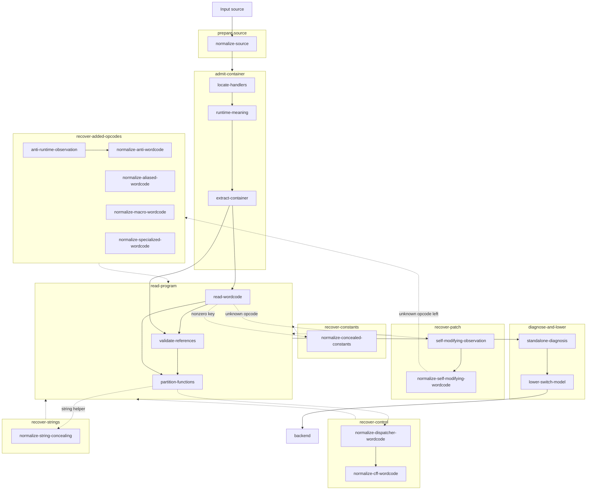
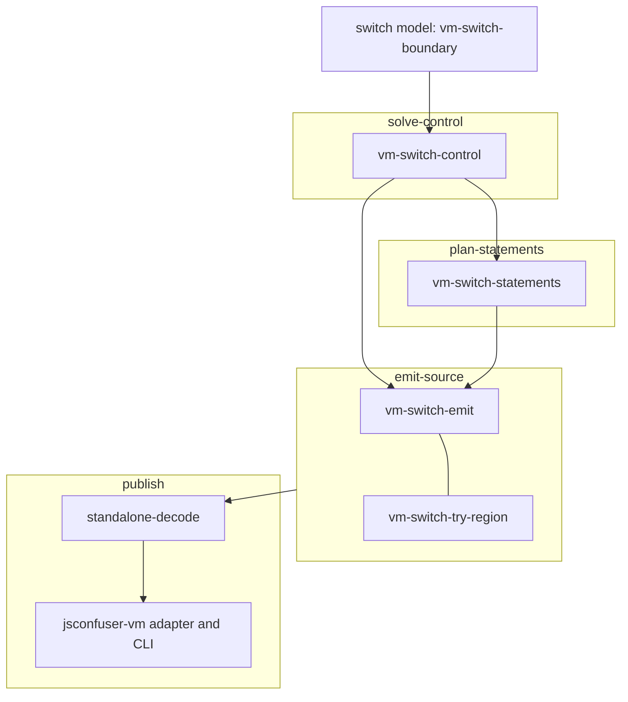

# jsconfuser-vm pipeline map

The structure of the `jsconfuser-vm` decoder and how it maps to the
[js-confuser-vm](../../js-confuser-vm/js-confuser-vm.md) encoder steps it reverses, laid out as
[decode-js's pipeline maps](../decode-js.md#pipeline-maps) require. The
[plugin doc](../plugins/jsconfuser-vm.md) owns the adapter and CLI contract; each component doc owns
its own mechanism.

## Layers, pipeline stages and components

The decoder has two layers. The frontend needs knowledge of the encoder: it admits the input,
undoes the encoder's steps that follow its compiler, and converts the compiled program into the
typed switch model. The backend reads only that model and needs no encoder knowledge: it recovers
readable source from it. The [VM switch boundary](../vm/switch/vm-switch-boundary.md) defines the model and
the test that decides which layer owns a step. Each layer runs pipeline stages in order; each stage contains components,
named by their transform doc's filename, which their source files and decline codes
(`wordcode-declined`, `references-declined`, ...) also name. A recovery stage runs only when its shape
is present
([retry schedule](../vm/jsconfuser-vm/standalone-diagnosis.md#canonical-frontend-retries));
each success rebuilds `read-program` from the changed words. Frontend stages analyze source without
executing the target or emitting the final program.
[`timing-checks`](../vm/jsconfuser-vm/timing-checks.md) belongs to no stage: no component
reads the timing scalar.

The frontend chart draws each pipeline stage as a box around its components. Solid arrows are
the path every input takes; dashed arrows are recoveries that run only when their shape is present,
each labeled with its trigger, and each returns to `read-program`. An arrow from a box means every
component inside reads that stage's records: every component after `read-program` reads its
instructions, references and functions. Arrows between
components show the other records each one reads; API/schema-only parameters are not drawn.

| Pipeline stage | Runs when | What it does |
|---|---|---|
| `prepare-source` | always | Normalizes the source spellings the readers need, on a private parse. |
| `admit-container` | always | Locates the payload by the boot skeleton and names every opcode by its handler's behaviour. |
| `read-program` | always; rebuilt after every recovery | Parses the words into instructions, checks constants and labels, and assigns instructions to functions. |
| `recover-patch` | `read-wordcode` reports an unknown or hardening opcode | Decrypts PATCH regions and removes headers, decoys and storage; later settles the suspects other stages recover labels for. |
| `recover-added-opcodes` | an unknown opcode remains after `recover-patch` | Proves each added opcode from its handler and rewrites it as canonical instructions, in the order aliases, macros, specialized, anti. |
| `recover-constants` | a constant reference has a nonzero key | Decrypts the referenced pool values and zeroes their keys. |
| `recover-control` | dispatcher: a JUMP_REG remains; CFF: every input, absent loops pass through | Restores direct branches from encoded seeds, then reads each state loop back into jumps and drops fake blocks. |
| `recover-strings` | the stream starts with the string helper prefix | Replaces each string decode site with a constant load and removes the helpers and their captures. |
| `diagnose-and-lower` | always | Gates opcode support, then lowers the instructions onto the typed switch model. |

The backend reads only the switch model the frontend lowered:

| Pipeline stage | Runs when | What it does |
|---|---|---|
| `solve-control` | every function, unless dispatch is forced for review | Decides from the typed cases which cases run, the handler stack each runs under, the edges and the indirect targets. |
| `plan-statements` | every function, unless dispatch is forced for review | Recovers loops, conditionals, switches and tries from the cases and the solver's edges. |
| `emit-source` | always | Removes adjacent copies and renders structured JavaScript, or dispatch for review. |
| `publish` | always | Gates residue and publishes the output or the exact input with a diagnostic. |

The charts draw data dependencies only. [Standalone diagnosis](../vm/jsconfuser-vm/standalone-diagnosis.md)
owns the schedule and the record contracts: its
[predecessor chain](../vm/jsconfuser-vm/standalone-diagnosis.md#predecessor-chain) gives
each component's function, inputs (including the API/schema-only ones the chart omits) and decline
code; the [retry schedule](../vm/jsconfuser-vm/standalone-diagnosis.md#canonical-frontend-retries)
and the [handoff model](../vm/jsconfuser-vm/standalone-diagnosis.md#handoff-model) say what
each consumer may assume. Only the backend renders JavaScript, and the [VM switch boundary](../vm/switch/vm-switch-boundary.md) is the handoff between the two
layers, drawn at the switch model, not inside a stage. A decline in any component stops the public path, and the adapter returns the exact input.

## Encoder steps each component undoes or reads

Rows follow the decoder's pipeline stages in order, frontend then backend. Each component lists the
encoder steps it undoes (removes what the step added) and those it reads (needs the step's output to
interpret the program), numbered as in the encoder's
[Compiler order](../../js-confuser-vm/js-confuser-vm.md#compiler-order). The recovery stages undo
the encoder's steps in reverse order
([P1](../../encoder-decoder-method.md#p1-work-in-reverse-encoder-stage-order-each-stage-placed-by-its-last-write)).
The frontend reads the lowering (step 2) and lowers it onto typed operations; the backend undoes it
in part, rebuilding statements and expressions from those operations. Nothing undoes register
resolution (11): the output keeps registers. Step 24's
disassembly comment carries no meaning and no component reads it; step 16's timing scalar affects
only the interpreter ([`timing-checks`](../vm/jsconfuser-vm/timing-checks.md)).

| Pipeline stage | Component | Undoes | Reads |
|---|---|---|---|
| `prepare-source` | [`normalize-source`](../vm/jsconfuser-vm/normalize-source.md) | - | 25 `applyMinify` |
| `admit-container` | [`locate-handlers`](../vm/jsconfuser-vm/locate-handlers.md) | - | 17 `applySpecializedOpcodes`, 18 `applyMacroOpcodes`, 19 `applyAliasedOpcodes`, 20 `applyAntiInstrumentation`, 21 `applyShuffleOpcodes`, 22 `applyHandlerTable`, 23 `applyClassObfuscation`, 25 `applyMinify` |
| `admit-container` | [`runtime-meaning`](../vm/jsconfuser-vm/runtime-meaning.md) | 1 `new Compiler(options)` (randomized opcode values) | - |
| `admit-container` | [`extract-container`](../vm/jsconfuser-vm/extract-container.md) | 16 `serializer.serialize` | 1 `new Compiler(options)`, 21 `applyShuffleOpcodes`, 22 `applyHandlerTable`, 23 `applyClassObfuscation`, 25 `applyMinify` |
| `read-program` | [`read-wordcode`](../vm/jsconfuser-vm/read-wordcode.md) | - | 2 `compiler.compile`, 6 `concealConstants`, 11 `resolveRegisters`, 13 `resolveLabels`, 14 `resolveConstants` |
| `read-program` | [`validate-references`](../vm/jsconfuser-vm/validate-references.md) | 13 `resolveLabels` | 2 `compiler.compile`, 14 `resolveConstants` |
| `read-program` | [`partition-functions`](../vm/jsconfuser-vm/partition-functions.md) | - | 2 `compiler.compile`, 13 `resolveLabels`; publishes 3 `stringConcealing`'s shared helper as a suspect |
| `recover-patch` | [`self-modifying-observation`](../vm/jsconfuser-vm/self-modifying-observation.md) | - | 12 `selfModifying`, 15 `encryptPatches` |
| `recover-patch` | [`normalize-self-modifying-wordcode`](../vm/jsconfuser-vm/normalize-self-modifying-wordcode.md) | 12 `selfModifying`, 15 `encryptPatches` | - |
| `recover-added-opcodes` | [`normalize-aliased-wordcode`](../vm/jsconfuser-vm/normalize-aliased-wordcode.md) | 10 `aliasedOpcodes` | 19 `applyAliasedOpcodes` |
| `recover-added-opcodes` | [`normalize-macro-wordcode`](../vm/jsconfuser-vm/normalize-macro-wordcode.md) | 9 `macroOpcodes` | 18 `applyMacroOpcodes` |
| `recover-added-opcodes` | [`normalize-specialized-wordcode`](../vm/jsconfuser-vm/normalize-specialized-wordcode.md) | 8 `specializedOpcodes` | 17 `applySpecializedOpcodes` |
| `recover-added-opcodes` | [`anti-runtime-observation`](../vm/jsconfuser-vm/anti-runtime-observation.md) | - | 7 `antiInstrumentation`, 20 `applyAntiInstrumentation` |
| `recover-added-opcodes` | [`normalize-anti-wordcode`](../vm/jsconfuser-vm/normalize-anti-wordcode.md) | 7 `antiInstrumentation` | 20 `applyAntiInstrumentation` |
| `recover-constants` | [`normalize-concealed-constants`](../vm/jsconfuser-vm/normalize-concealed-constants.md) | 6 `concealConstants`, 14 `resolveConstants` (nonzero keys) | - |
| `recover-control` | [`normalize-dispatcher-wordcode`](../vm/jsconfuser-vm/normalize-dispatcher-wordcode.md) | 5 `dispatcher` | - |
| `recover-control` | [`normalize-cff-wordcode`](../vm/jsconfuser-vm/normalize-cff-wordcode.md) | 4 `controlFlowFlattening` | - |
| `recover-strings` | [`normalize-string-concealing`](../vm/jsconfuser-vm/normalize-string-concealing.md) | 3 `stringConcealing` | - |
| `diagnose-and-lower` | [`lower-switch-model`](../vm/jsconfuser-vm/lower-switch-model.md) | - | 2 `compiler.compile` |
| `solve-control` | [`vm-switch-control`](../vm/switch/vm-switch-control.md) | - | 2 `compiler.compile` |
| `plan-statements` | [`vm-switch-statements`](../vm/switch/vm-switch-statements.md) | 2 `compiler.compile` in part: loops, conditionals and switches from the lowered jumps | - |
| `emit-source` | [`vm-switch-emit`](../vm/switch/vm-switch-emit.md) | 2 `compiler.compile` in part: expressions, calls, closures and captures from the typed operations; adjacent register copies | 11 `resolveRegisters` |
| `emit-source` | [`vm-switch-try-region`](../vm/switch/vm-switch-try-region.md) | 2 `compiler.compile` in part: try statements from the setups, pops, continuation writes and finalizer resume | - |
| `publish` | [`standalone-decode`](../vm/jsconfuser-vm/standalone-decode.md) | - | - |

## Reversibility by encoder step

One row per step of the encoder's [Compiler order](../../js-confuser-vm/js-confuser-vm.md#compiler-order).
`reversible`: the decoder restores what the step changed, through the named component.
`discarded`: the step changes only the interpreter or decoration, which the decoder drops instead of
inverting: the backend renders fresh JavaScript from the switch model, and `standalone-decode`'s
residue scan refuses any surviving runtime. `irreversible`: the step loses information no decoder
can restore. Which populations have been shown to recover is evidence, kept in the
[suites](../tests.md#suites); this table states only what each step permits.

| # | Encoder step | Reversal | How, or what is lost |
|---|---|---|---|
| 1 | `new Compiler(options)` | reversible | randomized opcode values are named by handler behaviour (`runtime-meaning`); decoy frame slots are discarded with the interpreter |
| 2 | `compiler.compile` | irreversible in part | `vm-switch-statements`, `vm-switch-emit` and `vm-switch-try-region` recover control flow, expressions, calls, closures and exceptions as equivalent JavaScript; original names, lexical scopes and statement spellings are lost ([source emission](../vm/switch/vm-switch-emit.md#1-target)) |
| 3 | `stringConcealing` | reversible | `normalize-string-concealing` |
| 4 | `controlFlowFlattening` | reversible | `normalize-cff-wordcode`; fake blocks are removed and statements are rebuilt from the graph, not the shuffled layout |
| 5 | `dispatcher` | reversible | `normalize-dispatcher-wordcode` |
| 6 | `concealConstants` | reversible | `normalize-concealed-constants` |
| 7 | `antiInstrumentation` | reversible | `normalize-anti-wordcode` keeps the one real step |
| 8 | `specializedOpcodes` | reversible | `normalize-specialized-wordcode` |
| 9 | `macroOpcodes` | reversible | `normalize-macro-wordcode` |
| 10 | `aliasedOpcodes` | reversible | `normalize-aliased-wordcode` |
| 11 | `resolveRegisters` | irreversible | slots are reused once a value's live range ends, so one register can hold several source variables; the output keeps registers |
| 12 | `selfModifying` | reversible | `normalize-self-modifying-wordcode` removes headers, decoys and storage |
| 13 | `resolveLabels` | reversible | `validate-references` re-derives each direct target as a label from its address; only label names are lost |
| 14 | `resolveConstants` | reversible | pool indexes resolve to values; nonzero keys through `normalize-concealed-constants` |
| 15 | `encryptPatches` | reversible | `self-modifying-observation` decrypts with the key the code carries; `normalize-self-modifying-wordcode` installs the plaintext |
| 16 | `serializer.serialize` | reversible | `extract-container` decodes the transport; the timing scalar and runtime template are discarded with the interpreter |
| 17 | `applySpecializedOpcodes` | discarded | the handlers are read to prove step 8, then dropped with the interpreter |
| 18 | `applyMacroOpcodes` | discarded | read to prove step 9, then dropped |
| 19 | `applyAliasedOpcodes` | discarded | read to prove step 10, then dropped |
| 20 | `applyAntiInstrumentation` | discarded | read to prove step 7, then dropped |
| 21 | `applyShuffleOpcodes` | discarded | interpreter only; read through by `locate-handlers` |
| 22 | `applyHandlerTable` | discarded | interpreter only; read through by `locate-handlers` |
| 23 | `applyClassObfuscation` | discarded | interpreter only; read through by `locate-handlers` and `extract-container` |
| 24 | `generate`, comment prefix | discarded | the comment carries no meaning |
| 25 | `applyMinify` | discarded | interpreter only; read through after `normalize-source` |
