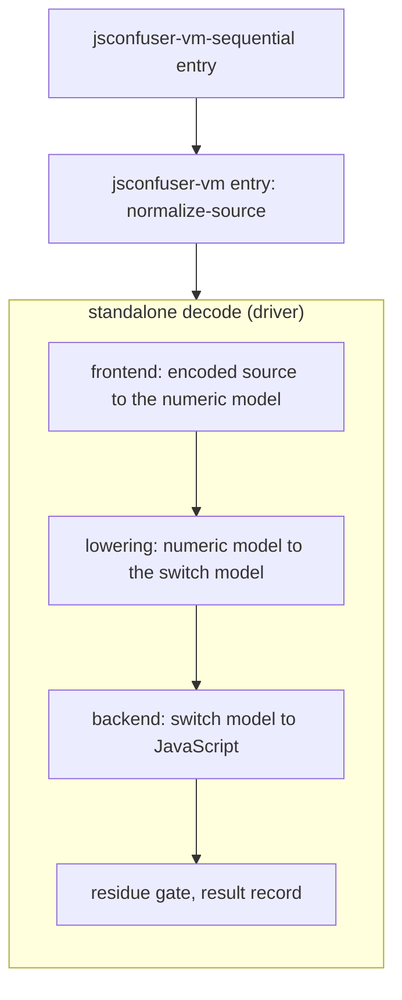
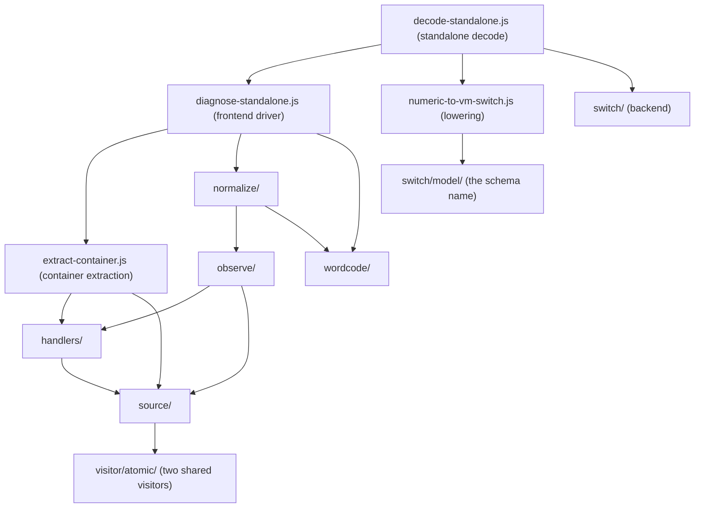
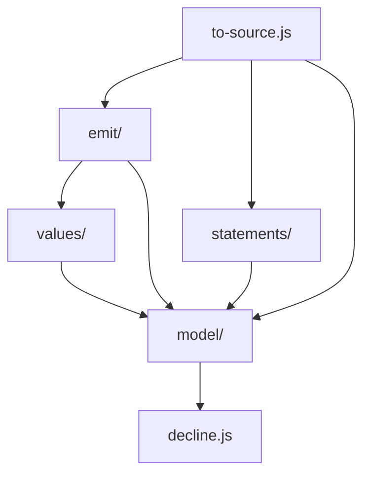
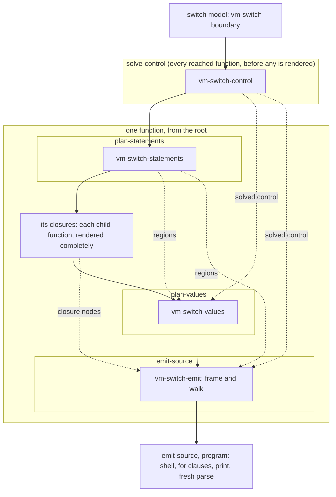

# jsconfuser-vm pipeline map

The architecture of the `jsconfuser-vm` decoder, how it maps to the
[js-confuser-vm](../../js-confuser-vm/js-confuser-vm.md) encoder steps it reverses, and the index
of its docs, laid out as the hub's
[Pipeline Map Layout](../../doc-conventions.md#pipeline-map-layout) requires. This map owns what
holds across docs: the layers, the code layout, the order the drivers run, the records that cross
docs and the refusal protocol. Each module and transform doc owns its own mechanism.

## Target

The encoder compiles a JavaScript program to numeric code for a register machine and ships that
code with an interpreter. The decoder takes that shipped source, reads the numeric code out of it
without running anything, and writes the compiled program again as JavaScript: functions,
statements and expressions, with registers as variables. The output shares the input's behaviour
and holds nothing of the interpreter.

A decode is all or nothing. A step that cannot recover its input refuses, and the entry then
returns the input unchanged with a diagnostic
([F1](../../decoding-method/rules.md#f1)). What the encoding
loses for good (names, lexical scopes, register reuse) is listed under
[Reversibility](#reversibility-by-encoder-step).

Two entries reach the decoder, each returning a record:

| Entry | Decodes | Doc |
|---|---|---|
| `-t jsconfuser-vm` | the encoder's output | [plugin](../plugins/jsconfuser-vm.md) |
| `-t jsconfuser-vm-sequential` | that output under a js-confuser outer layer: the outer decode, then the entry above, then a post-stage of two shared visitors | [plugin](../plugins/jsconfuser-vm-sequential.md) |

## Layers



The decoder has two layers with one model between them.

- **Frontend** (`src/vm/jsconfuser-vm/`). It knows the encoder: the interpreter's source, its
  opcodes and every option. It finds the payload and the handlers, names each opcode by what its
  handler does, reads the words into instructions and functions, and undoes the encoder's options
  one by one until the instructions are those the compiler wrote. Its output is the numeric model.
- **The model.** The lowering turns each instruction into a typed operation. The result, the VM
  switch model, is the only thing the backend reads; the
  [VM switch boundary](../vm/switch/vm-switch-boundary.md) defines it and the test that decides
  which layer owns a step.
- **Backend** (`src/vm/switch/`). It knows only the model, and imports nothing from the frontend.
  It solves the control of every reached function, then renders each function from the root
  (statements planned, its closures rendered, values planned, the walk) into one Babel tree it
  prints once.

Three drivers run them. The standalone decode calls the frontend, the lowering and the backend in
that order, checks the printed program for interpreter residue and builds the result record
([`standalone-decode`](../vm/jsconfuser-vm/standalone-decode.md)). The frontend driver decides
which recoveries run ([Frontend order](#frontend-order)); the backend driver renders the functions
and assembles the program ([Backend order](#backend-order)). Only the backend writes JavaScript,
and nothing executes the target.

## Code layout

The code is grouped in modules, each with one thing to read and its own folder, and the docs
follow it: a **module doc** covers a module several transforms use, and a **transform doc** covers
one pipeline item and cites the modules it uses. The tables below map the hub's names to the
code's and name every file of `src/vm` once. Every later section uses these doc names and function
names.

### Modules

File paths are relative to the module's folder.

| Module | Reads and provides | Sub-docs | Files | Called through |
|---|---|---|---|---|
| [`source`](../vm/jsconfuser-vm/source.md) (`jsconfuser-vm/source/`) | The input and the interpreter's source text: the input normalization, the container's roles, the boot payload, the encoded transport, a minified runtime, the opcode table | [`normalize-source`](../vm/jsconfuser-vm/source/normalize-source.md) (stage `prepare-source`) | `normalize-source.js` | `normalizeVmInput`; the statement view `simpleControlBody`, `isControlBodyKey` |
| | | [`container`](../vm/jsconfuser-vm/source/container.md) | `locate-boot-payload.js`, `container-role-helpers.js`, `materialize-encoded-bytecode.js`, `minified-runtime-container.js`, `opcode-table.js` | `locateBootPayload`, `locateBootSkeleton`; `createOpcodeTable`, `CANONICAL_OPCODES`; `runtimeAst` |
| [`handlers`](../vm/jsconfuser-vm/handlers.md) (`jsconfuser-vm/handlers/`) | Each opcode's handler, found in the interpreter and named by what it does | [`locate-handlers`](../vm/jsconfuser-vm/handlers/locate-handlers.md) | `locate-handlers.js`, `handler-table.js`, `handler-calls.js`, `handler-lowering.js`, `normalize-handler-statements.js`, `runtime-callables.js`, `runtime-fragment-pattern.js` | `locateHandlers`, `requireHandlers`, `partitionHandlers` |
| | | [`identify-handlers`](../vm/jsconfuser-vm/handlers/identify-handlers.md) | `identify-handlers.js`, `handler-meaning.js`, `handler-effects.js`, `handler-matchers.js` | `behaviourTable`, `requireIdentifiedHandlers` |
| [`wordcode`](../vm/jsconfuser-vm/wordcode.md) (`jsconfuser-vm/wordcode/`) | The word stream and its records | [`read-wordcode`](../vm/jsconfuser-vm/wordcode/read-wordcode.md) | `read-wordcode.js`, `wordcode-instructions.js`, `wordcode-operands.js`, `wordcode-index.js` | `readWordcode`, `diagnoseWordcode`; the added-opcode stream readers `diagnoseAliasedWordStream`, `diagnoseMacroWordStream`, `diagnoseSpecializedWordStream`, `diagnoseAntiWordStream`; `LABEL_WORD_OFFSETS` |
| | | [`validate-references`](../vm/jsconfuser-vm/wordcode/validate-references.md) | `validate-references.js` | `validateReferences`, `diagnoseReferences` |
| | | [`partition-functions`](../vm/jsconfuser-vm/wordcode/partition-functions.md) | `partition-functions.js` | `diagnoseFunctionPartition`, `functionIndexAt` |
| | | [`origin-addresses`](../vm/jsconfuser-vm/wordcode/origin-addresses.md) | `expand-observed-word-stream.js`, `finally-continuations.js` | `expandObservedWordStream`, `composePcMaps`, `selectContinuationLoads` |
| [`observe`](../vm/jsconfuser-vm/observe.md) (`jsconfuser-vm/observe/`) | The runtime read against the named handlers, never the word stream: each added-opcode option's handler bodies, and all four at once for a PATCH-decoded stream | none | `observe-aliased-runtime.js`, `observe-macro-runtime.js`, `observe-specialized-runtime.js`, `observe-anti-runtime.js`, `observe-patch-added-opcodes.js` | `diagnoseAliasedRuntime`, `diagnoseMacroRuntime`, `diagnoseSpecializedRuntime`, `diagnoseAntiRuntime`, `diagnosePatchAddedOpcodes` |
| [`model`](../vm/switch/vm-switch-boundary.md) (`switch/model/`) | The switch model: its schema and refusal, the operation helpers (reads, writes, constants as nodes), and the control solve every backend transform reads | [`vm-switch-boundary`](../vm/switch/vm-switch-boundary.md) (the head doc) | `model.js`, `operations.js` | `VM_SWITCH_SCHEMA`, the `vm-switch` refusal |
| | | [`vm-switch-control`](../vm/switch/vm-switch-control.md) (stage `solve-control`) | `control.js` | `solveControl` |

The refusal protocol `src/vm/decline.js` (`declines`, [Refusals](#refusals)) belongs to no module
and is used by all of them.

### Transforms

In pipeline order. Frontend paths are relative to `jsconfuser-vm/normalize/`, backend paths to
`switch/`.

| Pipeline stage | Transform | Files | Modules used | Called through |
|---|---|---|---|---|
| `recover-patch` | [`normalize-self-modifying-wordcode`](../vm/jsconfuser-vm/normalize-self-modifying-wordcode.md) | `normalize-self-modifying-wordcode.js`, `analyze-self-modifying-regions.js` | `observe`, `wordcode` | `diagnoseNormalizeSelfModifyingWordcode`, `diagnoseSettleSelfModifyingSuspects`; `diagnoseSelfModifyingRegions` |
| `recover-added-opcodes` | [`normalize-aliased-wordcode`](../vm/jsconfuser-vm/normalize-aliased-wordcode.md) | `normalize-aliased-wordcode.js` | `observe`, `wordcode` | `diagnoseNormalizeAliasedWordcode` |
| `recover-added-opcodes` | [`normalize-macro-wordcode`](../vm/jsconfuser-vm/normalize-macro-wordcode.md) | `normalize-macro-wordcode.js` | `observe`, `wordcode` | `diagnoseNormalizeMacroWordcode` |
| `recover-added-opcodes` | [`normalize-specialized-wordcode`](../vm/jsconfuser-vm/normalize-specialized-wordcode.md) | `normalize-specialized-wordcode.js` | `observe`, `wordcode` | `diagnoseNormalizeSpecializedWordcode`, `diagnoseNormalizeAntiSpecializedWordcode`, `normalizeExpandedSpecializedDispatcher` (the tail) |
| `recover-added-opcodes` | [`normalize-anti-wordcode`](../vm/jsconfuser-vm/normalize-anti-wordcode.md) | `normalize-anti-wordcode.js`, `analyze-anti-register-flow.js` | `observe`, `wordcode` | `diagnoseNormalizeAntiWordcode` |
| `recover-constants` | [`normalize-concealed-constants`](../vm/jsconfuser-vm/normalize-concealed-constants.md) | `normalize-concealed-constants.js` | `wordcode` | `diagnoseNormalizeConcealedConstants`, `hasConcealedConstant` |
| `recover-control` | [`normalize-dispatcher-wordcode`](../vm/jsconfuser-vm/normalize-dispatcher-wordcode.md) | `normalize-dispatcher-wordcode.js`, `analyze-dispatcher-wordcode.js`, `evaluate-decode-closure.js` | `wordcode` | `diagnoseNormalizeDispatcherWordcode` |
| `recover-control` | [`normalize-cff-wordcode`](../vm/jsconfuser-vm/normalize-cff-wordcode.md) | `normalize-cff-wordcode.js`, `cff-state-loop.js` | `wordcode` | `diagnoseNormalizeCffWordcode` |
| `recover-strings` | [`normalize-string-concealing`](../vm/jsconfuser-vm/normalize-string-concealing.md) | `normalize-string-concealing.js`, `string-concealing-helper-trace.js`, `string-concealing-helper-signatures.js` | `wordcode` | `diagnoseNormalizeStringConcealing` |
| none; the model boundary | [`lower-switch-model`](../vm/jsconfuser-vm/lower-switch-model.md) | `jsconfuser-vm/numeric-to-vm-switch.js` | `model` (the schema name) | `numericToVmSwitch` |
| `plan-statements` | [`vm-switch-statements`](../vm/switch/vm-switch-statements.md) | `statements/plan-statements.js`, `statement-regions.js`, `loop-ends.js`, `try-ends.js`, `switches.js`, `conditionals.js`, `graph.js` | `model` | `planStatements` |
| `plan-values` | [`vm-switch-values`](../vm/switch/vm-switch-values.md) | `values/value-planning.js`, `case-flow.js`, `object-literals.js`, `copy-simplification.js`, `single-use-folding.js`, `conditional-values.js` | `model` | `effectiveStructuredInstructions` |
| `emit-source`; the backend driver | [`vm-switch-emit`](../vm/switch/vm-switch-emit.md) | `to-source.js`; `emit/structured-emitter.js`, `emit-state.js`, `run-walk.js`, `render.js`, `conditional-region.js`, `switch-region.js`, `loop-region.js`, `try-region.js`; `scripts/render-vm-switch.mjs` | `model` | `emitVmSwitchProgram`; `emitStructuredFunction` |

The stages `admit-container`, `read-program` and `build-model` have no transform: they build
records through the `source`, `handlers` and `wordcode` modules, called by the frontend driver.
[`timing-checks`](../vm/jsconfuser-vm/timing-checks.md) is a transform doc with no code: nothing reads the timing
scalar.

### Entries and drivers

| Doc | Files | Called through |
|---|---|---|
| [plugin](../plugins/jsconfuser-vm.md) | `src/plugin/jsconfuser-vm.js` | `decodeJsconfuserVm` |
| [sequential plugin](../plugins/jsconfuser-vm-sequential.md) | `src/plugin/jsconfuser-vm-sequential.js` | `decodeJsconfuserVmSequential` |
| [`standalone-decode`](../vm/jsconfuser-vm/standalone-decode.md) | `jsconfuser-vm/decode-standalone.js` | `diagnoseStandalone` |
| [`frontend-driver`](../vm/jsconfuser-vm/frontend-driver.md) | `jsconfuser-vm/diagnose-standalone.js`, `standalone-contract.js`, `extract-container.js` | `diagnoseStandaloneInput` (class `Frontend`); `extractContainer`, `diagnoseContainer` |

The backend driver is `to-source.js`, in `vm-switch-emit` above.

### Imports

The modules depend in one direction. A transform reaches into `observe/` only for a runtime fact
and does its word-level work in `normalize/`; the container extraction is a top-level file over
`source/` and `handlers/`, because it composes both.

Three rules hold over all of `src`, checked by `npm run lint` (decode-js's `CONTRIBUTING.md`,
Dependencies):

- No file imports, directly or through others, a file that imports it; no module imports a module
  that imports it (`scripts/check-folder-cycles.mjs`).
- A file never hands a function to a file it imports, as an argument, a stored field or a
  method. Where a callee would need to call back, the caller computes the result first and hands it
  over as data: each closure's function is rendered before the function holding it, and each
  conditional value before its walk.
- A step two files need (the refusal handler, a renderer, a lowering) is its own file, imported
  by whichever file runs it.

The frontend's imports, each arrow pointing at what is imported. The top level is drawn as its
four files, because they differ: only the standalone decode and the lowering reach the backend,
and the frontend driver and everything under it import nothing from `switch/`. `observe/` and
`handlers/` read the runtime only and import nothing from `wordcode/`; `wordcode/` imports no
other folder.



Every file and module here but `handlers/` and the lowering also imports `decline.js`, the
driver and the standalone decode through `standalone-contract.js`; those arrows are not drawn.
`source/normalize-source.js` composes two shared visitors from `src/visitor/atomic/`, the VM
decoder's only import from outside `src/vm`.

The backend's imports:



## Frontend order

The driver is the `Frontend` class of `diagnose-standalone.js`
([`frontend-driver`](../vm/jsconfuser-vm/frontend-driver.md)). It holds the current
records and calls one method per stage, each of which first tests whether its shape is present.
The calls, in order (explanatory pseudocode, the names are the code's):

```text
decodeJsconfuserVm(source)                       the plugin
  normalizeVmInput(source)                       prepare-source
  diagnoseStandalone(source)                     the standalone decode
    diagnoseStandaloneInput -> reconstruct       the frontend driver
      new Frontend(source)
        extractContainer(source)                 admit-container
          locateBootPayload(ast)                   the payload by the boot skeleton
          locateHandlers(ast)                      the interpreter's handlers; if they are not
                                                   found, the container above stands as it is
          behaviourTable(view)                     every opcode named by its handler's behaviour
          locateBootPayload(ast, table)            the container, read with that opcode table
        readWordcode(container)                  read-program, first part; null if it refuses
      recoverPatch()                             recover-patch, if the read refused
        diagnosePatchAddedOpcodes(source)          the added opcodes the regions may hold
        diagnoseSelfModifyingRegions(...)          the PATCH regions
        compact, then diagnoseWordcode             the words without them, read again
      recoverAddedOpcodes()                      recover-added-opcodes, if the read still refuses
        the first route that recovers the stream   (routes below)
        settle()
      recoverConstants()                         recover-constants, if a key is nonzero
      readProgram()                              read-program, the rest
        validateReferences, diagnoseFunctionPartition   only the records that are missing
      recoverDispatcher()                        recover-control, if a JUMP_REG remains
        settle(), then readProgram() if the words changed
      recoverCff()                               recover-control, always
      recoverStrings()                           recover-strings, if the helper prefix is there
      model()                                    build-model: the gate, the numeric model
```

The chart draws the same order. Solid arrows are the path every input takes; a dashed arrow
leaves the path for a recovery that runs only when its trigger holds, and comes back to it.

```mermaid
flowchart TD
    S["Input source"] --> NS
    subgraph PS["prepare-source"]
        NS["normalize-source"]
    end
    subgraph AC["admit-container: extractContainer"]
        EC1["container: payload by the boot skeleton"]
        LH["locate-handlers"]
        RM["identify-handlers: behaviourTable"]
        EC2["container: with the opcode table"]
        EC1 --> LH --> RM --> EC2
    end
    NS --> EC1
    subgraph RP1["read-program, first part"]
        RW["read-wordcode"]
    end
    EC2 --> RW
    subgraph RPA["recover-patch"]
        SMO["normalize-self-modifying-wordcode: regions read"] --> NSM["normalize-self-modifying-wordcode: stream rewritten"]
    end
    subgraph RAO["recover-added-opcodes: the first route that recovers"]
        RT["aliased, macro, specialized, anti routes"]
    end
    subgraph RC["recover-constants"]
        NCC["normalize-concealed-constants"]
    end
    subgraph RP2["read-program, the rest"]
        VR["validate-references"] --> PF["partition-functions"]
    end
    subgraph RCT["recover-control"]
        NDW["normalize-dispatcher-wordcode"]
        NCF["normalize-cff-wordcode"]
    end
    subgraph RS["recover-strings"]
        NSC["normalize-string-concealing"]
    end
    subgraph BM["build-model"]
        SDG["frontend-driver: the gate"]
    end
    RW --> T1{"words read?"}
    T1 -. "no: unknown or hardening opcode" .-> SMO
    NSM -. "still an unknown opcode" .-> RT
    T1 -. "no: unknown opcode" .-> RT
    NSM -.-> T2
    RT -.-> T2
    T1 --> T2{"nonzero key?"}
    T2 -. "yes" .-> NCC
    NCC -.-> VR
    T2 --> VR
    PF --> T3{"JUMP_REG?"}
    T3 -. "yes" .-> NDW
    NDW -.-> NCF
    T3 --> NCF
    NCF --> T4{"string helper prefix?"}
    T4 -. "yes" .-> NSC
    NSC -.-> SDG
    T4 --> SDG
    SDG --> NM["numeric model"]
```



The added-opcode routes are not four separate recoveries: the encoder allocates added opcodes in
the order anti, specialized, macro, alias, and a runtime may hold several families at once. Each
route observes the families its runtime holds, expands the outermost, and hands the stream inward.

| Route, in the order tried | Observes | Rewrites | Then |
|---|---|---|---|
| aliased | the aliased runtime | each alias as the opcode it stands for; PCs unchanged | ends |
| aliased with an observed prefix | anti, specialized and macro runtimes where present, then the aliased runtime | the aliases, then the prefix's opcodes expanded | the anti normalizer if anti is present, else the tail |
| macro | anti and specialized runtimes where present, then the macro runtime | macros expanded | the anti normalizer if anti is present, else the tail |
| specialized | the specialized runtime | specialized opcodes expanded | the tail |
| specialized beside anti | the anti and specialized runtimes | specialized opcodes expanded | the anti normalizer |
| anti | the anti runtime | (the anti normalizer itself) | - |

- **The anti normalizer** (`diagnoseNormalizeAntiWordcode`) reads the register flow and keeps each
  instruction's one real step. Its analysis restores concealed constants first, and where the
  compacted stream still needs it, it runs the dispatcher normalizer on its own output.
- **The tail** (`normalizeExpandedSpecializedDispatcher`) reads the expanded words; if a
  `JUMP_REG` remains it restores concealed constants, builds references and functions, and runs
  the dispatcher normalizer.

So after a route, constants and the dispatcher may already be undone, and the driver's later
`recover-constants` and `recover-control` find no trigger. Every rewriter (constants, dispatcher,
CFF, strings) also reads its own output back through `read-wordcode`, and the last three through
`validate-references` and `partition-functions`, which is how the driver receives rebuilt records.

Stages in the order the driver calls them. `prepare-source` runs in the plugin, before the driver.

| Pipeline stage | Driver function | Runs when | What it does | When it cannot |
|---|---|---|---|---|
| `prepare-source` | `normalizeVmInput` (plugin) | always | Normalizes the source spellings the readers need, on a private parse. | unparseable input passes on unchanged |
| `admit-container` | constructor: `extractContainer` | always | Locates the payload by the boot skeleton and names every opcode by its handler's behaviour. | `container-declined` |
| `read-program`, first part | constructor: `readWordcode` | always | Parses the words into instructions. | no record yet: its refusal code is the trigger of the next two stages |
| `recover-patch` | `recoverPatch` | `read-wordcode` refuses with an unknown or hardening opcode | Decrypts PATCH regions and removes headers, decoys and storage; fillers it cannot decide stay as suspects. | carries on, words unread |
| `recover-added-opcodes` | `recoverAddedOpcodes` | `read-wordcode` still refuses with an unknown opcode | Proves each added opcode from its handler and rewrites it as canonical instructions. Routes are tried in order until one recovers the stream: aliased, aliased with an observed prefix, macro, specialized, specialized beside anti, anti. | the next route; after the last, carries on, words unread |
| `recover-constants` | `recoverConstants` | a constant reference has a nonzero key | Decrypts the referenced pool values and zeroes their keys. | `wordcode-declined` if the words are still unread; `concealed-constants-declined` |
| `read-program`, rest | `readProgram` | whichever record is missing | Checks constants and labels, and assigns instructions to functions; a closure entry with several parents is published as a suspect. | `references-declined`, `functions-declined` |
| `recover-control`, dispatcher | `recoverDispatcher` | a `JUMP_REG` remains | Restores direct branches from encoded seeds. | carries on with the indirect jumps |
| `recover-control`, CFF | `recoverCff` | every input | Reads each state loop back into jumps and drops fake blocks; an input with no state loop passes through. | the refusing record builder's code, or `cff-declined` |
| `recover-strings` | `recoverStrings` | the stream opens with the string helper prefix | Replaces each string decode site with a constant load and removes the helpers and their captures. | `string-concealing-declined` |
| `build-model` | `model` | always | Gates the result and builds the numeric model: instructions grouped by function, the constant pool, the functions record. | `functions-declined` while a shared-parent suspect is left; `unsupported-opcode` |

What the chart does not show:

- **Adoption.** A recovery returns records the driver adopts in one of two ways. A route (PATCH
  removal, added-opcode expansion) publishes its output with origin PCs; a rewrite (constants,
  dispatcher, CFF, strings) publishes its own PC map when it moves code, which the driver
  composes onto the origin map. A rewrite also returns the `read-program` records it rebuilt on its own output;
  `readProgram` builds whichever is missing.
- **Addresses.** Every address the encoder wrote is an origin PC, valid in the stream the encoder
  resolved its labels on. Each stage that moves code publishes where each PC went, and a later
  stage reading an encoder-written address resolves it through the composed map
  ([`origin-addresses`](../vm/jsconfuser-vm/wordcode/origin-addresses.md)).
- **Suspects.** An addition whose deciding fact only a later stage can read stays in place as a
  suspect ([P5](../../decoding-method/with-encoder.md#p5)).
  PATCH fillers undecided while a dispatcher hides labels are settled once a later stage has
  recovered those labels; a shared string helper's entry is remapped by the dispatcher and CFF
  and removed by `recover-strings`.
- [`timing-checks`](../vm/jsconfuser-vm/timing-checks.md) belongs to no stage: nothing reads
  the timing scalar.

## Model boundary

The frontend ends at the numeric model: the functions record, each function's instructions in PC
order, the constant pool and the wordcode. The standalone decode hands it to the lowering,
`numericToVmSwitch` ([`lower-switch-model`](../vm/jsconfuser-vm/lower-switch-model.md)), which
writes one typed operation per instruction (the gate in `build-model` has already refused any
opcode without a lowering) and records, on each catch setup, where the compiler closed the try.

The result is the VM switch model, schema `decode-js-vm-switch.v1`: per function a list of cases
`{ pc, nextPc, operation }`, and the storage (a register machine, with each function's register
and capture counts). The [VM switch boundary](../vm/switch/vm-switch-boundary.md) owns the
operation grammar and the ownership test: what needs the encoder's facts is the frontend's; what
the typed operations alone decide is the backend's.

## Backend order

The driver is `emitVmSwitchProgram` in `to-source.js`
([`vm-switch-emit`](../vm/switch/vm-switch-emit.md)). It works at two levels: the program, and
each function inside it. The calls, in order (explanatory pseudocode, the names are the code's):

```text
emitVmSwitchProgram(model)
  reachableFunctions(model)                  solve-control, for the whole program first:
    solveControl(function, cases)              the root, then each function a reachable closure
                                               creates; a function nothing reaches is not solved
  render(root)                               one function; recursive
    planStatements(function, cases, solved)    plan-statements                  -> regions
    render(child) per reachable closure site   the children, each completely    -> closures
    emitStructuredFunction(frame, cases, function, regions, solved)
      effectiveStructuredInstructions(...)     plan-values                      -> effective
      EmitState, StructuredFunctionEmitter     emit-source: the for-in heads are planned and the
                                               conditional values written before the walk
      functionHead(...)                        the frame: registers and arguments of emitted cases
      emit(startPc)                            the walk; every reachable case written once
  program shell                              an IIFE: the enumeration helper if a setup needs it,
                                             the root function, the root call
  writeForClauses(tree)                      `init; while (test) { …; update }` into `for`
  generate(tree)                             the program text, printed once
  parseEmittedJavaScript(output)             a fresh parse as a check
```

The chart draws the same order by stage. Solid arrows are calls in order; dashed arrows are the
records a stage reads from an earlier one.



| Pipeline stage | Function | Called by | Runs | What it does |
|---|---|---|---|---|
| `solve-control` | `solveControl` | the driver (`reachableFunctions`) | once per function reached from the root through a reachable closure, all before rendering | Decides from the typed cases which cases run, the handler stack each runs under, the edges, the indirect targets and the reaching definitions. |
| `plan-statements` | `planStatements` | the driver (`render`) | first step of a function's rendering | Finds where each statement opens and closes: loops, switches, conditionals, tries and labeled blocks, as region rows. |
| `plan-values` | `effectiveStructuredInstructions` | `emitStructuredFunction`, in `emit/` | after the function's closures are rendered, before its walk | Decides which values become expressions: literal reads, dead definitions, object literals, register copies, single-use folds, conditional values. |
| `emit-source`, function | `emitStructuredFunction` | the driver (`render`) | last step of a function's rendering | Plans the for-in heads, writes the conditional values, sets up the frame, then walks the regions and writes each reachable case once, as Babel nodes. |
| `emit-source`, program | the rest of `emitVmSwitchProgram` | the driver | once, after the root is rendered | Wraps the root in the program shell, writes `for` clauses, prints the tree and parses the printout as a check. |

What the chart does not show:

- **Why the children come between the two plans.** A function is written where a closure creates
  it, so its renderer needs each closure site's function as a finished node. The driver renders
  them after the statements are planned and hands them over in the frame; value planning and the
  walk run only then. A function only unreachable code creates is never rendered.
- **Value planning is not a driver call.** `to-source.js` imports `model/`, `statements/` and
  `emit/`; `values/` is imported by `emit/` alone, and its result goes to the emitter directly.
- **The review rendering.** With `{ dispatch: true }` the driver solves and plans nothing: every
  function, reachable or not, is written as a PC dispatch loop over all its cases. Only
  `scripts/render-vm-switch.mjs` asks for it; it is never a decode result.

## Records

One row per record that crosses from one doc's code to another's. The producer's doc owns the shape.

| Record | Producer | Consumers |
|---|---|---|
| container (`jsconfuser-vm-container.v1`) | `container` | every frontend stage |
| wordcode | `read-wordcode` | every frontend stage |
| references | `validate-references` | `partition-functions`, `normalize-string-concealing`, `build-model` |
| functions | `partition-functions` | every later frontend stage, the lowering, the backend |
| stage result (the records above as rewritten, with a PC map or origin PC map, suspects, recovered labels) | each `normalize-*` transform | the frontend driver |
| numeric model | `frontend-driver` | `lower-switch-model` |
| VM switch model (`decode-js-vm-switch.v1`) | `lower-switch-model` | the backend |
| solved control | `vm-switch-control` | `vm-switch-statements`, `vm-switch-values`, `vm-switch-emit` |
| statement regions | `vm-switch-statements` | `vm-switch-values`, `vm-switch-emit`; published as the result's `statements` |
| effective instructions | `vm-switch-values` | `vm-switch-emit`; its proofs are published as the result's `simplification` |
| standalone result (`jsconfuser-vm-standalone.v3`) | `standalone-decode` | the plugin, tests |
| adapter record (`jsconfuser-vm-adapter.v1`) | [plugin](../plugins/jsconfuser-vm.md) | the sequential plugin, the CLI |
| sequential record (`jsconfuser-vm-sequential.v1`) | [sequential plugin](../plugins/jsconfuser-vm-sequential.md) | the CLI |

## Refusals

All code of both layers refuses through `src/vm/decline.js`.

```text
declines(owner)  ->  decline(code, message)   throw a refusal tagged with this owner
                     requireValue(value, …)   decline unless the value is there
                     accepted(result)         a run's record   { ok: true,  result, diagnostic: null }
                     refused(error, …)        a run's record   { ok: false, result: null, diagnostic }
                     unwrap(record)           read another owner's record; its refusal becomes
                                              this owner's, code and message kept
```

- **A refusal is thrown, a record is returned.** Inside a module or transform a refusal is an
  exception tagged with its owner. Its boundary function (`diagnose<Name>`) turns the run
  into a record: its own owners' refusals become the diagnostic; anything else becomes the
  boundary's fallback code if it has one, and otherwise passes to the caller. Records cross
  between them as data.
- **Owners.** Frontend: `container`, `wordcode`, `references`, `partition`, `observed-expansion`,
  `self-modifying-observation`, `self-modifying-normalization`, `aliased-normalization`,
  `anti-normalization`, `anti-register-flow`, `concealed-constants`, `dispatcher`, `cff`,
  `string-concealing`, and the driver's `standalone`. Backend: `vm-switch`.
- **What a stage's refusal does** is the driver's decision, in the last column of the
  [Frontend order](#frontend-order) table: an absent shape carries on; a route that refuses
  yields to the next; a stage that must succeed stops the decode.
- **The public diagnostic.** The standalone decode's record carries one diagnostic. From the
  frontend it is one of the driver's own codes: a record builder's generic code
  (`container-declined`, `wordcode-declined`, `references-declined`, `functions-declined`), a
  recovery's (`concealed-constants-declined`, `cff-declined`, `string-concealing-declined`), the
  gate's `unsupported-opcode`, or `invalid-input`; a detailed code stays in its
  owner's own record. The one exception is a refusal of the suspects' settle, whose own code is
  published. From the backend and the residue gate it is the `vm-switch` code as
  thrown. Any other exception becomes `standalone-emission-error`.

## Encoder steps each doc undoes or reads

Rows follow the decoder's pipeline stages in order, frontend then backend. Each module or transform lists the
encoder steps it undoes (removes what the step added) and those it reads (needs the step's output to
interpret the program), numbered as in the encoder's
[Compiler order](../../js-confuser-vm/js-confuser-vm.md#compiler-order). The recovery stages undo
the encoder's steps in reverse order
([P3](../../decoding-method/with-encoder.md#p3)).
The frontend reads the lowering (step 2) and lowers it onto typed operations; the backend undoes it
in part, rebuilding statements and expressions from those operations. Nothing undoes register
resolution (11): the output keeps registers. Step 24's
disassembly comment carries no meaning and nothing reads it; step 16's timing scalar affects
only the interpreter ([`timing-checks`](../vm/jsconfuser-vm/timing-checks.md)).

| Pipeline stage | Doc | Undoes | Reads |
|---|---|---|---|
| `prepare-source` | [`normalize-source`](../vm/jsconfuser-vm/source/normalize-source.md) | - | 25 `applyMinify` |
| `admit-container` | [`locate-handlers`](../vm/jsconfuser-vm/handlers/locate-handlers.md) | - | 17 `applySpecializedOpcodes`, 18 `applyMacroOpcodes`, 19 `applyAliasedOpcodes`, 20 `applyAntiInstrumentation`, 21 `applyShuffleOpcodes`, 22 `applyHandlerTable`, 23 `applyClassObfuscation`, 25 `applyMinify` |
| `admit-container` | [`identify-handlers`](../vm/jsconfuser-vm/handlers/identify-handlers.md) | 1 `new Compiler(options)` (randomized opcode values) | - |
| `admit-container` | [`container`](../vm/jsconfuser-vm/source/container.md) | 16 `serializer.serialize` | 1 `new Compiler(options)`, 21 `applyShuffleOpcodes`, 22 `applyHandlerTable`, 23 `applyClassObfuscation`, 25 `applyMinify` |
| `read-program` | [`read-wordcode`](../vm/jsconfuser-vm/wordcode/read-wordcode.md) | - | 2 `compiler.compile`, 6 `concealConstants`, 11 `resolveRegisters`, 13 `resolveLabels`, 14 `resolveConstants` |
| `read-program` | [`validate-references`](../vm/jsconfuser-vm/wordcode/validate-references.md) | 13 `resolveLabels` | 2 `compiler.compile`, 14 `resolveConstants` |
| `read-program` | [`partition-functions`](../vm/jsconfuser-vm/wordcode/partition-functions.md) | - | 2 `compiler.compile`, 13 `resolveLabels`; publishes 3 `stringConcealing`'s shared helper as a suspect |
| `recover-patch` | [`normalize-self-modifying-wordcode`](../vm/jsconfuser-vm/normalize-self-modifying-wordcode.md) | 12 `selfModifying`, 15 `encryptPatches` | - |
| `recover-patch`, `recover-added-opcodes` | [`observe`](../vm/jsconfuser-vm/observe.md) | - | 17 `applySpecializedOpcodes`, 18 `applyMacroOpcodes`, 19 `applyAliasedOpcodes`, 20 `applyAntiInstrumentation`: the handler bodies each option adds |
| `recover-added-opcodes` | [`normalize-aliased-wordcode`](../vm/jsconfuser-vm/normalize-aliased-wordcode.md) | 10 `aliasedOpcodes` | 19 `applyAliasedOpcodes` |
| `recover-added-opcodes` | [`normalize-macro-wordcode`](../vm/jsconfuser-vm/normalize-macro-wordcode.md) | 9 `macroOpcodes` | 18 `applyMacroOpcodes` |
| `recover-added-opcodes` | [`normalize-specialized-wordcode`](../vm/jsconfuser-vm/normalize-specialized-wordcode.md) | 8 `specializedOpcodes` | 17 `applySpecializedOpcodes` |
| `recover-added-opcodes` | [`normalize-anti-wordcode`](../vm/jsconfuser-vm/normalize-anti-wordcode.md) | 7 `antiInstrumentation` | 20 `applyAntiInstrumentation` |
| `recover-constants` | [`normalize-concealed-constants`](../vm/jsconfuser-vm/normalize-concealed-constants.md) | 6 `concealConstants`, 14 `resolveConstants` (nonzero keys) | - |
| `recover-control` | [`normalize-dispatcher-wordcode`](../vm/jsconfuser-vm/normalize-dispatcher-wordcode.md) | 5 `dispatcher` | - |
| `recover-control` | [`normalize-cff-wordcode`](../vm/jsconfuser-vm/normalize-cff-wordcode.md) | 4 `controlFlowFlattening` | - |
| `recover-strings` | [`normalize-string-concealing`](../vm/jsconfuser-vm/normalize-string-concealing.md) | 3 `stringConcealing` | - |
| model boundary | [`lower-switch-model`](../vm/jsconfuser-vm/lower-switch-model.md) | - | 2 `compiler.compile` |
| `solve-control` | [`vm-switch-control`](../vm/switch/vm-switch-control.md) | - | 2 `compiler.compile` |
| `plan-statements` | [`vm-switch-statements`](../vm/switch/vm-switch-statements.md) | 2 `compiler.compile` in part: loops, conditionals, switches and tries from the lowered jumps, setups and pops | - |
| `plan-values` | [`vm-switch-values`](../vm/switch/vm-switch-values.md) | 2 `compiler.compile` in part: expressions, object literals and conditional values from the register temporaries the compiler spread them over; register copies | 11 `resolveRegisters` |
| `emit-source` | [`vm-switch-emit`](../vm/switch/vm-switch-emit.md) | 2 `compiler.compile` in part: statements, calls, closures and captures written from the typed operations and the planned regions | - |

## Reversibility by encoder step

One row per step of the encoder's [Compiler order](../../js-confuser-vm/js-confuser-vm.md#compiler-order).
`reversible`: the decoder restores what the step changed, through the named doc.
`discarded`: the step changes only the interpreter or decoration, which the decoder drops instead of
inverting: the backend renders fresh JavaScript from the switch model, and `standalone-decode`'s
residue scan refuses any surviving runtime. `irreversible`: the step loses information no decoder
can restore. Which populations have been shown to recover is evidence, kept in the
[suites](../tests.md#suites); this table states only what each step permits.

| # | Encoder step | Reversal | How, or what is lost |
|---|---|---|---|
| 1 | `new Compiler(options)` | reversible | randomized opcode values are named by handler behaviour (`identify-handlers`); decoy frame slots are discarded with the interpreter |
| 2 | `compiler.compile` | irreversible in part | `vm-switch-statements`, `vm-switch-values` and `vm-switch-emit` recover control flow, expressions, calls, closures and exceptions as equivalent JavaScript; original names, lexical scopes and statement spellings are lost ([source emission](../vm/switch/vm-switch-emit.md#1-target)) |
| 3 | `stringConcealing` | reversible | `normalize-string-concealing` |
| 4 | `controlFlowFlattening` | reversible | `normalize-cff-wordcode`; fake blocks are removed and statements are rebuilt from the graph, not the shuffled layout |
| 5 | `dispatcher` | reversible | `normalize-dispatcher-wordcode` |
| 6 | `concealConstants` | reversible | `normalize-concealed-constants` |
| 7 | `antiInstrumentation` | reversible | `normalize-anti-wordcode` keeps the one real step |
| 8 | `specializedOpcodes` | reversible | `normalize-specialized-wordcode` |
| 9 | `macroOpcodes` | reversible | `normalize-macro-wordcode` |
| 10 | `aliasedOpcodes` | reversible | `normalize-aliased-wordcode` |
| 11 | `resolveRegisters` | irreversible | slots are reused once a value's live range ends, so one register can hold several source variables; the output keeps registers |
| 12 | `selfModifying` | reversible | `normalize-self-modifying-wordcode` removes headers, decoys and storage |
| 13 | `resolveLabels` | reversible | `validate-references` re-derives each direct target as a label from its address; only label names are lost |
| 14 | `resolveConstants` | reversible | pool indexes resolve to values; nonzero keys through `normalize-concealed-constants` |
| 15 | `encryptPatches` | reversible | `normalize-self-modifying-wordcode` decrypts with the key the code carries and installs the plaintext |
| 16 | `serializer.serialize` | reversible | `container` decodes the transport; the timing scalar and runtime template are discarded with the interpreter |
| 17 | `applySpecializedOpcodes` | discarded | the handlers are read to prove step 8, then dropped with the interpreter |
| 18 | `applyMacroOpcodes` | discarded | read to prove step 9, then dropped |
| 19 | `applyAliasedOpcodes` | discarded | read to prove step 10, then dropped |
| 20 | `applyAntiInstrumentation` | discarded | read to prove step 7, then dropped |
| 21 | `applyShuffleOpcodes` | discarded | interpreter only; read through by `locate-handlers` |
| 22 | `applyHandlerTable` | discarded | interpreter only; read through by `locate-handlers` |
| 23 | `applyClassObfuscation` | discarded | interpreter only; read through by `locate-handlers` and `container` |
| 24 | `generate`, comment prefix | discarded | the comment carries no meaning |
| 25 | `applyMinify` | discarded | interpreter only; read through after `normalize-source` |

## Doc index

Every doc of the VM decoder. [Code layout](#code-layout) gives each one's files.

**Entries, drivers and tests**

| Doc | Owns |
|---|---|
| [plugins/jsconfuser-vm](../plugins/jsconfuser-vm.md) | the entry: the adapter record, the CLI contract |
| [plugins/jsconfuser-vm-sequential](../plugins/jsconfuser-vm-sequential.md) | the outer decode, the VM decode and the post-stage as one chain; its record |
| [`standalone-decode`](../vm/jsconfuser-vm/standalone-decode.md) | the standalone decode: the chain, the residue gate, the result record, the public diagnostic |
| [`frontend-driver`](../vm/jsconfuser-vm/frontend-driver.md) | the frontend driver: the record-building stages' calls, stage triggers, adoption, suspects and their settling, the gate, the numeric model |
| [tests.md](../tests.md) | the VM tests: cells and suites, proofs, controls, readability indicators, the cell machinery |

**Modules**

| Doc | Owns |
|---|---|
| [`source`](../vm/jsconfuser-vm/source.md) | reading the input and the interpreter's source text |
| [`source/normalize-source`](../vm/jsconfuser-vm/source/normalize-source.md) | the input normalization and the statement view |
| [`source/container`](../vm/jsconfuser-vm/source/container.md) | the boot skeleton, payload, transport and opcode table; the container record |
| [`handlers`](../vm/jsconfuser-vm/handlers.md) | each opcode's handler, found and named |
| [`handlers/locate-handlers`](../vm/jsconfuser-vm/handlers/locate-handlers.md) | finding the dispatch and each opcode's handler |
| [`handlers/identify-handlers`](../vm/jsconfuser-vm/handlers/identify-handlers.md) | naming a handler by its behaviour |
| [`wordcode`](../vm/jsconfuser-vm/wordcode.md) | the word stream and its records |
| [`wordcode/read-wordcode`](../vm/jsconfuser-vm/wordcode/read-wordcode.md) | operand layouts and the instruction parse; the wordcode record |
| [`wordcode/validate-references`](../vm/jsconfuser-vm/wordcode/validate-references.md) | constants, frame slots and labels; the references record |
| [`wordcode/partition-functions`](../vm/jsconfuser-vm/wordcode/partition-functions.md) | instructions to functions; the functions record, shared-parent suspects |
| [`wordcode/origin-addresses`](../vm/jsconfuser-vm/wordcode/origin-addresses.md) | addresses across code-moving stages: origin PCs, label operands, PC maps and their composition, added-opcode expansion, finally continuation loads |
| [`observe`](../vm/jsconfuser-vm/observe.md) | the runtime observers: the handler bodies of each added-opcode option, alone and all four for a PATCH-decoded stream |
| [`vm-switch-boundary`](../vm/switch/vm-switch-boundary.md) | the model module's head: schema, storage, typed operations, the ownership test |
| [`vm-switch-control`](../vm/switch/vm-switch-control.md) | the control solve every backend transform reads: reachability, handler stacks, edges, indirect targets, reaching definitions |

**Transforms**

| Doc | Owns |
|---|---|
| [`normalize-self-modifying-wordcode`](../vm/jsconfuser-vm/normalize-self-modifying-wordcode.md) | PATCH regions read and removed; suspects and their settling rule |
| [`normalize-aliased-wordcode`](../vm/jsconfuser-vm/normalize-aliased-wordcode.md), [`normalize-macro-wordcode`](../vm/jsconfuser-vm/normalize-macro-wordcode.md), [`normalize-specialized-wordcode`](../vm/jsconfuser-vm/normalize-specialized-wordcode.md), [`normalize-anti-wordcode`](../vm/jsconfuser-vm/normalize-anti-wordcode.md) | one added-opcode family each: its stream rewritten from the observed handler bodies |
| [`timing-checks`](../vm/jsconfuser-vm/timing-checks.md) | the timing scalar, which nothing reads |
| [`normalize-concealed-constants`](../vm/jsconfuser-vm/normalize-concealed-constants.md) | concealed constants |
| [`normalize-dispatcher-wordcode`](../vm/jsconfuser-vm/normalize-dispatcher-wordcode.md) | the dispatcher's encoded branches |
| [`normalize-cff-wordcode`](../vm/jsconfuser-vm/normalize-cff-wordcode.md) | control flow flattening's state loops |
| [`normalize-string-concealing`](../vm/jsconfuser-vm/normalize-string-concealing.md) | string decode sites and their helpers |
| [`lower-switch-model`](../vm/jsconfuser-vm/lower-switch-model.md) | the lowering table and the try's layout end |
| [`vm-switch-statements`](../vm/switch/vm-switch-statements.md) | where each statement opens and closes: loops, switches, conditionals, tries, labeled blocks |
| [`vm-switch-values`](../vm/switch/vm-switch-values.md) | which values become expressions, and the proof each simplification carries |
| [`vm-switch-emit`](../vm/switch/vm-switch-emit.md) | the walk, the region renderers, native forms, program assembly, the review rendering |
