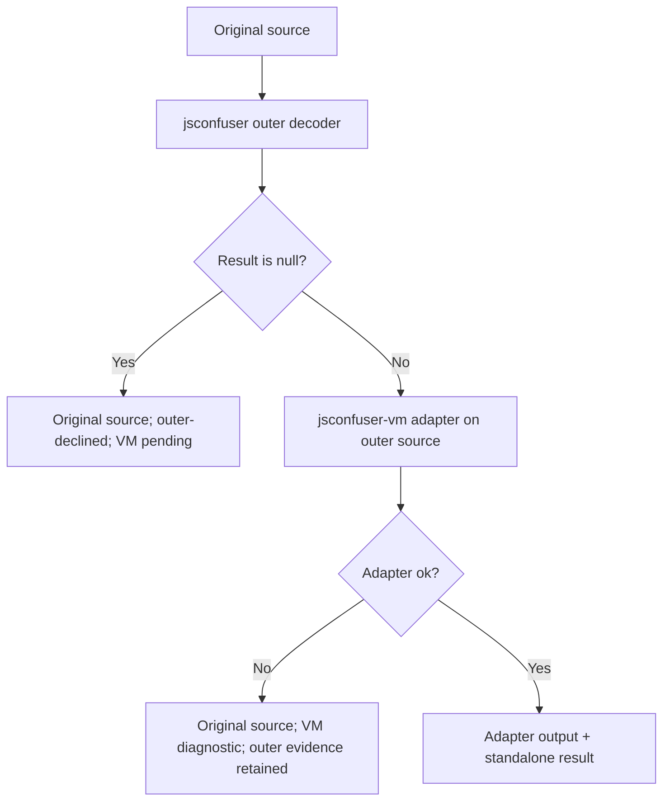

# jsconfuser-vm sequential coordination

## 1. Target

The `jsconfuser-vm-sequential` target composes this decoder's
[jsconfuser](jsconfuser.md) outer pass with its [numeric VM adapter](jsconfuser-vm.md).
It publishes recovered JavaScript when both calls succeed. If either returns a decline, it
publishes the exact original source string and the declining stage's diagnostic. Its schema
is `jsconfuser-vm-sequential.v1`. This is one outer-then-VM attempt, not a fixpoint layer loop
or qualification of every layered input.

Readers need the [source/AST workflow](../decode-js.md) and the two linked producer contracts.
The coordinator operates on source strings and does not edit an AST or private VM records.

## 2. Algorithm

Call the outer decoder with the original source. If it returns `null`, stop: preserve that
original source and mark the VM stage pending. Otherwise pass its generated source directly
to the VM adapter. If the adapter declines, preserve the **original**, not the outer result;
retain outer output only as stage evidence. If it succeeds, publish its output and standalone
result. Freeze the resulting object/array record.

The coordinator trusts owned outputs and adds no schema, proof, input-identity or parse check.
The outer decoder uses its own error-recovering parser and generator; the VM stage has source
admission and final emission parse gates. There is no coordinator strict-parse stage.

### Worked example: outer success does not commit partial progress

The committed outer scope-capture input can produce changed outer source without a supported
VM container. In that scenario, `outerSource !== original`, but the VM adapter returns
`container-declined`. The coordinator reports `failedStage:'vm'`, stores outerSource under
`stages.outer.output`, and sets top-level `output` to original. This is stage-aware rollback
of publication; the outer work can be inspected without becoming the recovered program.
It is a retained control, not evidence that an arbitrary outer-encoded VM will recover.

## 3. Implementation

### Calls, refusal and record fields

`decodeJsconfuserVmSequential` calls `PluginJsconfuser` once and, unless its result is exactly
null, calls `PluginJsconfuserVm` once. It tests only the outer null and adapter `ok`; it does
not infer whether an outer change actually decoded a layer. The direct calls are not enclosed
in try/catch. An exception from either propagates to a direct caller; the result-aware CLI
catches it and reports a decode error before writing output/sidecar. A thrown error is not
converted to a coordinator decline record.

| Field | Success | Outer decline | VM decline |
|---|---|---|---|
| `schemaVersion` | `jsconfuser-vm-sequential.v1` | same | same |
| `ok`, `status` | true, success | false, declined | false, declined |
| `input`, `output` | original, VM output | original, original | original, original |
| `result` | Adapter standalone result | null | null |
| `diagnostic` | null | `{stage:'outer',code:'outer-declined',message:'Outer decoder declined the input'}` | `{stage:'vm',code,message}` copied from adapter diagnostic |
| `failedStage` | null | outer | vm |
| `stages.outer` | `{status:'success',ok:true,output:outerSource}` | `{status:'declined',ok:false}` | success row with outer output |
| `stages.vm` | `{status:'success',ok:true,output:vmOutput}` | `{status:'pending'}` | `{status:'declined',ok:false,diagnostic:adapterDiagnostic}` |

The top-level success output equals `result.output`. VM decline preserves the standalone
code/message in the top-level staged diagnostic and the original diagnostic under `stages.vm`.
Deep freezing walks object/array values. It does not create a general Map freeze facility;
these public records rely on their declared object/array shapes.

### State and CLI boundary

Each producer owns its AST/record state. The outer decoder generates source, and the VM adapter
reparses it in its own admission context. There is no shared Babel scope to crawl or repair at
the coordinator. Public success is one complete frozen return; returned decline restores the
original string even after a successful outer call. The coordinator's outer pass uses the
existing outer workflow, including its evaluating visitors; the VM stage's static no-execution
flags do not make the whole outer pipeline parse-only.

The CLI registers `-t jsconfuser-vm-sequential`, applies the same
[output/sidecar contract](jsconfuser-vm.md#public-scenarios-and-acceptance) as the direct target,
and writes output before ordinary JSON. A decline exits successfully after both writes;
read/decode/path/write errors exit 1. Resolved output/result path equality is refused before
writes, but result-write/serialization failure after output write has no filesystem rollback.

### Scenarios and oracles

| Scenario | Required observation / oracle | Retained evidence or gap |
|---|---|---|
| Invalid outer source | outer-declined, original output, VM pending. | sequential.test invalid source; no VM publication. |
| Changed outer result without VM | VM container-declined, original output, changed stage outer output. | Scope-capture control; actual stage boundary reached. |
| Ordinary source without VM | Original output and VM container-declined. | Ordinary source control; outer success is not required to change text. |
| Visible numeric input | Both stage statuses success, emitted output equals result.output and differs from input, result frozen. | literal-order control; does not test an actual encoded outer layer. |
| CLI VM decline | Exit 0, declined status/diagnostic, original output file and staged sidecar. | sequential CLI control. |
| Throws / broad layered behavior | Direct throws propagate; CLI catches before writes; layered recovery needs its own structural and behavior controls. | Source-inspected throw path; no focused thrown-call control or general layering claim. |

## 4. Input Shapes

| Producer shape | Coordinator treatment |
|---|---|
| [jsconfuser](jsconfuser.md) source string or null | Send returned source directly to VM recognition; null ends the attempt. |
| [jsconfuser-vm](jsconfuser-vm.md) public adapter record | Publish its complete success, or carry diagnostic with original-string rollback. |
| Thrown producer error | Propagate to direct caller; result-aware CLI catches and writes neither file. |

This ordering removes a supported outer shape before VM recognition. It adds no VM recognizer,
new qualification gate, visitor mutation or intermediate packet validation.

## 5. Known Gaps

An outer result can lack a supported numeric VM; successful outer decoding alone cannot publish
partial VM recovery. The coordinator extends neither producer's supported representation,
hardening, repeated/mixed-encoder nor host-semantic evidence. Static VM success and metadata
are not proof of full native semantics. Sequential tests assert bounded TEST_OUTPUT equality
for the wrapped arithmetic fixtures with and without outer string concealing, not arbitrary
successful numeric inputs.
Thrown errors and two-file write failures are outside
returned-decline string atomicity.

The VM plugin's [source preparation](../transforms/jsconfuser-vm/normalize-source.md) restores
key and simple control-body forms before standalone recognition, and Packet A reads the outer
decoder's hoisted declarations through each role's defining write
([extract-container.md](../transforms/jsconfuser-vm/extract-container.md#2-algorithm)). This
recovers the wrapped arithmetic fixtures with and without outer string concealing. The
container's [sentinel-value contract](../transforms/jsconfuser-vm/extract-container.md) reads either
the captured map member or its canonical literal after constant simplification. The coordinator itself adds no
normalization call; direct VM-plugin callers use the same preparation.

## Source

- [jsconfuser-vm-sequential.js](../../../decoder/decode-js/src/plugin/jsconfuser-vm-sequential.js) — ordered calls, exact-original publication and staged record in section 3.
- [main.js](../../../decoder/decode-js/src/main.js) — CLI registry, thrown-decode catch and shared sidecar path.
- [jsconfuser.js](../../../decoder/decode-js/src/plugin/jsconfuser.js) and [jsconfuser-vm.js](../../../decoder/decode-js/src/plugin/jsconfuser-vm.js) — producer boundaries in sections 2 and 4.

## Fixtures

These are source-inspected committed assertions, not fresh execution or generator replay.
The retired immutable reduced emission/public verifier, built from the documents
before source consultation, and its postfreeze source audit retained staged record mapping, ordered supplied calls, exact null/rollback behavior, freezing and
outer-thrown propagation with supplied callbacks. VM-thrown propagation is source-inspected,
not independently exercised there. No actual outer pipeline, encoded layered source or native
behavior was reconstructed; the CLI part supplies I/O callbacks rather than filesystem writes.

| Committed test or input | Claim pinned |
|---|---|
| [sequential.test.js](../../../decoder/decode-js/test/vm/jsconfuser-vm/integration/sequential.test.js) | Actual source reaches outer null, VM decline, numeric success and CLI decline; assertions are the scenario map above. |
| [Outer scope-capture input](../../../decoder/decode-js/test/jsconfuser/control-flow-flattening-scope-capture.js) | Changed outer source retained as stage evidence while top-level output rolls back to original on VM decline. |
| [f-literals-order numeric input](../../../decoder/decode-js/test/vm/jsconfuser-vm/fixtures/corpus/raw/f-literals-order/encoded.js) | Both calls return success and output/result agree; broad layered/native behavior remains unqualified. |
| [layer-pair-arithmetic](../../../decoder/decode-js/test/vm/jsconfuser-vm/fixtures/layer-pair-arithmetic/) | Real encoder output with provenance in `generation.json`: VM-only and both outer-wrapped inputs decode; wrapped outputs have no dispatch/payload arrays/method installations and match source/encoded TEST_OUTPUT. |
