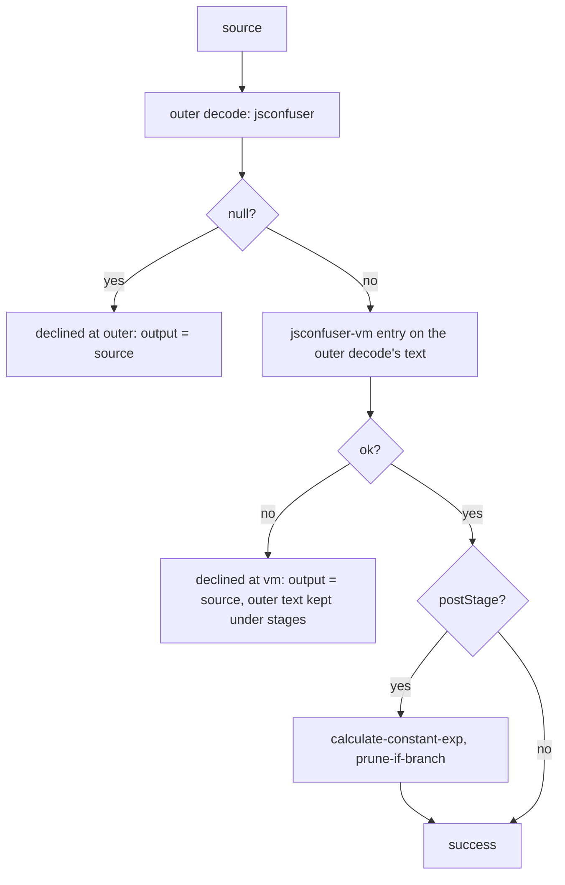

# jsconfuser-vm-sequential.js

Pipeline stage: none; the entry for a layered input, which runs the outer decode, the
[`jsconfuser-vm` entry](jsconfuser-vm.md) and a post-stage ([map](../pipelines/jsconfuser-vm.md)).

The `-t jsconfuser-vm-sequential` target. Readers need the two entries it chains,
[jsconfuser](jsconfuser.md) and [jsconfuser-vm](jsconfuser-vm.md); this doc owns only the chain,
the post-stage and the chain's record.

## 1. Target

Given output of the [js-confuser-vm](../../js-confuser-vm/js-confuser-vm.md) encoder that was then
obfuscated by [js-confuser](../../js-confuser/js-confuser.md), return the compiled program as
JavaScript. The outer decode removes the outer layer, the VM entry decodes what is left, and a
post-stage of two shared visitors folds the literal expressions in the result.

A decode is all or nothing over the whole chain
([F1](../../decoding-method/rules.md#f1)): if either decoder
declines, the output is the source as given, never the outer decode's intermediate text. The
caller always gets one deeply frozen record that says which step declined.

The chain runs once, outer then VM. It is no loop over layers, and it does not test whether the
outer decode found a layer: input with no outer layer goes through unchanged in meaning and is
decoded by the VM entry.

The VM entry executes nothing; the outer decode does evaluate the outer encoder's own helpers in
an isolate ([jsconfuser](jsconfuser.md)), so the chain as a whole is not parse-only.

## 2. Algorithm

```text
decodeJsconfuserVmSequential(source, { postStage = true }):     // explanatory pseudocode
  outerSource = PluginJsconfuser(source)
  if outerSource is null:  declined at 'outer', code outer-declined; the vm step is pending
  vmRecord = PluginJsconfuserVm(outerSource)
  if not vmRecord.ok:      declined at 'vm', with the VM entry's code and message
  output = postStage ? post(vmRecord.output) : vmRecord.output
  success: output, result = vmRecord.result, both steps' outputs kept under stages

post(code):
  parse as a script; traverse calculate-constant-exp, then prune-if-branch; print
```



1. **The outer decode** returns a string, or `null` only when its parser cannot read the source.
   It never says whether it removed anything, so the chain does not ask.
2. **The VM entry** receives the outer decode's text. Its preparation restores the spellings the
   outer decode leaves ([`normalize-source`](../vm/jsconfuser-vm/source/normalize-source.md)),
   and where the outer layer split a declaration into a bare `var` and a later assignment, the
   container takes the defining write as the value
   ([`container`](../vm/jsconfuser-vm/source/container.md)). When it declines, the top-level
   `output` goes back to the source as given: an outer decode that changed the text has not
   recovered the program, so its text is kept only as a record of that step.
3. **The post-stage** runs the shared visitors
   [calculate-constant-exp](../visitors/calculate-constant-exp.md) and
   [prune-if-branch](../visitors/prune-if-branch.md), imported unchanged, over the VM output.
   It reads only that text. The VM backend writes what the compiled program computes, so a
   source expression over literals arrives as an expression or a branch over literals; the
   post-stage folds those. What needs the backend's facts stays with the backend: a register copy
   is not folded here, since that needs the reaching definitions only the backend holds.

The chain adds no recognition and no check between the steps: each step's own parse and gates
are the only ones.

### Worked example

The committed cell `f-short-circuit` of suite `string-flow-chain` (seed 251) is VM encoder output
with no outer layer, so the outer decode passes it through and the example shows the post-stage
alone. Its source holds

```js
var andValue = false && hit("and");
var orValue = true || hit("or");
var nullValue = null ?? hit("null");
var zeroValue = 0 ?? hit("zero");
```

The register names are shortened here (`r4` for `__recovered_r_0_4`).

```js
// VM output (postStage: false)              // post-stage output
r4 = false && r3("and");                     r4 = false;
r5 = true || r3("or");                       r5 = true;
r13 = null;                                  r13 = null;
if (null == null) {                          r13 = r3("null");
  r13 = r3("null");
}
r6 = r13;                                    r6 = r13;
r15 = 0;                                     r15 = 0;
if (0 == null) {
  r15 = r3("zero");
}
return void 0;                               return undefined;
```

`calculate-constant-exp` folds the two short-circuits and the two tests to literals;
`prune-if-branch` then keeps the body of the true test and drops the false one. The copy
`r6 = r13` and the dead store `r13 = null` stay: neither is a literal expression.

## 3. Implementation

`decodeJsconfuserVmSequential(source, { postStage = true } = {})`, also the file's default
export, is imported by the CLI and the test. It calls each decoder at most once.

### The sequential record

```js
{
  schemaVersion: 'jsconfuser-vm-sequential.v1',
  ok,           // true on success
  status,       // 'success' | 'declined'
  input,        // the source as given
  output,       // success: the post-stage's output, or the VM output with postStage false
                // declined: the source as given
  postStage,    // success only: whether output went through the post-stage
  result,       // success: the standalone result, as the VM entry returned it; declined: null
  diagnostic,   // declined: { stage, code, message }; success: null
  failedStage,  // 'outer' | 'vm' | null
  stages: {
    outer,      // { status: 'success', ok: true, output }  |  { status: 'declined', ok: false }
    vm,         // { status: 'success', ok: true, output }
                // { status: 'declined', ok: false, diagnostic }   the VM entry's own diagnostic
                // { status: 'pending' }                           the outer decode declined
  },
}
```

- `result.output` and `stages.vm.output` are always the VM output, before the post-stage; with
  `postStage` false the top-level `output` equals them.
- The outer decline's diagnostic is `{ stage: 'outer', code: 'outer-declined', message: 'Outer
  decoder declined the input' }`. A VM decline's top-level diagnostic carries the
  [standalone decode's code](../vm/jsconfuser-vm/standalone-decode.md) and message with
  `stage: 'vm'`.
- The record is deeply frozen (`deepFreeze` of `src/vm/decline.js`).
- Nothing is caught. An exception from either decoder or from the post-stage's parse reaches the
  caller; it is not turned into a declined record.

### The CLI

`src/main.js` registers the entry as `-t jsconfuser-vm-sequential` and handles its record exactly
as the VM entry's ([the CLI](jsconfuser-vm.md#the-cli)): output file, JSON sidecar, exit 0 on a
decline. One flag is read for this target only: `--no-post-stage` passes `postStage: false`.

## 4. Input Shapes

| Shape | Producer | Treatment |
|---|---|---|
| VM encoder output under a js-confuser layer | the two encoders | the whole chain |
| VM encoder output with no outer layer | the VM encoder | the outer decode passes it on; the VM entry decodes it |
| A string, or `null` | the [outer decode](jsconfuser.md) | a string goes to the VM entry as it is; `null` ends the chain |
| The adapter record | the [VM entry](jsconfuser-vm.md#the-adapter-record) | its `result` and `output` are published, or its diagnostic with the source as given |
| The VM output: literal short-circuits, literal tests, `void 0` | the [backend](../vm/switch/vm-switch-emit.md) | folded by the post-stage |

## 5. Known Gaps

- One outer layer over one VM layer. A VM layer inside another VM layer, or an outer layer of
  another encoder, is not attempted.
- The outer options shown to decode are those of the committed layered inputs (section 7);
  nothing here claims every js-confuser option over a VM layer.
- No committed test runs the post-stage: every test passes `postStage: false`, and the two
  visitors are covered by their own unit tests.
- A thrown error is not a declined record, and the CLI's two writes are not atomic
  ([the CLI](jsconfuser-vm.md#the-cli)).

## 6. Source

- [jsconfuser-vm-sequential.js](../../../decoder/decode-js/src/plugin/jsconfuser-vm-sequential.js):
  the chain, the post-stage, the record.
- [main.js](../../../decoder/decode-js/src/main.js): the registry row and `--no-post-stage`.

## 7. Fixtures

The test is
[sequential.test.js](../../../decoder/decode-js/test/vm/jsconfuser-vm/public-entry-points/sequential.test.js).
Its layered inputs are committed outer-encoder output over a VM layer, in
[layered-inputs/](../../../decoder/decode-js/test/vm/jsconfuser-vm/layered-inputs/), each folder
with a `generation.json` naming the program, both encoders' revisions and options, and the seed
([tests.md](../tests.md)).

| Scenario | Expected result | Committed fixture |
|---|---|---|
| Source the outer parser cannot read (`function (`) | Declined at `outer`, `outer-declined`; output is the input; the vm step is `pending` | sequential.test.js |
| js-confuser output with no VM layer: the outer decode changes the text | Declined at `vm`, `container-declined`; output is the input; the changed text is under `stages.outer.output`; the record is frozen | sequential.test.js, with [control-flow-flattening-scope-capture.js](../../../decoder/decode-js/test/jsconfuser/control-flow-flattening-scope-capture.js) |
| Ordinary JavaScript | Declined at `vm`, `container-declined`; output is the input | sequential.test.js |
| VM encoder output with no outer layer | Success at both steps; `output` equals `result.output` and differs from the input; `result` is frozen | sequential.test.js, input cells `f-literals-order` and `conditional-increment` (baseline, seed 1) |
| `conditional-increment` (canonical opcodes) under the outer layer, with and without outer string concealing | Success; the outer text holds one `switch` and the output none; no payload array of the outer text and no method installation survives; the output and the input compute the source's `TEST_OUTPUT` | sequential.test.js, layered-inputs/conditional-increment (`complete.js`, `without-string-concealing.js`) |
| `counter-total` (randomized opcodes) under one outer option each: compact, object extraction, moved declarations, minify, variable masking | The same | sequential.test.js, layered-inputs/counter-total |
| CLI with `--no-post-stage`, a VM decline | Exit 0; `Status: declined` and the diagnostic printed; the output file is the input; the sidecar holds the sequential record | sequential.test.js |
| The post-stage on | Literal short-circuits and tests folded, as in the worked example | |
| A decoder throws | The exception reaches the caller; the CLI prints "Cannot decode input" and writes nothing | |
