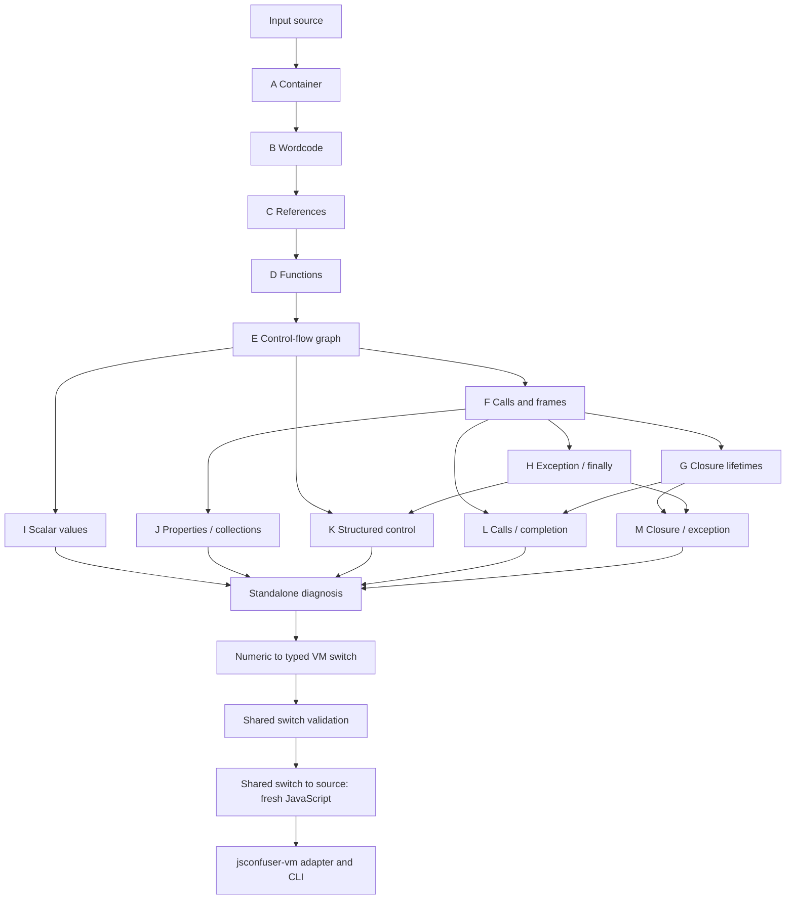

# jsconfuser-vm.js

Target-local decoder for proved supported source shapes of the pinned `js-confuser-vm` encoder. It is an
additive `decode-js` target: it does not alter the existing `jsconfuser` plugin or any legacy
plugin's string-or-null contract.

## 1. Target

Recover a complete supported VM container into fresh source-oriented JavaScript through the real
`decode-js` caller. The output is reviewable decompilation, not original-source reconstruction:
generic names and necessary register/capture scaffolding may remain. The target accepts
source-derived numeric, encoded, minified and selected hardened shapes whose current records pass
the static grammar, reference, ownership/control and coverage checks. Unsupported source shapes
or failed checks decline atomically and remain byte-for-byte unchanged. There is no qualification-record
or option-profile admission gate: an untested combination can reach static success, while its
qualification remains an evidence limit.

## 2. Algorithm

The adapter is a result-aware boundary around the target-local standalone decoder:

1. Apply the plugin's [source preparation visitors](../transforms/jsconfuser-vm/normalize-source.md)
   on a private strict script parse, then pass the prepared source to `diagnoseStandalone` exactly once.
2. On success, return the standalone emitted source and its immutable recovery result.
3. On decline, return the original source and the immutable diagnostic; do not expose partial
   analysis or emission.
4. The CLI writes the selected output and one JSON sidecar from that same record. The direct VM
   path never runs the input or recovered program during extraction, analysis or emission.

The standalone decoder resolves its predecessor analyses before emission; item 3 maps their
exact inputs.

## 3. Implementation

### Encoder stage order

The pinned encoder applies these stages in this order. Fixes run in reverse encoder order;
each row names the decoder decision or doc that reverses the stage.

| Encoder order | Actual domain and owning decoder decision |
|---|---|
| Compiler setup | Numeric opcode map or distinct randomized u16 labels; CALL_SPREAD can range from 65535 through u32 maximum; frame slots/header/start and optional noise are independent representation facts. A proves the selected representation, not the option name. |
| stringConcealing | Shared string bank/helper/captures precede both control rewrites; [string recovery](../transforms/jsconfuser-vm/normalize-string-concealing.md) removes that machinery before ordinary function/control recovery. |
| controlFlowFlattening → dispatcher | Relative state routing/dead blocks, followed by middleman jumps and lookup helper variants; [dispatcher](../transforms/jsconfuser-vm/normalize-dispatcher-wordcode.md) preparation precedes final [CFF](../transforms/jsconfuser-vm/normalize-cff-wordcode.md) relocation/control rebuilding. |
| concealConstants | Always expands constant operands to index/key pairs, even with concealConstants false. [Constant recovery](../transforms/jsconfuser-vm/normalize-concealed-constants.md) handles nonzero keys after added-opcode/PATCH recovery. |
| anti → specialized → macro → aliases | Added opcodes compose over remaining canonical candidates; source bodies and complete widths must be proved before stream projection. Their runtime construction order differs: specialized → macro → aliases → anti. |
| resolveRegisters → selfModifying | Concrete registers exist before function regions move. [PATCH observation](../transforms/jsconfuser-vm/self-modifying-observation.md) reads original added-opcode widths before any expansion changes PCs. |
| resolveLabels → resolveConstants → encryptPatches | Addresses and constant/key values finalize before encryption; [PATCH rebuild](../transforms/jsconfuser-vm/normalize-self-modifying-wordcode.md) reconstructs current B-E after recovery. |
| Serialize | Numeric u32 words or four little-endian bytes per word in base64; emitted timing scalar is independent of transport. A materializes a complete source-proved payload. |
| Runtime added-opcode builders → shuffle → table → class | Added handlers remain alongside every canonical case; shuffle changes listing, table changes dispatch, class inlines maps/scalars and permutes real/fake arguments/fields/methods. Representation owners prove their complete selected source before numeric analysis. |
| Generation/comments → minify | Leading disassembly comments are unconditional; Closure ADVANCED runs last and can erase/rearrange fields and helper arguments. Canonical minified and complete minified-class proofs have separate bounded recipes. |

### Decoder stage dependency map

The diagram is a reading map for the canonical numeric path. Arrows show the main data
handoffs; the A-M rows below list **every direct input** used by the diagnosis orchestrator.
Packet letters are decoder stage labels, not packets in the encoded program. All A-M stages
analyze source without executing the target or emitting the final program.

The graph highlights the point of each branch: I and J classify values and properties; K
projects blocks and edges and chooses each function's mode; L projects F/G calls and completion routes; M independently projects
G/H closure and exception routes. Diagnosis requires selected completeness flags and a live K plan before
the switch adapter and N decoder render JavaScript. A decline at any stage stops that public path and the adapter
returns the exact input. Despite their `emit*` function names, K-M produce analysis records;
only the shared switch-to-source backend renders the final JavaScript.
The [self-modifying wordcode normalizer](../transforms/jsconfuser-vm/normalize-self-modifying-wordcode.md)
can supply a canonical Packet A to B when the direct numeric reader encounters PATCH; it is
admitted only after its reachable-region and control-flow proofs complete.
The [VM switch boundary](../vm-switch-boundary.md) is now the handoff between the numeric
A-M diagnosis and source emission. An independent VM-2 benchmark has no admitted adapter to
that boundary; its [future transform contract](../transforms/jsconfuser-vm/exact-inner-recovery.md)
is a design reference, not an active decoder path.

| Stage and transform doc | Direct inputs | Record or decision passed forward |
|---|---|---|
| A [Container](../transforms/jsconfuser-vm/extract-container.md) | source | payload located by the boot skeleton (words, pool, root count) with this decode's opcode table and spread sentinel, named from the handlers by [runtime meaning](../transforms/jsconfuser-vm/runtime-meaning.md) |
| B [Wordcode](../transforms/jsconfuser-vm/read-wordcode.md) | A | complete ordered spans, semantic operands and variable forms |
| C [References](../transforms/jsconfuser-vm/validate-references.md) | A, B | key-zero pool/labels/frame descriptors and stream-global index bounds |
| D [Functions](../transforms/jsconfuser-vm/partition-functions.md) | A, B, C (A is API-only; B/C supply current facts) | serialized intervals, closure parents/sites and local direct labels |
| E [Control-flow graph](../transforms/jsconfuser-vm/build-cfg.md) | B, C, D | selected owner-range refinement, stack routes, finite indirect targets and blocks |
| F [Calls and frames](../transforms/jsconfuser-vm/build-call-frames.md) | B, C, D, E | explicit call/frame/receiver/argument roles, limited internal-target provenance and completion routes |
| G [Closure lifetimes](../transforms/jsconfuser-vm/closure-lifetimes.md) | B, C, D, E, F | actual parent capture bindings, close events and static use/escape state labels |
| H [Exception/finally](../transforms/jsconfuser-vm/exception-finally.md) | B, C, D, E, F | E state/route projection and supported finalizer routing restrictions |
| I [Scalar values](../transforms/jsconfuser-vm/scalar-values.md) | B, C, D, E | I-family use/def/literal descriptors; known peer opcodes skipped |
| J [Properties/collections](../transforms/jsconfuser-vm/property-collections.md) | B, C, D, E, F | J-family ordered roles/payloads, mutations and conditional iterator definitions |
| K [Structured control](../transforms/jsconfuser-vm/structured-control.md) | B, E, H reachability | per-function blocks/edges, structured or dispatch when E.irreducible.regions is nonempty; reported instruction/edge coverage (statement regions are [planned by the backend](../vm-switch-statements.md)) |
| L [Calls/completion](../transforms/jsconfuser-vm/call-completion.md) | B, D, E, F, G; C API/schema-only | F grammar/target/completion projection plus G static sites |
| M [Closure/exception](../transforms/jsconfuser-vm/closure-exception.md) | B, D, E, G, H; C/F API/schema-only | independent closure/exception/route projection and E-required fallback |
| [Standalone diagnosis](../transforms/jsconfuser-vm/standalone-diagnosis.md) | A-M | resolved model or named decline before emission |
| [VM switch boundary](../vm-switch-boundary.md) | resolved diagnosis model | typed code/storage/cases, shared validation and source emission |
| [Standalone decode](../transforms/jsconfuser-vm/standalone-decode.md) | validated switch output | numeric residue gate, public source or atomic decline |

The [K-M plan handoff](../transforms/jsconfuser-vm/standalone-diagnosis.md#k-m-plan-handoff)
separates schedule from data dependency. K/L/M are sibling analyses; M consumes neither K nor L.
Diagnosis gates K instructions/edges, L instructions/completions/completionRoutes and M
instructions/completions/routes.complete. Other reported families and intent proof flags are
not generic admission checks. A structured function can still fail statement planning or rendering. The numeric adapter
uses K controls/edges and L target.kind for plain-call receiver choice; M is required and retained
as closureException evidence but is not read by the adapter. These distinctions add no new support
or qualification gate and preserve the F/G/J limitations below. The
[bounded plan evidence](../transforms/jsconfuser-vm/standalone-diagnosis.md#k-m-plan-handoff)
excludes the original frozen K opaque/numeric-unique fields, M final lifetime kind, whole result
objects and inconsistent-sentinel read-order object. The separate
retired frozen field verifier covered K opaque
kind/blockIds/Boolean flags and terminal membership/postorder fields, supplied-event whole M
lifetime rows, and L grammar plus selected kind/roles/steps with caveat prose excluded. Supplied
inventories/maps/F/G facts and private contrasts bound that proof; synthetic throw metadata
qualifies no owned event reachability. Retained passing tests and source-only examples remain
separate. No whole-stage, admission/public/native/emitter or novice claim is added.

The [semantic handoff](../transforms/jsconfuser-vm/standalone-diagnosis.md#semantic-record-handoff)
closes the F-J dependency boundary. F/G/H consume owned current records, while I/J check complete
and unique coverage only of their own operation families. Their records do not execute target
code or propagate general register values. F's returned-closure fixed-register lookup, G's
method-receiver/precision heuristic, and J's accessor evaluation-step projection have explicit
current limitations; direct B/F receiver grammar and dynamic runtime semantics remain separate.
C is API/schema-only for G/H; C/F give J reporting counts. These summaries do not add model-input
revalidation or new support/qualification gates. Detailed F-J diagnose helpers expose their own
codes, but standalone uses null-return wrappers and publishes the generic stage *-declined code;
the plugin preserves that diagnostic. G fixed arguments join as one abstract value before event
emission; I/J retain the exact structural field variants declared in their owning designs.
The retired frozen semantic-record verifier
held selected document-first assertions, with their exclusions indexed by the owning F-J
Fixtures. It does not qualify source/public emission or whole A-M reconstruction. The separate
retired frozen field verifier supplied 17
exact projected-output, input-equality/deep-freeze controls for selected G argument/event/label,
I valueSemantics and J pair/evaluation/iterator fields from synthetic supplied scaffolds.
Whole rows and runtime/source/public/generated behavior remain excluded; F/G/J defects remain
unresolved.
The source-informed G/I/J correction checks are committed scaffold tests indexed by the owning
F-J Fixtures, separate from the cold reconstruction and from any historical corpus replay.

The canonical A-E map separates source admission from progressively derived facts.
[Packet A](../transforms/jsconfuser-vm/extract-container.md) locates the payload by the boot
skeleton for every runtime layer (encoded, randomized, class, minified, table), and the
[handler locator](../transforms/jsconfuser-vm/locate-handlers.md) gives the readers the handlers by
behaviour; neither recognizes the runtime by spelling. Wordcode normalizers can supply current B-D/E after expansion, erasure or relocation.
The [frontend retry schedule](../transforms/jsconfuser-vm/standalone-diagnosis.md#canonical-frontend-retries)
places added-opcode/PATCH and constant normalization before C, string/helper preparation before
ordinary D, then dispatcher/CFF preparation before final E. It reuses returned successful records
and fills missing analyses, without revalidating owned records. Detailed producer inventories
are linked from [B](../transforms/jsconfuser-vm/read-wordcode.md#4-input-shapes) through
[E](../transforms/jsconfuser-vm/build-cfg.md#4-input-shapes); this map does not qualify every
option combination. The [owned-record contract](../transforms/jsconfuser-vm/standalone-diagnosis.md#owned-record-boundary)
also distinguishes global bounds from later ownership and the separately supplied switch model.

The [constant inverse](../transforms/jsconfuser-vm/normalize-concealed-constants.md) returns current
A/B with unchanged PCs. The [dispatcher inverse](../transforms/jsconfuser-vm/normalize-dispatcher-wordcode.md)
can return A-D with deferred E, while [CFF](../transforms/jsconfuser-vm/normalize-cff-wordcode.md)
returns A-E after two relocation/rebuild stages. [String recovery](../transforms/jsconfuser-vm/normalize-string-concealing.md)
removes its bank/helper/capture machinery and returns ordinary A-D, so final E is rebuilt.
Optional preparation refusal can lead to a later E or structured-emission decline; the source
adapter publishes only the final standalone outcome, without exposing a partial prepared program.
E's [bounded document-first proof and limits](../transforms/jsconfuser-vm/build-cfg.md#5-known-gaps)
cover asserted reduced graph decisions from synthetic supplied B-D, with exact RETURN metadata
excluded. They do not qualify this source adapter or reconstruct the complete frontend.

Added-opcode recovery is a source-proof branch before canonical C: the
[alias observer/projector](../transforms/jsconfuser-vm/normalize-aliased-wordcode.md) establishes fixed
inverse tails; the [macro inverse](../transforms/jsconfuser-vm/normalize-macro-wordcode.md) owns joint
expansion/word-PC relocation; [specialization](../transforms/jsconfuser-vm/normalize-specialized-wordcode.md)
recovers baked tuples and dispatcher-map handoff; [anti observation](../transforms/jsconfuser-vm/anti-runtime-observation.md)
and [compaction](../transforms/jsconfuser-vm/normalize-anti-wordcode.md) identify real steps, isolate
seeds and erase fake state. Every added-opcode observer takes the interpreter's dispatch from the
[handler locator](../transforms/jsconfuser-vm/locate-handlers.md), which finds it by behaviour in each
runtime spelling. Shared body comparison uses lowered clones and binding identities; added
prefix classification follows label values rather than printed switch order. Canonical reference
inventory is one handler per value of the decode's opcode table, with distinct labels
([inventory](../transforms/jsconfuser-vm/normalize-aliased-wordcode.md#source-proof-and-observation-contract)). These internal
contracts are narrower than all allocator/host domains and do not qualify every option stack.
[PATCH observation](../transforms/jsconfuser-vm/self-modifying-observation.md)
reads these source-proved widths while it sweeps, and the
[PATCH compaction](../transforms/jsconfuser-vm/normalize-self-modifying-wordcode.md) hands the
added opcodes on to their own routes with its PC map.
[Finite PATCH qualification](../tests.md#finite-patch-added-opcode-qualification) covers its explicit
subset population; other runtime/option domains remain unqualified.

The adapter does not reimplement these shapes or diagnose the source a second time.

`decodeJsconfuserVm(source)` returns a frozen `jsconfuser-vm-adapter.v1` record:

| field | success | decline |
|---|---|---|
| `ok` / `status` | `true` / `success` | `false` / `declined` |
| `input` | exact input source | exact input source |
| `output` | fresh emitted JavaScript | exact input source |
| `result` | standalone result | `null` |
| `diagnostic` | `null` | standalone diagnostic |

The adapter retains the original source while its pre-operation visitors prepare the diagnosis
input; normalization is internal to this consumer, with no repo-wide suitability claim. The adapter
delegates the single call to `diagnoseStandalone`. Its result and diagnostic are
already frozen by the standalone boundary, and the adapter freezes the enclosing record as well.
The CLI registers the adapter under `-t jsconfuser-vm`, reads UTF-8 input, and writes the record's
`output`. The default result path is `<output>.result.json`; `--result` selects an explicit path.
The comparison is exact string equality of `path.resolve(resultPath)` and
`path.resolve(outputPath)`, after decoding but before writing. It rejects lexical path aliases;
it does not resolve symlinks, hard links or filesystem identity. The output and sidecar need
distinct resolved paths.
The target-specific branch reports unknown target, read, decode, output-write, result-write, and
invalid-result-option failures without changing legacy branches. A successful or declined target
record is still a successful CLI operation once both named files are written. Decline prints
`Status: declined` and its diagnostic but does not itself set a failing exit code.

The CLI writes UTF-8 output first, then `JSON.stringify(record,null,2)` plus newline to the
sidecar. Output-write failure leaves the result path unwritten. Result-write or JSON serialization
failure sets exit code 1 after output has already been written; no filesystem rollback is
implemented. This is not a two-file transaction. Ordinary JSON supplies no Map/Set/BigInt tags
here: this sidecar differs from the review renderer's tagged saved-model format. This documents
the format and error path, not a demonstrated serialization failure for a
current admitted input. These failure branches are source-inspected contracts; current CLI
tests do not exercise result-write or serialization failure.

### Public scenarios and acceptance

| Scenario | Observable result / oracle | Evidence boundary |
|---|---|---|
| Supported input | One diagnosis call; output differs from input and equals result.output; frozen envelope; fresh AST/residue/state checks. | plugin.test reference/focused controls. No general native equivalence. |
| Ordinary or damaged source | Exact original source and same diagnostic, result null; bytes/hash unchanged. | plugin.test ordinary, truncated and encoding-flag damage controls. |
| Registered CLI success | Output and explicit sidecar match direct standalone result; status success and exit 0. | cli.test retained literal-order input; integration.test separate branch/oracle. |
| Registered CLI decline | Original source file and default/explicit sidecar, diagnostic printed, exit 0. | cli.test ordinary and damaged-flag controls. |
| Resolved output/result path equality | Existing output sentinel remains untouched; exit 1. | cli.test lexical alias control; filesystem-identity aliases untested. |
| Unknown type/read/output failure | Exit 1; named paths remain unwritten as asserted. | cli.test selected errors; thrown decode and result/JSON failure lack focused controls. |
| Leading debug comment | Same emitted output and no target execution. | plugin.test synthetic comment; not proof about every comment/transform stack. |

The CLI branch catches thrown plugin errors before writes. The adapter itself does not catch
around its call because public standalone returns its supported failures as records. Legacy
plugins retain string-or-null publication and have no automatic result sidecar; `--result`
on an unsupported target exits before input read. The registry does not extend their APIs.

## 4. Input Shapes

The adapter consumes one public immutable success/decline shape from the standalone decoder. The affected
caller behavior is therefore a boundary contract, not another AST pass:

| upstream shape | producer | adapter treatment |
|---|---|---|
| emitted source plus complete recovery result | [standalone decode](../transforms/jsconfuser-vm/standalone-decode.md) | expose both in one success record |
| diagnostic with no result | [standalone diagnosis](../transforms/jsconfuser-vm/standalone-diagnosis.md) or the [standalone decoder](../transforms/jsconfuser-vm/standalone-decode.md) | preserve it and the exact input in one decline record |
| legacy plugin string or `null` | existing `decode-js` plugin branches | leave untouched; no result sidecar is added |

No shared visitor or generic caller is an upstream dependency of this target. The additive registry
and target-specific CLI branch are the only integration shapes, so a failure in this boundary must
not be repaired by widening an existing plugin contract.

## 5. Known Gaps

- [Packet A](../transforms/jsconfuser-vm/extract-container.md#5-known-gaps) and the
  [handler locator](../transforms/jsconfuser-vm/locate-handlers.md#5-known-gaps) list their runtime-layer
  gaps; [timing checks](../transforms/jsconfuser-vm/timing-checks.md) and the
  [PATCH added-opcode contract](../transforms/jsconfuser-vm/normalize-self-modifying-wordcode.md)
  own their accepted domains and qualification limits.
- Source replacement, generic shared-decoder changes, earlier releases, repeated or mixed
  encoders, and universal runtime equivalence are outside this target's contract.
- Unqualified combinations lack retained evidence; their status alone does not force runtime decline.
- Behavioral checks are bounded regression oracles around static recovery; the adapter does not
  claim production-wide semantic equivalence.
- Readability is gated by the tracked arithmetic, closure/loop, and scale benchmark owned by
  [the standalone decoder contract](../transforms/jsconfuser-vm/standalone-decode.md#readability-gate).
  The gate asserts current output is smaller and less scaffold-heavy than its
  recorded baseline; it does not promise recovered original identifiers or universal source
  reconstruction.

## Source

- [`../../../decoder/decode-js/src/plugin/jsconfuser-vm.js`](../../../decoder/decode-js/src/plugin/jsconfuser-vm.js) — the single-call frozen adapter.
- [`../../../decoder/decode-js/src/main.js`](../../../decoder/decode-js/src/main.js) — the additive registry and target-specific CLI/result-sidecar branch.
- [`../transforms/jsconfuser-vm/standalone-decode.md`](../transforms/jsconfuser-vm/standalone-decode.md) — the standalone producer consumed by the adapter.
- [`../transforms/jsconfuser-vm/standalone-diagnosis.md`](../transforms/jsconfuser-vm/standalone-diagnosis.md) — its separate pre-emission admission boundary.

## Fixtures

The single-call adapter and current-record caller handoffs were audited statically against
source. The retired frozen verifier supplied a synthetic
public wrapper only; it did not execute this plugin/CLI, reconstruct all A-M or qualify real source
admission/public E/K outcomes. The integration tests below contain separate public-boundary assertions over retained inputs;
this design does not report their fresh execution. The frozen executable and the report's frozen metadata/stdout section stay unchanged;
postfreeze audit/verdict remains appendable.

The retired immutable reduced emission/public verifier, built from the documents
before source consultation, and its postfreeze source audit separately pinned adapter exact-original output, call count and freezing with supplied diagnosis.
Their CLI credit is simulated selected ordering/path decisions: resolve-only alias refusal,
decode before alias checking, and output write before result write. They do not execute argv
handling, registry dispatch, a subprocess, filesystem writes, JSON serialization or exact stderr.
Injected I/O/JSON failures are callback decisions, not demonstrated failures on admitted input.
The production integration assertions below remain a separate evidence family.

| test or evidence input | claim pinned |
|---|---|
| [Randomized words](../transforms/jsconfuser-vm/extract-container.md#fixtures) | Randomized class and class-plus-minify inputs take their meaning from the handlers and recover with fresh state; a consistent full remapping keeps the meaning. |
| [`../../../decoder/decode-js/test/vm/jsconfuser-vm/integration/plugin.test.js`](../../../decoder/decode-js/test/vm/jsconfuser-vm/integration/plugin.test.js) | one diagnosis call, frozen success/decline records, exact-input declines, stable diagnostics, and debug independence |
| [`../../../decoder/decode-js/test/vm/jsconfuser-vm/integration/cli.test.js`](../../../decoder/decode-js/test/vm/jsconfuser-vm/integration/cli.test.js) | registered subprocess reachability, direct standalone result agreement, named output/result paths, target errors, and unchanged legacy behavior |
| [`../../../decoder/decode-js/test/vm/jsconfuser-vm/integration/integration.test.js`](../../../decoder/decode-js/test/vm/jsconfuser-vm/integration/integration.test.js) | structured branch output agrees across the registered CLI, direct diagnosis, and the fixture oracle |
| [`../../../decoder/decode-js/test/vm/jsconfuser-vm/integration/readability.test.js`](../../../decoder/decode-js/test/vm/jsconfuser-vm/integration/readability.test.js) | source-oriented output reduction, preserved bounded behavior, fresh parsing, and required scaffolding |
