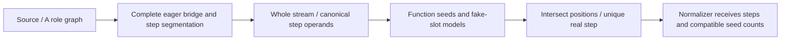

# Observe synthetic anti-instrumentation handlers

## 1. Target

Prove the widths, operand order and uniquely real step of anti-instrumentation instructions
without executing the VM. Three observations connect runtime AST to numeric words and then
register ownership. They let the [anti normalizer](normalize-anti-wordcode.md) remove fake state;
this observer alone changes neither source nor words and is not decoded output.

Readers need [Babel binding/path semantics](../../babel.md), [A](extract-container.md),
[B grammar](read-wordcode.md), [handler effects](runtime-meaning.md#2-algorithm)
and the pinned [anti producer](../../../js-confuser-vm/transforms/anti-instrumentation.md).
Input is admitted source/File and its owned numeric container. Runtime proof can observe a
prefix while another option's reader later proves the remainder; that partial proof is not standalone
admission. Private packet controls test internal decisions, not a public record-input boundary.

## 2. Algorithm

A fused handler first fetches all tail words and restores their order, then executes cloned
canonical steps. Its effects decompose uniquely into canonical step effects, every read eager, so
the reads give both the bridge (the stored order) and the step segmentation. Preserve repeated operation names as separate positions: an ADD can
be fake or real. Parse each occurrence at the proved fixed width and attach its step operands.

Find where fake values live rather than assuming the real operation comes first. Partition words
at root/closure entries. Enumerate possible leading LOAD_CONST seed pools and anchor pairs per
function. One step must use only registers outside that pool and belong to the real-operation
table; every other step must satisfy the closed fake-slot table. Ordinary instructions after
seeds may not touch the pool. Intersect possible positions across every occurrence and function.
A unique real position for every emitted synthetic opcode is required, even if seed counts are
not unique. Compatible counts remain explicit for later safe prefix removal.

### Annotated synthetic example

Supply one function with LOAD_CONST entry seeds `R3=5,R4=7,R5=1,R6=0`, separate real registers
R0/R1/R2, and a proved case 61 with these indexed steps:

```text
LOAD_INT fake: [3,9]       span [0,2)
ADD real: [0,1,2]          span [2,5)
BUILD_ARRAY fake: [4,2,3]   span [5,8), same R3 read reused twice
JUMP_IF_FALSE fake: [5,27]  span [8,10), truthy anchor / fallthrough
at PC16: canonical tail=[3,9,0,1,2,4,2,3,5,27]
stored tail=[9,0,3,1,2,4,2,3,5,27], map=[2,0,1,3,4,5,6,7,8,9]
width=11, nextPc=27
```

The 4-seed model with T=5/F=6 selects real index 1: its three registers avoid the fake pool;
the other steps write/read flowing registers 3/4 and use the immutable truthy anchor 5.
BUILD_ARRAY's count 2 still uses three static operand slots, since the cloned loop reuses its
single indexed register read. With R1=10/R2=20 the real result is R0=30; fake state is R3=9,
R4=[9,9], R5=1/R6=0. Changing the fake jump to 28 breaks the fallthrough rule. Moving ADD's
destination to R3 breaks this model's isolation; selecting an ADD by name alone would miss it.
This supplied handler/word model omits source admission, pool finalization, other functions
and host-global fake effects. Exact domains beneath determine which alternative seed models
survive; the example does not assert uniqueness without the complete function words.



## 3. Implementation

### Runtime proof and word observation

The [classifier](runtime-meaning.md#2-algorithm) identifies a synthetic case: its effects are, in
exactly one way, three or more canonical handlers' effects in sequence, and every operand is read
up front into one array literal. Because the reads are eager, each read's slot is its stored
position: step by step, the steps' bound reads are the stored positions the canonical operands take,
so `canonicalToStored` is their concatenation and each step's operands are a contiguous span
`{name,operandStart,operandCount}`. A read the handler never uses still takes its place in that
order. The observer takes the added handlers of that kind from the
[identified view](runtime-meaning.md#3-implementation); labels and their order are never read, and
the canonical handlers are those the view's table names, one per table value
([shared inventory](normalize-aliased-wordcode.md#source-proof-and-observation-contract)).

Each synthetic case leaves the dispatch (the view's `ends`). Fewer than three steps declines
`anti-runtime-steps`. In allowSpecializedTail mode other added handlers may remain; without it,
every added handler must be synthetic. The option name does not prove what the tail is:
specialized, macro or alias proof must cover it in its route. A changed read, a duplicated
permutation entry, a duplicated operand use or a changed step operator leaves the case without a
unique decomposition, so it is unclassified and declines `anti-runtime`. There is no separate
<=5 step check: the producer's 2..4 fake sampling is not an observer selection rule.

| Record | Fields / ownership |
|---|---|
| Frozen anti-runtime-observation.v1 | Full schema prefix `jsconfuser-vm-`; syntheticCases rows {opcode,arity,canonicalToStored,steps}. Runtime observer owns source semantics. |
| Frozen anti-word-stream-observation.v1 | wordCount,instructions. Reader owns complete numeric consumption and at least one SYNTHETIC occurrence. |
| Frozen anti-register-flow-observation.v1 | realSteps {opcode,index,name}; functionCount,fusedFunctionCount; seedCountChoices {startPc,counts,deferredSeed}; decoys (input PCs). Flow owns model selection. |

The reader takes 1+arity words, computes canonical[j]=stored[canonicalToStored[j]], and slices
step.words by the observed spans. Entries retain pc/name/opcode/raw words/width/nextPc plus
canonicalOperands/steps. Non-synthetic entries use canonical B grammar, including local capture
registers. Definitions are trusted owned outputs, not repeatedly schema/count validated.

### Function models and exact domains

Function starts are sorted distinct 0 and MAKE_CLOSURE functionMeta.startPc. Every start must
be an instruction boundary. Each interval ends at the next start or wordCount and must be
completely covered through its last nextPc. Except MAKE_CLOSURE, inspect only
instruction.wordOperands entries tagged kind="label-target"; each tagged pc must be a boundary
inside that function interval. This follows B's historical tagged view, not the semantic operand
view or raw control offset table. The [FOR_IN_NEXT tag defect](read-wordcode.md#5-known-gaps)
tags iter as label-target and exitPc as register. Here the iterator number is therefore checked
as a PC, while the true exit PC is not checked as a target. The register-exclusion rule below
also sees exitPc as a register and omits iter from that register census. A proper iterator can
be refused as function-boundary, while an invalid exit can survive this observer stage. This
is a consumer effect of the existing B compatibility/state defect, not an encoder operand order.
Later C/D/E and public admission are separate decisions; observer success does not promise them.

For each interval containing SYNTHETIC, count leading LOAD_CONST instructions. If any fused
step is conditional, try seed counts 4 and 5; otherwise try 2 and 3. A candidate count requires
that many leading seeds, distinct destination registers and valid index/key pairs restoring
only integers 0..65535 or alphanumeric strings length 3..8. Integers use Number.isInteger;
strings match `/^[A-Za-z0-9]{3,8}$/`. Concealed values use the
[constant restoration contract](normalize-concealed-constants.md), not raw pool values.
Every non-synthetic instruction after those seeds must avoid fake registers among wordOperands
entries tagged kind="register" (their index fields); MAKE_CLOSURE also checks every local capture
index. A [PATCH suspect](self-modifying-observation.md#2-algorithm) (the caller's `suspects`, in
this input's PCs) is read past: it is an
undecided selfModifying filler whose registers (0..24) say nothing about the program, and only the
dispatcher can recover the label that decides it. The FOR_IN_NEXT tag exception above affects this actual census, rather than being silently
corrected by semantic roles.

When conditionals occur, enumerate ordered anchor pairs of distinct seed registers: T has
numeric value>=1, F value exactly 0. Flowing registers are all other seeds. Without conditionals
anchors are null and all seeds flow. For each synthetic occurrence, a possible real step must
have the closed arity below and every operand word outside the full fake-register set. All
other steps must consume the exact fake slots below. Intersect positions for repeated uses of
an opcode within this function. A candidate model with any empty intersection is discarded.
No variant yields `register-isolation`.

| Real names | Exact register operand count |
|---|---|
| ADD,SUB,MUL,DIV,MOD,EXP,BAND,BOR,BXOR,SHL,SHR,USHR,LT,GT,LTE,GTE,EQ,NEQ,LOOSE_EQ,LOOSE_NEQ | 3 |
| UNARY_NEG,UNARY_POS,UNARY_NOT,UNARY_BITNOT,MOVE | 2 |

Fake slots w/r require flowing-register membership; T/F require that exact anchor register;
l requires instruction.nextPc, after translating the word through the caller's originPcMap when
one is given (a fake branch target is a Packet A address; see
[address spaces](normalize-macro-wordcode.md#shared-expansion-and-address-relocation)); i is an integer word<=65535; k is an integer word<=2. c/g/n
consume a pool index then conceal key (two slots). Pool index must be safe integer and in range,
and restoration must succeed. c's value is the seed scalar domain, g's is the closed global set
below, n's is `/^[A-Za-z0-9]{3,10}$/`. All words were already u32 by stream parsing, so lower
bounds for i/k are supplied by that producer. Require the layout consumes the entire step.words.

| Fake names | Slot sequence |
|---|---|
| All three-register real names above | wrr |
| All two-register real names above, TYPEOF | wr |
| LOAD_INT / LOAD_CONST / LOAD_GLOBAL / TYPEOF_SAFE | wi / wc / wg / wn |
| JUMP_IF_FALSE / JUMP_IF_TRUE | Tl / Fl |
| BUILD_ARRAY / BUILD_OBJECT | wkr / wkrr |

The g set is Object,Array,String,Number,Boolean,Math,JSON,Date,RegExp,Error,Function,parseInt,
parseFloat,isNaN,isFinite,Infinity,NaN,undefined. These are **names**, not proofs of the live
host property descriptors or conversion behavior. The source producer's recent-write sampling,
random choices and compiler register IDs are not reconstructed: emitted ownership/domain
constraints alone decide the model.

Across functions start with one empty opcode->positions map. Cartesian-combine each function's
variants, intersect common opcodes, drop empty intersections and deduplicate by sorted
opcode/position sets. No solutions is register-isolation; more than 4096 deduplicated solutions
is model-limit. For every runtime synthetic opcode, union surviving positions across solutions;
require exactly one (ambiguous-real-step otherwise), including cases unused by the word stream.
For each function retain distinct sorted seed counts whose candidate sets include every selected
real position. Seed count may remain ambiguous; the normalizer consumes the maximum compatible
count. Numeric register order never determines fake/real identity.

Real code never touches a seed register (the producer seeds above every live register), so a
suspect touching a seed that is fake in every retained count (an index below the smallest count)
is a decoy: flow publishes it in `decoys`, settled here by anti's own fact. A suspect touching only
the seed above the smallest count, while both counts remain, decides nothing yet: that seed is
`deferredSeed` and stays as code; a deferred seed is not settled later, and no encoder-generated
case has reached one.

The [source-informed scaffold and exact control recipe](normalize-aliased-wordcode.md#source-informed-example-control-boundary)
supply the retained canonical runtime and exercise these examples through normal source A, then
private numeric decisions where stated. They check exact recovery/current records and unchanged
input; they are not cold reconstruction or fresh encoder-output qualification.

### State, partial boundary and acceptance

Observations are deeply frozen `{ok,result,diagnostic}` envelopes and never alter source/A.
Source input/File errors are named or anti-runtime-error; a raw Program without its File has no
Babel traversal parent and is not a supported input.
Flow/reader failure yields no partial result. Optional runtime prefix observation is the only
partial boundary; a caller may use it only while proving the entire remainder before publication.
Register-flow alternatives are hypotheses until their intersections meet uniqueness, not decoded
instructions. This stage deletes no seeds/helpers and has no public AST cache to refresh.

| Scenario | Oracle / acceptance criterion | Evidence and limit |
|---|---|---|
| N1 bridge/step widths | Exact inverse, contiguous spans and full consumed wordCount; repeated names retain positions | Runtime test and duplicate-step fixture; source read/permutation/body damage reaches named proof. |
| N2 isolation and anchors | Closed domains/sets above, unique real positions and compatible counts | Flow tests primarily mutate private copied packets; these test internal choices, not new source admission guards. |
| N3 mixed prefix ownership | Earlier prefix may succeed; every remaining case needs independent proof before normalization | Anti-specialized/macro/alias combination tests. |
| N4 unchanged input/current downstream | Original words/source unchanged; normalizer removes synthetic headers and fake state with mapped targets | Downstream normalization tests; observer success alone has no recovery output. |
| N5 host-domain equivalence | Actual host names/descriptors/coercions versus removed fake effects | Not comprehensively retained; standard fixture environments only. |

## 4. Input Shapes

| Earlier decoder producer / accepted spelling | Affected contract |
|---|---|
| [Packet A](extract-container.md) / [handler locator](locate-handlers.md#4-input-shapes) | Supply the words and the handler bodies, lowered on copies, for every runtime spelling the locator lists. |
| [Alias projection](normalize-aliased-wordcode.md) / [macro-specialized expansion](normalize-macro-wordcode.md) | Restore canonical entry seeds; fake conditional fallthrough operands arrive unchanged, in Packet A space, and the `l` rule translates them through the route's composed originPcMap. |
| [Constant reader proof](normalize-concealed-constants.md) | Keys restore seed/scalar/global/name domains; a changed source reader declines normalization. |

The source [anti recipe](../../../js-confuser-vm/transforms/anti-instrumentation.md#4-later-stages)
explains eager loop reuse and per-function pools. This observer consumes emitted constraints;
it neither replays producer randomness nor proves all later combinations.

## 5. Known Gaps

Observer success does not erase synthetic instructions; the [normalizer](normalize-anti-wordcode.md)
owns erasure, continuations and public admission. Prefix mode can leave an unproved tail;
its callers must finish that proof. The source domain also requires bounded model enumeration and
unique real positions.
General allocator layouts, unused/ambiguous synthetic cases and wider host-domain harmlessness
are unqualified. Added-opcode PATCH recovery has the separate
[finite original-width contract](normalize-self-modifying-wordcode.md). Wider PATCH, minified-class
and unretained stacks remain open.

## Source

The observer is
[analyze-anti-runtime.js](../../../../decoder/decode-js/src/vm/jsconfuser-vm/analyze-anti-runtime.js),
on the classifier in
[identify-handlers.js](../../../../decoder/decode-js/src/vm/jsconfuser-vm/identify-handlers.js),
and word scanning in
[read-wordcode.js](../../../../decoder/decode-js/src/vm/jsconfuser-vm/read-wordcode.js).
Real-step selection is in
[analyze-anti-register-flow.js](../../../../decoder/decode-js/src/vm/jsconfuser-vm/analyze-anti-register-flow.js).
The pinned encoder mechanisms are
[antiInstrumentation.ts (bytecode)](https://github.com/MichaelXF/js-confuser-vm/blob/20c5b96bf57337c568579352758d7685358650de/src/transforms/bytecode/antiInstrumentation.ts)
and
[antiInstrumentation.ts (runtime)](https://github.com/MichaelXF/js-confuser-vm/blob/20c5b96bf57337c568579352758d7685358650de/src/transforms/runtime/antiInstrumentation.ts).

## Fixtures

The scenario tables in item 3 state acceptance oracles; rows below index retained inputs/tests.
The annotated examples are source-informed synthetic controls, not independent cold proofs.
Fixture qualification records and the [shared provenance contract](../../../../decoder/decode-js/test/vm/jsconfuser-vm/fixtures/qualification-provenance.md)
bound historical generated evidence; no fresh encoder generation or wider profile qualification
is asserted by this specification. Private copied-packet controls establish internal choices
only; source mutations that still reach A/B pin normal-entry refusals separately.

The retired frozen bounded verifier demonstrated
N2's one supplied four-seed conditional model: real index 1, fake fallthrough/isolation refusal
and selected unchanged numeric inputs. Anti runtime segmentation, canonical handler inventory,
A and spans are supplied; across-function intersections, alternate seed counts, the 4096 search,
keyed values and full fake-slot/host domains are not reconstructed. The
[shared boundary](normalize-aliased-wordcode.md#independent-bounded-proof) excludes full B-E,
public emission and generated qualification; exact reduced spans do not prove complete state.

A tagged-operand source control in
[analyze-anti-register-flow.test.js](../../../../decoder/decode-js/test/vm/jsconfuser-vm/analyze-anti-register-flow.test.js)
appends [53,0,iter,exit,45,0] to the retained anti-runtime-boot words, rewriting the source's
single `var BYTECODE = [...]` line before A/runtime/flow analysis. iter=1/exit=87 reaches
function-boundary; iter=0/exit=87 and iter=0/exit=1 pass flow. This static synthetic
source-damage control establishes the historical-tag consumer behavior,
not valid iterator semantics, normalization, C/D/E or public/reachability qualification.

| Committed fixture or test control | Claim pinned |
|---|---|
| [anti-runtime-boot](../../../../decoder/decode-js/test/vm/jsconfuser-vm/fixtures/anti-runtime-boot/encoded.js) | Generated anti-instrumentation output with three synthetic handlers, shuffled operands and a direct canonical reader decline. |
| [anti-runtime-duplicate-step](../../../../decoder/decode-js/test/vm/jsconfuser-vm/fixtures/anti-runtime-duplicate-step/encoded.js) | A generated synthetic handler with two `ADD` steps around a fake jump. |
| [analyze-anti-runtime.test.js](../../../../decoder/decode-js/test/vm/jsconfuser-vm/analyze-anti-runtime.test.js) | Connected observation, step spans, repeated names, exact word-stream consumption, and source-reachable truncation, unknown words, permutation, operand-read, opcode-set and step-body declines. |
| [analyze-anti-register-flow.test.js](../../../../decoder/decode-js/test/vm/jsconfuser-vm/analyze-anti-register-flow.test.js) | Real-step selection with repeated `ADD` steps; cross-pool writes, changed fake jumps, fake constants and damaged seeds decline atomically. |
| [runtime-binding-identities.test.js](../../../../decoder/decode-js/test/vm/jsconfuser-vm/runtime-binding-identities.test.js) | Combined class/handler stacks retain complete body proofs after every lexical binding is independently renamed. |
