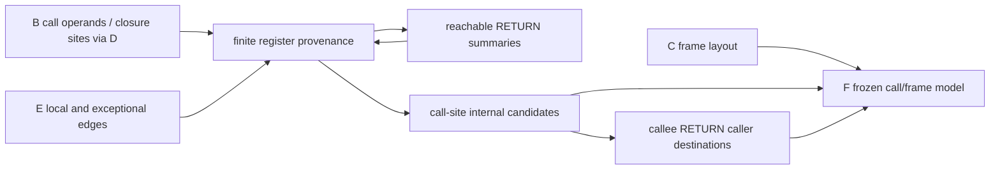

# Build call frames and completion routes

## 1. Target

Relate each serialized call to its caller frame, callee candidates, receiver, arguments and
completion routes before any source is emitted. `buildCallFrames(B,C,D,E)` returns the deeply
frozen `jsconfuser-vm-call-frames.v1` record F or null. `diagnoseCallFrames` returns the frozen
`{ok,result,diagnostic}` envelope. Success is recovery of inspectable call/frame records, not
execution of a call or JavaScript emission.

Readers need registers, directed graphs, lexical closures and JavaScript calls. The declared
foundations are [B grammar and semantic operands](read-wordcode.md), [C frame facts](validate-references.md),
[D function/site ownership](partition-functions.md), [E routes](build-cfg.md), and the encoder's
[call/frame semantics](../../../js-confuser-vm/instruction-set.md#branches-and-call-completion).
PCs and widths count u32 **words**; register indexes are relative to a function's frame. Function
IDs are D's ascending serialized-entry IDs, with root ID 0. F does not assign new function IDs.

`diagnoseCallFrames` exposes detailed stage diagnostics. `buildCallFrames` returns only the
result or null, discarding those details. Standalone reconstruct uses that wrapper and reports
`call-frames-declined` on null; the plugin preserves this generic standalone diagnostic.

## 2. Algorithm

A call's operand identifies a register, not the function stored there. First index the successful
B-E records. Preserve B's call grammar directly, then follow limited closure provenance over E's
edges to distinguish a known VM closure from an unresolved value. MAKE_CLOSURE seeds a child
function ID, MOVE preserves it, and merges retain all candidate IDs with an unknownness flag.
Only a fully known callee cell publishes internal targets; empty targets leave the call dynamic.

Return summaries connect calls whose results are themselves closures. Solve each function from
unknown entry registers, collect its reachable RETURN cells, and repeat with the new summaries.
The current call-result lookup has a fixed-register defect described below; direct call-target
projection uses the actual parsed callee and is a separate decision. Returned-target claims
outside that lookup's supported coincidence must remain unqualified.

Use E's edges to propagate output on normal continuations and input on exceptional call edges:
a throwing call has not installed its normal return value. Finally attach C's frame arithmetic,
copy completion routes, and join known callee IDs back to every serialized RETURN of that callee.
Those caller destinations are possible callers, not evidence that a particular invocation ran.

The feedback arrow is static summary iteration. It does not simulate call stacks or propagate
argument values into the callee.

### Worked example: direct call versus returned closure

This **synthetic canonical assembly** supplies root regCount=5 and no pool/captures/rest:

| PC | Words | Meaning |
|---:|---|---|
| 0 | `[47,4,17,0,1,0,0]` | Root r4 receives function 1 (entry 17). |
| 7 | `[42,0,4,0]` | Call r4, zero arguments, result r0; continuation 11. |
| 11 | `[42,1,0,0]` | Call the result r0; continuation 15. |
| 15 | `[45,1]` | Root return. |
| 17 | `[47,0,26,0,1,0,0]` | Function 1 creates function 2 in r0. |
| 24 | `[45,0]` | Function 1 returns that closure. |
| 26 | `[1,0,7]` | Function 2 loads 7. |
| 29 | `[45,0]` | Function 2 returns a scalar. |

D intervals are [0,17), [17,26), [26,31), parents null/0/1. F reports call targets at 7 as
[1], using B.callee=r4. It currently reports targets at 11 as [], although function 1's return
summary is function 2: call-result transfer at 7 reads environment **r2**, which is unknown.
The same-width opposite control changes only PC0's destination and PC7's callee from 4 to 2;
then targets are [1] and [2]. The second control exposes the defect rather than justifying r2 as
a VM requirement. The example omits source admission, host calls, merging and finalizers.

## 3. Implementation

### Components and exact provenance decisions

| Component | Consumes -> produces | Consequential contract |
|---|---|---|
| Indexes | B instructions, C frame, D sites, E edges -> lookup maps | Owned producer facts; no schema/count/raw-word revalidation. |
| Local flow | Entry unknown cells + previous summaries -> PC input cells | Edge transfer/merge below; no argument/upvalue/property alias analysis. |
| Summary iteration | Reachable returns -> candidate return cells | Unknown initialization; bounded rounds, no nonconvergence refusal. |
| Call projection | B call + input cell + E exception edge -> call row | Actual B.callee indexes internal candidates. |
| Frame/return join | C/D + calls/routes -> functions/flattened records | Relative windows, all serialized returns/throws, possible callers. |
| Publisher | Entire constructed F -> immutable result | No mutation of predecessors or source cleanup. |

A cell is `{unknown:Boolean,targets:Set<functionId>}`. At entry every register is
`{unknown:true,targets:{}}`. MAKE_CLOSURE overwrites its destination with a known singleton
D.childFunctionId. MOVE copies a cell. Other register-producing operations overwrite word-1's
destination with unknown/empty; stores, branches, accessor definitions and completion preserve
register cells. The destination set includes loads/upvalue/this, all scalar and property results,
calls, closure/array/object creation and both enumeration instructions. This is provenance,
not an inference that all those operations produce scalar values.

Merge unions targets and sets unknown to `left.unknown || right.unknown || kindsDisagree`,
where kindsDisagree means exactly one target set is empty. Normal CALL/METHOD transfer reads
**state[2] for CALL and state[3] for CALL_METHOD**, rather than state[instruction.callee.index].
If this cell is unknown or empty, the result is unknown. Otherwise combine its targets' return
summaries in insertion order: missing summary -> unknown/empty; add each summary's targets;
the first `known=false` returns unknown with only targets accumulated so far; all known returns
produce a known union. NEW's destination is always unknown. These fixed positions describe the
current implementation defect, not the intended runtime contract.

For each function, a worklist starts at D.startPc. Clone/transfer an input cell array; for each
non-null E edge propagate the input if it is a call's non-normal edge, otherwise the output.
Join/requeue changed targets. No null edge is propagated. A return summary is known iff there
is at least one reachable RETURN and every such RETURN has unknown=false; union only known
return cells' target IDs. Initialize every summary unknown/empty. Recompute all functions with
the previous round's summaries for iteration indexes 0 through `functionCount+2` inclusive,
stopping when every summary's known flag and target set agree. If the bound is exhausted F
publishes the last solve; it does **not** diagnose nonconvergence. Summaries/states are private,
not additional public F fields.

### Call, frame and completion contracts

B defines fixed arguments `{kind:fixed,count,registers}` and spread arguments
`{kind:spread,sentinel:65535,arrayRegister}`. F copies them, plus destination/callee/receiver.
CALL/NEW receiver is null; CALL_METHOD's receiver is a separate register preceding the callee.
A site has pc/functionId/kind, those operand fields, sorted `calleeFunctions`,
`constructorState:{isConstructor,mode:allocate-this|ordinary}`, continuationPc=B.nextPc,
returnDestination=destination, exceptionalCompletion, and
`cfg:{normalTargetPc:nextPc,handlerStateBefore,handlerStateAfter}`. The exceptionalCompletion
copies kind/targetPc/route/mode/callSitePc/payload from the first E edge at that PC with the same
callSitePc and non-normal route; cfg states come from that exceptional edge. They are **not**
the normal output handler state.

The pinned runtime reads receiver/callee then arguments before invoking anything. Internal CALL
uses globals as THIS, host CALL uses `callee.apply(null,args)`; METHOD uses its explicit receiver
for either route. Internal NEW allocates `Object.create(closure.prototype || null)` and tags
RET_DST=(dst<<1)|1; ordinary internal calls tag dst<<1. Host NEW uses Reflect.construct. RETURN
closes captures, applies the constructor fallback when the return is not a non-null object,
releases the frame, restores the caller, then writes caller r(retDst>>1) or root slot zero.
A returned function falls back to THIS under that actual `typeof !== "object"` test. F records
constructor mode, not the encoded RET_DST integer or an evaluated constructor result. Parameter,
rest and arguments-register placement belong to the [container frame contract](../../../js-confuser-vm/container-wordcode.md#frame-and-capture-state).

F's frame summary copies C's frameStart/headerSize/slots/mainStartPc/mainRegCount/root/descriptors.
Per-function frame fields are functionId/kind/regCount/paramCount/hasRest,
`frameBase=frameStart` for ID0 and null otherwise, `frameSize=headerSize+regCount`,
registerBaseOffset=headerSize, `registerWindow:{start:headerSize,end:headerSize+regCount}`.
This window is **relative** to the frame base; C's root window is absolute.

A function record preserves id/kind/startPc/endPc/parentFunctionId/counts/rest plus frame,
callSites, returns, throws and completionRoutes. Each return has pc/sourceRegister/reachable/routes
and callerDestinations. Each throw has pc/payloadRegister/reachable/routes. Reachability means
presence in the local solve. A route copies kind/sourcePc/targetPc/route/mode/callSitePc/
continuationPc/payload/handlerStateBefore/After. Select E return/throw/handler/finally edges and
non-normal call edges. Caller destinations contain callerFunctionId/callSitePc/destination/
continuationPc/constructorState and are attached whenever a call's published target set contains
the callee, including at an unreachable serialized return.

Top-level F contains schemaVersion/encoding, word/instruction/function counts, frame, frames,
functions, flattened callSites/returns/throws/completionRoutes, and `source` with B/C/D/E schema
names. Empty call sets are successful models, not no-candidate refusals. Unexpected construction
errors become `call-frame-builder-error`, result:null. In particular an unreachable serialized
call has no E exceptional edge and current F dereferences that missing edge; no unreachable-call
support is promised. Whole F is the atomic unit; no partial F or AST edit escapes failure.

### Testing and acceptance

| Scenario | Result / oracle | Acceptance | Evidence |
|---|---|---|---|
| F1 direct/fixed/spread/method/new | B roles and nextPc copied; exact C-relative windows; internal candidates from MAKE/MOVE. | Frozen F, unchanged B-E; assertions fail for passthrough. | Call-frame test and fixtures below. |
| F2 closure returned by internal call | Example has targets [1],[] for callee r4; opposite r2 control gives [1],[2]. | Attribute fixed-slot defect; do not qualify general returned-closure provenance. | Private-A scaffold in the call-frame test; corpus regressions exercise coincident layout only. |
| F3 completion | Exact E routes and candidate caller destinations. | Normal versus exceptional transfer; no invented host target. | Closure/finally/spread fixtures and call-frame test. |
| F4 absent/unreachable call or exhausted summary bound | Current error/last solve, not claimed semantic refusal. | No new defensive predecessor gate or convergence claim. | Dedicated normal-entry controls missing; unsupported/unqualified boundary. |

## 4. Input Shapes

[Diagnosis](standalone-diagnosis.md#owned-record-boundary) completes normalizer-produced B-E
before F. Use those current records after PC relocation, helper removal and pool restoration;
old PC indexes are invalid. B owns call forms, C frame/descriptor equality, D serialized parents,
E owner ranges/handler/indirect decisions. F adds no source or model-input admission boundary.
[G](closure-lifetimes.md) uses F target/return metadata, [H](exception-finally.md) uses its route
count, [L](call-completion.md) composes call/frame/completion records, and
[M](closure-exception.md) receives F along with G/H. Detailed K-M/emission contracts remain
owned by their pages.

## 5. Known Gaps

- Fixed r2/r3 call-result lookup can lose or misattribute returned closure targets. General return
  provenance is quarantined pending repair and controls away from those positions.
- The summary iteration has no refusal on exhaustion; recursive/long propagation remains
  unqualified. Unreachable calls currently fail construction despite E retaining them.
- Unknown host/upvalue/property values remain unresolved. F does not analyze arguments into
  callees, execute hosts, or prove constructor results/whole-program equivalence.
- Retained fixture success is bounded by the [provenance contract](../../../../decoder/decode-js/test/vm/jsconfuser-vm/fixtures/qualification-provenance.md).
  No fresh encoder output, whole-F cold reconstruction, full compiler or novice evidence is claimed.

## Source

The runtime frame allocation and call/return decisions in item 3 are pinned by
[frame push](https://github.com/MichaelXF/js-confuser-vm/blob/20c5b96bf57337c568579352758d7685358650de/src/runtime.ts#L112-L159)
and [call/return handlers](https://github.com/MichaelXF/js-confuser-vm/blob/20c5b96bf57337c568579352758d7685358650de/src/runtime.ts#L565-L676).

The stage is implemented by [call-frames-preflight.js](../../../../decoder/decode-js/src/vm/jsconfuser-vm/call-frames-preflight.js), [build-call-frames.js](../../../../decoder/decode-js/src/vm/jsconfuser-vm/build-call-frames.js). The [standalone diagnosis](standalone-diagnosis.md)
composes its result with predecessor records. The encoder contracts are described in
[instruction-set.md](../../../js-confuser-vm/instruction-set.md) and
[container-wordcode.md](../../../js-confuser-vm/container-wordcode.md).

## Fixtures

The F2 scaffold test takes the exact words, role changes and output oracle of the worked example.
Its supplied infrastructure is a private clone of A obtained from the retained
[reference source](../../../../decoder/decode-js/test/vm/jsconfuser-vm/fixtures/reference/encoded.js).
Replace only roles.words.values, roles.scalars.MAIN_REG_COUNT.value and roles.pool.values with
the example values; keep source-proved canonical maps/frame roles. Rebuild B via readWordcode,
C via validateReferences(A,B), D via partitionFunctions(A,B,C), E via buildControlFlow(B,C,D),
then diagnoseCallFrames(B,C,D,E), asserting every preceding stage succeeded and D's intervals and
parents. F2's opposite control changes words[1] and words[9] from 4 to 2, with the same 31-word
width. Both produce F; the test asserts callees r4/r0 with target lists [1],[] versus r2/r0 with
[1],[2], and unchanged A/B/C/D/E snapshots. This private-record scaffold does not admit new source
or qualify the changed runtime semantics. It pins the fixed-slot defect as current behavior, not a
cold proof, generated-output qualification or public emission claim. F4's exhaustion and
unreachable-call observations are static source findings only.

| Committed fixture or test control | Claim pinned |
|---|---|
| [f-closures-state](../../../../decoder/decode-js/test/vm/jsconfuser-vm/fixtures/corpus/raw/f-closures-state/encoded.js) | Internal closure targets, frame ownership, and return relationships. |
| [focused-call-method-spread](../../../../decoder/decode-js/test/vm/jsconfuser-vm/fixtures/corpus/focused/focused-call-method-spread/encoded.js) | Method receiver preservation and fixed/spread call argument layout. |
| [focused-new-spread](../../../../decoder/decode-js/test/vm/jsconfuser-vm/fixtures/corpus/focused/focused-new-spread/encoded.js) | Constructor call state and spread argument layout. |
| [f-spread-order](../../../../decoder/decode-js/test/vm/jsconfuser-vm/fixtures/corpus/raw/f-spread-order/encoded.js) | Ordinary call spread order and caller continuation. |
| [f-finally-abrupt](../../../../decoder/decode-js/test/vm/jsconfuser-vm/fixtures/corpus/raw/f-finally-abrupt/encoded.js) | Call completion routes through nested finally paths. |
| [build-call-frames.test.js](../../../../decoder/decode-js/test/vm/jsconfuser-vm/build-call-frames.test.js) | Dynamic empty-target classification, completion routes, producer regressions, input immutability, and the F2 returned-closure scaffold. |

The retired frozen semantic-record verifier,
built from the documents before source consultation, independently asserted selected
callee/frame/return/caller facts and MAKE/MOVE/merge/exceptional-state controls from supplied
B-E. This does not qualify general returned-closure provenance, repair fixed-r2/r3 lookup,
assert all schema fields, or prove source admission/public/generated behavior. The frozen
artifact is evidence, not an algorithm dependency.
