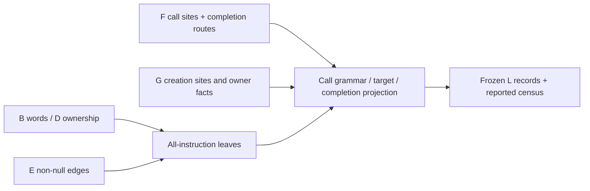

# Project numeric VM calls and completion

## 1. Target

Make each call's operand grammar, receiver, constructor metadata and continuation inspectable,
then connect serialized RETURN/THROW instructions to the completion routes already recovered
by F. `emitCallCompletion(B,C,D,E,F,G)` returns deeply frozen
`jsconfuser-vm-call-completion.v1` (L) or null; `diagnoseCallCompletion` returns the frozen
`{ok,result,diagnostic}` envelope. L produces records, not JavaScript or executed calls.
A result distinguishes recovered call/completion rows from passthrough but does not prove
callee behavior or complete exception semantics.

Readers need registers, lexical closures, calls and directed graphs. The declared dependencies
are [B typed grammar](read-wordcode.md), [D ownership](partition-functions.md),
[E control edges](build-cfg.md), [F frame/call/return facts](build-call-frames.md),
[G static site/lifetime facts](closure-lifetimes.md) and the encoder's
[call/completion contract](../../../js-confuser-vm/instruction-set.md#branches-and-call-completion).
PCs and widths are absolute u32-word positions/counts; register objects `{kind:register,index}`
are frame-relative indexes. VM function/site IDs describe static provenance, not runtime closure
instances. C is an API/schema parameter here; L does not read its reference values or frame facts
again. The active source-entry chain supplies owned successful predecessors.

## 2. Algorithm

A call instruction contains registers, whereas F says what those registers can statically
refer to. Index every B instruction by PC and every F call site by PC. D supplies function
ownership, and a per-function walk over E edges marks instruction reachability. Preserve all
serialized instructions, including unreachable ones. Calls get detailed records; other
non-completion operations get opaque leaves with their exact typed operands.

For CALL/CALL_METHOD/NEW, combine B's raw words with F's interpreted argument form. Preserve
fixed argument order or the one spread-array register. A method call carries the receiver
separately from the callee so later emission can preserve `this`. A constructor carries F's
allocation mode and the explicit-object-or-allocated-this return-rule label; L evaluates neither.
Recording register-read order does not re-evaluate the earlier property lookup that loaded a
method, or establish getter/proxy/coercion ordering in emitted JavaScript.

Classify a target as internal-closure exactly when F.calleeFunctions is nonempty. Otherwise use
host-or-dynamic; do not invent a function from a register number. G enriches known target IDs
with all matching static creation sites. This is a projection of F's current provenance, including
its documented result-transfer defect. It is not an independent repair or stronger inference.

Finally copy F completion routes into indexed route records. Join each RETURN/THROW to F's
same-PC record and to route IDs having the same function/source PC. This keeps an unreachable
completion in the record set without pretending it executed. Caller destinations describe
possible static callers, rather than an observed call stack.



### Worked example: fixed method call and spread construction

This **synthetic B/F projection example** uses already successful typed records; it is not a
complete stream or source-admission control. A CALL_METHOD at PC20 has words
`[43,1,4,7,1,6]`: destination r1, receiver r4, callee r7, count1, argument r6. Its width is6
and nextPc/continuationPc=26. F supplies those roles, arguments={kind:fixed,count:1,
registers:[r6]}, calleeFunctions=[], and a return destination/exceptional edge as recovered by F.
L grammar has kind=fixed, argcWord=1, sentinel=null, operandOffset=5, payloadWords=[6],
count=1, arrayRegister=null and registers=[r6]. Read steps are receiver(r4), callee(r7),
argument-count(word=1, register=null), `argument[0]` (r6), in that order. The count
value 1 comes from word offset4. Target kind is host-or-dynamic and receiverPreservation
carries r4 independently of that target decision. The exact selected read-order fields are
source-derived data (caveat prose is specified by meaning in item 3):

```json
{"kind":"left-to-right-register-read","roles":["receiver","callee","argument-count","argument[0]"],"steps":[{"order":0,"role":"receiver","register":{"kind":"register","index":4},"word":null},{"order":1,"role":"callee","register":{"kind":"register","index":7},"word":null},{"order":2,"role":"argument-count","register":null,"word":1},{"order":3,"role":"argument[0]","register":{"kind":"register","index":6},"word":null}]}
```

A NEW at PC30 with words `[44,2,5,65535,6]` has width5/continuation35. F arguments are spread
array r6, constructorState.mode=allocate-this, and calleeFunctions=[1]. L records
operandOffset=4/count=null/sentinel=65535/payloadWords=[6], reads callee(r5), count65535,
spread-array(r6), and target functionIds=[1]. G sites creating child1 add their IDs to
closureSiteIds. The row's construction.returnRule is explicit-object-or-allocated-this;
this remains metadata. Replacing NEW with CALL preserves the same argument grammar but
changes construction to ordinary-call and receiverPreservation to none. Its selected spread
read-order fields are:

```json
{"kind":"left-to-right-register-read","roles":["callee","argument-count","spread-array"],"steps":[{"order":0,"role":"callee","register":{"kind":"register","index":5},"word":null},{"order":1,"role":"argument-count","register":null,"word":65535},{"order":2,"role":"spread-array","register":{"kind":"register","index":6},"word":null}]}
```

For a RETURN at PC40 in function1, F.sourceRegister=r0 and any caller destinations are copied.
A matching F route at global completionRoutes index2 receives ID `completion:1:40:2` and is
referenced in that RETURN's routeRecordIds. No route is created merely because the words are a
RETURN. These worked rows are source-only examples; checked-in method/constructor/completion
controls below supply separate execution evidence.

## 3. Implementation

### Components and exact decisions

| Component | Input -> output | Decision / invariant |
|---|---|---|
| Owner/reachability index | D intervals/instructionPcs, E per-function edges | Owner from D; BFS follows every non-null E target from startPc. |
| Instruction projection | Every B instruction -> typed or opaque L leaf | Stable owner/PC key, including unreachable rows. |
| Call projection | B call + F same-PC site + G matching sites | Fixed/spread grammar, separate method receiver, target certainty inherited from F. |
| Completion join | B RETURN/THROW + F records/routes | Exact same-owner/source-PC route IDs, possible caller destinations. |
| Census/publisher | All generated records -> frozen L | Reports counts/uniqueness; no explicit generated-coverage refusal. |

For each D function map its id and every instructionPc to that owner. E BFS starts at fn.startPc,
uses its own edges grouped by sourcePc, follows all non-null targets and stores reachable keys
`${functionId}:${pc}`. Null terminal routes do not enqueue a target. Reachability is not computed
from G site flags. Missing successful producer fields can throw and be caught at the stage
boundary; exported helpers do not create a separately supported packet-input API.

Call argc is word3 for CALL/NEW and word4 for CALL_METHOD; payload starts one word later.
These offsets include the opcode at word0. `spread = F-call.arguments.kind == spread`, rather
than rechecking the raw sentinel. Grammar returns kind/argcWord/sentinel (the argc word for spread, the build's
sentinel, 65535 in the canonical build; otherwise null)/operandOffset/payloadWords/count (null for spread, raw argc otherwise)/
arrayRegister (F array register or null)/registers (F fixed registers or []). B/F already own
width and sentinel agreement. L does not reinterpret payload registers from their raw integers.

evaluationOrder has exactly kind/roles/steps/caveat. Build its ordered roles array first:
receiver for CALL_METHOD, then callee and argument-count; append spread-array for spread,
otherwise append argument[0] through argument[grammar.count-1] using grammar.count, not
F.registers.length. kind is left-to-right-register-read. Next build the role-to-register map:
method receiver and callee from F; spread-array from grammar.arrayRegister, or fixed
argument[i] from grammar.registers in array order. Finally map roles to steps, each with
zero-based order, role, register=`roleMap[role] ?? null`, and word. word is the raw argc value
for argument-count (word4 for methods, word3 otherwise), and null for every other role.
The argument-count register is null because it has no mapping; an absent/null register for
any other generated role also becomes null. This mapping does not truncate roles when a
register entry is absent. Normal owned B/F agreement remains the support boundary; an
inconsistent private sentinel is a contrast control, not admitted source grammar.

The caveat says this is compiler/runtime register-read order and leaves property access,
coercion, getters, proxies and final JavaScript semantics to later stages. Its substantive
meaning is part of this boundary; exact prose is not a cold acceptance field.

Target has kind/functionIds/closureSiteIds/closureSites/certainty. Internal means exactly
F.calleeFunctions.length>0; certainty=statically-proven-by-packet-f. For each matching G site
whose childFunctionId is included, preserve id/creationPc/parentFunctionId/childFunctionId/
childStartPc in G order; include every matching site, not just the site's current register
provenance. Dynamic targets have empty function/site lists and certainty=not-invented.
callMode equals target.kind. These certainty labels describe the producer's analysis boundary;
[F's known defects](build-call-frames.md#components-and-exact-provenance-decisions) still apply.

Normal completion is constructed from F: kind=call, sourcePc=site.pc,
targetPc=continuationPc, route=normal, mode=direct, callSitePc/continuationPc=site values,
payload.returnDestination=clone(F.returnDestination). Exceptional completion is copied from
F.exceptionalCompletion, and cfg is copied from F.cfg. L does not check route equality with E/H.

Each F.completionRoutes row, in array order, becomes
`{id:completion:<D-owner-of-sourcePc>:<sourcePc>:<index>,functionId,...route,
semanticBoundary:later-packet}`. The index is global, not local to a function. RETURN/THROW
records select these rows by functionId and sourcePc for routeRecordIds while copying
F.record.routes separately. constructorCallers filters F.callerDestinations on
constructorState.isConstructor and retains callSitePc/callerFunctionId/constructorState.
No hidden evaluation or simulated unwinding occurs in this join.

### Records, coverage and publication

Each instruction leaf has id=`instruction:functionId:pc`, functionId/pc/name/opcode/words/
width/nextPc/operands/wordOperands/reachable/kind/semanticBoundary. kind is lowercase opcode
name for CALL/CALL_METHOD/NEW/RETURN/THROW, otherwise opaque-instruction. The boundary is
later-packet even for a detailed family row. Each detailed call has id=`call:functionId:pc`,
identity/word/width/nextPc/reachable fields, destination/callee/receiver/receiverPreservation/
target/callMode/constructorState/construction/arguments/grammar/evaluationOrder/
continuationPc/returnDestination/completion/cfg/semanticBoundary.

Method receiverPreservation is {kind:call-method-this-argument,register,preservedThrough:
CALL_METHOD}; other calls have {kind:none}. NEW construction is {kind:new-construction,
allocationMode:F.mode,returnRule:explicit-object-or-allocated-this,semanticBoundary}.
Ordinary construction is {kind:ordinary-call,thisMode:receiver-register for methods or
null-or-host-default otherwise,semanticBoundary}. These labels are not the final emitted receiver
choice. The numeric adapter uses L target.kind for plain CALL: internal -> global receiver,
dynamic -> null receiver; method and constructor roles otherwise come from B operands.

RETURN/THROW rows have id=`return:functionId:pc` or `throw:functionId:pc`, identity/words/
width/nextPc/reachable, sourceRegister/payloadRegister/callerDestinations/routes from F,
routeRecordIds/constructorCallers/semanticBoundary. L output includes instructions/calls/
returns/throws/completionRoutes, cloned F.frame/F.frames, ownerFacts and the whole cloned G
closureLifetimes. ownerFacts are D functionId/kind/startPc/endPc/parentFunctionId/instructionPcs
plus IDs of G sites created by that parent and semanticBoundary.

Metadata includes schemaVersion/encoding, word/instruction/function counts, predecessorSchemas,
API descriptions, opcodeScope for the five relevant names, parseOnly=true, targetExecution/
emittedJavaScript/vmExecuted/finalJavaScriptSemantics=false and semanticBoundary. Inputs contains
word/instruction/function/CFG-edge/CFG-block/call-site/return/throw/closure-site/binding counts;
C contributes no reread values. boundaryOmissions groups every canonical peer name, including
ones absent from this input, as non-call-completion. It is an inventory, not an unsupported
opcode gate; peers retain opaque instruction leaves.

For each coverage family let expected be its producer family size, emitted the projected row
count and keys the generated IDs or owner/PC pairs. unique means distinct keys; complete means
`expected == emitted && distinct-key-count == expected`. Families are instructions (all B),
calls (B CALL/METHOD/NEW), completions (B RETURN/THROW), completionRoutes (F route count).
The census records countsByName, operationKeys for all five relevant names, callKeys,
completionKeys, counts and expected/emitted instruction counts. Its complete flag checks only
all-instruction count and relevant-key uniqueness; dropped/duplicated are initialized empty
arrays, not a diagnostic comparison to independently missing records. Proof flags compare
projected counts/keys and include carried-facts/no-execution intent. No coverage or census flag
is an explicit L refusal. [Diagnosis](standalone-diagnosis.md#k-m-plan-handoff) gates only
instructions/completions/completionRoutes.complete, not coverage.calls or census.complete.

One call publishes frozen whole-stage output or null. Deep cloning keeps all predecessors
unchanged; there is no AST mutation, binding recrawl, helper cleanup or retry state. An empty
call family is successful output with empty calls, not no candidate. There are no explicit typed
CallCompletionDecline throws in the current projector. Unexpected missing-map/property errors
become call-completion-analysis-error in diagnoseCallCompletion. emitCallCompletion discards
the diagnostic and returns null, leading to call-completion-declined in standalone diagnosis.
A completed record may still fail public opcode/coverage/emission gates.

### Testing and acceptance

| Scenario | Oracle / acceptance | Retained control or gap |
|---|---|---|
| L1 fixed/spread method and NEW | Exact grammar and evaluationOrder.kind/roles/steps; receiver independent of callee and constructor label. | Focused tests assert selected grammar fields/roles/receiver/constructor/target fields, not every step or whole row. The separate narrow field proof below asserts supplied-input grammar and selected kind/roles/steps, with caveat prose excluded. |
| L2 internal/dynamic target | Match F IDs and G all-matching sites; empty F targets stay dynamic; no inferred instance count. | Fixtures/L test assert selected target/site/owner projections, not whole rows. F result-defect cases remain quarantined. |
| L3 return/throw join | Exact F payload/routes, owner/source-PC route IDs and unreachable rows; passthrough lacks these records. | Reference/catch/finally tests assert selected payload/route/reachability fields; no whole RETURN/THROW reconstruction. |
| L4 publication | All generated family rows, deeply frozen result and unchanged predecessor snapshots. | Selected freeze/input-equality tests; the broader census loop was not part of the retained-input run. |
| L5 refusal boundary | Null result only at reached stage exception; public generic code distinct from detailed stage code. | Dedicated normal source-entry L refusal and standalone incomplete-family controls missing. |

Projection/read-order assertions do not replace runtime equivalence or actual encoder admission.
A negative control damaged before F/L does not test L's projection. Counterexamples to F/G
provenance are documented at those producers and must not be interpreted as callee semantics.

## 4. Input Shapes

| Producer spelling / consumer | Dependency used or published |
|---|---|
| [B](read-wordcode.md) canonical/rebuilt calls and typed registers | Exact words/widths/operands; argc offsets are raw-word offsets, not semantic-operand indexes. |
| [D](partition-functions.md) / [E](build-cfg.md) | Static function ownership and local non-null-edge reachability. |
| [F](build-call-frames.md) | Supplies grammar, actual callee/receiver/destination roles, candidate targets, return/throw records and completion routes. Its fixed-r2/r3 call-result defect is inherited. |
| [G](closure-lifetimes.md) | Supplies static site matches, owner facts and copied lifetime records; method-receiver/aggregate-precision/NEW limitations persist. |
| [K](structured-control.md) / [M](closure-exception.md) | Independent siblings. L consumes neither; M does not consume L or its route IDs. |
| [Diagnosis](standalone-diagnosis.md#k-m-plan-handoff) | Requires L, gates selected completeness and indexes only calls by owner/PC. |
| Numeric adapter / [standalone decoding](standalone-decode.md) | Consumes target.kind for plain-call receiver selection; operand grammar still comes from B. RETURN/THROW and M routes are not lowered from L route rows. |

H/I/J run earlier in the standalone call order but are not L inputs. Source normalizers must
supply current rebuilt B-E before F/G/L; L never merges old call-site PCs into changed words.

## 5. Known Gaps

- F's defective fixed-register result lookup can leave returned closures dynamic. Direct callee
  grammar remains correct but does not certify returned-target precision. L adds no repair.
- G's site/lifetime labels are static and have explicit precision limits. Matching child function
  IDs to every site is not a proof of the particular instance or invocation at a call.
- No general value propagation, property/coercion/host/proxy behavior, dynamic spread iteration,
  constructor return outcome or complete native exception graph is inferred.
- Reported family coverage is not internally refused as a whole. Owned-source production records
  bound the API; malformed private inputs and historical broad suite recipes add no qualification.
- Current normalized canonical inputs can reach L; raw hidden/PATCH words, earlier eras, fresh
  encoder output, whole-L cold reconstruction and novice readability remain unqualified here.

## Source

Moving decoder files are linked relatively; linked encoder foundations own their pinned runtime
contracts. No fresh encoder execution or reversal qualification is asserted.

| Source | Relevant ranges / role |
|---|---|
| [call-completion-input.js](../../../../decoder/decode-js/src/vm/jsconfuser-vm/call-completion-input.js) | Lines 1-95 schemas/family inventory; 116-184 ownership/reachability/leaves; 186-211 raw grammar projection. |
| [emit-call-completion.js](../../../../decoder/decode-js/src/vm/jsconfuser-vm/emit-call-completion.js) | Lines 23-218 call/read-order/target/route projection; 220-258 census; 260-458 result construction; 460-514 wrappers. |
| [diagnose-standalone.js](../../../../decoder/decode-js/src/vm/jsconfuser-vm/diagnose-standalone.js) | Lines 370-429 L call, selected complete flags and owner/PC calls map. |
| [numeric-to-vm-switch.js](../../../../decoder/decode-js/src/vm/jsconfuser-vm/numeric-to-vm-switch.js) | Lines 58-84 plain-call receiver use of L.target.kind, as item 3 states. |

## Fixtures

The [qualification provenance](../../../../decoder/decode-js/test/vm/jsconfuser-vm/fixtures/qualification-provenance.md)
owns retained input origin. Checked-in tests assert record projection; their historical corpus
loop is not rerun or upgraded by this design. Worked examples are source-only.

| Fixture / test | Scenario and bounded claim |
|---|---|
| [focused-call-method-spread](../../../../decoder/decode-js/test/vm/jsconfuser-vm/fixtures/corpus/focused/focused-call-method-spread/encoded.js) | L1 receiver r4/callee r7, fixed call@58 and spread call@64 with selected grammar/read-role assertions. |
| [focused-new-spread](../../../../decoder/decode-js/test/vm/jsconfuser-vm/fixtures/corpus/focused/focused-new-spread/encoded.js) | L1 NEW@45 allocation mode/spread grammar/internal function1. |
| [f-closures-state](../../../../decoder/decode-js/test/vm/jsconfuser-vm/fixtures/corpus/raw/f-closures-state/encoded.js) and [f-spread-order](../../../../decoder/decode-js/test/vm/jsconfuser-vm/fixtures/corpus/raw/f-spread-order/encoded.js) | L2 selected F/G target/site/owner fields and unresolved host target. |
| [reference](../../../../decoder/decode-js/test/vm/jsconfuser-vm/fixtures/reference/encoded.js), [f-throw-catch](../../../../decoder/decode-js/test/vm/jsconfuser-vm/fixtures/corpus/raw/f-throw-catch/encoded.js), [f-finally-abrupt](../../../../decoder/decode-js/test/vm/jsconfuser-vm/fixtures/corpus/raw/f-finally-abrupt/encoded.js) | L3 completion payloads/routes and unreachable returns, no simulated invocation. |
| [emit-call-completion.test.js](../../../../decoder/decode-js/test/vm/jsconfuser-vm/emit-call-completion.test.js) | L1-L4 selected grammar/roles/target/site/owner/payload projections and freeze/input equality. Full rows/steps are not asserted; L5 source-entry refusal missing. |

The predecessor [F controls](build-call-frames.md#fixtures) and [G controls](closure-lifetimes.md#fixtures)
retain known defect oracles and bounded document-first evidence. L's projection does not expand
those cold claims or resolve the defects.

The committed [L test](../../../../decoder/decode-js/test/vm/jsconfuser-vm/emit-call-completion.test.js)
exercises selected grammar/target/route/immutability tests and skips the reference completion
boundary and broad census loop. The original
retired frozen plan verifier, built from the documents before
source consultation, kept credit for complete selected normal-control grammar/target/receiverPreservation/construction/
normal-completion objects, selected evaluationOrder.kind/steps and reduced route/constructor-
caller joins. That original reconstruction's roles/caveat and whole evaluationOrder/call/
RETURN/THROW/census claims remain excluded. The private inconsistent-sentinel contrast supports only grammar's use of
F.arguments.kind; its entire read-order object is excluded.

The separate retired frozen field verifier,
built from the corrected documents before source consultation, reconstructed
complete grammar objects and selected evaluationOrder objects with exactly kind/roles/steps;
each step has exactly order/role/register/word. Valid fixed method, zero-fixed CALL and spread
CALL/NEW/method controls cover raw offsets/count, ordered roles, null count register and nullish
role lookup. Canonical words and F callee/receiver/argument facts are supplied; no provenance or
target inference is rebuilt. Extra/missing-register cases are private contrasts, not admitted
B/F disagreements. Missing grammar arrays, source grammar/refusal, caveat prose, target/
receiverPreservation/construction/completion/call rows and census/publication remain outside
this new proof. Source-only examples, retained-input execution and original cold exclusions
remain separate; there is no whole-L, public rendering or native-behavior claim.
