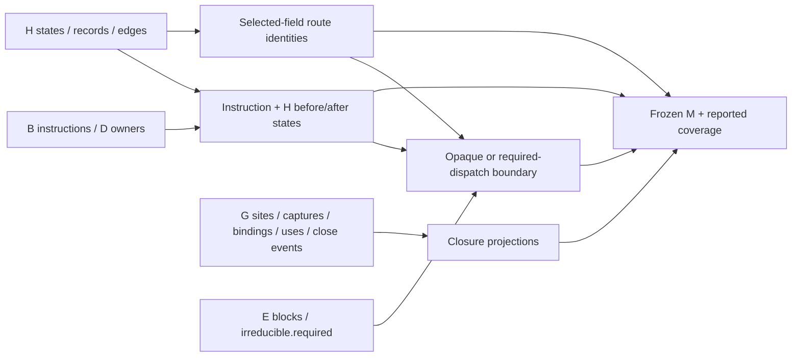

# Project numeric VM closures and exceptions

## 1. Target

Join the owned closure relationships and exception states into one inspectable record set with
stable route references. `emitClosureException(B,C,D,E,F,G,H)` returns deeply frozen
`jsconfuser-vm-closure-exception-emission.v1` (M) or null; `diagnoseClosureException` returns
frozen `{ok,result,diagnostic}`. The observable recovery is instruction/site/capture/binding/
state/completion records, not JavaScript emission or executed closures/exceptions. Whole-stage
success can still precede an emission refusal.

Readers need lexical captures, registers, graphs and handler/finally completion. Declared
foundations are [B instructions](read-wordcode.md), [D owners/sites](partition-functions.md),
[E blocks/routes](build-cfg.md), [G binding/lifetime records](closure-lifetimes.md) and
[H states/finalizer restrictions](exception-finally.md). The encoder's
[frame/capture state](../../../js-confuser-vm/container-wordcode.md#frame-and-capture-state) and
[abrupt completion](../../../js-confuser-vm/instruction-set.md#catch-finally-and-abrupt-completion)
provide the narrow runtime context. PCs count absolute u32 words; register indexes are relative
to an owning function frame, and static binding IDs do not distinguish repeated runtime frames.
C and F remain API/schema parameters; M does not read their facts. M consumes neither K nor L.

## 2. Algorithm

G has already resolved which ancestor register owns each capture. H has already projected
handler states and applied its supported finally-routing restrictions. M preserves these facts
rather than repeating their analyses. First attach D ownership and H before/after states to every
B instruction. Next project G creation sites, capture edges, interned bindings, upvalue uses and
owner-close transitions. Site capture lists follow G's ordered capturePairIds, so inherited
captures still point to their original ancestor binding.

Then project H handler/finalizer records, states, merges, transitions and finite continuation
checks. Build a route ID from the selected route-defining fields of each H edge. Completion
routes reuse those edge IDs. This makes each block successor and each RETURN/THROW route refer
to the same inventory without confusing handler state annotation with edge identity.
Finally functions get block/instruction/route references and an independent fallback boundary:
state-machine only when E.irreducible.required is exactly true, otherwise opaque. M makes no
structured-control choice, even for a function K labels linear or conditional.



The arrows describe actual data dependencies. F call frames, L call/completion rows and K control
regions are absent from the join. A lifetime-transition label such as closed-captured-value is
inherited static knowledge, not evidence that an allocated closure cell closed in a particular
execution. Likewise, a finalizer throw pad is recorded with its continuation/payload registers;
M never traverses the finalizer to calculate a pending value.

### Worked example: inherited binding and a terminal route

This **synthetic producer-record example** reuses the
[G inherited-capture example](closure-lifetimes.md#worked-example-inherited-capture), not a
complete word stream. Child2 capture0 at creationPC20 in parent1 refers to parent upvalue0,
ultimately owned by function0 r2. G pair `capture:1:20:0` identifies child closure
`closure:1:20`, childFunctionId=2, bindingId=`binding:0:register:2`,
bindingOwnerFunctionId=0, bindingRegister=r2. M's captureRecords copies those fields and adds
kind=capture-edge/semanticBoundary=later-packet. The site record's captures[0] is the copied
whole G pair, rather than a second owner resolution. Suppose G supplies the owned-style close
event {bindingId:binding:0:register:2,sourcePc:12,functionId:0,kind:return,
completion:return,route:propagate,mode:direct,callSitePc:null}. M first installs a preliminary
kind=closure-lifetime-transition, then spreads that event over it. The final selected row is:

```json
{"id":"lifetime:binding:0:register:2:0:12","kind":"return","fromState":"open-upvalue","toState":"closed-captured-value","bindingId":"binding:0:register:2","sourcePc":12,"functionId":0,"completion":"return","route":"propagate","mode":"direct","callSitePc":null,"semanticBoundary":"later-packet"}
```

An owner0 THROW@16 close event with kind=throw/completion=throw and the same other route
metadata produces id=lifetime:binding:0:register:2:0:16 and final kind=throw/completion=throw;
fromState/toState remain the two labels above. These are complete owned-style projected lifetime
rows for the supplied events, shown as source-derived data, not executed controls. The preliminary
transition tag does not survive. The rows describe static events, not instance counters.

For a separate root RETURN@4 with words `[45,0]`, suppose H supplies edge
{functionId:0,kind:return,sourcePc:4,targetPc:null,route:propagate,mode:direct,
callSitePc:null,continuationPc:null,payload:{returnRegister:0}}, plus handler-state annotations.
Its selected-field serialization is
`{"functionId":0,"kind":"return","sourcePc":4,"targetPc":null,"route":"propagate","mode":"direct","callSitePc":null,"continuationPc":null,"payload":{"returnRegister":0}}`.
M edge ID is `route:` followed by that string. The completion route at owner0/source4 reuses
that ID. M completion `completion:0:4` reads sourceRegister=r0 from words[1], has
payloadRegister=null, and copies the matched route. Changing only H handlerStateAfter does not
change route ID; changing targetPc or payload does. These explicit null fields are retained;
JSON would omit an undefined property.

With E.irreducible.required=false, M.function.fallback stays opaque, even if K independently
recognized a linear region. If it is true, M dispatch states are E block IDs, and successorRouteIds
refer to the route strings above. No `try`, `catch`, cell allocation or dispatch JavaScript is
produced. The example's supplied facts are source-only; execution evidence below is distinct.

## 3. Implementation

### Components and record inventory

| Component | Consumes -> produces | Consumer invariant |
|---|---|---|
| Instruction projector | B instructions + D owners + flattened H state map | One owner/PC ID per instruction, exact B record plus reachability/stacks. |
| Closure projector | G site/pair/binding/use/termination arrays | Stable static relationships; all cloned, no lifetime/provenance solver. |
| Exception projector | H records/states/merges/transitions/jumps | Tagged emission views plus raw cloned arrays. |
| Route join | H edgeStates/completionRoutes -> edges/routes | Completion IDs refer to the same selected-field edge key. |
| Function boundary | D functions + E blocks + generated instruction/edge IDs | Resolve every block reference; independent E-required fallback only. |
| Census/publisher | Generated rows -> metadata/coverage/frozen M | Selected explicit consistency refusals; other flags remain reporting. |

Build functionById and ownerByPc from D.functions and their instructionPcs. H flattened
instructionStates are keyed `${functionId}:${pc}`. Every B instruction becomes
{id:`instruction:functionId:pc`,kind,functionId,...B instruction,reachable,
handlerStateBefore,handlerStateAfter,semanticBoundary:later-packet}. kind is closure-creation
for MAKE_CLOSURE, handler-setup for TRY_SETUP, handler-finally-end for TRY_END,
finally-setup for FINALLY_SETUP, completion for RETURN/THROW and opaque-opcode otherwise.
Copy null H states as null, not empty known states. Missing required producer state can throw.

The G schema and exact resolution algorithm remain
[normative predecessor contracts](closure-lifetimes.md#components-and-record-identity).
M's named output views are:

| Output array | Exact projection / added fields |
|---|---|
| closureRecords | Site id; kind=lexical-closure-creation; creationPc/parentFunctionId/childFunctionId/childStartPc/destinationRegister/reachable/capturePairIds/escapeEvents; captures are whole G pairs in capturePairIds order. |
| captureRecords | Pair id; kind=capture-edge; creationPc/parentFunctionId/childFunctionId/childStartPc/childClosureId/captureIndex/source/bindingId/bindingOwnerFunctionId/bindingRegister. |
| bindingRecords | Binding id; kind=lexical-binding; ownerFunctionId/register/capturePairIds/useIds/lifecycle. |
| upvalueUseRecords | Whole G use; kind=upvalue-use. |
| lifetimeTransitionRecords | Assign id/fromState/toState and preliminary transition tag, then spread whole G event; final owned kind is return/throw. See update order below. |

For lifetimeTransitionRecords, assignment order is consequential: first generate
id=`lifetime:${event.bindingId}:${event.functionId}:${event.sourcePc}`, then set preliminary
kind=closure-lifetime-transition/fromState=open-upvalue/toState=closed-captured-value; spread
the cloned whole G event next; set semanticBoundary=later-packet last. Current owned G terminal
events contain bindingId/sourcePc/functionId/kind/completion/route/mode/callSitePc. They do
not contain id/fromState/toState, so those preliminary fields survive, but event.kind overwrites
the preliminary kind. Final kind and completion are both return or both throw, inherited from
G's owner's null-target return/throw edge. callSitePc is G's edge value or null. Thus the final
owned row fields are id/kind/fromState/toState/bindingId/sourcePc/functionId/completion/route/
mode/callSitePc/semanticBoundary. The transition-style tag is an intermediate source assignment,
not the current published kind or a promised production repair.

Every projected row adds semanticBoundary=later-packet. Whole raw clones are also published as
closureSites/capturePairs/bindings/uses/terminationEvents. They retain G's original field sets;
the raw and tagged views are not the same schema. Site captures do not acquire the capture-edge
tag of captureRecords. No missing pair is independently resolved or guessed by M.
Termination IDs omit completion kind, so ID uniqueness is a reported property, not a proof of
distinct runtime close events.

Exception projections copy the complete
[H rows](exception-finally.md#records-routes-and-state) and add the following IDs/kinds:

| Output | ID / kind |
|---|---|
| handlerEmissionRecords | H record ID / try-catch-region |
| finallyEmissionRecords | H record ID / try-finally-region |
| handlerFinallyStateRecords | `state:functionId:pc` / handler-finally-state |
| mergeRecords | `merge:functionId:pc` / handler-finally-merge |
| transitionRecords | `transition:functionId:pc` / handler-finally-transition |
| finallyContinuationChecks | `jump-reg:functionId:pc` / finally-continuation-check |
| throwPadRecords | `throw-pad:finalizerId` / finally-throw-pad |

Throw-pad rows explicitly retain finalizerId/ownerFunction/setupPc/finallyPc/continuationReg/
payloadReg/throwPadPc and semanticBoundary. Other tagged exception rows add semanticBoundary
to copied H rows. Raw clones are handlerRecords/finallyRecords/exceptionStates/edgeStates/
merges/jumpRegChecks/transitions/completionRoutes. M does not recompute stack transitions,
apply H restrictions again or add native-operation exception edges.

### Route identity and completion

For each H edge, construct an object in this exact property order:
functionId, kind, sourcePc, targetPc, route, mode, callSitePc, continuationPc, payload.
`edgeKey = JSON.stringify(object)`; `id = "route:" + edgeKey`. Undefined values are omitted
by JSON, nulls are retained, and payload's existing property order is preserved. condition,
handlerStateBefore/After and other annotations do not enter the key. H supplies owned stable
objects; this is not a general canonical serializer. M's key is distinct from
[K's full-edge key](structured-control.md#components-and-classification-decisions) and
[L's index-based completion ID](call-completion.md#components-and-exact-decisions).

edgeRecords copies every H.edgeState and adds id/semanticBoundary. Map selected-field key to
ID in edge order; identical keys overwrite the lookup with the same string. routeRecords
projects H.completionRoutes, reusing the ID looked up by the same key. Missing route lookup
alone leaves id undefined here; it is not an explicit routeRecords refusal. Block successor
resolution below does refuse missing edges. Under owned H output the completion subset is
already the return/throw/handler/finally edge subset; M does not reconstruct that selection.

For each instruction named RETURN/THROW, completionRecords has
id=`completion:functionId:pc`, kind=return-completion or throw-completion,
functionId/pc/name/opcode/words/width/operands, sourceRegister={kind:register,index:words[1]},
payloadRegister=that source register for THROW, otherwise null, reachable and semanticBoundary.
Its routes are cloned projected routeRecords matching functionId and sourcePc. Unlike L,
M has no callerDestinations/constructorCallers or F route join, and no nextPc field in this view.
The inherited E/H RETURN payload metadata is preserved, including the known active-finalizer
boundary; M does not repair it into a universal runtime completion claim.

### Function boundary, coverage and refusal

For each D function find E's same-ID function. Map each E block to id/startPc/endPc/
instructionPcs/instructionIds/successorRouteIds/handlerStateIn. Instruction IDs come from
M's owner/PC map; missing ID declines incomplete-instruction. Successor IDs come from each
E block.successor's selected-field key in H-derived edgeRecords; missing ID declines
invalid-route-identity. The block state is copied from E, not independently matched to H.

Each function view has id/kind=function-emission-boundary/functionKind/startPc/endPc/
parentFunctionId/regCount/paramCount/captureCount/hasRest/blocks/fallback/semanticBoundary.
If `E-function.irreducible.required === true`, fallback has kind=state-machine/required=true,
stateVariable=__jsconfuserVmState/entryBlockId=`functionId:b@startPc`, dispatch rows
{state:block.id,blockId,successorRouteIds} in E block order, and cloned E.irreducible proof.
Otherwise fallback={kind:opaque,required:false,blockIds,reason}. No K regions or sorted K
blockOrder are copied. K uses nonempty E.regions for its independent choice; those predicates
agree for current successful E but are different source decisions.

M explicitly refuses duplicated generated instruction owner/PC keys (duplicated-instruction)
and an instruction projection that lacks some B PC (incomplete-instruction). It also has the
block-reference refusals above. These are generated construction checks, not a new admission
validator for arbitrary packets. There is no blanket check rejecting every incomplete coverage
family. Typed errors return `{ok:false,result:null,diagnostic:{code,message}}`; unexpected errors
use closure-exception-error. emitClosureException returns only result or null, so standalone
reports closure-exception-declined and discards detailed codes.

Coverage uses expected=producer size, emitted=projected count, unique=distinct key count equals
key count, and complete=`expected == emitted && distinct-key-count == expected` for:

- instructions, keyed owner/PC against B;
- closures.sites/capturePairs/bindings/uses/terminationEvents, keyed output ID against G arrays;
- exceptions.handlers/finalizers/states/edges/merges/transitions/jumpRegChecks/throwPads against
  H, with edges keyed by selected-field route key and throwPads expected=H.finallyRecords.length;
- exceptions.setupInstructions/tryEnds/throws against B opcode-family counts, keyed owner/PC;
- completions against B RETURN/THROW, keyed completion ID;
- routes and completionRoutes against H.completionRoutes, keyed reused route IDs (same formula).

Function coverage uses the generated function count for both expected/emitted, ID uniqueness
and **complete=true**; it is not a comparison to an independent inventory. Census has
opcodeCounts, closure category counts (source.kind local/upvalue), exception operation/record
counts, return/throw completion counts and routes grouped by kind/route. Metadata includes
schema/encoding/counts/predecessorSchemas, parseOnly=true and targetExecution/emittedJavaScript/
vmExecuted/finalJavaScriptSemantics=false. The proof's exactInstructionCoverage/
exactClosureCoverage/exactExceptionCoverage=true are assigned intent flags, not a conjunction of
all coverage flags; ownerIdentityFromPacketD compares owner-map size to B instruction count.
[Diagnosis](standalone-diagnosis.md#k-m-plan-handoff) gates only M instructions/completions/
routes.complete, not every nested family or function coverage.

Inputs remain unchanged. All output views are new cloned data and deeply frozen on publication;
no source AST mutation, binding recrawl, helper deletion, runtime state change or partial model
publication occurs. Empty closure/handler families are successful empty arrays. A complete M
record can fail later coverage or rendering; it cannot upgrade F/G/E/H precision by copying it.

### Testing and acceptance

| Scenario | Oracle / acceptance | Retained control or gap |
|---|---|---|
| M1 local/inherited captures | Same G ancestor binding/register, pair order, use IDs and static lifecycle; final lifetime kind from event spread. | M test asserts selected capture/owner/lifecycle/use/close fields, not final kind/full lifetime rows. The separate narrow field proof below asserts whole lifetime rows only from supplied field-shape events. |
| M2 catch/finally projection | Exact H states/nullness/transitions/pad operands and reused route ID; no invented pending value. | Fixtures/M test assert selected exception/pad/merge/state/route-kind/coverage fields; full projection and key invariance unasserted. |
| M3 fallback | E.required true -> exact dispatch references; false -> opaque even when K is structured. | M tests assert fallback kind/required/dispatch count. Reference opaque test was skipped in retained run; full dispatch references are separate reduced cold evidence. |
| M4 route identity | Selected fields determine ID; handler-state-only change does not; RETURN/THROW word1 selects source. | Source-only worked example; checked-in tests assert route prefix/type but not the complete key invariance matrix. |
| M5 publication/refusal | Deep freeze/input equality; missing block instruction/edge reference gives named whole-stage null. | Positive freeze/input-equality test; reduced cold consistency controls are private. Dedicated source-entry guard reachability remains missing. |

Record assertions distinguish projection from passthrough. They do not establish closure-instance
identity, all runtime exceptions or structured source recovery. Negative source controls reaching
G/H refusal are evidence for those producers, not for M's construction checks.

## 4. Input Shapes

| Producer spelling / consumer | Dependency used or published |
|---|---|
| [B/D](partition-functions.md) canonical or normalizer-rebuilt instructions/owners | Supply complete current instruction words/PCs and static ownership before projection. |
| [E](build-cfg.md) block.successors and irreducible.required | Supply route-reference graph and independent fallback requirement. |
| [G](closure-lifetimes.md) local/inherited captures and static event/lifetime rows | Preserve original ancestor binding; inherit G/F precision defects and static-instance boundary. |
| [H](exception-finally.md) flattened states/edgeStates/completionRoutes | Supply annotated routes and finalizer restrictions; missing native-operation exception edges remain missing. |
| [K](structured-control.md) / [L](call-completion.md) | Independent siblings; M has no input for their plans/IDs/call-target meaning. |
| [Diagnosis](standalone-diagnosis.md#k-m-plan-handoff) | Requires M and selected coverage flags, retains closureException in the model. |
| Numeric adapter / [standalone decoding](standalone-decode.md) | Adapter does not read closureException. It lowers B/D/K/L facts; retained M is evidence, not the emitter's closure/exception instruction source. |

I/J are earlier scheduled analyses, not M semantic dependencies. Every normalization that changes
PCs must rebuild current B-E before G/H/M. This chain does not combine old site/route IDs with a
relocated stream or mutate successful predecessor records between these sibling projections.

## 5. Known Gaps

- Complete projections are bounded by G's static binding/use/escape heuristic and E/H's modeled
  routes. Known F/G defects and native-operation exception omissions remain quarantined.
- Reused selected-field route IDs are internal references, not a canonical identity independent
  of payload order or rewrites. Missing route ID alone is not locally refused by the route projector.
- Nested coverage and assigned proof flags do not establish a fully validated semantic program.
  M's opaque fallback is a record boundary, not a universal opaque source emitter.
- The preliminary closure-lifetime-transition tag is overwritten by owned G event.kind. The
  retained M test does not assert final kind, and the original cold oracle for that field is
  excluded. The separate narrow field proof covers current return/throw kind and complete rows
  only for supplied events; it does not establish G event production or reachability.
- No instance multiplicity, upvalue values, host behavior, pending-completion value evaluation,
  final JavaScript equivalence or whole-M cold reconstruction is claimed.
- Successful normalized canonical records can enter M; raw hidden/PATCH variants, earlier eras,
  fresh encoder qualification and novice readability are outside this evidence boundary.

## Source

Moving decoder links are relative; linked predecessor/encoder foundations own their algorithms
and pinned runtime context. Source inspection is separate from qualification or cold evidence.

| Source | Relevant ranges / role |
|---|---|
| [closure-exception-records.js](../../../../decoder/decode-js/src/vm/jsconfuser-vm/closure-exception-records.js) | Lines 1-137 constants/helpers; 139-175 route keys/IDs; 177-223 instruction records/refusal; 225-297 closure views, including 282-288 lifetime spread order. |
| [closure-lifetimes-flow.js](../../../../decoder/decode-js/src/vm/jsconfuser-vm/closure-lifetimes-flow.js) | Lines 179-196 define owned terminal event kind/fields. |
| [analyze-closure-lifetimes.js](../../../../decoder/decode-js/src/vm/jsconfuser-vm/analyze-closure-lifetimes.js) | Lines 97-103 add bindingId to flattened termination events. |
| [emit-closure-exception.js](../../../../decoder/decode-js/src/vm/jsconfuser-vm/emit-closure-exception.js) | Lines 27-116 exception/completion projection; 118-191 function references/fallback; 193-500 coverage/result; 502-582 wrappers. |
| [diagnose-standalone.js](../../../../decoder/decode-js/src/vm/jsconfuser-vm/diagnose-standalone.js) | Lines 382-429 M call, selected coverage and retained model field. |
| [numeric-to-vm-switch.js](../../../../decoder/decode-js/src/vm/jsconfuser-vm/numeric-to-vm-switch.js) | Lines 58-260 B/D/L instruction lowering; 262-316 K control adaptation; no M read, as item 4 states. |

## Fixtures

The [qualification provenance](../../../../decoder/decode-js/test/vm/jsconfuser-vm/fixtures/qualification-provenance.md)
owns retained fixture origins. No fresh producer execution or broad qualification is inferred
from the following projection tests. Worked examples remain source-only.

| Fixture / test | Scenario and bounded claim |
|---|---|
| [reference](../../../../decoder/decode-js/test/vm/jsconfuser-vm/fixtures/reference/encoded.js) | M3 all typed instructions, RETURN@30 source r2 and opaque fallback. |
| [f-closures-state](../../../../decoder/decode-js/test/vm/jsconfuser-vm/fixtures/corpus/raw/f-closures-state/encoded.js) and [program-cash](../../../../decoder/decode-js/test/vm/jsconfuser-vm/fixtures/corpus/raw/program-cash/encoded.js) | M1 selected local/inherited capture owner/binding/lifecycle/use/close fields; final lifetime kind unasserted by M test. |
| [f-throw-catch](../../../../decoder/decode-js/test/vm/jsconfuser-vm/fixtures/corpus/raw/f-throw-catch/encoded.js) | M2 handler routes and THROW records; no new exception-edge solver. |
| [f-finally-abrupt](../../../../decoder/decode-js/test/vm/jsconfuser-vm/fixtures/corpus/raw/f-finally-abrupt/encoded.js) | M2 finalizer/pad/merge/continuation/abrupt-route fields. |
| [emit-closure-exception.test.js](../../../../decoder/decode-js/test/vm/jsconfuser-vm/emit-closure-exception.test.js) | Selected capture/lifecycle/use/exception/pad/merge/route-kind/coverage fields, fallback kind/count and freeze/input equality. Final lifetime kind/full rows/dispatch references/key invariance/source-entry refusal matrix unasserted. |

The irreducible control supplies words `[40,0,5,39,5,39,3]` through B-E/F/G/H producers;
expected dispatch length is E block count and kind=state-machine/required=true. This is a
checked-in producer-built synthetic control, not serialized encoder irreducibility evidence.
[G's retained evidence](closure-lifetimes.md#fixtures) and
[H's retained evidence](exception-finally.md#fixtures) bound the copied facts; their selected
cold proofs do not establish whole-M reconstruction. The existing M corpus loop is a projection
census and is not freshly rerun by this specification.

The committed [M test](../../../../decoder/decode-js/test/vm/jsconfuser-vm/emit-closure-exception.test.js)
exercises selected closure/exception/fallback/immutability projections, with reference opaque
and corpus tests skipped. The original
retired frozen plan verifier, built from the documents before
source consultation, kept credit only for selected inherited site/capture rows, lifetime ID/fromState/toState/ancestor
fields, reduced route/completion/fallback references and consistency decisions over supplied
projected facts. The original final lifetime kind and complete lifetime-row claims are excluded.
M THROW/binding/use/exception-state projection and all nested family coverage were not rebuilt;
private consistency controls establish no normal source-entry guard reachability.

The separate retired frozen field verifier,
built from the corrected documents before source consultation, reconstructed
entire lifetime rows for supplied return/throw events, with exactly id/kind/fromState/toState/
bindingId/sourcePc/functionId/completion/route/mode/callSitePc/semanticBoundary. The proof covers
whole-event spread, final semanticBoundary assignment, private overwrite/own-undefined
contrasts and empty events. G event production, binding resolution and provenance are supplied.
The positive throw event is owned-style in field shape; its deliberately supplied handler/catch/
callSite metadata is projection data, not a qualified G null-target event or source admission.
Other raw/tagged views, binding/use/state/routes/completion/fallback/census/publisher remain
outside this proof. It gives separate credit to corrected projected lifetime fields, without
repairing the original frozen kind/whole-row exclusions or production's preliminary tag. The
worked examples remain source-only; neither retained-input tests nor this narrow cold proof
establish whole M, native behavior or public emission.
