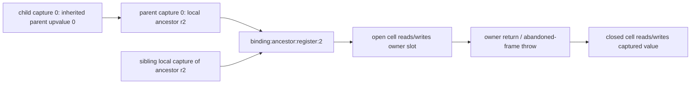

# Analyze closure binding lifetimes

## 1. Target

Resolve every captured upvalue to its owning function/register binding, then describe its uses,
close events and statically observed escape paths. `analyzeClosureLifetimes(B,C,D,E,F)` returns
deeply frozen `jsconfuser-vm-closure-lifetimes.v1` (G) or null; `diagnoseClosureLifetimes` returns
frozen `{ok,result,diagnostic}`. G recovers binding relationships, not runtime values or emitted
JavaScript. Readers need lexical scope, captures, registers and directed graphs, plus
[B semantic operands](read-wordcode.md), [C's coarse bounds](validate-references.md),
[D's lexical parents/sites](partition-functions.md), [E routes](build-cfg.md) and
[F call/return facts](build-call-frames.md). [Babel](../../babel.md) governs source bindings;
G's binding identity is a VM function/register pair, not a Babel binding object.

`diagnoseClosureLifetimes` exposes detailed stage diagnostics. `analyzeClosureLifetimes` returns only the
result or null, discarding those details. Standalone reconstruct uses that wrapper and reports
`closure-lifetimes-declined` on null; the plugin preserves this generic standalone diagnostic.

## 2. Algorithm

A capture index belongs to the child closure, while a local register belongs to its creating
parent frame. Resolve each child's ordered descriptor captures recursively: a local capture
ends at the parent register; an inherited capture follows that parent's upvalue until it reaches
the same ancestor register. Intern that owner pair so sibling/nested captures share one static
binding. C's stream-wide bounds are insufficient for this decision: the actual parent must own
the register or upvalue.

Build capture-pair rows at each D creation site and attach LOAD_UPVALUE/STORE_UPVALUE rows to
the resolved binding. Keep unreachable sites/uses with a reachability flag. Find owner-terminal
E return/throw edges to record when captured cells can close. A finally-entry edge is not itself
an owner termination: close events require targetPc=null.

Then track closure **creation-site IDs**, rather than F's function-target IDs, through limited
register/container provenance. A return or global store of a precise site value records a proven
escape; call arguments, receivers and property stores record uses without claiming escape.
Combine these events into each upvalue use's possible open/closed labels. These are the current
static classification heuristic, not a path-sensitive proof of every runtime invocation.

The graph identifies a static owner. The pinned runtime deduplicates by the **absolute slot of
one live frame**; repeated recursive invocations are distinct cells even though G uses the same
static binding ID. RETURN closes before clearing the owner frame; exceptional unwinding closes
abandoned frames before releasing them. Inherited captures share the original Upvalue object,
rather than copying its value. The encoder [cell/frame contract](../../../js-confuser-vm/container-wordcode.md#frame-and-capture-state)
owns these runtime storage details.

### Worked example: inherited capture

This **synthetic descriptor/ownership example** declares function 0 root regCount=3; function 1,
parent 0, captures local r2; function 2, parent 1, captures upvalue 0. Suppose creation sites are
root PC0 -> child1 and child1 PC20 -> child2, and function2 reads capture0 at PC40. Supplied PCs
are word boundaries in the declared B/D scaffolds; this is not a complete stream.

Both captures resolve to `binding:0:register:2`. The pair at PC20 is
`capture:1:20:0`, source={kind:upvalue,parentFunctionId:1,upvalueIndex:0},
childClosureId=`closure:1:20`, bindingOwnerFunctionId=0, bindingRegister=r2. The use is
`use:2:40`, operation=read, upvalueIndex=0, with that same bindingId. Its register field names
the LOAD_UPVALUE destination, not the ancestor register. If E has owner0 RETURN@12 -> null,
that is the binding's close event even though the child's code is serialized later.
Changing child2's capture to parent upvalue1 with parent.captureCount=1 reaches incomplete-capture
only if C's global capture maximum still permits index1 (for example a separate descriptor has
captureCount=2). An index outside all descriptors would stop at C and prove nothing about G.
Restoring capture0 is the valid opposite control.

## 3. Implementation

### Components and record identity

| Component | Input -> output | Decision |
|---|---|---|
| Owner resolver | D descriptors/parents -> interned bindings | Recursive local/upvalue resolution with memoization and cycle refusal. |
| Site/use projector | D sites + B upvalue operands + E reachability -> pairs/sites/uses | Exact IDs and semantic operand offsets below. |
| Close-event projector | E terminal routes + bindings -> lifecycle | Only owner's null return/throw edges; must have at least one. |
| Site provenance | B/E + F call targets/returns -> precise site sets/events | Fixed point and limited aggregate propagation. |
| State classifier | Site events + bindings/uses -> possibleStates | Exact heuristic below, no runtime lifetime simulation. |
| Publisher | Complete G -> deeply frozen result | Private indexes only; no predecessor/AST mutation. |

PCs/entries/endPc are absolute word indexes; indexes in register/upvalue objects remain relative.
IDs are `binding:ownerId:register:index`, `closure:parentId:creationPc`,
`capture:parentId:creationPc:captureIndex` and `use:functionId:pc`. Capture order is the
child descriptor order at each D site. Function IDs follow D, not traversal depth.

Memoize resolution by functionId:captureIndex. Local capture requires a parent and
index < parent.regCount. Upvalue capture requires a closure parent and index < parent.captureCount;
recurse into that parent's descriptor. Cycle/no parent owner -> incomplete-capture. Pair rows
carry id/creationPc/reachable/parentFunctionId/childFunctionId/childStartPc/childClosureId/
captureIndex/source/bindingId/bindingOwnerFunctionId/bindingRegister. A local source contains
kind/parentFunctionId/register; an inherited source kind/parentFunctionId/upvalueIndex.
Site rows carry id/creationPc/parentFunctionId/childFunctionId/childStartPc/destinationRegister/
reachable/capturePairIds/escapeEvents.

For LOAD_UPVALUE select B.operands[1] as upvalue and [0] as destination; STORE_UPVALUE selects
[0] as upvalue and [1] as source. index >= owner.captureCount -> use-without-owner. Use rows
carry id/pc/functionId/operation=read|write/upvalueIndex/register/bindingId/reachable/state/
possibleStates. Resolving captures and collecting uses fills each binding's pair/use ID arrays.

For every resolved binding, collect E edges with functionId=owner, targetPc=null and
kind=return|throw. Preserve sourcePc/functionId/kind/completion/route/mode/callSitePc (null when
absent). No event -> unknown-lifetime. Lifecycle fields are initialState="open-upvalue",
afterCloseState="closed-captured-value", runtimeIdentity=owner-function-register-slot and closeEvents.
Binding output has id/ownerFunctionId/register/capturePairIds/useIds/lifecycle;
terminationEvents flattens closeEvents with bindingId. This is a static close opportunity, not
an allocation count or a guarantee all executions terminate.

### Site provenance and classification

An abstract value is `{precise:Boolean,sites:Set<closureId>}`. Entry/unknown is false/empty;
known non-closure is true/empty; creation is true/singleton. Join is precision AND and site union.
Only precise values generate events. MAKE_CLOSURE seeds its site; MOVE copies; BUILD_ARRAY and
BUILD_OBJECT union all payload registers, including object keys; LOAD_THIS/INT/CONST become
known-empty; other register-result operations become unknown. There is no property-load alias
recovery or upvalue contents analysis.

For a call, read the actual callee operand (METHOD [2], otherwise [1]), and fixed F argument
registers or its single spread array register. **Join all fixed argument values before emitting
argument events**, starting with precise/empty: precision is AND across every argument, and sites
is their union. Zero arguments yields precise/empty; spread reads one aggregate register. One
imprecise argument suppresses argument-site events for every otherwise precise closure argument,
not just the imprecise register. Callee/receiver events are separate decisions. Event kinds are invoke-internal/external,
internal/external-call-argument and internal/external-call-receiver, selected solely by whether
F.calleeFunctions is nonempty, all provenEscape=false. Current METHOD receiver-event lookup
reads **B.operands[0] (destination)** instead of [1] (receiver); conclusions about receiver uses
are quarantined. On an E edge kind=call, overwrite destination with joined summaries for
F.calleeFunctions, starting from known-empty (missing summary -> unknown); on every other call
edge overwrite destination unknown. Thus an unresolved external call currently yields a
known-empty normal result, and NEW applies the same summary transfer as ordinary calls. Neither
is a runtime proof of non-closure/constructor-result behavior; these affected conclusions remain
unqualified. This differs from F's exceptional-input preservation.

STORE_GLOBAL examines its last operand and emits global-store/provenEscape=true; RETURN examines
operand0 and emits return/provenEscape=true; SET_PROP/DEFINE_GETTER/SETTER examine their last
operand and emit property-store/provenEscape=false. Event fields are kind/functionId/pc/
provenEscape/targetFunctions (sorted). Deduplicate by siteId, kind, functionId, pc, provenEscape.
No event is inferred merely from THROW or an imprecise value.

For each function, start at entry with unknown register values; transfer separately for each E
edge, join at non-null successors and requeue changed environments. Join reachable F RETURN
source cells for its summary; no reachable returns -> unknown. Begin all summaries unknown;
repeat at most `functionCount*4+4` rounds using previous summaries, keeping only the final
round's states/events. Equal precision/site sets for all summaries establishes convergence;
otherwise decline nonconvergent-dataflow. Provenance and summaries are private.

For each use consider **all creation sites with childFunctionId=use.functionId**, without an
additional reachability filter. Add `"closed"` when any has a proven return/global-store event.
Add `"open"` when any has parentFunctionId=use.functionId or an internal-call-argument event.
If neither label was added, choose `"open"` if use.functionId equals binding.ownerFunctionId,
otherwise `"closed"`. Sort labels lexicographically; one label gives that state, two give
`"open-or-closed"`. `possibleStates` contains only `"open"`/`"closed"`,
distinct from lifecycle labels `"open-upvalue"`/`"closed-captured-value"`.
Invoke/property/receiver/external-argument events do not themselves add a label.
Do not reinterpret fallback closed as a fully derived escape proof.

### Publication and acceptance

G has schemaVersion/encoding, word/instruction/function/capturePair/binding/closureSite counts,
functions, capturePairs, bindings, uses, closureSites, terminationEvents and source B/C/D/E/F
schema names. Function summaries have id/kind/startPc/endPc/parentFunctionId/captureCount,
capturePairIds (pairs entering that child), useIds and closeBindingIds (owned bindings).
C is an API/schema dependency; current G does not reread its pool/frame facts. Reachability is
BFS from each D/E function entry over non-null E edges. The frozen failure result is null;
unexpected errors become closure-lifetime-error. Whole G is atomic; no helper cleanup or retry
mutation occurs. Empty capture sets are successful models.

| Scenario | Result / oracle | Acceptance | Evidence |
|---|---|---|---|
| G1 local/inherited capture | Exact shared binding IDs, ordered pairs and uses. | One owner pair across inheritance; precise lifecycle and unchanged inputs. | Closure fixture/test below; synthetic descriptor example. |
| G2 parent-owner refusal | Detailed diagnoseClosureLifetimes reports incomplete-capture or unknown-lifetime after B-F succeed. | Null G; standalone/plugin reports closure-lifetimes-declined; valid originals succeed. | Owned-chain source local/inherited/owner-without-close controls. |
| G3 escape/lifetime label | Returned/global-stored precise sites versus internal arguments produce declared labels. | Inspect events plus possibleStates; labels alone do not prove runtime state. | Closure and lexical-host fixtures/test; general path-sensitive lifetime proof missing. |
| G4 distinct method destination/receiver | Two sites at PC0/7; METHOD dst=r0, receiver=r4 records receiver event at site0. | Changing receiver to r0 leaves that current event; expose fixed destination lookup. | Private-A scaffold in the closure-lifetime test; correct receiver attribution unqualified. |
| G6 argument aggregation | Known closure plus unknown argument suppresses its event; all-precise opposite emits internal-call-argument. | Exact event and use-state oracle below; no per-argument event emission. | Private-record scaffold in the closure-lifetime test; bounded argument/label reconstruction by the retired field verifier. |
| G5 external/NEW/recursive provenance | Current known-empty/summary/iteration boundary. | Do not promote precision to host or constructor equivalence. | Dedicated runtime/source controls missing. |

## 4. Input Shapes

Ordinary [D](partition-functions.md) is required: preliminary shared-helper minimum-parent choices
must be removed/rebuilt by [string recovery](normalize-string-concealing.md) before G. B/C/D/E
normalizer replacements invalidate old pair PCs/IDs. G trusts successful current records and
adds actual parent capture and lifetime decisions; it does not repeat schema/count/descriptor
proofs. [F](build-call-frames.md) supplies callee sets and reachable returns, including its
provenance limitations. [L](call-completion.md) uses G site/owner metadata for target/owner facts;
[M](closure-exception.md) carries capture/site/binding/use/termination rows and coverage.
[Diagnosis](standalone-diagnosis.md#owned-record-boundary) schedules them without model revalidation.

## 5. Known Gaps

- Static bindings collapse runtime invocations; possibleStates uses the declared heuristic,
  including its fallback and unreachable-site scope. No path-sensitive lifetime/GC claim follows.
- Method receiver events follow the destination defect; external normal results and NEW's
  summary reuse can overstate precision. F's fixed call-result slots also limit G target/events.
  Affected escape/state conclusions are quarantined pending repairs and dedicated controls.
- Object keys/values share one aggregate site set; unknown inputs suppress precise events.
  Arbitrary host aliases, properties/upvalues and callbacks are unresolved.
- No target code execution, emitted-equivalence, fresh encoder qualification, whole-G cold
  reconstruction or novice study is claimed. Selected cold assertions are indexed below. Historical [fixture provenance](../../../../decoder/decode-js/test/vm/jsconfuser-vm/fixtures/qualification-provenance.md)
  remains bounded.

## Source

Runtime cell identity/close ordering in items 2-3 is verified by
[Upvalue cells](https://github.com/MichaelXF/js-confuser-vm/blob/20c5b96bf57337c568579352758d7685358650de/src/runtime.ts#L43-L66),
[local capture deduplication](https://github.com/MichaelXF/js-confuser-vm/blob/20c5b96bf57337c568579352758d7685358650de/src/runtime.ts#L160-L170),
[owner-frame close](https://github.com/MichaelXF/js-confuser-vm/blob/20c5b96bf57337c568579352758d7685358650de/src/runtime.ts#L205-L221),
and [exceptional frame abandonment](https://github.com/MichaelXF/js-confuser-vm/blob/20c5b96bf57337c568579352758d7685358650de/src/runtime.ts#L910-L948).

The public stage is
[analyze-closure-lifetimes.js](../../../../decoder/decode-js/src/vm/jsconfuser-vm/analyze-closure-lifetimes.js).
It uses
[closure-lifetimes-contract.js](../../../../decoder/decode-js/src/vm/jsconfuser-vm/closure-lifetimes-contract.js),
[closure-lifetimes-ownership.js](../../../../decoder/decode-js/src/vm/jsconfuser-vm/closure-lifetimes-ownership.js),
and
[closure-lifetimes-flow.js](../../../../decoder/decode-js/src/vm/jsconfuser-vm/closure-lifetimes-flow.js).
The [standalone diagnosis](standalone-diagnosis.md) composes this stage.

## Fixtures

G4 uses the [F private-record scaffold](build-call-frames.md#fixtures), root regCount=5,
pool=["fn"], and exact words
`[47,0,25,0,1,0,0,47,4,25,0,1,0,0,2,3,0,0,43,0,4,3,0,45,0,1,0,0,45,0]`.
PC0 creates closure:0:0 in r0; PC7 creates closure:0:7 in r4; both target child1 at25.
LOAD_GLOBAL at14 supplies dynamic host callee r3. CALL_METHOD at18 has dst0/receiver4/callee3,
zero arguments; RETURN@23 and child RETURN@28 allow F/G construction. Run G after successful
B-F, retaining snapshots. The external-call-receiver event at PC18 belongs to closure:0:0;
closure:0:7 has no such event. Change only words[20] (receiver) from4 to0: the same event
assignment persists, exposing destination lookup. The
[closure-lifetime test](../../../../decoder/decode-js/test/vm/jsconfuser-vm/analyze-closure-lifetimes.test.js)
pins both variants, F's PC18 destination/receiver registers and unchanged A-F snapshots. These
recipes are bounded private-record evidence, not runtime receiver equivalence.
The inherited descriptor illustration is static; G5's external/NEW precision observations are
source-only, with no dedicated executed control claimed.

| Committed fixture | Claim pinned |
|---|---|
| [f-closures-state](../../../../decoder/decode-js/test/vm/jsconfuser-vm/fixtures/corpus/raw/f-closures-state/encoded.js) | Local capture identity, owner-return close, and child reads/writes; no inherited capture claim. |
| [program-cash](../../../../decoder/decode-js/test/vm/jsconfuser-vm/fixtures/corpus/raw/program-cash/encoded.js) | Retained test selects an inherited pair with parent different from binding owner, checks owner/register binding identity and nonempty uses; no full inherited schema oracle. |
| [f-arrow-lexical-state](../../../../decoder/decode-js/test/vm/jsconfuser-vm/fixtures/corpus/raw/f-arrow-lexical-state/encoded.js) | Lexical host use without inventing an internal VM closure target. |
| [owned-chain-source.test.js](../../../../decoder/decode-js/test/vm/jsconfuser-vm/owned-chain-source.test.js) | Source payload damage reaches grammar, reference, partition, indirect-control, capture, and finalizer-routing checks at their exact first diagnostic; successful source cases preserve emitted behavior. |

The [closure-lifetime test](../../../../decoder/decode-js/test/vm/jsconfuser-vm/analyze-closure-lifetimes.test.js) pins G1/G3 on retained inputs and the G4/G6 scaffolds; G2 normal-source controls and exact public diagnostics are in the owned-chain test above. G4 does not repair or qualify method receiver attribution.

G6 uses the same private-record scaffold, root regCount=6, pool=["unknown"], and words
`[1,0,7,47,1,31,0,1,1,0,1,0,47,2,36,0,1,0,0,2,5,0,0,42,3,2,2,1,5,45,0,3,0,0,45,0,1,0,0,45,0]`.
PC3 creates closure:0:3 in r1 capturing root r0; PC12 creates uncaptured callee closure:0:12
in r2. LOAD_GLOBAL@19 makes r5 imprecise. CALL@23 uses r2 and arguments [r1,r5]; F targets=[2].
The aggregate is imprecise with site closure:0:3, so that site's escapeEvents has no
internal-call-argument@23. Its child LOAD_UPVALUE@31 use has state="closed",
possibleStates=["closed"] by fallback, while lifecycle.initialState="open-upvalue" and
afterCloseState="closed-captured-value" remain distinct. Change only words[19] from2
(LOAD_GLOBAL) to0 (LOAD_CONST), preserving width/pool/registers: r5 becomes precise/empty,
and closure:0:3 gains {kind:"internal-call-argument",functionId:0,pc:23,provenEscape:false,
targetFunctions:[2]}; use state="open", possibleStates=["open"]. Rebuild B-F before each G.
This control qualifies the reported static join/classifier only, not live runtime cell state.
The closure-lifetime test pins both variants, asserting preserved A-F snapshots and a deeply
frozen G; it imports no encoder code and generates no sample.

The retired frozen semantic-record verifier,
built from the documents before source consultation, independently asserted selected lexical
owner, capture/use register, close and site-event facts on supplied B-E. It does not prove G6
multi-argument joining, use-state literals (it conflated them with lifecycle labels), unasserted
whole schemas, source admission or public/generated behavior. The separate
retired frozen field verifier, built
from the corrected documents before source consultation, reconstructed selected reduced register transfers, fixed/spread
argument joins, precise-only event emission/suppression and exact use-state/lifecycle label
namespaces, including mixed/all-precise, zero/spread, internal/external, escape/fallback and
supplied unreachable-site controls. This is bounded evidence from synthetic register/F/site
scaffolds. It does not reconstruct capture admission, close-event generation, F targets, full G
summary fixed points, a second precise closure-site union or whole G, and does not qualify
runtime cells, source admission or public/generated behavior.
