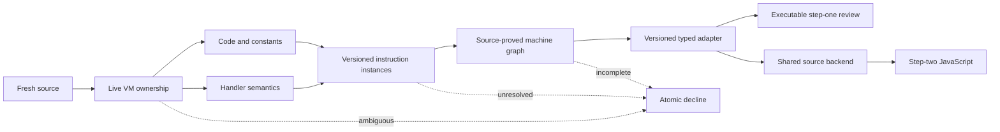

# Proposed source-derived inner VM recovery

Readers need JavaScript functions, arrays, control flow and basic register-machine concepts, plus
the [Babel source/AST foundation](../../babel.md) and [decoder workflow](../../decode-js.md).
The current [numeric VM pipeline](../../plugins/jsconfuser-vm.md) and
[shared typed switch boundary](../../vm-switch-boundary.md) are implemented dependencies with
bounded contracts. This proposal supplies no new extractor or source admission.

## 1. Target

This is an **unimplemented transform proposal** for source-derived recovery of an independently
selected inner VM representation. An independent VM-2 benchmark would evaluate a resulting
decoder; it must not supply recognition constants, handler answers or replacement source.
No private trial implementation or removed trial fixture is an active dependency or evidence.

The proposed input is fresh JavaScript source after a supported conventional outer decode, or
direct inner source. Recognition must prove one live entry/interpreter/code/constants/storage
relationship from that input. Its intended output is ordinary executable JavaScript with the
interpreter and wordcode removed, through an executable step-one review form and step-two source
emission from the same typed model. Necessary register/capture/control scaffolding can remain.
Original names, comments and lexical scopes are not generally recoverable.

The intended runtime profile is ordinary Node/browser execution with standard built-ins at entry.
Input-owned ambient reads, writes, calls, exceptions and environment branches must remain runtime
operations. An observed historical host value is never substituted during recovery. Arbitrary prior
host mutation and exotic host behavior need separate qualification. This intended profile is not
proved by the current backend or by this proposal.

No candidate, recognized-but-unresolved source and complete recovery must be distinguishable in
the future caller contract. A recognized unit is atomic: either all its required semantics are
represented or its exact input is preserved on returned decline. The recognition key, diagnostics
and concrete API/schema remain unresolved; no existing plugin is registered for this proposal.

## 2. Algorithm

The decoder first determines which source components form one machine, then recovers the data
and handler meanings that determine its instructions. Only after code versions, control, frames
and completion agree can it lower that relation into JavaScript operations. A familiar opcode
number, case label, identifier spelling or reference output supplies none of those proofs.

A code write can change later instruction interpretation, so instruction identity must include
code version and execution context as well as machine, function and PC. Static instruction
discovery and patch effects may require a bounded fixed point: derive successors from known
versions, add only source-proved versions/targets, and repeat until the relation stabilizes.
An unresolved write, target or nonconvergent relation cannot become a guessed instruction.
The concrete patch equations, bounds and context abstraction are missing knowledge, not supplied
by the numeric pipeline's source-proved PATCH normalizer.

### Worked example: semantic lowering before simplification

This explanatory synthetic example assumes ownership, operand widths and handler meanings were
already proved. Suppose a handler fetches destination then immediate, writes `r0 = 7`, and advances
to the next instruction; a second fetches destination/source/literal and means `r1 = r0 + 2`; a
third writes r1 to global `RESULT`. The first typed case carries assignment to register 0 from
literal 7; the second carries addition from register 0 and literal 2 to register 1; the third
carries a global write from register 1. PCs belong to the proved instruction graph, not this text.

An executable review form would retain the explicit register assignments and transitions. A later
optimizer could replace them with `globalThis["RESULT"] = 9` only after proving primitive-number
semantics, operand availability, unchanged effect/throw order and no intervening uses or captures.
A property read, coercing operand or captured register invalidates that simple constant argument.
This example omits encoded selectors, byte order, patching, frames and exceptions; it is not an
encoded fixture, an admission recipe or executed equivalence evidence.

## 3. Implementation

### Declared inputs, components and outputs

No component below is implemented for this proposal. The table defines dependency order and the
knowledge its eventual owner must establish; it does not pretend that a complete source matcher
or handler grammar is already documented.

| Component | Input | Required decision and output |
|---|---|---|
| Source recognizer | Fresh source/AST and live bindings | Prove entry, interpreter, dispatch aliases, code/constants/register/frame storage and outside effects as one ownership graph; return no-candidate or recognized identity |
| Static dependency decoder | Owned initialization and storage dependencies | Evaluate only source-proved pure operations in initialization order; produce immutable code/pool values with byte/word widths, order, bounds and provenance |
| Handler derivation | Owned live selectors and helper bodies | Record ordered operand fetches, widths, coercions, reads/writes, receivers, effects, throwing prefixes and completion for each reachable selector |
| Version/context walker | Initial code/pool and handler templates | Discover instruction instances, patch versions and targets together; distinguish code/data; decline unresolved transfers or bounds |
| Machine analysis | Instructions, versions and ownership | Complete normal/exceptional edges, frames, calls/returns, captures, handler/finally state and completion routes; unresolved relations forbid publication |
| Typed adapter | Complete source-proved relation | Project semantics into a versioned typed register/context model; extend the shared contract where evidence requires it |
| Source backend | Admitted typed operations and a qualified control plan | Emit review and recovered source from the same model; remove only proved redundant state and retain justified scaffolding |
| Publisher | Complete emitted source and recovery evidence | Fresh syntax/residue checks and one complete result or exact-input returned decline; API and error conversion require a separate concrete contract |

### Representation and validation boundary

Every proposed record needs input/model identity, structural ID, source provenance and consumed
predecessor IDs. An instruction is keyed by `(machine,function,context,codeVersion,pc)` with its
word interval, selector, ordered operand roles and next-PC rule. Code versions need parent version,
patch site, changed intervals and resulting code identity. Frames need allocation/register-bank
identity, receiver/arguments, continuation and captured-cell ownership; equal register indices
in different contexts do not identify the same location.

Edges must retain source/target instance, guard, normal/exceptional kind and the completed
operation prefix on a throw. Catch routing follows the source's actual protected interval; finally
can replace a pending completion. Capture records retain cell identity, aliases, lifetime and
post-return use, rather than only a value sampled during analysis. Source ownership and complete
semantic coverage precede optimization. A schema tag, full instruction count or successful
current switch validation cannot prove this source relation.

The implemented [switch contract](../../vm-switch-boundary.md#model-fields-and-exact-checked-boundary)
uses immutable-code meanings and per-invocation register/capture storage, with separately supplied
model checks and bounded renderer decisions. It has no arbitrary code-version/context model.
A new versioned adapter must close the source operation, storage and completion correspondence
before using it. Never reparse the review switch rendering as the semantic handoff.

Current numeric lowering consumes B/C/D/K and selected L facts; I/J are retained projections and
M is required at selected gates but not read by that adapter. Those records do not supply this
proposal's dynamic value or machine proof. Supplied K control has no inferred-plan dispatch retry.
The [current diagnosis handoff](standalone-diagnosis.md#handoff-model) and shared boundary remain
authoritative for implemented behavior.

### Optimization, state and atomicity

Begin with private noncaptured scalar definitions whose uses, lifetime and effects are proved.
Propagate a value only where the same definition reaches each use across all normal, exceptional
and completion predecessors. A copied value cannot be replaced by a source register overwritten
after the copy. An unused destination does not authorize dropping getters, coercions, host calls,
strict writes, allocations with observable identity or throwing operations. Retain registers,
cells and explicit dispatch where proof is absent. The current bounded
[adjacent-copy optimization](../../vm-switch-boundary.md#copy-simplification) is a dependency, not
proof that general substitution or dead-code omission is implemented.

Analyze privately and invalidate every descendant that consumed changed code, helpers, constants,
frames or control facts. Any AST producer must rebuild the bindings/reference state its later
consumer reads; a source-string handoff is parsed into a fresh consumer context. Final emitted
JavaScript must parse freshly and have no unexplained interpreter/handler/wordcode residue.
Helper deletion requires complete owned use/escape and effect proof. No half-rewritten recognized
machine may escape on returned decline. Exception conversion and filesystem writes are distinct
caller decisions, not implied by byte rollback.

### Acceptance design

These are future criteria with missing evidence. Behavioral checks are separately controlled
validation activity on retained bytes, not target execution during recovery. Actual encoder-produced
inputs qualify source admission/interactions; synthetic model controls qualify only their relation.

| Scenario | Observable oracle and acceptance criterion | Evidence now |
|---|---|---|
| Independently produced positive | Source-derived recognition plus actual emitted output, executable review/final behavior, no interpreter/wordcode residue; recovery assertion fails for passthrough | Missing |
| Binding/handler near miss | Intended ownership/operand/receiver decision reached; named refusal and exact-input preservation, with neighboring positive | Missing |
| Patch/context boundary | Same-PC different-version/context instances remain distinct; changed words affect only proved successors; unsupported targets/nonconvergence decline | Missing |
| Effects and completion | Getter/coercion/call counts and order, receiver/constructor behavior, throwing prefixes, captures and finally replacement agree under declared host | Missing |
| Optimization and cleanup | Definition/use/control proof supports each omission; effects remain; helper/capture inventories and fresh derived state agree | Missing |
| Publication failure | Complete success or exact-input returned decline; error/resource conversion and write failures separately match the future API | Missing |

## 4. Input Shapes

The producing pass owns its emitted shape and derived state; this proposal consumes that output
without importing paths or bindings from another parse. A conventional outer success does not
prove that it exposes a supported inner VM or preserves its complete semantics.

| Input spelling / producer | Prospective consumer requirement |
|---|---|
| Direct VM source, actual [encoder](../../../js-confuser-vm/js-confuser-vm.md) | Derive that source's connected machine and handlers independently; option names are not recognition keys |
| Generated outer source, this decoder's [jsconfuser plugin](../../plugins/jsconfuser.md) | Fresh inner parse; prove the same VM ownership/semantics from the emitted source, including remaining conventional residue |
| Current numeric A-M model | Existing [numeric adapter](../../plugins/jsconfuser-vm.md) only; no implicit conversion to this proposed frontend |
| Rendered review switch | Inspectable output only; never semantic input or a replacement for source proof |

The current [sequential coordinator](../../plugins/jsconfuser-vm-sequential.md) performs one outer
call and one numeric adapter call. Parsing belongs to its producers; it adds no strict intermediate
parse, VM-2 recognizer or layer fixpoint. Returned decline restores the original outer string;
direct producer throws propagate and the CLI catches before writes. Output/JSON sidecar writes
have no two-file rollback. Integrating a future frontend requires a concrete caller contract and
independent handoff controls; this proposal changes none of those current behaviors.

## 5. Known Gaps

- Source recognition, static storage decoding, complete handler templates, concrete patch equations
  and bounds, context abstraction, frame/capture/completion analysis and versioned adapter are
  not specified sufficiently for reconstruction or implemented. The component contracts define
  work to perform, not an available source-derived recipe for unfamiliar inner input.
- No benchmark fixture, admission, performance result, ordinary-host semantic qualification or
  novice-readability study exists for this transform. A removed trial and the current numeric
  fixtures supply none of that evidence.
- The [current source/native limitations](../../vm-switch-boundary.md#5-known-gaps), including
  EXP/Math.pow, delete, object publication and host apply differences, remain. F/G/J precision
  limits and M terminal-kind overwrite survive metadata completeness.
  `finalJavaScriptSemantics:false` remains necessary for current numeric publication. These
  source-only contrasts are neither repaired here nor new admission gates.
- Full option/version coverage, repeated or mixed encoding and arbitrary host histories need
  separate source contracts and qualification. A benchmark-specific result cannot widen the
  public numeric decoder's claim.

## Source

No source-derived frontend, adapter or plugin is implemented for this proposal. The existing
[shared validator](../../../../decoder/decode-js/src/vm/switch/vm-switch-model.js),
[control planner](../../../../decoder/decode-js/src/vm/switch/vm-switch-control.js),
[copy planner](../../../../decoder/decode-js/src/vm/switch/vm-switch-copy-planning.js),
[structured emitter](../../../../decoder/decode-js/src/vm/switch/vm-switch-structured-emitter.js)
and [source assembler](../../../../decoder/decode-js/src/vm/switch/vm-switch-to-source.js)
implement the current downstream boundary only. Sections 3 and 4 define the prerequisite relation
and schedule a future frontend must prove before using that boundary.

## Fixtures

No committed fixture proves this transform. Every section 3 acceptance scenario lacks its own
retained input, expected behavior, diagnostic/control and provenance. The
[shared switch tests](../../../../decoder/decode-js/test/vm/switch/vm-switch-to-source.test.js)
exercise the current typed backend, while the
[sequential test](../../../../decoder/decode-js/test/vm/jsconfuser-vm/integration/sequential.test.js)
checks current outer/numeric handoff and returned-decline rollback. Neither exercises a new
extractor, versioned adapter, independent benchmark or native-semantic proof for this proposal.
