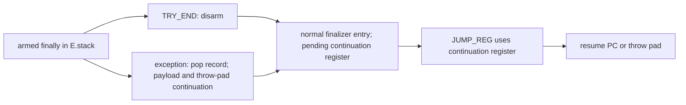

# Analyze exception and finally state

## 1. Target

Project the owned control graph into handler/finalizer states and completion routes, adding the
supported finalizer routing restrictions needed before planning source emission.
`analyzeExceptionFinally(B,C,D,E,F)` returns deeply frozen `jsconfuser-vm-exception-finally.v1`
(H) or null; `diagnoseExceptionFinally` returns frozen `{ok,result,diagnostic}`.
The result makes state and pending-completion relationships inspectable. It does not execute
exceptions or supply a new CFG.

Readers need stacks, directed graphs and try/catch/finally completion, plus
[B grammar](read-wordcode.md), [D owners](partition-functions.md),
[E handler/indirect routes](build-cfg.md) and [F completions](build-call-frames.md).
The encoder's [abrupt-completion contract](../../../js-confuser-vm/instruction-set.md#catch-finally-and-abrupt-completion)
owns runtime/compiler behavior. PCs are absolute u32-word indexes, function IDs come from D,
and handler/payload/continuation registers are relative indexes, not absolute frame slots.

`diagnoseExceptionFinally` exposes detailed stage diagnostics. `analyzeExceptionFinally` returns only the
result or null, discarding those details. Standalone reconstruct uses that wrapper and reports
`exception-finally-declined` on null; the plugin preserves this generic standalone diagnostic.

## 2. Algorithm

An armed finalizer is a promise that completion will traverse its code once. E already supplies
stack-consistent local control flow and finite indirect targets. Consume those facts directly.
A direct branch never pops a record, so its target is protected exactly as E's edge states say,
wherever the producer laid that target out; H adds no test of its own. A jump into a finalizer's
entry while it is still armed never reaches H: E refuses that merge. Disarming with TRY_END before
a normal entry is the supported route. An exception pops the armed record before entering the
finalizer with a throw-pad continuation and payload.

The JUMP_REG a finalizer resumes through is read from the graph: walk from finallyPc over E's
non-exceptional edges, stop at a JUMP_REG, and step over a nested finalizer the walk enters by
that finalizer's own JUMP_REG targets. Each JUMP_REG belongs to the innermost finalizer reaching
it, and it must use that record's continuation register: the one extra H restriction. Where a
resume lands is E's: a resume into the still-armed protected region disagrees with the region's
handler state there, and E refuses that merge; a resume elsewhere is ordinary control flow,
wherever the producer laid its target out. E also owns target finiteness, boundaries and
same-function locality. Finally project
all per-instruction states, route states and merge summaries, retaining unreachable serialized
instructions with null before-state.

The diagram does not give RETURN a hidden runtime finally call. The pinned RETURN itself closes
and returns; compiler-produced routing must visit the finalizer first. H preserves E's actual
active-finalizer RETURN metadata (including its throwRegister field) rather than interpreting it
as an executed return or repairing it.

### Worked example: disarmed entry and continuation

This **synthetic canonical stream**, root regCount=2, has no captures or calls:

| PC | Words | Meaning |
|---:|---|---|
| 0 | `[59,13,0,1,15]` | Arm finally@0: entry13, continuation r0, payload r1, throw pad15. |
| 5 | `[1,0,17]` | Put resume PC17 into r0. |
| 8 | `[55]` | Pop finally@0 before normal entry. |
| 9 | `[39,13]` | Enter disarmed finalizer. |
| 11 | `[45,1]` | Unreachable serialized return, preserved. |
| 13 | `[58,0]` | Resume through r0={17}. |
| 15 | `[46,1]` | Throw pad, reached through the setup's exceptional route. |
| 17 | `[45,1]` | Return after finalizer. |

WordCount=19. The setup reaches its finalizer with the throw-pad continuation (a try statement is
one unit; [build-cfg.md](build-cfg.md)), so E gives the same-owner finite targets [15, 17] at
PC13. H's jump check records finalizer=finally@0, continuationRegister=r0, finite=true,
sameFunction=true. Before states at 0/9/13/15/17 are empty; at 5/8 the stack and finallyStack
contain finally@0's view; unreachable 11 before-state is null. PC0 is an exceptional finally
route, PC9 a normal finally route, PC15 a throw/propagate route and PC17 a return/propagate route.
A standalone empty state is not proof of reachability; inspect reachable and null before-state.

A JUMP into a still-armed finalizer, `[59,7,0,1,9,39,7,39,7,46,1]`, never reaches H: the setup also enters the finalizer
with the outer handler state, so E refuses `handler-stack-merge-disagreement`. The compiler never
emits that jump; every jump into a finalizer follows the TRY_END that disarms it.
The disarmed example is the valid opposite control. These source-informed examples omit source
admission, nested records and pending return values; they are not generated compiler output.

## 3. Implementation

### Components and consequential checks

| Component | Consumes -> produces | Contract |
|---|---|---|
| Record index | E function handler/finally records -> per-function ID maps | IDs try@setupPc/finally@setupPc; E owns push/pop/merge proof. |
| State/arrival projection | E edge before/after views -> PC stacks and incoming keys | Entry initialized empty; source before and target after installed in E edge order. |
| Finalizer routing checks | B branches, installed stacks, E indirect targets -> acceptance/refusal | Exact interval and first-record decisions below. |
| Result projection | States/edges/records + F route count -> H arrays | All owned instructions retained; flattened rows add functionId. |
| Publisher | Complete H -> frozen result | Whole-stage atomicity; no CFG reconstruction or input mutation. |

Convert each E stack view back to IDs using type=handler -> try@setupPc, type=finally ->
finally@setupPc. Start inStates with fn.startPc=[]; for every E edge install sourcePc's before
stack, and non-null targetPc's after stack. E already proved agreement; H does not solve or
compare these stacks again. Incoming entries are keyed by
`sourcePc:kind:targetPc:callSitePc-or-empty`, so repeated identical keys count once.
A merge is an installed target with more than one such key; retain pc/incomingCount/handlerState.

For each installed PC apply these checks, in that insertion order:

| Instruction | H decision | Diagnostic |
|---|---|---|
| JUMP, JUMP_IF_FALSE/TRUE, FOR_IN_NEXT | None: E's states decide protection. | none in H |
| JUMP_REG a finalizer's walk reaches (`finalizerJumpRegs`) | Require words[1] == continuationReg. | invalid-handler-routing, wrong continuation register |
| JUMP_REG no finalizer reaches | No extra H continuation restriction. | E still owns finite/boundary/local proof. |

The walk follows E's edges whose route is not exceptional and stops at each JUMP_REG; when it
enters another record's finallyPc it continues at the targets of that record's own JUMP_REGs, so
a nested finalizer's resume is never claimed by the outer one.

### Records, routes and state

State views contain `stack` of handler/finalizer record views and `finallyStack`, its filtered
projection. A handler view hastype/setupPc/handlerPc/exceptionReg; a finalizer view has
type/setupPc/finallyPc/continuationReg/payloadReg/throwPadPc. Unknown record IDs at view
construction give invalid-handler-state; this is an internal construction error boundary,
not redundant independent input validation.

Each instructionState has pc/reachable/handlerStateBefore/handlerStateAfter. reachable means
installed inStates. before is null when absent. after is the first outgoing E after-state iff
there is at least one edge and all outgoing after-states are structurally equal, otherwise null.
A call can therefore have a precise before-state and null after-state because normal and
exceptional stacks differ.

Each edgeState copies kind/sourcePc/targetPc/route/mode/callSitePc/continuationPc/payload/
handlerStateBefore/After from E. completionRoutes filters **kind** in return/throw/handler/finally,
not every branch, continuation or normal call. E's route selection, extra-write order and
RETURN payload contract are [normative E dependencies](build-cfg.md#stack-flow-and-routes);
H never recomputes pending values. F contributes only callFrameRouteCount=F.completionRoutes.length,
not a second route-equality proof.

jumpRegChecks preserve pc/sourceRegister/sorted targets/finalizer-or-null/finite=true/
sameFunction/continuationRegister-or-null/instructionName. sameFunction checks target owners
for reporting; finiteness is inherited from E. transitions preserve pc/name/before plus outgoing
copies of E edges with sourcePc/functionId/handlerStateBefore removed. Handler/finally records
are copied verbatim, including E's ID and ownerFunction.

A function has id/startPc/endPc/handlerRecords/finallyRecords/instructionStates/edgeStates/
merges/jumpRegChecks/transitions. H flattens these arrays (state/merge/check/transition rows add
functionId), carries completionRoutes/callFrameRouteCount, schemaVersion/encoding and
word/instruction/function counts, and source B/C/D/E/F schema names. C remains an API/schema
parameter; current H does not reread its reference facts.

No candidate handlers is successful H with empty handler/finally arrays. Typed refusal returns
null result and the named diagnostic; unexpected exceptions become exception-finally-error.
Whole H is atomic. Inputs stay unchanged, no AST/helpers are removed, and no partial route set
is published. A later public decline is still possible even after H success.

### Testing and acceptance

| Scenario | Result / oracle | Acceptance | Evidence |
|---|---|---|---|
| H1 nested/call/throw routes | Exact E state projections, merges and completion metadata. | Before/after distinctions retained; no duplicated stack solver. | Finally/catch/no-handler fixtures and H test below. |
| H2 armed re-entry | E handler-stack-merge-disagreement. | Null E; standalone/plugin cfg-declined; unchanged predecessors; disarmed opposite succeeds. | Owned-chain source control; the H test's disarmed scaffold. |
| H3 wrong continuation register | Detailed invalid-handler-routing at reached JUMP_REG, not earlier unknown-value E refusal. | Generic standalone/plugin exception-finally-declined; named H decision and valid original. | Owned-chain wrong-register source control. |
| H4 unmodeled throwing property/host behavior | No new E route inferred by H. | Preserve missing exception-edge limitation, not a cannot-throw claim. | Whole native/property exception equivalence and arbitrary overlapping layouts unqualified. |

## 4. Input Shapes

[B](read-wordcode.md), [C](validate-references.md), [D](partition-functions.md) and
[E](build-cfg.md) establish grammar, local owners, handler stack agreement and indirect routes.
[F](build-call-frames.md) contributes the copied route count. Normalizers must supply rebuilt
current B-E after any PC rewrite; H does not operate on opaque PATCH or hidden control words.
[Diagnosis](standalone-diagnosis.md#owned-record-boundary) schedules H before
[K](structured-control.md), which consumes finalizer/control facts, and [M](closure-exception.md),
which copies states/records/routes with coverage. Those later plans own emission acceptance.

## 5. Known Gaps

- E enumerates explicit THROW and possible call exceptions, not all property/coercion exceptions;
  H cannot upgrade those edges into complete runtime exception behavior.
- Unresolved/non-finite targets decline at E, not a new H solver. Unreachable setups also decline
  at E; ordinary unreachable instruction rows remain H facts with null before-state.
- Canonical [PATCH-normalized](normalize-self-modifying-wordcode.md) code can enter H, while
  unnormalized variants cannot. No fresh qualification, whole-H cold reconstruction, full compiler or
  novice study follows from retained [fixture provenance](../../../../decoder/decode-js/test/vm/jsconfuser-vm/fixtures/qualification-provenance.md).

## Source

The distinction between compiler routing and runtime unwind in items 2-3 is pinned by
[armed handler/finalizer instructions](https://github.com/MichaelXF/js-confuser-vm/blob/20c5b96bf57337c568579352758d7685358650de/src/runtime.ts#L842-L876)
and [exception delivery](https://github.com/MichaelXF/js-confuser-vm/blob/20c5b96bf57337c568579352758d7685358650de/src/runtime.ts#L910-L948).

The public stage is [analyze-exception-finally.js](../../../../decoder/decode-js/src/vm/jsconfuser-vm/analyze-exception-finally.js). Supporting modules are [exception-finally-input.js](../../../../decoder/decode-js/src/vm/jsconfuser-vm/exception-finally-input.js), [exception-finally-control.js](../../../../decoder/decode-js/src/vm/jsconfuser-vm/exception-finally-control.js), [exception-finally-routes.js](../../../../decoder/decode-js/src/vm/jsconfuser-vm/exception-finally-routes.js). The [standalone diagnosis](standalone-diagnosis.md) composes this stage.

## Fixtures

The worked example and the two shorter H2 controls retain complete words/oracles. Use
[F's private-record scaffold](build-call-frames.md#fixtures), root regCount=2, empty pool,
then diagnoseExceptionFinally(B,C,D,E,F) after successful B-F. Assert targets=[17] and null
PC11 before-state for the disarmed example; for each active control assert result:null and
its exact H diagnostic. The exception/finally test below pins all three, with the example's
before-state stacks, completion routes, unchanged A-F and a deeply frozen H. These are decoder
checks, not source-admitted new fixtures, runtime completion execution or cold reconstruction.
The existing source controls below independently reach their named H decisions through A-F.

| Committed fixture | Claim pinned |
|---|---|
| [f-finally-abrupt](../../../../decoder/decode-js/test/vm/jsconfuser-vm/fixtures/corpus/raw/f-finally-abrupt/encoded.js) | Nested handler/finally records, normal and exceptional routes, continuation jumps, and merge states. |
| [f-throw-catch](../../../../decoder/decode-js/test/vm/jsconfuser-vm/fixtures/corpus/raw/f-throw-catch/encoded.js) | Handler-only throw/catch routing and propagation. |
| [focused-call-method-spread](../../../../decoder/decode-js/test/vm/jsconfuser-vm/fixtures/corpus/focused/focused-call-method-spread/encoded.js) | No-handler control case for call completion and empty handler state. |
| [owned-chain-source.test.js](../../../../decoder/decode-js/test/vm/jsconfuser-vm/owned-chain-source.test.js) | Source payload damage reaches grammar, reference, partition, indirect-control, capture, and finalizer-routing checks at their exact first diagnostic; successful source cases preserve emitted behavior. |

The [exception/finally test](../../../../decoder/decode-js/test/vm/jsconfuser-vm/analyze-exception-finally.test.js) pins H1 state/route projections and deep freeze with unchanged predecessors, plus the worked-example scaffold; the owned-chain test pins H2/H3 first responsible diagnostics and valid source opposites. H4 remains missing runtime-equivalence evidence.

The retired frozen semantic-record verifier,
built from the documents before source consultation, independently asserted selected
installed/disarmed state, routing, unreachable-before and entry/bypass/wrong/backward decisions
from supplied B-E. Wrong/backward controls establish the diagnostic decision meaning, not exact
production message equality. Unasserted whole schemas and source/public/generated behavior are
excluded. The verifier is evidence, not a replacement E/H contract.
