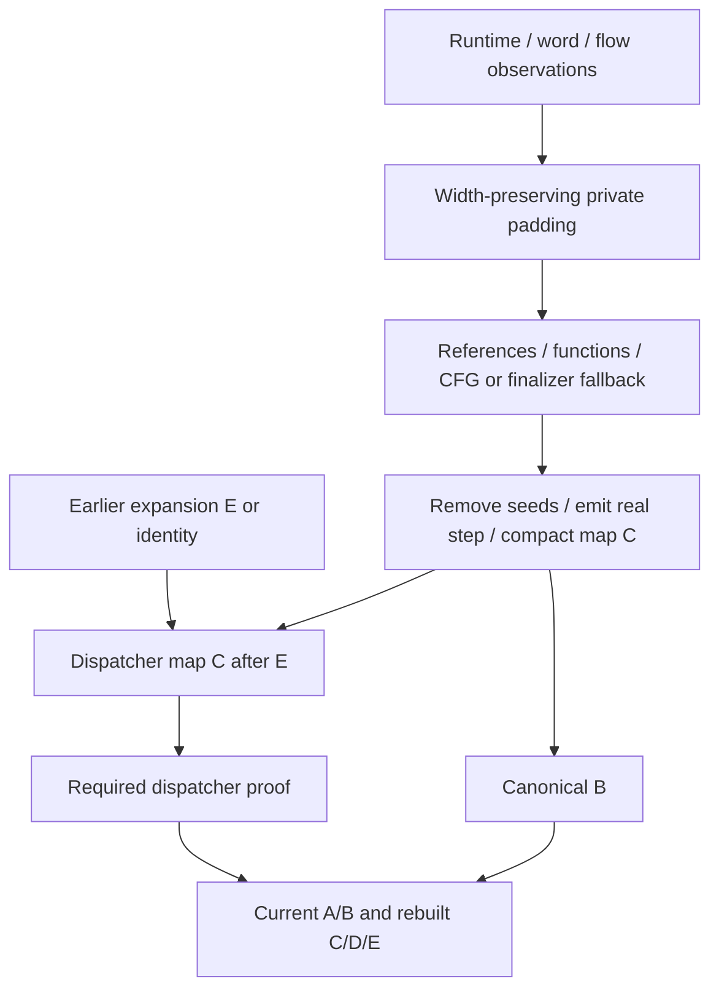

# Normalize anti-instrumented wordcode

## 1. Target

Remove proved fake entry seeds and replace every fused anti instruction with its uniquely real
canonical step. Success gives a compact canonical numeric container/B, optionally current
C/D/E from dispatcher recovery; ordinary behavior remains bounded by the observed fake-domain
and host assumptions. A normalizer success differs from passthrough by actual synthetic-header
and seed removal, not merely by executable output.

Readers need [A](extract-container.md), [B-E contracts](standalone-diagnosis.md#owned-record-boundary),
[anti runtime/stream/flow proof](anti-runtime-observation.md),
[shared expansion/maps](normalize-macro-wordcode.md#shared-expansion-and-address-relocation),
[constant normalization](normalize-concealed-constants.md) and
[dispatcher normalization](normalize-dispatcher-wordcode.md). Source and owned numeric container
are inputs; source is never executed. Arbitrary private packet damage is not a public boundary.

## 2. Algorithm

The runtime/flow observations identify each real step and isolated fake seed pool. First create
an analysis-only canonical stream with exactly the original width: place the real step at each
fused header and fill its leftover words with harmless writes to an isolated fake register.
This keeps old addresses intact while the existing reference/function/CFG analyses establish
continuation facts. Padding is never output or executed.

Retain finalizer continuation loads, and decide whether remaining indirect routes
require the dispatcher inverse. Select the maximum compatible seed count for each function;
all selected seeds are isolated under a surviving real-step model. Reject control entering the
middle of that removable prefix. Compute a compact map, emit real steps, omit seeds and rewrite
only direct control and selected continuation addresses. Plain integer literals stay literals.
Dispatcher endpoints still decode to pre-expansion PCs, so combine any earlier expansion map
with this compaction before route recovery. Publish current records only after canonical parsing
and every required dispatcher proof succeeds.

### Annotated synthetic example

Supply the observation in the [anti example](anti-runtime-observation.md#annotated-synthetic-example)
with pool=[`"sentinel"`,5,7,1,0], four seeds and the same four-step handler. Initialize real
registers after seeds, so all relevant input words and addresses are explicit:

```text
PC0,4,8,12: [0,3,1,0], [0,4,2,0], [0,5,3,0], [0,6,4,0]
PC16: [1,1,10]                  // R1=10
PC19: [1,2,20]                  // R2=20
PC22: [61,9,0,3,1,2,4,2,3,5,33] // shuffled tail; fake target=nextPc=33
PC33: [45,0]                    // return real ADD result
analysis at 22: [11,0,1,2,5,3,3,4,3,4,3] // ADD; MOVE r3,r3; LOAD_THIS r3 twice
compact: [1,1,10,1,2,20,11,0,1,2,45,0]
C={0:0,4:0,8:0,12:0,16:0,19:3,22:6,33:10,35:12}
```

The 35-word input becomes 12 words and returns 30. Seed function entry 0 maps to compact entry
0; the other seed starts still occur in C for bookkeeping but are forbidden externally consumed
entries. The eleven-word padding consumes exactly the old fused width and cannot leak into the
compact result. This word/model example supplies source-handler proof and A metadata; it is
not independently admissible source or a host-global fake-effect test.



## 3. Implementation

### Proof inputs and map provenance

Require anti runtime observation, whole anti word stream and register-flow selection. With
allowSpecializedTail=true the runtime observer can stop at its proved prefix; the surrounding
route must have accounted for the rest, and every route that expands before anti passes its map.
One origin map arrives, originPcMap O (Packet A PC -> input PC;
[address spaces](normalize-macro-wordcode.md#shared-expansion-and-address-relocation)): the PATCH
stage's map, or an expanding route's own map composed with it (`composePcMaps(O,E)`); absent, it is
identity. Expansion copies synthetic words unchanged, so on every route the fused operands,
fake jump targets included, are still in Packet A space, and this stage translates them itself:
O goes to the register-flow proof (the fake-slot `l` rule), to the dispatcher translation, and to
the PATCH `suspects` (Packet A PCs), which are read in this input's space through it.

If ordinary constant-ref operands or fused LOAD_CONST/LOAD_GLOBAL/TYPEOF_SAFE key words are
nonzero, require the source's [concealed reader proof](normalize-concealed-constants.md) before
flow analysis. The stream/flow producers supply spans, real indices and seed alternatives;
consumers do not revalidate schema versions, counts or raw-word equality of those owned facts.

### Padding and provisional control facts

For each synthetic instruction emit `[canonicalOpcode,...realStep.words]`. Set remaining to
original width minus that length; require remaining>=4 (`anti-padding`). Pick fakeRegister as
the first operand of the first nonreal step, which the successful model placed in its isolated
pool/anchors. If remaining is odd, append MOVE fakeRegister,fakeRegister (3 words) and subtract
3; append LOAD_THIS fakeRegister (2 words) until zero. This restores width, not the original
fake values. Clone A and replace only words; parse it into B. Restore keyed constants for this
private padded control stream when needed, then validate C and partition D.

If ordinary D fails but C exists, count repeated zero-capture/four-parameter closure descriptors;
exactly one shared entry permits the preliminary shared-string-helper D exception. Otherwise
no D is `anti-control-proof`. Try E but do not require it yet: CFF/dispatcher residue can make
the ordinary CFG unavailable before its own inverse.

Select the finally continuation loads with the
[shared rule](normalize-macro-wordcode.md#shared-expansion-and-address-relocation), functions from D's
ownership, reading past PATCH suspects (a suspect load keeps its Packet A word until
[settled](normalize-self-modifying-wordcode.md#settling-suspects)). The rule holds wherever CFF has moved those loads. With E, inspect indirect target origins: exception@ origins
need no load; any other origin not in the selected load set requires dispatcher recovery.
Without E, a JUMP_REG avoids that requirement only when its register is one of that function's
FINALLY_SETUP continuation registers and at least one selected load writes it. This fallback
alone is not final CFG admission; standalone later requires current E.

### Seed erasure and compact relocation

Take count=max(counts) in each successful seedCountChoices row, or min(counts) when the row has a
deferredSeed (that seed stays as code). Mark exactly count leading
LOAD_CONST starts at that function entry. A missing seed is anti-seed-proof. For each ordinary
instruction's direct target (offset table in the
[shared relocation contract](normalize-macro-wordcode.md#shared-expansion-and-address-relocation))
and every selected continuation LOAD_INT, reject a target to a marked seed except a function
entry with diagnostic anti-seed-proof. This code names both incoming direct-target and selected
continuation-target prefix refusals, as well as the missing canonical seed above; anti-control-proof
instead names missing compact boundaries and provisional/control proof failures. Synthetic fake
branches disappear, so they are not ordinary incoming routes.

Iterate original stream starts: C[pc]=nextPc; seeds add zero; a flow decoy (a PATCH suspect
touching a fake seed) is removed with no C entry, so an address naming it declines and its origin
is omitted from the dispatcher map; a fused instruction adds
1+realStep.words.length; other instructions add original width. Set C[wordCount]=nextPc.
Emit no seeds. Fused output is its canonical header and real operands; ordinary output is copied
raw words with direct offsets mapped through C and selected LOAD_INT offset 2 mapped through C.
A missing boundary is anti-control-proof. Function entries at the first seed map to the first
surviving instruction. Intermediate seed entries remain in C but are prohibited incoming targets.

For dispatcher translation use O, or identity over C keys. Every value
must exist in C or decline. Omit origins whose expanded target is a removed
nonentry seed; otherwise `decodedTargetMap[oldPc]=C[E[oldPc]]`. The map's domain matters as much
as its arithmetic: an encoded endpoint into omitted seeds must fail dispatcher validation.

### Final records, failure and state

Canonical-parse compact cloned A. Without requiresDispatcher return that A/B: ordinary keyed
values remain for the later constant adapter and no provisional padded C/D/E is reused. With
requiresDispatcher, first normalize keyed compact constants if needed, build current C, identify
at most one repeated string-helper start and build preliminary D with deferControlFlow:true,
allowSharedParentStarts, decodedTargetMap and the remaining suspects. Require dispatcher success, adopting its complete
current container/B/C/D/E result. Provisional padding and its records are discarded.

The deeply frozen success envelope contains schemaVersion
`jsconfuser-vm-anti-wordcode-normalization.v1`, container, wordcode, optional rebuilt records,
originPcMap (the origin space -> output: decodedTargetMap, composed with the dispatcher's pcMap when
it ran; the dispatcher's own pcMap is not passed on), the dispatcher's skipLabels when it ran,
`suspects` (the incoming ones less the decoys settled here) and `deferredSeeds` (Packet A PCs),
originalWordCount (this compactor's input, possibly already expanded) and syntheticInstructionCount.
Named NormalizationDecline yields result:null/diagnostic; other failures become
anti-normalization-error. No partially compact stream is returned. Public diagnosis may still
decline downstream. Source AST is never rewritten here; helper cleanup belongs to final emission.
Numeric spans/maps/records are rebuilt where consumed, and the owned chain fills only absent
records against current words. There is no caller binding cache to repair or private-record
malformation admission to invent.

The [source-informed scaffold and exact control recipe](normalize-aliased-wordcode.md#source-informed-example-control-boundary)
supply the retained canonical runtime and exercise these examples through normal source A, then
private numeric decisions where stated. They check exact recovery/current records and unchanged
input; they are not cold reconstruction or fresh encoder-output qualification.

### Acceptance scenarios

| Scenario | Oracle / acceptance criterion | Evidence and limit |
|---|---|---|
| N1 real replacement / seed erasure | Exact words/map/value above; shorter stream, zero added headers, no padding in output | Worked calculation; normalizer fixture tests. |
| N2 scalar versus continuation / iterator exit | Only selected address loads and canonical target offsets remap; FOR_IN_NEXT uses offset 3 | Finally/catch/CFF fixtures and routing tests; unrestricted provenance remains unqualified. |
| N3 removed-prefix / dispatcher route | Reject nonentry seed targets; compose E then C before dispatcher endpoint validation | Routing, pair, macro and alias tests; retained profiles only. |
| N4 keyed state / atomicity | Source reader proved, restored values correct; A/source unchanged and failed whole result:null | Concealed pair/source reader controls; private flow damage is internal evidence only. |
| N5 public recovery/current state | No VM residue; source/encoded/decoded behavior and fresh emitted parse state agree | Existing focused tests; observer/temporary padding success alone insufficient. |
| N6 host effects | Removed fake effects total/unobservable in actual host/coercion environment | Ordinary test contexts retained; arbitrary reassigned/getter globals and conversion effects unproved. |

## 4. Input Shapes

[PATCH recovery](normalize-self-modifying-wordcode.md) consumes these proved added-opcode definitions
at original widths, then expands only recovered executable instructions. Its finite combined
boundary is [the PATCH census](../../tests.md#finite-patch-added-opcode-qualification); the linear
stream reader on this page still does not interpret encrypted storage.

| Earlier decoder producer / spelling | Effect |
|---|---|
| [Packet A](extract-container.md) / [handler locator](locate-handlers.md#4-input-shapes) | Supply the words and the handler bodies for every runtime spelling the locator lists. |
| [PATCH compaction](normalize-self-modifying-wordcode.md) | Words with selfModifying's additions removed; addresses inside added opcodes are still Packet A addresses and go through its `originPcMap` ([address spaces](normalize-macro-wordcode.md#shared-expansion-and-address-relocation)). |
| [Anti observations](anti-runtime-observation.md) | Supply eager widths/permutations, step positions and compatible fake seed models. |
| [Alias](normalize-aliased-wordcode.md) / [macro-specialized expansion](normalize-macro-wordcode.md) | Restore canonical seed spellings; copy synthetic words unchanged; pass their own E composed with O as originPcMap. |
| [Constant inverse](normalize-concealed-constants.md) / [dispatcher inverse](normalize-dispatcher-wordcode.md) | Restore private proof values or consume original-PC route endpoints before publication. |

Expansion leaves fake jump targets in Packet A space; the flow model translates them through O,
so a changed fake target declines here (`register-isolation`) on the plain and the expanding routes
alike.

## 5. Known Gaps

The closed fake operand/name domains do not establish universal harmlessness. Host getters,
missing/reassigned globals and value-to-primitive effects can make erasing fake operations
observable; the decoder does not inspect those external descriptors. Ordinary intact Node/browser
fixture environments bound current regression evidence. The no-CFG JUMP_REG fallback is not
final CFG admission; later E still must pass.
Changed keyed reader, unsupported layouts, linear reading of PATCH storage, minified class and
unretained stacks decline or remain unqualified under their own concrete gates.

## Source

Item 3's private padded B/C/D/E are built by
[read-wordcode.js](../../../../decoder/decode-js/src/vm/jsconfuser-vm/read-wordcode.js),
[validate-references.js](../../../../decoder/decode-js/src/vm/jsconfuser-vm/validate-references.js),
[partition-functions.js](../../../../decoder/decode-js/src/vm/jsconfuser-vm/partition-functions.js)
and [build-cfg.js](../../../../decoder/decode-js/src/vm/jsconfuser-vm/build-cfg.js).
Key and route adapters are
[normalize-concealed-constants.js](../../../../decoder/decode-js/src/vm/jsconfuser-vm/normalize-concealed-constants.js)
and [normalize-dispatcher-wordcode.js](../../../../decoder/decode-js/src/vm/jsconfuser-vm/normalize-dispatcher-wordcode.js).
Their own recipes define emitted forms; item 3 defines the compactor's schedule and map contract.

The normalizer is
[normalize-anti-wordcode.js](../../../../decoder/decode-js/src/vm/jsconfuser-vm/normalize-anti-wordcode.js),
called by
[diagnose-standalone.js](../../../../decoder/decode-js/src/vm/jsconfuser-vm/diagnose-standalone.js).
Its proof inputs are linked from the [observation document](anti-runtime-observation.md).

## Fixtures

The scenario tables in item 3 state acceptance oracles; rows below index retained inputs/tests.
The annotated examples are source-informed synthetic controls, not independent cold proofs.
Fixture qualification records and the [shared provenance contract](../../../../decoder/decode-js/test/vm/jsconfuser-vm/fixtures/qualification-provenance.md)
bound historical generated evidence; no fresh encoder generation or wider profile qualification
is asserted by this specification. Private copied-packet controls establish internal choices
only; source mutations that still reach A/B pin normal-entry refusals separately.

The retired frozen bounded verifier demonstrated
N1/N3's selected four-seed padding, real-step emission, exact compact C/words and reduced current
spans. Composition E is an explicit synthetic scaffold; C and its composition arithmetic/domain
are reconstructed. Runtime segmentation/A are supplied. Across-function flow, alternate seed
counts, provisional or compact C/D/E, keyed restoration, general finalizer/dispatcher proof and
public emission are not reconstructed. See the
[shared bounded-proof limits](normalize-aliased-wordcode.md#independent-bounded-proof); owner examples
and retained-input tests remain separate.

The frozen private nonentry-seed control appends JUMP@35 [39,4] and correctly excludes that incoming
prefix route, but guesses diagnostic anti-control-proof. Actual direct/selected-continuation prefix
refusal is anti-seed-proof. That single diagnostic-equality assertion is
excluded from accepted evidence; the frozen executable stays unchanged, and its
words/map/padding/isolation assertions are unaffected. Existing routing tests
below pin the actual anti-seed-proof code using a private copied A, without creating a public
private-packet admission boundary.

| Committed fixture or test control | Claim pinned |
|---|---|
| [anti-runtime-boot](../../../../decoder/decode-js/test/vm/jsconfuser-vm/fixtures/anti-runtime-boot/encoded.js) | Compact normalization of multiple synthetic arithmetic instructions. |
| [anti-runtime-duplicate-step](../../../../decoder/decode-js/test/vm/jsconfuser-vm/fixtures/anti-runtime-duplicate-step/encoded.js) | The first of two `ADD` steps is real; a fake jump and fake constant remain absent from compact wordcode. |
| [anti-runtime-finally](../../../../decoder/decode-js/test/vm/jsconfuser-vm/fixtures/anti-runtime-finally/encoded.js) | A return continuation held in a register survives PC compaction. |
| [anti-runtime-catch-finally](../../../../decoder/decode-js/test/vm/jsconfuser-vm/fixtures/anti-runtime-catch-finally/encoded.js) | Catch and finally continuations survive PC compaction. |
| [concealed-constants-anti-instrumentation](../../../../decoder/decode-js/test/vm/jsconfuser-vm/fixtures/concealed-constants-anti-instrumentation/encoded.js) and its [qualification record](../../../../decoder/decode-js/test/vm/jsconfuser-vm/fixtures/concealed-constants-anti-instrumentation/qualification.json) | Keyed constants and anti instructions preserve catch/finally behavior. |
| [string-concealing-anti-instrumentation-nested](../../../../decoder/decode-js/test/vm/jsconfuser-vm/fixtures/string-concealing-anti-instrumentation-nested/encoded.js) and its [qualification record](../../../../decoder/decode-js/test/vm/jsconfuser-vm/fixtures/string-concealing-anti-instrumentation-nested/qualification.json) | Removing fake entry seeds exposes the shared string helper and nested bank captures. |
| [cff-anti-instrumentation-exceptions](../../../../decoder/decode-js/test/vm/jsconfuser-vm/fixtures/cff-anti-instrumentation-exceptions/encoded.js) and its [qualification record](../../../../decoder/decode-js/test/vm/jsconfuser-vm/fixtures/cff-anti-instrumentation-exceptions/qualification.json) | Reordered catch/finally continuations survive anti compaction before CFF inversion. |
| [dispatcher-anti-instrumentation-switch](../../../../decoder/decode-js/test/vm/jsconfuser-vm/fixtures/dispatcher-anti-instrumentation-switch/encoded.js) and its [qualification record](../../../../decoder/decode-js/test/vm/jsconfuser-vm/fixtures/dispatcher-anti-instrumentation-switch/qualification.json) | Encoded dispatcher targets still use old PCs after anti compaction and are mapped into the compact stream. |
| [string-cff-dispatcher-concealed-constants-anti-instrumentation-exceptions](../../../../decoder/decode-js/test/vm/jsconfuser-vm/fixtures/string-cff-dispatcher-concealed-constants-anti-instrumentation-exceptions/encoded.js) and its [qualification record](../../../../decoder/decode-js/test/vm/jsconfuser-vm/fixtures/string-cff-dispatcher-concealed-constants-anti-instrumentation-exceptions/qualification.json) | The five-option stack preserves catch/finally behavior through all inverses. |
| [anti-specialized-exceptions](../../../../decoder/decode-js/test/vm/jsconfuser-vm/fixtures/anti-specialized-exceptions/encoded.js) and its [qualification record](../../../../decoder/decode-js/test/vm/jsconfuser-vm/fixtures/anti-specialized-exceptions/qualification.json) | Joint handler proof preserves catch/finally behavior. |
| [string-cff-dispatcher-concealed-constants-anti-specialized-exceptions](../../../../decoder/decode-js/test/vm/jsconfuser-vm/fixtures/string-cff-dispatcher-concealed-constants-anti-specialized-exceptions/encoded.js) and its [qualification record](../../../../decoder/decode-js/test/vm/jsconfuser-vm/fixtures/string-cff-dispatcher-concealed-constants-anti-specialized-exceptions/qualification.json) | Two PC compactions compose through the six-option exception stack. |
| [normalize-anti-wordcode.test.js](../../../../decoder/decode-js/test/vm/jsconfuser-vm/normalize-anti-wordcode.test.js) | Behavioral agreement, no VM residue, immutable Packet A input and atomic decline for a changed fake jump on the plain and the macro route. |
| [normalize-anti-concealed-constants.test.js](../../../../decoder/decode-js/test/vm/jsconfuser-vm/normalize-anti-concealed-constants.test.js) | Keyed pair normalization, immutable Packet A and derived state. |
| [normalize-anti-routing-combinations.test.js](../../../../decoder/decode-js/test/vm/jsconfuser-vm/normalize-anti-routing-combinations.test.js) | Pair and five-option behavior, derived state, old-PC dispatcher routes, and atomic declines for invalid endpoints and entries into removed fake seeds. |
| [normalize-macro-combinations.test.js](../../../../decoder/decode-js/test/vm/jsconfuser-vm/normalize-macro-combinations.test.js) | Macro expansion before anti compaction, composed dispatcher PC maps, and the seven-option exception stack. |
