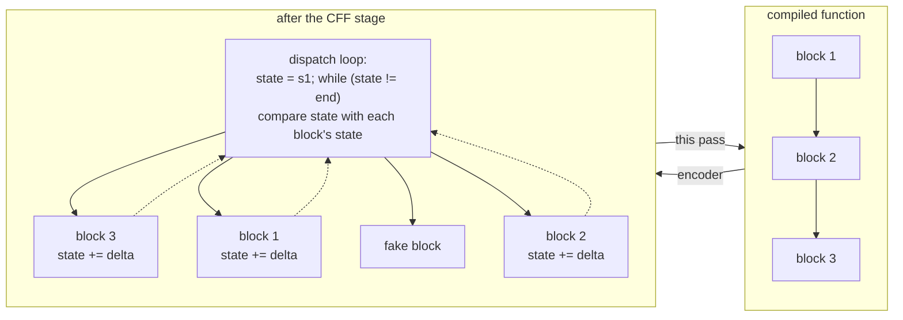
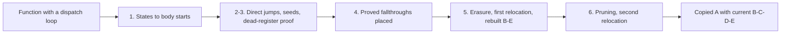

# Normalize VM control flow flattening

## 1. Target

The encoder's control flow flattening stage cuts a function into blocks, shuffles them, and routes
every jump through a dispatch loop that compares a state register against each block's state. It
adds fake blocks the program never reaches, writes each jump as a relative state change, seeds the
state absolutely in blocks entered without the loop, and inverts each conditional. This pass
removes all of that: it returns the same function with the dispatch loop gone, every transition
turned back into a direct jump, each conditional followed by the fallthrough the encoder proves,
and the fake blocks pruned. It does not rebuild any other order: loops, breaks and try regions are
read from the graph by the backend ([vm-switch-boundary.md](../../vm-switch-boundary.md#1-target)),
so every jump the stream does not prove a fallthrough stays a jump. Code the compiler emitted
stays; compiler code that is unreachable goes with the fake blocks, as a by-product of the same
pruning.

Without this pass the dispatch loop reaches the backend as a loop over a state variable:
passthrough may fail E's handler analysis, or pass it and still fail structured emission, and the
program behaves the same either way, so behaviour alone cannot show recovery.

The pass is a static inverse. It consumes the owned [A](extract-container.md),
[B](read-wordcode.md) and [D](partition-functions.md) (D's creation and ownership data derives from
the current C), restored zero-key numeric constants, exact word boundaries and function intervals,
and returns a copied A with current B/C/D/E. It never executes the flattened program and does not
infer arbitrary equivalent state machines: it reads the encoder's own grammar. Readers need blocks,
relative arithmetic, function ownership, branches and the [CFG contract](build-cfg.md).

## 2. Algorithm

What the encoder does to one function, and what this pass gives back:



The pass works in six steps, each needing what the previous one learned:

1. **Read the dispatch loop.** The function's entry sets the state and a comparison accumulator;
   the loop compares the state against a chain of arms. The arms do not name their states: each
   adds or subtracts a difference from the previous one, so replaying the chain recovers every
   arm's state and the body it jumps to. The entry state names the first body, whatever the
   shuffled physical order; the end state names the loop's exit.
2. **Turn transitions into jumps.** Inside each body, a transition is `LOAD_INT delta; ADD/SUB
   state; JUMP loopTop`. The body's own state plus the delta names the next body, so the triple
   becomes `JUMP next`. A conditional's two transitions become one conditional jump. A body
   entered directly (a catch, a finalizer, a for-in exit, a resume pad) begins with an absolute
   state seed; it goes once it matches the body's state.
3. **Prove the dispatch registers are dead.** The state, accumulator and comparison registers must
   not be read by any retained instruction; otherwise erasing their writes would change the
   program.
4. **Place proved fallthroughs.** The encoder rewrites each conditional to jump over the
   transition to its own fallthrough, so that fallthrough is the one order the stream proves.
   Keep the bodies in the stream's order, the entry body first, and pull each proved fallthrough
   right after its conditional.
5. **Erase proved jumps and relocate.** Invert each conditional whose proved fallthrough now
   follows it, dropping the jump to that fallthrough; every other jump stays. Translate every
   address into the new stream and rebuild B/C/D/E.
6. **Prune and relocate again.** The rebuilt E says which bodies are reachable. Keep exactly
   those in every flattened function, translate addresses a second time and rebuild B/C/D/E on the
   final words.



An unconditional transition proves nothing: the encoder writes a compiler jump and a plain
fallthrough the same way. Erasing a jump because its target happened to land next would turn a
compiler `break` into a fallthrough out of its loop; keeping it costs nothing, since the backend
reads a jump step as straight-line flow.

### Annotated example: exact words

A supplied canonical scaffold, not generated CFF output: main entry 0, regCount 6, pool
`[10,0,60,undefined]`. The state register is r2, the accumulator r3, the comparison r4; r1 is
scratch and r5 is retained payload. It has no helpers, conditional payload, finalizers or fake
forks.

```text
0  LOAD_THIS r0
2  LOAD_CONST r1,0,0        # pool[0] = 10: start state
6  MOVE r2,r1
9  LOAD_CONST r1,1,0        # pool[1] = 0: accumulator starts at zero
13 MOVE r3,r1
16 LOAD_CONST r1,2,0        # loopTop; pool[2] = 60: end state
20 NEQ r4,r2,r1
24 JUMP_IF_FALSE r4,65     # loop exit: the first physical body
27 LOAD_CONST r1,0,0       # first arm: absolute state 10
31 MOVE r3,r1
34 EQ r4,r2,r3
38 JUMP_IF_FALSE r4,43
41 JUMP 76                 # state 10 -> body A at 76
43 LOAD_CONST r1,0,0       # next arm: +10 -> state 20
47 ADD r3,r3,r1
51 MOVE r3,r3
54 EQ r4,r2,r3
58 JUMP_IF_FALSE r4,63
61 JUMP 71                 # state 20 -> body B at 71
63 JUMP 16                 # back to the loop test
65 LOAD_CONST r5,3,0       # end-state body: never reached by the real path
69 RETURN r5
71 LOAD_INT r5,42          # body B (state 20)
74 RETURN r5
76 LOAD_INT r5,7           # body A (state 10, the start)
79 LOAD_INT r1,10          # transition: delta +10
82 ADD r2,r2,r1
86 JUMP 16                 # old word count 88
```

Step 1 recovers `10->76`, `20->71`, `60->65`. Step 2 turns A's transition into `JUMP 71`
(10 + 10 = 20). There is no conditional, so step 4 keeps the stream's order with the entry first:
A, end, B; A's jump stays. The first emission is `[1,5,7,39,11,0,5,3,0,45,5,1,5,42,45,5]`
(16 words), with significant first-map entries `0->0, 76->0, 79->3, 82->5, 86->5, 65->5, 69->9,
71->11, 74->14, 88->16`; the other prefix starts are never traversed, so they have no entry. E finds
the end body at 5 and 9 dead. The second map is `0->0, 3->3, 11->5, 14->8, 16->10`, and the final
words `[1,5,7,39,5,1,5,42,45,5]` write 7, jump to B, write 42 and return r5: both dispatch
operations and the end body are gone. Changing word 81 (the delta) from
10 to 11 makes step 2 refuse with cff-shape, "Relative transition reaches unknown state 21".

## 3. Implementation

| Component | Consumes -> produces | Invariant its consumer relies on |
|---|---|---|
| Loop observer | function B/D and pool -> state/target map | Closed entry and arm grammar, distinct states, current owned starts. |
| Body planner | state/target map and intervals -> replacements, removals, successors | Every relative destination exists; a removed seed matches its body's state. |
| Erased-state proof | planned erasures, retained operands and captures -> accepted bodies | Retained conditions and payload neither read nor write a deleted register. |
| Body placer | successors, stream order -> body order | The entry body first; each proved fallthrough right after its conditional; every other body in stream order. |
| Branch simplifier | order and replacements -> final replacements | Only a proved fallthrough's jump erased, by inverting its conditional. |
| First relocation | plans and current A-D -> reordered A, current B-E | Current addresses and shared-option entries rebuilt. |
| Pruner and final relocation | first E and words -> compact A, current B-E | No fake arm live; a flattened function keeps only what its E reaches. |

The function is `diagnoseNormalizeCffWordcode(container, wordcode, functions, partitionOptions)`;
internally `recognize` runs the per-function `observeFunction` (observer, planner, proof, placer,
simplifier) and then both relocations.

### Recognizing the dispatch loop

Scan every D function. A candidate has at least 18 instructions and begins `LOAD_THIS, LOAD_CONST,
MOVE, LOAD_CONST, MOVE, LOAD_CONST, NEQ, JUMP_IF_FALSE`; other functions carry through unchanged.
Once a candidate's prefix matches, any later mismatch refuses the whole adapter rather than
returning that function unchanged beside recovered ones.

```text
numericConstant(load): LOAD_CONST with key 0 whose pool value is an integer Number in 0..65535
startState = numericConstant(load 1);  MOVE state <- it
accumulator: numericConstant(load 2) must be 0;  MOVE accumulator <- it
loopTop = PC of load 3;  endState = numericConstant(load 3)
NEQ compare, state, endState-register;  JUMP_IF_FALSE compare -> exitPc
stateTargets = { endState -> exitPc }
arms, from instruction index 8:
  first arm:  LOAD_CONST absolute state; MOVE accumulator
  later arms: LOAD_CONST delta; ADD or SUB accumulator, scratch; MOVE accumulator
              current = previous +/- delta   (ordinary Number arithmetic, no u16 wrap or second
                                              0..65535 guard on the accumulated state)
  each arm:   EQ compare, state, accumulator; JUMP_IF_FALSE compare -> next arm; JUMP bodyPc
              refuse if current is already in stateTargets; else stateTargets[current] = bodyPc
end: a JUMP back to loopTop; the loop must be nontrivial (index >= 13, last consumed JUMP)
require: startState in stateTargets; the next instruction's PC = exitPc
```

Sort the distinct `stateTargets` values: the first is `exitPc`, and all are B starts in
`[exitPc, fn.endPc)`. Each body runs from its start to the next start or the function's end.
`stateByTarget` excludes the end state; repeated target values are not refused separately, and a
later Map assignment supplies that target's state. The predicate is narrower than arbitrary
equivalence but invents no state-to-target bijection.

### Transitions, seeds and erased registers

For a body with recovered state `currentState`, remove a leading `LOAD_INT state, currentState` if
present exactly; any other entry value is kept and faces the checks below. Every adjacent
instruction sequence is scanned, not only a presumed terminator:

```text
transition:   LOAD_INT scratch, magnitude; ADD-or-SUB state, state, scratch; JUMP loopTop
  -> JUMP stateTargets[currentState +/- magnitude]   (missing state: refuse)
     the first instruction is replaced, the next two removed; record that successor
conditional:  JUMP_IF_FALSE/TRUE c, skip; transition (first); skip: transition (second)
  -> require the conditional's target is the second transition's LOAD_INT
  -> JUMP_IF_x c, second-destination; JUMP first-destination   (six instructions removed)
     record successors [second, first]
```

The magnitude is B's u32 immediate; no separate u16 guard applies. Other instructions carry
through. Handler entries are recorded from TRY_SETUP and FINALLY_SETUP word 1 and FOR_IN_NEXT
word 3; finalizer throw-pad and continuation references remain for relocation.

A body containing an LT whose left operand (word 2) is the state register is state-dependent: a
fake fork. It skips the erased-register scan and is kept until E proves it unreachable. This
literal LT classifier is not a symbolic fake-block interpreter. Erased registers are the
destinations (word 1) of removed or replaced LOAD_THIS, LOAD_CONST, LOAD_INT, MOVE, ADD, SUB, EQ
and NEQ. Outside fake forks, a retained semantic register operand or local capture in that set
refuses with "Dispatch register escapes into payload"; a replacement condition register in it
refuses with "Dispatch condition uses erased state" (both cff-shape). These checks and the
enumeration handler offsets read semantic operands and raw words, not the swapped compatibility-tag
view some observers use ([B's distinction](read-wordcode.md#5-known-gaps)).

### Placing proved fallthroughs and erasing their jumps

The encoder writes `JUMP_IF_FALSE c,T` (fallthrough F) as `JUMP_IF_TRUE c,skip`, a transition to
T, then at `skip` a transition to F (and the mirror for JUMP_IF_TRUE). So a conditional's skip
arm, its first recorded successor, is the block the compiler placed right after it. It is proved
for a two-way body outside a fake fork when no other such body records the same skip arm. Nothing
else in the stream says what followed what.

```text
fallthrough(c)  = c's skip arm, when proved
place(b):         while b is unplaced: append b to order; b = fallthrough(b)
place(entry)                                  # the root's placeholder falls into the entry body
for b in bodies, stream order: if b is the entry or no proved fallthrough: place(b)
for b in bodies, stream order: place(b)       # anything left: a cycle of proved fallthroughs
for each adjacent (c, next) in order with next = fallthrough(c):
  [JUMP_IF_x cond, next; JUMP other]  ->  [JUMP_IF_not_x cond, other]
```

Every other transition keeps its `JUMP`, also one whose target lands next. A conditional whose
proved fallthrough does not follow it (the entry body, say) keeps both its jumps. With a
proved fallthrough after it, the conditional regains the compiler's polarity.

#### Worked example: a catch that ends in `break`

`for (var i = 0; i < 4; i++) { try { g(i); n += i; } catch (e) { n += 100; break; } } return n;`
under control flow flattening (the cff-loop-return fixture's `loopCatchBreak`, seed 324508639).
The recovered bodies in the order this pass places them, with their PCs in that encode:

| Body | Code | Successors |
|---|---|---|
| 1704 | entry: `n = 0` | 1742 |
| 1600 | `return n` | |
| 1602 | `n += i`; TRY_END | 1654 |
| 1619 | fake arm | |
| 1625 | `i < 4` | 1722 (proved fallthrough), 1600 |
| 1722 | TRY_SETUP, catch 1758; `g(i)` | 1602 |
| 1654 | after the catch (empty) | 1684 |
| 1663 | fake arm | |
| 1672 | `i = i + 1` (second half) | 1625 (back edge) |
| 1684 | `i + 1` (first half) | 1672 |
| 1742 | `i = 0` | 1625 |
| 1758 | catch: `n += 100` | 1600 (the `break`) |

The entry comes first, then the stream's order, with 1722 pulled after its conditional 1625. Only
1625's jump to 1722 is erased: `JUMP_IF_TRUE c,1722; JUMP 1600` becomes `JUMP_IF_FALSE c,1600`.
The catch's `JUMP 1600` stays a jump, so the backend reads it as the loop's `break`, and the loop,
the try and the code after them come from the graph; pruning then removes 1619 and 1663. The
decode reads as the plain compile's.

### First relocation and rebuilt state

Emit D functions in their order. A planned function emits its root placeholder (an empty
replacement) and then its ordered bodies; any other function emits every instruction in D order.
The first map's domain is exactly the transformed roots, the traversed body instruction starts, the
carried-through instruction starts and the old word count. Within traversed starts, replacements and
removals map to the next PC (zero-width entries included); retained starts map before their raw
words are copied. The other prefix starts are never traversed and have no entry, even though the
plan removes them, so a reference to one refuses at relocation instead of aliasing to the root.
Replacement opcodes come from A; the old word count maps to the new end.

Translate address operands at JUMP word 1, JUMP_IF_FALSE/TRUE word 2, FOR_IN_NEXT word 3, TRY_SETUP
word 1, FINALLY_SETUP words 1 and 4, MAKE_CLOSURE word 2; a missing start refuses cff-shape. Also
translate the finally continuation literals the [shared continuation rule](normalize-macro-wordcode.md#shared-expansion-and-address-relocation) selects, functions from the original D owners.
The emitted length must match the measured next PC.

Clone A, install the words and require current B/C/D/E. When `partitionOptions` exists, its
`allowSharedParentStarts` set is remapped into a new D option; no other option reaches D. E is
always built, even if the input options carried `deferControlFlow`. E's edge sources and non-null
targets form the live PCs; a fake fork whose first-map image is live refuses cff-shape, "A fake
state-dependent block became reachable".

### Pruning and final relocation

Functions that were not flattened keep every instruction. A flattened function keeps its entry and
every edge source and non-null target in its E, also when it holds a finalizer: E reaches a
finalizer's throw pad from its setup (a try statement is one unit, [build-cfg.md](build-cfg.md)),
so the setup's throw-pad reference survives. [E owns the reachable-edge
contract](build-cfg.md); this pass does not infer reachability from literal opcode values. The fake
arms go, and with them the compiler's own unreachable code (the dead normal exit of a try whose body
always returns, the implicit return after it).

The second map sends retained first-pass starts to compact starts, plus the first word count to the
compact end. Copy the retained words and translate the same address operands; a removed target
refuses with its instruction name and PC. Continuation LOAD_INTs are selected again by the same
rule over the first-pass D owners, and allowed shared entries are remapped a second time. Install the
compact words in the private clone and require fresh B/C/D/E. No first-pass record survives the
handoff. The old-to-final mapping is `second(first(oldPc))` only where both domains contain that
address; neither map is published.

### Result, refusals and atomicity

The result (schema `jsconfuser-vm-cff-normalization.v1`) holds the container, wordcode,
references, functions, cfg, `pcMap` (input PC -> output PC through the reorder and the
compaction, for the caller's [origin map](normalize-macro-wordcode.md#shared-expansion-and-address-relocation)),
`functionCount` (matched plans), `originalWordCount` and
`normalizedWordCount`. The copied container and envelope are not deeply frozen here; the rebuilt
B-E are frozen owned facts. The adapter returns `{ok, result, diagnostic}`, with `result: null` on
failure:

| Condition | Diagnostic |
|---|---|
| no candidate function | cff-shape, "No pinned flattening dispatch loop found" |
| any other grammar, state, register or relocation violation | cff-shape, with the message above |
| a B-E builder refuses | that builder's code and message |
| anything unexpected | cff-normalization-error |

All matched functions form one atomic recovery: a later invalid plan, map or packet discards the
whole result. Unmatched functions carry through, with possibly new global PCs and rebuilt records;
that is partial coverage across functions, never partial recovery of a matched loop. The source and
the supplied A/B/D remain unchanged, and no intermediate order or pruning is published. Whole-VM
source emission is a later operation with its own supported-control boundary.

### Testing and acceptance

| Scenario | Oracle | Criterion | Fixture or control |
|---|---|---|---|
| C1 states, order, maps | exact state-to-body map, direct words, significant first-map entries, second map | current B-E rebuilt | the example scaffold; retained branch, loop and switch fixtures |
| C2 direct and completion entries | enumeration, catch and finally routes behave as the source | the TRY_END finalizer edge remains; no dead block remains, also in a function holding a finalizer | for-in, catch, finally and exception fixtures |
| C3 changed states or deltas | a source-written mutation | refuses cff-shape; the public decode keeps the dispatcher as structured residue with the input's behaviour | exact internal and public tests (not a uniform early E failure) |
| C4 erased payload or condition | source-written register uses | named cff-shape refusal, no result | retained controls (arbitrary capture or metadata allocations unqualified) |
| C5 fake, reachability, partial | fake starts not live | unmatched functions kept whole; final records current | source-backed rules and retained fixtures (no alternate fake classifier or mixed-candidate proof) |
| C6 recovery and state | fewer words, unchanged predecessors, current E | no public VM residue; fresh AST consistent | existing tests; passthrough fails the structural checks |
| C7 order left to the backend | the plain compile's decode | the CFF decode equals it, register names and dead blocks aside | cff-loop-return |

## 4. Input Shapes

[Current added-opcode/PATCH B](read-wordcode.md#4-input-shapes),
[restored constants](normalize-concealed-constants.md) and D supply this adapter's owned inputs.
[Dispatcher inversion](normalize-dispatcher-wordcode.md) runs first when encoded routes surround the
state loop. Shared string-helper preparation can supply a temporary D's
[explicit allowed entries](partition-functions.md#preliminary-shared-helper-exception), which both
relocations remap; [string recovery](normalize-string-concealing.md) then consumes the current
bodies and values and publishes an ordinary D. These producers own their emitted inventories.

[Diagnosis](standalone-diagnosis.md#canonical-frontend-retries) attempts this pass before the final
E even when the original graph could pass. An optional refusal keeps the current path, so a later
structured-emission refusal is not reported as a CFF diagnostic; during matched string recovery a
failed preparation or retry can instead end in string-concealing-declined. The
[pinned producer](../../../js-confuser-vm/transforms/state-control-flow.md) and
[helper assembly](../../../js-confuser-vm/symbolic-helper-assembly.md) explain state versus PC,
direct-entry seeds and why earlier helper bodies acquire these routes.
[Packet A](extract-container.md) locates the words for every runtime layer; this pass reads them
by the decode's opcode table and does not qualify those wider stacks.

## 5. Known Gaps

- Only the closed prefix, arm and transition grammar is read. Literal LT fake classification,
  repeated-target Map selection and traversed-start first-map
  aliases have the boundaries stated above; no general state-machine or control equivalence
  follows. Dedicated mixed-candidate, alternate fake-classifier and private-refusal controls are
  missing.
- Only a conditional's skip arm is proved. A plain fallthrough the compiler wrote (a try body
  popping into a routed `return`, say) keeps its jump, so a later reader that tells a compiler
  jump from a fallthrough by spelling sees a jump; the graph, and so behaviour, is the same.
- Wider stacks, added-opcode PATCH, minified class, the actual host or complete frontend, and
  generated qualification are unqualified; the example and tests do not establish cold
  reconstruction.

## Source

The decoder is [normalize-cff-wordcode.js](../../../../decoder/decode-js/src/vm/jsconfuser-vm/normalize-cff-wordcode.js),
wired by [diagnose-standalone.js](../../../../decoder/decode-js/src/vm/jsconfuser-vm/diagnose-standalone.js)
under the dependencies in item 4.

The pinned encoder's [CFF bytecode pass](https://github.com/MichaelXF/js-confuser-vm/blob/20c5b96bf57337c568579352758d7685358650de/src/transforms/bytecode/controlFlowFlattening.ts)
defines block splitting, relative transitions, direct-entry seeds, inverted conditionals and fake
blocks. The [compiler pass list](https://github.com/MichaelXF/js-confuser-vm/blob/20c5b96bf57337c568579352758d7685358650de/src/compiler.ts)
places CFF after optional string concealing and before dispatcher, register resolution and label
resolution.

## Fixtures

The section 2 scaffold is pinned in
[normalize-cff-wordcode.test.js](../../../../decoder/decode-js/test/vm/jsconfuser-vm/normalize-cff-wordcode.test.js):
it clones A from the retained [reference](../../../../decoder/decode-js/test/vm/jsconfuser-vm/fixtures/reference/encoded.js),
installs the listed instructions and pool with MAIN_REG_COUNT 6 and mainStartPc 0, builds B/C/D and
runs this pass. It asserts the exact ten-word output, a complete cfg and unchanged supplied A/B/D;
word 81 changed to 11 reaches the named unknown-state refusal. The listed first-map entries and
second map are source-derived and determine the asserted output; omitted prefix starts have no
entries. The returned B/C/D/E equal fresh rebuilds from their owned builders: B starts 0/3/5/8 with
widths 3/2/3/2, D holds only the root [0,10) with regCount 6, and E runs 0->3->5->8->exit. The prefix
control replaces only PC 71's three words with `JUMP_IF_TRUE r5,2` (word count 88 kept) and reaches
cff-shape, "Target 2 is not an instruction boundary", with no result and A/B/D unchanged; r5 is
retained, so it pins the missing first-map entry 2, not an erased-condition refusal. Both are
supplied canonical scaffolds, not generated output, public admission or independent cold evidence.

A retired frozen verifier is historical evidence only: it followed a wrong prefix-map claim, so
its omitted-prefix aliases are excluded and it proves no part of the map or refusal contract.

The [historical provenance contract](../../../../decoder/decode-js/test/vm/jsconfuser-vm/fixtures/qualification-provenance.md)
bounds the retained records below. Source-written state and escape controls can reach a later
public structured-emission refusal rather than a uniform first refusal at E.

| Committed fixture or test control | Claim pinned (scenario) |
|---|---|
| [cff-branches](../../../../decoder/decode-js/test/vm/jsconfuser-vm/fixtures/cff-branches/encoded.js) and its [qualification record](../../../../decoder/decode-js/test/vm/jsconfuser-vm/fixtures/cff-branches/qualification.json) | Shuffled branch and loop bodies recover structured control (C1). |
| [cff-switch](../../../../decoder/decode-js/test/vm/jsconfuser-vm/fixtures/cff-switch/encoded.js) and its [qualification record](../../../../decoder/decode-js/test/vm/jsconfuser-vm/fixtures/cff-switch/qualification.json) | Multiway source dispatch survives state routing (C1). |
| [cff-for-in](../../../../decoder/decode-js/test/vm/jsconfuser-vm/fixtures/cff-for-in/encoded.js) and its [qualification record](../../../../decoder/decode-js/test/vm/jsconfuser-vm/fixtures/cff-for-in/qualification.json) | Enumeration's direct exit receives the correct recovered target (C2). |
| [cff-try-catch](../../../../decoder/decode-js/test/vm/jsconfuser-vm/fixtures/cff-try-catch/encoded.js) and its [qualification record](../../../../decoder/decode-js/test/vm/jsconfuser-vm/fixtures/cff-try-catch/qualification.json) | An impossible dispatch path no longer underflows the catch handler stack (C2). |
| [cff-try-finally](../../../../decoder/decode-js/test/vm/jsconfuser-vm/fixtures/cff-try-finally/encoded.js) and its [qualification record](../../../../decoder/decode-js/test/vm/jsconfuser-vm/fixtures/cff-try-finally/qualification.json) | The finalizer route and indirect continuation keep their distinct semantics; no `if (false)` block remains (C2). |
| [cff-exceptions](../../../../decoder/decode-js/test/vm/jsconfuser-vm/fixtures/cff-exceptions/encoded.js) and its [qualification record](../../../../decoder/decode-js/test/vm/jsconfuser-vm/fixtures/cff-exceptions/qualification.json) | Catch and finally returns are proved together; no `if (false)` block remains (C2). |
| [cff-loop-return](../../../../decoder/decode-js/test/vm/jsconfuser-vm/fixtures/cff-loop-return/encoded.js), its plain compile and [generation record](../../../../decoder/decode-js/test/vm/jsconfuser-vm/fixtures/cff-loop-return/generation.json) | Loop and try exits the encoder reorders (a conditional returning from its fallthrough arm, a `break` that is a loop's only exit, a catch ending in `break`, a catch that always returns), with every unproved jump kept: the CFF decode reads as the plain decode does, register names and dead blocks aside (C7). |
| [cff-dispatcher-try-finally](../../../../decoder/decode-js/test/vm/jsconfuser-vm/fixtures/cff-dispatcher-try-finally/encoded.js) and its [qualification record](../../../../decoder/decode-js/test/vm/jsconfuser-vm/fixtures/cff-dispatcher-try-finally/qualification.json) | Dispatcher inversion precedes CFF recovery for a finalizer (item 4). |
| [cff-anti-instrumentation-exceptions](../../../../decoder/decode-js/test/vm/jsconfuser-vm/fixtures/cff-anti-instrumentation-exceptions/encoded.js) and its [qualification record](../../../../decoder/decode-js/test/vm/jsconfuser-vm/fixtures/cff-anti-instrumentation-exceptions/qualification.json) | Anti compaction preserves CFF-reordered finalizer continuations (item 4). |
| [string-cff-dispatcher-concealed-constants-anti-specialized-exceptions](../../../../decoder/decode-js/test/vm/jsconfuser-vm/fixtures/string-cff-dispatcher-concealed-constants-anti-specialized-exceptions/encoded.js) and its [qualification record](../../../../decoder/decode-js/test/vm/jsconfuser-vm/fixtures/string-cff-dispatcher-concealed-constants-anti-specialized-exceptions/qualification.json) | Specialized expansion and anti compaction preserve CFF-reordered finalizer continuations (item 4). |
| [normalize-cff-wordcode.test.js](../../../../decoder/decode-js/test/vm/jsconfuser-vm/normalize-cff-wordcode.test.js) | Immutable Packet A, rebuilt CFG, matching behaviour, no VM residue, derived state and atomic refusals of malformed states (C3-C6); source-text controls reject payload uses of the erased state, accumulator and comparison registers and retained conditional routes using erased state (C4). |
