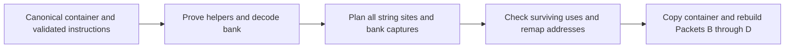

# Normalize VM string concealment

## 1. Target

Restore string constants hidden in the pinned VM's shared encoded bank. Successful recovery
replaces each proved four-instruction string decode site with an ordinary `LOAD_CONST`, removes
the runtime string helpers and their extra closure captures, and supplies a valid function
partition for later decoding. Passthrough retains the bank, helper calls and appended captures;
behavioral equivalence alone therefore does not establish recovery.

This is an implemented static normalizer for an admitted canonical numeric container. It consumes
Packet A (copied runtime data), Packet B (parsed instructions) and Packet C (validated references),
not arbitrary JavaScript source. It does not execute the encoded program, infer an unknown cipher,
or decode the rest of the VM. Stacked transformations require the producers in item 4 first.

Readers need ordinary functions, arrays, control flow, integer bit operations and basic VM
concepts, including registers, constant pools and closure upvalues. For this transform, the
**bank** is one encoded array of UTF-16 code units, including padding, shared through an
extra final upvalue. String offsets and lengths count UTF-16 units rather than Unicode code
points: an astral character occupies two units. Item 3 defines the register assignments,
pool indexes and capture relationships required by the normalizer.

## 2. Algorithm

### Establish what the runtime would do

The encoder replaces a string load with `(key, start, length)` and a call to a shared decoder.
The program first inflates a base64 constant into a bank; each function using strings creates its
own closure pointing at the same decoder body. Recognizing both helper bodies proves that the
bank is little-endian 16-bit data and that the call arguments really select and decrypt a string.
Otherwise a similar-looking call could be ordinary application logic.

Read the bank without evaluating those helpers. Decode the base64 bytes, pair low byte then high
byte, and select the slice named by the call. Starting from its key, advance the 32-bit state
before each unit and XOR that unit with the resulting 16-bit mask. XOR is self-inverse, so the
same mask used by the encoder restores the original UTF-16 unit. Item 3 specifies the exact
arithmetic and the recognition boundary.

### Remove the shared machinery as one unit

Direct string users identify the needed closure tree. Walk their parents to the program and
prove that each needed child receives the bank in its final capture. Intermediate ancestors may
forward that upvalue without decoding strings themselves. Removing only the final slot preserves
the indexes of all original captures; removing a different slot would change application values.

Plan every string replacement, prologue deletion and capture edit before emitting a new word
stream. Prove that surviving instructions do not use the erased helper registers. Then shorten
the stream and remap its absolute instruction addresses. A branch into a site's interior could
skip one of its argument loads, so it cannot normally target the replacement. The sole admitted
exception is a source proved unreachable by control-flow analysis, as specified in item 3.
Finally rebuild instruction, reference and function records from the new container.



Each arrow supplies evidence required by the next operation. No intermediate arrow publishes a
partially decoded container. A failure anywhere leaves the supplied container unchanged.

### Worked example: one UTF-16 unit

This synthetic example illustrates one site's arithmetic and replacement; it omits the full
helper traces, closure prologues, unrelated instructions and actual random decoys. Assume a bank
of 201 units, with unit 100 equal to `0x8853`, and the remaining units padding. For decoder
register `r10` and bank register `r9`, the site is:

```text
LOAD_INT r11, 1                  # seed, not a pool index
LOAD_INT r12, 100                # start measured in bank units
LOAD_INT r13, 1                  # one UTF-16 unit
CALL r2, r10, 4, r9,r11,r12,r13 # destination, decoder, count, ordered args
```

The first state is `(1 + 0x9e3779b9) | 0 = -1640531526` (unsigned bit pattern
`0x9e3779ba`). Its unsigned right shift by 13 is `0x0004f1bb`; XOR and masking give
`0x8801`. Thus `0x8853 XOR 0x8801 = 0x0052`, the unit for `"R"`. The bank bytes at
indexes 200 and 201 are `0x53, 0x88`; the byte offset is twice the unit offset.

If the pool previously had `P` entries, append `"R"` at index `P` and emit
`LOAD_CONST r2, P, 0`. The last zero is the unconcealed constant key. The original site
occupied 17 words (three loads of width 3 and a call of width 8); its replacement occupies
4. Its first address maps to the replacement, while its other three addresses disappear.
All surviving address operands must consequently be translated, not just the next branch.

## 3. Implementation

### Component contracts and dependencies

A program counter (`pc`) indexes words, not bytes or instructions. Operand layouts, widths and
capture-pair flags are specified in [read-wordcode](read-wordcode.md); legal pool/register/label
references and closure metadata come from [validate-references](validate-references.md).
[Function partitioning](partition-functions.md) assigns instruction intervals to functions, and
[control-flow analysis](build-cfg.md) supplies edges between instruction addresses. These are
supplied dependencies; a reconstruction must implement or supply their declared contracts.

| Component | Consumes | Produces / consumer invariant |
|---|---|---|
| Helper and bank recognition | Container, B instructions, C closure descriptors | Last two function entries are inflate and decode; canonical bank bytes |
| Site planner | User function intervals and recognized bank/decoder registers | All plaintexts, deleted instruction addresses and replacements; no input mutation |
| Capture planner | User closure creation graph and direct string users | Final capture removals; original upvalue indexes remain stable |
| Escape and address proof | Planned removals, typed register/capture operands and control edges | No surviving erased-register use; every retained target can be mapped |
| Emission and reconstruction | Complete plan and copied container | Fresh B, C and ordinary single-parent D, or whole-unit decline |

The public `diagnoseNormalizeStringConcealing(container, wordcode, references)` returns
`{ok:true,result,diagnostic:null}` on success. `result` has schema
`jsconfuser-vm-string-concealing-normalization.v1`, the new `container`, rebuilt `wordcode`,
`references`, `functions`, `pcMap` (input PC -> output PC, for the caller's
[origin map](normalize-macro-wordcode.md#shared-expansion-and-address-relocation)), `decodedCount`
(number of replaced sites), and
`threadedFunctionCount` (needed functions excluding the root). On failure it returns
`{ok:false,result:null,diagnostic:{code,message}}`; planned shape refusals use
`string-concealing-shape`, unexpected errors use `string-concealing-error`. The adapter does
not expose a separate no-candidate result: direct invocation on an absent shape declines.
The coordinator's prologue gate decides whether to try it (item 4).

### Helper recognition

Form sorted unique function entries from `0` plus C's closure descriptor starts. Require at
least three entries. The last two delimit inflate (penultimate entry to last entry) and decode
(last entry to end of stream). Other entries delimit user functions. This ordering is part of
the pinned emitted shape, not a search for any equivalent cipher anywhere in the program.

Compare each helper's operation and data-dependency trace, taken in execution order, to the
pinned template's. Walk from the helper's entry and follow every jump without recording it; a
conditional records `IF condition, whenTrue, whenFalse` (whichever of JUMP_IF_FALSE or
JUMP_IF_TRUE the layout uses), the walk continues on the true arm, and reaching an instruction
already traced records `GOTO` it. Number instructions by first visit; branch and GOTO targets
are those numbers. Normalize registers by replacing every read with the identity of its last
producing operation; an unwritten register reads as `argN`. A `MOVE` aliases that identity
rather than creating a new one. Resolve constant indexes to actual values. Keep operations,
operand order, globals, constants and branch targets exact. This admits changed temporary
register numbers and any layout an earlier decoder chooses (CFF reorders bodies and splits them
with jumps) while refusing changed computation.

The expected semantic computations below are explanatory pseudocode. Property accesses and
method calls retain their receiver identities. Each helper begins with `LOAD_THIS` (unused by
its result). The compiler's dead `LOAD_CONST undefined; RETURN` pair after the final return is
never reached, so it is absent from both traces whether or not the helper keeps it.

```text
inflate(arg0):
  bytes = call global atob(arg0); out = ""; i = 0
  while i < bytes["length"]:
    out = out + call String["fromCharCode"](
      call bytes["charCodeAt"](i) |
      (call bytes["charCodeAt"](i + 1) << 8))
    i = i + 2
  return out

decode(arg0=bank, arg1=key, arg2=start, arg3=length):
  result = ""; i = 0
  while i < length:
    key = (key + 2654435769) | 0
    mask = (key ^ (key >>> 13)) & 65535
    result = result + call String["fromCharCode"](
      call bank["charCodeAt"](start + i) ^ mask)
    i = i + 1
  return result
```

For exact recognition, the expected opcode sequences are the following design constraints.
Their constants and dependencies are the computations above; the loop's false edge goes to
its result return and its back edge goes to the condition's first load/comparison. In decode,
an extra `MOVE` reading the old `i` precedes loading the increment constant; it is retained in
the signature even though that temporary value is then overwritten.

```text
Inflate (continue across lines):
  LOAD_THIS LOAD_GLOBAL CALL MOVE LOAD_CONST MOVE LOAD_CONST MOVE
  LOAD_CONST GET_PROP LT JUMP_IF_FALSE LOAD_GLOBAL LOAD_CONST GET_PROP
  LOAD_CONST GET_PROP CALL_METHOD LOAD_CONST GET_PROP LOAD_CONST ADD
  CALL_METHOD LOAD_CONST SHL BOR CALL_METHOD ADD MOVE LOAD_CONST ADD
  MOVE JUMP RETURN

Decode (continue across lines):
  LOAD_THIS LOAD_CONST MOVE LOAD_CONST MOVE LT JUMP_IF_FALSE
  LOAD_CONST ADD LOAD_CONST BOR MOVE LOAD_CONST USHR BXOR LOAD_CONST
  BAND MOVE LOAD_GLOBAL LOAD_CONST GET_PROP LOAD_CONST GET_PROP ADD
  CALL_METHOD BXOR CALL_METHOD ADD MOVE MOVE LOAD_CONST ADD MOVE JUMP RETURN
```

`LOAD_CONST` and `LOAD_GLOBAL` must have zero conceal key; `CALL` and `CALL_METHOD` must
have fixed argument counts equal to their serialized argument words. Normalize constant
`-1640531527` to `2654435769` for trace comparison: both have bit pattern `0x9e3779b9`, and
the following `BOR 0` makes them equivalent. No neighboring constant is admitted by that rule.

Require exactly one inflate closure, at PC 0, with one parameter, at least 12 registers and
zero captures. Require at least one decode closure; every such creation must have four
parameters, at least 14 registers and zero captures. Rest flags are not independently tested
by this matcher; parsed metadata and rebuilt reference/partition validation still apply.
The first three program instructions must be that closure, an unconcealed `LOAD_CONST` of
the bank into a register, and a one-argument `CALL` of the inflate register using that loaded
register. Its destination is the root bank register.

### Bank and site recovery

Admit only the standard base64 alphabet `A-Z a-z 0-9 + /`, complete groups of four and
canonical final padding (`xx==` or `xxx=`). Decoding then re-encoding must reproduce the
exact string; byte length must be even. Treat each byte pair as an unsigned little-endian
unit `B[j] = bytes[2*j] | (bytes[2*j+1] << 8)`.

Read each function in execution order: from its entry, follow every jump (dropping it), take a
conditional's fallthrough first and its other targets later, then append what no walk reached.
"Immediately after" and "adjacent" below are in that order. At the root, look for a decode
closure immediately after the three inflation instructions. At another direct string user,
require `LOAD_UPVALUE localBank, uv` followed immediately by its decode closure at the function
entry. Functions forwarding the bank without string
sites need neither of those instructions. For decode register `d`, the dedicated argument
registers must be exactly `d+1`, `d+2`, `d+3` for key, start, length. Every call to `d` must
have the following adjacent instructions and argument order:

```text
LOAD_INT d+1, key
LOAD_INT d+2, start
LOAD_INT d+3, length
CALL destination, d, 4, localBank, d+1, d+2, d+3
```

Require integer `1 <= key <= 0xffffffff`, integer `start >= 100`, integer `length >= 0`,
and `start + length <= byteLength/2 - 100`. Offsets and lengths are in UTF-16 units.
The minimum 100-unit margin reflects each end's pinned decoy run; it does not identify
where every actual random padding run ends. Empty slices are mechanically accepted.
Each decode closure must have at least one site, and the number of decoder creations must
equal the number of direct users. A changed call, nonadjacent argument load or different
argument register refuses the whole bank.

The exact recovery equation, expressed as explanatory pseudocode, is:

```text
state = key; units = []
for i in [0, length):
  state = signed32(state + 0x9e3779b9)       # advance BEFORE reading mask
  mask = (state XOR unsignedShift(state,13)) AND 0xffff
  units.append(B[start+i] XOR mask)
plain = stringFromUTF16Units(units)         # preserve surrogates, no UTF-8 conversion
```

`signed32` keeps the low 32 bits and interprets them as two's complement, as JavaScript
`| 0` does; unsigned shift interprets that same pattern unsigned, as `>>>` does. Append
one new pool value per site in traversal order, even if plaintexts repeat. Replace the
first load with `[LOAD_CONST, destination, newPoolIndex, 0]`; remove the other two loads
and the call. Pool indexes and the opcode are obtained from the supplied container.

### Capture proof and surviving uses

For every nonhelper closure creation, its owner is the greatest function start not exceeding
its PC. Build `childEntry -> parentEntry`; refuse a user child created by different parents.
Let `need` be direct users plus all their ancestors. Require that it includes root 0.
Every creation of a needed child must have at least one capture and the exact final pair
below; remove that pair and decrement capture count, preserving all other descriptor words.

| Parent | Required final capture `(isLocal,index)` | Reason |
|---|---|---|
| Root | `(1, rootBankRegister)` | Bank is stored locally in the program |
| Nonroot | `(0, parentCaptureCount-1)` | Parent forwards its own last upvalue |

For each nonroot direct user, its first `LOAD_UPVALUE` must read its own descriptor's
`captureCount-1`. Ancestors forwarding the bank lose the same final descriptor capture
without removing any ordinary captures. Remove inflation instructions, each direct user's
decoder prologue and bank load, and all instructions of the two helper bodies.

Before emission, scan surviving typed register operands for use of the local bank, decoder,
and its three dedicated temporaries. At the root also include the inflate and base64-load
registers. Scan surviving closure local captures separately: a special register may occur
only in the final bank pair already planned for removal. Any other read, write or capture
of those registers declines, because deleting its producer would change the surviving code.
Register windows are left at their existing sizes; unused slots are not renumbered. Original
pool entries, including the base64 bank and helper constants, remain in the container; this
normalizer appends plaintexts but does not compact the pool. The bank's runtime load and use
are removed, rather than claiming its stored bytes have been erased.

The resulting admission boundary is deliberately narrower than semantic cipher equivalence:

| Input form | Result | Reason |
|---|---|---|
| Pinned traces with different temporary register numbers | Accept if dependencies match | Trace identities preserve computation; S-helper-allocation qualifies retained allocations only |
| Optional final undefined-return pair omitted | Accept | Exact admitted suffix choice; S-helper-suffix qualifies both helpers omitting it |
| Signed Weyl constant | Accept | Following 32-bit coercion preserves its bit pattern |
| Empty slice within the margins | Accept mechanically | Loop emits an empty string; edge evidence is missing |
| Changed helper, call layout or final bank capture | Whole-bank refusal | Cannot prove the deleted machinery's meaning |
| Surviving special-register use or live interior target | Whole-bank refusal | Deletion would change surviving behavior |
| No recognizable helpers / inflation prologue | Direct adapter refusal | Coordinator normally bypasses absent candidates |

### Address remapping, atomicity and derived state

Build an old-PC-to-new-PC map in stream order. Map surviving instructions and site first
loads to their new addresses. A deleted instruction that is a function entry maps to the
next emitted address. Also map the old stream end to its new end. The other instructions
inside a collapsed site have no ordinary map entry. A jump the execution-order read followed
between two parts of one site (a flattened block split the site) is that site's own
fallthrough: it is retargeted to the instruction after the site's call.

Translate these word offsets (zero is opcode): `JUMP:1`; `JUMP_IF_FALSE/JUMP_IF_TRUE:2`;
`FOR_IN_NEXT:3`; `TRY_SETUP:1`; `FINALLY_SETUP:1,4`; `MAKE_CLOSURE:2`. Also translate the
finally continuation literals the
[shared continuation rule](normalize-macro-wordcode.md#shared-expansion-and-address-relocation)
selects, functions from the plan starts, rather than treating them as ordinary integer constants.

Any other removed target is admissible only when it names one of the other three
instructions in a collapsed site AND the targeting instruction is unreachable. Prove
unreachability on the original instructions: construct a temporary partition allowing shared
zero-capture, four-parameter helper entries; build the CFG; traverse all non-null edges from
every function entry. Retarget that unreachable source to the site's first replacement.
A reachable source, failed CFG/partition, or any other removed target declines. Reachability
includes the edges supplied by the CFG, not just a scan for literal jumps.

The atomic unit is the entire recognized shared bank and all affected functions. There is
no supported partial bank recovery. Analysis uses plans and copied word arrays; only after
all proofs succeed is the container cloned, words replaced and plaintexts appended. Re-run
B's wordcode reader, C's reference validator and D's ordinary single-parent partition on
that clone; any failure returns no result. The original container and predecessor records
remain immutable. Retry is possible after an upstream inverse supplies another container.

The rebuilt records are the derived state read by later components: instruction boundaries,
typed references, function descriptors and ownership must describe the emitted words and pool.
No old instruction/reference/partition record is reused after compaction. This pass operates
on wordcode; the standalone emitter's AST consistency is a separate end-to-end acceptance
check. The package's [Babel foundation](../../decode-js.md#babel--isolated-vm-foundation) and
[scope, binding and path semantics](../../babel.md) supply the shared AST background for
that check.

### Testing and acceptance

The following scenarios define acceptance. Their IDs connect the concrete evidence below to
this design. Existing committed tests are executable checks; the worked example above is
explanatory and does not qualify an encoder option stack.

| Scenario | Oracle and observed result | Acceptance criterion | Evidence / limitation |
|---|---|---|---|
| S-sites: ordinary strings, methods, exceptions and nested closures | Source/encoded/decoded `TEST_OUTPUT` equality; direct normalization records | Positive decodedCount, fewer words, immutable input, valid ordinary D; no VM residue and consistent emitted AST | Base fixtures and normalizer test below |
| S-stacks: prior dispatcher/CFF/constant inverses | Same behavior and recovery checks; signed increment trace | Restore strings after required producers; altered increment/helper refuses | Combination fixtures and test below |
| S-helper-allocation: changed helper temporary-register allocation | Compare prepared helper register operands with baseline; existing recovery oracle | Different retained allocations preserve the proved operation/dependency traces and recover strings | Dispatcher and CFF fixtures below; arbitrary renumberings are not independently qualified |
| S-helper-suffix: final undefined-return pair omitted | Inspect CFF-prepared helper endings against the baseline's full endings; existing recovery oracle | Both helpers ending at their result return recover successfully (the unreachable pair is outside both traces) | CFF fixture below |
| S-routing: finalizer and collapsed site targets | Original CFG reachability plus behavior | A jump between two parts of one site continues after the site; another dead interior edge can remap; another live interior edge refuses | Triple exception fixture; combination live-branch control |
| S-refusal: helper, base64, capture and slice damage | Recognized fixture changed at one relevant decision | No normalized result; unchanged inputs; expected shape diagnostic when directly asserted | Existing tests assert refusal; exact diagnostic and unchanged-input assertions are incomplete for some damage controls |
| S-state: rebuilt instruction/reference/function records | Re-read emitted container through B/C/D | Records agree with emitted words, pool and captures; no old addresses retained | Direct base test validates D; end-to-end tests assert AST derived state |
| S-escape: surviving dedicated-register use | A control reaching the escape scan | Whole-bank shape refusal, input unchanged | No dedicated retained string-register escape control indexed here |
| S-no-candidate: absent prologue | Coordinator gate / direct adapter outcome | Coordinator bypasses adapter; direct call returns failure | Source-verified contract; no dedicated retained control indexed here |

Actual source and encoded bytes are retained with each qualification record, along with the
requested options, seed and observations. The cited records mark generation provenance
incomplete: exact encoder/decoder commits, tool/runtime/RNG details and decoded bytes are not
retained there. They support testing the retained cells and their observed effects, not exact
regeneration or exhaustive option/version coverage. Mutation controls establish bounded refusal
behavior; they are not new encoder admission evidence.

## 4. Input Shapes

Packet A's admission or runtime materialization supplies the canonical copied container.
Packet B establishes operand boundaries; Packet C establishes legal references. Shared string
helpers can be created by multiple parents, so ordinary Packet D cannot precede their removal.
The coordinator first tries string normalization after C. On failure it tries the dispatcher
inverse, retries strings, then the CFF inverse and retries strings. Its temporary D allows at
most one shared zero-capture four-parameter helper entry; dispatcher preparation defers CFG
validation. Successful strings publish the ordinary single-parent D for later decoding.

For each preparation attempt the coordinator counts repeated C descriptors with paramCount=4
and captureCount=0. More than one repeated entry or a failed preliminary D stops preparation;
an adapter decline instead advances to the next adapter. A successful preparation replaces the
current A/B/C and returned D/E privately before retrying strings. If that retry still fails, CFF
receives the prepared stream rather than the original one. There is no unbounded fixpoint retry.
The [dispatcher result contract](normalize-dispatcher-wordcode.md#result-atomicity-and-acceptance)
permits cfg:null; [CFF](normalize-cff-wordcode.md#first-relocation-and-rebuilt-state) always proves
current E and remaps allowed helper entries through both of its word-PC changes. This string
inverse returns ordinary B/C/D and no E; any prepared graph is discarded when its bank/capture
rewrite changes the words. Final diagnosis builds E on that string result. If the initial string
gate opened but all available retries fail, public string-concealing-declined publishes no partial
source, even when an earlier preparation succeeded privately.

| Accepted input spelling / interface | Producing pass | Origin and affected gate |
|---|---|---|
| Canonical numeric instruction names, unconcealed pool loads | [Container admission](extract-container.md), B/C | Encoder baseline; widths/references required before recognition |
| Restored pool values, including signed Weyl increment | [Constant normalization](normalize-concealed-constants.md) | Decoder output; helper constant trace accepts the two equivalent bit patterns |
| Direct routes with decoder dependencies recovered | [Dispatcher inverse](normalize-dispatcher-wordcode.md) | Decoder output; helper operation/branch traces must match |
| User/helper bodies with direct jumps, in any order | [CFF inverse](normalize-cff-wordcode.md) | Decoder output; traces, prologue and adjacency gates read execution order, so its layout is not relied on |
| Canonical words after fake-entry removal or specialized expansion | [Anti normalization](normalize-anti-wordcode.md), [specialized normalization](normalize-specialized-wordcode.md) | Decoder output; original PC maps are producer-owned; this pass reads their current boundaries |

The linked producers own their emitted-shape inventories. Their maps and records must be current
before this pass compacts again. Encoder ordering explains why these residues can surround the
string machinery; the retry sequence above defines how the decoder actually removes them.

The pinned [shared-bank producer](../../../js-confuser-vm/transforms/shared-string-bank.md) owns
original capture-count indexes, per-direct-user scratch allocation and fresh destination
occurrences. [Helper assembly](../../../js-confuser-vm/symbolic-helper-assembly.md) owns supplied
raw lowering, appended tails and descriptor state; those source contracts are not upgraded by this
decoder's retained cells. Its later [state routing](../../../js-confuser-vm/transforms/state-control-flow.md),
[encoded routing](../../../js-confuser-vm/transforms/encoded-branch-dispatch.md) and
[keyed values](../../../js-confuser-vm/transforms/keyed-constants.md) explain why the inverse
producers above must recover the current helper traces first. Original descriptor arrays need
not have been grown by the bank producer: this decoder consumes the serialized MAKE_CLOSURE
capture counts/pairs supplied by B/C.

Runtime layers (handler table, class obfuscation, minify, an encoded payload) reach this decoder
through [Packet A](extract-container.md) and the [handler locator](locate-handlers.md); one
recovered stack does not qualify arbitrary stacks.

## 5. Known Gaps

- Other helper bodies, noncanonical transports, changed site layouts or captures refuse; only
  the pinned trace shapes and documented register-renaming/suffix choices are admitted.
- S-helper-allocation qualifies the retained dispatcher/CFF allocations, not every arbitrary
  register renumbering that the source-derived trace rule can admit. No committed fixture
  exercises a layout other than the current CFF inverse's.
- Empty strings and full UTF-16 behavior follow the equation but lack a dedicated retained
  edge-value control in this document's evidence index.
- S-escape and S-no-candidate lack dedicated indexed controls. Some S-refusal controls assert
  only failure, without the exact decision diagnostic or unchanged-input check.
- Option stacks outside the indexed retained cells remain unqualified. Generation-provenance
  limitations are stated with the testing design; the selected cold retry model below does not reconstruct helper/bank/capture
  recovery or establish a novice reader study.

## Source

The decoder is [normalize-string-concealing.js](../../../../decoder/decode-js/src/vm/jsconfuser-vm/normalize-string-concealing.js):
`helperTrace`/`executionOrder`/`recognize` implement helper proof, `decodeBank`/`decodeSlice` implement the transport
and equation, and `recognize` plans captures, remaps addresses and rebuilds B/C/D.
[Audited helper signatures](../../../../decoder/decode-js/src/vm/jsconfuser-vm/string-concealing-helper-signatures.js)
verify the operation sequences specified in item 3. The adapter is wired by
[diagnose-standalone.js](../../../../decoder/decode-js/src/vm/jsconfuser-vm/diagnose-standalone.js)
after C and before ordinary D under the forced shared-helper dependency in item 4.

The pinned encoder's [string concealment pass](https://github.com/MichaelXF/js-confuser-vm/blob/20c5b96bf57337c568579352758d7685358650de/src/transforms/bytecode/stringConcealing.ts)
defines the bank, cipher, helper templates, site replacement and appended captures.
The [compiler pass list](https://github.com/MichaelXF/js-confuser-vm/blob/20c5b96bf57337c568579352758d7685358650de/src/compiler.ts)
places it before CFF, dispatcher, register resolution and label resolution, accounting for
the inverse dependencies in item 4.

## Fixtures

The retired frozen verifier used labeled
synthetic stage results to check current A/B/C/D/E replacement, ordered preparation/string retries
and mandatory exhaustion. This is an interface model, not actual helper/bank/capture reconstruction,
source admission or public plugin execution. Missing-record fill is confirmed only by the postfreeze
static source audit; the frozen model does not rebuild missing C/D/E. Its synthetic public wrapper
checks modeled whole-source refusal, not a real public E/K control. The accepted pilot evidence
below retains its existing exact-gate and unchanged-input gaps. The frozen executable and the
report's frozen metadata/stdout section stay unchanged; postfreeze audit/verdict remains appendable.

| Committed fixture or test control | Scenario and claim pinned |
|---|---|
| [string-concealing-switch](../../../../decoder/decode-js/test/vm/jsconfuser-vm/fixtures/string-concealing-switch/encoded.js) and its [qualification record](../../../../decoder/decode-js/test/vm/jsconfuser-vm/fixtures/string-concealing-switch/qualification.json) | S-sites: A shared decode helper created by root and child is removed before Packet D. |
| [string-concealing-methods](../../../../decoder/decode-js/test/vm/jsconfuser-vm/fixtures/string-concealing-methods/encoded.js) and its [qualification record](../../../../decoder/decode-js/test/vm/jsconfuser-vm/fixtures/string-concealing-methods/qualification.json) | S-sites: Method closure bank capture and string sites restore. |
| [string-concealing-exceptions](../../../../decoder/decode-js/test/vm/jsconfuser-vm/fixtures/string-concealing-exceptions/encoded.js) and its [qualification record](../../../../decoder/decode-js/test/vm/jsconfuser-vm/fixtures/string-concealing-exceptions/qualification.json) | S-sites: Catch/finally behavior survives bank removal. |
| [string-concealing-closures](../../../../decoder/decode-js/test/vm/jsconfuser-vm/fixtures/string-concealing-closures/encoded.js) and its [qualification record](../../../../decoder/decode-js/test/vm/jsconfuser-vm/fixtures/string-concealing-closures/qualification.json) | S-sites: Ordinary closure captures remain valid. |
| [string-concealing-nested](../../../../decoder/decode-js/test/vm/jsconfuser-vm/fixtures/string-concealing-nested/encoded.js) and its [qualification record](../../../../decoder/decode-js/test/vm/jsconfuser-vm/fixtures/string-concealing-nested/qualification.json) | S-sites: The bank threads through two intermediate closures to an inner string user. |
| [string-concealing-cff](../../../../decoder/decode-js/test/vm/jsconfuser-vm/fixtures/string-concealing-cff/encoded.js) and its [qualification record](../../../../decoder/decode-js/test/vm/jsconfuser-vm/fixtures/string-concealing-cff/qualification.json) | S-stacks / S-helper-allocation / S-helper-suffix: CFF is inverted before restoring strings shared by root and child; prepared helpers use different temporary registers and both omit the final undefined-return pair. |
| [string-concealing-dispatcher](../../../../decoder/decode-js/test/vm/jsconfuser-vm/fixtures/string-concealing-dispatcher/encoded.js) and its [qualification record](../../../../decoder/decode-js/test/vm/jsconfuser-vm/fixtures/string-concealing-dispatcher/qualification.json) | S-stacks / S-helper-allocation: Dispatcher changes the retained helper register allocation without changing its proved operations. |
| [string-concealing-nested-cff](../../../../decoder/decode-js/test/vm/jsconfuser-vm/fixtures/string-concealing-nested-cff/encoded.js) and its [qualification record](../../../../decoder/decode-js/test/vm/jsconfuser-vm/fixtures/string-concealing-nested-cff/qualification.json) | S-stacks: A threaded bank survives CFF through intermediate closures. |
| [string-concealing-cff-dispatcher-exceptions](../../../../decoder/decode-js/test/vm/jsconfuser-vm/fixtures/string-concealing-cff-dispatcher-exceptions/encoded.js) and its [qualification record](../../../../decoder/decode-js/test/vm/jsconfuser-vm/fixtures/string-concealing-cff-dispatcher-exceptions/qualification.json) | S-stacks / S-routing: The triple stack restores catch/finally behavior and proves a dead pad before remapping its string-site edge. |
| [string-concealing-cff-dispatcher-switch](../../../../decoder/decode-js/test/vm/jsconfuser-vm/fixtures/string-concealing-cff-dispatcher-switch/encoded.js) and its [qualification record](../../../../decoder/decode-js/test/vm/jsconfuser-vm/fixtures/string-concealing-cff-dispatcher-switch/qualification.json) | S-stacks: The triple stack restores multiway string dispatch. |
| [string-concealing-concealed-constants](../../../../decoder/decode-js/test/vm/jsconfuser-vm/fixtures/string-concealing-concealed-constants/encoded.js) and its [qualification record](../../../../decoder/decode-js/test/vm/jsconfuser-vm/fixtures/string-concealing-concealed-constants/qualification.json) | S-stacks: Constant normalization supplies the signed spelling of the helper increment. |
| [string-concealing-cff-dispatcher-concealed-constants](../../../../decoder/decode-js/test/vm/jsconfuser-vm/fixtures/string-concealing-cff-dispatcher-concealed-constants/encoded.js) and its [qualification record](../../../../decoder/decode-js/test/vm/jsconfuser-vm/fixtures/string-concealing-cff-dispatcher-concealed-constants/qualification.json) | S-stacks: The four-pass stack preserves catch/finally behavior. |
| [string-concealing-anti-instrumentation-nested](../../../../decoder/decode-js/test/vm/jsconfuser-vm/fixtures/string-concealing-anti-instrumentation-nested/encoded.js) and its [qualification record](../../../../decoder/decode-js/test/vm/jsconfuser-vm/fixtures/string-concealing-anti-instrumentation-nested/qualification.json) | S-stacks: Fake entry seeds are removed before shared helper and nested capture recovery. |
| [string-cff-dispatcher-concealed-constants-anti-instrumentation-exceptions](../../../../decoder/decode-js/test/vm/jsconfuser-vm/fixtures/string-cff-dispatcher-concealed-constants-anti-instrumentation-exceptions/encoded.js) and its [qualification record](../../../../decoder/decode-js/test/vm/jsconfuser-vm/fixtures/string-cff-dispatcher-concealed-constants-anti-instrumentation-exceptions/qualification.json) | S-stacks: The five-option stack preserves catch/finally behavior. |
| [string-cff-dispatcher-concealed-constants-anti-specialized-exceptions](../../../../decoder/decode-js/test/vm/jsconfuser-vm/fixtures/string-cff-dispatcher-concealed-constants-anti-specialized-exceptions/encoded.js) and its [qualification record](../../../../decoder/decode-js/test/vm/jsconfuser-vm/fixtures/string-cff-dispatcher-concealed-constants-anti-specialized-exceptions/qualification.json) | S-stacks: The six-option stack restores strings after both wordcode inverses. |
| [normalize-string-concealing.test.js](../../../../decoder/decode-js/test/vm/jsconfuser-vm/normalize-string-concealing.test.js) | S-sites / S-refusal / S-state: Matching behavior, no VM residue, consistent emitted AST state and refusal controls for changed helper, bank, capture and slice. |
| [normalize-string-concealing-combinations.test.js](../../../../decoder/decode-js/test/vm/jsconfuser-vm/normalize-string-concealing-combinations.test.js) | S-stacks / S-helper-allocation / S-helper-suffix / S-routing / S-refusal: Pair, triple and four-pass behavior; signed helper increment, malformed stacked helpers and a live jump into a collapsed site. |
