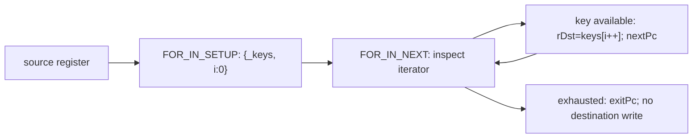

# Analyze property and collection operations

## 1. Target

Recover property/collection operand roles, ordered payloads, mutation descriptors and iterator
branches without executing them. `analyzePropertyCollections(B,C,D,E,F)` returns deeply frozen
`jsconfuser-vm-property-collections.v1` (J) or null; `diagnosePropertyCollections` returns frozen
`{ok,result,diagnostic}`. J emits one row per **J-family** instruction, including unreachable
rows, not one row for every B instruction. It does not infer dynamic objects, keys or results.

Readers need JavaScript properties/prototypes/accessors and graph reachability, plus
[B grammar/semantic operands](read-wordcode.md), [D owners](partition-functions.md),
[E iterator edges](build-cfg.md) and [F call/receiver facts](build-call-frames.md).
The encoder [property/enumeration semantics](../../../js-confuser-vm/instruction-set.md#properties-collections-and-enumeration)
own the native runtime behavior. PCs/widths count u32 words; register indexes are relative to
D's function/frame. Register contents are unrestricted JavaScript values.

`diagnosePropertyCollections` exposes detailed stage diagnostics. `analyzePropertyCollections` returns only the
result or null, discarding those details. Standalone reconstruct uses that wrapper and reports
`property-collections-declined` on null; the plugin preserves this generic standalone diagnostic.

## 2. Algorithm

A property instruction's input order decides when key coercion, a getter or a proxy can act.
Preserve the parsed semantic roles and describe the runtime effect, while leaving outcomes
unknown. First index D ownership and traverse E edges from each entry for reachability. Project
GET/SET/DELETE, IN/INSTANCEOF, array/object construction, accessor definitions and enumeration.
Walk B order, retaining complete rows only for this family; skip known peer names and reject
names outside the canonical inventory.

Counted collection payloads retain their element/pair order. Enumeration has two different
results: setup creates an iterator; next either writes a key and advances it or branches without
writing the destination. Attach the corresponding E edges to make that conditional definition
visible. Finally check unique/complete J-family coverage and publish a frozen result. This is
structural analysis; E reachability does not reveal actual enumerable key values.

The loop arrow describes runtime iteration. J records the two E routes and ordered roles; it
does not enumerate the source itself or unroll this loop.

### Worked example: payload, accessor and conditional definition

This **synthetic canonical stream** has root regCount=7, empty pool and no calls/captures:

| PC | Words | Projected meaning |
|---:|---|---|
| 0 | `[49,0,2,1,2,1,3]` | BUILD_OBJECT r0, two ordered pairs (r1,r2), (r1,r3). |
| 7 | `[50,0,1,4]` | DEFINE_GETTER object r0, key r1, accessorFunction r4; no destination. |
| 11 | `[52,5,0]` | FOR_IN_SETUP iterator r5 from object r0; next14. |
| 14 | `[53,6,5,20]` | FOR_IN_NEXT key r6 from iterator r5; normal18 or exit20. |
| 18 | `[39,14]` | Loop back; peer control instruction skipped by J. |
| 20 | `[45,6]` | Peer return skipped by J. |

WordCount=22; J emits four rows. Row property-collection:0:0 keeps pairIndex0/1 and key/value
registers in order; under ordinary assignment the later pair can overwrite the earlier same key.
J does not assert that r1 actually has a particular key. Row PC14 uses semantic operands
register6/register5/label-target20, defines r6 **only** on the normal edge and reports
normal writesDestination/incrementsIterator=true, exit both false.

B's current compatibility wordOperands instead tags iterator5 as label-target and exit20 as
register. J copies them and reports historicalForInNextWordOperandsPreserved=true from the kinds;
this flag is not a guard or an alternate grammar. The semantic roles and E edges remain authoritative.

At PC7 roles.accessorFunction.register is r4, but the current evaluationOrder step for role
`function` has register=null due to a role-name mismatch. Changing only word PC10 (the accessor
register) to r3 changes roles/accessor payload to r3 while leaving that erroneous step null.
This opposite control exposes missing projection; it does not qualify accessor order from that
step array. The example omits real object/function values, source admission and host behavior.

## 3. Implementation

### Components and exact role mapping

| Component | Input -> output | Consequential decision |
|---|---|---|
| Owner/reachability index | D ownership + E edges -> functionId/reachable | BFS from each entry over non-null edges, including exceptional routes. |
| Role projector | B semantic operands -> destination/inputs/roles/payload | Preserve grouped order; no raw tag inference. |
| Semantic/effect projector | Name + roles -> runtime/effect descriptors | Unknown results; exact mutation/descriptor behavior below. |
| Iterator projector | B nextPc/exit + E edges -> conditional definition | Normal/exit use distinct source edges. |
| Census/publisher | Complete family projection -> frozen J | Unique keys/row counts; no source/input mutation. |

A role value is `{role,operand:semanticOffset,register:copiedOperand}`. Destination is
register(operands[0].index) except SET_PROP/DEFINE_GETTER/SETTER, where it is null.

| Names | family; descriptor operation/effect | Inputs and role offsets |
|---|---|---|
| GET_PROP | property; get-property/property-read | inputs [1,2]; result0/object1/key2 |
| SET_PROP | property; set-property/property-write | inputs [0,1,2]; object0/key1/value2; no result |
| DELETE_PROP | property; delete-property/property-delete | inputs [1,2]; result0/object1/key2 |
| IN | membership; membership-test/property-membership-read | inputs [1,2]; result0/propertyKey1/object2 |
| INSTANCEOF | prototype-relation; instanceof-test/prototype-relation-read | inputs [1,2]; result0/instance1/constructor2 |
| BUILD_ARRAY | collection; build-array/array-construction | result0; count1; all tail registers, element[i] at 2+i |
| BUILD_OBJECT | collection; build-object/object-construction | result0; pairCount1; all tail registers, key at 2+2i/value at 3+2i |
| DEFINE_GETTER/SETTER | accessor; define-getter/setter/accessor-definition | inputs [0,1,2]; object0/key1/accessorFunction2 (role=function); no result |
| FOR_IN_SETUP | enumeration; for-in-setup/iterator-creation | input1; iterator0/source1 |
| FOR_IN_NEXT | enumeration; for-in-next/iterator-step | input1; key0/iterator1/exit2={role:exit,operand:2,targetPc} |

Widths come from B: setup=3, next=4, ordinary property/accessor=4, arrays=3+count,
objects=3+2*pairCount. Accessors have **fixed** width four, not variable payloads.
payload is array{kind,count,elementRegisters}, object{kind,pairCount,pairs:[{pairIndex,key,value}]},
iterator-next{kind,iterator,exitTarget}, or null. Object payload key/value fields are register
objects. roles.pairs[i] is {pairIndex,key,value}: key={role:"key",operand:2+2*i,
register:{kind:"register",index:keyIndex}} and value={role:"value",operand:3+2*i,
register:{kind:"register",index:valueIndex}}. These wrapper role strings are "key"/"value";
evaluationOrder.roles and steps.role instead name "pair[i].key"/"pair[i].value".
For iterator-next, iterator is the copied register object and exitTarget is the copied
{kind:"label-target",pc:exitPc} object. controlFlow.exitTargetPc is the numeric exitPc.

evaluationOrder has kind=left-to-right-register-read, ordered roles, steps={order,role,register}
and a dynamic-effect caveat. Roles are object/key[/value], propertyKey/object, instance/constructor,
element[i], pair[i].key then pair[i].value, object/key/function, source, or iterator/exit respectively.
Exit steps have register=null intentionally. Accessor function steps also currently have null,
**unintentionally**: lookup asks roles.function, while the role map field is accessorFunction.
Read the exact accessor register from roles/inputs; a corrected step projection remains work to
qualify, not a required runtime null operand.

### Native semantics and mutation order

For GET/DELETE read object then key, compute `object[key]` or `delete object[key]`, then write
the destination. SET reads object/key/value, calls Reflect.set and discards its Boolean return;
false is not itself a throw or a register result. IN computes propertyKey in object, including
prototype membership; INSTANCEOF computes instance instanceof constructor, including native
custom hasInstance behavior. Preserve native key coercion, getters/setters, proxies and throws;
J does not convert these effects into known values or E exception edges.

BUILD_ARRAY allocates Array(count), reads/writes element registers in payload order, then installs
it at destination. BUILD_OBJECT allocates `{}`, reads key then value and assigns `o[key]=value`
for each pair before installing destination. Later ordinary assignments overwrite earlier keys;
prototype setters, `__proto__`, coercion and accessors retain ordinary assignment behavior,
so the duplicateKeyBehavior descriptor is not a proof for every exotic key/object effect.
Accessor definitions read object/key/function, inspect its existing **own** descriptor, construct
an enumerable/configurable=true descriptor, preserve the opposite accessor only when its typeof
is function, then Object.defineProperty. Neither accessor instruction invokes the function or
replaces an unrelated data descriptor with a copied writable/value field.

FOR_IN_SETUP handles null/undefined as empty keys. Otherwise box with Object(source); for each
prototype from object outward, get Object.getOwnPropertyNames in native order. For each unseen
name, mark it seen **before** looking up its descriptor/enumerable flag; append only enumerable
names, then advance with Object.getPrototypeOf until null. Thus a non-enumerable own name still
suppresses an enumerable same-name prototype property. Store `{_keys:keys,i:0}` after enumeration.
NEXT reads iterator/exit; if i >= keys.length set PC=exit without writing key/incrementing; otherwise
write destination=keys[i++] and continue nextPc. Snapshot keys and receiver/prototype mutations
are runtime effects, not live enumeration performed by J.

semantic always has known=false/certainty=structural-only, roles, evaluationOrder, kind/resultType,
runtime description, unknowns and mayThrow. Kinds are property-read/write/delete, membership-test,
prototype-relation-test, array/object-construction, getter/setter-definition, for-in-setup/next.
Result types are dynamic, no-register-result, boolean, boolean, boolean, array, object,
no-register-result, iterator, property-key-or-exit respectively. mayThrow is false only for the
array-construction descriptor; it is a structural classification, not immunity to allocation/host
failures. Object semantic carries pairCount/duplicateKeyBehavior; accessor semantic carries
accessorKind/descriptor flags; setup carries its nullish/boxing/prototype/de-dup flags; next carries
exitTargetPc and exit=controlFlow.

### Control, records and atomicity

Setup controlFlow={kind:fallthrough,normalTargetPc:nextPc,edge:first outgoing E edge}.
NEXT selects exit from E kind=branch/targetPc=operands[2].pc and normal from
kind=fallthrough/targetPc=nextPc. Its controlFlow is kind=iterator-conditional/normalTargetPc/
exitTargetPc plus normal and exit condition/writesDestination/incrementsIterator/edge fields.
useDef defines destination but conditionalDefine explicitly says only when a key is available.
An unreachable iterator row still preserves structural next/exit targets; copied edge fields are
undefined when E has no corresponding outgoing edge. This does not invent a reachable branch.

Rows have id=`property-collection:functionId:pc`, functionId/pc/reachable/opcode/name/family/
operandForm, operands, copied wordOperands/words/width/nextPc, destination/inputs/roles/payload/
controlFlow, useDef={uses,defines,conditionalDefine}, effect, evaluationOrder, semantic.
effect has kind/register/resultType/reads/mutates: true for SET/DELETE/accessors/NEXT, false
otherwise. It additionally carries writesProperty/deletesProperty/definesAccessor/createsIterator/
stepsIterator where relevant, using the role map. Allocating an object is not an effect.mutates
assertion about an existing object.

J carries schemaVersion/encoding/api/parseOnly=true/targetExecution=false, total counts,
opcodeScope={family:J-property-collection,count,names,rows}, operations/operationCount,
functionCensus/census/reachability, predecessorSchemas/predecessorInputs, boundaryOmissions,
proof and inputs. Rows in opcodeScope contain name/opcode/family/operandForm/operation/effect/
resultType/known=false/evaluationOrder (definition roles)/width/count. functionCensus and census
parallel [I's projection contract](scalar-values.md#output-partial-boundary-and-refusal), replacing
scalar counts with propertyOperationCount/reachablePropertyOperationCount/
unreachablePropertyOperationCount. All count sums/unique keys refer only to J instructions.
predecessorInputs names B/C/D/E/F schemas; inputs includes word/instruction/pool/function/edge/
block/call/return/throw counts. C and F contribute reporting counts, not dynamic property/callee
resolution. proof flags generated row presence/uniqueness, compatibility-tag kinds and
noTargetCodeExecuted; none establishes runtime property equivalence.

Known canonical I/THIS/upvalue/control/call/closure/handler/PATCH/DEBUGGER peer names are skipped,
listed in boundaryOmissions, the complete grouped static peer inventory, not only encountered
names. Empty operations is successful J. Unknown name -> unsupported-opcode;
duplicate generated key -> duplicate-operation; census disagreement -> incomplete-property-census;
unexpected errors -> property-collections-analysis-error. Whole J returns null on failure, never
partial rows. No AST/helper cleanup or predecessor mutation occurs, and no schema/raw-word
correspondence validation is added within the owned chain.

### Testing and acceptance

| Scenario | Result / oracle | Acceptance | Evidence |
|---|---|---|---|
| J1 property/payload projection | Exact ordered roles/pairs, fixed accessor width, null mutation destination. | Complete/unique J rows, skipped peers, freeze/unchanged inputs. | J test/accessor/mutation fixtures and the example's scaffold test. |
| J2 enumeration | Exact semantic iterator/exit and normal-only definition; first-seen suppression includes non-enumerable names. | Distinguish tags from semantic roles; never infer exit-path key. | For-in fixture/test; private-A semantic/tag scaffold in the J test; exotic prototype runtime evidence missing. |
| J3 accessor step mismatch | r4->r3 changes actual role/inputs, function step remains null. | Expose projection defect; correct step attribution remains unqualified. | Private-A scaffold and r3 opposite in the J test. |
| J4 method/call relation | GET_PROP produces dynamic callee; F copies explicit METHOD receiver. | No inferred property alias/call target or receiver from syntax alone. | Accessor/method fixture; general alias/receiver behavior unqualified. |
| J5 unknown/census refusal | Named whole-stage null result. | Reach projector decision, not earlier B grammar failure. | Dedicated normal source-entry J refusal missing; private packet damage is not owned-chain admission evidence. |

## 4. Input Shapes

Normalizers must supply current [B](read-wordcode.md)/[D](partition-functions.md)/[E](build-cfg.md)
records after payload/PC rewrites; [C](validate-references.md) counts and [F](build-call-frames.md)
call/return counts are reporting dependencies. GET_PROP's result can later be F's callee register,
but F cannot recover its value through property aliasing. METHOD's receiver comes from its explicit
B/F operand; an accessor invoked by ordinary property semantics has native receiver behavior,
not a new J call-site target. [G](closure-lifetimes.md) tracks limited aggregate/property-store
provenance with its stated limitations. [K](structured-control.md) consumes B/E/H iterator control,
not J as a CFG producer. [Diagnosis](standalone-diagnosis.md#owned-record-boundary) retains J as
propertyCollections; current emission reads B and the later plan/model facts directly.

## 5. Known Gaps

- Accessor evaluationOrder's function step is null despite an actual register role; corrected
  step behavior is unqualified. B's FOR_IN_NEXT compatibility tags remain a distinct known defect.
- Object/key/coercion/prototype/accessor/proxy outcomes, constructor validation and precise host
  exceptions remain dynamic. mayThrow/duplicate-key descriptors are structural, not universal
  runtime guarantees or new E edges.
- J's F dependency does not create a property-to-callee alias analysis. General receiver and
  closure-state claims require the F/G limitations to be resolved separately.
- No fresh generated-output, full compiler, whole-J cold reconstruction or novice proof is claimed;
  retained [fixture provenance](../../../../decoder/decode-js/test/vm/jsconfuser-vm/fixtures/qualification-provenance.md)
  bounds existing evidence.

## Source

The runtime property/payload/descriptor/iteration decisions in item 3 are pinned by
[property handlers](https://github.com/MichaelXF/js-confuser-vm/blob/20c5b96bf57337c568579352758d7685358650de/src/runtime.ts#L333-L361)
and [collection/accessor/enumeration handlers](https://github.com/MichaelXF/js-confuser-vm/blob/20c5b96bf57337c568579352758d7685358650de/src/runtime.ts#L737-L839).

The stage is implemented by [property-collections-operands.js](../../../../decoder/decode-js/src/vm/jsconfuser-vm/property-collections-operands.js), [analyze-property-collections.js](../../../../decoder/decode-js/src/vm/jsconfuser-vm/analyze-property-collections.js). The [standalone diagnosis](standalone-diagnosis.md)
composes its result with predecessor records. The encoder contracts are described in
[instruction-set.md](../../../js-confuser-vm/instruction-set.md) and
[container-wordcode.md](../../../js-confuser-vm/container-wordcode.md).

## Fixtures

J1/J2/J3 use the worked example's complete words, empty pool and regCount=7 with
[F's private-record scaffold](build-call-frames.md#fixtures), then diagnosePropertyCollections
(B,C,D,E,F). Assert four rows, ordered object pairs, iterator semantic operands r6/r5/exit20,
normal-only definition, and the copied compatibility-tag flag. Accessor role/inputs identify r4,
while evaluationOrder.steps[2].register is null. Change only words[10] from4 to3: the accessor
role/inputs change to r3 and the function step remains null. The
[property-collection test](../../../../decoder/decode-js/test/vm/jsconfuser-vm/analyze-property-collections.test.js)
pins both variants with the field oracles below. These private-record results expose projection
limits without qualifying repaired behavior, and are not new source admission, generated-output
or cold proof.
J2's non-enumerable shadow suppression follows static runtime source; that exotic runtime
control was not executed here.

| Committed fixture or test control | Claim pinned |
|---|---|
| [f-accessors-and-methods](../../../../decoder/decode-js/test/vm/jsconfuser-vm/fixtures/corpus/raw/f-accessors-and-methods/encoded.js) | Accessor definitions and method/property roles; function evaluation-step register projection remains defective. |
| [f-for-in-enumeration](../../../../decoder/decode-js/test/vm/jsconfuser-vm/fixtures/corpus/raw/f-for-in-enumeration/encoded.js) | `FOR_IN_SETUP`/`FOR_IN_NEXT` operands and the iteration/exit edges. |
| [f-expression-mutation](../../../../decoder/decode-js/test/vm/jsconfuser-vm/fixtures/corpus/raw/f-expression-mutation/encoded.js) | Property mutation and deletion operation roles. |
| [f-instanceof-errors](../../../../decoder/decode-js/test/vm/jsconfuser-vm/fixtures/corpus/raw/f-instanceof-errors/encoded.js) | `INSTANCEOF` operand roles while leaving dynamic errors unresolved. |
| [analyze-property-collections.test.js](../../../../decoder/decode-js/test/vm/jsconfuser-vm/analyze-property-collections.test.js) | Variable-payload roles, enumeration routes, complete producer coverage, immutable results, and the J1-J3 worked-example scaffold. |

For the existing example, exact J1/J2 representation oracles additionally require
roles.pairs[0].key={role:"key",operand:2,register:{kind:"register",index:1}} and
roles.pairs[0].value={role:"value",operand:3,register:{kind:"register",index:2}}, while the
evaluation steps name "pair[0].key" and "pair[0].value". FOR_IN_NEXT@14 payload is
{kind:"iterator-next",iterator:{kind:"register",index:5},exitTarget:{kind:"label-target",pc:20}};
controlFlow.exitTargetPc=20. The property-collection test pins these fields with unchanged A-F
snapshots and a deeply frozen J; it does not repair the historical word tags or accessor step.

The retired frozen semantic-record verifier,
built from the documents before source consultation, asserted selected ordered register/payload,
iterator branch and evaluation facts on supplied B-E. Excluded are numeric exitTarget and
pair-path role-wrapper guesses, exact boundaryOmissions/whole-schema equality, and
source/public/generated behavior. The separate
retired frozen field verifier, built
from the corrected documents before source consultation, reconstructed both object pair wrappers/evaluation paths, accessor
r4/r3 role/null-step opposite, iterator register/label payloads and numeric control targets,
normal/exit writes with supplied or absent edges, and empty J projection. These are selected
fields from supplied semantic operands/edges. Unasserted result roles, evaluation kind/caveat,
branch condition text, semantic/effect/useDef fields, FOR_IN_SETUP, census refusals, whole J
rows and source/public/generated behavior remain excluded. The accessor defect is preserved.
