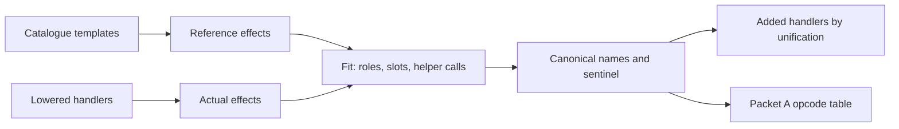

# Read opcode meaning from the handlers

## 1. Target

randomizeOpcodes gives every operation a random value, so a word's number no longer says which
instruction it is. Its handler still does: the interpreter code that executes that opcode. Runtime
meaning names every handler by what it does in a production environment, and Packet A writes the
result into the decode's opcode table
([opcode-table.js](../../../../decoder/decode-js/src/vm/jsconfuser-vm/opcode-table.js)); the words
keep their values and B reads them through that table. A canonical handler is named by comparing
its effects with one reference per canonical opcode. Every other handler is an added handler
(anti, specialized, macro, alias), identified by comparing its effects with the named canonical
handlers' and handed to the reader of its kind. The build's spread sentinel, the value CALL
compares its argument count with, comes from the named CALL.

Every encoder stage after the runtime template, the VM encoder's runtime layers and any outer
obfuscator alike, adds complexity and keeps behaviour, so a handler's spelling is unstable and only
its effects identify it. Behaviour is the production environment's: a `debugger` statement acts
only under a debugger, so it is no effect.

Meaning reads the supplied tree through the [handler locator](locate-handlers.md)'s view, evaluates
lowered copies symbolically, and executes nothing. Without a located runtime the table keeps its
canonical default. Labels are never read for meaning: an added handler moved to another label is
the same handler, and the words that used the old label then have no handler, so B declines them.

Readers need the [handler locator](locate-handlers.md), the [canonical word grammar](read-wordcode.md)
and the encoder's [opcode allocation](../../../js-confuser-vm/js-confuser-vm.md#compiler-order) and
[added-opcode passes](../../../js-confuser-vm/transforms/runtime-layout.md), which build every
added handler from canonical handler bodies.

## 2. Algorithm

Every handler and every reference is evaluated to effects first. The canonical handlers are named
all at once; the named handlers then serve as the references every added handler is identified
against.

```text
references = effects(template) for each catalogue template      // one per canonical opcode
actual     = effects(lowered handler) for each handler, one identity per binding across the runtime
named = { h -> N : a reference of N fits h, a reference of N fits no other handler,
                   and no other opcode's reference fits h }    // fits bind roles (below)
for each h still unnamed:                                        // an original beside its copies
  N = the one opcode whose reference fits h among the named handlers only
  group h under N
for each group:                                                  // the original reads most operands
  originals = members reading the most operands
  if every original has equal effects: name the lowest label N (the others are identity aliases)
table = canonical default; a value an identified handler holds is cleared elsewhere
table[N] = label of each named handler; sentinel = the number CALL's `$_SPREAD` role bound
for each other handler h:
  effects(h) against each named handler's effects:
    one canonical handler, every operand slot a literal       -> specialized (operands baked)
    one canonical handler, its slots a permutation of reads    -> alias (canonicalToStored)
    canonical handlers in sequence, reads in order             -> macro
    canonical handlers in sequence, reads one eager array      -> anti (steps, permutation)
    anything else, or more than one way                        -> unclassified
```

**Effects.** The lowered handler is evaluated symbolically, in JavaScript evaluation order:

- each operand read becomes a slot numbered in read order (`{op: k}`; an assignment's target
  before its value; a constant read without arguments reads two);
- a literal stays a value, an unbound name is the global it names, and a binding outside the
  handler (the run function's state, a helper) is one identity across the runtime;
- a local is a carrier of its value; after a conditional or loop it holds what the paths leave:
  the one value when they agree, otherwise their join (a loop counts its zero-pass value);
- a statement-level `a || b`, `a && b` or `c ? x : y` is the `if` it stands for, and an assignment
  inside an expression performs its write before the effect that holds it and yields its value.

The effects are the writes to anything but a local, calls, conditionals, loops, throws and returns.
These spellings evaluate to the same effects; each has a producer and a test:

| Unstable dimension | Spellings | Producer |
|---|---|---|
| Which locals hold a value | kept, folded, coalesced; `var x = v` or `x = v` | Closure minify, outer MovedDeclarations, SSA renaming |
| A dead initial write | `var args;` or `args = undefined;` before branches that both write it | outer MovedDeclarations |
| A conditional statement | `if`, `?:`, `&&`, `\|\|` | Closure and outer minify |
| String building | `` `${x} is not defined` `` or `"" + x + " is not defined"` | outer Preparation (its own left-to-right chain, a nonempty quasi after each expression) |
| A constant | `void 0`/`undefined`; `!0`/`true`; `!1`/`false` | Closure minify |
| Array construction | `Array(n)` or `new Array(n)` | Closure minify |
| Bitwise grouping | `a ^ b ^ c`, `a ^ (b ^ c)`; `x &= y` or `x = x & y` | Closure minify (a chain of `^`, `&` or `\|` is one list of operands) |
| A loop | `for (init; test; update)` or `init; while (test) { ...; update }` | Closure minify |
| A stable value | `SLOTS.THIS`, `3`, or a top-level binding stably holding `3` | randomizeOpcodes, constant folding, outer ObjectExtraction (read by the [lowering](locate-handlers.md#2-algorithm)) |
| A debug-only statement | `debugger;` or nothing | our outer lock decoder removes every `debugger` |

**References.** A reference is a catalogue template written in the lowered form and evaluated the
same way, its placeholders kept as roles:

| Placeholder | Binds | Scope |
|---|---|---|
| `$operand()`, `$constant(...)` | The locator's reader calls | Literal markers |
| `$regs`, `$base`, `$fp`, `$vm`, helper names, `$...Field`, `$...Method` | The interpreter's own state, helpers and fields: one actual term (for `$regs`, `$base`, `$fp` in a table handler, the read itself), or a property name | The whole dispatch; no two share a value |
| `$_PC`, `$_THIS`, ..., `$_SPREAD` | A number: a frame-header offset or the spread sentinel | The whole dispatch |
| Any other `$name` | One actual term | One handler; may share a value |

**Fitting** compares a reference's effects with a handler's term by term: each operand slot in the
same position, each role bound once in its scope. A call to an interpreter helper or constructor is
its callee and an unordered list of arguments, extra dummy literals allowed: class obfuscation
permutes helper parameters and turns a VM method into a function taking the VM first, so a method
call's receiver joins its arguments and the helper's role binds the method's name or that
function. The one spelling effects cannot equate is a helper's body inlined into the handler
(Closure's upvalue cell), so LOAD_UPVALUE and STORE_UPVALUE also keep a reference of the inlined
form. A reference can fit a canonical handler and its specialized copies alike only where the
copy reads the same operands, which is why the uniqueness of the first pass is asked again among
the named handlers only.



### Worked example: LOAD_GLOBAL under an outer layer

The `outer-layers` fixture holds one randomized VM layer and the outer js-confuser's output over it,
one option each. In the VM layer, LOAD_GLOBAL's handler (label 9745) reads:

```text
var dst = this._operand(); var globalName = this._constant();
if (!(globalName in this.globals)) { throw new ReferenceError(`${globalName} is not defined`); }
regs[base + dst] = this.globals[globalName];
```

The `compact` cell's outer Preparation rewrote the message as `"" + globalName + " is not
defined"` and dropped the block braces. Both evaluate to the same two effects:

```text
if !(constant(op1, op2) in this.globals):  throw new ReferenceError(("" + constant(op1, op2)) + " is not defined")
set free0[free1 + op0] := this.globals[constant(op1, op2)]
```

LOAD_GLOBAL's reference evaluates to the same terms with roles: `$vm` binds `this`,
`$globalsField` the property `globals`, `$regs` and `$base` the run function's bindings, and its
slots 0, 1, 2 match `op0`, `op1`, `op2` in place. No other reference fits label 9745, so the table's
LOAD_GLOBAL is 9745 in both cells. In the `object-extraction` cell the case labels themselves are
`case __p_BmUS_OP_LOAD_CONST:` with `var __p_BmUS_OP_LOAD_CONST = 58675;`; the locator reads that
stable binding as 58675, so the same handler is found at the same value.

### Worked example: a specialized ADD under minify and a handler table

The `runtime-layers` `minify-table-specialized` fixture minified canonical ADD (label 11) and its
copy ADD_5_3_4 (label 75) differently:

```text
ADD  lowered: c = $operand(); d = regs[base + $operand()]; regs[base + c] = d + regs[base + $operand()]
75   lowered: regs[base + 5] = regs[base + 3] + regs[base + 4]
```

1. Both evaluate to one effect: `set regs[base + slot0] := regs[base + slot1] + regs[base + slot2]`
   for ADD, and the same with `5, 3, 4` for label 75, which reads no operand.
2. Unification binds ADD's slots 0, 1, 2 to the literals 5, 3, 4; no other canonical handler fits.
3. Label 75 is specialized ADD with operands `[5, 3, 4]`: the specialized normalizer rewrites each
   word 75 into ADD's value followed by 5, 3, 4.

## 3. Implementation

| Component | Input -> output | Decision |
|---|---|---|
| Catalogue (`HANDLER_MATCHERS`, `isDispatchRole`, handler-matchers.js) | -> `{name, source}`, one per opcode plus the two inlined upvalue forms | Item 2's placeholders, in the plain runtime's spelling. |
| Effects (`handlerEffects`, `templateEffects`, handler-effects.js) | Handler or template statements -> `{effects, operands, eager}` | Item 2's evaluation; `eager` is true when every read happens inside one array literal. |
| Resolver (`meaningResolver`, handler-meaning.js) | View -> `opcodeFor(label)`, `nameAmong(label, labels)`, `sentinel()` | Fitting with roles; uniqueness both ways, `nameAmong` within the given labels only; a committed fit fixes its dispatch roles; a failed fit is remembered, since roles only add constraints. |
| Behaviour table (`behaviourTable`, identify-handlers.js) | View -> `{opcodes, sentinel, named}` | Item 2's naming: all handlers, most operands, equal effects. |
| Unifier (`unifyEffects`, `decomposeEffects`, handler-effects.js) | Reference against actual -> slot bindings | Added handlers: a slot binds a literal (baked) or a read (permuted). |
| Classifier (`classifyAdded`, identify-handlers.js) | View, table -> label -> class | Item 2's kinds, with the dead-read rule; a baked literal no effect shows stays unknown. |
| Identified view (`requireIdentifiedHandlers`) | Program, code -> view with `opcodes` and `added` | What the [added-opcode readers](normalize-aliased-wordcode.md) start from. |
| Packet A (`meaningFromHandlers`, extract-container.js) | Program -> Packet A or none | Publishes the behaviour table whatever the words hold; added opcodes are left to B's retries. |

| Input | Disposition |
|---|---|
| Runtime not located | No meaning; Packet A keeps the canonical table. |
| A canonical opcode no handler answers | Its default value, unless an identified handler holds it (then null). |
| An added handler of no kind, or of two | Unclassified; every reader leaves it, and the reader asked to account for it declines `Unproved extra opcode cases remain`. |
| A word whose label no handler has | B's `unknown-opcode`. |

### Testing and acceptance

| Scenario | Oracle | Criterion | Fixture |
|---|---|---|---|
| M1: randomized minified switch | Public decode behaves as the source. | Every canonical handler named. | `runtime-layers` minify-randomized. |
| M2: randomized minified table | Same. | SSA-renamed table handlers fit. | `runtime-layers` minify-table-randomized. |
| M3: randomized class runtimes | Word meaning equals the canonical baseline's. | Instruction names and operands, not raw values. | randomized-class.test.js, randomized-minified-class.test.js. |
| M4: surviving randomized map | Same canonical meaning as the baseline. | Behaviour, not the map, names the words. | randomized-runtime-exceptions. |
| M5: canonical handlers beside their copies | All 61 named. | Most operands decides; an identity alias shares its handler's meaning. | identify-handlers.test.js. |
| M6: added handlers under minify and a handler table | Each class equals the encoder's own naming (re-encoded without minify). | Specialized operands, alias order, macro steps, anti permutation; a different canonical handler does not fit. | identify-handlers.test.js; `runtime-layers` minify-table-{specialized, aliased, macro, anti}. |
| M7: an outer obfuscator over a randomized VM | All 61 named with the VM layer's own `OP` values and spread sentinel; the sequential decode behaves as the source with no payload left. | Each outer option alone: compact (Preparation, the `debugger` removal), objectExtraction, movedDeclarations, minify, variableMasking. | `outer-layers`; identify-handlers.test.js, sequential.test.js. |
| M8: spellings of one term | Equal effects. | Compound against written-out bitwise writes, regrouped chains. | identify-handlers.test.js. |

## 4. Input Shapes

| Input spelling | Producer | Handling |
|---|---|---|
| Random labels, header offsets and spread sentinel | randomizeOpcodes, encoder | Numeric roles; words keep their values. |
| Added handlers at random free values | randomizeOpcodes with an added-opcode option, encoder | Labels are not read; the classifier sorts by effects. |
| Locals folded or kept per handler; constants, loops and bitwise chains respelled; helpers devirtualized or inlined | Closure ADVANCED minify and class obfuscation, encoder | Effects (item 2's table); helper calls by role; the inlined upvalue forms. |
| Every spelling the locator lists | Runtime layers, encoder | The [locator's lowering](locate-handlers.md#2-algorithm), then effects. |
| Template literals as concatenation, moved declarations, `if` as `?:`, masked parameters, extracted map members | An outer js-confuser layer, after its own decoder | Effects; stable bindings read by the locator. |
| A DEBUGGER handler with an empty body | Our outer lock decoder | No effect, which no other canonical handler has. |

## 5. Known Gaps

- Each reader builds its own identified view from its own parse, so the table is computed again per
  reader.
- A helper inlined into a handler fits only where the catalogue holds that inlined form (the upvalue
  cell); another inlined helper would need its own reference.
- An update of a local (`i++`) is recorded as an effect on its current value and does not advance
  the local, so a value read after it is the one before. Both sides of a comparison evaluate it the
  same way.

## Source

[handler-matchers.js](../../../../decoder/decode-js/src/vm/jsconfuser-vm/handler-matchers.js),
[handler-meaning.js](../../../../decoder/decode-js/src/vm/jsconfuser-vm/handler-meaning.js),
[handler-effects.js](../../../../decoder/decode-js/src/vm/jsconfuser-vm/handler-effects.js),
[identify-handlers.js](../../../../decoder/decode-js/src/vm/jsconfuser-vm/identify-handlers.js) and
Packet A in [extract-container.js](../../../../decoder/decode-js/src/vm/jsconfuser-vm/extract-container.js).
The handler bodies derive from the pinned
[runtime.ts#L222-L954](https://github.com/MichaelXF/js-confuser-vm/blob/20c5b96bf57337c568579352758d7685358650de/src/runtime.ts#L222-L954);
the outer spellings from the pinned js-confuser
[preparation.ts#L96-L129](https://github.com/MichaelXF/js-confuser/blob/31c5a47a79f97e4b4c2d4b2a8552c11a8b548fb0/src/transforms/preparation.ts#L96-L129)
and the [ObjectExtraction](../../../js-confuser/transforms/object-extraction.md) and
[MovedDeclarations](../../../js-confuser/transforms/moved-declarations.md) stages.

## Fixtures

| Committed fixture or test | Claim pinned |
|---|---|
| [runtime-layers](../../../../decoder/decode-js/test/vm/jsconfuser-vm/fixtures/runtime-layers/generation.json) minify-randomized and minify-table-randomized, via [extract-container.test.js](../../../../decoder/decode-js/test/vm/jsconfuser-vm/extract-container.test.js) | M1, M2. |
| [randomized-class.test.js](../../../../decoder/decode-js/test/vm/jsconfuser-vm/randomized-class.test.js), [randomized-minified-class.test.js](../../../../decoder/decode-js/test/vm/jsconfuser-vm/randomized-minified-class.test.js) | M3. |
| [randomized-runtime-exceptions](../../../../decoder/decode-js/test/vm/jsconfuser-vm/fixtures/randomized-runtime-exceptions/encoded.js) | M4. |
| [identify-handlers.test.js](../../../../decoder/decode-js/test/vm/jsconfuser-vm/identify-handlers.test.js) on runtime-layers minify-table-{specialized, aliased, macro, anti}, also decoded by extract-container.test.js | M5, M6, M8. |
| [outer-layers](../../../../decoder/decode-js/test/vm/jsconfuser-vm/fixtures/outer-layers/generation.json), via identify-handlers.test.js and [sequential.test.js](../../../../decoder/decode-js/test/vm/jsconfuser-vm/integration/sequential.test.js) | M7: one randomized VM layer (vm.encoded.js) under the outer compact, objectExtraction, movedDeclarations, minify and variableMasking options. |
