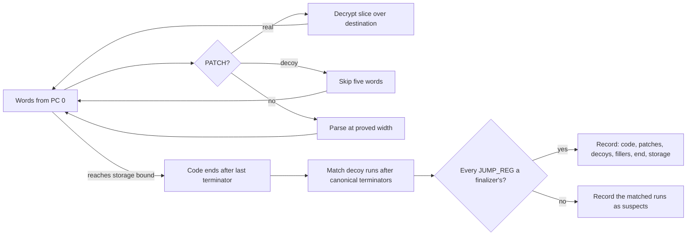

# Observe self-modifying PATCH regions

## 1. Target

Read a PATCH-protected word stream in execution order and say, word by word, what selfModifying
added: real PATCH headers (with their decrypted plaintext), decoy PATCHes, decoy fillers and the
storage after the code. A filler-shaped entry that only a later decoder can decide is reported as a
suspect instead. Every other instruction is reported exactly as the encoder left it. The
result is a proof input to the [compacting normalizer](normalize-self-modifying-wordcode.md), not
runnable output or Packet B.

The observer interprets only what the pinned
[PATCH producer](../../../js-confuser-vm/transforms/self-modifying-wordcode.md) itself uses:
instruction widths, block boundaries, PATCH operands and the cipher. It never decides
reachability, register meaning or jump targets, and never runs another stage's proof: an added
opcode is a width and a terminator flag, nothing more. Reachability decides nothing here because
the producer treats reachable and unreachable code alike
([method rule](../../../encoder-decoder-method.md#p3-each-decoder-removes-only-its-own-additions-by-its-own-encoders-facts)).

Readers need [A](extract-container.md), [B's grammar](read-wordcode.md), word PCs and
JavaScript int32/u32 coercion. Input is owned numeric A plus the source-proved added-opcode
definitions; A and its words stay untouched.

## 2. Algorithm

The producer works on IR blocks, each starting at a label. It moves runs of a block's body into
encrypted storage appended after all functions, leaving at the execution site a five-word PATCH
followed by garbage of the run's width; the PATCH copies and decrypts the run over that garbage
and execution falls into it. Decoy PATCHes copy junk to junk inside the storage. After an
unconditional terminator it may plant a decoy run before the next label. The observer undoes each
of these from the producer's own facts:

1. **Sweep in order from PC 0.** A PATCH is real when it targets its own next word and copies from
   storage after that destination (`dest == pc+5` and `sourceStart >= dest + width`): decrypt its
   slice, write it over the destination, and continue there. Any other PATCH is a decoy: skip its
   five words. Every other word is parsed at its source-proved width.
2. **Bound the storage.** Storage begins no later than the lowest address any PATCH header names
   (a real source, a decoy's source and destination), wherever that header sits: decoys address
   only storage. The storage can begin with a junk block no header names at its start, so the
   sweep may read junk below the bound. Three facts keep that junk out of the code: a code
   instruction never reaches past the bound; a real region always decrypts to whole instructions
   and overlaps nothing, so a header that fails either is a decoy and storage starts there; and a
   decoy header found in junk names addresses behind it, lowering the bound.
3. **End the code.** Code ends after the last unconditional terminator (JUMP, RETURN, THROW,
   JUMP_REG, or an added opcode whose last canonical step is one) before the bound whose operand
   compiled code could hold. A function never falls off its end. The only terminator-like word in
   storage is a junk block's random last word, a canonical opcode whose operand is the next item's
   first word: a JUMP to no instruction start, or a register beyond its function's frame.
4. **Match decoy runs.** After a canonical terminator, the producer's decoy run is at most two
   entries, each a decoy PATCH or a filler shape. The run ends where the next block starts. Match
   the leading entries until the first visible block start (a direct target, closure entry,
   handler target or finally continuation literal), real PATCH, or instruction no filler can be.
   While its budget lasts the producer patches a block's whole body, so a block it reached starts
   with a PATCH or its own terminator, never a filler shape. Once the budget is spent a block stays
   untouched and can start with a filler shape, so a matched entry is a filler only if every label
   is visible here.
5. **Decide or defer.** JUMP_REG is the only operation that takes the PC from data, and the
   compiler emits two: the finalizer's `JUMP_REG contReg` and the dispatcher's `JUMP_REG rDisp`.
   `contReg` is a `local::` register, a slot resolveRegisters never reuses, written only by label
   loads and read only by its finalizer's JUMP_REG; `rDisp` is another `local::` slot. So when
   every JUMP_REG reads its function's FINALLY_SETUP continuation register, the continuation loads
   are all its targets and every label is visible: the matched entries are fillers. Otherwise a
   dispatcher hides labels behind encoded endpoints, and the matched entries are **suspects**: kept
   as code, published with their runs, read past by every decoder until one recovers the labels,
   then [settled](normalize-self-modifying-wordcode.md#settling-suspects) by this same rule
   ([method rule](../../../encoder-decoder-method.md#p3-each-decoder-removes-only-its-own-additions-by-its-own-encoders-facts)).
   CFF emits no JUMP_REG, so it hides no label from this stage.



### Worked example (real encoder output)

The encoder's own output for

```js
function f(a) { var b = a + 1; return b * 2; }
window.TEST_OUTPUT = f(3);
```

with only `selfModifying`, mulberry32 seed 1, is 427 words. Its first 64, as the encoder's listing
shows them (garbage still in place):

```text
  0: PATCH dest 5, source [201,217)        real: plaintext LOAD_THIS, MAKE_CLOSURE, MOVE, LOAD_GLOBAL
  5..20: UNARY_NOT, LOAD_THIS, ...         garbage, overwritten by that plaintext
 21: PATCH dest 26, source [117,138)       real
 37: PATCH dest 356, source [192,199)      a decoy inside the garbage; overwritten, never read
 47: RETURN r3                             canonical terminator
 49: UNARY_NOT r7 = !r18                   filler (decoy run entry 1)
 52: PATCH dest 353, source [365,370)      decoy (entry 2): destination is in storage
 57: PATCH dest 62, source [217,219)       fn_1_1 starts here: a closure entry, so the run stops
```

The sweep materializes five real PATCHes. The lowest named address is 117, so storage starts
there. The last terminator before it is the epilogue RETURN at 105, so the code is [0,107). The
matcher marks fillers at 49, and at 95 and 99 (SUB and LOAD_THIS after the explicit `return`
at 93), stopping at the compiler's dead epilogue `LOAD_CONST undefined` at 101. The normalizer then
drops every marked word and returns 68 words of canonical code.

## 3. Implementation

`diagnoseSelfModifyingRegions(container, addedOpcodes = {}, { requirePatch = true })` returns
`{ ok, result, diagnostic }`.

| Step | Decision | Refusal |
|---|---|---|
| Header | Five u32 words; real iff `dest == pc+5`, `width = sourceEnd - sourceStart > 0`, `sourceStart >= dest + width`, `sourceEnd <= wordCount` | `truncated-patch`, `invalid-patch-word` |
| Real PATCH | Decrypt from the original words with state `(key ^ dest) \| 0`, per word `state = (state + 0x9e3779b9) \| 0`, `plain = (cipher ^ (state ^ (state >>> 13))) >>> 0`; the plaintext must parse into whole instructions and the region must overlap no earlier one, otherwise the header is a decoy and storage starts at it | `patch-ciphertext`, `patch-overlap` only when no code ends before that header |
| Decoy PATCH | Skip; lower the storage bound to its destination and source | none |
| Other word | `diagnoseObservedWordcodeInstruction` with the added-opcode definitions; a parse failure, or an instruction reaching past the bound, stops the sweep | none |
| End | Last instruction before the bound whose own name, or last canonical step for an added opcode other than SYNTHETIC, is JUMP/RETURN/THROW/JUMP_REG, and whose operand is possible: a canonical JUMP targets a parsed instruction start; a canonical RETURN, THROW or JUMP_REG names a register below its function's frame size (`MAIN_REG_COUNT` for the root, the MAKE_CLOSURE register count otherwise) | `no-code-end` |
| PATCH required | No real PATCH: `no-patch` after a clean sweep (proved absence), `unparsed-word` when the sweep stopped on a word that did not parse | `no-patch`, `unparsed-word` |

**Filler matching.** Visible block starts are 0, every direct target of a canonical instruction
or of an added opcode's canonical steps (offsets as in the
[shared relocation contract](normalize-macro-wordcode.md#shared-expansion-and-address-relocation)),
and the finally continuation literals that contract selects. After each canonical JUMP, RETURN,
THROW or JUMP_REG, scan at most two entries: stop at a visible start or real PATCH; a decoy counts
as an entry; a filler shape (TRY_END, LOAD_THIS, MOVE, LOAD_INT, the unary operators, TYPEOF,
the arithmetic, bitwise and comparison operators, GET_PROP) is matched; anything else stops.
Added-opcode terminators are not decoy anchors: the producer tests literal canonical opcodes.
Functions are delimited by 0 and every MAKE_CLOSURE entry. Labels are complete when every JUMP_REG
step (canonical or inside an added opcode) reads a register some FINALLY_SETUP of the same
function names as its continuation register (word 2): then the matches are `fillers`; otherwise
they are `suspects`, with `suspectRuns` holding them grouped by the terminator they follow.

```text
explanatory
complete = every JUMP_REG r in function f: r in { FINALLY_SETUP.words[2] in f }
runs     = for each canonical terminator: its matched entries (at most two, decoys counted)
result   = complete ? { fillers: flat(runs), suspects: [] }
                    : { fillers: [], suspects: flat(runs), suspectRuns: runs }
```

The result holds `schemaVersion` `jsconfuser-vm-self-modifying-observation.v2`, `patches`
(`pc`, `destPc`, `sourceStart`, `sourceEnd`, `width`, plaintext instruction names), `decoys`,
`fillers` (PCs), `suspects` and `suspectRuns` (Packet A PCs), `instructions` (the code in
order, PATCH and DECOY entries included),
`end`, `storageStart`, `sourceIntervals`, `destinationIntervals` and `patchedWords` (the words
with every real region materialized). It is not frozen; nothing else is mutated.

### Acceptance scenarios

| Scenario | Oracle | Criterion | Fixture |
|---|---|---|---|
| S1 real PATCH | Encoder cipher | First region decrypts to canonical instructions; the original stream still declines B | self-modifying-boot |
| S2 every region, decoys skipped | Real headers in the stream | Each real PATCH is inline and materialized; closure entries survive; the code ends before storage | self-modifying-boot, -closures |
| S3 damage | Named refusal | Overlapping source and changed ciphertext refuse by name | self-modifying-observation.test.js |
| S4 decoy fillers | Public decode | Layered cells whose fillers would break later stages decode with source behaviour | self-modifying-layers |
| S5 suspects | Encoder listing and public decode | With a dispatcher JUMP_REG the matches are suspects, not fillers; the settled cells decode with source behaviour | self-modifying-layers dispatcher cells |

## 4. Input Shapes

| Earlier producer | Shape | Effect |
|---|---|---|
| [Packet A](extract-container.md#4-input-shapes) | Numeric words, an encoded payload already decoded | The cipher uses those word PCs unchanged. |
| [Added-opcode observers](normalize-aliased-wordcode.md) via `diagnosePatchAddedOpcodes` | Alias, macro, specialized and anti definitions | Supply widths and canonical steps, used only for widths, terminators and visible block starts. |
| Encoder: [selfModifying](../../../js-confuser-vm/transforms/self-modifying-wordcode.md) | Headers, garbage, decoys, fillers, storage | Removed through the normalizer; everything else passes through unchanged. |

## 5. Known Gaps

- **A junk random word whose operand happens to be possible.** A junk block's random last word read
  as a JUMP whose next word equals a code instruction start, or as a register terminator whose
  next word is within the frame, passes the operand test; if no decoy behind it lowers the bound,
  the code end moves into junk. The census has not reached the case.
- **Dead compiler code reads as filler.** The compiler can leave unlabelled code after a terminator
  (a `TRY_END` and route after an always-throwing try body); a filler-shaped entry there is matched
  like a decoy. It never runs, so dropping it changes no behaviour, but a block reached only from it
  is dropped by the settle as well.
- The cipher is unauthenticated: changed ciphertext can form a legal, different program.
- A grammar gap inside the code stops the sweep early; later references to the lost code then
  decline in their own stages.

## Source

The observer is
[observe-self-modifying.js](../../../../decoder/decode-js/src/vm/jsconfuser-vm/observe-self-modifying.js)
(`diagnoseSelfModifyingRegions`), called by
[normalize-self-modifying-wordcode.js](../../../../decoder/decode-js/src/vm/jsconfuser-vm/normalize-self-modifying-wordcode.js).
Added-opcode definitions come from
[observe-patch-added-opcodes.js](../../../../decoder/decode-js/src/vm/jsconfuser-vm/observe-patch-added-opcodes.js),
widths from [read-wordcode.js](../../../../decoder/decode-js/src/vm/jsconfuser-vm/read-wordcode.js)
(`diagnoseObservedWordcodeInstruction`), continuation literals from
[finally-continuations.js](../../../../decoder/decode-js/src/vm/jsconfuser-vm/finally-continuations.js).

The compiler facts behind item 5:
[the finalizer's JUMP_REG reads its continuation register](https://github.com/MichaelXF/js-confuser-vm/blob/20c5b96bf57337c568579352758d7685358650de/src/compiler.ts#L1590-L1648),
[a `local::` register per try/finally](https://github.com/MichaelXF/js-confuser-vm/blob/20c5b96bf57337c568579352758d7685358650de/src/compiler.ts#L490-L496),
[local slots are never reused](https://github.com/MichaelXF/js-confuser-vm/blob/20c5b96bf57337c568579352758d7685358650de/src/transforms/bytecode/resolveRegisters.ts#L5-L25),
[the dispatcher's rDisp is its own register](https://github.com/MichaelXF/js-confuser-vm/blob/20c5b96bf57337c568579352758d7685358650de/src/transforms/bytecode/dispatcher.ts#L540-L548).

The pinned producer facts each step relies on:
[region selection and whole-body patching](https://github.com/MichaelXF/js-confuser-vm/blob/20c5b96bf57337c568579352758d7685358650de/src/transforms/bytecode/selfModifying.ts#L286-L437),
[decoys after canonical terminators](https://github.com/MichaelXF/js-confuser-vm/blob/20c5b96bf57337c568579352758d7685358650de/src/transforms/bytecode/selfModifying.ts#L276-L284),
[decoy runs](https://github.com/MichaelXF/js-confuser-vm/blob/20c5b96bf57337c568579352758d7685358650de/src/transforms/bytecode/selfModifying.ts#L439-L452),
[filler shapes and decoy PATCHes](https://github.com/MichaelXF/js-confuser-vm/blob/20c5b96bf57337c568579352758d7685358650de/src/transforms/bytecode/selfModifying.ts#L50-L183),
[storage appended after the code](https://github.com/MichaelXF/js-confuser-vm/blob/20c5b96bf57337c568579352758d7685358650de/src/transforms/bytecode/selfModifying.ts#L455-L462),
[encryption](https://github.com/MichaelXF/js-confuser-vm/blob/20c5b96bf57337c568579352758d7685358650de/src/transforms/bytecode/encryptPatches.ts#L35-L84)
and the
[runtime PATCH handler](https://github.com/MichaelXF/js-confuser-vm/blob/20c5b96bf57337c568579352758d7685358650de/src/runtime.ts#L879-L892).

## Fixtures

| Committed fixture or test | Claim pinned |
|---|---|
| [self-modifying-boot](../../../../decoder/decode-js/test/vm/jsconfuser-vm/fixtures/self-modifying-boot/encoded.js) | S1/S2: a real first PATCH, its ciphertext slice and source/encoded behaviour agreement. |
| [self-modifying-closures](../../../../decoder/decode-js/test/vm/jsconfuser-vm/fixtures/self-modifying-closures/encoded.js) | S2: nested closure entries and several real patches; decoy fillers after RETURNs. |
| [self-modifying-finally](../../../../decoder/decode-js/test/vm/jsconfuser-vm/fixtures/self-modifying-finally/encoded.js) | A finally continuation literal is a visible block start. |
| [self-modifying-layers](../../../../decoder/decode-js/test/vm/jsconfuser-vm/fixtures/self-modifying-layers/generation.json) | S4: selfModifying over dispatcher, string concealing and anti (seeds 2 and 7), and over CFF and anti (seed 2, whose fillers would break anti). S5: selfModifying and dispatcher alone (finalizers 1, 2 and 4, loops 2): suspects a route starts on (finalizers 4), a skip label behind decoys (loops 2). Storage below the bound: a decoy naming an address behind it (arithmetic 212), an arena decoy that looks real (finalizers 232), a junk block's random last word read as JUMP_REG (patch arrays 213). |
| [self-modifying-observation.test.js](../../../../decoder/decode-js/test/vm/jsconfuser-vm/self-modifying-observation.test.js) | S1-S3. |
| [patch-added-opcodes.test.js](../../../../decoder/decode-js/test/vm/jsconfuser-vm/patch-added-opcodes.test.js) with its [generation metadata](../../../../decoder/decode-js/test/vm/jsconfuser-vm/fixtures/patch-added-opcodes/generation.json) | Added-opcode widths inside regions; each reader is load-bearing; ciphertext damage refuses by name; a nonterminal macro JUMP_REG passes this stage and is refused by E. |
