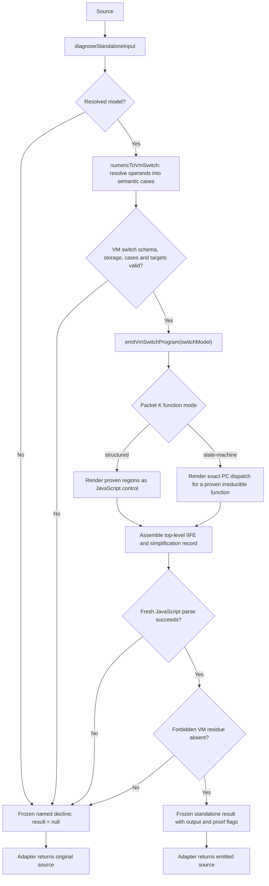

# jsconfuser-vm standalone decode

## 1. Target

`decodeStandalone(source)` returns fresh JavaScript for the supported visible numeric-u32,
visible-constant VM baseline, or `null` on decline. The result-aware public entry point,
`diagnoseStandalone(source)`, combines [standalone diagnosis](standalone-diagnosis.md) with
emission and returns a frozen success or a structured decline. The integrated adapter preserves
the exact input bytes when either stage declines.

| Boundary | Success | Decline |
|---|---|---|
| Internal `diagnoseStandaloneInput` | Resolved model; no `output` | Named diagnostic; `model: null` |
| Public `diagnoseStandalone` | `{ ok: true, result, diagnostic: null }` | `{ ok: false, result: null, diagnostic }` |
| Public `decodeStandalone` | `result.output` | `null` |
| Integrated `decodeJsconfuserVm` | Output plus result | Original source plus diagnostic |

This design assumes JavaScript functions, registers and control flow, plus the
[parser/AST foundation](../../babel.md). Success is source-oriented decompilation, not
reconstruction of the original source or proof of universal runtime equivalence. The production
operation is static: it neither evaluates target helpers nor runs recovered code. Tests may
execute committed controls under their declared host/oracle boundary.

## 2. Algorithm

The public operation first admits the input through the diagnosis contract. The numeric adapter
then lowers every instruction to a [typed VM switch case](../../vm-switch-boundary.md), and the
shared backend renders one generated function per VM function inside a top-level IIFE. Fresh
parse and the target-specific residue scan precede publication. Nothing partially rendered
escapes a failing call.

Structured mode renders proven linear, conditional and natural-loop regions, plus the narrow
handler forms that the control renderer can express. State-machine mode is restricted to a
Packet K function with exact-block-graph and required-irreducible proof. The supplied numeric
plan does not receive the generic backend's inferred-plan fallback.
Opaque or incomplete reducible shapes can pass diagnosis and then decline at rendering.

Output retains registers where recovered operations need them, explicit receiver/constructor
roles, capture cells and completion/handler flow. The exact shared operation semantics and
source-only native gaps are specified by the [switch boundary](../../vm-switch-boundary.md#typed-operation-grammar-and-actual-emission-semantics).
The final parse and residue scan establish syntax and a target-local shape check; they do not
execute the artifact or prove native semantic equivalence.

### Worked example: retain a method receiver

In this source-informed synthetic example, an admitted CALL_METHOD has destination r3, receiver
r0, callee r1, count 1 and argument r2. B/L already establish the operand roles; lowering creates
`{kind:'call',mode:'apply',destination:3,callee:1,receiver:{kind:'register',index:0},`
`arguments:{kind:'fixed',registers:[2]}}`. The renderer emits an assignment equivalent to
`r3 = Reflect.apply(r1,r0,[r2])`. A spread sentinel instead produces `array-register:[r2]`
and passes r2 directly; no copied array literal is inserted. This example explains the carrier
and preserves the explicit receiver. It omits closure provenance, custom callee apply behavior,
exception routing and source qualification; those are not proved by the example.

## 3. Implementation

### Numeric-to-switch handoff and rendering path

`numericToVmSwitch` resolves constant references and call forms before emission. Each case
contains `pc`, `nextPc`, and a typed `operation`; the backend sees no numeric opcode or raw
operand words. `code` records the source kind and census, while `storage` identifies per-function
register/capture frames; the handoff contains no word stream. The shared validator checks
schema, case inventory, register range,
native operator allowlist, targets, fallthrough, and structured-control leaf/edge consistency; it does not validate every region or handler proof.
This handoff is internal and follows the source-derived A-M admission; the validator alone
does not prove the encoder source implements a supplied model.
The numeric adapter projects admitted wordcode and analysis records without rechecking
their operand kinds, call widths, function counts or control-leaf identities. It shares the
function records, global K edges and nested control metadata, while allocating cases and
projected leaves whose operation object is identical to their case's operation. The
[owned projection and validation limits](../../vm-switch-boundary.md#numeric-projection-into-the-boundary)
are the normative shared handoff: typed B operands are consumed through `.index`, `.pc`,
`.value` and `.kind`; the switch count is `lowered.size`; the global edge array is shared inside
a new structuredControl envelope. The [complete supplied-model example](../../vm-switch-boundary.md#complete-minimal-structured-model)
and [nested control fields](../../vm-switch-boundary.md#structured-plan-fields-consumed-after-validation)
own the exact representation. I/J/M are retained diagnosis evidence, not emission value stores.

| Delivery component | Dependency / result | Acceptance decision |
|---|---|---|
| Preflight | Source -> current resolved diagnosis model or named decline. | No lowering on decline; preceding semantic gaps remain visible. |
| Numeric projection | Model -> typed cases, frames, K plan and L plain-call receiver choice. | No source/opcode text reaches generic operation rendering. |
| Shared backend | Validated typed cases -> complete function/program text and copy proofs. | Supplied K plan fully renders or throws; no numeric guessed fallback. |
| Numeric publication | Fresh text -> residue-free AST -> standalone record. | Publish only after all stages finish; freeze success/decline objects. |
| Adapter and CLI | One public diagnosis -> output/result or original/diagnostic. | String rollback is separate from sequential output/sidecar filesystem writes. |

| Input or shape | Renderer action | Guard or retained evidence |
|---|---|---|
| Function partition and ordered instructions | Emit `__recovered_function_<id>`; call function 0 inside an IIFE. | Root capture argument appears only when needed. |
| Parameters, registers and captures | Declare registers referenced by structured output; add argument and capture parameters or local cells when used. | State-machine output retains its full register and handler scaffolding. |
| Loads, arithmetic, comparisons, unary operations | Render literals, `globalThis` access, `this`, capture reads and JavaScript operators. | The adapter resolves zero-key constants; the shared validator checks typed operands/operators. |
| Property, array, object and accessor operations | Render property reads, `Reflect.set`/`Reflect.deleteProperty`, array/object construction and property descriptors. | The wordcode reader resolves numeric widths; the adapter projects ordered semantic fields. |
| Plain, method and constructor calls | The adapter consumes the L call record and normalizes fixed/spread argument forms; the backend renders `Reflect.apply` or `Reflect.construct`. | Receiver identity and one spread-array register remain explicit. |
| `MAKE_CLOSURE`, upvalues and `FOR_IN_*` | Render closure shells and capture cells; include the enumerable-key helper only when some function needs it. | Child function entry, capture kinds/width and iterator labels are checked. |
| Packet K `structured` | Render regions, `if`, loops, transfers and supported handler forms through `StructuredFunctionEmitter`. A terminal conditional follows only jumps inside the two disjoint block sets proved by K; a route into a catch or finalizer must name an enclosing try region. | Reachable blocks must be fully emitted and the path must have a complete natural exit. |
| `TRY_SETUP`, `FINALLY_SETUP` | Render every try statement (catch, finally, both, nested) as native `try`, with each exit native, through the [try-region rule](../../vm-switch-try-region.md). | The rule's semantic checks decline models that are not compiler grammar. |
| Packet K `state-machine` | Render exact instruction cases, PC transitions and handler routing. | Diagnosis already required irreducible proof; unknown function modes decline. |

For structured functions, the [shared copy planner](../../vm-switch-boundary.md#copy-simplification)
`effectiveStructuredInstructions` may coalesce an adjacent
producer/`MOVE` pair. It runs a reaching-definition analysis, requires the producer's destination
to have one use at that move, excludes local capture registers, and checks adjacency within a
block or across a single-predecessor fallthrough. The producer is retargeted, the redundant move
is removed, and the result records a `safely-eliminated` proof. If that analysis cannot converge,
emission declines; state-machine functions do not use this simplification.

The structured renderer also accounts for unreachable blocks: it emits their non-control leaves
inside an unreachable `if (false)` branch and declines if a reachable block was left uncovered.
This keeps instruction accounting explicit without inventing a path into dead code. The summary
counts all noncopy instructions as emitted and sets `provenUnreachable:0`; it does not claim
general unreachable-code deletion. Argument/cell declaration reduction is setup liveness, not
reconstruction of original lexical variables.

### Final validation and result

The shared emitter parses generated text as a script with error recovery disabled and
`allowReturnOutsideFunction:true`; the numeric wrapper parses it again as a script with error
recovery disabled for its residue scan. It scans that AST for target VM identifiers with exact names
`BYTECODE`, `CONSTANTS`, `ENCODE_BYTECODE`, `VM`, `Closure`, `Upvalue` and `decodeBytecode`,
plus noncomputed `vm.run` with identifier object/property. Shared parse failure produces
`emitted-parse-failed`; detected residue produces `emitted-residue`. Both discard the string.
An unexpected failure of the wrapper's second parse follows its generic exception path.
The residue walk is syntax-based and name-based: any
Identifier with an exact forbidden name counts, without a binding/liveness check; computed
`vm["run"]` and other unrelated names are not this rule. It is a target-local census, not
an exhaustive VM detector or semantic oracle. Typed `StandaloneDecline` and `VmSwitchDecline`
errors keep their codes; unexpected exceptions become `standalone-emission-error` with message
`error instanceof Error ? error.message : String(error)`. Residue uses code `emitted-residue`
and message `Standalone output contains forbidden VM residue ${residue}`, where residue is the
first detected forbidden identifier or `vm.run`. Both messages are source-inspected contracts;
the original reduced residue oracle asserted only the right code/discard behavior. The separate
[field-review controls](#fixtures) add exact synthetic error fields without executing these
production failure branches.

| Result field | What it records |
|---|---|
| `schemaVersion: jsconfuser-vm-standalone.v1`, `packet: N` | Public numeric result shape and its position after A-M. |
| `output`, `wordCount`, `instructionCount`, `functionCount` | Emitted text and current canonical wordcode/frame census after normalization; not necessarily original encoded payload counts. |
| `simplification` | Shared record relabeled `jsconfuser-vm-simplification.v1`; per-function copies and summary `emitted=instructionCount-copyCount`, `safelyEliminated=copyCount`, `provenUnreachable=0`. |
| `coverage`, `control` | `{instructions:wordcode.instructionCount,functions:functionCount}` and the original admitted K structuredControl record. |
| `statements` | The shared backend's [planned regions](../../vm-switch-statements.md) per structured function, `{functionId,regions}`. |
| `proof` | True fields: `allPredecessorsReconstructed`, `noTargetExecution`, `noVmRuntimeEmission`, `freshJavaScriptEmission`, `freshSimplificationState`, `simplificationDispositionsDisjoint`, `finalParseValidated`, `finalResidueValidated`. |
| `parseOnly: true`, `targetExecution: false`, `vmExecuted: false` | The production decoder constructs and parses output; it does not run the target or its VM. |
| `emittedJavaScript: true`, `finalJavaScriptSemantics: false` | JavaScript was emitted, while full semantic equivalence remains unclaimed. |

`diagnoseStandalone` calls preflight once, constructs this record only after validation, and
deep-freezes the success or decline. `decodeStandalone` projects the result's `output` or
`null`; `emitStandalone` is the same projection alias. The adapter calls `diagnoseStandalone` once and returns either its emitted output or
the exact source string with the same diagnostic; the CLI's additive registry and result sidecar
expose that result without routing through the legacy decode path. Deep freezing walks enumerable
object/array values; it is not a generic immutable-Map mechanism. The internal resolved diagnosis
and shared emission return are not promised frozen. The public record contains output and
selected evidence, not every A-M record. Proof fields are asserted construction/disposition
flags: `allPredecessorsReconstructed` means required stages returned, not that native semantics
or every reported field has independent proof.

No caller AST is mutated by this source-string operation. Emission constructs new text and uses
fresh parse trees; later consumers parse that text into a fresh scope context. The production
parse tree is not returned. Retained tests separately check fresh AST scope/reference consistency.

### Scenario and oracle map

| Scenario | Required observation / oracle | Retained assertion or gap |
|---|---|---|
| Successful numeric container | output differs from input, generated functions parse, target machinery absent. | Standalone/public tests and selected class/table controls. |
| Structured branch/loop | K mode and the backend's planned regions agree with output without PC dispatch; retained oracle behavior matches. | Corpus test and guard controls. |
| Catch/finalizer recovery | Explicit native syntax plus oracle value/throw; return evaluated before finalizer. | Named focused controls below; arbitrary handler graphs unqualified. |
| Source/control damage | result null, decodeStandalone null, expected named code where asserted. | Truncation/opcode/container and stale-control controls. |
| Internal emission failure | No partial output; typed code retained, unexpected exception normalized. | Source-inspected wrapper contract; injected failure/parse/residue branches lack focused retained tests here. |
| Result publication | Frozen public envelope/result/diagnostic where asserted; one adapter diagnosis call. | Standalone and plugin tests; shared/internal return freezing excluded. |
| Broader native effects | Exact host result/error/effect-order comparison. | Missing controls in the shared semantic-gap list; flags/metadata cannot supply this evidence. |

### Readability gate

The committed benchmark assertions recompute fresh output for arithmetic, closure/loop and repeated-call
scale cases and compare it with committed goldens; the baseline records each decoded output's
size and digest. Its measurements are durable *axes*, not fixed figures:

| Axis | Acceptance question |
|---|---|
| Bytes and decoded/source, decoded/encoded ratios | Did output shrink against the recorded baseline for the same frozen input? |
| AST statements, declarations and generated identifiers | Did generated machinery decrease without losing executable structure? |
| Registers, captures, cells and enumerable helper | Does output retain only the setup that the recovered operations need? |
| Semantic operation counts | Did call, property, closure, handler and control forms remain present where expected? |
| Fresh parse, consistent derived state and bounded execution | Does the golden parse cleanly, keep parser state consistent and match the source fixture's observed `TEST_OUTPUT`? |

The oracle in this benchmark is a bounded regression check on committed fixtures. The metrics
collector uses current diagnosis output against committed goldens; these claims describe retained
test assertions, not a benchmark executed for this document. It is not a
production admission step and cannot establish general equivalence.

## 4. Input Shapes

| Earlier decoder output | Effect on emission |
|---|---|
| [standalone diagnosis](standalone-diagnosis.md) decline | Return its named diagnostic without building or emitting switch cases. |
| Resolved diagnosis model | Lower function/wordcode ownership, constants, instructions, calls and control plan into the shared switch input. |
| [structured control](structured-control.md) | Select proven structured or required irreducible state-machine mode; stale or opaque plans cannot be promoted here. |
| [call/completion](call-completion.md) and [closure/exception](closure-exception.md) | Selected coverage is required. L target.kind shapes plain-call receiver; M is retained internal evidence and is not read by lowering/rendering. K carries the consumed handler/control fields. |

The output is target-local and additive. This stage does not modify shared visitors or the
ordinary decoder plugin path.

## 5. Known Gaps

Earlier encoder eras, mixed or repeated encoders, arbitrary host behavior and source replacement
remain outside this boundary. Source-proved hardening, encoded, randomized and concealed forms reach
source emission only through their preceding
[container](extract-container.md) and [wordcode](standalone-diagnosis.md) proofs; source emission
does not independently recognize those representations.
Unsupported reducible control shapes may decline or remain opaque; only proven irreducible
regions use the state machine. In particular, switch arms with shared nonterminal routes and
loop exits that the enclosing loop cannot write remain open, including try exits into them; the
[control boundaries](../../vm-switch-boundary.md#5-known-gaps) list each with the cell that pins it.
`finalJavaScriptSemantics` stays false. The [shared semantic gaps](../../vm-switch-boundary.md#5-known-gaps)
include EXP/Math.pow, native delete/Reflect.deleteProperty, host callee apply/Reflect.apply,
object destination publication/evaluation order, strictness, global host choice and closure/
constructor behavior. These are source-inspected contrasts and unqualified domains, not freshly
executed counterexamples. F/G/J precision defects and M's terminal-kind overwrite remain as
specified by their owning designs; selected coverage or result proof flags are no remedy.

## Source

- [numeric-to-vm-switch.js](../../../../decoder/decode-js/src/vm/jsconfuser-vm/numeric-to-vm-switch.js) — resolves numeric operands into semantic cases.
- [vm-switch-model.js](../../../../decoder/decode-js/src/vm/switch/vm-switch-model.js) and [vm-switch-to-source.js](../../../../decoder/decode-js/src/vm/switch/vm-switch-to-source.js) — validate and emit the shared switch model.
- [decode-standalone.js](../../../../decoder/decode-js/src/vm/jsconfuser-vm/decode-standalone.js) — public numeric result and residue boundary.
- [diagnose-standalone.js](../../../../decoder/decode-js/src/vm/jsconfuser-vm/diagnose-standalone.js) — supplies the preflight result consumed in section 1.
- [jsconfuser-vm.js](../../../../decoder/decode-js/src/plugin/jsconfuser-vm.js) and [main.js](../../../../decoder/decode-js/src/main.js) — wire the adapter and CLI result described in section 3.
- [instruction-set.md](../../../js-confuser-vm/instruction-set.md) and [container-wordcode.md](../../../js-confuser-vm/container-wordcode.md) — define the visible baseline.

## Fixtures

The scenario table specifies the oracle boundary. The committed input/test assertions below
are source-inspected contracts; dated native executions cited beside them are separate evidence.
Neither listing nor finite execution establishes cold reconstruction or universal qualification.
Historical generation provenance alone does not supply a current replay recipe.

The retired immutable reduced emission/public verifier, built from the documents before
source consultation, ran with supplied diagnosis/emission/parser callbacks. It pins selected public result fields, flags,
simplification relabeling, counts/control references, result discard and deep freezing, plus typed
and Error normalization. It does not rebuild admission, the compiler, Babel parsing or native
behavior. Residue code/discard credit survives, but its exact-message expectation was guessed;
that run supplies no unexpected non-Error normalization credit. Shared projection/control
exclusions are recorded in [the owned evidence boundary](../../vm-switch-boundary.md#fixtures).

The separate retired immutable field verifier, built from the corrected documents before
source consultation, asserted independent literal typed code/message retention, Error.message, non-Error string and number
conversion, exact BYTECODE and vm.run residue messages, null-result/discard, and envelope/nested
freezing. A supplied computed-member AST opposite publishes supplied text. These are synthetic
error/AST/text controls: actual preflight, emitter, parser, typed-class dispatch and full traversal
are not reconstructed or called. The skeletal success has only output, so it supplies no whole
standalone-result reconstruction. Other failure values, production injection/second-parse/residue
branches and source/native semantics remain unqualified. This new credit does not restore the
first verifier's excluded residue-message assertion or provide input-preservation evidence.

| Committed fixture or test | Claim pinned |
|---|---|
| [f-literals-order](../../../../decoder/decode-js/test/vm/jsconfuser-vm/fixtures/corpus/raw/f-literals-order/encoded.js) | Visible-constant input and generated-function output shape. |
| [f-branching](../../../../decoder/decode-js/test/vm/jsconfuser-vm/fixtures/corpus/raw/f-branching/encoded.js) and [f-loop-forms](../../../../decoder/decode-js/test/vm/jsconfuser-vm/fixtures/corpus/raw/f-loop-forms/encoded.js) | Structured conditional and loop output. |
| [terminal-switch-arms](../../../../decoder/decode-js/test/vm/jsconfuser-vm/fixtures/corpus/focused/terminal-switch-arms/encoded.js) | Source-derived switch output with two independently terminating conditional arms, recovered without dispatch scaffolding. |
| [f-throw-catch](../../../../decoder/decode-js/test/vm/jsconfuser-vm/fixtures/corpus/raw/f-throw-catch/encoded.js) | Native catch rendering for a protected terminal throw, including primitive and `Error` values and an uncaught completion. |
| [protected-conditional-catch](../../../../decoder/decode-js/test/vm/jsconfuser-vm/fixtures/corpus/focused/protected-conditional-catch/encoded.js) | Native catch rendering around a conditional with one handled throw and one normal return. |
| [return-through-finally](../../../../decoder/decode-js/test/vm/jsconfuser-vm/fixtures/corpus/focused/return-through-finally/encoded.js) | Native finalizer rendering for one saved return and straight-line finalizer body. |
| [caught-return-through-finally](../../../../decoder/decode-js/test/vm/jsconfuser-vm/fixtures/corpus/focused/caught-return-through-finally/encoded.js) | Native catch/finally rendering for normal and caught return pads through one shared finalizer. |
| [arithmetic input](../../../../decoder/decode-js/test/vm/jsconfuser-vm/fixtures/readability/arithmetic/encoded.js) and [decoded golden](../../../../decoder/decode-js/test/vm/jsconfuser-vm/fixtures/readability/arithmetic/decoded.js) | Source-oriented output and readability comparison. |
| [closure-loop input](../../../../decoder/decode-js/test/vm/jsconfuser-vm/fixtures/readability/closure-loop/encoded.js) and [decoded golden](../../../../decoder/decode-js/test/vm/jsconfuser-vm/fixtures/readability/closure-loop/decoded.js) | Bounded behavior and required capture scaffolding. |
| [exception-region-parser.test.js](../../../../decoder/decode-js/test/vm/jsconfuser-vm/exception-region-parser.test.js) and [provenance.json](../../../../decoder/decode-js/test/vm/jsconfuser-vm/fixtures/exception-region/provenance.json) | Frozen source/config/seed/pin parser admission, current structured recovery, captured-write/return/handler state, residue and each damage reaching its named try-region check. The separate [finite minified-class qualification](../../tests.md#finite-minified-class-qualification) states the current-output behavior boundary for the corresponding population; parser mutations remain unevaluated. |
| [try-region.test.js](../../../../decoder/decode-js/test/vm/jsconfuser-vm/try-region.test.js) | Every try form and exception route recovers with the source's own behaviour. |
| [minified-class-admission.behavior.test.js](../../../../decoder/decode-js/test/vm/jsconfuser-vm/minified-class-admission.behavior.test.js) and [native-qualification.json](../../../../decoder/decode-js/test/vm/jsconfuser-vm/fixtures/minified-class-admission/native-qualification.json) | Current public output, qualified local input identities and independent mandatory exception trace across the retained profiles/seeds; finite qualification is owned by the [finite minified-class qualification](../../tests.md#finite-minified-class-qualification). |
| [decode-standalone.test.js](../../../../decoder/decode-js/test/vm/jsconfuser-vm/decode-standalone.test.js) | Emitted structure, frozen success/decline and null source on decline; exact-original publication is tested at the adapter. |
| [vm-switch-to-source.test.js](../../../../decoder/decode-js/test/vm/switch/vm-switch-to-source.test.js) | Direct source-switch producer model, generic emission, and malformed handoff declines. |
| [readability.test.js](../../../../decoder/decode-js/test/vm/jsconfuser-vm/integration/readability.test.js) | Fresh output, bounded behavior, derived state and scaffolding reduction. |
| [plugin.test.js](../../../../decoder/decode-js/test/vm/jsconfuser-vm/integration/plugin.test.js), [cli.test.js](../../../../decoder/decode-js/test/vm/jsconfuser-vm/integration/cli.test.js), and [integration.test.js](../../../../decoder/decode-js/test/vm/jsconfuser-vm/integration/integration.test.js) | Single-call adapter, sidecar and registered-path agreement with standalone output on a branch control. |
