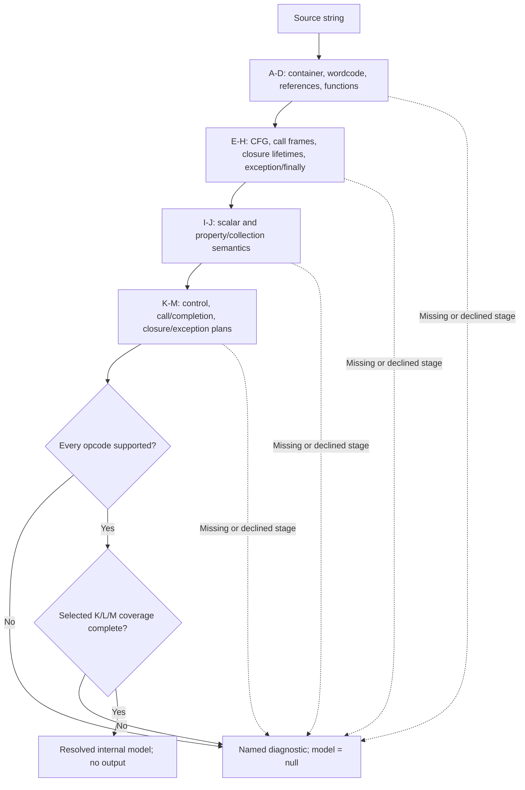

# jsconfuser-vm standalone diagnosis

## 1. Target

`diagnoseStandaloneInput(source)` decides whether one source string contains a complete,
statically recoverable instance of the visible numeric-u32, visible-constant VM baseline. It is
the internal boundary between source-derived analyses and
[standalone decoding](standalone-decode.md). It emits no JavaScript and executes neither the
target program nor the VM.

| Outcome | Internal return value | Meaning for the decoder |
|---|---|---|
| Resolved | `{ ok: true, model, diagnostic: null }` | The predecessor records and control plan passed admission; emission may start. |
| Recognized decline | `{ ok: false, model: null, diagnostic: { code, message } }` | A named gate refused the input; there is no model to emit. |
| Unexpected exception | Throws to the public boundary | The public wrapper turns it into one atomic `standalone-emission-error` decline. |

A resolved model is an **emission input**, not a decoded program or a claim of universal
behavioral equivalence.

## 2. Algorithm

The analyses run in dependency order on the supplied source. Packet letters identify the
decoder's own records; each stage must resolve before the next can use it.

The opcode gate accepts only instruction names implemented by the standalone emitter. The
coverage gate requires Packet K's instructions and edges, Packet L's instructions, completions
and completion routes, and Packet M's instructions, completions and routes to be complete.
These flags describe projected record coverage over the owned inputs, not complete runtime
semantics. The [K-M plan handoff](#k-m-plan-handoff) gives the exact gated families and consumers.

Packet K derives control from the current wordcode, CFG and exception records. Diagnosis uses
that same in-memory plan and indexes its functions by ID for emission;
there is no second validation of Packet K's own output. This assumes the stage produces the
record it declares, while the coverage gate still refuses an incomplete plan.

## 3. Implementation

### Predecessor chain

`reconstruct` calls these functions in order. A falsy stage result becomes the listed
`*-declined` diagnostic. For F-J, reconstruct calls null-return wrappers, which discard the
detailed diagnoseCallFrames/diagnoseClosureLifetimes/diagnoseExceptionFinally/diagnoseScalarValues/
diagnosePropertyCollections diagnostic. Detailed helper codes such as incomplete-capture,
unknown-lifetime or invalid-handler-routing therefore differ from the public call-frames-declined,
closure-lifetimes-declined, exception-finally-declined, scalar-values-declined and
property-collections-declined codes. The plugin preserves the standalone generic code.

| Packet | Function and record | Main inputs | Missing-result code |
|---|---|---|---|
| A | `extractContainerFromSource` -> container | source | `container-declined` |
| B | `readWordcode` -> wordcode | container | `wordcode-declined` |
| C | `validateReferences` -> references and constants | container, wordcode | `references-declined` |
| D | `partitionFunctions` -> function ownership | container, wordcode, references | `functions-declined` |
| E | `buildControlFlow` -> CFG | wordcode, references, functions | `cfg-declined` |
| F | `buildCallFrames` -> call/frame model | wordcode, references, functions, CFG | `call-frames-declined` |
| G | `analyzeClosureLifetimes` -> closure model | F and its predecessors | `closure-lifetimes-declined` |
| H | `analyzeExceptionFinally` -> exception/finally model | F and its predecessors | `exception-finally-declined` |
| I | `analyzeScalarValues` -> scalar operations | wordcode, references, functions, CFG | `scalar-values-declined` |
| J | `analyzePropertyCollections` -> property/collection operations | F and its predecessors | `property-collections-declined` |
| K | `emitStructuredControl` -> control plan | B, E, H instruction reachability | `structured-control-declined` |
| L | `emitCallCompletion` -> calls and completion routes | B, D, E, F, G; C API/schema-only | `call-completion-declined` |
| M | `emitClosureException` -> closure/exception routes | B, D, E, G, H; C/F API/schema-only | `closure-exception-declined` |

### Canonical frontend retries

The A-E table describes the canonical calls; it is not the complete normalization schedule.
All retries below work on private records/analysis source, never partially replacing public
source. Packet A locates the payload by the boot skeleton; the runtime added-opcode observers find
the interpreter's handlers through the [handler locator](locate-handlers.md).

After A, the runtime added-opcode observers read the **original source**; a handler table's
handlers reach them through the locator's handler bodies. A reads the supplied tree and builds no
private clone. Successful numeric packets are reused rather than reparsed or revalidated.

1. Try canonical B. An unknown-opcode or unsupported-hardening-opcode diagnosis first opens
   [PATCH compaction](normalize-self-modifying-wordcode.md), which removes only selfModifying's
   words and returns its `originPcMap` (Packet A PC -> current PC); a failure leaves original A
   available. An unknown-opcode diagnosis on the current words then opens the linear added-opcode
   retries: aliases, aliases with allowObservedPrefix, macros, specialized, anti-specialized, then
   anti, each given the map. A successful inverse replaces container/B and adopts whatever other
   records it rebuilt, and its published `originPcMap` replaces the map (an alias projection passes
   the incoming one on). Other B failures do not trigger an arbitrary recovery search; unresolved B
   becomes wordcode-declined. From here on the schedule keeps that origin map (Packet A PC ->
   current PC, null while they coincide), recomposes it with the `pcMap` of every dispatcher, string
   and CFF success, and hands it to every dispatcher call as `decodedTargetMap`
   ([address identity](normalize-macro-wordcode.md#shared-expansion-and-address-relocation)).
   PATCH compaction's `suspects` (Packet A PCs) travel the same way, to every route and dispatcher
   call; a route that settles some (anti's decoys) publishes the rest. After each result adopted
   from a stage that can recover hidden labels (the added-opcode or anti route, the
   string-concealing dispatcher adapter in step 3, the dispatcher in steps 4 and 5), the schedule collects
   its `skipLabels` and runs the [settle](normalize-self-modifying-wordcode.md#settling-suspects);
   when it settles, its `pcMap` is composed into the origin map and C and D (and E after the late
   dispatcher) are rebuilt from the settled stream. A settle refusal is the decode's refusal.
2. Any nonzero constant-ref key opens the [constant inverse](normalize-concealed-constants.md).
   It replaces container/B and clears prior derived records by adopting its new result. C is then
   built only if the current result has no C. Unresolved keys produce concealed-constants-declined.
3. A first-three-instruction prefix MAKE_CLOSURE, LOAD_CONST, CALL with the first closure's
   paramCount=1 opens [string recovery](normalize-string-concealing.md). Try it directly; on
   decline try dispatcher preparation then CFF preparation, retrying strings after each success.
   Preliminary D can allow one shared helper entry: count repeated descriptors with
   paramCount=4/captureCount=0; more than one repeated entry stops preparation. The
   [D exception](partition-functions.md#preliminary-shared-helper-exception) is internal to this
   complete helper-removal attempt. Dispatcher preparation defers CFG; final string normalization
   returns ordinary B/C/D. Unresolved matched string machinery becomes string-concealing-declined.
4. Use returned D or build ordinary D. If JUMP_REG remains, try dispatcher preparation with an
   empty shared-parent set and deferred CFG. Try CFF unconditionally. These optional declines
   alone do not fail the canonical path; successful results replace their whole current record set.
5. Use returned E or build E. If E fails and JUMP_REG remains, retry dispatcher normalization with
   full control proof. This last branch adopts returned B/C/D/E; unlike preparation branches it
   does not reassign the local container binding, which is not read afterward. Require successful
   current E before F; otherwise cfg-declined.

The [constant result](normalize-concealed-constants.md#value-equations-and-publication) preserves
PCs and returns A/B only. [Dispatcher preparation](normalize-dispatcher-wordcode.md#result-atomicity-and-acceptance)
returns A-D with cfg:null when requested; [CFF](normalize-cff-wordcode.md#result-refusals-and-atomicity)
returns complete A-E after its reorder and pruning; [string recovery](normalize-string-concealing.md#address-remapping-atomicity-and-derived-state)
returns A-D after bank/capture removal. Each result replaces prior derived records rather than
merging old analysis into changed words. Matched functions recover as a unit; unmatched functions
can carry through an inverse with relocated PCs and rebuilt ownership. That internal partial
boundary does not permit partially emitted source.

Preparation declines outside the string-prefix route are optional: an observer's dispatcher-shape
or CFF cff-shape is not automatically the public diagnostic. Retained dispatcher source controls
later fail E as cfg-declined; retained CFF state/escape controls can pass E, and the shared
backend then renders the retained dispatcher as structured code, which keeps it as visible
residue with the input's behaviour. The mechanism pages own those selected internal/public
oracles. Do not infer a universal first rejecting packet from the option name.

The detailed recognition/inversion and emitted-form inventories belong to [B's producer
map](read-wordcode.md#4-input-shapes), [C](validate-references.md#4-input-shapes),
[D](partition-functions.md#4-input-shapes) and [E](build-cfg.md#4-input-shapes).
This schedule is not evidence that every composition is qualified.

The added-opcode/PATCH retries have distinct source and record contracts:

| Retry after direct B failure | Required interpretation / returned records |
|---|---|
| [Alias isolated, then mixed](normalize-aliased-wordcode.md) | Width-preserving alias projection; mixed prefix proofs then expansion/anti or dispatcher. Current A/B and any adapter-rebuilt C/D/E. |
| [Macro](normalize-macro-wordcode.md) | Complete anti/specialized prefixes and macro suffix; shared counted expansion with its actual E passed to compactor/dispatcher. Current A/B and optional rebuilt records. |
| [Specialized](normalize-specialized-wordcode.md) | One-word headers and baked tuples; expansion E to dispatcher. Current A/B and optional dispatcher records. |
| [Anti-specialized](normalize-specialized-wordcode.md#dispatcher-and-anti-specialized-routes) | Expansion with its map E passed to the anti compactor, which composes C(E(oldPc)). |
| [Anti](normalize-anti-wordcode.md) | Proved real steps/seeds; private width-preserving control proof, then compact A/B; required dispatcher can add C/D/E. |
| [PATCH, before linear retries](normalize-self-modifying-wordcode.md) | Added-opcode source proof for widths; sweep removes headers, decoys, fillers and storage; compact A, canonical B only when no added opcode remains, and `originPcMap`. |

Each retry receives unchanged original source/A until one whole route succeeds. Internal typed
added-opcode/PATCH diagnostics can be more precise than the final wordcode-declined public outcome;
a failed retry is not exposed as a partly recovered program. The direct B diagnostic is the
route gate, not an encoder option-name detector. The added-opcode source observer uses the
[count-only canonical inventory](normalize-aliased-wordcode.md#source-proof-and-observation-contract);
this retry schedule does not add label-uniqueness validation to A or that observer.
The [reachable observer](self-modifying-observation.md) consumes the owned added-opcode definitions
before any width-changing expansion. Linear added-opcode retries never interpret ciphertext.
[Finite PATCH qualification](../../tests.md#finite-patch-added-opcode-qualification) supplies generated
interaction evidence; successful source recovery alone does not qualify every option stack.

Changing words changes instruction spans even when some numeric PCs stay equal. Normalizers own
direct target relocation (including closure entry, iterator exit, catch/finally/pad words) and
proved LOAD_INT address seeds; plain numeric LOAD_INT values are not all addresses. For two
rewrites the address mapping composes in order, newPc = second(first(oldPc)); only proved
surviving/replaced boundaries get mappings. Unmapped consumed targets must decline rather than
retain an old address. Each producer's removal/replacement rules define that domain.

Returned records have a deliberate partial analysis boundary: a normalizer may return only A/B,
A-D, or A-E (dispatcher preparation can return cfg:null). Diagnosis fills missing records from
the current words and values, reusing successful returned records. It never combines a current B
with old C/D/E. Public success still requires all A-M and final emission gates; an internally
successful inverse can therefore be followed by a public atomic decline.

### Semantic record handoff

After ordinary current B-E succeed, diagnosis calls F, G, H, I and J in that order. F derives
call/frame and limited returned-closure provenance; G resolves parent captures and records static
binding/use/escape lifetimes; H projects E handler states/routes and applies finalizer-routing
restrictions. I/J project disjoint scalar and property/collection operation families. These are
whole-stage immutable outputs: a missing result becomes the listed stage decline; an empty
operation/capture/handler family is a successful record, not an absent result.

| Record | Actual semantic dependency | Consumer / precision boundary |
|---|---|---|
| [F call frames](build-call-frames.md) | B call forms, C frame, D sites, E edges | G/L use candidate targets/returns; H uses route count. Direct callee roles remain distinct from F's defective fixed-r2/r3 result lookup. |
| [G closure lifetimes](closure-lifetimes.md) | B upvalue roles, D parents, E close routes, F targets/returns; C is API/schema-only | L/M carry site/binding/use facts. Event/fallback state labels are static; method-receiver destination lookup, external-result/NEW precision and F result provenance remain unqualified. |
| [H exception/finally](exception-finally.md) | B branch words, D owners, E states/targets, F route count; C is API/schema-only | K/M use finalizer restrictions and copied routes. H does not reconstruct stack flow or supply missing native-operation exception edges. |
| [I scalar values](scalar-values.md) | B semantic operands, C values/references, D owners, E reachability | Retained as scalarValues; only I-family rows, no register value propagation. |
| [J property/collections](property-collections.md) | B semantic roles/tags, D owners, E iterator edges; C/F reporting counts | Retained as propertyCollections; only J-family rows. Accessor function-step null and B iterator compatibility tags remain reported projection limits. |

The two operation censuses prove complete generated coverage **within their own families**.
Peer instructions are skipped. boundaryOmissions is the complete grouped static peer inventory,
including names absent from the current stream. Runtime effect descriptions are structural knowledge; they do not establish
actual dynamic values or upgrade E into a complete exception graph. F/G/H's precise current
algorithms and source-informed controls live in the owning pages, with affected conclusions
quarantined rather than converted into VM semantic requirements. G joins all fixed arguments
before emitting site events; one imprecise argument suppresses events for precise closure arguments.
I/J retain exact structural objects, including MOVE/STORE value kinds, label-target exit objects
and object role wrappers; these are inspectable records, not dynamic emission value stores.

The retired frozen semantic-record verifier,
built from the documents before source consultation, provided selected F target/frame/return/caller,
G lexical owner/use-register/close/event, H state/routing, I literal/dynamic operand and J
ordered-register/iterator-branch/evaluation assertions from supplied B-E. Owning Fixtures index
the exact bounded claims. It excludes G multi-argument join/use-state guesses, I MOVE/STORE kind
guesses, J exitTarget/role wrapper guesses, unasserted whole schemas and source/public/generated
claims. The separate retired frozen field verifier added 17 exact projected-output,
input-equality/deep-freeze controls for reduced G argument joins/event/label decisions, six I
valueSemantics variants with conditional key absence, and selected J pair/evaluation/iterator
fields and empty projections. Synthetic canonical/register/F/site/edge facts are supplied.
Neither proof reconstructs whole F-J, source admission, runtime equivalence or public rendering.
The source-informed G/I/J correction checks are committed scaffold tests indexed by the owning
F-J Fixtures, and remain distinct from the cold proof;
these artifacts add no model-input/public support boundary.

### K-M plan handoff

After I/J succeed, diagnosis schedules K, L and M in that order. This is call order, not a
K -> L -> M data chain: K consumes B/E/H, L consumes B/D/E/F/G, and M consumes B/D/E/G/H.
Neither L nor M consumes K; M does not consume L or F's call/frame contents. C is API/schema-only
for L/M and F is API/schema-only for M. The owning designs specify
[K classification](structured-control.md#components-and-classification-decisions),
[L projection](call-completion.md#components-and-exact-decisions) and
[M route/fallback construction](closure-exception.md#route-identity-and-completion).

| Required record | Exactly gated `.coverage.*.complete` | Published/consumed model facts |
|---|---|---|
| K | instructions, edges | structuredControl and controlByFunction; numeric adapter consumes per-function controls and global edges. |
| L | instructions, completions, completionRoutes | calls keyed `functionId:pc`; numeric adapter reads target.kind for plain-call receiver choice. |
| M | instructions, completions, routes | closureException retained; numeric adapter does not read M. |

Any false flag in this table yields incomplete-predecessor-coverage, model:null. Diagnosis does
not separately gate K/L/M unique flags, L.calls/census, or M nested closure/exception/function
coverage. Each complete flag's owning formula may incorporate uniqueness, but there is no generic
all-reported-flags check. K/L report coverage without an explicit coverage refusal. M separately
refuses duplicated/incomplete instruction construction and unresolved block instruction/route
references; its other coverage fields remain reporting. F/G precision defects and E/H missing
native-operation exception edges survive these projections and a complete census.

K uses nonempty E.irreducible.regions to select state-machine; M independently uses
E.irreducible.required===true. For ordinary reducible functions M remains opaque even where the
backend later plans linear/conditional/loop regions. These independent plans do not certify each
other's control proof, and M's required presence does not make it the backend's closure/exception
instruction source. A structured K function can still fail later rendering as
unemittable-structured-control.

K-M null-return wrappers discard their detailed diagnostics, just like F-J wrappers.
structured-control-declined/call-completion-declined/closure-exception-declined are the generic
standalone outcomes for a missing stage result. invalid-basic-block, the stage error codes,
duplicated-instruction/incomplete-instruction/invalid-route-identity remain detailed helper
outcomes, not additional plugin diagnostics. All three build private cloned/frozen output and
leave predecessors unchanged; admission/emission remains whole-source atomic.

The original retired frozen plan verifier,
built from the documents before source consultation, was credited only for the selected fields
named in each K/L/M Fixtures section. Frozen per-block K opaque rows, numeric unique values, M's final lifetime kind, whole
plan/call/lifetime rows and the private inconsistent-sentinel read-order object are excluded.
The grammar contrast still supports L's F.arguments.kind predicate, not source admission.
The committed K-M tests ([K](../../../../decoder/decode-js/test/vm/jsconfuser-vm/emit-structured-control.test.js), [L](../../../../decoder/decode-js/test/vm/jsconfuser-vm/emit-call-completion.test.js),
[M](../../../../decoder/decode-js/test/vm/jsconfuser-vm/emit-closure-exception.test.js)) exercise selected record projections and immutability; it is neither cold evidence nor public
emission/qualification. The separate
retired frozen field verifier, built from
the corrected documents before source consultation, asserted 22
selected synthetic controls: K opaque kind/blockIds and Boolean flags, terminal membership/
postorder fields or null; M entire lifetime rows only for supplied field-shape events; and L
complete grammar plus selected evaluationOrder.kind/roles/steps, excluding caveat prose.
Owning Fixtures state the exact supplied/private boundaries. The synthetic throw metadata and
private mismatch/refusal controls establish no owned source-entry reachability. This new proof
agrees with the corrected procedures without restoring original frozen exclusions or asserting
whole K/L/M, diagnosis/public/native/emitter behavior or novice readability. Source-only worked
examples and the retained-input test run remain separate evidence. Stronger procedures remain
acceptance criteria where those artifacts assert only a subset.

### Owned-record boundary

All numeric A-M production callers originate in this source chain or its owned observer and
normalizer rebuilds. Plugin and sequential entry points supply source strings; they do not
supply private packets. Exported diagnostic helpers do not create an independent model-input
boundary. Successful B-E records are deeply frozen producer facts. Normalizer container replacements are
private clones treated as stable owned values during the chain; not every normalizer freezes its
container/envelope. No intervening caller mutates them. Consumers build lookup maps and
new semantic records without replaying schemas, counts, raw-word correspondence, descriptor
shape, ownership, CFG reconstruction, or predecessor equality.

| Producer/consumer | Proof owner and retained work |
|---|---|
| Representation producer to A | Materializers prove source and publish whole analysis clones; observers prove source and publish whole observations. A retries/adapts the declared interface. Scope rebuilding belongs to the producer or fresh consumer context, not record revalidation. |
| A to B | A admits source roles, canonical maps, encoding, and word values. B owns instruction grammar, truncation, flags, unsupported opcodes, and complete consumption. |
| B to C | C owns pool/key/global-name legality, stream-global register/capture maxima, entry boundaries, frame arithmetic and descriptor equality. Actual ownership is not yet assigned. |
| C to D | D constructs function intervals and closure parents, rejects self-entry/ambiguous parents and ordinary cross-function targets. |
| D to E | E refines its selected registers against actual owners, solves finite indirect targets/handler stacks and builds blocks/SCC markers. Its [owner-range omissions and evidence limits](build-cfg.md#5-known-gaps) remain explicit. |
| B-E to F, then B-E/F to G | F projects calls/frames with bounded provenance; G adds actual parent capture ownership, close events and static escape/state classification. Their [declared precision limits](#semantic-record-handoff) remain visible. |
| B-E/F to H | H uses E states/routes and finite targets, adds active-finalizer bypass/continuation restrictions, and reports F route count. It does not solve stack flow again or compare E/F routes. |
| B-E (plus F reporting for J) to I/J | Each projects its own typed operation family, including unreachable rows, skips known peers and checks its generated family census; no value interpreter is introduced. |
| B-H to K-M | K classifies E control with H reachability; L projects F/G calls/completion; M independently projects G/H closure/routes and E fallback. [Only selected completeness flags](#k-m-plan-handoff) are diagnosis gates. |
| Normalizer rebuild to chain | Producer remaps its changed stream and rebuilds the consumed records it returns. Diagnosis adopts the complete current result, fills absent C/D/E, and reuses present records. PC relocation, PATCH legality, fake-seed/label proofs and erased-register lifetime guards remain producer decisions. |
| Independently supplied shared switch model | The reusable [switch boundary](../../vm-switch-boundary.md) retains model validation for separately supplied models. |

[wordcode-index.js](../../../../decoder/decode-js/src/vm/jsconfuser-vm/wordcode-index.js) builds instruction/boundary lookup maps over successful B records; it is not a replacement
validator. C-global legality, D serialized ownership, E control/state and G parent captures are
distinct facts; one successful record does not promise the next stage will accept. Source damage controls pin the first responsible diagnostic and the public atomic
decline. Successful producer regressions cover downstream projections and emitted behavior.
The [bounded document-first CFG proof](build-cfg.md#5-known-gaps) supplies synthetic B-D consumed
fields and reconstructs only asserted reduced-E graph/state/refusal decisions. It does not admit
private packets, reconstruct A-D or replace source-chain qualification; its unasserted RETURN
metadata is excluded from the reconstruction claim. E owns the executable evidence map.

### Admission and coverage checks

| Check | Evidence compared | Failure code |
|---|---|---|
| Input and opcode admission | Source is a string; each Packet B instruction name belongs to `SUPPORTED_INSTRUCTIONS`. | `invalid-input`, `unsupported-opcode` |
| Cross-packet coverage | [Selected K/L/M projected completeness flags](#k-m-plan-handoff), not every reported family. | `incomplete-predecessor-coverage` |

Packet K's source-derived input checks and coverage construction are specified in
[structured control](structured-control.md). Diagnosis reads the reported coverage flags;
it does not compare the generated record against its own inputs a second time.

### Handoff model

| Model field | Origin | Use after diagnosis |
|---|---|---|
| `constants`, `wordcode`, `functions` | C, B, D | Literal values, instruction counts, function signatures and ownership. |
| `instructionsByFunction` | B PCs joined to D's ordered `instructionPcs` | Ordered emitter input for each recovered function. |
| `controlByFunction`, `structuredControl` | K plan, indexed by function ID | Select structured or state-machine rendering; publish control evidence. |
| `calls` | L rows indexed by `functionId:pc` | Numeric adapter reads target.kind for plain CALL receiver; B supplies operand grammar. |
| `scalarValues`, `propertyCollections` | I, J | Retain typed family projections, census and precision limits; current rendering does not read these as dynamic value stores. |
| `closureException` | M | Retain closure/exception coverage and route evidence; numeric adapter does not read M. |

The [numeric projection](../../vm-switch-boundary.md#numeric-projection-into-the-boundary)
reads this model rather than recalculating the predecessor chain. It takes C values, B operands,
D frames/ordered PCs, K modes/blocks/edges and L target.kind for plain CALL receiver choice.
It does not render from I/J value projections or M lifetime/route rows. M is mandatory at the
selected coverage gate and retained internally; it is not included as a whole record in the
published standalone result. K is published as `control`; selected L receiver information affects
operations, while I/J remain internal. No field's presence or complete census proves native
semantics beyond its owning design's evidence.

Projection shares function records and K edge/region metadata, allocates new cases and projected
leaves, and gives each leaf the same operation object as its case. Its structuredControl envelope
is new while its edges array is shared. The [exact typed operand/identity/count contract](../../vm-switch-boundary.md#numeric-projection-into-the-boundary)
and [complete supplied-model representation](../../vm-switch-boundary.md#complete-minimal-structured-model)
belong to the shared boundary. Shared switch validation is an
independent-model interface check, not reexecution of A-M or validation of every K semantic proof.
The [shared checks and their limits](../../vm-switch-boundary.md#model-fields-and-exact-checked-boundary)
include exact schema/ranges/census/direct references/leaf identity, with rendering responsible
for consumed structure and complete output. A supplied K opaque or unsupported structured plan
can therefore resolve diagnosis but decline in emission; it does not acquire inferred dispatch
fallback. A K state-machine plan keeps E/K's required irreducibility boundary.

B instruction identity and D ownership are successful producer facts. The internal envelope,
lookup Maps and model are not deep-frozen by `diagnoseStandaloneInput`; producer records retain
their own freeze contracts and callers do not mutate them. `StandaloneDecline` becomes a
structured diagnostic here; any other exception propagates. The public wrapper alone normalizes
unexpected exceptions, adds parse/residue checks, and freezes its complete success/decline.
[Publication](standalone-decode.md#final-validation-and-result) is source-string atomicity;
it is separate from CLI output/sidecar writes. Current F/G/J defects and M terminal-kind overwrite
remain in the owning designs and are not repaired or requalified by this handoff.

## 4. Input Shapes

| Earlier decoder output | Effect at this boundary |
|---|---|
| [container](extract-container.md), [wordcode](read-wordcode.md), [references](validate-references.md), and [functions](partition-functions.md) | Establish the visible baseline and PC/function ownership. Records are rebuilt from source on each call. |
| [CFG](build-cfg.md), [call frames](build-call-frames.md), [closure lifetimes](closure-lifetimes.md), and [exception/finally](exception-finally.md) | Supply control, call, lifetime and handler facts to K-M; an earlier decline stops admission. |
| [scalar values](scalar-values.md) and [property/collections](property-collections.md) | Supply typed operation records for the supported subset. |
| [structured control](structured-control.md), [call/completion](call-completion.md), and [closure/exception](closure-exception.md) | Their presence and selected [completeness flags](#k-m-plan-handoff) are required; K/L feed lowering and M is retained evidence. |
| [standalone decode](standalone-decode.md) | Receives the resolved model or diagnostic; a decline never enters emission. |

## 5. Known Gaps

Representation variants outside the preceding container and wordcode normalization proofs,
unknown opcodes, and incomplete or unsafe control/completion shapes remain outside admission. A
resolved diagnosis proves the supported static records are available; output rendering, fresh
parse, VM-residue rejection and readability belong to the decoder boundary.

## Source

- [diagnose-standalone.js](../../../../decoder/decode-js/src/vm/jsconfuser-vm/diagnose-standalone.js) — `reconstruct` and `diagnoseStandaloneInput` implement the chain and gates in sections 2-3.
- [standalone-contract.js](../../../../decoder/decode-js/src/vm/jsconfuser-vm/standalone-contract.js) — public object/array freeze helper and typed declines; internal diagnosis does not call the freeze helper.
- [decode-standalone.js](../../../../decoder/decode-js/src/vm/jsconfuser-vm/decode-standalone.js) — public `diagnoseStandalone` consumes the section 1 outcome.

## Fixtures

The retired immutable reduced emission/public verifier
credited selected downstream reduced decisions with supplied diagnosis records. It adds no A-M
source-admission, whole projection or complete-validator evidence. The [shared evidence map](../../vm-switch-boundary.md#fixtures)
keeps those exclusions alongside the exact representation contract.

The retired frozen verifier modeled only
synthetic current-result adoption/clearing, ordered string retries and mandatory exhaustion versus
optional preparation decline. It does not reconstruct source admission, actual recovery, missing
records or all A-M. Missing-record fill and actual caller order were verified in the postfreeze
static source audit only. The synthetic public wrapper does not qualify real public E/K outcomes;
retained production source tests below own those gates. The frozen executable stays unchanged.

| Committed fixture or test | Claim pinned |
|---|---|
| [f-literals-order](../../../../decoder/decode-js/test/vm/jsconfuser-vm/fixtures/corpus/raw/f-literals-order/encoded.js) | Visible baseline input resolves to a model without emitted output. |
| [encoded-bytecode-arithmetic](../../../../decoder/decode-js/test/vm/jsconfuser-vm/fixtures/encoded-bytecode-arithmetic/encoded.js) | An `encodeBytecode` input resolves to a model through encoded-payload materialization. |
| [diagnose-standalone.test.js](../../../../decoder/decode-js/test/vm/jsconfuser-vm/diagnose-standalone.test.js) | Numeric and encoded positive models remain distinct from a genuine missing-role diagnostic before emission. |
| [decode-standalone.test.js](../../../../decoder/decode-js/test/vm/jsconfuser-vm/decode-standalone.test.js) | Public decline shape and successful continuation from preflight to emission. |
| [owned-chain-source.test.js](../../../../decoder/decode-js/test/vm/jsconfuser-vm/owned-chain-source.test.js) | Source payload damage reaches grammar, reference, partition, indirect-control, capture, and finalizer-routing checks at their exact first diagnostic; successful source cases preserve emitted behavior. |
