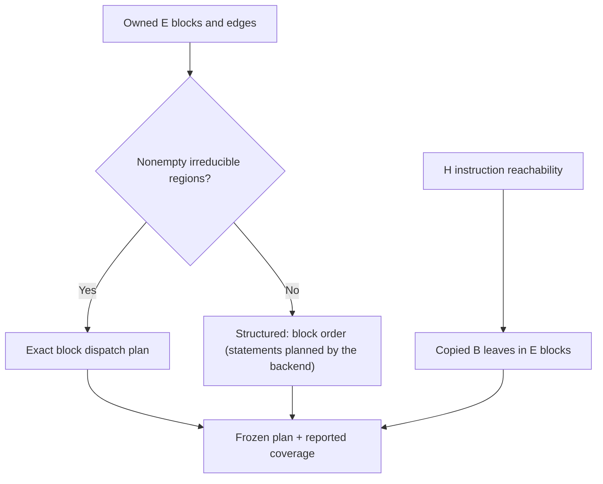

# Plan numeric VM control

## 1. Target

Project an owned instruction/control graph into per-function blocks, leaves and edges, and choose
each function's emission mode. `emitStructuredControl(B,E,H)` returns deeply frozen
`jsconfuser-vm-structured-control.v1` (K) or null. Despite its name it emits no JavaScript.
`diagnoseStructuredControl` returns the frozen `{ok,result,diagnostic}` envelope. A structured
function's statement regions are not K's: by the
[frontend/backend boundary](../../vm-switch-boundary.md#1-target) they need no encoder knowledge,
so the shared backend [recovers them](../../vm-switch-statements.md) from these blocks and edges.

Readers need directed graphs and the declared dependencies: [B instructions](read-wordcode.md),
[E blocks/edges and irreducibility](build-cfg.md), [H instruction reachability](exception-finally.md),
and the package's [Babel foundation](../../babel.md) for the source stages before these records.
PCs, widths and interval endpoints count absolute u32 words; function IDs and block IDs are E's
owned identities.

## 2. Algorithm

Give each global E edge an ID, keep each E block and its instruction leaves, then choose each
function's mode. E has already established ownership, finite indirect targets and handler stack
flow; K indexes those successful facts and does not parse wordcode or solve handler flow again. H
supplies each leaf's reachable flag. Block handler state comes from E.

A function with nonempty E irreducible regions gets a state-machine plan: dispatch rows that keep
exact block identity and successor edge IDs. Every other function is structured, with its blocks
in startPc order; the backend plans its statements.

## 3. Implementation

### Components and classification decisions

| Component | Consumes -> produces | Consumer invariant |
|---|---|---|
| Indexes | B instruction PCs, E function blocks/edges/regions, H per-function states | Owned producer identity; no schema/raw-word/CFG reconstruction. |
| Edge publisher | E global edge order -> `e<index>` copies | Block/region successor IDs resolve through the same global inventory. |
| Mode selector | E irreducible regions -> state-machine or structured control | A structured function carries no regions; the backend plans them. |
| Leaf/block publisher | E instructionPcs + B/H maps -> blocks/leaves | Includes reachable and unreachable serialized instructions. |
| Coverage/publisher | Constructed records -> census and deeply frozen K | Reports coverage; standalone diagnosis decides whether reported completeness admits emission. |

Edge lookup uses `JSON.stringify(edge)` over the **whole E edge**, in its existing property order.
IDs are e0, e1, ... from global E.edges order. Every per-function edge is looked up using this
same key. K does not use [M's selected-field route key](closure-exception.md#route-identity-and-completion).
Both are owned internal identities, not persistent IDs across rewrites.

Selection: nonempty E.irreducible.regions -> state-machine; otherwise structured with
blockOrder, the function's block IDs in startPc order. K relies on E for serialized successor
legality and block coverage.

### Exact result and state contract

K carries schemaVersion/encoding/parseOnly=true/targetExecution=false, B wordCount and
instructionCount, functionCount, predecessorSchemas, modeCounts and overall mode. Overall mode
is structured if no function is state-machine, state-machine if none is structured, otherwise
mixed. Each function copies id/kind/startPc/endPc/parentFunctionId/regCount/paramCount/
captureCount/hasRest from E and adds instructionCount/blockCount/mode/control/blocks.

Each block has id/functionId/startPc/endPc/leaves, cloned E.handlerStateIn and successorEdgeIds
from edges sourced at its last instruction. Each leaf is `{kind:opcode,...B instruction,
reachable:H-state.reachable,semanticBoundary:later-packet}`. The whole B record is copied,
including words, typed operands and compatibility wordOperands. K does not carry H's
before/after instruction stacks, transitions, jump checks or merge rows; those indexes are
constructed but unused. It does not add call-site projections or operation meanings.

Structured control has kind=structured/blockOrder/proof; its region rows are the backend's
([region rows](../../vm-switch-statements.md#region-rows)). State-machine control has kind/stateVariable=
__jsconfuserVmState/entryBlockId/blockOrder/dispatch/proof; each dispatch row has state=blockId,
blockId and successorEdgeIds. Its proof copies E.irreducible and sets exactBlockGraph and
explicitLeaves true. These flags describe construction intent, not additional validators.

Instruction coverage expected=B.instructions.length and emitted=leaf count. Its published
unique flag is the Boolean `new Set(emittedPcs).size === emittedPcs.length`; the distinct-PC
count is not the flag's value. complete compares sorted emitted PCs with sorted B instruction
PCs. Edge coverage expected=E.edges.length and emitted=edge-copy count. Its unique flag is
the Boolean `new Set(globalEdges.map(edge => edge.id)).size === globalEdges.length`;
complete is the Boolean `globalEdges.length === E.edges.length`. Edge-ID uniqueness does not test duplicate underlying edge
content or resolve every successor reference. There is no generated-coverage refusal in K.
[Diagnosis's exact gate](standalone-diagnosis.md#k-m-plan-handoff) reads the two complete flags.
Omissions strings delimit operation semantics, exception syntax and source replacement; they
are not extra carried state.

Lookup maps and constructed records are private. Publication deep-freezes the result. Owned inputs remain
unchanged; no source AST, scope bindings or helper declarations are mutated or cleaned up.
One call publishes a complete result or null, never a partial function plan. Typed or unexpected
exceptions return `{ok:false,result:null,diagnostic}`; unexpected code is structured-control-error.
The null-return wrapper discards that detail; standalone reports structured-control-declined.
A later coverage or rendering refusal is a different boundary.

### Testing and acceptance

| Scenario | Oracle / acceptance | Retained control or gap |
|---|---|---|
| K1 projected leaves/edges | Strip edge IDs and compare to E; leaf PCs/typed B rows equal; structured kind and block order; deep freeze and unchanged predecessors. | Reference/K test asserts structured kind/block-order length, leaf PCs, full edge copies, coverage and immutability; whole typed leaves unasserted. |
| K5 irreducible graph | Exact state-machine block dispatch from E.regions with typed leaves. | Synthetic K test asserts kind/dispatch length/non-null IDs/leaf count/coverage; not whole dispatch or serialized encoder irreducibility. |
| K6 coverage | Boolean unique flags and complete flags over instructions and edges. | The corpus coverage test; no internal K coverage refusal. |

Parse-only tests establish projected records and immutability, not behavioural equivalence.

## 4. Input Shapes

| Producer spelling / consumer | Dependency used or published |
|---|---|
| Canonical or [normalizer-rebuilt B-E](standalone-diagnosis.md#canonical-frontend-retries) | Same numeric-u32 owned spans/IDs; normalization must rebuild moved PCs before planning. |
| [E](build-cfg.md) conditional/fallthrough/call/handler edges and irreducible markers | Supply all classification facts and block handler state; K does not re-solve them. |
| [H](exception-finally.md) per-function instructionStates | Supply reachable flags; H restrictions succeeded before K runs. |
| [L](call-completion.md) and [M](closure-exception.md) | Sibling analyses, not K inputs; M independently derives its fallback. |
| [Diagnosis](standalone-diagnosis.md#k-m-plan-handoff) | Requires K, gates reported instruction/edge complete and indexes functions by ID. |
| Numeric adapter / [standalone decoding](standalone-decode.md) | Reads K function mode, blocks and edges; the backend plans statements and renders, with its own refusals. |

I/J are earlier calls in the standalone schedule but are not K data dependencies. Complete K
coverage cannot cure their projection limits or make unmodeled property exceptions visible in E.

## 5. Known Gaps

- K reports coverage rather than refusing all incomplete/duplicate generated facts. Successful
  owned inputs are its boundary; private packet corruption is not new public admission evidence.
- E models native throws only inside protected ranges. K carries reachability and E block states,
  not complete exception semantics, captures, call effects, runtime values or closure-instance
  multiplicity.
- Mode selection, reachability and handler state need no encoder knowledge, so by the boundary
  they belong to the backend; K and E/H supply them.
- Canonical output from an owned normalizer can enter K; this is no claim for raw hidden/PATCH
  words, earlier eras, fresh encoder qualification, a whole-K cold rebuild or novice readability.

## Source

Line ranges below were read at decoder revision `66f79bd3b6335e2b002a94ddefca919305ea19dd`;
emit-structured-control.js is named by function.
Moving decoder files are linked relatively; the item-3 procedures name the exact mechanisms.

| Source | Relevant ranges / role |
|---|---|
| [emit-structured-control.js](../../../../decoder/decode-js/src/vm/jsconfuser-vm/emit-structured-control.js) | `structuredControl` mode selection; `buildResult` publication/coverage; `diagnoseStructuredControl` wrappers. |
| [structured-control-input.js](../../../../decoder/decode-js/src/vm/jsconfuser-vm/structured-control-input.js) | Lines 1-3 whole-edge key. |
| [structured-control-contract.js](../../../../decoder/decode-js/src/vm/jsconfuser-vm/structured-control-contract.js) | Lines 1-66 schemas, cloning/freezing and equality. |
| [structured-control-cfg.js](../../../../decoder/decode-js/src/vm/jsconfuser-vm/structured-control-cfg.js) | Lines 1-26 owned CFG indexes. |
| [structured-control-exceptions.js](../../../../decoder/decode-js/src/vm/jsconfuser-vm/structured-control-exceptions.js) | Lines 1-34 H indexes; only states are consumed. |
| [diagnose-standalone.js](../../../../decoder/decode-js/src/vm/jsconfuser-vm/diagnose-standalone.js) | Lines 365-429 K construction, census gate and model handoff, as items 3-4 explain. |

## Fixtures

The [qualification provenance](../../../../decoder/decode-js/test/vm/jsconfuser-vm/fixtures/qualification-provenance.md)
owns retained encoder-produced input provenance. Source/test inspection here does not rerun
that qualification. Source-only worked examples above add no execution evidence.

| Fixture / checked-in test | Scenario and bounded claim |
|---|---|
| [reference](../../../../decoder/decode-js/test/vm/jsconfuser-vm/fixtures/reference/encoded.js) and [emit-structured-control.test.js](../../../../decoder/decode-js/test/vm/jsconfuser-vm/emit-structured-control.test.js) | K1 structured kind/block order, leaf PCs, full edge copies/coverage and immutability; K5 and K6 as listed above. |
| [f-finally-abrupt](../../../../decoder/decode-js/test/vm/jsconfuser-vm/fixtures/corpus/raw/f-finally-abrupt/encoded.js) | E block states/H reachability carried without exception syntax. |

The K test's synthetic irreducible words `[40,0,5,39,5,39,3]` pass through B-E/F/H producers;
its leaf/edge coverage counts, state-machine kind, dispatch length and non-null successor IDs
are K5's retained executable assertions; complete dispatch objects are not independently asserted.
The test's corpus loop is an existing projection census, not a fresh run claimed by this page.

The committed [K test](../../../../decoder/decode-js/test/vm/jsconfuser-vm/emit-structured-control.test.js)
exercises the selected projection/irreducible/immutability assertions; the retired plan verifiers
that covered region rows are described with the [statement planner](../../vm-switch-statements.md#fixtures).
