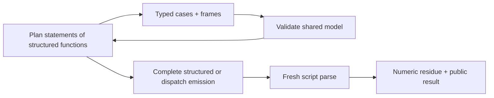

# VM switch boundary for reusable decoding

`decode-js-vm-switch.v1` is the in-memory handoff from a VM-specific frontend to the
shared source emitter. This design assumes JavaScript functions, arrays and control flow;
[Babel foundations](babel.md) explain the AST/scope vocabulary used by the surrounding decoder.
A case is one semantic instruction identified by a numeric PC. A register is a mutable
per-invocation variable; a capture is a shared cell referring to that variable or an inherited cell.

## 1. Target

A frontend turns its admitted source into typed operations and a complete function/case inventory.
The shared backend turns those cases into fresh JavaScript. Its input is an object with `Map`
indexes, not rendered switch text, serialized numeric operands or a proof about arbitrary source.
The active numeric frontend targets the linked
[js-confuser-vm instruction semantics](../js-confuser-vm/instruction-set.md).
The synthetic `source-switch` tests exercise a separately supplied model; there is no production
binary or source-switch extractor.

**One test decides where a step belongs: does it need knowledge of the encoder?** If it does, the
frontend does it; if it only reads the model, the shared backend does. The model's typed
operations are a canonical machine. A frontend maps its encoder's mechanisms onto them; the
backend recovers source from them without knowing which encoder produced them, so every VM
frontend reuses it.

| Concern | Needs encoder knowledge | Owner |
|---|---|---|
| Container, wordcode, opcode meaning, operands, constants | yes | frontend |
| Code the encoder injected (CFF fake transitions, self-modifying decoys and junk) | yes, to recognize it | frontend, removed before the model by the injecting transform's own placement facts, never by reachability ([P3](../encoder-decoder-method.md#p3-each-decoder-removes-only-its-own-additions-by-its-own-encoders-facts)) |
| The encoder's exception and finally mechanism | yes | frontend, lowered onto `catch-setup`, `finally-setup` (continuation, payload, throw pad), `handler-pop` and the `indirect-jump` resume |
| The encoder's for-in protocol | yes | frontend, lowered onto `for-in-setup` and `for-in-next` |
| Which operation can throw where; finite indirect targets | yes | frontend, as edges |
| Reachability and handler-state flow over the operations | no | backend |
| Dispatch or structured emission for a function | no | backend |
| Statement units: if, while, do-while, for with its update, for-in, switch, labeled, try/catch/finally | no | backend |
| Transfers: break, continue, return, throw, exits routed through a finalizer | no | backend |
| Copy simplification, register and capture scaffolding, rendering | no | backend |

The backend decides behaviour only from what is reachable on the model's graph: which code runs
and in what order. Unreachable operations never decide it, since their origin cannot be tested (an
intact unit injected by hand looks compiled); they are kept as they are, and removing them belongs
to later passes over the recovered JavaScript. Reachable code is program code whoever wrote it,
including dead code a JavaScript-stage transform injected before the VM compiled it.

Layout never decides structure either. A block whose only operation is an unconditional `jump` is
a **jump step**: it runs nothing, so every backend reader that follows control or compares where
flow arrives looks through it (`isJumpStep`), whether the producer laid its target out next or
elsewhere. A frontend that keeps a jump it cannot prove to be a fallthrough (a reordered layout,
control flow flattening's) therefore gets the same statements as one that erased it. A back edge
stays a `continue`, never a step.

| Step | Observable result | Obligation |
|---|---|---|
| Source-specific lowering | One typed case per admitted instruction, with explicit storage and transfer semantics. | The frontend proves source ownership, operands, effects, calls, captures and completion. Model consistency alone cannot prove this relation. |
| Shared recovery | Source-oriented JavaScript with proved statement structure and bounded adjacent-copy removal, or explicit PC dispatch. | Emission covers the represented relation completely; it retains unproved operations and necessary register/cell scaffolding. |
| Review rendering | Executable PC-switch JavaScript from the same model. | This exposes step one for inspection; reparsing it is not the step-two interface or a new source proof. |

Original names and lexical scopes are not recovered in general. Register reuse, checks, host calls
and other effects remain where their removal is unproved. `emitVmSwitchProgram(model)` returns
`{output,statements,simplification}` or throws a typed decline; it does not freeze that internal result or
execute the source/output. The numeric [publication wrapper](transforms/jsconfuser-vm/standalone-decode.md)
adds a residue gate and frozen public success/decline.

## 2. Algorithm

Lowering resolves encoded references before the shared boundary. For the numeric path,
[diagnosis](transforms/jsconfuser-vm/standalone-diagnosis.md) supplies constants, current instructions,
function ownership, the K control plan and L call targets. The adapter replaces each opcode and
operand list with a typed operation: a constant reference becomes a primitive value, a call count
becomes an ordered register list, and a branch becomes an explicit target plus polarity.
It projects owned facts rather than revalidating private packet objects.

The backend validates a separately usable model interface, including each function's mode and,
for a structured function, its blocks and edges. It then [recovers the statements](vm-switch-statements.md)
of every structured function from those blocks and edges and renders them. The graph is the
frontend's claim; structured emission checks the decisions it consumes, not that the frontend
read the source correctly.

Structured emission walks the rooted graph and emits each block once. It follows a branch only
inside its declared region and a cycle only inside a proved loop. It requires a complete natural
exit and accounts for unvisited unreachable leaves. A function that cannot be rendered is not
retried as dispatch: the numeric frontend keeps its K proof and refusal boundaries, including
opaque reducible regions.



### Worked example: resolve, then remove one copy

This source-informed synthetic example omits captures, exceptions and calls. Suppose admitted
numeric instructions mean `LOAD_INT r0,7; MOVE r1,r0; STORE_GLOBAL "RESULT",r1; RETURN r1`.
Lowering produces `assign(0,literal(7))`, `assign(1,register(0))`,
`global-write("RESULT",1)` and `return(1)`, preserving their PCs and next PCs. Nothing here
requires the backend to know a numeric opcode or a constant-pool key.

The reaching-definition pass identifies the first assignment by its PC. Its only use is the
adjacent move; neither register is captured. Retargeting that assignment to r1 and removing
only the move yields the explanatory body below, with declarations/IIFE omitted:

```js
// Explanatory output shape, not a runnable fixture.
__recovered_r_0_1 = 7;
globalThis["RESULT"] = __recovered_r_0_1;
return __recovered_r_0_1;
```

A second read of r0, a captured r0/r1, a join at the move, or a conditional iterator definition
blocks this removal. The producer remains at the same point even when it calls a function or
reads a property; the optimization removes a private copy, not an effectful evaluation.

## 3. Implementation

### Components and dependency order

| Component | Consumes | Produces / consequential decision |
|---|---|---|
| Numeric adapter | Successful diagnosis model. | Semantic cases and projected K blocks/edges; resolves constants and L plain-call receiver choice. |
| Shared validator | Supplied or lowered model with its control plan. | Same object on success; typed decline on invalid representation/reference. |
| Copy planner | Structured blocks, edges and typed register reads/definitions. | Retarget map, removed-move PC set and per-copy proof rows. |
| Statement planner | A structured function's blocks, leaves and edges. | Its regions ([statement recovery](vm-switch-statements.md)), also returned as `statements`. |
| Structured renderer | Planned regions, effective instructions, frame/capture facts. | Complete function text or refusal; scope scaffolding follows retained register use. |
| Dispatch renderer | Typed cases and frame/capture facts. | Explicit PC transitions; handler stack/unwinder only where used. |
| Program assembler | All complete functions. | Strict IIFE, optional enumeration helper, root invocation, summary and fresh parse. |

`emitVmSwitchProgram` validates the model before emitting anything. It creates strings
and local planning maps; it does not mutate a source AST or maintain caller-owned Babel bindings.
Fresh parsing checks syntax and discards that parse tree. Downstream AST consumers must parse
`output` into their own context. Test-harness derived-state checks inspect that fresh AST; there
is no production scope crawl or claim that a supplied input AST has been repaired.

### Model fields and exact checked boundary

All IDs, PCs, counts, indexes and register fields checked below are nonnegative safe integers.
PCs are globally unique case identities, not necessarily word or byte offsets; each `nextPc` is
greater than its `pc`. The validator does not require the case array to be numerically sorted.

| Field | Contract |
|---|---|
| `schemaVersion` | Exact `decode-js-vm-switch.v1`. |
| `code` | `kind` is `numeric-u32`, `binary`, or `source-switch`; `instructionCount` is total cases; numeric code also has nonnegative `wordCount`. No raw word stream is supplied. |
| `storage` | `kind:'register-machine'`; unique `functions:[{id,registerCount,captureCount}]`, equal to the corresponding frame counts. |
| `functions.functions` | Nonempty ordered frames `{id,startPc,regCount,paramCount,captureCount,hasRest}`. First frame has id 0; IDs/entries unique, parameters fit registers, `hasRest` is Boolean. |
| `instructionsByFunction` | `Map<id,case[]>`, one nonempty array per frame; each case `{pc,nextPc,operation}`. Every entry PC exists. |
| `controlByFunction`, `structuredControl` | Both required. The former is `Map<id,control>` with mode `structured` or `state-machine`; the latter contains `edges:[]`. |
| `instructionCount` | Equals `code.instructionCount` and the summed cases; map sizes cover all frames. |
| Supplied structured blocks | `controlByFunction.get(id).blocks` cover all case PCs exactly once through `leaves`; each leaf operation is the identical case operation. Validation checks block functionId and successor edge references; renderer fields are specified below. |
| Supplied global edges | Unique string IDs. Edges referenced by a structured block have its function ID, an existing source PC and either null or an existing local target PC. |

### Structured plan fields consumed after validation

Let `functionControl = model.controlByFunction.get(frame.id)`. The model supplies its mode, blocks
and edges; the [statement planner](vm-switch-statements.md) adds its regions, and structured
rendering creates conditional and natural-loop lookup maps from them. A linear/opaque region is
not itself a renderer dispatch rule: the block walk must still complete, and an unsupported
opaque shape can decline.

| Record | Exact fields / consumer |
|---|---|
| `functionControl` | `mode:'structured'`, `blocks`, `control:{kind:'structured'}`. Regions are planned, not supplied; kind is retained metadata. |
| Block | `id,functionId,startPc,endPc,leaves,successorEdgeIds`; `endPc` is retained where supplied, not a region-walk gate. |
| `block.leaves` | Ordered `{pc,nextPc,reachable,operation}` objects. `operation` is shared with the corresponding case; the leaf object is separate. |
| `block.handlerStateIn` | Ordered `stack`/`finallyStack` metadata required by the finalizer proofs below; generic validation does not prove it. |
| Edge | `{id,functionId,sourcePc,targetPc,kind}`; `targetPc:null` is completion. The renderer resolves edge IDs and target PCs through block leaves. |
| Conditional region | `{kind:'conditional',testBlockId,branchEdgeId,fallthroughEdgeId,mergeBlockId}`. The test must end in branch; the named edges must be conditional/fallthrough. |
| Terminal conditional additions | When `mergeBlockId:null`, `branchTerminalBlockIds` and `fallthroughTerminalBlockIds` supply each arm's allowed terminal-region jump targets. Each entry of `regionExitBlockIds` must be the catch or finalizer entry of an enclosing try region. The renderer still accepts these fields; the statement planner always names a merge and never produces them. |
| Natural-loop region | `{kind:'natural-loop',headerBlockId,bodyBlockIds,continuationBlockId,backEdgeIds,exitEdgeIds}`. Rendering reads the header and the continuation, the block where the loop completes normally (null: the loop declines); backEdgeIds and exitEdgeIds retain the planner's evidence rather than being re-proved by the renderer. |

Current structured entry lookup is exactly the block ID
`${functionId}:b@${frame.startPc}`. Supplied IDs must let that lookup succeed; arbitrary root
block labels may pass some validator checks but fail rendering. `startPc` indexes block entry
for copy predecessors; target lookup searches the leaves for the target PC. Numeric plans use
this ID convention. Branch-target/fallthrough-target PCs and proof strings retained
in region records describe the planner result; current rendering follows the named edges.
Validation's case/leaf census and identity check is separate from these consumed-field and
control-semantic obligations.

### Complete minimal structured model

This explanatory representation describes a separately supplied model, not encoded source or
an executed fixture. `Map(key -> value)` denotes an actual JavaScript Map entry; labels `op0`,
`case0` and so on denote object references, not strings. Repeated op labels mean the **same**
object. All fields needed for this no-handler linear example are shown:

```text
op0 = {kind:'assign', destination:0, value:{kind:'literal', value:7}}
op1 = {kind:'global-write', name:'RESULT', source:0}
op2 = {kind:'return', source:0}
case0 = {pc:0, nextPc:1, operation:op0}
case1 = {pc:1, nextPc:2, operation:op1}
case2 = {pc:2, nextPc:3, operation:op2}
edge0 = {id:'e0', functionId:0, sourcePc:0, targetPc:1, kind:'fallthrough'}
edge1 = {id:'e1', functionId:0, sourcePc:1, targetPc:2, kind:'fallthrough'}
edge2 = {id:'e2', functionId:0, sourcePc:2, targetPc:null, kind:'return'}
block0 = {id:'0:b@0', functionId:0, startPc:0, endPc:1,
          leaves:[{pc:0,nextPc:1,reachable:true,operation:op0}], successorEdgeIds:['e0']}
block1 = {id:'0:b@1', functionId:0, startPc:1, endPc:2,
          leaves:[{pc:1,nextPc:2,reachable:true,operation:op1}], successorEdgeIds:['e1']}
block2 = {id:'0:b@2', functionId:0, startPc:2, endPc:3,
          leaves:[{pc:2,nextPc:3,reachable:true,operation:op2}], successorEdgeIds:['e2']}
frame0 = {id:0,startPc:0,regCount:1,paramCount:0,captureCount:0,hasRest:false}
model = {
  schemaVersion:'decode-js-vm-switch.v1',
  code:{kind:'source-switch',instructionCount:3},
  storage:{kind:'register-machine',functions:[{id:0,registerCount:1,captureCount:0}]},
  functions:{functions:[frame0]},
  instructionsByFunction:Map(0 -> [case0,case1,case2]),
  controlByFunction:Map(0 -> {
    mode:'structured', blocks:[block0,block1,block2],
    control:{kind:'structured',regions:[{kind:'linear',blockIds:['0:b@0','0:b@1','0:b@2']}]}
  }),
  structuredControl:{edges:[edge0,edge1,edge2]},
  instructionCount:3
}
```

The ordinary operations fall through to existing cases, the terminal return needs no case at
nextPc 3, each leaf shares its case operation, and the rooted block walk ends in return.
This is a source-informed complete representation example, statically checked against the
specified fields. It is not independent reconstruction evidence, source admission or a native
semantic proof. A model without either control field is invalid. A branch extension must use `when:'true'` or `when:'false'` as strings.

Registers are below `regCount`; upvalues are below `captureCount`. Direct jump/branch/handler,
finally throw-pad and iterator-exit targets exist in the same function. A closure entry identifies
a frame start, and capture width equals that child's `captureCount`. Every operation except
jump, indirect-jump, return and throw has an existing normal `nextPc`.

This is **not an exhaustive supplied-plan validator**. It does not prove region shape, handler
state, edge semantic truth, complete exceptional edges or finite indirect targets. Structured
rendering checks the decisions it consumes and can still decline or throw after validation.
A generic state-machine model need not contain an irreducibility proof. The source frontend
must establish its indirect target relation, exceptional behavior and storage semantics before
publication; changing `code.kind` adds no evidence. Future code mutation/version/context storage
needs another versioned contract.

| Refusal family | Actual code / boundary |
|---|---|
| Envelope, safe-integer fields, frame/storage/edge mode mismatch | `invalid-switch-model`. |
| Register or capture/reference range | `invalid-switch-register` or `invalid-switch-reference`. |
| Missing direct/closure entry/fallthrough target | `invalid-switch-target`. |
| Invalid typed operation/receiver/argument/accessor fields | `invalid-switch-operation`. |
| Unsupported primitive/operator/value/operation | `unsupported-switch-literal`, `unsupported-switch-operator`, `unsupported-switch-value`, `unsupported-switch-operation`. |
| Case counts or structured leaf identity/census | `incomplete-switch-cases`. |
| Consumed region/edge metadata or unsupported structured walk | `invalid-structured-control` or `unemittable-structured-control`. |
| Copy fixed point / fresh syntax | `simplification-nonconvergent` / `emitted-parse-failed`. |

These are source-defined error families, not a claim that every malformed nested object throws
a typed error. Unexpected exceptions can still propagate from the shared API; numeric publication
normalizes them to `standalone-emission-error`. There is no partial shared return on either kind.

### Numeric projection into the boundary

For each D frame, `numericToVmSwitch` reads the ordered successful B instructions
`{name,pc,nextPc,operands}` in `model.instructionsByFunction.get(fn.id)`. Each operand is a
typed object, not a raw numeric word: register, pool and capture indexes use `.index`, label
operands use `.pc`, immediate operands use `.value`, and spread selection uses `.kind`.
A constant reference uses `.index` into `model.constants` (C's resolved values); lowering does
not decode a raw pool pair/key. The source proof and operand grammar belong to the owned chain.

For a concrete selected-instruction example, B's
`{name:'LOAD_INT',pc:0,nextPc:3,operands:[{kind:'register',index:0},{kind:'immediate',value:7}]}`
lowers to `{pc:0,nextPc:3,operation:{kind:'assign',destination:0,value:{kind:'literal',value:7}}}`.
A branch's `{kind:'label-target',pc:9}` becomes `target:9`; JUMP_IF_FALSE supplies the string
`when:'false'`. These examples show field consumption, not a complete numeric model or source
admission. The complete model above uses an independent source-switch PC scheme.

A `catch-setup` also carries `layoutEnd` when the compiler's normal exit of its try block,
`TRY_END; JUMP after_catch` compiled immediately before the catch entry, is unreachable (the block
always throws): the jump's target, where the source closed the statement. It is compiler grammar,
so the frontend supplies it; to the backend that exit is dead code, and the reachable graph cannot
tell the catch's code from what follows it. The hint decides layout only, never what runs.

Cases retain PC/nextPc and receive new semantic operation objects. A global `lowered` Map
indexes them by PC. Both `code.instructionCount` and top-level `instructionCount` are exactly
`lowered.size`, not B's reported instructionCount or an independently summed array count.
`code.wordCount` is current B's `model.wordcode.wordCount`. Owned successful global PC uniqueness
makes the censuses agree, but an example with equal counts does not independently test the formula.
The shared validator separately checks case totals; lowering does not revalidate owned records.

| Projection part | Exact allocation / identity |
|---|---|
| `functions` | The original `model.functions` object, shared. |
| `instructionsByFunction`, `controlByFunction` | New Maps; each case array and case object is new. |
| Operation | New lowered object per case; the projected K leaf uses that exact operation object. |
| K function/block records | New spreads of original control/block objects. `blocks` and `leaves` arrays and projected leaf objects are new. |
| Projected leaf | Exactly `{pc:leaf.pc,nextPc:leaf.nextPc,reachable:leaf.reachable,operation:lowered.get(leaf.pc).operation}`. There is no `instructions` field replacing `leaves`. |
| Nested K metadata | Spread-retained control/region and selected block metadata (including handlerStateIn) stay shared. |
| `structuredControl` | A **new** object `{edges:model.structuredControl.edges}`; the edge array/rows are shared. Whole-envelope identity is not retained. |
| `code`, `storage` | New envelope and storage rows; code kind is numeric-u32 and counts follow the rules above. |

No deep clone/freeze is promised here. Normalization can change canonical wordcode width from
the original payload. LOAD_INT uses the immediate value; VOID becomes undefined without a read
of its encoded source. The unary-minus opcode is `UNARY_NEG`, not `NEG`; the other spellings
are `UNARY_POS`, `UNARY_NOT`, `UNARY_BITNOT`. BUILD_ARRAY drops its count operand and maps
remaining registers; BUILD_OBJECT reads pair count `.value` and makes ordered index pairs.
MAKE_CLOSURE reads child entry `.pc` and the capture `{kind,index}` pairs after its six fixed
operands; child frame shape was already established by the owned records.

CALL/NEW use destination `.index`, callee `.index`, count at offset 2 and argument tail after it;
CALL_METHOD uses destination, receiver, callee, count at offset 3 and argument tail. Count
`kind==='spread-sentinel'` selects `array-register`; its canonical sentinel is 65535, but the
lowerer does not compare a raw numeric operand to 65535. Otherwise it selects `fixed`.
The argument list is the ordered tail's `.index` values. NEW uses `construct/none`, and
CALL_METHOD uses `apply/register`.

For plain CALL, find the L record at `calls.get(key)`, with `key = functionId + ':' + pc`. Exact receiver decision:
`record.target?.kind === 'internal-closure'` gives `{kind:'global'}`; external and ambiguous
kinds (or an absent target on a present record) give `{kind:'null'}`. It is not a test for any
possible internal candidate. A missing L record is not revalidated here and can throw when
reading `record.target`; owned success supplies it. I/J/M are not read by lowering. The
[F/L target precision limits](transforms/jsconfuser-vm/build-call-frames.md#5-known-gaps) therefore
remain consequential. This predicate is source-inspected; the original cold plain-CALL receiver
oracles mirrored it and receive no independent receiver-choice proof credit.

### Typed operation grammar and actual emission semantics

`R(r)` below denotes `__recovered_r_<functionId>_<r>` and `C(i)` is
`__recovered_captures[i].value`. These are explanatory notation, not executable helpers.
Global names are strings; literal values may be undefined, null, Boolean, string, number or
BigInt. Numbers retain NaN, infinities and signed zero in emitted spellings.

| `kind` | Fields | Actual emitted operation |
|---|---|---|
| `assign` | `destination,value` | `R(dst)=value`; value kinds: `literal(value)`, `this`, `register(index)`, `binary(operator,left,right)`, `unary(operator,source)`, `typeof(source)`, `undefined`. |
| `global-read` | `destination,name` | Check `name in globalThis`, throw `ReferenceError(name+' is not defined')` if absent, then read the named property. |
| `safe-typeof` | `destination,name` | Own-property test with `Object.prototype.hasOwnProperty.call`; typeof the own value, otherwise string `'undefined'`. Inherited-only names are absent here. |
| `global-write` | `name,source` | Strict assignment to `globalThis[name]`. |
| `upvalue-read`, `upvalue-write` | `destination,index`; `index,source` | Read/write C(index). |
| `property-read`, `property-delete` | `destination,object,key` | Property get; or `Reflect.deleteProperty(R(object),R(key))`. |
| `property-write` | `object,key,value` | `Reflect.set` in that operand order; ignore Boolean result. |
| `call` | `mode,destination,callee,receiver,arguments` | `Reflect.apply(callee,receiver,args)` or `Reflect.construct(callee,args)` assigned to destination. |
| `closure` | `destination,entry,captures:[{kind,index}]` | Recovered callable shell using local/inherited cells and child frame. |
| `array` | `destination,elements:[r...]` | Array literal with explicit values, including undefined elements. |
| `object` | `destination,pairs:[{key,value}...]` | Assign `{}` to destination first, then ordered `Reflect.set` calls using that destination. |
| `accessor` | `accessor:get\|set,object,key,callback` | Get existing own descriptor, define configurable/enumerable accessor; preserve the opposite field only if it is a function. |
| `for-in-setup` | `destination,source` | Snapshot helper result into `{keys,index:0}`. |
| `for-in-next` | `destination,iterator,exit` | Test index against key count; exit without writing destination, or copy key and increment index then fall through. |
| `jump`, `branch`, `indirect-jump` | `target`; `condition,when:'true'\|'false',target`; `source` | Direct target, truthiness-based target versus nextPc, or raw register value as PC with no coercion. |
| `return`, `throw` | `source` | Native completion from R(source). |
| `catch-setup` | `target,exceptionRegister`, optional `layoutEnd` | Dispatch: push catch target and destination register. Structured: consume as a supported try boundary; `layoutEnd`, a case PC, only places where the statement closes when its block never completes normally. |
| `finally-setup` | `target,continuation,payload,throwPad` | Dispatch: push finalizer routing record. Structured: consume only supported return-continuation forms. |
| `handler-pop`, `debugger` | none | Dispatch stack pop; DEBUGGER emits no statement in structured mode and only the next-PC transition in dispatch mode. |

Binary operator allowlist: `+ - * / % ** & | ^ << >> >>> < > <= >= === !== == != in instanceof`.
Unary allowlist: `- + ! ~`. Branch `when` is the literal string `'true'` or `'false'`,
never a Boolean: `'false'` tests `!R(condition)` to select target and `'true'` tests
`R(condition)`; otherwise use nextPc. The shared grammar defines JavaScript expressions, with their native
coercions and throws; it does not silently equate a handler's `Math.pow` with `**`.
Call receivers are `register(index)`, `global`, `null`, or `none`. Only construction permits
`none`. Arguments are `fixed(registers)` rendered as an array literal or
`array-register(registers:[r])` rendered as the register value directly.

The enumeration helper returns an empty snapshot for null/undefined. Otherwise it starts at
`Object(value)`, walks prototypes, reads own property names in host order, marks each first-seen
string **before** testing enumerability, and keeps enumerable names only. A nonenumerable own
name suppresses an inherited name; symbols and later mutations are absent. This is snapshot
iteration, not substitution with native live `for...in`.

### Frames, cells and setup liveness

Each frame becomes `__recovered_function_<id>`. Captures are an explicit first parameter only
when `captureCount>0`. A local-capture register gets one lazy cell with getter/setter accessing
that invocation's register variable; inherited captures reuse the parent's cell. The closure
shell stores its capture-array identity and forwards arguments through `Reflect.apply`, using
`this == null ? globalThis : this`. A returning invocation needs no explicit close operation:
JavaScript closures retain its lexical register variable. That representation is not a proof of
all original VM shell identity, constructor or host/reentrancy behavior.

Arguments are included only when some instruction reads an argument register or captures it
locally. Parameter registers start at zero; with rest, the final parameter receives
`args.slice(paramCount-1)`. When `paramCount<regCount`, register `paramCount` can hold the whole
argument array. Nonroot functions initialize the selected argument registers; root is invoked
with `[]` only for its capture parameter and no arguments. Structured functions declare only
registers referenced/defined by effective instructions (plus handler/capture roles). Dispatch
functions declare the full register frame. This is setup liveness, not SSA/local-scope recovery
or general dead-value elimination.

### Copy simplification

For every structured block, maintain sets of reaching definition IDs per register. Entry seeds
are `entry:<register>`; a safe-integer `operation.destination` kills that register's set and
replaces it with its PC string, except `for-in-next`, which is excluded as a conditional
definition. Other implicit handler writes are not added by this read/definition classifier.
A block's input unions predecessor outputs, including the supplied edge relation; iterate to
a fixed point with limit
`max(32, blockCount * max(1,regCount) * 8)`. Exceeding the limit declines
`simplification-nonconvergent`. Replay the stable states to associate each read with every
reaching definition, preserving use-site multiplicity.

Coalesce only when producer and move both have `reachable === true`, with a
destination-producing instruction followed by
`assign(dst,register(src))` where src is the producer destination, src differs from dst,
neither is a local-capture register or any catch exception/finally continuation/payload
register declared in that function, and that producer definition has exactly one use at that
move. These implicit routing destinations remain explicit because the reaching-definition
classifier does not model their exceptional writes. They must be adjacent inside a block, or producer must end a block with a fallthrough
edge whose target starts with the move and has exactly one incoming edge; jump steps between the
two, each with exactly one incoming edge, are passed over. Cross-block iteration
examines every source successor edge; it does not require the source to have only one outgoing
edge. The repeated-role guards are exactly `plan.has(producer.pc)` and
`coalescedMovePcs.has(move.pc)`, not a blanket ban on a PC that previously served either role.
Overlapping copy-chain and multi-outgoing-source shapes need their own controls. `for-in-next`
is not an unconditional destination producer because it writes
only on one route. This rule does not substitute an expression at later uses or drop the producer.

Proof rows record `functionId,producerPc,movePc,sourceRegister,destinationRegister`,
`reachingDefinitions:[String(producerPc)]`, `useSites:[{pc:movePc,register:src}]`,
`disposition:'safely-eliminated'`, `reason:'single-reaching-definition-use'` and true
`producerRetained,evaluationOrderPreserved,receiverSemanticsPreserved`. These are the planner's
stated reason and disposition, not independent behavioral evidence. Effective instruction rows
are copied when retargeted; the input cases/operation objects are not edited. Every structured
instruction-rendering path applies the retarget map at the retained producer, including a
single-leaf block inside an exception region; skipping the move alone is insufficient.

The summary is exactly `emitted=instructionCount-copyCount`, `safelyEliminated=copyCount`,
`provenUnreachable=0`. Structured output keeps unreachable noncontrol leaves in `if(false)` and
replaces their control leaves by `void 0`; the summary does not count those as deleted. No copy
proofs are generated for dispatch functions.

### Structured decisions and dispatch

Structured emission requires the planned regions plus blocks/edges and any consumed handler
state, with the root ID described above.
It stops conditional arms at their merge; a conditional arm's route into a catch or finalizer
must name an enclosing try region. Loop emission uses labeled
`while(true)`, break and continue, and ends the loop at its continuation, which the planner has
already followed through jump-only blocks; a continuation that is an enclosing loop's exit
declines. A loop with a
[continue target](vm-switch-statements.md#2-algorithm) is written `for (; ; update)` instead: the
update run's operations, each of which must render as one expression, become the comma-joined
clause, a planned conditional inside the run written `test ? (…) : (…)` with an empty arm as
`void 0`, and a jump to the target from anywhere in the body is `continue`. A do-while with one is
written `do { … } while (test)`: its test run as one comma expression ending in the condition that
goes back, and the body's own end reaching the test without a `continue`. So a continue routed
through a finally runs the finalizer and then the update or the test natively. Every other exit of
the loop body is a transfer its own block renders. Any other jump is a step of the statement's own
flow, as a fallthrough is: the walk continues at its target, and emitting each block once keeps
anything shared out. A conditional arm whose jump steps lead straight to its merge starts there,
so it renders empty as an arm starting at the merge does. Repeated blocks, uncovered reachable
blocks or an incomplete natural exit decline. Ordinary leaves permit one normal successor and,
as exceptional successor, only an uncaught null throw or the innermost try region's catch or
finalizer route; a call has exactly one exceptional successor.

### Try statements

Every try statement, catch only, finally only, catch and finally, nested in any combination, is
emitted by the [try-region rule](vm-switch-try-region.md): regions are read from their
compiler-only head and tail instructions, every exit stays native, and the rule's semantic checks
decline models that are not compiler grammar.

Dispatch starts at frame entry inside a labeled loop and one case per instruction. Ordinary
cases set nextPc and continue; transfers override it; return/throw finish natively. A missing
runtime PC throws `Error('Invalid recovered control state')`. Handler setup pushes records;
handler-pop alone retains a stack but adds no catch wrapper. With catch/finally setup, each
switch iteration is under try/catch: pop the top handler, rethrow if absent; catch writes its
exception register and jumps to target; finally writes continuation=throwPad and payload=error,
then jumps to finalizer. Register selection uses a switch with an invalid-register error.

A structured function that declines is never retried as dispatch; the decline propagates.
Atomicity is one assembled return value: no partially emitted output escapes a
throw, even if earlier functions were locally rendered.

### Scenarios, oracles and evidence boundaries

| Scenario | Observable oracle / acceptance | Evidence or gap |
|---|---|---|
| Numeric arithmetic handoff | Cases/leaf operations present; serialized instruction fields absent; validator returns same model. | Numeric adapter test; it does not assert every operation's exact lowering. |
| Linear source-switch model | The planner makes one linear region; RESULT matches the typed cases and dispatch is absent. | Shared source-switch test; no source-extractor qualification. |
| Installed catch under dispatch | RESULT matches the typed throw; installed catch present. | Shared source-switch control. |
| Grouped catch boundary | Throw after pop escapes; grouped values survive; normal continuation work skipped on exceptional route. | Shared supplied-plan controls with host setter throw. |
| Adjacent-copy recovery | Positive eliminated-copy census, exact proof identities, proof incoming-count and closure no-copy/cell assertions, source TEST_OUTPUT matches. | Numeric copy tests on selected frozen inputs. |
| Malformed supplied model | Operator injection, missing target/case, unknown mode and missing edge throw before publication. | Shared model tests assert error text, not a complete schema/control validator. |
| Acyclic caught-finally proof | Unique grouped/nested ownership, captured-write and saved-return order, exact represented exception routes, current public recovery and atomic reaching refusals. | Shared parser-only exception-region controls and frozen numeric parser inputs; separate finite native evidence is owned by the [finite minified-class qualification](tests.md#finite-minified-class-qualification). |
| Native semantic breadth | Compare exact result/error/effect order for coercions, primitive delete, custom apply, constructor returns and reentrancy. | Current source contrasts and missing bounded controls; no universal claim. |

### Inspecting the switch handoff

The [step-one renderer](../../decoder/decode-js/scripts/render-vm-switch.mjs) writes
`switch-case.js` from admitted numeric source. It forces explicit dispatch for review, preserving
operations for later cleanup. `--emit-model` saves `switch-model.json`; `--model` accepts an
existing tagged representation retaining Map, Set, BigInt, undefined and nonfinite numbers.
The renderer includes no demo host shim/logger. From `decoder/decode-js`, with a fresh directory:

```sh
node scripts/render-vm-switch.mjs \
  --source test/vm/jsconfuser-vm/fixtures/readability/arithmetic/encoded.js \
  --output-dir /tmp/decode-js-switch-review
```

This is a command interface example, not a run performed for this design. The committed script
test compares encoded and review output under the same `window` and `performance.now` bindings,
checks saved-model agreement and prevents overwriting its review artifact. That arithmetic
fixture evidence does not establish general step-one native semantics.

## 4. Input Shapes

| Producer | Supplied shape / consumer treatment |
|---|---|
| [Numeric diagnosis](transforms/jsconfuser-vm/standalone-diagnosis.md) | Source-admitted current model; adapter consumes B/C/D/K and selected L fields, not I/J/M as values. |
| [Numeric normalizers](transforms/jsconfuser-vm/standalone-diagnosis.md#canonical-frontend-retries) | Rebuilt current wordcode/ownership/control; frontend completes admission before lowering. Shared backend does not recognize their source spellings. |
| Independent frontend | Must establish a complete immutable register-machine relation fitting this operation domain; may supply a stronger control plan. |
| Synthetic source-switch fixture | Supplies direct model objects and selected plans; establishes only the exercised backend relation. |

A future [machine-IR adapter](../vm2-machine-ir-contract.md) must project source-proved state,
not infer its machine meaning from generated switch text. No active independent VM-2 adapter
exists. New operation semantics require a checked backend extension rather than a similar-looking
native spelling.

## 5. Known Gaps

Validation is model consistency, not native equivalence. Numeric emission's
`finalJavaScriptSemantics:false` remains necessary: EXP becomes `**` while the
[pinned handler](../js-confuser-vm/instruction-set.md#loads-stores-scalar-operations-and-coercion) uses Math.pow.
The same [target semantics](../js-confuser-vm/instruction-set.md#properties-collections-and-enumeration)
use native delete rather than Reflect.deleteProperty, build an object in a temporary with ordinary
assignment before publishing it, and invoke host callees through their apply property rather than
Reflect.apply. Emission's exact choices above need comparison under primitive delete targets,
custom apply
properties and reentrant/error-order conditions; existing bounded fixtures do not qualify all
of those domains. No counterexample was executed for this design. Strict IIFE,
globalThis selection, host intrinsic mutation and internal closure/constructor identity also need
their own evidence. These source-only boundaries introduce no admission gate or code repair.

The [F/G/J limitations](transforms/jsconfuser-vm/standalone-diagnosis.md#semantic-record-handoff)
and [M terminal-kind overwrite](transforms/jsconfuser-vm/closure-exception.md#5-known-gaps) remain
unchanged; retained metadata/completeness flags cannot erase them. No production binary/source-switch
frontend, arbitrary machine context, code mutation or general source reconstruction is implemented.
Opaque or unsupported planned structure declines.

By the [section 1 boundary](#1-target), the numeric frontend still does backend work: K decides
dispatch from E's irreducibility marker, and E/H supply reachability and handler state, although
none of these needs encoder knowledge.

Structured emission has these known control boundaries. Each is pinned by a declining corpus
cell or a minimal reproducer, not by a capability test:

| Boundary | Where it declines | Pinned by |
|---|---|---|
| A switch whose arms share nonterminal routes (case fallthrough) | `Conditional block ... has no qualified conditional region` | f-switch-flow |

## Source

- [numeric-to-vm-switch.js](../../decoder/decode-js/src/vm/jsconfuser-vm/numeric-to-vm-switch.js) — `lower`, `lowerCall`, `numericToVmSwitch`: owned projection in section 3.
- [vm-switch-model.js](../../decoder/decode-js/src/vm/switch/vm-switch-model.js) — schema, operation grammar and `validateVmSwitchModel` checks/limits.
- [vm-switch-copy-planning.js](../../decoder/decode-js/src/vm/switch/vm-switch-copy-planning.js) — exact operation rendering, frame/capture setup and copy planning.
- [vm-switch-structured-emitter.js](../../decoder/decode-js/src/vm/switch/vm-switch-structured-emitter.js) — region walk, loops, conditionals, try regions and coverage refusal.
- [vm-switch-statements.js](../../decoder/decode-js/src/vm/switch/vm-switch-statements.js) — statement planning for structured functions ([statement recovery](vm-switch-statements.md)).
- [vm-switch-to-source.js](../../decoder/decode-js/src/vm/switch/vm-switch-to-source.js) — planning calls, dispatch unwinder, program assembly and fresh parse.
- [decode-standalone.js](../../decoder/decode-js/src/vm/jsconfuser-vm/decode-standalone.js) — numeric publication after this boundary.
- [render-vm-switch.mjs](../../decoder/decode-js/scripts/render-vm-switch.mjs) — review artifact interface.

## Fixtures

The scenario table above states acceptance and exclusions. Source-inspected committed assertions
and separately cited dated native results have distinct evidence boundaries; this specification
is not an execution report or document-only reconstruction claim. Historical generation provenance
alone does not promise generator replay.

The retired immutable reduced emission/public verifier, built from the documents before
source consultation, retained selected literal lowering fields, reduced validation predicates, copy transfer/use decisions,
nearest-reconvergence choice, dispatch selection and inferred retry decisions. Supplied B/control
scaffolds and callbacks bound those observations; no production backend or native output ran.
Its postfreeze source audit
excludes whole schematic projection/identity, validator success/census/leaf gate claims, guessed
`NEG` opcode, Boolean branch polarity, exact residue message and the mirrored plain-CALL
receiver oracle. Those original exclusions remain permanent.

The separate retired immutable field verifier, built from the corrected documents before
source consultation, provided new independent literal controls over supplied scaffolds, followed by a static source audit:

| Selected new credit | Exact boundary |
|---|---|
| Typed lowering | LOAD_INT/LOAD_CONST/MOVE/VOID/UNARY_NEG fields, array tail, ordered object pairs, label PC, fixed/spread kind and method/constructor carriers. B/C grammar and provenance are supplied; other opcodes and closure lowering are excluded. |
| Projection allocations and counts | Selected new Maps/arrays/cases/control/block/leaves, shared functions/nested metadata/case-leaf operation, and new structuredControl with shared edge array/row. A private duplicate-PC scaffold distinguishes lowered.size from B count and array sum; it is private scaffolding inconsistent with successful owned records, not source admission or a duplicate-PC refusal oracle. |
| Supplied-model baseline and selected gates | Complete baseline is statically source-valid. Reduced positive/opposite controls cover census, leaf identity/inventory, edge reference, storage/control-field presence, register range, normal targets and string versus Boolean polarity. No actual validator import/call occurred; reduced traces are their own order, not production order. The constant sameObject marker proves no return identity. |
| Root/nesting and polarity | Literal consumers select root 0:b@0 and nested regions; four branch decisions cover both string spellings and supplied Boolean conditions. No region renderer, JavaScript truthiness/coercion or production emitter executes. |
| Plain CALL receiver | Independent literal whole-call expectations select global for internal-closure, null for external, ambiguous-with-internal-candidate and present-record/absent-target. F/L provenance and precision are supplied; native receiver/apply behavior is excluded. |
| Copy guards | Seeded producer/move role sets distinguish the two repeat guards; supplied cross-block relations allow multiple source outgoing edges with one target incoming edge and refuse two incoming records or absent fallthrough. Use/capture facts replace actual dataflow; full adjacency/first-last-leaf positioning and retarget composition are excluded. The extra reduced matching-use-register check receives no credit. |

This separate run retains selected input graphs but asserts no input preservation. Its selected
allocation observations do not establish generic clone/freeze semantics or a whole numeric/K
schema. Reduced copy facts and callbacks do not qualify the full compiler, owned source admission,
native behavior or CLI. New [synthetic error credit](transforms/jsconfuser-vm/standalone-decode.md#fixtures)
belongs to this field verifier; no new evidence repairs an excluded assertion of the first verifier.

| Test | Actual assertions and boundary |
|---|---|
| [numeric-to-vm-switch.test.js](../../decoder/decode-js/test/vm/jsconfuser-vm/numeric-to-vm-switch.test.js) | Arithmetic source resolves, shared validator accepts, case/leaf serialized opcode/word fields are absent. |
| [vm-switch-statements.test.js](../../decoder/decode-js/test/vm/switch/vm-switch-statements.test.js) | Planned linear, conditional and loop rows over numeric fixtures ([statement recovery](vm-switch-statements.md#fixtures)). |
| [vm-switch-to-source.test.js](../../decoder/decode-js/test/vm/switch/vm-switch-to-source.test.js) | Synthetic planned output and RESULT; catch scaffold under dispatch; code after a handler-pop that is not a transfer declines; DEBUGGER omission with continued effects in structured and dispatch modes; selected malformed-model error text. |
| [vm-copy-simplification.test.js](../../decoder/decode-js/test/vm/jsconfuser-vm/vm-copy-simplification.test.js) | Selected arithmetic/literal proofs, branch proof incoming-count, selected closure empty-copy arrays/cell presence, retained effectful producers, fresh AST checks and source TEST_OUTPUT. |
| [decode-standalone.test.js](../../decoder/decode-js/test/vm/jsconfuser-vm/decode-standalone.test.js) | Corpus output versus retained oracle; K structured/required-dispatch shape, narrow catch/finally fixtures, named or atomic declines. No exhaustive host semantics. |
| [render-vm-switch.test.js](../../decoder/decode-js/test/scripts/render-vm-switch.test.js) | Arithmetic encoded/review window effect under fixed host, switch shape, saved-model text equality and no overwrite. |

The [numeric parser tests](../../decoder/decode-js/test/vm/jsconfuser-vm/exception-region-parser.test.js)
retain exact source/config/seed/pin provenance for [frozen parser data](../../decoder/decode-js/test/vm/jsconfuser-vm/fixtures/exception-region/provenance.json),
assert source-derived public recovery and carrier/capture/handler/residue state, and retain damaged
edge/state controls; try-region behaviour is in the [try-region fixtures](vm-switch-try-region.md#fixtures).
The [finite minified-class qualification](tests.md#finite-minified-class-qualification)
owns the numeric current-output matrix; neither it nor these tests closes missing E/H
native property/coercion edges, abstract-value precision or arbitrary host/exception semantics.
