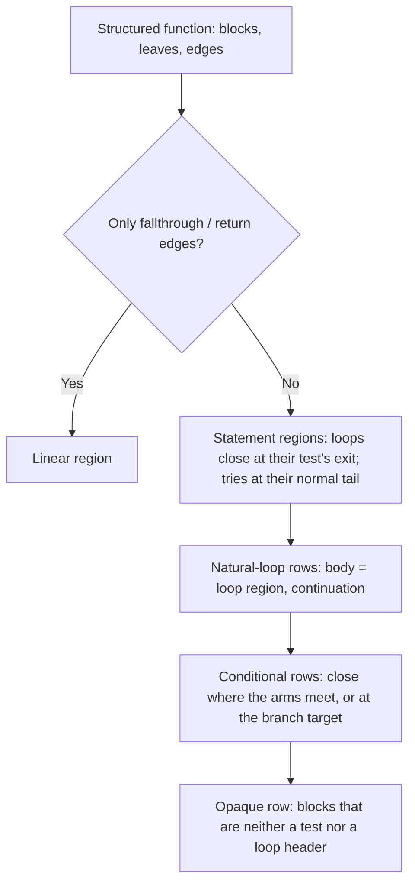

# Recover statements from a VM switch model

## 1. Target

Turn one structured function of a [VM switch model](vm-switch-boundary.md) into the statement
regions the structured emitter renders: loops, conditionals, a linear run, and one opaque row for
the blocks no region covers. `planStatements(functionRecord, functionControl, edges)` returns the
regions; `emitVmSwitchProgram` calls it for every structured function and returns the plans as
`statements`. By the [frontend/backend boundary](vm-switch-boundary.md#1-target) this needs no
encoder knowledge: it reads only the model's blocks, typed operations and edges, so every VM
frontend reuses it. A plan can still contain opaque regions and fail later emission.

Readers need directed graphs, branches, loops and basic dominance. The inputs are the model's
[supplied structured blocks and edges](vm-switch-boundary.md#model-fields-and-exact-checked-boundary):
block leaves carry typed operations and reachability; edges carry kind, route, condition and the
handler state before and after the edge. Block IDs are `${functionId}:b@${startPc}`.

## 2. Algorithm

A function whose edges are all fallthrough or return, and which sets up no try, is one linear
region. Otherwise statements
are found by walking forward over the graph. A case with one next step continues the current
statement at the same depth. A case with more than one next step opens a control statement whose
arms are one level deeper, and that statement closes where the walk returns to its depth. Each
statement's end therefore comes from the statement's own edges, never from how the function ends:
a source function need not end in `return`, and `for (…) { if (x) return a; } return b;` closes
its `for` where the loop's test exits, whatever the statement after it does. A `return` or
`throw` inside a statement is a transfer out of it, as is an edge to an enclosing loop's head
(`continue`) or end (`break`). Blocks no region covers stay in one opaque region; the frontend
decides dispatch versus structured emission before this runs.

A **loop** is entered at a back-edge target (an edge whose target dominates its source). It closes
where its own test leaves its cycle (the blocks that reach a back edge): walking the header's
run, the first two-way branch with one target outside the cycle (while, for, for-in), or else the
branch the back edge falls from (do-while), with that target followed through jump-only blocks. A
branch whose arms close inside the cycle is nested in the test, a short-circuit operand of
`p != null && !(stop && f(p))` say, and the walk continues where it closes. Its body is its **statement
region**: the blocks the header dominates and the continuation does not, so a try inside the loop
keeps its throw pad, the `handler-pop` a `break` runs before its jump, and a catch ending in
`break`. A loop whose test cannot be found has no continuation; its row is still published and
emission declines it.

A **try** is entered at its setup (`catch-setup`, `finally-setup`) and closes where its own normal
exit tail leads: for a catch, the block after a `handler-pop` that pops this try when the catch's
own normal walk rejoins it there (a reordered layout, control flow flattening's, puts the code
after the try, or an empty end label, right after the pop), else the target of the `jump` after
that pop; for a finally, the literal its tail assigns to its continuation register after such a
pop and before jumping to its finalizer. A pop that falls into code the catch never reaches ends
nothing: a `return` crossing the try and a reordered normal exit of a catch that never completes
have the same graph. A `break` or `continue` crossing a catch has the same tail, so when a try has several
tail targets those that are an enclosing loop's head or end are transfers. The compiler emits one
normal tail per try; when several remain (a reachable injected copy of it, say), the first in
program order ends the try and the others are walked as routed exits. Either continuation
must leave a closed region: every edge into a member other than the entry comes from a member (a
try's setup may be entered from anywhere outside it, also when it is a loop's header). A catch
whose block never completes normally has no reachable end: the code after it is reached only
through the catch. The frontend's layout end, where the source closed the statement, then places
the end, if the catch's own normal walk reaches that block inside the catch; otherwise the catch
keeps the code only it reaches. Both layouts behave the same.

A loop's **trailing run** is the code that ends at its only back edge, walked back from it, when
several paths enter it; for a do-while (a loop whose test is the branch its back edge falls from)
the walk starts at that test, so the run is the test. The walk crosses straight blocks and a conditional that is one expression
(an update `i = x ? i + 2 : i + 1` or `x && n++`): its arms meet first at the block being walked
back from, hold no statement, and are the only way into it. An `if` whose arms meet earlier is a
statement before that block, so the walk stops there. It is a stop like the loop's head and end, so a statement inside the loop never takes it
as a member. Whether it is the loop's **update** (a `for`'s, entered by every `continue`) or plain
body code that a merge explains (`while (t) { if (c) a; else b; z }` closes its `if` at `z`) is
read after the statements close. It is the update when a statement jumps there without closing
there: a try that closes elsewhere while one of its blocks jumps to the run (a `continue` routed
through a finally re-issues the jump from its pad), or a conditional with an arm that reaches the
run while it closes elsewhere. An inner loop that ends at the run explains such a jump from inside
it as its own `break`. Only then does the loop publish the run as its continue target, which the
emitter writes as a `for` update clause, or a do-while's `while (test)`, so that a native
`continue` runs it; otherwise the loop reads as before.

A **conditional** is a block whose final operation has a conditional and a fallthrough edge. Its
arms walk forward from its two targets over normal edges, each stopping at a transfer. It closes
at the first block both arms reach, taken by dominance over the paths from the test through its
arms only, so code the arms share with paths from outside the statement (a catch rejoining after a
try, say) does not hide where they meet. Arms that meet only at one stop (both run into a loop's
trailing run, say) close there. If the arms never meet, one of them is a transfer: an arm
that starts at an enclosing loop's head or end (the loop's own test leaving it) closes the
statement there; otherwise the fallthrough arm is the consequent and the branch target, the
else-or-end, is the end, taken at the stop its [jump steps](vm-switch-boundary.md#1-target) lead
straight to (a test leaving through a jump to the loop's end closes at the end). So
`if (v < 0) throw …; return v + 1;` reads as a guard, a `switch` whose
cases all return reads as a chain of guards, and a loop's test reads as `if (test) { body;
continue } break`. An exceptional route into a handler or finalizer leaves the statement rather
than joining its arms, so it is never followed.

### Worked example: a diamond, a guard and a loop

This **synthetic block graph** omits concrete operations. Block IDs are `0:b@0` (test), `0:b@3`
(fallthrough arm), `0:b@5` (branch arm), and `0:b@7` (merge). Edges: conditional 0 -> 5,
fallthrough 0 -> 3, branch 3 -> 7, branch 5 -> 7, return 7 -> null. Both arms reach block7 first,
so the conditional records mergeBlockId=0:b@7. The opaque row has blockIds=[0:b@3,0:b@5,0:b@7]:
only the test is a covered control source.

Replace arm3's branch by a return. The arms never meet; neither starts at a loop's head or end, so
the end is the branch target: mergeBlockId=0:b@5, a guard whose consequent (block3) returns.

For `for (…) { if (i === n) return i * 10; } return -1;`, the header run ends at the test
`i < 5`, whose exit arm leaves the cycle at the block holding `return -1`: that is the loop's
continuation. Inside the loop the test `i === n` has arms `return i * 10` (a transfer) and the
update (which reaches the loop's head, a stop); they never meet, so it closes at its branch target,
the update. The loop's own test has arms body and exit; the exit is the loop's end, a stop, so it
closes there.

## 3. Implementation

### Procedures

Build block adjacency by mapping each leaf PC to its block. Every edge needs a source block and,
for a non-null target, a target block; otherwise `invalid-structured-control`. Null edges have no
adjacency successor. Preserve parallel successor rows and the model's edge order. Dominators
follow `dom(v) = {v} union intersection(dom(p) for reachable predecessors p)` from the entry
`${functionRecord.id}:b@${functionRecord.startPc}`.

Statement regions (`findStatementRegions`): entries are each back-edge target, once, and each
reachable block whose last operation is `catch-setup` or `finally-setup`, sorted by dominator-set
size (stable, loops first) so an enclosing statement is computed before what it contains.
`loopEnd` collects the latches (blocks the header dominates with an edge to it) and the cycle (the
header plus every reachable predecessor chain from a latch). It walks the header's straight run
over normal edges; at a block with more than one normal next step, a `branch` or `for-in-next`
with exactly one target outside the cycle gives the exit; any other conditional branch is closed
by the conditional rule below (its stops: the loop's head and the enclosing loops' heads and ends)
and the walk resumes at its merge inside the cycle. Otherwise, with one latch whose only in-cycle
predecessor is such a branch, that branch gives it. The exit is followed
through blocks whose every operation is `jump` while it stays outside the cycle. `exitTails`
collects a try's tail targets: for each `handler-pop` whose outgoing edge's `handlerStateBefore`
top record has this setupPc, a handler record takes the block that follows when the catch's
normal walk from its handler entry, never passing the setup again (`rejoins`), reaches that
block, else the target of the `jump` that follows; a
finally record takes the literal value of a following `assign` whose destination is the record's
continuationReg, when the next operation jumps to its finallyPc. With several targets, those
equal to an enclosing loop region's head or continuation are dropped; the remaining target with
the lowest startPc is the continuation.
Members exclude blocks the continuation dominates, unless it dominates the entry; closure ignores
unreachable predecessors.

`trailingRun` starts at a loop's only latch (none for several), or for a loop whose end
`loopEnd` took from the branch its latch falls from, at that branch with the latch after it, and
walks back while the block has
exactly one reachable normal predecessor whose only normal successor it is. At a block with
several normal predecessors it asks `expressionConditional`: the block's immediate dominator, a
two-way test other than the header, whose arms reach only blocks it dominates, share none of them,
leave only to that block, supply all of its normal predecessors, are entered only from the test
and contain no `catch-setup`, `finally-setup`, `handler-pop`, `indirect-jump`, `return`, `throw`
or `for-in-next`. Such a conditional joins the run and the walk continues before its test;
otherwise the run starts at that block. It is empty when the walk reaches the header. For a try
inside a loop with a trailing run that does not dominate the try's setup, the run's first block is a
cut: members also exclude what it dominates. With several tail targets left after the head/end
filter, a target that leads to the run through jump-only blocks is dropped, unless every target
does. When such a try has a continuation other than the run and a member has a normal edge into the
run, the loop records that try.

Loops (`findNaturalLoops`): each adjacency edge source -> header with reachable endpoints, header
in dom(source), and source != header. The body is the header's statement region. Exit edges have
a body source and a null or outside-body target; header edges a header source and non-null body
target; both sets must be nonempty. Deduplicate by header plus sorted body-ID set (one row per
header, the first back edge retained). Sort bodyBlockIds by startPc; continuationBlockId is the
region's continuation or null; headerCondition is the first conditional header-to-body edge's
condition, or null. Self-loops are not recognized.

Conditionals (`findConditionalRegions`, closing by `closeConditional`), in startPc order: the
stops are the heads, continuations and trailing-run heads of every loop whose body contains the
test. Each arm is the set of blocks reached
from its target over non-exceptional edges without entering a stop (an arm starting at a stop is
empty). The common blocks are those in both arms; dominators are computed over the test plus both
arms, entered at the test; the merge is the common block dominating every other common block.
With no common block, when the stops the two arms reach (an arm starting at a stop reaches that
stop) share exactly one, that stop is the merge; otherwise the merge is the fallthrough target when
it is a stop, else the branch target. A test with common blocks but none dominating the rest gets
no row.

Continue targets (`publishContinueTargets`), after conditionals: a loop publishes its trailing run
when it recorded a try, or when a conditional in its body, whose merge is not one of its stops and
which no other loop holding it ends at the run, has an arm that reaches the run's first block over
normal edges without entering its stops or its merge.

Selection (`planStatements`): every edge fallthrough or return, and no block ending in
`catch-setup` or `finally-setup` -> one linear region with all blocks in startPc order; the empty
edge list satisfies that predicate. Otherwise conditionals in
startPc order, then loops in adjacency order. If any block is neither a conditional test nor a loop
header, append exactly one opaque region listing them in startPc order. The region list describes
the function with overlap; it is not a disjoint partition of its operations.

### Region rows

Linear rows have kind/blockIds/proof. Conditional rows have kind/testBlockId/condition/
branchEdgeId/branchTargetPc/fallthroughEdgeId/fallthroughTargetPc/mergeBlockId/proof; the planner
always names a merge. Natural-loop rows have kind/headerBlockId/backEdgeIds/bodyBlockIds/
continuationBlockId/continueBlockId/updateBlockIds/testBlockIds/exitEdgeIds/headerCondition/proof;
continueBlockId and the trailing run (ending at the back edge's source) are null unless the loop
publishes a continue target; the run is updateBlockIds for a loop tested at its header and
testBlockIds (ending with the test's branch and the latch) for a do-while. Try rows have
kind/setupBlockId/continuationBlockId/layoutEndBlockId/memberBlockIds/proof: the continuation is the
reachable end (null when the block never completes normally or its region does not close), the layout
end the accepted frontend hint for a catch without one (else null), and the members, in startPc
order, exclude what either end dominates. Opaque rows have kind/blockIds/reason.
Conditions are the model edges' own objects. Rows are plain data for the emitter and for
inspection; the planner does not freeze them and never changes the model.

### Testing and acceptance

| Scenario | Oracle / acceptance | Retained control or gap |
|---|---|---|
| S1 linear | One linear row over every block. | [vm-switch-statements.test.js](../../decoder/decode-js/test/vm/switch/vm-switch-statements.test.js) on the reference fixture. |
| S2 merged conditional | The first block both arms reach, its condition and successor IDs. | The planner test on f-branching asserts edge-target/condition relations and the proof; nested-loops/forms asserts every loop nesting recovers structured with source behaviour. |
| S3 guard | Arms that never meet close at the branch target: a guard, or a chain of guards for a returning `switch`. | The exits test asserts the guard's merge and the output's missing `else`; the protected-conditional and terminal-switch-arms public tests assert guard merges, no `else` and source behaviour. |
| S4 loop end and statement region | The loop closes where its test exits, whatever ends the function; its body is the header's statement region. | The exits test asserts a continuation for every planned loop, one labeled loop per source loop and source behaviour; try-region/forms loop forms and f-finally-abrupt assert try statements inside loops. |
| S6 continue target | A continue routed through a finally, with code after the try, ends the try at that code; the loop publishes its update as continue target and reads as `for (; ; update)` with the `continue` inside the `try`, an update that branches written as a conditional expression; a do-while's continue enters its test, and the loop reads `do { … } while (test)`; a loop whose run a merge explains publishes none and keeps `while (true)`. | The try-ends test on functions 7 and 8 and its dowhile-continue cell, and function 6 (a break across a catch) as the loop that keeps its form. |
| S5 opaque boundary | One combined startPc-ordered opaque list; opaque success distinct from later rendering refusal. | The stale-target public test asserts the rendering refusal. |

These recovery assertions would fail for passthrough or an empty guessed plan. A negative control
must reach the named local/classification/rendering decision rather than fail grammar upstream.

## 4. Input Shapes

| Producer / consumer | Dependency used or published |
|---|---|
| The frontend's structured blocks and edges ([numeric projection](vm-switch-boundary.md#numeric-projection-into-the-boundary)) | One block per region-relevant boundary, typed leaf operations, edge kinds/routes/conditions and handler states; the planner does not re-solve handler flow. |
| [Structured emitter](vm-switch-boundary.md#structured-decisions-and-dispatch) | Indexes conditional rows by test and loop rows by header; renders or declines. |
| [Standalone result](transforms/jsconfuser-vm/standalone-decode.md) | Publishes the plans as `statements`. |

## 5. Known Gaps

- Arbitrary conditional structuring and all-path equivalence are unqualified. Reducible opaque
  regions are intentional output.
- A loop's test reads as `if (test) { body; continue } break` rather than a `while (test)`, and an
  `if`/`else` keeps the compiled branch polarity (`if (!x) { … } else { … }`).
- Natural-loop deduplication preserves one back-edge ID; self-loop reconstruction is outside the
  described proof.
- The emitter ends a try where its row does; a try's exit tails and a finally's pads are still read
  by the emitter's own try rendering.
- A catch's pop that falls into code the catch never reaches ends nothing, so the try has no
  continuation and emission declines: the compiler's own `return` crossing a try has the same
  graph as a reordered normal exit of a catch that always returns. The CFF frontend restores the
  compiler's placement (its catch at the try's return point, a loop's exit after the loop), so its
  output keeps the jumps this rule reads.
- Reachability and handler state are taken from the frontend's edges and states, although by the
  boundary they need no encoder knowledge.

## Source

| Source | Role |
|---|---|
| [vm-switch-statements.js](../../decoder/decode-js/src/vm/switch/vm-switch-statements.js) | `blockGraph`, `dominators`, `findStatementRegions` (`loopEnd`, `exitTails`, `trailingRun`), `findNaturalLoops`, `closeConditional`, `findConditionalRegions`, `publishContinueTargets`, `planStatements`. |
| [vm-switch-to-source.js](../../decoder/decode-js/src/vm/switch/vm-switch-to-source.js) | `emitVmSwitchProgram` plans each structured function and returns `statements`. |

## Fixtures

| Fixture / checked-in test | Scenario and bounded claim |
|---|---|
| [vm-switch-statements.test.js](../../decoder/decode-js/test/vm/switch/vm-switch-statements.test.js) with [reference](../../decoder/decode-js/test/vm/jsconfuser-vm/fixtures/reference/encoded.js), [f-branching](../../decoder/decode-js/test/vm/jsconfuser-vm/fixtures/corpus/raw/f-branching/encoded.js) and [f-loop-forms](../../decoder/decode-js/test/vm/jsconfuser-vm/fixtures/corpus/raw/f-loop-forms/encoded.js) | S1 linear row; S2 edge-target/condition relations and the merge ID; S4 loop existence, header membership, resolving back/exit IDs and proof text. |
| [exits](../../decoder/decode-js/test/vm/switch/fixtures/vm-switch-statements/exits/generation.json) with the same test | S3/S4 one function per way a statement ends inside a function (return inside for/while/nested loops, a loop then a throw, a throw or return inside a loop then the other, a guard, an if/else then a throw): a continuation for every planned loop, the guard's merge at its branch target, one labeled loop per source loop, the guard without `else`, the if/else kept, source behaviour. |
| [try-ends](../../decoder/decode-js/test/vm/switch/fixtures/vm-switch-statements/try-ends/generation.json) with the same test | S6 one function per way a try ends (catch completing either way, a try block that always throws, a finally falling through, a finally whose block returns, a break across a catch in a loop, a continue routed through a finally with code after the try, the same continue into an update that branches): which tries have a continuation, function 3's layout end with `note("after")` after its catch and, with the hint removed from the model, nested in the catch with the same behaviour, the continue targets of functions 7 and 8 outside their tries' members, function 8's update holding a conditional, one `try` per function, `for (; ;` only for functions 7 and 8 with the `continue` inside the `try` and function 8's clause a conditional expression, source behaviour; its dowhile-continue cell, a continue routed through a finally in a do-while: the test as continue target outside the try's members, `do {` and `} while ((`, the `continue` inside the `try`, source behaviour; its forms-cff cell, the forms source under control flow flattening (seed in generation.json), where tries' pops fall into the code after them: the same tries have a continuation, source behaviour, one `try` per function and the plain cell's loop forms. |
| [loop-tests](../../decoder/decode-js/test/vm/switch/fixtures/vm-switch-statements/loop-tests/generation.json) with the same test | S4 loops whose test is a compound condition (while with && and ||, for with a negated nested &&, a for walking a chain, do-while with ||, nested fors): a continuation for every planned loop, one labeled loop per source loop, source behaviour. |
| [terminal-switch-arms](../../decoder/decode-js/test/vm/jsconfuser-vm/fixtures/corpus/focused/terminal-switch-arms/encoded.js) and [protected-conditional-catch](../../decoder/decode-js/test/vm/jsconfuser-vm/fixtures/corpus/focused/protected-conditional-catch/encoded.js) | S3 guard rows read from the public `statements` (a chain of guards for the returning `switch`); [decode-standalone.test.js](../../decoder/decode-js/test/vm/jsconfuser-vm/decode-standalone.test.js) asserts the missing `else` and fixture behaviour. |
| [nested-loops/forms](../../decoder/decode-js/test/vm/switch/fixtures/vm-switch-statements/nested-loops/generation.json) | S2/S4 every loop nesting (for, while, do-while, mixed, an inner break, an inner conditional) recovers structured, without dispatch, with source behaviour; encoder-built, regenerable from its generation record. |
| [f-finally-abrupt](../../decoder/decode-js/test/vm/jsconfuser-vm/fixtures/corpus/raw/f-finally-abrupt/encoded.js) and [try-region/forms](../../decoder/decode-js/test/vm/switch/fixtures/vm-switch-structured-emitter/try-region/generation.json) | S4 statement regions: continue/break across a finally, break across a catch, a catch ending in break, and a do-while whose header is the try setup, each recovering with source behaviour. |
| [control-stale-target oracle](../../decoder/decode-js/test/vm/jsconfuser-vm/fixtures/corpus/negative/control-stale-target/oracle.json) | S5 public unemittable-structured-control with unchanged source. |

Two retired verifiers covered these rows when K planned them, under the earlier postdominator and terminal-arm rules. The first, built from the documents
before source consultation, kept credit only for selected conditional/natural-loop rows excluding
proof, singleton terminal/handler decisions and fallback decisions over supplied
one-instruction-per-block graphs. The second reconstructed selected opaque rows (one combined
startPc-sorted uncovered list, no row for an empty list) and selected terminal results (chain/fork
completion order, shared descendants once, excluded handler targets and reduced refusal cases),
excluding merge selection, conditional fields/proof and path-to-public rendering. Neither
establishes complete plan reconstruction, and neither ran against this module.
