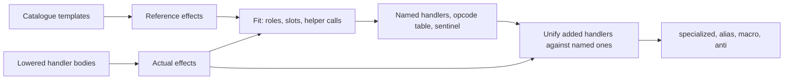

# Name each handler by its behaviour

Part of the [`handlers` module](../handlers.md). The stage `admit-container` calls
`behaviourTable` through the [frontend driver](../frontend-driver.md); the runtime observers call
`requireIdentifiedHandlers` ([map](../../../pipelines/jsconfuser-vm.md#frontend-order)).

## 2. Algorithm

`randomizeOpcodes` gives every operation a random value, so a word's number no longer says which
instruction it is. Its handler still does. Every encoder step after the runtime template, and any
outer obfuscator, changes how a handler is spelled and keeps what it does, so a handler is
compared by its **effects**, never by its label or its text. Behaviour is the production
environment's: a `debugger` statement acts only under a debugger and is no effect.

Every handler and every reference is evaluated to effects first. The canonical handlers are named
all at once; the named handlers then serve as the references every added handler is classified
against.

```text
references = effects(template) for each catalogue template     // explanatory pseudocode
actual     = effects(lowered body) for each handler, one identity per outside binding

behaviourTable(view):
  named = { h -> N : a reference of N fits h, a reference of N fits no other handler,
                     and no other opcode's reference fits h }
  for each h still unnamed:                          // an original beside its copies
    N = the one opcode whose reference fits h and no named handler; N not yet taken
    group h under N
  for each group:
    originals = the members reading the most operands, by label
    if all originals have equal effects: name the lowest label N
  opcodes = the canonical table; a canonical value that a named handler of another
            name holds is set to null; opcodes[N] = label of each named handler
  sentinel = the number CALL's `$_SPREAD` role bound, or null
  return {opcodes, sentinel, named}

classifyAdded(view, table):                          // for every handler not named
  singles = named handlers whose effects unify with h's
  one single, every operand slot a literal, not variable-width  -> specialized
  one single, its slots h's own reads in some order             -> alias
  no single; exactly one way to read h as two or more named
      handlers in sequence, every read used once                -> macro, or anti when
                                                                   all reads sit in arrays
  anything else                                                 -> unclassified (null)
```

A copy that bakes operands reads fewer than its original, which is why the member reading the
most operands is the original. Members with equal effects are aliases in identity order; the
lowest label stands for the opcode and the others classify as aliases. The variable-width
opcodes, whose operand count depends on the instruction, are `MAKE_CLOSURE`, `BUILD_ARRAY`,
`BUILD_OBJECT`, `CALL`, `CALL_METHOD` and `NEW`; a specialized handler cannot bake them.

Labels are never read for meaning. An added handler moved to another label is the same handler;
the words that used the old label then have no handler, and the word reader refuses them.

### Effects

The [lowered](locate-handlers.md#lowering) body, without `break` and empty statements, is
evaluated symbolically in JavaScript evaluation order:

- each operand read is a slot numbered in read order (`{op: k}`); an assignment's target is
  evaluated before its value; a constant read without arguments reads two slots;
- a literal is a value; an unbound name is the global it names; a binding outside the handler
  (the run function's state, a helper) is one identity across the whole runtime;
- a local carries its value, so whether it was kept, folded or coalesced changes nothing. After a
  conditional or loop it holds what the paths leave: the one value when they agree, otherwise
  their join (a loop counts its zero-pass value);
- a statement-level `a || b`, `a && b` or `c ? x : y` is the `if` it stands for; a statement-level
  sequence is its statements; an assignment inside an expression performs its write before the
  effect that holds it and yields its value;
- a `for` is its initializer, then a `while` whose body ends with its update.

The effects are the writes to anything but a local, the calls, conditionals, loops, throws and
returns. These spellings evaluate to the same effects:

| Dimension | Spellings | Producer |
|---|---|---|
| Which locals hold a value | Kept, folded, coalesced; `var x = v` or `x = v` | Closure minify, outer MovedDeclarations, the table handlers' renaming |
| A conditional statement | `if`, `?:`, `&&`, `\|\|` | Closure and outer minify |
| String building | `` `${x} is not defined` `` or `"" + x + " is not defined"` | Outer Preparation |
| A constant | `void 0` or `undefined`; `!0` or `true`; `!1` or `false` | Closure minify |
| Array construction | `Array(n)` or `new Array(n)` | Closure minify |
| Bitwise grouping | `a ^ b ^ c` or `a ^ (b ^ c)`; `x &= y` or `x = x & y` (a chain of `^`, `&` or `\|` is one list of operands) | Closure minify |
| A loop | `for (init; test; update)` or `init; while (test) { ...; update }` | Closure minify |
| A stable number | `SLOTS.THIS`, `3`, or a top-level binding stably holding `3` | Read by the [lowering](locate-handlers.md#lowering) |
| A debug-only statement | `debugger;` or nothing | An outer lock decoder removes every `debugger` |

### References and fitting

A reference is a catalogue template, written in the lowered form and evaluated the same way, with
its placeholders kept as roles:

| Placeholder | Binds | Scope |
|---|---|---|
| `$operand()`, `$constant(...)` | The lowered reader calls | Literal markers |
| `$regs`, `$base`, `$fp`, `$vm`, helper and constructor names, `$...Field`, `$...Method` | The interpreter's own state, helpers and fields: one actual term, or a property name | The whole dispatch; no two hold the same value |
| `$_PC`, `$_THIS`, ..., `$_SPREAD` | A number: a frame-header offset or the spread sentinel | The whole dispatch |
| Any other `$name` | One actual term | One handler; several may hold the same value |

`$wordsField` and `$poolField` start bound to the locator's two field names. **Fitting** compares
a reference's effects with a handler's term by term: the operand counts are equal, each slot is
in the same position, each role is bound once in its scope. A fit that names a handler commits
its dispatch roles for every later question; because roles only add constraints, a reference
that failed to fit a handler is not tried on it again.

A call to an interpreter helper or constructor is its callee and an unordered list of arguments,
with left-over dummy literals allowed: class obfuscation permutes helper parameters and turns a
VM method into a function taking the VM first, so a method call's receiver joins its arguments
and the helper's role binds the method's name or that function. The one spelling effects cannot
equate is a helper's body inlined into the handler (Closure's upvalue cell), so `LOAD_UPVALUE`
and `STORE_UPVALUE` each keep a second reference in the inlined form.

**Unifying** an added handler with a named handler's effects binds each of the named handler's
slots to one term of the added handler: a literal (a baked operand) or one of its own slots (a
permuted operand). A read whose value no effect uses still consumes a word, so a slot no effect
binds takes the added handler's next unused read, in order; a baked literal no effect shows stays
unknown and leaves the handler unclassified.



### Worked example: LOAD_GLOBAL and its alias under minify

Cell `minify-over-aliased-opcodes`: source `composition-finally-abrupt-return`, profile
`randomizeOpcodes+aliasedOpcodes+minify`, seed 251. Two of its 76 cases:

```text
case 35951: e=C(a); var x=J(a); if(!(x in a.i))throw new ReferenceError(`${x} is not defined`);
            b[d+e]=a.i[x]; break;
case 48718: let aa=[C(a),C(a),C(a)],ba=[aa[1],aa[0],aa[2]]; e=ba[0]; x=J(a,ba[1],ba[2]);
            if(!(x in a.i))throw new ReferenceError(`${x} is not defined`); b[d+e]=a.i[x]; break;
```

Case 35951 evaluates to two effects (`free0` is the state `a`, `free1` the register array `b`,
`free2` the base `d`):

```text
if !(constant(op1, op2) in free0.i): throw new ReferenceError(("" + constant(op1, op2)) + " is not defined")
set free1[free2 + op0] := free0.i[constant(op1, op2)]
```

`LOAD_GLOBAL`'s reference evaluates to the same terms with roles: `$vm` binds `free0`,
`$globalsField` the property `i`, `$regs` and `$base` bind `free1` and `free2`. No other
reference fits case 35951 and this reference fits no other handler, so `opcodes.LOAD_GLOBAL` is
35951.

Case 48718 reads three operands into an array and uses them permuted. Its effects are the same
two with `constant(op0, op2)` and `free1[free2 + op1]`. Unifying with case 35951 binds the named
handler's slots 0, 1, 2 to this handler's reads 1, 0, 2, so the class is
`{kind: 'alias', name: 'LOAD_GLOBAL', opcode: 35951, canonicalToStored: [1, 0, 2]}`.

### Worked example: one handler under two outer layers

The committed `counter-total` layered inputs hold one randomized VM program under one outer
js-confuser option each. The VM layer's `LOAD_GLOBAL` handler (label 9745) throws
`` new ReferenceError(`${globalName} is not defined`) `` inside a block. In `compact.js` the
outer Preparation rewrote the message as `"" + globalName + " is not defined"` and dropped the
braces; both evaluate to the effects above, and `LOAD_GLOBAL` is 9745 in both. In
`object-extraction.js` the case labels are bindings (`case __p_BmUS_OP_LOAD_CONST:` with
`__p_BmUS_OP_LOAD_CONST = 58675`); the locator reads the binding as 58675 and the same handler is
found at the same value.

## 3. Implementation

### Exports another file imports

| Export | File | Contract | Imported by |
|---|---|---|---|
| `behaviourTable(view)` | `identify-handlers.js` | `{opcodes, sentinel, named}`: the opcode table by behaviour (a name no handler answers keeps its canonical value, or `null` when a named handler holds that value), the spread sentinel or `null`, and the map handler -> name. | `extract-container.js`, `observe/observe-patch-added-opcodes.js` |
| `requireIdentifiedHandlers(ast, code)` | `identify-handlers.js` | The [locator's view](locate-handlers.md#the-view) with `opcodes` by behaviour and `added`, a map label -> class or `null`. Refuses as `requireHandlers` does. | the four per-option runtime observers |
| `templateEffects(nodes)` | `handler-effects.js` | The effects of statements already in lowered form. | `handler-meaning.js`, the test |

An added handler's class:

```js
{ kind: 'specialized', name, opcode, operands }           // operands: the baked literals, in
                                                           // the named handler's slot order
{ kind: 'alias', name, opcode, canonicalToStored }         // canonicalToStored[j]: which of the
                                                           // handler's reads canonical operand j takes
{ kind: 'macro' | 'anti', steps: [{ name, opcode, reads }] } // reads: the handler's read index
                                                           // for each operand of the step
```

`opcode` is the named handler's label. The effects record is `{effects, operands, eager}`:
`operands` counts the operand reads, and `eager` is true when there is at least one and every
one was made inside an array literal.

### Inside the part

| Piece | File | Does |
|---|---|---|
| `HANDLER_MATCHERS`, `isDispatchRole` | `handler-matchers.js` | The catalogue: `{name, source}` per canonical opcode, two for `LOAD_UPVALUE` and `STORE_UPVALUE`; which roles are dispatch-wide. |
| `meaningResolver(view)` | `handler-meaning.js` | Fitting. `opcodeFor(label)`: the one opcode that fits the handler and no other handler. `nameAmong(label, labels)`: the same, with the uniqueness asked within `labels` only. `sentinel()`. |
| `handlerEffects(view, handler, identities)`, `withoutBreaks` | `handler-effects.js` | A handler's effects from its lowered body; `identities` numbers outside bindings and is shared by handlers that are compared. |
| `unifyEffects(reference, actual, slots)`, `decomposeEffects(references, effects, limit = 2)` | `handler-effects.js` | Slot binding; every way, up to `limit`, to read effects as consecutive references. |
| `classifyAdded`, `classify`, `fillDeadReads` | `identify-handlers.js` | The classes. |

### Outcomes

| Input | Outcome |
|---|---|
| The interpreter is not located | The driver keeps the canonical table and sentinel ([frontend driver](../frontend-driver.md)); a runtime observer refuses with its own code |
| A canonical opcode no handler answers | Its canonical value, or `null` when a named handler holds that value |
| An added handler of no class, or of more than one | `null` in `added`; the runtime observer asked to account for it refuses "Unproved extra opcode cases remain" ([observe](../observe.md)) |
| A word whose value no handler has | Refused by the [word reader](../wordcode/read-wordcode.md) |

This part refuses nothing of its own.

## 5. Known Gaps

- Each runtime observer builds its own identified view from its own parse, so the table is
  computed again per observer.
- A helper inlined into a handler fits only where the catalogue holds that inlined form (the
  upvalue cell); another inlined helper would need its own reference.
- An update of a local (`i++`) is a term over its current value and does not advance the local,
  so a value read after it is the one before. Both sides of a comparison evaluate it the same way.
- No committed case counts the named handlers, or compares a class with the encoder's own record
  of the added handler.

## 6. Source

- [identify-handlers.js](../../../../../decoder/decode-js/src/vm/jsconfuser-vm/handlers/identify-handlers.js):
  the behaviour table and the classes.
- [handler-meaning.js](../../../../../decoder/decode-js/src/vm/jsconfuser-vm/handlers/handler-meaning.js):
  references and fitting.
- [handler-effects.js](../../../../../decoder/decode-js/src/vm/jsconfuser-vm/handlers/handler-effects.js):
  the evaluator, unification, decomposition.
- [handler-matchers.js](../../../../../decoder/decode-js/src/vm/jsconfuser-vm/handlers/handler-matchers.js):
  the catalogue.
- The handler bodies in the pinned encoder:
  [runtime.ts#L222-L954](https://github.com/MichaelXF/js-confuser-vm/blob/20c5b96bf57337c568579352758d7685358650de/src/runtime.ts#L222-L954);
  how added handlers are built from canonical bodies:
  [runtime layout](../../../../js-confuser-vm/transforms/runtime-layout.md).

## 7. Fixtures

Suites encode their sources with the pinned encoder and require the decode to behave as the
source ([tests.md](../../../tests.md)). No suite breaks this part's code; every cell runs under
randomized opcodes and so depends on the table.

| Scenario | Expected result | Committed fixture |
|---|---|---|
| A compound assignment against its written-out form | Equal effects | [handler-effects.test.js](../../../../../decoder/decode-js/test/vm/jsconfuser-vm/single-component/handler-effects.test.js) |
| An XOR chain grouped two ways | One effect | handler-effects.test.js |
| A randomized switch under minify, with added handlers | Canonical handlers named, added handlers classified; the decode behaves as the source | the `minify-over-*` suites (coverage) |
| A randomized handler table, with added handlers | Renamed table handlers fit | the `handler-table-over-*` suites (coverage) |
| Class obfuscation: helpers as functions, permuted parameters | Helper calls fit by role | the `class-rewrite-over-*` suites, [runtime-rewrites-chain](../../../../../decoder/decode-js/test/vm/jsconfuser-vm/cell-suites/runtime-rewrites-chain/suite.js) (coverage) |
| One randomized VM layer under each outer option: compact, objectExtraction, movedDeclarations, minify, variableMasking | The sequential decode behaves as the source | [counter-total](../../../../../decoder/decode-js/test/vm/jsconfuser-vm/layered-inputs/counter-total/generation.json) layered inputs, read by [sequential.test.js](../../../../../decoder/decode-js/test/vm/jsconfuser-vm/public-entry-points/sequential.test.js) |
| An added handler that fits two named handlers | Unclassified | |
