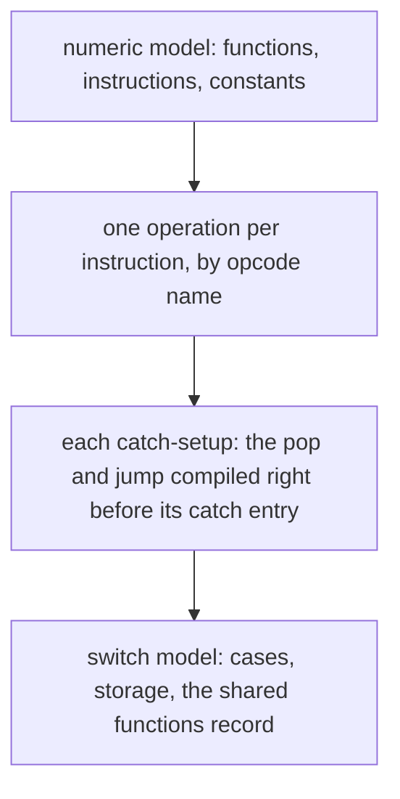

# Lower the numeric model onto the VM switch model

Pipeline stage: none; the model boundary, between the layers
([map](../../pipelines/jsconfuser-vm.md#model-boundary)).

Readers need the [numeric model](frontend-driver.md#the-numeric-model), the instruction's
[operand grammar](wordcode/read-wordcode.md#operand-grammar), the
[VM switch model](../switch/vm-switch-boundary.md#model-fields) with its
[typed operations](../switch/vm-switch-boundary.md#typed-operation-grammar), and the encoder's
[instruction set](../../../js-confuser-vm/instruction-set.md#canonical-grammar).

## 1. Target

The frontend ends with the compiler's instructions: an opcode name and operands that are
registers, pool references, immediates and addresses. The backend reads none of that. The lowering
is the step between them: it writes each instruction again as one typed operation, which says what
the instruction does in terms a reader without the encoder can use. A pool reference becomes its
value, a call's count and tail become an argument list, a conditional jump becomes a branch with a
polarity and a target.

`numericToVmSwitch(model)` takes the numeric model and returns the switch model, schema
`decode-js-vm-switch.v1`. It never refuses, reads no word and no interpreter source, and decides
nothing about control: which cases run, and how they nest, is the backend's to solve.

By the [ownership test](../switch/vm-switch-boundary.md#ownership-test) this is the frontend's
last step, because it needs the encoder's facts: each opcode's operand order, and one fact of the
compiler's layout, where a try statement closed ([the catch layout hint](#the-catch-layout-hint)).
After it nothing reads an opcode name.

## 2. Algorithm

```text
numericToVmSwitch(model)                                    (explanatory pseudocode)
  for each function of model.functions, in order:
    for each of its instructions, in order:
      case = { pc, nextPc, operation: LOWERINGS[name](operands, model.constants) }
  for each function, for each catch-setup case:
    jump = the case that ends where the catch entry starts
    pop  = the case that ends where that jump starts
    if jump is a jump and pop is a handler-pop:
      catch-setup.layoutEnd = jump.target
  return { schemaVersion, storage, functions, instructionsByFunction, instructionCount }
```



1. **One case per instruction.** The PC and next PC are kept, so every address the frontend
   resolved stays valid as a case identity. The operation is chosen by the opcode name alone, and
   its fields by the operands' positions: an operand is already a typed object
   ([operand grammar](wordcode/read-wordcode.md#operand-grammar)), so the lowering takes a
   register's or capture's `index`, an address's `pc`, an immediate's `value`, and a pool
   reference's `index` into `model.constants`. Every key is zero by now
   ([`normalize-concealed-constants`](normalize-concealed-constants.md)), so a pool value is used
   as it stands.
2. **The layout hint.** One fact cannot be read from the operations later, so it is read here
   from the order the compiler wrote them in ([below](#the-catch-layout-hint)).
3. **The storage.** A row per function with its register and capture counts, copied from the
   functions record. The record itself is handed on, not copied.

The lowering does not validate. The [gate](frontend-driver.md#the-gate) has already refused any
opcode outside the table, and the records' own builders have checked operands, addresses and
function ownership.

### The catch layout hint

The compiler ends a try block with `TRY_END; JUMP after_catch`, compiled immediately before the
catch entry. The jump's target is where the source closed the try statement. Wherever a
`catch-setup` has that pair before its catch entry, the lowering writes the jump's target on the
operation as `layoutEnd`.

**Why this fact is read from layout.** When a try block always throws, the program reaches the
code after the statement only by falling out of the catch. The reachable graph then cannot tell
"the catch's own tail" from "what follows the statement": both are the cases the catch runs into.
The compiler's normal exit is the one record of where the statement closed, and there it is dead
code, because the throw comes first. The backend decides nothing from an unreachable case
([reachability and layout](../switch/vm-switch-boundary.md#reachability-and-layout)); the frontend
knows this compiler's grammar and may read the pair by position. So the hint is written for every
try that has the pair, and the [statement planner](../switch/vm-switch-statements.md) uses it only
for a try with no reachable end.

The hint places code and changes no behaviour: with it the statement closes where the source
closed it, without it the catch keeps every case only it reaches. Both programs run the same
cases in the same order.

### Worked example

The committed cell `f-throw-catch` of suite `compiled-forms` (file `control-try`, profile
`randomizeOpcodes`, seed 251). The source:

```js
var result = [];
try { throw "boom"; } catch (error) { result.push({ type: typeof error, value: error }); }
try { throw new Error("bad"); } catch (error) { result.push({ type: error.name, message: error.message }); }
throw { kind: "uncaught", caught: result };
```

One function, 39 instructions, 39 cases. The first try, as instruction and as case (`r` a
register, `c` a pool index, `@` an address):

| PC | Instruction | Operation |
|---:|---|---|
| 8 | `TRY_SETUP @20, r3` | `{ kind: 'catch-setup', target: 20, exceptionRegister: 3, layoutEnd: 52 }` |
| 11 | `LOAD_CONST r4, c0` | `{ kind: 'assign', destination: 4, value: { kind: 'literal', value: 'boom' } }` |
| 15 | `THROW r4` | `{ kind: 'throw', source: 4 }` |
| 17 | `TRY_END` | `{ kind: 'handler-pop' }` |
| 18 | `JUMP @52` | `{ kind: 'jump', target: 52 }` |
| 20 | `LOAD_CONST r4, c1` | the catch entry: `... value: 'push'` |
| 39 | `BUILD_OBJECT r8, 2, r4, r6, r7, r3` | `{ kind: 'object', destination: 8, pairs: [{ key: 4, value: 6 }, { key: 7, value: 3 }] }` |
| 46 | `CALL_METHOD r4, r2, r5, 1, r8` | `{ kind: 'call', mode: 'apply', destination: 4, receiver: { kind: 'register', index: 2 }, callee: 5, arguments: { kind: 'fixed', registers: [8] } }` |
| 52 | `TRY_SETUP @73, r3` | the second try: `... target: 73, layoutEnd: 118` |

- **PC 11.** The pool reference `c0` is gone; the operation holds the string.
- **PC 39, 46.** The pair count 2 and the argument count 1 are gone; the pairs and the argument
  registers are lists.
- **PC 17, 18.** The case ending at the catch entry 20 is the jump at 18, and the case ending at
  18 is the pop at 17, so the setup at 8 gets `layoutEnd: 52`. Both cases are unreachable: the
  throw at 15 comes first.

With the hint the decode closes the first try at 52, and the two tries and the final `throw` read
as three sibling statements, as in the source. The same source under
`randomizeOpcodes+selfModifying` (suite `single-payload-stage`, seed 251) reaches the lowering
without the `TRY_END` at 17: [`normalize-self-modifying-wordcode`](normalize-self-modifying-wordcode.md#5-known-gaps)
reads dead compiler code of a filler's shape as a filler and drops it. The pair is not there, no
hint is written, and the decode nests the second try and the final `throw` inside the first
catch. Both outputs behave as the source.

## 3. Implementation

### Exports another file imports

| Export | Importers | Role |
|---|---|---|
| `numericToVmSwitch(model)` | `decode-standalone.js` ([`standalone-decode`](standalone-decode.md)), `scripts/render-vm-switch.mjs` ([review rendering](../switch/vm-switch-emit.md)), the unit test | the numeric model to the switch model |

### The lowering table

One row per opcode group; `LOWERINGS` holds one entry per opcode name. Operand positions are
those of the [operand grammar](wordcode/read-wordcode.md#operand-grammar); the operations' fields
and meaning are the [boundary's](../switch/vm-switch-boundary.md#typed-operation-grammar).

| Opcode | Operation | Fields from the operands |
|---|---|---|
| `LOAD_CONST` | `assign`, value `literal` | destination; the pool value |
| `LOAD_INT` | `assign`, value `literal` | destination; the immediate |
| `LOAD_THIS` | `assign`, value `this` | destination |
| `MOVE` | `assign`, value `register` | destination, source |
| `VOID` | `assign`, value `undefined` | destination; its source operand is not read |
| `TYPEOF` | `assign`, value `typeof` | destination, source |
| the 22 binary opcodes | `assign`, value `binary` | destination, left, right; the operator from the table below |
| `UNARY_NEG`, `UNARY_POS`, `UNARY_NOT`, `UNARY_BITNOT` | `assign`, value `unary` | destination, source; operators `-`, `+`, `!`, `~` |
| `LOAD_GLOBAL`, `TYPEOF_SAFE` | `global-read`, `safe-typeof` | destination; the name, a pool value |
| `STORE_GLOBAL` | `global-write` | the name, a pool value; source |
| `LOAD_UPVALUE`, `STORE_UPVALUE` | `upvalue-read`, `upvalue-write` | destination, capture index; capture index, source |
| `GET_PROP`, `DELETE_PROP` | `property-read`, `property-delete` | destination, object, key |
| `SET_PROP` | `property-write` | object, key, value |
| `JUMP` | `jump` | target |
| `JUMP_IF_FALSE`, `JUMP_IF_TRUE` | `branch`, `when: 'false'` or `'true'` | condition, target |
| `JUMP_REG` | `indirect-jump` | source |
| `RETURN`, `THROW` | `return`, `throw` | source |
| `CALL`, `CALL_METHOD`, `NEW` | `call` | see [calls](#calls) |
| `MAKE_CLOSURE` | `closure` | destination, entry address; each operand after the sixth as a capture `{ kind, index }` |
| `BUILD_ARRAY` | `array` | destination; every operand after the count as an element |
| `BUILD_OBJECT` | `object` | destination; the count's value, then that many `{ key, value }` register pairs in order |
| `DEFINE_GETTER`, `DEFINE_SETTER` | `accessor`, `accessor: 'get'` or `'set'` | object, key, callback |
| `FOR_IN_SETUP` | `for-in-setup` | destination, source |
| `FOR_IN_NEXT` | `for-in-next` | destination, iterator, exit address |
| `TRY_SETUP` | `catch-setup` | target, exception register; `layoutEnd` added afterwards |
| `TRY_END` | `handler-pop` | none |
| `FINALLY_SETUP` | `finally-setup` | target, continuation register, payload register, throw pad address |
| `DEBUGGER` | `debugger` | none |

Binary operators: `ADD +`, `SUB -`, `MUL *`, `DIV /`, `MOD %`, `EXP **`, `BAND &`, `BOR |`,
`BXOR ^`, `SHL <<`, `SHR >>`, `USHR >>>`, `LT <`, `GT >`, `LTE <=`, `GTE >=`, `EQ ===`,
`NEQ !==`, `LOOSE_EQ ==`, `LOOSE_NEQ !=`, `IN in`, `INSTANCEOF instanceof`.

`MAKE_CLOSURE`'s parameter, register and capture counts and its rest flag are not copied: the
child's frame is in the functions record, which
[`partition-functions`](wordcode/partition-functions.md) built from the same operands.

### Calls

| Opcode | `mode` | `receiver` | Operands |
|---|---|---|---|
| `CALL` | `apply` | `{ kind: 'none' }` | destination, callee, count, arguments |
| `CALL_METHOD` | `apply` | `{ kind: 'register', index }` | destination, receiver, callee, count, arguments |
| `NEW` | `construct` | `{ kind: 'none' }` | destination, callee, count, arguments |

`arguments` is `{ kind, registers }` with the registers after the count, in order. The kind is
`array-register` when the count operand is of kind `spread-sentinel`, and `fixed` otherwise. The
lowering compares no number: [`read-wordcode`](wordcode/read-wordcode.md) decided the operand's
kind from the sentinel the container carries. The count itself is dropped.

### Decisions

- **A plain call has no receiver.** The interpreter calls its own closures with its globals as
  `this` and applies a host function to null. That split is the interpreter's machinery, not the
  program's ([the source program, not the interpreter](../switch/vm-switch-boundary.md#the-source-program-not-the-interpreter)),
  so `CALL` lowers to the source's `f(...)` and no call record is read.
- **`EXP` is `**`.** The interpreter's handler computes `Math.pow`
  ([scalar operations](../../../js-confuser-vm/instruction-set.md#loads-stores-scalar-operations-and-coercion)),
  which rejects a BigInt where `**` does not. The compiler emits `EXP` for the source's `**`, so
  where the two differ the encoding changed the behaviour and the decode writes the source's form
  ([F8](../../../encoder-decoder-method.md#f8-keep-the-shared-behaviour-what-the-encoding-changed-is-free)).
- **`VOID` reads nothing.** Its result is `undefined` whatever its source register holds, so the
  operation names no source.
- **The hint is one-sided.** `layoutEnd` is absent, not null, where the pair is not found. It is
  searched in the setup's own function only, by position: the case whose `nextPc` is the catch
  entry, and the case whose `nextPc` is that case's PC.

### Output

```js
{
  schemaVersion: 'decode-js-vm-switch.v1',   // VM_SWITCH_SCHEMA, the lowering's one import
  storage: {
    kind: 'register-machine',
    functions: [{ id, registerCount, captureCount }],  // from each frame's regCount, captureCount
  },
  functions,                 // the numeric model's functions record, the same object
  instructionsByFunction,    // a new Map: function id -> new cases { pc, nextPc, operation }
  instructionCount,          // the number of distinct case PCs over all functions
}
```

Every case and operation is a new object; the numeric model's instructions are not changed. The
[model fields](../switch/vm-switch-boundary.md#model-fields) say what the backend relies on.

### Refusals

None. An opcode name outside the table would give a case with no operation, on which the hint
pass fails with a plain exception; the [gate](frontend-driver.md#the-gate) refuses every such name
first (`unsupported-opcode`).

## 4. Input Shapes

| Shape | Producer | Treatment |
|---|---|---|
| Instructions of canonical opcodes only, operands typed, keys zero | the frontend's recoveries, admitted by the [gate](frontend-driver.md#the-gate) | one case each |
| `TRY_END; JUMP` immediately before a catch entry | encoder step 2 `compiler.compile` ([catch and finally](../../../js-confuser-vm/instruction-set.md#catch-finally-and-abrupt-completion)) | `layoutEnd` on the setup |
| A catch entry without that pair before it | a frontend rewrite that moved or dropped the pair: [`normalize-self-modifying-wordcode`](normalize-self-modifying-wordcode.md#5-known-gaps) drops a dead `TRY_END` as a filler (the worked example) | no hint |
| A count operand of kind `spread-sentinel` | [`read-wordcode`](wordcode/read-wordcode.md), from the container's sentinel | `arguments.kind: 'array-register'` |
| A `JUMP_REG` the dispatcher recovery left | [`normalize-dispatcher-wordcode`](normalize-dispatcher-wordcode.md), when it carried on | `indirect-jump`; the [control solve](../switch/vm-switch-control.md) settles it or declines |

## 5. Known Gaps

- **The opcode list is kept twice.** The gate's set of supported names
  ([`frontend-driver`](frontend-driver.md#the-gate)) and the lowering table hold the same names
  today, and no test compares them. A name in the gate's set alone would pass the gate and fail in
  the lowering with a plain exception, published as `standalone-emission-error`, not a refusal
  that names the opcode.
- **Nothing pins the layout hint.** The decode behaves the same with and without it, so no cell
  fails when it is removed, and no proof or form indicator names it.
- **The hint depends on dead code surviving the frontend.** Where a recovery drops the dead
  `TRY_END`, the try that always throws keeps the following statements in its catch (the worked
  example). The output is correct and reads worse than the source.
- **One unit test.** It pins the shape of a case and the absence of control fields, not any
  opcode's lowering; each lowering is exercised only through the cells' behaviour.

## 6. Source

- [numeric-to-vm-switch.js](../../../../decoder/decode-js/src/vm/jsconfuser-vm/numeric-to-vm-switch.js):
  the tables `BINARY`, `UNARY` and `LOWERINGS`, `lowerCall`, and `numericToVmSwitch` with the
  layout hint.
- Called by `diagnoseStandalone` in
  [decode-standalone.js](../../../../decoder/decode-js/src/vm/jsconfuser-vm/decode-standalone.js),
  between the frontend driver and `emitVmSwitchProgram`, and by
  [render-vm-switch.mjs](../../../../decoder/decode-js/scripts/render-vm-switch.mjs).

## 7. Fixtures

Each suite encodes its sources with the pinned encoder and requires the decode to behave as the
source; a proof is a break of the named code that turns the suite red
([tests.md](../../tests.md#suites)). Suites are under
[cell-suites/](../../../../decoder/decode-js/test/vm/jsconfuser-vm/cell-suites/).

| Scenario | Expected result | Committed fixture |
|---|---|---|
| A finally's throw pad is lowered from its own operand | Decodes; behaves as the source | `compiled-forms`, proof "A finally's throw pad is its own operand." (removes `throwPad`) |
| The same under timing checks and a rewritten interpreter | Decodes; behaves as the source | `timing-runtime-chain`, proof "Finalizer throw pads under timing, patch, encoded and table runtimes." (the same break) |
| Every compiled form lowers | Decodes; behaves as the source | `compiled-forms`, by the cells' behaviour; no proof per opcode |
| A case holds `pc`, `nextPc` and `operation` only; the model has no control fields | Exactly those keys; nine cases for `window.TEST_OUTPUT = 1 + 2` | [numeric-to-vm-switch.test.js](../../../../decoder/decode-js/test/vm/jsconfuser-vm/single-component/numeric-to-vm-switch.test.js), on a hand-written boot |
| A try that always throws closes where the source closed it | Sibling statements after the try | `compiled-forms` cell `f-throw-catch` (the worked example); read by hand, nothing asserts it |
| An opcode in the gate's set but not in the table | A refusal naming the opcode | |
| Each opcode's exact operation | The table's row | |
