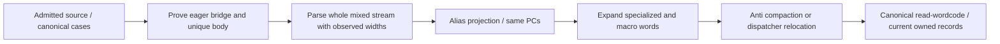

# Normalize aliased VM opcodes

Pipeline stage: `recover-added-opcodes` ([map](../../pipelines/jsconfuser-vm.md)).

## 1. Target

Replace proved alias headers and permuted tails with canonical opcode words. An alias takes
exactly the same word span as its original operation; successful projection changes the words
without changing their PCs. This supplies `read-wordcode` to the normal decoder instead of its
`unknown-opcode` decline. Mixed added-opcode recovery publishes a fully canonical result only after
its subsequent expansion/anti route succeeds.

Readers need arrays, word PCs and the [Babel binding/path foundation](../../babel.md), plus
[`extract-container`](extract-container.md), [canonical word grammar](read-wordcode.md) and the
pinned [alias producer](../../../js-confuser-vm/transforms/aliased-opcodes.md). Input is admitted
source text (or a Babel File for the runtime observer) and its owned numeric container. Supplied
private observations are not another public model-input API. Source/AST and `extract-container`
remain unchanged. The input boundary is narrower than every output the encoder allocator could emit.

## 2. Algorithm

An unknown header has no safe width until the runtime proves it. Take the interpreter's
dispatch from the [handler locator](locate-handlers.md)'s view. Keep the handlers whose labels
are values of this decode's opcode table as canonical references (item 3). For each extra alias, prove that an eager operand array is read once, that a second
array is a permutation of it, and that the remaining handler restores exactly one canonical
body. Neither comments nor generated names identify the operation.

Undo that permutation while parsing the whole stream. Copy nonalias instructions unchanged;
replace each alias with its original header and canonical tail. Equal width makes this first
projection an identity address map. In a mixed stream, numeric cases first prove anti,
specialized and macro prefixes; alias proof owns only the remaining suffix. A subsequent
expansion then inserts canonical headers, and anti compaction removes fake state if present.
The final canonical parse is required before publishing any result.

### Annotated synthetic example

Supply an admitted runtime whose numeric `case 61` has these schematic bodies; this excerpt
omits the rest of `extract-container` and is not itself admitted source:

```text
let unsorted=[operand(),operand(),operand()];
let ordered=[unsorted[2],unsorted[0],unsorted[1]];
dst=ordered[0]; name=constant(ordered[1],ordered[2]); R[dst]=globals[name]; break;
input at PC 10: [61,7,0,4]
canonicalToStored=[2,0,1]; restored=[4,7,0]
output at PC 10: [2,4,7,0]          // LOAD_GLOBAL dst=4,index=7,key=0
```

With pool[7]=`"answer"` and an ordinary globals.answer=42, both handlers assign R4=42 and
finish at PC 14. The canonical reference instead reads dst then its constant index/key.
Replacing the explicit constant pair with a zero-argument constant call accounts for two
operand slots in the proof. Applying the stored three-cycle again would restore `[0,4,7]`;
this example distinguishes direction, unlike a swap. The canonical case is never mutated.



The last two operations are conditional, but a mixed projection cannot escape before they finish.

## 3. Implementation

### Source proof and observation contract

The [classifier](runtime-meaning.md#2-algorithm) identifies an alias: its effects unify with exactly
one canonical handler, every canonical operand slot bound to one of the alias's own reads, all of
them distinct. Whatever the prelude's spelling (two `let` arrays, one `let` with both declarators,
a single folded read array, or none when minify inlines an identity copy), the reads land in
operand slots, so `canonicalToStored[j]` is the read canonical operand j takes. A read the handler
never uses still takes its place in that order. The observer takes the added handlers of that kind
from the [identified view](runtime-meaning.md#3-implementation); labels and their order are never
read. Each leaves the dispatch (`ends`).

The canonical handlers are those the view's table names by behaviour (`partitionHandlers`); there
must be as many as table entries, and at least one added handler. Every added handler that is not
an alias must belong to the prefix observations supplied (anti, specialized, macro), whose counts
must cover it exactly. The result is one record per alias:

```js
{ opcode, originalOpcode, originalName, arity, canonicalToStored }
```

The frozen runtime record is `jsconfuser-vm-aliased-runtime-observation.v1` with
aliases and the three prefix counts. No alias, or an unaccounted added handler, declines at
`alias-runtime`; a [handler locator](locate-handlers.md) refusal is `alias-runtime-container`.

The canonical reference bodies come from the admitted runtime itself, so this proves the
added/base handler relationship, not the canonical semantics, which source and test qualification
bound. An identically damaged base and added body cannot be certified harmless merely by matching
each other.

### Stream projection, composition and publication

| Component | Owned input -> output | Consumer fact |
|---|---|---|
| Runtime proof | Source -> alias/prefix definitions | Complete bodies determine header semantics and fixed arity. |
| Mixed reader | `extract-container` + definitions -> aliased stream observation | Entire source words consumed; raw words, pc/nextPc/width retained. |
| Alias projection | Stream -> cloned `extract-container`, canonical alias words | `tail[j]=stored[canonicalToStored[j]]`; width is 1+arity. |
| Expansion/compaction | Projected stream + earlier added-opcode proofs -> current `extract-container` and `read-wordcode` and optional `validate-references` and `partition-functions` | Address changes and erased fake state owned by the linked inverses. |
| Publication | Successful whole route -> normalization result | No alias or other added header remains in `read-wordcode`. |

The reader represents aliases as `SYNTHETIC` with one step; actual anti entries also use that name.
Distinguish them by opcode membership in the alias definition map. Require at least one alias
instruction (`no-alias-instructions` otherwise). Leave true anti raw tails intact.

A projected alias keeps `extract-container` addresses (the
[two address spaces](normalize-macro-wordcode.md#shared-expansion-and-address-relocation)). When the
caller passes originPcMap O, translate each projected alias's direct targets through O, then the
finally continuation literal of each alias the caller's `originContinuationLoads` lists (an alias
has one step, index 0). The route does not select continuation loads itself: in the projected
stream a FINALLY_SETUP can still sit inside a specialized or macro instruction, so only the `recover-patch`
stage's whole-stream selection is complete. A target missing from O declines
`origin-target-boundary`. Canonical instructions are already current.

With prefixes, reparse projected words using macro if present, otherwise specialized, otherwise anti
definitions; use the shared expansion with `includePcMap:true` and O for the remaining added
opcodes. Anti compaction receives composePcMaps(O,E) with `allowSpecializedTail:true`; without anti
pass that map to the
[specialized dispatcher adapter](normalize-specialized-wordcode.md#dispatcher-and-anti-specialized-routes).
If no later adapter returns `read-wordcode`, construct canonical `read-wordcode` once on the output
container.

The normalizer returns `{ok,result,diagnostic}`: success result carries cloned `container`, current
`wordcode`, optional rebuilt records, schemaVersion
`jsconfuser-vm-aliased-wordcode-normalization.v1`, originalWordCount, aliasedInstructionCount and
macroInstructionCount. Its envelope/container are not universally frozen; `read-wordcode` is frozen.
It trusts owned prefix/stream records and never revalidates hypothetical damaged records. A typed
failure returns result:null and the named diagnostic; unexpected errors become
`alias-normalization-error`. The transaction is the whole container route, not each alias.
Independent standalone calls retry from original source; no intermediate projection is public.

### Source-informed example control boundary

These owner checks are recipes; no committed test runs them. They use the retained
[reference source](../../../../decoder/decode-js/test/vm/jsconfuser-vm/fixtures/reference/encoded.js)
as supplied canonical runtime/AST infrastructure. Parse as Babel File; retain root entry 0, main
regCount=7 and all maps/methods. Replace BYTECODE with the exact example words (alias example
prepends ten DEBUGGER=57 words and appends RETURN=45,r4). Replace CONSTANTS with
[`"sentinel"`,5,7,1,0,0,0,`"answer"`]. Append numeric case 61 by deep-cloning the relevant canonical
bodies, removing top-level BreakStatement/EmptyStatement, and adding one final break/block. Macro
concatenates LOAD_INT then MOVE unchanged. Specialized LOAD_GLOBAL replaces operand calls with 4 and
supplies constant arguments 7,0. Alias LOAD_GLOBAL and anti's LOAD_INT/ADD/BUILD_ARRAY/JUMP_IF_FALSE
replace each syntactic operand call with ordered[i] and constant calls with the next two indexed
arguments; prepend the exact eager/permutation arrays in the examples. Repeated collection-loop
reads remain one syntactic slot. PATCH adds no case. Generate this synthetic analysis source using
supplied Babel, re-extract `extract-container` normally, then call the corresponding inverse; no
target or encoder execution is required.

Exact expected normalized words live in each worked example. Require original `extract-container`
equality, positive added-opcode recovery and current `read-wordcode` (PATCH also
`validate-references` and `partition-functions`); anti flow must select index 1 and
changing its fake target 33 to 34 must yield register-isolation on a private copied
`extract-container`. PATCH must recover PCs [0,5,8] and clear [1,0,7]; replacing RETURN@8 by
JUMP=39,target12 must yield source-reachable, while wrong key 2147483652 must never receive credit
for the expected clear words. Public diagnosis succeeds for the alias/anti/PATCH scaffolds. Macro
and specialized examples normalize exactly but the jump directly to RETURN gets a later
unemittable-structured-control decline. These outcomes pin the internal/public boundary; they do not
establish arbitrary emitter or host equivalence.

A separate source control (no committed test; it edits encoded input by hand) parses the
aliased-runtime-boot input (the `constant-arithmetic` source under `aliasedOpcodes`) and adds 0.5 to every numeric index in case 61's second bridge array before Babel generation.
A and alias runtime observation still succeed; normalization returns result:null/invalid-word
(the first restored invalid word is at PC7 for this fixture). This reaches the missing integer
check directly, rather than crediting an unrelated early refusal; it establishes no positive
fractional-permutation support.

These are source-informed one-agent controls with supplied canonical reference and AST/generation
infrastructure, not cold reconstruction, retained encoder output or novice readability evidence.
The word expectations/control recipes are durable here; no ignored staging/tool path is a dependency.

### Acceptance scenarios

| Scenario | Oracle / acceptance criterion | Evidence and limit |
|---|---|---|
| S1 three-cycle and constant pair | Exact tail/value/PC above; alias header disappears, canonical case remains unchanged | Synthetic worked calculation; `single-payload-stage` and `every-aliased-opcode` below. Whole compiler excluded. |
| S2 mixed prefixes and shuffled dispatch | Numeric ordering plus every added opcode's body proof; actual alias count>0 and canonical `read-wordcode` | The chain, route and rewrite suites below. |
| S3 source body/permutation damage | A still admits source; alias-runtime declines, result:null; public output absent | No committed test. |
| S4 immutable/state contract | Original `extract-container`/source unchanged; current spans/targets agree with output; fresh emitted parse has consistent state and no VM residue | Every cell; no public AST scope is returned by this pass. |

## 4. Input Shapes

[PATCH recovery](normalize-self-modifying-wordcode.md) consumes these proved added-opcode definitions
at original widths, then expands only recovered executable instructions. Its finite combined
boundary is [the PATCH census](qualify-jsconfuser-vm.md#finite-patch-added-opcode-qualification); the linear
stream reader on this page still does not interpret encrypted storage.

| Earlier decoder producer / accepted spelling | Gate or handoff affected |
|---|---|
| [Handler locator](locate-handlers.md#4-input-shapes) | Supplies the dispatch, handler bodies (a table handler's frame prologue split off), reader predicates, lowering and opcode table for every runtime spelling it lists. |
| [PATCH compaction](normalize-self-modifying-wordcode.md) | Words with selfModifying's additions removed; addresses inside added opcodes are still `extract-container` addresses and go through its `originPcMap` ([address spaces](normalize-macro-wordcode.md#shared-expansion-and-address-relocation)). |
| [Classifier](runtime-meaning.md#2-algorithm) and the anti, specialized and macro observations | The classifier decides each added handler's kind; the observations' counts account for every non-alias one. |

The actual encoder [alias recipe](../../../js-confuser-vm/transforms/aliased-opcodes.md#4-later-stages)
explains why aliases remain canonical fixed-arity clones. It is a narrow source dependency,
not a qualification result. Earlier decoder producers own their shape inventories.

## 5. Known Gaps

Aliases whose effects unify with exactly one canonical handler are the admitted source shape.
Matching the runtime's own canonical handlers is not proof of untouched canonical semantics or
dispatch completeness. Variable tails, noncanonical bodies and other representations need
separate proof. Added-opcode PATCH recovery
has the separate [finite original-width contract](normalize-self-modifying-wordcode.md); wider
PATCH representations remain unqualified.
Minified class admission and profiles beyond the suites below remain open.

## Source

The observer in item 3 is
[observe-aliased-runtime.js](../../../../decoder/decode-js/src/vm/jsconfuser-vm/observe-aliased-runtime.js)
(`diagnoseAliasedRuntime(source, options)`),
on the classifier in [identify-handlers.js](../../../../decoder/decode-js/src/vm/jsconfuser-vm/identify-handlers.js),
with [read-wordcode.js](../../../../decoder/decode-js/src/vm/jsconfuser-vm/read-wordcode.js).
Mixed expansion/anti/dispatcher dependencies are owned by their linked item 3 recipes.

The decoder is [normalize-aliased-wordcode.js](../../../../decoder/decode-js/src/vm/jsconfuser-vm/normalize-aliased-wordcode.js)
(`diagnoseNormalizeAliasedWordcode(source, container, options)`),
wired by [diagnose-standalone.js](../../../../decoder/decode-js/src/vm/jsconfuser-vm/diagnose-standalone.js)
under the dependencies described in item 4.

The pinned encoder's [bytecode alias pass](https://github.com/MichaelXF/js-confuser-vm/blob/20c5b96bf57337c568579352758d7685358650de/src/transforms/bytecode/aliasedOpcodes.ts)
chooses free opcode slots and permutes stored operands. Its
[runtime alias pass](https://github.com/MichaelXF/js-confuser-vm/blob/20c5b96bf57337c568579352758d7685358650de/src/transforms/runtime/aliasedOpcodes.ts)
appends the corresponding dispatch cases.

## Fixtures

The scenario tables in item 3 state acceptance oracles; the suites below hold them. The annotated
examples are source-informed synthetic controls, not independent cold proofs.

### Independent bounded proof

The retired frozen verifier retained exact synthetic inputs, expected words/maps/spans, controls and
the pre-source freeze. One experienced agent reconstructed selected mechanics from the ten candidate
pages plus Babel and `read-wordcode` prerequisites, using supplied Node/assert/Babel infrastructure
and no production imports. The tested consumed state is ordered raw words, spans, widths and nextPc,
not full register-value, `validate-references` and `partition-functions`, scope-cache
or emitted-program state. The recovery assertions fail passthrough.

Alias proof covers the declared three-slot LOAD_GLOBAL bridge, inverse three-cycle and selected
body/capture/repeated-index refusals. Its source is a function with a supplied labeled-break marker
removed by the scaffold, not an admitted numeric switch case. Binding projection covers declared
identifier/variable/function-parameter spellings and capture/read/write/shadow controls; it does not
cover destructuring, catches/rest, repeated var or complete clone-origin handling. Supplied
`extract-container`, role names and canonical inventory are not reconstructed. Numeric labels, full
case-ending syntax, class layouts, prefix allocation, source admission and whole runtime semantics
remain source-audit or qualification dependencies.

The proof's single guessed anti-prefix diagnostic equality is
[quarantined](normalize-anti-wordcode.md#fixtures); its selected changed words/maps/spans remain
credited under their declared scope. Owner source-informed scaffolds and retained-input test runs
are separate evidence. This is neither a whole-frontend reconstruction nor generated-output,
public-admission, option-stack or novice-readability qualification. The frozen executable and the
report's frozen metadata/stdout section remain unchanged after reference consultation; the report's
post-freeze audit and verdict sections remain appendable.

Each suite encodes its sources with the pinned encoder and requires the decode to behave as the
source ([tests.md](../../tests.md#suites)); a Proved line names the code whose break turns the case
red.

| Suite and cases | Claims | Proved |
|---|---|---|
| [single-payload-stage](../../../../decoder/decode-js/test/vm/jsconfuser-vm/generated-cells/single-payload-stage/suite.js), file `aliased-opcodes` | S1, S4: the stage step restores canonical words, equal to the plain program's; the decode behaves as the source | No alias break of its own |
| [single-payload-stage-conditions](../../../../decoder/decode-js/test/vm/jsconfuser-vm/generated-cells/single-payload-stage-conditions/suite.js), `every-aliased-opcode` | S1: every opcode an alias can target | Aliases of EQ and UNARY_NOT in `observe-aliased-runtime` |
| [added-opcodes-chain](../../../../decoder/decode-js/test/vm/jsconfuser-vm/generated-cells/added-opcodes-chain/suite.js) | S2: alias operands restored alone and after macro; only alias handlers count as aliases | `read-wordcode`'s alias operand order; the alias test in `observe-aliased-runtime`; the alias macro tail |
| [anti-alias-route](../../../../decoder/decode-js/test/vm/jsconfuser-vm/generated-cells/anti-alias-route/suite.js) | S2: alias projection reads the word stream through the anti observation | The anti word stream in this pass |
| [minify-over-aliased-opcodes](../../../../decoder/decode-js/test/vm/jsconfuser-vm/generated-cells/minify-over-aliased-opcodes/suite.js) | Minify's merged, folded and prelude-free aliases | No break of its own |
| [handler-table-over-aliased-opcodes](../../../../decoder/decode-js/test/vm/jsconfuser-vm/generated-cells/handler-table-over-aliased-opcodes/suite.js) | Aliases found through a handler table | No break of its own |
| [class-rewrite-over-aliased-opcodes](../../../../decoder/decode-js/test/vm/jsconfuser-vm/generated-cells/class-rewrite-over-aliased-opcodes/suite.js) | Aliases found under the class rewrite | No break of its own |
| [interpreter-rewrite-seeded](../../../../decoder/decode-js/test/vm/jsconfuser-vm/generated-cells/interpreter-rewrite-seeded/suite.js) | S2: shuffled dispatch | The opcode table matched from the runtime |
| [transport-patch-chain](../../../../decoder/decode-js/test/vm/jsconfuser-vm/generated-cells/transport-patch-chain/suite.js) | Handler proofs after minify renames the bindings | The payload is reached by structure through renamed bindings |
| [all-stages-together](../../../../decoder/decode-js/test/vm/jsconfuser-vm/generated-cells/all-stages-together/suite.js) | S2: every stage at once | No alias break of its own |

S3 has no committed test: the old body and permutation controls changed encoded input by hand,
a shape no encoder emits.
