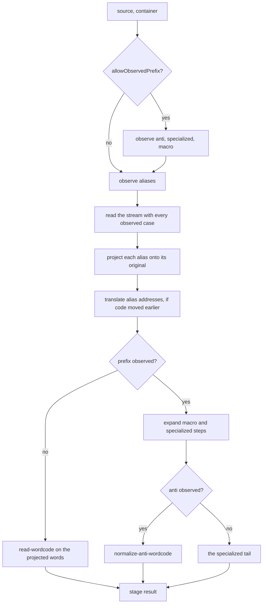

# Normalize aliased VM opcodes

Pipeline stage: `recover-added-opcodes` ([map](../../pipelines/jsconfuser-vm.md#frontend-order)).

Readers need the encoder's [aliased opcodes](../../../js-confuser-vm/transforms/aliased-opcodes.md),
the alias observation of the [`observe`](observe.md#observations) module and the stream readers
of [`read-wordcode`](wordcode/read-wordcode.md#added-opcode-instructions).

## 1. Target

Write every alias instruction as the canonical instruction it stands for. The encoder gives a
canonical operation a second opcode value whose handler reads the same operands in another
order; the transform restores the canonical opcode and operand order. An alias takes exactly the
words its original takes, so this changes words and never PCs.

On a stream whose only added opcodes are aliases, the result is canonical wordcode, where
`read-wordcode` had refused the input with `unknown-opcode`. On a stream that also holds anti,
specialized or macro opcodes, the transform is the outermost step of a chain: it rewrites the
aliases and hands the stream to the transform of the next family, and the result is that
transform's. A result is published only when the whole chain ends in canonical wordcode
([F1](../../../decoding-method/rules.md#f1)); the input
container is never changed.

Proving which handler is an alias, and of what, is the
[`observe`](observe.md) module's; reading a stream that holds aliases is
[`read-wordcode`](wordcode/read-wordcode.md)'s. This doc owns the rewrite and the chain.

## 2. Algorithm

An unknown opcode has no width until its handler proves one. So the transform first asks the
alias observer which added handlers are aliases, then reads the whole stream with those cases,
and only then rewrites.

```text
normalizeAliased(source, container, options):              // explanatory pseudocode
  prefix  = options.allowObservedPrefix ? observePrefix(source) : none
  runtime = diagnoseAliasedRuntime(source, prefix)         every other added handler must
                                                           belong to the prefix
  stream  = diagnoseAliasedWordStream(container, runtime, prefix)
  for each instruction of the stream:                      projection
    an alias:      [originalOpcode, ...operands in canonical order]
    anything else: its words, unchanged
  if an earlier stage moved code (options.originPcMap):
    translate the addresses inside the projected aliases
  if no prefix: result = the projected container, read by read-wordcode
  else:         result = expandPrefix(...)                 the next family's transform

observePrefix(source):
  anti        = observe anti, a tail allowed
  specialized = observe specialized, after anti if anti was found, a tail allowed
  macro       = observe macro with both, an alias tail allowed
  none of the three: refuse alias-prefix-unproved

expandPrefix(projected container, prefix):
  read the projected words with the macro cases if macro was found,
    else the specialized cases, else the anti cases
  expand macro and specialized instructions into their steps      (origin-addresses)
  anti found:  diagnoseNormalizeAntiWordcode, specialized tail allowed
  otherwise:   normalizeExpandedSpecializedDispatcher             (the tail)
```



1. **Two routes, one function.** The [frontend driver](frontend-driver.md#triggers-and-refusal-policy)
   tries the transform twice: first plainly, then with `allowObservedPrefix`. The encoder
   allocates added opcodes in the order anti, specialized, macro, alias, so aliases are the last
   allocated and the outermost to undo. The plain route's observer requires every added handler
   to be an alias; on a mixed runtime it refuses, and the second route first observes the
   families allocated before the aliases, so the alias observer can account for every handler.
2. **Projection.** The observation gives each alias `canonicalToStored`: canonical operand `j` is
   the stored operand at position `canonicalToStored[j]`. The stream reader has already put each
   alias's operands in canonical order; the projection writes the original opcode before them.
   Every occurrence of an aliased operation was rewritten by the encoder, and all are restored.
   A synthetic instruction that is not an alias is anti's and keeps its words.
3. **Addresses inside an alias.** When self-modifying code was removed first, canonical
   instructions already hold current addresses, but an alias's operands were left untouched and
   still hold origin PCs. Each label operand of a projected alias goes through the origin map,
   and so does the immediate of an alias that the earlier stage's `originContinuationLoads`
   lists as a continuation load
   ([`normalize-self-modifying-wordcode`](normalize-self-modifying-wordcode.md#compaction)). The
   transform does not select continuation loads itself: the `FINALLY_SETUP` can still sit inside
   a specialized or macro instruction, which only that stage's whole view saw.
4. **The rest of the chain.** With a prefix, the projected words are read again with the
   innermost family that can read all that is left, expanded
   ([`origin-addresses`](wordcode/origin-addresses.md#expanding-added-opcodes)), and handed on
   with the composed origin map: to the [anti normalizer](normalize-anti-wordcode.md) if anti
   was observed, else to the [specialized tail](normalize-specialized-wordcode.md), which also
   undoes a dispatcher when one remains. Their result, with its own origin map and records, is
   this transform's result.

### Worked example

The committed cell `composition-finally-abrupt-return` of suite `single-payload-stage`, file
`aliased-opcodes` (profile `randomizeOpcodes+aliasedOpcodes`, seed 251). `read-wordcode` refuses
the stream: `Unknown opcode 45526 at pc 11`. The observer proves 15 aliases, among them

```text
{ opcode: 45526, originalName: 'MOVE',        originalOpcode: 29942, arity: 2, canonicalToStored: [1, 0] }
{ opcode: 59715, originalName: 'LOAD_CONST',  originalOpcode: 17857, arity: 3, canonicalToStored: [1, 2, 0] }
{ opcode: 48718, originalName: 'LOAD_GLOBAL', originalOpcode: 35951, arity: 3, canonicalToStored: [1, 0, 2] }
```

and the projection rewrites 32 instructions in place:

```text
pc   input words          output words
11   45526, 5, 3          29942, 3, 5          MOVE r3 = r5
20   59715, 0, 5, 0       17857, 5, 0, 0       LOAD_CONST r5 = constant 0, key 0
32   48718, 1, 5, 0       35951, 5, 1, 0       LOAD_GLOBAL r5 = global named by constant 1, key 0
```

At PC 20 the stored words are `[0, 5, 0]`; canonical operand 0 is stored word 1 (`5`), operand 1
stored word 2 (`0`), operand 2 stored word 0 (`0`). The stream is 161 words before and after, and
the output reads as the same program the cell's plain encoding (`randomizeOpcodes` alone) holds.

On the cell of suite `anti-alias-route` (profile `aliasedOpcodes+antiInstrumentation`, seed 113)
the plain route refuses with `alias-runtime` ("Unproved extra opcode cases remain"). The prefix
route observes anti, projects 43 aliases, and hands the stream to the anti normalizer, whose
result (263 words to 179, with its origin map) is published.

## 3. Implementation

### Exports another file imports

| Export | Contract | Imported by |
|---|---|---|
| `diagnoseNormalizeAliasedWordcode(source, container, { allowObservedPrefix = false, originPcMap = null, originContinuationLoads = null, suspects = [] })` | `{ ok, result, diagnostic }`. `originPcMap` and `originContinuationLoads` are the self-modifying stage's; `suspects` are origin PCs, passed on to the expansion and the next transform. | the [frontend driver](frontend-driver.md) (both routes); `support/cell-tests.js` |

It imports the four observers ([`observe`](observe.md#exports-another-file-imports)), the four
stream readers, `diagnoseWordcode` and `LABEL_WORD_OFFSETS`
([`read-wordcode`](wordcode/read-wordcode.md#exports-another-file-imports)),
`expandObservedWordStream` and `composePcMaps`
([`origin-addresses`](wordcode/origin-addresses.md#exports-another-file-imports)),
`diagnoseNormalizeAntiWordcode` and `normalizeExpandedSpecializedDispatcher`.

### The stage result

```js
{
  schemaVersion: 'jsconfuser-vm-aliased-wordcode-normalization.v1',
  container,                // a clone with the rewritten words
  wordcode,                 // canonical, read by read-wordcode
  originPcMap,              // plain route: the caller's, unchanged (PCs did not move)
                            // prefix route: origin PC -> PC of the result, from the next transform
  originalWordCount,        // of the input stream
  aliasedInstructionCount,  // aliases in the input stream
  macroInstructionCount,    // macro instructions in the input stream
  // prefix route only: every other field of the next transform's result (suspects,
  // references, functions, its own counts), under this schema name
}
```

The driver adopts it as a route ([Adoption](frontend-driver.md#adoption)).

### Decisions

- An alias in the stream is an instruction named `SYNTHETIC` whose opcode the alias observation
  holds; anti's instructions share the name and are told apart by that lookup.
- A stream with no alias refuses (`no-alias-instructions`, the stream reader's), so the route
  never claims a stream it did not change.
- The expansion's reader is chosen by what is left after projection: the macro reader also reads
  specialized and anti cases, the specialized reader anti cases.
- Nothing is revalidated between the steps: the observation, the stream record and the next
  transform's result are trusted as their owners publish them.

### Refusals

Owner `aliased-normalization`; refusals of `observed-expansion` keep their codes
([Refusals](../../pipelines/jsconfuser-vm.md#refusals)). Any refusal makes the driver try its
next route.

| Code | When |
|---|---|
| `alias-prefix-unproved` | The prefix route found none of anti, specialized, macro |
| the alias observer's code (`alias-runtime`, ...) | No alias handler, or an added handler neither an alias nor in the prefix ([`observe`](observe.md#refusals)) |
| a stream reader's code (`no-alias-instructions`, ...) | The stream does not read with the observed cases ([`read-wordcode`](wordcode/read-wordcode.md#refusals)) |
| `alias-opcode-mismatch` | A synthetic instruction that is no alias, with no anti observation |
| `origin-target-boundary` | An address inside an alias that the origin map does not hold |
| the expansion's, the anti normalizer's or `read-wordcode`'s code | A later step of the chain refused |
| `alias-normalization-error` | Any other exception |

## 4. Input Shapes

| Shape | Producer | Treatment |
|---|---|---|
| Alias instructions: an added opcode and the original's operands, permuted | encoder step 10 `aliasedOpcodes`; the handlers by step 19 `applyAliasedOpcodes` | rewritten in place |
| Anti, specialized and macro instructions beside them | encoder steps 7 to 9 | read by their observed cases, then handed to their transforms |
| `{ aliases, antiPrefixCount, specializedPrefixCount, macroPrefixCount }` | [`observe`](observe.md#observations) | the alias cases |
| The aliased stream record, operands already canonical | [`read-wordcode`](wordcode/read-wordcode.md#added-opcode-instructions) | projected |
| Words with self-modifying additions removed, `originPcMap`, `originContinuationLoads`, `suspects` | [`normalize-self-modifying-wordcode`](normalize-self-modifying-wordcode.md#the-stage-result) | alias addresses translated; suspects passed on |

## 5. Known Gaps

- An alias is proved against the runtime's own canonical handler, so the rewrite is as right as
  that handler's naming ([`identify-handlers`](handlers/identify-handlers.md)); a canonical
  handler and its alias damaged alike would still match each other.
- `alias-opcode-mismatch` has no input that reaches it: the stream reader yields a synthetic
  instruction only for an alias or an anti case.
- No committed test asserts a refusal of this transform, or runs it over a self-modifying
  stream's origin map on its own; the PATCH suites reach that path through the whole decode.
- The `EQ` and `UNARY_NOT` aliases are exercised by a cell with no proof.

## 6. Source

- [normalize-aliased-wordcode.js](../../../../decoder/decode-js/src/vm/jsconfuser-vm/normalize/normalize-aliased-wordcode.js):
  `observePrefix`, `projectAliases`, `translateAliasAddresses`, `expandPrefix`.
- Called from
  [diagnose-standalone.js](../../../../decoder/decode-js/src/vm/jsconfuser-vm/diagnose-standalone.js)
  (`ADDED_OPCODE_ROUTES`, the first two entries).

The encoder's
[bytecode alias pass](https://github.com/MichaelXF/js-confuser-vm/blob/20c5b96bf57337c568579352758d7685358650de/src/transforms/bytecode/aliasedOpcodes.ts)
chooses the opcode values and permutes the stored operands; its
[runtime alias pass](https://github.com/MichaelXF/js-confuser-vm/blob/20c5b96bf57337c568579352758d7685358650de/src/transforms/runtime/aliasedOpcodes.ts)
appends the handlers.

## 7. Fixtures

Each suite encodes its sources with the pinned encoder and requires the decode to behave as the
source; a proof is a break of the named code that turns the suite red
([tests.md](../../tests.md#suites)). Suites are under
[cell-suites/](../../../../decoder/decode-js/test/vm/jsconfuser-vm/cell-suites/).

| Scenario | Expected result | Committed fixture |
|---|---|---|
| Aliases alone | The normalizer's output holds at least one rewritten alias and equals, instruction for instruction, the plain encoding's program; the decode behaves as the source | `single-payload-stage`, file `aliased-opcodes` (the worked example; its stage-effect test) |
| Every opcode an alias can target, `EQ` and `UNARY_NOT` included | The decode behaves as the source; no proof | `single-payload-stage-conditions`, source `every-aliased-opcode` |
| Aliases over anti, specialized and macro | The prefix route recovers the stream. Proof: the macro tail allowed to the specialized observer in `observePrefix` | `added-opcodes-chain` |
| Aliases over anti alone | The projected words are read again with the anti cases. Proof: the anti reader in `expandPrefix` | `anti-alias-route` |
| An alias holding an address, after self-modifying code was removed | The address goes through the origin map | |
| A mixed runtime on the plain route | `alias-runtime`; the driver tries the prefix route | |
| An alias address the origin map does not hold | `origin-target-boundary` | |
