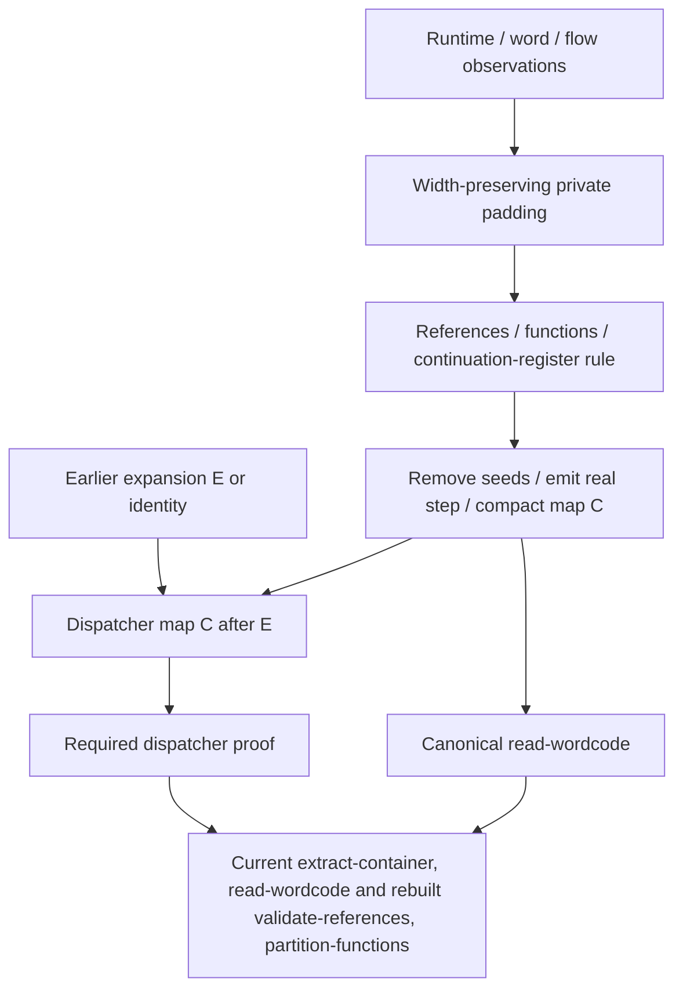

# Normalize anti-instrumented wordcode

Pipeline stage: `recover-added-opcodes` ([map](../../pipelines/jsconfuser-vm.md)).

## 1. Target

Remove proved fake entry seeds and replace every fused anti instruction with its uniquely real
canonical step. Success gives a compact canonical numeric container and `read-wordcode` record, optionally current
`validate-references` and `partition-functions` from dispatcher recovery; ordinary
behavior remains bounded by the observed fake-domain and host assumptions. A normalizer success
differs from passthrough by actual synthetic-header and seed removal, not merely by executable
output.

Readers need [`extract-container`](extract-container.md),
[`read-wordcode` through `partition-functions` contracts](standalone-diagnosis.md#owned-record-boundary),
[anti runtime/stream/flow proof](anti-runtime-observation.md),
[shared expansion/maps](normalize-macro-wordcode.md#shared-expansion-and-address-relocation),
[constant normalization](normalize-concealed-constants.md) and
[dispatcher normalization](normalize-dispatcher-wordcode.md). Source and owned numeric container are
inputs; source is never executed. Arbitrary private record damage is not a public boundary.

## 2. Algorithm

The runtime/flow observations identify each real step and isolated fake seed pool. First create
an analysis-only canonical stream with exactly the original width: place the real step at each
fused header and fill its leftover words with harmless writes to an isolated fake register.
This keeps old addresses intact while the existing reference and function analyses establish
continuation facts. Padding is never output or executed.

Retain finalizer continuation loads, and decide from the instructions alone whether remaining
indirect routes require the dispatcher inverse: a JUMP_REG is a finalizer resume only when it reads
its function's continuation register and a selected load writes it. Select the maximum compatible seed count for each function;
all selected seeds are isolated under a surviving real-step model. Reject control entering the
middle of that removable prefix. Compute a compact map, emit real steps, omit seeds and rewrite
only direct control and selected continuation addresses. Plain integer literals stay literals.
Dispatcher endpoints still decode to pre-expansion PCs, so combine any earlier expansion map
with this compaction before route recovery. Publish current records only after canonical parsing
and every required dispatcher proof succeeds.

### Annotated synthetic example

Supply the observation in the [anti example](anti-runtime-observation.md#annotated-synthetic-example)
with pool=[`"sentinel"`,5,7,1,0], four seeds and the same four-step handler. Initialize real
registers after seeds, so all relevant input words and addresses are explicit:

```text
PC0,4,8,12: [0,3,1,0], [0,4,2,0], [0,5,3,0], [0,6,4,0]
PC16: [1,1,10]                  // R1=10
PC19: [1,2,20]                  // R2=20
PC22: [61,9,0,3,1,2,4,2,3,5,33] // shuffled tail; fake target=nextPc=33
PC33: [45,0]                    // return real ADD result
analysis at 22: [11,0,1,2,5,3,3,4,3,4,3] // ADD; MOVE r3,r3; LOAD_THIS r3 twice
compact: [1,1,10,1,2,20,11,0,1,2,45,0]
C={0:0,4:0,8:0,12:0,16:0,19:3,22:6,33:10,35:12}
```

The 35-word input becomes 12 words and returns 30. Seed function entry 0 maps to compact entry 0;
the other seed starts still occur in C for bookkeeping but are forbidden externally consumed
entries. The eleven-word padding consumes exactly the old fused width and cannot leak into the
compact result. This word/model example supplies source-handler proof and `extract-container`
metadata; it is not independently admissible source or a host-global fake-effect test.



## 3. Implementation

### Proof inputs and map provenance

Require anti runtime observation, whole anti word stream and register-flow selection. With
allowSpecializedTail=true the runtime observer can stop at its proved prefix; the surrounding route
must have accounted for the rest, and every route that expands before anti passes its map. One
origin map arrives, originPcMap O (`extract-container` PC -> input PC;
[address spaces](normalize-macro-wordcode.md#shared-expansion-and-address-relocation)): the `recover-patch`
stage's map, or an expanding route's own map composed with it (`composePcMaps(O,E)`); absent, it is
identity. Expansion copies synthetic words unchanged, so on every route the fused operands, fake
jump targets included, are still in `extract-container` space, and this component translates them
itself: O goes to the register-flow proof (the fake-slot `l` rule), to the dispatcher translation,
and to the PATCH `suspects` (`extract-container` PCs), which are read in this input's space through
it.

If ordinary constant-ref operands or fused LOAD_CONST/LOAD_GLOBAL/TYPEOF_SAFE key words are
nonzero, require the source's [concealed reader proof](normalize-concealed-constants.md) before
flow analysis. The stream/flow producers supply spans, real indices and seed alternatives;
consumers do not revalidate schema versions, counts or raw-word equality of those owned facts.

### Padding and provisional control facts

For each synthetic instruction emit `[canonicalOpcode,...realStep.words]`. Set remaining to original
width minus that length; require remaining>=4 (`anti-padding`). Pick fakeRegister as the first
operand of the first nonreal step, which the successful model placed in its isolated pool/anchors.
If remaining is odd, append MOVE fakeRegister,fakeRegister (3 words) and subtract 3; append
LOAD_THIS fakeRegister (2 words) until zero. This restores width, not the original fake values.
Clone `extract-container` and replace only words; parse it into `read-wordcode`. Restore keyed
constants for this private padded control stream when needed, then validate `validate-references`
and partition `partition-functions` with every multi-parent entry published as a
[suspect](partition-functions.md#shared-parent-suspects) (the shared string helper). No
`partition-functions` is `anti-control-proof`.

Select the finally continuation loads with the
[shared rule](normalize-macro-wordcode.md#shared-expansion-and-address-relocation), functions from
`partition-functions`'s ownership, reading past PATCH suspects (a suspect load keeps its
`extract-container` word until [settled](normalize-self-modifying-wordcode.md#settling-suspects)).
The rule holds wherever CFF has moved those loads. A JUMP_REG avoids dispatcher recovery only
when its register is one of its function's FINALLY_SETUP continuation registers and at least one
selected load of that function writes it; any other JUMP_REG sets requiresDispatcher. The rule reads
instructions, not a control graph: CFF and dispatcher residue still in the stream leave it decidable.
Whether the resulting control is admissible is the diagnosis's decision, not this rule's.

```text
// explanatory
requiresDispatcher = false
for fn in partition.functions:
  continuations = { words[2] of each FINALLY_SETUP in fn }
  for jump in JUMP_REG instructions of fn:
    if jump.words[1] not in continuations
       or no selected load in fn has words[1] == jump.words[1]:
      requiresDispatcher = true
```

### Seed erasure and compact relocation

Take count=max(counts) in each successful seedCountChoices row, or min(counts) when the row has a
deferredSeed (that seed stays as code). Mark exactly count leading
LOAD_CONST starts at that function entry. A missing seed is anti-seed-proof. For each ordinary
instruction's direct target (offset table in the
[shared relocation contract](normalize-macro-wordcode.md#shared-expansion-and-address-relocation))
and every selected continuation LOAD_INT, reject a target to a marked seed except a function
entry with diagnostic anti-seed-proof. This code names both incoming direct-target and selected
continuation-target prefix refusals, as well as the missing canonical seed above; anti-control-proof
instead names missing compact boundaries and provisional/control proof failures. Synthetic fake
branches disappear, so they are not ordinary incoming routes.

Iterate original stream starts: C[pc]=nextPc; seeds add zero; a flow decoy (a PATCH suspect
touching a fake seed) is removed with no C entry, so an address naming it declines and its origin
is omitted from the dispatcher map; a fused instruction adds
1+realStep.words.length; other instructions add original width. Set C[wordCount]=nextPc.
Emit no seeds. Fused output is its canonical header and real operands; ordinary output is copied
raw words with direct offsets mapped through C and selected LOAD_INT offset 2 mapped through C.
A missing boundary is anti-control-proof. Function entries at the first seed map to the first
surviving instruction. Intermediate seed entries remain in C but are prohibited incoming targets.

For dispatcher translation use O, or identity over C keys. Every value
must exist in C or decline. Omit origins whose expanded target is a removed
nonentry seed; otherwise `decodedTargetMap[oldPc]=C[E[oldPc]]`. The map's domain matters as much
as its arithmetic: an encoded endpoint into omitted seeds must fail dispatcher validation.

### Final records, failure and state

Canonical-parse compact cloned `extract-container`. Without requiresDispatcher return that
`extract-container` and `read-wordcode`: ordinary keyed values remain for the later constant adapter
and no provisional padded `validate-references` or `partition-functions` is reused.
With requiresDispatcher, first normalize keyed compact constants if needed, build current
`validate-references` and `partition-functions` with multi-parent entries published as suspects, and
call the dispatcher with decodedTargetMap and the remaining PATCH suspects.
Require dispatcher success, adopting its complete current container, `read-wordcode`,
`validate-references` and `partition-functions` result. Provisional
padding and its records are discarded.

The deeply frozen success envelope contains schemaVersion
`jsconfuser-vm-anti-wordcode-normalization.v1`, container, wordcode, optional rebuilt records,
originPcMap (the origin space -> output: decodedTargetMap, composed with the dispatcher's pcMap when
it ran; the dispatcher's own pcMap is not passed on), the dispatcher's skipLabels when it ran,
`suspects` (the incoming ones less the decoys settled here) and `deferredSeeds` (`extract-container`
PCs), originalWordCount (this compactor's input, possibly already expanded) and
syntheticInstructionCount. Named NormalizationDecline yields result:null/diagnostic; other failures
become anti-normalization-error. No partially compact stream is returned. Public diagnosis may still
decline downstream. Source AST is never rewritten here; helper cleanup belongs to final emission.
Numeric spans/maps/records are rebuilt where consumed, and the owned chain fills only absent records
against current words. There is no caller binding cache to repair or private-record malformation
admission to invent.

The
[source-informed scaffold and exact control recipe](normalize-aliased-wordcode.md#source-informed-example-control-boundary)
supply the retained canonical runtime and exercise these examples through normal source
`extract-container`, then private numeric decisions where stated. They check exact recovery/current
records and unchanged input; they are not cold reconstruction or fresh encoder-output qualification.

### Acceptance scenarios

| Scenario | Oracle / acceptance criterion | Evidence and limit |
|---|---|---|
| S1 real replacement / seed erasure | Exact words/map/value above; shorter stream, zero added headers, no padding in output | Worked calculation; `single-payload-stage` and the conditions below. |
| S2 scalar versus continuation / iterator exit | Only selected address loads and canonical target offsets remap; FOR_IN_NEXT uses offset 3 | `single-payload-stage`, `for-in-iterator-number` below; unrestricted provenance remains unqualified. |
| S3 removed-prefix / dispatcher route | Reject nonentry seed targets; compose E then C before dispatcher endpoint validation | The route and stack suites below; no removed-prefix refusal case. |
| S4 keyed state / atomicity | Source reader proved, restored values correct; `extract-container`/source unchanged and failed whole result:null | `dispatcher-keys-anti` below; no atomicity case. |
| S5 public recovery/current state | No VM residue; source/encoded/decoded behavior and fresh emitted parse state agree | Every cell; observer/temporary padding success alone insufficient. |
| S6 host effects | Removed fake effects total/unobservable in actual host/coercion environment | The cells' browser-like host; arbitrary reassigned/getter globals and conversion effects unproved. |

## 4. Input Shapes

[PATCH recovery](normalize-self-modifying-wordcode.md) consumes these proved added-opcode definitions
at original widths, then expands only recovered executable instructions. Its finite combined
boundary is [the PATCH census](qualify-jsconfuser-vm.md#finite-patch-added-opcode-qualification); the linear
stream reader on this page still does not interpret encrypted storage.

| Earlier decoder producer / spelling | Effect |
|---|---|
| [`extract-container`](extract-container.md) / [handler locator](locate-handlers.md#4-input-shapes) | Supply the words and the handler bodies for every runtime spelling the locator lists. |
| [PATCH compaction](normalize-self-modifying-wordcode.md) | Words with selfModifying's additions removed; addresses inside added opcodes are still `extract-container` addresses and go through its `originPcMap` ([address spaces](normalize-macro-wordcode.md#shared-expansion-and-address-relocation)). |
| [Anti observations](anti-runtime-observation.md) | Supply eager widths/permutations, step positions and compatible fake seed models. |
| [Alias](normalize-aliased-wordcode.md) / [macro-specialized expansion](normalize-macro-wordcode.md) | Restore canonical seed spellings; copy synthetic words unchanged; pass their own map composed with O as originPcMap. |
| [Constant inverse](normalize-concealed-constants.md) / [dispatcher inverse](normalize-dispatcher-wordcode.md) | Restore private proof values or consume original-PC route endpoints before publication. |

Expansion leaves fake jump targets in `extract-container` space; the flow model translates them
through O, so a changed fake target declines here (`register-isolation`) on the plain and the
expanding routes alike.

## 5. Known Gaps

The closed fake operand/name domains do not establish universal harmlessness. Host getters,
missing/reassigned globals and value-to-primitive effects can make erasing fake operations
observable; the decoder does not inspect those external descriptors. The cells' browser-like host
bounds current regression evidence.
Changed keyed reader, unsupported layouts, linear reading of PATCH storage, minified class and
stacks no suite holds decline or remain unqualified under their own concrete gates.

## Source

Item 3's private padded `read-wordcode`, `validate-references` and `partition-functions` are
built by
[read-wordcode.js](../../../../decoder/decode-js/src/vm/jsconfuser-vm/read-wordcode.js),
[validate-references.js](../../../../decoder/decode-js/src/vm/jsconfuser-vm/validate-references.js)
and [partition-functions.js](../../../../decoder/decode-js/src/vm/jsconfuser-vm/partition-functions.js). Key and route
adapters are
[normalize-concealed-constants.js](../../../../decoder/decode-js/src/vm/jsconfuser-vm/normalize-concealed-constants.js)
and
[normalize-dispatcher-wordcode.js](../../../../decoder/decode-js/src/vm/jsconfuser-vm/normalize-dispatcher-wordcode.js).
Their own recipes define emitted forms; item 3 defines the compactor's schedule and map contract.

The normalizer is
[normalize-anti-wordcode.js](../../../../decoder/decode-js/src/vm/jsconfuser-vm/normalize-anti-wordcode.js)
(`diagnoseNormalizeAntiWordcode(source, container, options)`), called by
[diagnose-standalone.js](../../../../decoder/decode-js/src/vm/jsconfuser-vm/diagnose-standalone.js).
Its proof inputs are linked from the [observation document](anti-runtime-observation.md).

## Fixtures

The scenario tables in item 3 state acceptance oracles; the suites below hold them. The annotated
examples are source-informed synthetic controls, not independent cold proofs.

The retired frozen bounded verifier demonstrated S1/N3's selected four-seed padding, real-step
emission, exact compact C/words and reduced current spans. Composition E is an explicit synthetic
scaffold; C and its composition arithmetic/domain are reconstructed. Runtime segmentation/A are
supplied. Across-function flow, alternate seed counts, provisional or compact `validate-references`
and `partition-functions`, keyed restoration, general finalizer/dispatcher proof and
public emission are not reconstructed. See the
[shared bounded-proof limits](normalize-aliased-wordcode.md#independent-bounded-proof); owner
examples and retained-input tests remain separate.

The frozen private nonentry-seed control appends JUMP@35 [39,4] and correctly excludes that incoming
prefix route, but guesses diagnostic anti-control-proof. Actual direct/selected-continuation prefix
refusal is anti-seed-proof. That single diagnostic-equality assertion is excluded from accepted
evidence; the frozen executable stays unchanged, and its words/map/padding/isolation assertions are
unaffected. No committed test pins the anti-seed-proof refusal.

Each suite encodes its sources with the pinned encoder and requires the decode to behave as the
source ([tests.md](../../tests.md#suites)); a Proved line names the code whose break turns the case
red.

| Suite and cases | Claims | Proved |
|---|---|---|
| [single-payload-stage](../../../../decoder/decode-js/test/vm/jsconfuser-vm/generated-cells/single-payload-stage/suite.js), file `anti-instrumentation` | S1, S2, S5: the stage step erases synthetic instructions and the stream still reads; the decode behaves as the source | The real step of each synthetic case, MOD included; the stored operand permutation; each synthetic step's own operand span |
| [single-payload-stage-conditions](../../../../decoder/decode-js/test/vm/jsconfuser-vm/generated-cells/single-payload-stage-conditions/suite.js), `anti-real-arithmetic`, `anti-real-comparison`, `anti-real-unary-and-move` | S1: the real step of each operation kind | Real EXP; `fakeStepMatches`; real UNARY_NOT, in `analyze-anti-register-flow` |
| [single-payload-stage-conditions](../../../../decoder/decode-js/test/vm/jsconfuser-vm/generated-cells/single-payload-stage-conditions/suite.js), `anti-runtime-duplicate-step` | S1: of two equal steps in one case the first is real | The real-step choice in `analyze-anti-register-flow` |
| [single-payload-stage-conditions](../../../../decoder/decode-js/test/vm/jsconfuser-vm/generated-cells/single-payload-stage-conditions/suite.js), `for-in-iterator-number` | S2: a for-in iterator number off every boundary | FOR_IN_NEXT `labelOffset` in `read-wordcode` |
| [dispatcher-keys-anti](../../../../decoder/decode-js/test/vm/jsconfuser-vm/generated-cells/dispatcher-keys-anti/suite.js) | S3, S4: keyed constants inside synthetic cases restored before the dispatcher and the later stages | The concealKey test in this pass |
| [anti-macro-route](../../../../decoder/decode-js/test/vm/jsconfuser-vm/generated-cells/anti-macro-route/suite.js) | S3: macro expansion reading its words through the anti route | The anti branch in `normalize-macro-wordcode` |
| [anti-alias-route](../../../../decoder/decode-js/test/vm/jsconfuser-vm/generated-cells/anti-alias-route/suite.js) | S3: alias projection through the anti observation | The anti word stream in `normalize-aliased-wordcode` |
| [self-modifying-dispatcher-anti](../../../../decoder/decode-js/test/vm/jsconfuser-vm/generated-cells/self-modifying-dispatcher-anti/suite.js) | S3: anti decoys in self-modifying code behind a dispatcher removed with no address | Decoy removal in this pass; settle in `diagnose-standalone` |
| [added-opcodes-chain](../../../../decoder/decode-js/test/vm/jsconfuser-vm/generated-cells/added-opcodes-chain/suite.js) | S3: anti, specialized, macro and alias each reading the previous output | The alias macro tail in `normalize-aliased-wordcode` |
| [all-stages-together](../../../../decoder/decode-js/test/vm/jsconfuser-vm/generated-cells/all-stages-together/suite.js) | S3: two PC compactions and every other stage at once | Specialized operands up to a full 32-bit word |

The removed-prefix and changed-fake-jump refusals (S3, S4) have no committed test: the old
controls changed encoded input by hand, a shape no encoder emits. S6 is held only by the
browser-like host every cell runs in.
