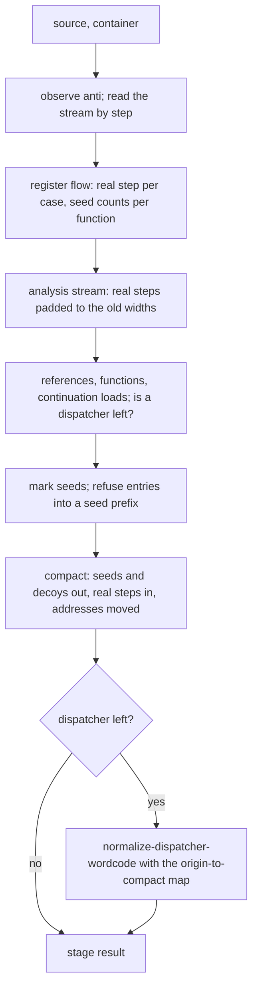

# Normalize anti-instrumented wordcode

Pipeline stage: `recover-added-opcodes` ([map](../../pipelines/jsconfuser-vm.md#frontend-order)).

Readers need the encoder's
[anti instrumentation](../../../js-confuser-vm/transforms/anti-instrumentation.md), the anti
observation of the [`observe`](observe.md#observations) module, the stream readers of
[`read-wordcode`](wordcode/read-wordcode.md#added-opcode-instructions) and the
[address rules](wordcode/origin-addresses.md).

## 1. Target

Remove what the encoder's `antiInstrumentation` step added. That step does two things to a
function: it opens the function with two to five **seeds**, `LOAD_CONST` instructions that put
random scalars into registers the program never uses, and it replaces some instructions with
**fused** ones, an added opcode whose handler runs the original instruction (the real step)
among fake steps that read and write only the seed registers. The transform removes the seeds
and writes each fused instruction as its real step alone.

The result is a shorter canonical stream: `read-wordcode` reads it, where it had refused the
input with `unknown-opcode`. Where the stream also holds a dispatcher, the transform undoes it
too before publishing, because the dispatcher's encoded targets need the map this transform
builds. A result exists only when every step succeeded
([F2](../../../encoder-decoder-method.md#f2-resolve-completely-or-not-at-all)); the input
container is never changed, and nothing is executed.

Which handlers are anti's, their steps and their stored operand order are the
[`observe`](observe.md) module's. This doc owns the two decisions the handlers cannot give:
which step of a fused instruction is real, and which leading loads are seeds.

## 2. Algorithm

```text
normalizeAnti(source, container, { allowSpecializedTail, originPcMap, suspects }):
                                                              // explanatory pseudocode
  runtime = diagnoseAntiRuntime(source)                       the fused cases and their steps
  stream  = diagnoseAntiWordStream(container, runtime)        every fused instruction, by step
  flow    = diagnoseAntiRegisterFlow(container, runtime)      each case's real step; per function
                                                              the possible seed counts; decoys
  padded  = the stream with each fused instruction as its real step, padded to its old width
  analysis of padded: references, functions, the continuation loads
  needsDispatcher = some JUMP_REG is not a finalizer's
  seeds   = per function its first `count` loads; refuse if anything jumps into them
  compact = drop seeds and decoys, write real steps, move addresses       -> words, pcMap
  decodedTargetMap = origin PC -> compact PC
  if needsDispatcher: restore constants, build references and functions on the compact
                      stream, run the dispatcher normalizer with decodedTargetMap; must succeed
  publish the compact (or dispatcher) records with originPcMap
```



### Finding the real step

A fused handler runs three or more canonical steps, and nothing in the handler says which one
the program needs. The stream does: the fake steps live entirely on the seed registers, and the
real step never touches them. The register-flow analysis finds, for every fused opcode, the one
step position consistent with that.

1. **Functions.** The stream is cut at PC 0 and every `MAKE_CLOSURE` entry. Each cut must be an
   instruction start, each interval must be covered to its end, and every label operand inside
   an interval (closure entries aside) must name an instruction start of the same interval.
2. **Seed sets.** For a function that holds fused instructions, count its leading `LOAD_CONST`
   instructions. The encoder writes two or three seeds, or four or five when a fused instruction
   of the function has a fake branch. A candidate count needs that many leading loads, into
   distinct registers, each loading a **fake scalar** (an integer 0..65535 or a string of three
   to eight letters and digits; a concealed constant is restored with its key first), and no
   other instruction of the function, fused instructions aside, may read or write those
   registers.
3. **Anchors.** A fake branch must never be taken, so it tests a seed that is never written: a
   **truthy anchor** (a seed holding a number of at least 1) for `JUMP_IF_FALSE`, a **falsy
   anchor** (a seed holding 0) for `JUMP_IF_TRUE`. With fake branches in the function, every
   ordered pair of distinct seeds with those values is tried; the other seeds are **flowing**
   registers, which fake steps may read and write. Without fake branches all seeds flow.
4. **Models.** A seed set with an anchor pair is a model. Under a model, a position of a fused
   instruction can be real when the step there is a [real form](#decisions) with no operand
   among the seed registers, and every other step is a [fake form](#decisions) filled only from
   the model: flowing registers, the anchors, small integers, fake constants, and for a branch
   its own fall-through address. The positions are intersected over all instructions of the
   same opcode in the function; a model that leaves an opcode no position is dropped.
5. **Across functions.** One opcode has one handler, so its real position is the same
   everywhere. The functions' models are combined, intersecting positions per opcode and
   dropping combinations that leave one empty. Every fused case of the runtime must end with
   exactly one position over all surviving combinations, cases the stream never uses included.
6. **Seed counts.** For each function, the counts of its models that agree with the selected
   positions are kept. Two counts can remain (the last load may be a seed or the program's
   own); the transform removes the larger count.

A fake branch's target is an address the encoder wrote, so when an earlier stage moved code it
is an origin PC and is translated through the origin map before it is compared with the
instruction's fall-through.

### The analysis stream

Removing the seeds needs two facts that only the record builders give: which `LOAD_INT`s load
addresses, and whether a dispatcher is left. They cannot read a stream with fused opcodes, and
compacting first would move every address they must check. So the transform builds a private
stream of exactly the input's widths: each fused instruction becomes its real step, followed by
harmless writes to one of its fake registers (`MOVE r, r`, three words, when the remainder is
odd; then `LOAD_THIS r`, two words each). It is read, its concealed constants are restored when
any key is nonzero, and references and functions are built on it, with every closure entry that
has several parents published as a
[suspect](wordcode/partition-functions.md#shared-parent-suspects). The padding is never output.

From it:

- **The continuation loads** ([`origin-addresses`](wordcode/origin-addresses.md#2-algorithm),
  rule 1), by the functions record's ownership, suspects read past.
- **Whether a dispatcher is left.** A `JUMP_REG` is a finalizer's when it reads a continuation
  register of its function and some continuation load of the function writes that register. Any
  other `JUMP_REG` is the dispatcher's.

### Seeds and compaction

1. **Mark the seeds.** In each fused function the first `count` instructions, each of which must
   be a `LOAD_CONST`. No label operand of a canonical instruction and no continuation load may
   name a seed other than the function's entry: control entering the middle of a removed prefix
   has no place to go. A fused instruction's fake branch is not such an entry; it disappears.
2. **Compact.** In stream order every instruction's PC maps to the next output PC; a seed adds
   no words, so a function's entry maps to its first surviving instruction. A fused instruction
   emits its canonical opcode and the real step's operands; any other instruction emits its
   words, with label operands and continuation loads moved through the map.
3. **The origin map.** Each origin PC maps to the compact PC of its instruction, through the
   caller's origin map when there is one. A seed other than a function entry has no entry, so a
   dispatcher target that decodes into a removed prefix is refused by the dispatcher normalizer.

### The dispatcher

When a dispatcher is left, the compact stream is not published as it is: its routes decode to
origin PCs, which only the map just built can resolve. The transform restores concealed
constants on the compact stream when any key is nonzero, builds references and functions, and
calls [`normalize-dispatcher-wordcode`](normalize-dispatcher-wordcode.md) with that map as
`decodedTargetMap`. The dispatcher must succeed; its records are published, and the origin map
is composed with its PC map.

Without a dispatcher the compact stream is published as read: concealed constants stay for
`recover-constants`, and the records built on the analysis stream are dropped.

### Suspects

A stream that went through `recover-patch` can hold undecided self-modifying fillers
([suspects](normalize-self-modifying-wordcode.md#decide-or-defer)), which arrive as origin PCs.
A filler draws its registers at random and says nothing about the program, so the seed-set test
and the continuation selection read past suspects. The analysis can also settle some by its own
fact: real code never touches a seed, so a suspect that touches a register which is a seed under
every remaining count is a **decoy**. It is removed with no map entry and leaves the suspect
set. A suspect touching only the one load that the larger count alone calls a seed decides
nothing: that load is a **deferred seed**, the smaller count is removed, and the load stays as
code.

### Worked example

The committed cell `constant-arithmetic` of suite `single-payload-stage-conditions`, file
`anti-instrumentation` (profile `antiInstrumentation`, seed 2). The source is
`window.TEST_OUTPUT = (6 * 7 + 3) % 5;`; `read-wordcode` refuses the stream with
`Unknown opcode 61 at pc 38`. The pool opens `[0, 60840, 62183, 46799, "NGc00Ht3", ...]`.
Canonical opcodes in this build are the encoder's defaults (`LOAD_CONST` 0, `MUL` 13).

```text
input PC -> output PC
 0 ->  0   LOAD_CONST r6 = constant 0      seed: 0, the falsy anchor
 4         LOAD_CONST r5 = constant 1      seed: 60840
 8         LOAD_CONST r2 = constant 2      seed: 62183
12         LOAD_CONST r3 = constant 3      seed: 46799
16         LOAD_CONST r4 = constant 4      seed: "NGc00Ht3"
20 ->  0   LOAD_THIS r1                    the function's first surviving instruction
30 -> 10   LOAD_CONST r9 = constant 7
34 -> 14   LOAD_CONST r10 = constant 8
38 -> 18   61, 0,3,2,2,11,9,2,3,3,2,2,4,10,2,9         fused, 16 words
54 -> 22   LOAD_CONST r9 = constant 10
58 -> 26   62, 3,6,67,10,3,9,11,3                      fused, 9 words
```

The observer gives opcode 61 five steps and the stored order of its fifteen operands; the stream
reader puts them back:

```text
at 38:  0 MUL          r11 = r9 * r10          real: no seed register
        1 SHL          r2 = r2 << r4           fake: flowing registers only
        2 TYPEOF_SAFE  r3 = typeof constant 9  fake: a name ("OMS6")
        3 USHR         r2 = r3 >>> r2          fake
        4 LOOSE_EQ     r2 = r2 == r3           fake
at 58:  0 ADD          r10 = r11 + r9          real
        1 JUMP_IF_TRUE r6, 67                  fake: the falsy anchor, target = its own next PC
        2 ADD          r3 = r3 + r3            fake
```

The function has a fake branch, so four or five seeds are tried; only five fits, since the fused
steps use `r2`, `r3` and `r4` as flowing registers and `r6` as the falsy anchor. Every case gets
one real position (`MUL` at 0, `ADD` at 0, `MOD` at 2 for opcode 63). The analysis stream writes
PC 38 as `MUL r11, r9, r10` followed by six `LOAD_THIS r2`, sixteen words again. No `JUMP_REG` is
there, so no dispatcher runs. The output writes PC 38 as `13, 11, 9, 10` at PC 18, and the 91
words become 48.

## 3. Implementation

### Exports another file imports

| Export | File | Contract | Imported by |
|---|---|---|---|
| `diagnoseNormalizeAntiWordcode(source, container, { allowSpecializedTail = false, originPcMap = null, suspects = [] })` | `normalize-anti-wordcode.js` | `{ ok, result, diagnostic }`, deeply frozen. `allowSpecializedTail` goes to the observer: the caller has accounted for the other added handlers. `originPcMap` is origin PC to this input's PC; `suspects` are origin PCs. | the [frontend driver](frontend-driver.md) (the last added-opcode route); `normalize-aliased-wordcode`, `normalize-macro-wordcode`, `normalize-specialized-wordcode` (after their expansion); `support/cell-tests.js` |
| `diagnoseAntiRegisterFlow(container, runtimeObservation, { originPcMap = null, suspects = new Set() })` | `analyze-anti-register-flow.js` | `{ ok, result, diagnostic }`, deeply frozen; `result` the [flow record](#the-flow-record). `suspects` are PCs of this input. | `normalize-anti-wordcode.js` |

The transform imports `diagnoseAntiRuntime` ([`observe`](observe.md)), `diagnoseAntiWordStream`,
`diagnoseWordcode` and `LABEL_WORD_OFFSETS`
([`read-wordcode`](wordcode/read-wordcode.md#exports-another-file-imports)), `validateReferences`,
`diagnoseFunctionPartition`, `selectContinuationLoads` and `composePcMaps`
([`origin-addresses`](wordcode/origin-addresses.md#exports-another-file-imports)),
`restoreConcealedValue`, `hasConcealedConstant` and `diagnoseNormalizeConcealedConstants`
([`normalize-concealed-constants`](normalize-concealed-constants.md)) and
`diagnoseNormalizeDispatcherWordcode`.

### Decisions

Real forms: a step can be real only with one of these names and exactly this many operand words,
all registers.

| Real names | Operands |
|---|---|
| `ADD`, `SUB`, `MUL`, `DIV`, `MOD`, `EXP`, `BAND`, `BOR`, `BXOR`, `SHL`, `SHR`, `USHR`, `LT`, `GT`, `LTE`, `GTE`, `EQ`, `NEQ`, `LOOSE_EQ`, `LOOSE_NEQ` | 3 |
| `UNARY_NEG`, `UNARY_POS`, `UNARY_NOT`, `UNARY_BITNOT`, `MOVE` | 2 |

Fake forms: a step is fake when its words fill its slot sequence exactly.

| Fake names | Slots |
|---|---|
| the three-operand real names | `w r r` |
| the two-operand real names, `TYPEOF` | `w r` |
| `LOAD_INT` / `LOAD_CONST` / `LOAD_GLOBAL` / `TYPEOF_SAFE` | `w i` / `w c` / `w g` / `w n` |
| `JUMP_IF_FALSE` / `JUMP_IF_TRUE` | `T l` / `F l` |
| `BUILD_ARRAY` / `BUILD_OBJECT` | `w k r` / `w k r r` |

| Slot | Words | Must be |
|---|---|---|
| `w`, `r` | 1 | a flowing register |
| `T`, `F` | 1 | the truthy, the falsy anchor |
| `l` | 1 | the instruction's next PC, after the origin map |
| `i` | 1 | at most 65535 |
| `k` | 1 | at most 2 (an element count) |
| `c` | 2 | a pool index and key restoring to a fake scalar |
| `g` | 2 | a pool index and key restoring to one of `Object`, `Array`, `String`, `Number`, `Boolean`, `Math`, `JSON`, `Date`, `RegExp`, `Error`, `Function`, `parseInt`, `parseFloat`, `isNaN`, `isFinite`, `Infinity`, `NaN`, `undefined` |
| `n` | 2 | a pool index and key restoring to a string of three to ten letters and digits |

- A constant slot's index must be inside the pool, and the value is restored by
  `restoreConcealedValue` with the slot's key; a value that does not restore fails the slot.
- A register an instruction "touches" is every operand of kind `register`, and for
  `MAKE_CLOSURE` every local capture's index.
- More than 4096 distinct combinations of models refuses (`model-limit`).
- The padding needs at least four words after the real step (`anti-padding`); its register is
  the first operand of the first step that is not real.
- The removed count is the largest that remains, or the smallest when the function has a
  deferred seed.

### The flow record

```js
{
  schemaVersion: 'jsconfuser-vm-anti-register-flow-observation.v1',
  realSteps,          // per fused case of the runtime: { opcode, index, name }
  functionCount,      // intervals of the stream
  fusedFunctionCount, // those holding a fused instruction
  seedCountChoices,   // per fused function: { startPc, counts, deferredSeed }
                      //   counts: the seed counts that remain, ascending
                      //   deferredSeed: PC of the deferred seed, or null
  decoys,             // PCs of the suspects settled as decoys, ascending
}
```

### The stage result

```js
{
  schemaVersion: 'jsconfuser-vm-anti-wordcode-normalization.v1',
  container,                  // a clone with the compact words, or the dispatcher's
  wordcode,                   // canonical
  originPcMap,                // origin PC -> PC of the result; without a caller's map, this
                              //   input's PC -> PC of the result
  suspects,                   // the incoming ones less the decoys, origin PCs
  deferredSeeds,              // origin PCs
  originalWordCount,          // of this input (already expanded on the other routes)
  syntheticInstructionCount,  // fused instructions in the input
  // when the dispatcher ran: references, functions, skipLabels and the other fields of its
  // result, its pcMap aside
}
```

The driver adopts it as a route ([Adoption](frontend-driver.md#adoption)).

### Refusals

Owners `anti-register-flow` (the analysis) and `anti-normalization` (the rest); the second
repeats the first's and the other owners' codes as its own
([Refusals](../../pipelines/jsconfuser-vm.md#refusals)). On the driver's own route a refusal
leaves the words unread; inside another transform's route it is that route's refusal.

| Code | When |
|---|---|
| the observer's or the stream reader's code (`anti-runtime`, `no-synthetic-instructions`, ...) | No fused handler or instruction; the stream does not read |
| `constant-pool` | The container has no pool |
| `function-boundary` | A function entry that is no instruction start, an interval not covered to its end, a label operand leaving its interval |
| `register-isolation` | A function with no model, or functions whose models share no real position |
| `model-limit` | More than 4096 combinations |
| `ambiguous-real-step` | A fused case with no single real position |
| `anti-padding` | A fused instruction with fewer than four words beyond its real step |
| `anti-control-proof` | No functions record on the analysis stream; no references on the compact stream; an address with no compact PC |
| `anti-seed-proof` | A counted seed that is no `LOAD_CONST`; a label operand or continuation load naming a seed inside a prefix |
| the constant restoration's, `partition-functions`' or the dispatcher normalizer's code | A step of the dispatcher recovery refused |
| `anti-register-flow-error`, `anti-normalization-error` | Any other exception |

## 4. Input Shapes

| Shape | Producer | Treatment |
|---|---|---|
| Seeds at a function's entry; fused instructions with their operands in stored order | encoder step 7 `antiInstrumentation`; the handlers by step 20 `applyAntiInstrumentation` | removed; reduced to the real step |
| `{ syntheticCases }`: per fused opcode its arity, stored order and steps | [`observe`](observe.md#observations) | the cases |
| The anti stream record: each fused instruction's steps with their words | [`read-wordcode`](wordcode/read-wordcode.md#added-opcode-instructions) | analysed and compacted |
| A stream the alias, macro or specialized transform expanded, with the composed origin map | [`normalize-aliased-wordcode`](normalize-aliased-wordcode.md), [`normalize-macro-wordcode`](normalize-macro-wordcode.md), [`normalize-specialized-wordcode`](normalize-specialized-wordcode.md) | fused instructions were copied unchanged, so their fake branch targets are origin PCs |
| Words with self-modifying additions removed, `originPcMap`, `suspects` | [`normalize-self-modifying-wordcode`](normalize-self-modifying-wordcode.md#the-stage-result) | suspects read past; decoys settled |
| Concealed constants, in seeds, fake steps and ordinary instructions | encoder step 6 `concealConstants` | restored for each test that reads a value |
| A dispatcher, a shared string helper | encoder steps 5 and 3 | the dispatcher undone here; the helper left as a suspect |

## 5. Known Gaps

- **Fake steps are assumed to have no effect.** The fake forms and domains are the encoder's own
  lists; the transform does not prove that removing them is unobservable. A host whose
  `Object`, `Math` or another listed global has a getter, or a value whose conversion runs code,
  would make a fake step observable.
- **A deferred seed is never settled.** It is published as `deferredSeeds`, which nothing reads,
  and the load stays in the output as dead code. No committed cell produces one.
- When no dispatcher is left, the records built on the analysis stream are thrown away and built
  again by the driver.
- The flow analysis cuts functions at `MAKE_CLOSURE` entries itself, before any functions record
  exists, and requires label operands to stay inside a cut.
- No committed test asserts a refusal of this transform; the stage-effect test checks only that
  fused instructions were found and that the output reads.

## 6. Source

- [analyze-anti-register-flow.js](../../../../decoder/decode-js/src/vm/jsconfuser-vm/normalize/analyze-anti-register-flow.js):
  the real step and the seed counts (`functionIntervals`, `seedSets`, `anchorPairs`,
  `realPositions`, `solveModels`, `selectRealSteps`, `seedCountChoice`).
- [normalize-anti-wordcode.js](../../../../decoder/decode-js/src/vm/jsconfuser-vm/normalize/normalize-anti-wordcode.js):
  the analysis stream (`padStream`, `analyzePadded`, `needsDispatcher`), the seeds (`fakeSeeds`),
  compaction (`compactStream`), the maps and the dispatcher (`translateTargets`,
  `recoverDispatcher`).
- Called from
  [diagnose-standalone.js](../../../../decoder/decode-js/src/vm/jsconfuser-vm/diagnose-standalone.js)
  (`ADDED_OPCODE_ROUTES`) and from the three other added-opcode transforms.

## 7. Fixtures

Each suite encodes its sources with the pinned encoder and requires the decode to behave as the
source; a proof is a break of the named code that turns the suite red
([tests.md](../../tests.md#suites)). Suites are under
[cell-suites/](../../../../decoder/decode-js/test/vm/jsconfuser-vm/cell-suites/).

| Scenario | Expected result | Committed fixture |
|---|---|---|
| Anti instrumentation alone | The normalizer finds fused instructions and its output reads; the decode behaves as the source. Proof: `MOD` among the real forms | `single-payload-stage`, file `anti-instrumentation` |
| The real step of an arithmetic, a comparison, a unary case | Proofs: `EXP` and `UNARY_NOT` among the real forms; the "every other step is fake" test | `single-payload-stage-conditions`, sources `anti-real-arithmetic`, `anti-real-unary-and-move`, `anti-real-comparison` |
| A case whose real step is not the first | Proof: the selected position, replaced by 0 | `single-payload-stage-conditions`, source `constant-arithmetic` (seeds 2, 251; the worked example) |
| A `FOR_IN_NEXT` whose iterator number is no instruction start | Only its exit is checked as a label; the proof is [`read-wordcode`](wordcode/read-wordcode.md#7-fixtures)'s | `single-payload-stage-conditions`, source `for-in-iterator-number` |
| Concealed constants in fused cases, under a dispatcher | Restored before the dispatcher reads them. Proof: the concealed-constant test of `canonicalConstants` | `dispatcher-keys-anti` |
| Suspects in a stream with a dispatcher and anti | A decoy is removed with no map entry. Proof: the decoy skip in `compactStream` | `self-modifying-dispatcher-anti` |
| Anti under macros, aliases, specialized opcodes | The outer transform hands over its expanded stream | [`normalize-macro-wordcode`](normalize-macro-wordcode.md#7-fixtures), [`normalize-aliased-wordcode`](normalize-aliased-wordcode.md#7-fixtures) hold the suites |
| A jump into a seed prefix | `anti-seed-proof` | |
| A fake branch whose target is not its fall-through | `register-isolation` | |
| Two seed counts with a suspect on the last load | A deferred seed | |
