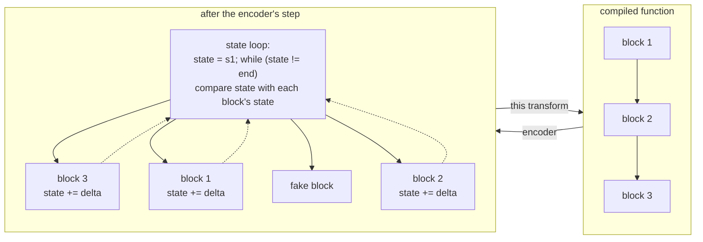

# Normalize VM control flow flattening

Pipeline stage: `recover-control` ([map](../../pipelines/jsconfuser-vm.md#frontend-order)).

Readers need the encoder's
[state-based control flow flattening](../../../js-confuser-vm/transforms/state-control-flow.md),
the [wordcode](wordcode/read-wordcode.md#records) and
[functions](wordcode/partition-functions.md) records and the
[address rules](wordcode/origin-addresses.md).

## 1. Target

The encoder's `controlFlowFlattening` step cuts a function into blocks, shuffles them, and routes
every jump through a **state loop** that compares a state register with each block's state. It
writes each jump as a relative change of the state, seeds the state absolutely in blocks that are
entered without the loop, inverts each conditional, and adds fake blocks nothing reaches.

The transform removes all of that. It returns the same function with the state loop gone, every
transition a direct jump again, each conditional followed by the fall-through the encoder's own
rewrite proves, and the fake blocks gone. Its output is a container with wordcode, references and
functions rebuilt; a function with no state loop passes through.

It removes nothing else, and it restores no other order:

- **Code the compiler emitted stays, also where no path reaches it** (source dead code, the dead
  exit of a try that always returns). Its origin cannot be tested here, so it goes to the
  backend, which reads unreachable code as it does in a function that was never flattened. A
  fake block is recognized by the encoder's own form, never by whether it runs
  ([reachability and layout](../switch/vm-switch-boundary.md#reachability-and-layout)).
- **Every jump the stream does not prove a fall-through stays a jump.** Loops, breaks and try
  regions are read from the graph by the backend.

The transform is static: it reads the encoder's own state-loop grammar and executes nothing. All
flattened functions are recovered or none is
([F2](../../../encoder-decoder-method.md#f2-resolve-completely-or-not-at-all)). Behaviour alone
cannot show recovery: left in place, the state loop is a valid loop over a variable, and the
program runs the same.

## 2. Algorithm



```text
normalizeCff(container, wordcode, functions):               // explanatory pseudocode
  for each function:
    read the state loop: header, dispatch tests, body starts     no loop: the function is kept
    for each body, with the state it runs under:
      drop its own state seed; turn each transition into a jump; note its successors
    fakes = bodies of a fake form that nothing outside the fakes targets
    prove the state-loop registers are dead in every kept body
    order = the entry body, then stream order, each proved fall-through after its conditional
    invert each conditional that is now followed by its proved fall-through
  no function with a loop: refuse cff-absent
  write the functions: a flattened one as its ordered bodies without the fakes
  move addresses; read the result: wordcode, references, functions
```

Each step needs what the one before learned.

### Reading the state loop

A candidate function has at least 18 instructions and opens with the loop's header:

```text
LOAD_THIS
LOAD_CONST start;  MOVE state = it
LOAD_CONST 0;      MOVE acc = it
top:  LOAD_CONST end
      NEQ c = state != end
      JUMP_IF_FALSE c, exit
```

Then the dispatch tests, one per state, and a `JUMP top` after the last:

```text
first test:   LOAD_CONST s;  MOVE acc = it
later tests:  LOAD_CONST d;  ADD or SUB t = acc, d;  MOVE acc = t      this state = previous +/- d
each test:    EQ c = state == acc;  JUMP_IF_FALSE c, next test;  JUMP body
```

The tests do not name their states: each adds or subtracts a difference from the one before, so
replaying the chain gives every state and the body it jumps to. The start state names the entry
body, whatever the shuffled order; the end state names the loop's exit, which must be the
instruction right after the `JUMP top`. Every constant here is a pool integer in 0..65535 with a
zero key; the accumulated state is plain arithmetic with no wrap.

The header alone is spelling: every non-arrow function opens with `LOAD_THIS`, and a source loop
`let s = 1; let c = 0; while (s !== k)` continues it exactly. What a flattened function cannot
run without is the whole loop. So the function counts as flattened only when every line above
reads, at least one test is there, no state repeats, the start state is among the states, and
the body starts are instruction starts from the exit to the function's end, the exit first.
Until then any mismatch means "not flattened" and the function is kept as it is. After that the
loop is this transform's, and a later violation refuses the whole transform.

A body runs from its start to the next body start or the function's end. Each body's state is
the one whose test jumps to it; the exit has the end state, which is not a body's state.

### Transitions and seeds

Inside a body with state `s`, every position is tried, not only the body's end:

```text
transition    LOAD_INT d, m;  ADD or SUB state = state, d;  JUMP top
              -> JUMP body(s +/- m)                         an unknown state refuses

conditional   JUMP_IF_FALSE or JUMP_IF_TRUE c, skip
              transition                                    the first
        skip: transition                                    the second
              -> JUMP_IF_x c, second's body;  JUMP first's body
```

A body entered directly (a catch, a finalizer, a for-in exit, a continuation) begins with an
absolute seed, `LOAD_INT state, s`; it is removed when it loads exactly the body's state. Every
other instruction is kept. Each body's successors are recorded, for a conditional the second
first, and so are the handler entries it names: the first label of a `TRY_SETUP` or
`FINALLY_SETUP` and the exit of a `FOR_IN_NEXT`.

### Fake blocks

The encoder gives a fake block a fresh state that no real transition targets, never seeds it,
and fills it with state machinery alone, in one of two forms:

```text
single   one transition                                               three instructions
fork     LOAD_INT d, k;  LT d = state < d;  JUMP_IF_TRUE d, skip;     nine instructions
         transition;  skip: transition
```

A fake's own transitions pick their targets among all states, fakes included, so a fake can be
the target of another fake. The fakes are therefore the largest set of bodies of a fake form,
the entry aside, that no body outside the set targets by a transition or a handler entry:

```text
fakes = bodies of a fake form, the entry body excepted            // explanatory pseudocode
repeat until unchanged:
  targeted = successors and handler entries of every body not in fakes
  fakes = fakes - targeted
```

Whether code runs never enters the set: a body of source dead code targets like any other. A
real body of the single form that nothing targets goes with the fakes; it held one jump.

### The state-loop registers are dead

Erasing the loop's writes is safe only if nothing else reads them. The erased registers are the
destinations of every removed or replaced `LOAD_THIS`, `LOAD_CONST`, `LOAD_INT`, `MOVE`, `ADD`,
`SUB`, `EQ` and `NEQ`. In every kept body, no kept instruction may read or write one, as a
register operand or as a local capture of a closure it creates, and no rewritten conditional may
test one. Fake bodies are removed whole and are not scanned.

### Order and proved fall-throughs

The encoder writes the compiler's `JUMP_IF_FALSE c, T` with fall-through `F` as
`JUMP_IF_TRUE c, skip`, a transition to `T`, and at `skip` a transition to `F` (the mirror for
`JUMP_IF_TRUE`). So a rewritten conditional's skip arm is the block the compiler placed right
after it. That fall-through is **proved** when the conditional's body records exactly those two
successors, is no fake, and no second such body claims the same block. Nothing else in the
stream says what followed what: an unconditional transition is written the same for a compiler
jump and for a plain fall-through.

```text
place(b):  while b is not placed: append b; b = its proved fall-through     // explanatory
place(entry)
for b in stream order: if b is the entry or nobody's proved fall-through: place(b)
for b in stream order: place(b)                 what is left: a cycle of proved fall-throughs
for each conditional now followed by its proved fall-through:
  [JUMP_IF_x c, next;  JUMP other]  ->  [JUMP_IF_not_x c, other]
```

The conditional regains the compiler's sense. Every other jump stays, also one whose target
lands next: erasing it because of where a block happened to land would turn a compiler `break`
into a fall-through out of its loop, and keeping it costs nothing, since the backend reads a
jump as straight-line flow ([jump steps](../switch/vm-switch-boundary.md#jump-steps)).

### Rewriting

Functions are written in the functions record's order. A flattened one writes its first
instruction as nothing (a placeholder that keeps the function's entry in the map) and then its
bodies in the planned order without the fakes; any other function is copied. The PC map holds
exactly the instructions written or passed over that way and the end; the rest of the loop's
header and tests and the fake bodies have no entry, so an address naming one refuses. Label
operands and continuation loads go through the map. The container is cloned with the new words
and read again by `read-wordcode`, `validate-references` and `partition-functions`; the closure
entries the incoming functions record published as
[shared-parent suspects](wordcode/partition-functions.md#shared-parent-suspects) are admitted
again at their new PCs.

### Worked example

The committed cell `composition-finally-abrupt-return` of suite `single-payload-stage`, file
`control-flow-flattening` (profile `randomizeOpcodes+controlFlowFlattening`, seed 251). Its
source:

```js
var log = [];
function run(flag) {
  try {
    log.push("try-" + flag);
    if (flag) return "returned";
    return "normal";
  } finally {
    log.push("finally-" + flag);
  }
}
var result = run(true);
window.TEST_OUTPUT = [result, log];
```

The root function is straight-line code and is not flattened. `run` is the function at
[55, 709): its header sets the state register `r12` to pool value 59715 and tests it against the
end state 54653, with the exit at 440; eighteen tests follow, to the `JUMP 71` at 438. The first
test jumps to 618 for state 59715, the second adds 826 and jumps to 473. The eighteen bodies
start at 440, 450, 473, 494, 503, 508, 539, 558, 567, 595, 618, 637, 648, 667, 672, 681, 691 and
704. Four of them, with canonical names and each instruction's output PC:

```text
618 ->  55  LOAD_THIS r2                      the entry body (state 59715)
620 ->  57  FINALLY_SETUP 595, r3, r4, 667    rewritten to 145, r3, r4, 162
625 ->  62  LOAD_UPVALUE r5
628 ->  65  LOAD_INT r70, 826                 transition: 59715 + 826 is the state of 473
631         ADD r12 = r12 + r70
635         JUMP 71                           the three become JUMP 86

508 -> 108  ADD r71 = r7 + r0
512 -> 112  CALL_METHOD r72 = r5.r6(r71)      log.push("try-" + flag)
518 -> 118  JUMP_IF_TRUE r0, 530              conditional: skip to the second transition
521         LOAD_INT r70, 46837; SUB r12; JUMP 71     first: the body at 539 ("normal")
530         LOAD_INT r70, 36212; SUB r12; JUMP 71     second: the body at 648 ("returned")

494 -> 100  LOAD_INT r12, 42619               an absolute seed: removed
497 -> 100  LOAD_CONST r71 = undefined        a continuation the finalizer jumps to
501 -> 104  RETURN r71

567         LOAD_INT r70, 65194               a fake fork: no body outside the fakes targets it
570         LT r70 = r12 < r70
574         JUMP_IF_TRUE r70, 586
577         ...
```

The fakes are 558, 567 and 672. The body at 648 is the proved fall-through of the conditional in
508, so the order is the entry 618 first, then the stream's order with 648 pulled after 508:
618, 440, 450, 473, 494, 503, 508, 648, 539, 595, 637, 667, 681, 691, 704. The conditional is
written inverted, `JUMP_IF_FALSE r0, 133` (133 is where 539 went), and falls into 648's code:

```text
108  ADD r71 = r7 + r0
112  CALL_METHOD r72 = r5.r6(r71)
118  JUMP_IF_FALSE r0, 133
121  LOAD_CONST r71 = "returned"
125  MOVE r4 = r71
128  LOAD_INT r3, 173                 a continuation load: 704 went to 173
131  JUMP 67
133  LOAD_CONST r71 = "normal"
```

The stream goes from 709 words to 175. Run on its own output, the transform answers
`cff-absent`.

## 3. Implementation

### Exports another file imports

| Export | File | Contract | Imported by |
|---|---|---|---|
| `diagnoseNormalizeCffWordcode(container, wordcode, functions)` | `normalize-cff-wordcode.js` | `{ ok, result, diagnostic }`. `functions` is the record of the same stream; constants must have zero keys. | the [frontend driver](frontend-driver.md); `support/cell-tests.js` |
| `observeFunction(fn, wordcode, pool)` | `cff-state-loop.js` | One function's [plan](#the-plan), or null when it has no state loop; throws a `cff` refusal once the loop has read. | `normalize-cff-wordcode.js` |

The transform imports `diagnoseWordcode` and `LABEL_WORD_OFFSETS`
([`read-wordcode`](wordcode/read-wordcode.md#exports-another-file-imports)), `diagnoseReferences`,
`diagnoseFunctionPartition`, `functionIndexAt` and `selectContinuationLoads`
([`origin-addresses`](wordcode/origin-addresses.md#exports-another-file-imports)).

### The plan

```js
{
  root,           // PC of the function's first instruction
  replacements,   // Map: PC -> the instructions written there ([] for the root)
  removed,        // Set of PCs that write nothing: the loop, seeds, the rest of each transition
  orderedStarts,  // every body start, in output order, fakes included
  blockRanges,    // [{ start, end }] in stream order
  fakeStarts,     // Set of fake body starts
  fn,             // the function record
}
```

### The stage result

```js
{
  schemaVersion: 'jsconfuser-vm-cff-normalization.v1',
  container,                 // a clone with the rewritten words
  wordcode, references, functions,   // read from it
  pcMap,                     // Map: input PC -> output PC, through the reorder
  functionCount,             // flattened functions recovered
  originalWordCount, normalizedWordCount,
}
```

The driver adopts it as a rewrite and composes `pcMap` onto its origin map
([Adoption](frontend-driver.md#adoption)).

### Refusals

Owner `cff`; every diagnostic carries `refusedBy`, null for the transform's own refusals
([Refusals](../../pipelines/jsconfuser-vm.md#refusals)). The three outcomes are what the driver
acts on: `cff-absent` carries on with the stream as it is; a refusal with `refusedBy` set ends
the decode under that record builder's public code; any other ends it as `cff-declined`. A loop
this transform read never reaches a later stage as ordinary code.

| Code | When |
|---|---|
| `cff-absent` | No function reads as a whole state loop |
| `cff-shape` | After a loop has read: a transition to an unknown state; a state-loop register read by kept code or tested by a rewritten conditional; an address naming an instruction that left; a written length that does not match the map |
| a record builder's code, with `refusedBy` `read-wordcode`, `validate-references` or `partition-functions` | The rewritten stream does not read |
| `cff-normalization-error` | Any other exception |

## 4. Input Shapes

| Shape | Producer | Treatment |
|---|---|---|
| The state loop, transitions, seeds, inverted conditionals, fake blocks | encoder step 4 `controlFlowFlattening` | removed, as section 2 |
| Canonical wordcode and the functions record of the same stream | [`read-wordcode`](wordcode/read-wordcode.md), [`partition-functions`](wordcode/partition-functions.md) | each function's instructions and interval |
| Constants with zero keys | [`normalize-concealed-constants`](normalize-concealed-constants.md) | the header's and the tests' states are read from the pool |
| Direct jumps where a dispatcher stood | [`normalize-dispatcher-wordcode`](normalize-dispatcher-wordcode.md), run before | the loop's jumps must be direct to read |
| Direct entries: catch and finally handlers, for-in exits, continuation loads | the compiler | seeds removed; the entries count as targets; continuation loads moved |
| A shared string helper's entry, a suspect | [`partition-functions`](wordcode/partition-functions.md#shared-parent-suspects) | remapped; [`normalize-string-concealing`](normalize-string-concealing.md) runs after |
| A plain loop that opens like the header | the compiler | not a state loop; kept |

The driver calls the transform on every input, flattened or not.

## 5. Known Gaps

- Only the encoder's own header, test, transition and fake forms are read; an equivalent state
  machine spelled otherwise is not flattening to this transform.
- Only a conditional's skip arm is proved. A plain fall-through the compiler wrote keeps the
  jump the encoder made of it; the graph, and so behaviour, is the same.
- When two states' tests jump to one body, the body takes the later one's state. The exit is
  such a body in the worked example: it is the end state's target and a real state's body.
- No committed test reaches `cff-shape`, a `refusedBy` refusal or the public `cff-declined`; no
  encoder output is known to. The register checks stay because they decide whether the erasure
  preserves the program.
- No committed test compares a recovered function with its plain encoding instruction for
  instruction; the suites check behaviour and that a second run finds no loop.

## 6. Source

- [cff-state-loop.js](../../../../decoder/decode-js/src/vm/jsconfuser-vm/normalize/cff-state-loop.js):
  the loop (`readLoopHeader`, `readDispatchTests`, `observeFunction`) and the plan (`StateLoop`:
  `readBlock`, `fakeStarts`, `checkErasedRegisters`, `orderBlocks`).
- [normalize-cff-wordcode.js](../../../../decoder/decode-js/src/vm/jsconfuser-vm/normalize/normalize-cff-wordcode.js):
  the rewrite (`orderInstructions`, `rewriteParts`, `remapWords`, `rereadRecords`).
- Called from
  [diagnose-standalone.js](../../../../decoder/decode-js/src/vm/jsconfuser-vm/diagnose-standalone.js)
  (`recoverCff`).

The encoder's
[flattening pass](https://github.com/MichaelXF/js-confuser-vm/blob/20c5b96bf57337c568579352758d7685358650de/src/transforms/bytecode/controlFlowFlattening.ts)
defines block splitting, relative transitions, direct-entry seeds, inverted conditionals and fake
blocks.

## 7. Fixtures

Each suite encodes its sources with the pinned encoder and requires the decode to behave as the
source; a proof is a break of the named code that turns the suite red
([tests.md](../../tests.md#suites)). Suites are under
[cell-suites/](../../../../decoder/decode-js/test/vm/jsconfuser-vm/cell-suites/).

| Scenario | Expected result | Committed fixture |
|---|---|---|
| Flattening alone | The normalizer succeeds and, run on its own output, answers `cff-absent`; the decode behaves as the source. Proof: a body counts as fake only in a fake form | `single-payload-stage`, file `control-flow-flattening` (the worked example) |
| Loops, catches and labeled exits whose jumps the flattener moved | The decode reads and behaves as the source; the proofs are the backend's ([`vm-switch-statements`](../switch/vm-switch-statements.md)) | `single-payload-stage-conditions`, sources `cff-loop-return`, `try-arm-exits`, `try-routed-ends`, `labeled-exit-forms` |
| A function of one block | Flattening leaves the payload as the plain encoding's; an inert control ([tests.md](../../tests.md#what-every-cell-checks)) | `single-payload-stage-conditions`, source `single-block-function` |
| A source loop that opens like the header | Not taken for a state loop; the decode behaves as the source; no proof | `compiled-forms`, source `loop-sharing-cff-prefix` |
| A flattened finalizer under self-modifying code | Its state transition stays code | [`normalize-self-modifying-wordcode`](normalize-self-modifying-wordcode.md#7-fixtures) holds the suites |
| A transition to an unknown state | `cff-shape` | |
| Kept code reading a state-loop register | `cff-shape` | |
| A rewritten stream a record builder refuses | That builder's public code | |
