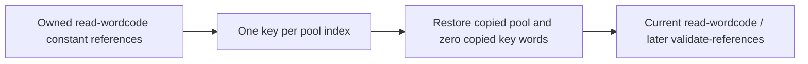

# Normalize concealed VM constants

Pipeline stage: `recover-constants` ([map](../../pipelines/jsconfuser-vm.md)).

## 1. Target

Restore referenced constant-pool values and turn their nonzero key operands into ordinary zero-key
references. Passing the input through would leave encrypted strings/XORed integers and make
`validate-references` refuse those references. Success publishes a copied container and current
`read-wordcode`; `validate-references` and later analyses are built from those values, not retained
from before the pool rewrite.

The normalizer reads only the payload: owned [`extract-container`](extract-container.md) pool values
and [canonical `read-wordcode`](read-wordcode.md) key operands. The cipher is the encoder's fixed
algorithm, so the interpreter's constant reader is not read or proved. It does not execute target
code, infer an unknown cipher or restore unreferenced entries. Readers need JavaScript bitwise
coercion, UTF-16 units and the encoder's
[keyed constants](../../../js-confuser-vm/transforms/keyed-constants.md).

## 2. Algorithm

Collect every constant reference before decryption. One pool entry must use one key, including
zero, at all its references; otherwise replacing that entry globally could change a different
use. Require at least one nonzero key.

Clone `extract-container`. For each referenced keyed integer, XOR the stored value with its key. For
each keyed string, read canonical base64 as little-endian u16 pairs and regenerate the
position-dependent mask from that entry's key. Advance the mask state before each unit; XOR reverses
the emitted operation. Replace each keyed pool entry once and clear each corresponding key word.
Widths, instruction PCs, register windows and pool indexes stay fixed. Re-read `read-wordcode` on
the clone and publish only on success.



### Synthetic exact-value example

Main entry 0 with two registers and this private `extract-container` and `read-wordcode` stream:

```text
PC 0: LOAD_CONST r0, index 0, key 1           [0,0,0,1]
PC 4: LOAD_CONST r1, index 1, key 2147483649  [0,1,1,2147483649]
PC 8: RETURN r0                            [45,0]
pool = ["QIg=",2147483640,"%%%%"]
```

Base64 QIg= contains bytes [64,136], unit 34880. From seed 1, the first state is
`(1+0x9e3779b9)|0 = -1640531526`; `(state^(state>>>13))&65535 = 34817`.
`34880^34817 = 65`, giving "A". Integer `2147483640^2147483649 = -7` uses signed int32 XOR.
Output words are `[0,0,0,0,0,1,1,0,45,0]` and pool `["A",-7,"%%%%"]`.
The unreferenced malformed-looking string remains unchanged: no key proves its meaning. PCs
0/4/8 and wordCount 10 remain identical; the changed values/keys fail a passthrough oracle.

## 3. Implementation

### Components and owned inputs

| Component | Consumes -> produces | Consumer invariant |
|---|---|---|
| Pair collector | `read-wordcode` semantic constant-ref operands -> keys and key-word PCs | Every reference to an index has the same key. |
| Value recovery (`restoreConcealedValue`) | Referenced pool value/key -> plaintext | Exact int32 or UTF-16 equations; no host target execution. |
| Copy/re-reader | A plus recovery plan -> copied `extract-container`/current `read-wordcode` | Same widths/PCs; changed pool and key words authoritative. |

`read-wordcode` owns operand shape and u32 key/index words. Iterate instructions and their semantic
`operands`; for each constant-ref record `{index,concealKey}`, record keyPc=instruction.pc+2 for
STORE_GLOBAL, otherwise pc+3. Those offsets follow `read-wordcode`'s four constant-bearing rows, not
a search for matching numbers elsewhere. Include zero-key references in the index->key Map.
Differing keys decline concealed-key. No nonzero pair declines no-concealed-constants; ordinary
standalone diagnosis bypasses the adapter in that case.

### Value equations and publication

Structured-clone `extract-container`. For each collected index require index<pool.length, otherwise
concealed-index. Leave zero-key values untouched. For a nonzero key:

```text
explanatory recovery procedure:
if typeof value == number and Number.isInteger(value): plain = value ^ key
else if typeof value == string:
  require canonical base64 and exact base64 re-encoding
  require even byte length
  state = key; plain = ""
  for byteIndex = 0,2,...:
    state = (state + 0x9e3779b9) | 0
    mask = (state ^ (state >>> 13)) & 0xffff
    stored = bytes[byteIndex] | (bytes[byteIndex+1] << 8)
    append String.fromCharCode(stored ^ mask)
else: decline concealed-value
```

The base64 grammar is `^(?:[A-Za-z0-9+/]{4})*(?:[A-Za-z0-9+/]{2}==|[A-Za-z0-9+/]{3}=)?$`.
Buffer decode/re-encode must reproduce the input exactly. Empty strings pass; surrogate/NUL units
are retained without Unicode normalization or UTF-8 conversion. Bad grammar, noncanonical padding
bits or odd byte length decline concealed-string. Numeric XOR returns int32, including the signed
Weyl increment -1640531527. The [producer's numeric preservation domain](../../../js-confuser-vm/transforms/keyed-constants.md#interning-and-storage-decisions)
does not promise recovery of original integer-valued Numbers outside int32.

Replace each referenced nonzero pool entry, then zero each such keyPc. Re-read `read-wordcode` once;
failure becomes concealed-wordcode with the reader's message. The result schema is
jsconfuser-vm-concealed-constants-normalization.v1 with container, wordcode and concealedPoolEntries
(distinct collected nonzero keys by index). It returns no `validate-references`,
`partition-functions`, map or source replacement. The envelope/container are not
deeply frozen here; `read-wordcode` is an owned frozen record.

`diagnoseNormalizeConcealedConstants(source, container, wordcode)` returns `{ok,result,diagnostic}`;
`source` is accepted for its callers and not read. Typed failures retain the codes above; unexpected
recovery errors become concealed-normalization-error. It publishes no partial recovery and mutates
no `extract-container` and `read-wordcode`. The atomic unit is all referenced keyed entries;
independent plaintext and unused entries carry through unchanged. The runtime's reader stays in
source because standalone emission later replaces the entire VM.

### Testing and acceptance

| Scenario | Oracle / acceptance | Evidence |
|---|---|---|
| S1 values/keys | Exact example pool/zero-key words/current `read-wordcode`; unchanged predecessors | Owner scaffold above; `single-payload-stage` and the conditions below. |
| S2 pair/value refusal | Malformed string/key conflict reaches concealed-string/concealed-key with no result | No committed test. |
| S3 no candidate/unused pool | No nonzero pair declines directly; standalone bypasses; unused values stay intact | Owner unused-entry example. |
| S4 downstream state | New `read-wordcode` then `validate-references` agree with changed keys/pool; public output loses VM residue and fresh AST state agrees | The dispatcher-key suites, `keys-patch-chain`, `all-stages-together` below. |

## 4. Input Shapes

[Earlier added-opcode/PATCH producers](read-wordcode.md#4-input-shapes) own expansion/decryption,
compaction, operand layouts and map handoffs. This pass consumes their current canonical
`read-wordcode`, not synthetic handler records. If keys remain,
[diagnosis](standalone-diagnosis.md#canonical-frontend-retries) requires this inverse before
`validate-references`, adopts its `extract-container`/`read-wordcode`-only result and discards
previous `validate-references` and `partition-functions`.

[Dispatcher](normalize-dispatcher-wordcode.md), [CFF](normalize-cff-wordcode.md) and
[string recovery](normalize-string-concealing.md) need restored constants first. The string trace
admits the signed Weyl increment only at its documented bit-pattern equivalence. Anti's private flow
proof restores values earlier under its own route with `restoreConcealedValue`. Runtime
representations (class, minify, table, encoded payload) do not reach this pass: `extract-container`
supplies the same payload under each. The
[pinned keyed-constant producer](../../../js-confuser-vm/transforms/keyed-constants.md) explains
mandatory pairs before augmentation and late pool resolution.

## 5. Known Gaps

Unreferenced entries have no key and stay emitted. Empty/Unicode arithmetic follows the formula,
but the suites do not cover every value/host case. Wider option combinations need suites of their
own.

## Source

The decoder is [normalize-concealed-constants.js](../../../../decoder/decode-js/src/vm/jsconfuser-vm/normalize-concealed-constants.js),
wired by [diagnose-standalone.js](../../../../decoder/decode-js/src/vm/jsconfuser-vm/diagnose-standalone.js)
and the [anti normalizer](normalize-anti-wordcode.md) under the dependencies described in item 4.

The pinned encoder's [constant-pair pass](https://github.com/MichaelXF/js-confuser-vm/blob/20c5b96bf57337c568579352758d7685358650de/src/transforms/bytecode/concealConstants.ts)
adds a key operand. Its [constant resolver](https://github.com/MichaelXF/js-confuser-vm/blob/20c5b96bf57337c568579352758d7685358650de/src/transforms/bytecode/resolveConstants.ts)
encrypts pool values, and the [runtime reader](https://github.com/MichaelXF/js-confuser-vm/blob/20c5b96bf57337c568579352758d7685358650de/src/runtime.ts)
reverses them. The [compiler pass list](https://github.com/MichaelXF/js-confuser-vm/blob/20c5b96bf57337c568579352758d7685358650de/src/compiler.ts)
establishes the position described in item 4.

## Fixtures

Each suite encodes its sources with the pinned encoder and requires the decode to behave as the
source ([tests.md](../../tests.md#suites)); a Proved line names the code whose break turns the case
red.

| Suite and cases | Claims | Proved |
|---|---|---|
| [single-payload-stage](../../../../decoder/decode-js/test/vm/jsconfuser-vm/generated-cells/single-payload-stage/suite.js), file `conceal-constants` | S1, S4: the stage step restores concealed pool entries and leaves no keyed constant reference; the decode behaves as the source | Each concealed constant use keeps its own key and site |
| [single-payload-stage-conditions](../../../../decoder/decode-js/test/vm/jsconfuser-vm/generated-cells/single-payload-stage-conditions/suite.js), `constant-value-kinds` | S1: zero, negative, large int32 and float values | The full 32-bit XOR in `restoreConcealedValue` |
| [single-payload-stage-conditions](../../../../decoder/decode-js/test/vm/jsconfuser-vm/generated-cells/single-payload-stage-conditions/suite.js), `repeated-constants` | S1: repeated integers sharing one pool entry and key | Every use clears its key word |
| [dispatcher-keys-anti](../../../../decoder/decode-js/test/vm/jsconfuser-vm/generated-cells/dispatcher-keys-anti/suite.js) | S4: keys inside anti synthetic cases restored before the dispatcher reads them | The concealKey test in `normalize-anti-wordcode` |
| [dispatcher-keys-specialized](../../../../decoder/decode-js/test/vm/jsconfuser-vm/generated-cells/dispatcher-keys-specialized/suite.js) | S4: a specialized instruction's key restored before the dispatcher reads it | The concealKey test in `normalize-specialized-wordcode` |
| [keys-patch-chain](../../../../decoder/decode-js/test/vm/jsconfuser-vm/generated-cells/keys-patch-chain/suite.js) | Encryption over the final pool keys, with a minified key reader | No break of its own |
| [all-stages-together](../../../../decoder/decode-js/test/vm/jsconfuser-vm/generated-cells/all-stages-together/suite.js) | S4: the signed Weyl increment the string normalizer reads after this pass | The signed Weyl constant in `normalize-string-concealing` |

S2 has no committed test: the old pair and key controls changed encoded input by hand, a shape
no encoder emits. S3 is held by the owner example only.
