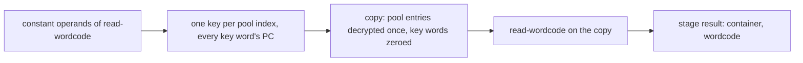

# Restore concealed VM constants

Pipeline stage: `recover-constants` ([map](../../pipelines/jsconfuser-vm.md#frontend-order)).

Readers need the encoder's [keyed constants](../../../js-confuser-vm/transforms/keyed-constants.md),
JavaScript's 32-bit integer operators, and the constant operand of
[`read-wordcode`](wordcode/read-wordcode.md#operand-grammar).

## 1. Target

Put every concealed pool value back as the value the program uses, and set its key to zero. With
`concealConstants` the encoder stores each string and each integer of the constant pool
encrypted under a random 32-bit key, and writes that key beside the pool index at every
instruction that reads the entry; the interpreter decrypts on each read. After this transform the
pool holds plaintext and every constant operand has key 0, which is the form of a build without
the option and the only form [`validate-references`](wordcode/validate-references.md) accepts.

The transform reads the payload only: the pool and the key operands. The cipher is the encoder's
fixed one, so the interpreter's constant reader is not read. Nothing is executed. Instruction
widths, PCs and pool indexes do not change, so no address moves and no PC map is published. The
input container is never changed; a result exists only when every referenced entry is restored
([F2](../../../encoder-decoder-method.md#f2-resolve-completely-or-not-at-all)).

## 2. Algorithm

```text
restore(container, wordcode):                                // explanatory pseudocode
  for each instruction, each constant operand (index, key):
    an index seen with another key           -> refuse
    keys[index] = key;  sites += the PC of the key word
  no nonzero key at all                      -> refuse (nothing to do)
  on a copy of the container:
    for each (index, key) with key != 0:  pool[index] = decrypt(pool[index], key)
    for each site with key != 0:          words[site] = 0
  read the copy with read-wordcode; publish the copy and that reading
```



1. **Collect before changing anything.** A pool entry is interned: every use of one value reads
   the same index, and the encoder draws one key per entry. The transform therefore decrypts an
   entry once, and it needs every site, because each site carries its own copy of the key. Keys
   of zero are collected too, so an entry read both keyed and unkeyed is refused, not half
   restored.
2. **The key word.** A constant operand is two words, index then key. It is the second and
   third word after the opcode in `LOAD_CONST`, `LOAD_GLOBAL` and `TYPEOF_SAFE`
   (`op, dst, c, k`: the key at PC + 3) and the first and second in `STORE_GLOBAL`
   (`op, c, k, src`: the key at PC + 2).
3. **Decrypt.** By the stored value's type:

   ```text
   integer:  plain = stored ^ key                            // signed 32-bit XOR
   string:   bytes = base64(stored), read as 16-bit units, low byte first
             state = key
             for each unit:
               state = (state + 0x9e3779b9) | 0
               mask  = (state ^ (state >>> 13)) & 0xffff
               plain += String.fromCharCode(unit ^ mask)
   ```

   The string cipher is a keystream: the state advances once before each unit, and the mask is
   16 bits of it. Units are UTF-16 code units and are restored as they are, with no Unicode
   normalization, so surrogates and NUL pass through; the empty string is the empty string.
4. **Read again.** The copy is read by `read-wordcode`, and that reading is published with it,
   so later stages never hold instructions whose operands still show a key.

An entry no instruction references has no key anywhere and stays as stored. A value that is
neither a string nor an integer (a fraction, `undefined`) is never concealed and has key 0.

### Worked example

The committed cell `focused-store-global-assignment` of suite `single-payload-stage`, file
`conceal-constants` (profile `randomizeOpcodes+concealConstants`, seed 251). Its source begins
`var value = 17; TEST_OUTPUT = value;`. Before the transform, `validate-references` refuses the
stream: `LOAD_CONST@2 has an invalid constant pair`. Canonical opcodes in this build:
`LOAD_CONST` 17857, `STORE_GLOBAL` 3061, `LOAD_GLOBAL` 35951.

```text
PC   instruction    words before               words after
 2   LOAD_CONST     17857, 5, 0, 3913494741    17857, 5, 0, 0
 9   STORE_GLOBAL    3061, 1, 1830575706, 2     3061, 1, 0, 2
13   LOAD_CONST     17857, 3, 2, 0             unchanged: key 0
20   STORE_GLOBAL    3061, 3, 1134296204, 2     3061, 3, 0, 2
45   LOAD_CONST     17857, 6, 1, 1830575706    17857, 6, 1, 0
49   LOAD_GLOBAL    35951, 7, 1, 1830575706    35951, 7, 1, 0

pool before                               pool after
0  -381472572                             17
1  "2YLTHcD1uGoln7YrObe32vZN+cXtUg=="     "TEST_OUTPUT"
2  undefined                              undefined
3  "kHjI7+qb"                             "NaN"
```

- **Entry 0, an integer.** `-381472572` is `0xE94330C4` and the key `3913494741` is
  `0xE94330D5`; their XOR is `0x11`, 17.
- **Entry 1, read at three sites** (PCs 9, 45 and 49) under the one key 1830575706. The entry
  is decrypted once and all three key words are zeroed.
- **Entry 3, a string** under key 1134296204. `"kHjI7+qb"` is the bytes
  `144,120, 200,239, 234,155`, the units 30864, 61384, 39914. The state runs -506235323,
  -2146766850, 507668919, giving the masks 30942, 61353, 39844; the XORs are 78, 97, 78: `NaN`.
- **Entry 2** is `undefined`, never concealed; its sites have key 0 and are not touched.

Six entries are restored in this cell, the stream keeps its 68 words, and `validate-references`
then accepts it. On the cell `constant-value-kinds` of suite `single-payload-stage-conditions`
the stored `-273493163` becomes `2147483647`, which needs all 32 bits of the XOR, and the
fractions `1.5`, `0.25`, `0.1` and `0.2` are stored plain with key 0.

## 3. Implementation

### Exports another file imports

| Export | Contract | Imported by |
|---|---|---|
| `hasConcealedConstant(wordcode)` | Whether any constant operand has a nonzero key. The test every caller runs before the transform. | the [frontend driver](frontend-driver.md#triggers-and-refusal-policy); [`normalize-anti-wordcode`](normalize-anti-wordcode.md); [`normalize-specialized-wordcode`](normalize-specialized-wordcode.md) (the tail) |
| `diagnoseNormalizeConcealedConstants(source, container, wordcode)` | `{ ok, result, diagnostic }`. `source` is not read. | the same three; `support/cell-tests.js` |
| `restoreConcealedValue(value, key)` | One value decrypted; `value` itself when `key` is 0. Throws the refusals of the value below. | `analyze-anti-register-flow.js` ([`normalize-anti-wordcode`](normalize-anti-wordcode.md#the-analysis-stream)), which reads a constant's value while keys are still in the stream |

It imports `diagnoseWordcode`
([`read-wordcode`](wordcode/read-wordcode.md#exports-another-file-imports)).

### The stage result

```js
{
  schemaVersion: 'jsconfuser-vm-concealed-constants-normalization.v1',
  container,             // a clone: pool entries restored, key words zero
  wordcode,              // read-wordcode's reading of that clone
  concealedPoolEntries,  // pool indexes that had a nonzero key
}
```

The driver adopts it as a rewrite that moved no code ([Adoption](frontend-driver.md#adoption)):
it takes the container and the wordcode, and `readProgram` then builds references and functions
on them. No PC map, no suspects.

### Decisions

- **Who runs it.** The driver, when the stream it holds after the added-opcode routes still has
  a key. Two transforms run it earlier on their own streams, because the dispatcher they hand to
  reads constants: the anti normalizer on its analysis stream and again on its compacted
  stream, and the specialized tail on its expanded stream. After either, the driver finds no key.
- **One key per entry** includes zero. The check is on the pool index, not on the value.
- **Integers** are restored with JavaScript's `^`, so the result is a signed 32-bit integer. The
  encoder conceals every integer-valued number with the same operator, so a source integer
  outside that range is already changed in the encoded program
  ([keyed constants](../../../js-confuser-vm/transforms/keyed-constants.md#interning-and-storage-decisions));
  the transform restores what the interpreter would read.
- **Strings** must be canonical base64 of an even number of bytes: the text matches
  `^(?:[A-Za-z0-9+/]{4})*(?:[A-Za-z0-9+/]{2}==|[A-Za-z0-9+/]{3}=)?$` and encodes back to itself.
- **The result is not frozen**, except the wordcode record, which `read-wordcode` freezes.
- The interpreter's own constant reader stays in the source; it goes with the interpreter.

### Refusals

Owner `concealed-constants` ([Refusals](../../pipelines/jsconfuser-vm.md#refusals)). The driver
turns any of them into `concealed-constants-declined` and stops the decode; the anti normalizer
and the specialized tail take it as their own refusal.

| Code | When |
|---|---|
| `no-concealed-constants` | No constant operand has a nonzero key |
| `concealed-key` | One pool index is read under two different keys |
| `concealed-index` | A keyed or unkeyed constant operand names an index past the pool |
| `concealed-value` | A keyed entry is neither an integer nor a string |
| `concealed-string` | A keyed string is not canonical base64, or has an odd byte count |
| `concealed-wordcode` | The copy does not read |
| `concealed-normalization-error` | Any other exception |

## 4. Input Shapes

| Shape | Producer | Treatment |
|---|---|---|
| A constant operand `(index, key)` with a nonzero key | encoder step 6 `concealConstants` adds the key operand; step 14 `resolveConstants` draws the key and writes it | key word zeroed |
| A pool string as base64, a pool integer XORed | encoder step 14 `resolveConstants` | decrypted |
| A constant operand with key 0 | the same steps, for a value that is not concealed; every operand of a build without the option | read for the key check, left |
| The wordcode record | [`read-wordcode`](wordcode/read-wordcode.md#records), on the stream as the added-opcode routes or the PATCH removal left it | its constant operands |
| An expanded, analysis or compacted stream inside a route | [`normalize-specialized-wordcode`](normalize-specialized-wordcode.md), [`normalize-anti-wordcode`](normalize-anti-wordcode.md) | the same; the route goes on with the result |

A stream whose opcodes are not yet canonical never arrives: the driver refuses with
`wordcode-declined` when the words are still unread. Later stages need this one first: the
[dispatcher](normalize-dispatcher-wordcode.md), [CFF](normalize-cff-wordcode.md) and
[string](normalize-string-concealing.md) transforms read constant values from the pool.

## 5. Known Gaps

- No committed cell reaches a refusal, and no test asserts one. The encoder draws one key per
  pool entry, conceals only strings and integers and writes canonical base64, so its output
  cannot reach `concealed-key`, `concealed-value`, `concealed-string` or `concealed-index`;
  zeroing a key word changes no width, so `concealed-wordcode` cannot follow a stream that read
  once. Every caller tests `hasConcealedConstant` first, so `no-concealed-constants` is
  returned to no caller.
- The `source` parameter is unused.
- An unreferenced pool entry stays as the encoder stored it. Nothing reads it afterwards.

## 6. Source

- [normalize-concealed-constants.js](../../../../decoder/decode-js/src/vm/jsconfuser-vm/normalize/normalize-concealed-constants.js):
  the whole transform.
- Called from
  [diagnose-standalone.js](../../../../decoder/decode-js/src/vm/jsconfuser-vm/diagnose-standalone.js)
  (`recoverConstants`), `normalize-anti-wordcode.js` and `normalize-specialized-wordcode.js`.

The encoder's
[constant-pair pass](https://github.com/MichaelXF/js-confuser-vm/blob/20c5b96bf57337c568579352758d7685358650de/src/transforms/bytecode/concealConstants.ts)
adds the key operand, its
[constant resolver](https://github.com/MichaelXF/js-confuser-vm/blob/20c5b96bf57337c568579352758d7685358650de/src/transforms/bytecode/resolveConstants.ts)
encrypts the pool values, and its
[runtime](https://github.com/MichaelXF/js-confuser-vm/blob/20c5b96bf57337c568579352758d7685358650de/src/runtime.ts)
holds the reader this transform stands in for.

## 7. Fixtures

Each suite encodes its sources with the pinned encoder and requires the decode to behave as the
source; a proof is a break of the named code that turns the suite red
([tests.md](../../tests.md#suites)). Suites are under
[cell-suites/](../../../../decoder/decode-js/test/vm/jsconfuser-vm/cell-suites/).

| Scenario | Expected result | Committed fixture |
|---|---|---|
| Strings and integers concealed, one entry read at several sites | At least one entry restored and no constant operand with a key left; the decode behaves as the source. Proof: every use is collected with its key and site | `single-payload-stage`, file `conceal-constants` (the worked example; its stage-effect test) |
| Zero, negative and large 32-bit integers, fractions | Restored exactly. Proof: the 32-bit XOR in `restoreConcealedValue` | `single-payload-stage-conditions`, `constant-value-kinds` |
| A repeated integer and a repeated string, each one entry and one key | Every use's key word is zeroed. Proof: the site list | `single-payload-stage-conditions`, `repeated-constants` |
| Keys under anti instructions, restored before the dispatcher reads constants | The decode behaves as the source. Proof: the key test in `normalize-anti-wordcode` | `dispatcher-keys-anti` |
| Keys in an expanded specialized stream | The same. Proof: the key test in `normalize-specialized-wordcode` | `dispatcher-keys-specialized` |
| Keys with PATCH encryption and a minified interpreter | The decode behaves as the source | `keys-patch-chain` (no proof) |
| A program whose pool has no string | Integers alone are restored | `single-payload-stage`, file `conceal-constants`, `no-string-pool` |
| Any refusal | The code above, no result | |
| A stream with no key | Not run by any caller | |
