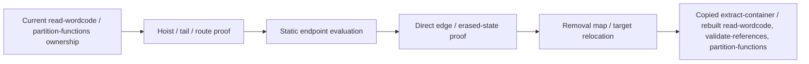

# Normalize VM dispatcher routes

Pipeline stage: `recover-control` ([map](../../pipelines/jsconfuser-vm.md)).

## 1. Target

Replace proved encoded-PC routes with ordinary direct branches, then remove their per-function
decode closures and terminal dispatcher blocks. Passthrough retains the key/selector machinery and a
JUMP_REG whose targets are encoded PCs. Successful recovery publishes copied
`extract-container` and current `read-wordcode`, `validate-references` and `partition-functions`;
it builds no control graph, and whether the output's control is admissible is decided by the
diagnosis, not here.

The implemented adapter consumes owned [`extract-container`](extract-container.md),
[`read-wordcode`](read-wordcode.md) and [`partition-functions`](partition-functions.md).
`partition-functions` already derives from current `validate-references` and supplies function
ownership, creation metadata and instruction PCs. It statically interprets a closed arithmetic
subset; it never executes the target closure or arbitrary JavaScript. Readers need registers,
branches, function frames, JavaScript truthiness/bitwise coercion and the linked component contracts.

## 2. Algorithm

A candidate owner begins by creating a decode closure and ends in JUMP_REG. Connect that hoist to
its child descriptor and the terminal CALL; prove the optional result-container extraction and
ordered key arguments. Scan each direct jump to that CALL backwards through its complete route.
Otherwise a nearby key load or arithmetic fragment could belong to application code.

Evaluate the helper with each route's encoded endpoint and key arguments. Direct routes recover
one destination. A branchless route has two endpoints: !condition selects the second when falsy.
Exactly one decoded endpoint must be the route's next PC; the other is the taken target. Recover
the corresponding JUMP_IF_FALSE/TRUE, or one JUMP when both endpoints agree. Prove targets stay
inside the owner body and retained payload cannot observe any erased scratch/closure register.

Plan all replacements and deletions together. Replace only route starts, remove the remaining route
instructions, hoist, dispatcher and helper body, then map surviving instruction starts to new word
PCs. Translate all direct references and the selected finally continuation loads. Rebuild current
records from copied `extract-container` before publishing. Functions without candidate plans carry
through, subject to the whole rebuilt stream's normal record admission.



### Synthetic direct route with exact PCs

This source-informed private scaffold has root regCount 5, mainStartPc 0, pool `[undefined]`,
one zero-capture, nonrest helper with two parameters/regCount 5, and these canonical instructions.
The [`read-wordcode` grammar](read-wordcode.md#operand-grammar) supplies every serialized width.

```text
0  MAKE_CLOSURE r3,28,2,5,0,0   # seven words; helper entry 28
7  LOAD_INT r0,42               # retained payload
10 LOAD_INT r1,105              # encoded endpoint 18 XOR 123
13 LOAD_INT r2,123              # nonzero site key
16 JUMP 20                     # route enters terminal CALL
18 RETURN r0                   # explicit terminator before dispatcher
20 CALL r1,r3,2,r1,r2           # reads args before writing r1
26 JUMP_REG r1
28 LOAD_THIS r4                # helper; receiver is not used
30 BXOR r2,r0,r1
34 LOAD_INT r3,0
37 BOR r2,r2,r3                # signed bitwise coercion, result remains 18
41 RETURN r2
43 LOAD_CONST r4,0,0           # exact dead undefined-return suffix
47 RETURN r4                   # old wordCount 49
```

The evaluator starts helper registers r0=105,r1=123 and obtains 18. Removing the hoist and
helper/tail leaves the payload, route replacement and RETURN. Map entries are
`0->0,7->0,10->3,18->5,49->7`; other removed starts have no entry. New JUMP target is map(18)=5.
Output words are `[1,0,42,39,5,45,0]`; current `partition-functions` has only root, and a
control graph built over the output is complete. Changing word 15 (key 123) to 122 decodes 19, which is not an instruction
start, and reaches dispatcher-target, "Decoded target leaves the original body". This helper is an
admitted synthetic evaluator input, not a newly generated scheme or a full source/public admission
proof.

## 3. Implementation

### Components and candidate boundaries

| Component | Consumes -> produces | Consequential contract |
|---|---|---|
| Owner/closure binder | Current `partition-functions` and `read-wordcode` -> hoist, child, tail | Ownership/creation relationship connects the decoder. |
| Route observer | Owner instructions/tail -> complete route spans | No overlapping consumed starts; key and selector grammar is closed. |
| Arithmetic evaluator | Child instructions/metadata/pool/args -> result | Only listed operations and exact dead-return suffix; no target execution. |
| Escape proof | Erased PCs/registers plus retained operands -> accepted plan | Neither payload nor retained condition observes deleted state. |
| Relocator/rebuilder | All plans/current `extract-container` through `partition-functions` -> copied `extract-container`/current records | Map and shared-parent suspects describe changed word PCs. |

**PATCH suspects.** partitionOptions may carry `suspects`: undecided selfModifying fillers as
`extract-container` PCs, read in this input through decodedTargetMap (identity without one).
selfModifying plants them after a terminator, so this component reads past them exactly where it relies
on what follows a terminator: the instruction before the CALL block, the closure's RETURN suffix, a
route's skip label, and the two dispatcher-register scans (the closure-register census and the
erased-state proof). Route grammar matches over every instruction: a label the encoded endpoints hid
can sit on a suspect that starts a route. Continuation-literal selection reads past suspects by the
[shared rule](normalize-macro-wordcode.md#shared-expansion-and-address-relocation) (a suspect load keeps
its `extract-container` word). Suspects stay in the output unchanged; the
[settle](normalize-self-modifying-wordcode.md#settling-suspects) decides them afterwards.

For each `partition-functions` function, obtain instructions in instructionPcs order. Skip a
function unless its first instruction is MAKE_CLOSURE and its last is JUMP_REG. A candidate hoist
has captureCount/rest words 5/6 both zero. Its target entry must identify a child whose
descriptor.creationPc equals the hoist PC and paramCount equals hoist word 3. Candidate shape
failure aborts the observer; it does not silently skip that malformed candidate. No plans declines
no-dispatcher.

The terminal JUMP_REG's word 1 is disp. In forward order the tail is CALL, optionally followed by
LOAD_INT 0 or zero-key LOAD_CONST string then GET_PROP disp,disp,keyRegister, and finally JUMP_REG.
The optional load/GET_PROP pair is between CALL and JUMP_REG. Unwrap load's
destination equals GET_PROP key register; array mode is only integer zero, object mode records
the literal string. CALL destination is disp, callee is hoist destination, count equals child
paramCount and is 2 or 3, raw length is count+4. Two arguments contain disp exactly once; the
other is the key register, allowing either order. Three arguments are disp,keyLo,keyHi with
three distinct registers. The last non-suspect instruction before the CALL block must be RETURN,
THROW, JUMP or JUMP_REG, proving no physical fallthrough into that block.

Outside hoist/CALL, the closure register may not occur in `read-wordcode`'s `wordOperands` tagged
register census; the later erased-state proof
uses semantic operands/captures instead. Across all functions the child body has exactly one
MAKE_CLOSURE creation, at this hoist, and planned child IDs are distinct.

### Route grammar and endpoint choice

Only JUMP directly targeting tail.call.pc opens routeAt. Read immediately preceding LOAD_INT key
loads backwards in reverse tail key-register order; restore forward argument order. One key is its
full u32 word. Split key is `(lo | (hi<<16))>>>0`, both halves <=65535. Zero combined key or an
oversized half declines dispatcher-key. Each site's literal key arguments are passed in the tail's
observed parameter order; the evaluator determines whether the closure uses them correctly.

A LOAD_INT into disp before the keys is a direct route. Otherwise require this complete adjacent
sequence before the key loads and JUMP:

```text
UNARY_NOT test,condition
UNARY_POS test,test
[UNARY_NEG test,test]                 # required only for BAND
LOAD_INT disp,baseEncoded
LOAD_INT delta,otherEncoded
SUB delta,delta,disp
MUL-or-BAND delta,delta,test          # either input order allowed; other input != delta
ADD disp,disp,delta
```

The optional negation turns 0/1 into 0/-1 for masking. The stored endpoint literals are evaluated
separately rather than evaluating arbitrary payload truthiness. Array/object results must have
the observed mode and, for object, the exact key; unwrap their value. Require integer 0..0xffffffff
or decline dispatcher-target. If supplied decodedTargetMap exists, that decoded original PC must
be present; translate it before current-boundary/owner checks. A missing entry declines
dispatcher-target, "Decoded target has no anti PC boundary"; the wording also covers expansion
maps supplied by earlier producers.

Let b/o be the translated base/other targets. A target is the skip edge when it is the route JUMP's
nextPc, a suspect between that and the first non-suspect after the JUMP, or that first non-suspect.
If b==o emit JUMP b. Otherwise require exactly one skip edge. If b is it emit JUMP_IF_FALSE
condition,o; if o is it emit JUMP_IF_TRUE condition,b. The rewritten branch reaches the skip label
by fallthrough, so the route records its decoded `extract-container` value (`skipOrigin`) and the
result publishes them as `skipLabels` for the settle. Neither or both skip matches decline
dispatcher-target. Every target must be a current `read-wordcode` start owned by the candidate owner
and precede tail.call.pc; a conditional endPc must also be a `read-wordcode` start. Routes' oldPcs
may not overlap. A direct/conditional reference into a consumed interior cannot be remapped later
merely because its number is in range.

### Closed static evaluator

Initialize descriptor.regCount slots to undefined; copy args to slots 0 onward. Require no
captures/rest, paramCount==args.length and regCount>=args.length. Every read/write register
must be integer and in frame. The receiver and recognized Math/imul values are private symbols,
not host objects extracted from target code. The interpreter walks instructions once in order;
no branch, loop, arbitrary property access or general CALL is accepted.

| Operation | Exact evaluation / refusal boundary |
|---|---|
| LOAD_THIS / MOVE / LOAD_INT | Receiver symbol; copy slot value; immediate word. |
| LOAD_CONST | Key zero and index<pool.length; load actual pool value. |
| LOAD_GLOBAL | Key zero and pool value exactly "Math"; produce Math symbol. |
| GET_PROP | Object is Math symbol and key slot exactly "imul"; produce imul symbol. |
| CALL_METHOD | Receiver Math, method imul, count 2/raw length 7; actual Math.imul on finite numeric arguments. |
| UNARY_BITNOT | `~x` after finite-number check. |
| ADD / SUB | Number x+y / x-y after finite-number checks. |
| BOR / BXOR / SHL / USHR | JavaScript x\|y / x^y / x<<y / x>>>y after finite-number checks; source imposes no extra shift-count range. |
| BUILD_ARRAY | Count 1/raw length 4; private `{kind:"array",value:slot}`. |
| BUILD_OBJECT | Count 1/raw length 5, string key slot; private `{kind:"object",key,value}`. |
| RETURN | Read result; require the remaining non-suspect instructions to be exactly LOAD_CONST(key zero,pool value undefined), RETURN of that load's destination. |

A numeric operand is typeof number and Number.isFinite, otherwise dispatcher-decode. Stored
intermediate results follow ordinary JS arithmetic; a later numeric read or final target check
can refuse them. Missing RETURN/unsupported operation/frame/constant/global/property/method/
container/tail metadata uses dispatcher-closure. A RETURN without the two-instruction suffix is
not admitted by this evaluator, even if semantically equivalent. This rule is distinct from the
string helper's optional suffix choice. Host standard Math.imul is an explicit infrastructure
assumption; monkey-patched host semantics are not qualified.

### Erased-state proof and relocation

Erased PCs include hoist, terminal block and every route span. Erased registers start with closure,
disp and key registers, then include word 1 destinations of erased instructions except JUMP/JUMP_REG.
A retained conditional's condition cannot be in that set. For each retained owner instruction,
reject semantic register operands or local capture indexes in that set (dispatcher-shape).
This includes writes as well as reads. Helper deletion cannot preserve a final scratch value merely
because application code only uses it later.

Across all plans remove hoists, tail blocks and complete child instruction lists. Route starts emit
direct branch words; their other PCs are consumed. Refuse route/removed overlap. In original
`read-wordcode` order, map each retained start/route start to next new PC. Removed hoist entries
also map there, so an owning function entry survives. Other removed/consumed starts do not. Map old
wordCount to new end. Replacements use canonical opcodes and widths 2/3; retained raw words are
copied.

Translate offsets JUMP:1; JUMP_IF_FALSE/TRUE:2; FOR_IN_NEXT:3; TRY_SETUP:1; FINALLY_SETUP:1,4;
MAKE_CLOSURE:2. Missing map entries decline dispatcher-target-boundary. Remap the finally
continuation literals the
[shared continuation rule](normalize-macro-wordcode.md#shared-expansion-and-address-relocation)
selects, functions from the original `partition-functions` owners.

Clone `extract-container` and install words. Require `read-wordcode`, `validate-references`,
`partition-functions` on the clone; their typed diagnostics propagate. `partition-functions` admits
exactly the incoming `partition-functions`'s `sharedParentStarts`, remapped, as its
[suspects](partition-functions.md#shared-parent-suspects); partitionOptions never reaches
`partition-functions`. decodedTargetMap is input-only; the component returns its own removal map as
`pcMap` (input PC -> output PC, surviving starts and hoists only) for the caller to compose.
Success is recovery of the matched routes, not control admission.

### Result, atomicity and acceptance

Result schema jsconfuser-vm-dispatcher-normalization.v1 contains container, wordcode, references,
functions, pcMap, originalWordCount, normalizedWordCount, routeCount, decoderClosureCount and
skipLabels. Counts concern all accepted plans, not every function in the input. Envelope/copied
`extract-container` are not deeply frozen here; rebuilt `read-wordcode` through `partition-functions` are
owned frozen records. Source/A/predecessors remain unchanged. Typed DispatcherDecline codes above
propagate; unexpected errors become dispatcher-observation-error in the observer or
dispatcher-normalization-error in the adapter. Both return no partial result.

Atomicity covers the complete set of matched owners and decoder children: a later failure discards
all plans. Unmatched functions carry through, and residual indirect/finally instructions stay for later
stages to recover or refuse. No
source helper is incrementally deleted; standalone emission later replaces the entire VM.

| Scenario | Oracle / acceptance | Evidence boundary |
|---|---|---|
| S1 route/evaluation | Exact endpoints/condition/opcode/current `read-wordcode` through `partition-functions`; words/maps differ from passthrough | Synthetic example; `single-payload-stage` and the conditions below. |
| S2 source-written damage | Changed helper global or key reaches dispatcher-closure/target; public `unresolved-indirect-jump` | No committed test. |
| S3 erased uses | Payload/key/selector/retained-condition use reaches named dispatcher-shape; no result | No committed test. |
| S4 maps | Original decoded PC translated, shared entries remapped | The specialized, anti and string suites below; no universal map composition claim. |
| S5 current state/atomicity | Re-read `read-wordcode`, `validate-references` and `partition-functions`; unchanged predecessors, fewer words, no public residue/fresh AST consistency | Every cell and the stage step; unmatched-function partial carry-through is source-derived, no dedicated mixed-candidate control. |

## 4. Input Shapes

[Current added-opcode/PATCH `read-wordcode`](read-wordcode.md#4-input-shapes) and
[restored constants](normalize-concealed-constants.md) supply widths, values and zero keys. The
incoming `partition-functions`'s
[shared-parent suspects](partition-functions.md#shared-parent-suspects) (the shared string helper)
are relocated before rebuilding `partition-functions`. Decoded endpoints are `extract-container` PCs
([address identity](normalize-macro-wordcode.md#shared-expansion-and-address-relocation)). A route
that runs this component inside itself passes its composed map; otherwise the
[schedule](standalone-diagnosis.md#canonical-frontend-retries) passes its origin map whenever an
earlier component moved code. Consume the map as supplied; this component's deletion map is a different
operation, returned as `pcMap`.

[Diagnosis](standalone-diagnosis.md#canonical-frontend-retries) runs this component once, before
[CFF](normalize-cff-wordcode.md) and string recovery. Success adopts the complete returned record
set. A decline leaves that caller's current stream intact; the backend's control solver may later refuse it
(`unresolved-indirect-jump`) rather than exposing this private observer diagnostic. Representations are owned by
[`extract-container`'s adapters](extract-container.md#4-input-shapes). The
[pinned dispatcher producer](../../../js-confuser-vm/transforms/encoded-branch-dispatch.md) explains
encoded final-PC literals, modes and CFF-before-dispatcher ordering; these references do not add
generated/option qualification.

## 5. Known Gaps

The evaluator accepts only its closed instruction subset and exact suffix. Modified Math.imul,
arbitrary helper side effects or equivalent unrecognized decoders are outside the contract.
Temporary shared-helper
ownership has the limits stated above. No committed test pins a refusal. Wider option stacks, added-opcode PATCH, minified-class entry and complete
host/front-end qualification remain open. Owner examples are not independent cold reconstruction or novice evidence.

## Source

The decoder is [normalize-dispatcher-wordcode.js](../../../../decoder/decode-js/src/vm/jsconfuser-vm/normalize-dispatcher-wordcode.js)
(`diagnoseNormalizeDispatcherWordcode(container, wordcode, functions, partitionOptions)`),
using [route observation and the static evaluator](../../../../decoder/decode-js/src/vm/jsconfuser-vm/observe-dispatcher-wordcode.js)
(`diagnoseDispatcherWordcode(container, wordcode, functions, decodedTargetMap, suspects)`).
It is
wired by [diagnose-standalone.js](../../../../decoder/decode-js/src/vm/jsconfuser-vm/diagnose-standalone.js)
under the dependencies described in item 4.

The pinned encoder's [dispatcher bytecode pass](https://github.com/MichaelXF/js-confuser-vm/blob/20c5b96bf57337c568579352758d7685358650de/src/transforms/bytecode/dispatcher.ts)
defines the route, closure and result variants. The [compiler pass list](https://github.com/MichaelXF/js-confuser-vm/blob/20c5b96bf57337c568579352758d7685358650de/src/compiler.ts)
places it before register and label resolution, as item 4 accounts for.

## Fixtures

The retired frozen verifier reconstructed selected finite arithmetic, a direct route/removal map,
one branchless MUL route choice and original-PC translation from supplied root/helper metadata and
canonical words. Exact changed words/maps and erased-register refusal fail passthrough. Separate
array/object evaluator controls check container values, not integrated CALL/load/GET_PROP/JUMP_REG
tail recognition. Split-key, Math.imul binding, BAND integrated routes, local captures and full
`partition-functions` rebuilding were excluded or supplied; the XOR-only scaffold
also omits mandatory ingredients of generated producer schemes. This selected reconstruction does
not qualify generated routes, public admission or full helper/frame records. The frozen executable
and the report's frozen metadata/stdout section stay unchanged; postfreeze audit/verdict sections
remain appendable. The suites below are separate evidence.

D1-D5 above specify recovery, current state and the reached refusal boundaries. The owner item 2
control is a recipe; no committed test runs it. It clones `extract-container` from the retained
[reference](../../../../decoder/decode-js/test/vm/jsconfuser-vm/fixtures/reference/encoded.js),
installs the listed instructions using `read-wordcode`'s canonical opcodes/widths, pool
`[undefined]` and MAIN_REG_COUNT=5, retains mainStartPc=0 and all other roles, then builds
`read-wordcode`, `validate-references` and `partition-functions` and invokes the normalizer. Exact
seven-word output and unchanged supplied `extract-container`, `read-wordcode` and
`partition-functions` are asserted; returned `read-wordcode`, `validate-references` and
`partition-functions` equal fresh reads/rebuilds from their owned builders for that output. Current `read-wordcode` starts are 0/3/5 with widths 3/2/2, `partition-functions` contains
root [0,7) only with regCount 5, and execution over that output runs 0->3->5->exit. The word-15 key control
reaches the named dispatcher-target. Maps are source-derived internal decisions, not published Map
fields. This is private source-informed scaffolding, not newly generated or public source admission,
independent cold evidence or full helper/frame reconstruction.

Each suite encodes its sources with the pinned encoder and requires the decode to behave as the
source ([tests.md](../../tests.md#suites)); a Proved line names the code whose break turns the case
red.

| Suite and cases | Claims | Proved |
|---|---|---|
| [single-payload-stage](../../../../decoder/decode-js/test/vm/jsconfuser-vm/generated-cells/single-payload-stage/suite.js), file `dispatcher` | S1, S5: the stage step removes the dispatcher (a second run finds none); the decode behaves as the source | Dispatcher routes are observed in every function |
| [single-payload-stage-conditions](../../../../decoder/decode-js/test/vm/jsconfuser-vm/generated-cells/single-payload-stage-conditions/suite.js), `dispatcher-split-key` | S1: a route key split in two halves | `keyParts` order in `decodeOrigin` |
| [single-payload-stage-conditions](../../../../decoder/decode-js/test/vm/jsconfuser-vm/generated-cells/single-payload-stage-conditions/suite.js), `dispatcher-array-result`, `dispatcher-object-result` | S1: a decode closure returning an array or an object | The array and object `resultMode` in `observe-dispatcher-wordcode` |
| [dispatcher-specialized-chain](../../../../decoder/decode-js/test/vm/jsconfuser-vm/generated-cells/dispatcher-specialized-chain/suite.js) | S4: addresses stay correct after specialized expansion, with no anti | `decodedTargetMap` in `normalize-specialized-wordcode` |
| [dispatcher-keys-specialized](../../../../decoder/decode-js/test/vm/jsconfuser-vm/generated-cells/dispatcher-keys-specialized/suite.js) | S4: a specialized instruction's key restored before the dispatcher reads it | The concealKey test in `normalize-specialized-wordcode` |
| [dispatcher-keys-anti](../../../../decoder/decode-js/test/vm/jsconfuser-vm/generated-cells/dispatcher-keys-anti/suite.js) | S4: anti compaction maps old route PCs to compact boundaries | The concealKey test in `normalize-anti-wordcode` |
| [string-flow-chain](../../../../decoder/decode-js/test/vm/jsconfuser-vm/generated-cells/string-flow-chain/suite.js) | S4: routes inverted before CFF and the strings, with a finalizer continuation | The finally-continuation remap and reach |
| [flattened-self-modifying-dispatcher](../../../../decoder/decode-js/test/vm/jsconfuser-vm/generated-cells/flattened-self-modifying-dispatcher/suite.js) | A finalizer's flattened tail under the dispatcher's hidden labels | Settle's anchor test in `normalize-self-modifying-wordcode` |
| [self-modifying-dispatcher-anti](../../../../decoder/decode-js/test/vm/jsconfuser-vm/generated-cells/self-modifying-dispatcher-anti/suite.js) | Hidden labels settle behind anti decoys in self-modifying code | Settle in `diagnose-standalone` |
| [all-stages-together](../../../../decoder/decode-js/test/vm/jsconfuser-vm/generated-cells/all-stages-together/suite.js) | S4: every stage at once | No dispatcher break of its own |

S2 and S3 have no committed test: the old controls changed encoded input or source-written
words by hand, a shape no encoder emits.
