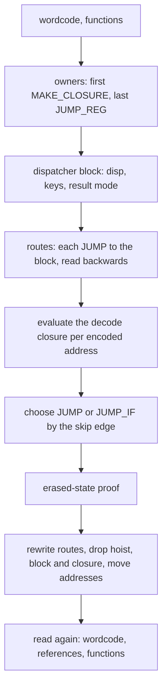

# Normalize VM dispatcher routes

Pipeline stage: `recover-control` ([map](../../pipelines/jsconfuser-vm.md#frontend-order)).

Readers need the encoder's
[encoded branch dispatch](../../../js-confuser-vm/transforms/encoded-branch-dispatch.md), the
[wordcode](wordcode/read-wordcode.md#records) and
[functions](wordcode/partition-functions.md) records and the
[address rules](wordcode/origin-addresses.md).

## 1. Target

Restore the direct branches the encoder's `dispatcher` step hid. That step gives a function a
**decode closure** and one **dispatcher block** (a call of the closure followed by `JUMP_REG`),
and rewrites each jump of the function as a **route**: it loads an encoded address and a key and
jumps to the block, which decodes the address and jumps there. A conditional jump becomes a
route that picks one of two encoded addresses by arithmetic on the condition, with no branch.

The transform evaluates each route's decode statically and writes the jump back: `JUMP`,
`JUMP_IF_FALSE` or `JUMP_IF_TRUE`. It then removes the closure's creation, the dispatcher block
and the closure's body, moves every address, and reads the result again. Its output is a
container with wordcode, references and functions rebuilt; a function with no dispatcher passes
through. It builds no control graph, and whether the recovered control can be rendered is the
backend's decision.

The decode closure is never run. Its arithmetic is interpreted over a closed list of operations
on a private register frame; anything else refuses. All matched functions are recovered or none
is ([F2](../../../encoder-decoder-method.md#f2-resolve-completely-or-not-at-all)).

## 2. Algorithm

```text
normalizeDispatcher(container, wordcode, functions, { decodedTargetMap, suspects }):
                                                              // explanatory pseudocode
  for each function that starts with MAKE_CLOSURE and ends with JUMP_REG:      an owner
    bind the hoist to its child function                      the decode closure
    read the dispatcher block backwards from the JUMP_REG     disp, key registers, result mode
    check nothing falls into the block, and the closure is used only by hoist and CALL
    for each JUMP to the block's CALL: read the route backwards
      key loads; then a direct LOAD_INT of disp, or the selector
      decode each encoded address by evaluating the closure
      one address: JUMP;  two: the one that is the route's own fall-through is the skip edge,
                          the other the target of a JUMP_IF_FALSE or JUMP_IF_TRUE
    check the routes: disjoint, targets inside the owner and before the block
    prove no kept instruction reads or writes what is erased
  no owner: refuse no-dispatcher
  each closure has one owner and one creation site
  rewrite: a route's first instruction becomes its jump; the rest of the route, the hoists,
           the blocks and the closures' bodies are dropped; addresses moved
  read the result: wordcode, references, functions
```



### The owner and its dispatcher block

A function is a candidate when its first instruction is a `MAKE_CLOSURE` and its last a
`JUMP_REG`; any other function is left alone. From here a mismatch is a refusal, not a skip: a
function with that outline that is not a dispatcher's must not be half-recovered.

- **The hoist** creates the closure with no captures and no rest parameter. Its entry must be a
  function of the functions record that was created at this instruction and takes the hoist's
  parameter count.
- **The block**, read backwards from the `JUMP_REG disp`:

  ```text
  CALL disp = closure(args)             two or three arguments
  [LOAD key; GET_PROP disp = disp[key]] only when the closure returns a record
  JUMP_REG disp
  ```

  With two arguments, one is `disp` and the other the key register, in either order. With three
  they are `disp, keyLo, keyHi`, three distinct registers. The optional unwrap gives the
  **result mode**: `LOAD_INT key, 0` is an array result, a `LOAD_CONST` of a string an object
  result with that key; without it the closure returns the address itself.
- **Nothing falls into the block:** the last instruction before the `CALL` is a `RETURN`,
  `THROW`, `JUMP` or `JUMP_REG`.
- **The closure register** appears in no instruction other than the hoist and the `CALL`.

### Routes

Every `JUMP` whose target is the block's `CALL` ends a route, which is read backwards from it:

```text
direct route                      conditional route
LOAD_INT disp, encoded            UNARY_NOT test = !condition
LOAD_INT key ...                  UNARY_POS test = +test
JUMP call                         [UNARY_NEG test = -test]         with BAND only
                                  LOAD_INT disp, baseEncoded
                                  LOAD_INT delta, otherEncoded
                                  SUB delta = delta - disp
                                  MUL or BAND delta = delta (*|&) test
                                  ADD disp = disp + delta
                                  LOAD_INT key ...
                                  JUMP call
```

The key loads are one `LOAD_INT` per key register, in the block's argument order. A single key
is the whole word; a split key is `(lo | (hi << 16)) >>> 0` with both halves at most 65535. A
key of zero refuses.

The selector computes `base + (other - base) * test` with `test` 1 when the condition is falsy
and 0 otherwise (as a mask, -1 and 0). It is not evaluated: the two literals are decoded
separately, so the transform learns both destinations and which the condition picks.

**Decoding.** The closure is evaluated with the encoded address and the key parts placed as the
block's `CALL` passes them. The result, unwrapped by the result mode, must be an integer in
0..0xffffffff. It is an address the encoder wrote, so with a `decodedTargetMap` (origin PC to
this stream's PC, [`origin-addresses`](wordcode/origin-addresses.md#2-algorithm)) it is
translated, and an address the map does not hold refuses.

**Which jump.** If both addresses are equal, the route is a `JUMP`. Otherwise exactly one of
them must be the **skip edge**, the route's own fall-through: the PC after the route's `JUMP`.
The encoder builds such a route from a conditional jump, whose branch not taken is the next
instruction; that branch is the skip edge.

| Skip edge | `test` selects | Written |
|---|---|---|
| base | other when the condition is falsy | `JUMP_IF_FALSE condition, other` |
| other | base when the condition is truthy | `JUMP_IF_TRUE condition, base` |

The rewritten branch reaches the skip label by falling through, so nothing in the stream names
that label any more. The route records it as the encoder wrote it (`skipOrigin`), and the result
publishes these as `skipLabels` for the
[settle](normalize-self-modifying-wordcode.md#settling-suspects).

**Checks.** Routes share no instruction. Every target is an instruction start of the owner,
before the block; a conditional route's end is an instruction start.

### The decode closure's arithmetic

The closure's instructions are walked once, in order, over a frame of its declared registers with
the arguments in the first slots. It has no captures and no rest parameter; every register
access is inside the frame.

| Operation | Evaluation |
|---|---|
| `LOAD_THIS`, `MOVE`, `LOAD_INT` | a private receiver marker; a copy; the immediate |
| `LOAD_CONST` | the pool value; the key must be zero and the index inside the pool |
| `LOAD_GLOBAL` | a private marker for `Math`; the name must be the string `"Math"`, key zero |
| `GET_PROP` | a private marker for `Math.imul`; the object must be the `Math` marker, the key `"imul"` |
| `CALL_METHOD` | `Math.imul(a, b)`; the receiver and method must be the two markers, with two arguments |
| `UNARY_BITNOT`, `ADD`, `SUB`, `BOR`, `BXOR`, `SHL`, `USHR` | JavaScript's operator on finite numbers |
| `BUILD_ARRAY`, `BUILD_OBJECT` | with one element: a private record `{ kind, value }` or `{ kind, key, value }` |
| `RETURN` | the result; what follows must be exactly the compiler's dead `LOAD_CONST undefined; RETURN` |

Any other operation, a branch included, refuses. A number operand that is not a finite number
refuses. The host's `Math.imul` is the one function called.

### What is erased

Erased are the hoist, the block and every route's instructions. The registers they wrote are the
closure register, `disp`, the key registers and every destination of an erased instruction. A
kept instruction of the owner must not read or write any of them, as a register operand or as a
local capture of a closure it creates, and a rewritten branch's condition must not be one. So
removing the machinery cannot change what the program computes.

### Rewriting

In stream order, a route's first instruction is replaced by its jump and the rest of the route
emits nothing; a hoist, the blocks and the closures' bodies emit nothing; every other
instruction is copied. The PC map holds each kept instruction, each route's start and each
hoist (so the owner's entry survives), and the end. Label operands and continuation loads go
through it; an address naming an instruction that left refuses. The container is cloned with the
new words and read again by `read-wordcode`, `validate-references` and `partition-functions`.
The closure entries the incoming functions record published as
[shared-parent suspects](wordcode/partition-functions.md#shared-parent-suspects) are admitted
again at their new PCs.

### Suspects

Undecided self-modifying fillers ([suspects](normalize-self-modifying-wordcode.md#decide-or-defer))
arrive as origin PCs and are read in this stream through `decodedTargetMap`. The encoder plants
them after a terminator, so they are read past exactly where the transform relies on what
follows one: the instruction before the block, the closure's dead return, the skip edge (which
may be any suspect between the route's `JUMP` and the next instruction that is not one, or that
instruction), and the two register scans. Route matching itself reads every instruction, since
a hidden label can sit on a suspect that starts a route. Suspects stay in the output.

### Worked example

The committed cell `dispatcher-branches` of suite `single-payload-stage-conditions`, file
`dispatcher` (profile `dispatcher`, seed 33). Its source:

```js
let value = 0; for (let i = 0; i < 4; i++) { if (i % 2) value += i; else value -= i; } window.TEST_OUTPUT = value;
```

The stream is 307 words in two functions. Function 0, with each instruction's output PC:

```text
  0 ->  0  MAKE_CLOSURE r7, entry 183, 3 parameters      the hoist
  7 ->  0  LOAD_THIS r1
 23 -> 16  LOAD_CONST r10 = 4
 27 -> 20  LT r11 = r3 < r10
 31 -> 24  UNARY_NOT r8 = !r11                           conditional route, 31..65
 34        UNARY_POS r8 ; 37 UNARY_NEG r8
 40        LOAD_INT r4, 3453634925 ; 43 LOAD_INT r9, 1665060987
 46        SUB r9 = r9 - r4 ; 50 BAND r9 = r9 & r8 ; 54 ADD r4 = r4 + r9
 58        LOAD_INT r5, 13221 ; 61 LOAD_INT r6, 5282     the key, in two halves
 64        JUMP 174
 66 -> 27  LOAD_CONST r10 = 2
113 -> 45  LOAD_INT r4, 3652587690                       direct route, 113..123
116        LOAD_INT r5, 63271 ; 119 LOAD_INT r6, 36447
122        JUMP 174
124 -> 47  SUB r10 = r2 - r3
172 -> 86  RETURN r10
174        CALL r4 = r7(r4, r5, r6)                      the block: disp r4, keys r5 and r6
181        JUMP_REG r4
183        ... 33 instructions to 306                    the decode closure, with Math.imul
```

The route at 31 decodes its two addresses to 66 and 156. 66 is the PC after the route's `JUMP`,
so it is the skip edge and the route becomes `JUMP_IF_FALSE r11, 156`. The route at 113 decodes
to 131 and becomes `JUMP 131`. With the two other routes the output is 88 words in one function:

```text
16  LOAD_CONST r10 = 4
20  LT r11 = r3 < r10
24  JUMP_IF_FALSE r11, 70         the loop's exit
27  LOAD_CONST r10 = 2
31  MOD r11 = r3 % r10
35  JUMP_IF_FALSE r11, 47
38  ADD r10 = r2 + r3 ; 42 MOVE r2 = r10
45  JUMP 54
47  SUB r10 = r2 - r3 ; 51 MOVE r2 = r10
54  ...
68  JUMP 16                       the loop's back edge
70  LOAD_GLOBAL r10 = window
```

`skipLabels` is `[66, 106]`. Run on its own output, the transform answers `no-dispatcher`.

## 3. Implementation

### Exports another file imports

| Export | File | Contract | Imported by |
|---|---|---|---|
| `diagnoseNormalizeDispatcherWordcode(container, wordcode, functions, { decodedTargetMap, suspects })` | `normalize-dispatcher-wordcode.js` | `{ ok, result, diagnostic }`. `functions` is the record of the same stream. `decodedTargetMap` is absent when no stage moved code; `suspects` are origin PCs. | the [frontend driver](frontend-driver.md); `normalize-anti-wordcode`; the [specialized tail](normalize-specialized-wordcode.md); `support/cell-tests.js` |
| `diagnoseDispatcherWordcode(container, wordcode, functions, decodedTargetMap, suspects = [])` | `analyze-dispatcher-wordcode.js` | `{ ok, result, diagnostic }`; `result` the [route plans](#the-route-plans). | `normalize-dispatcher-wordcode.js` |
| `decodedSuspects(origin, decodedTargetMap)` | `analyze-dispatcher-wordcode.js` | The suspects' PCs in this stream, as a set. | `normalize-dispatcher-wordcode.js` |
| `decline`, `unwrap`, `accepted`, `refused` | `analyze-dispatcher-wordcode.js` | The `dispatcher` owner's refusal helpers. | `normalize-dispatcher-wordcode.js` |
| `evaluateClosure(instructions, descriptor, pool, args)` | `evaluate-decode-closure.js` | The closure's result for `args`; throws a `dispatcher` refusal. | `analyze-dispatcher-wordcode.js` |

The transform imports `diagnoseWordcode` and `LABEL_WORD_OFFSETS`
([`read-wordcode`](wordcode/read-wordcode.md#exports-another-file-imports)), `diagnoseReferences`,
`diagnoseFunctionPartition`, `functionIndexAt` and `selectContinuationLoads`
([`origin-addresses`](wordcode/origin-addresses.md#exports-another-file-imports)).

### The route plans

```js
{
  schemaVersion: 'jsconfuser-vm-dispatcher-observation.v1',
  plans: [{
    ownerId, closureId,      // function ids of the functions record
    hoistPc,
    dispatcherPcs,           // the block's instructions
    routes: [{
      startPc, endPc,        // the route's first instruction; the PC after its JUMP
      oldPcs,                // every instruction of the route
      name,                  // 'JUMP' | 'JUMP_IF_FALSE' | 'JUMP_IF_TRUE'
      condition,             // the condition register; conditional routes only
      target,                // this stream's PC
      skipOrigin,            // the skip label as the encoder wrote it; conditional routes only
    }],
  }],
}
```

### The stage result

```js
{
  schemaVersion: 'jsconfuser-vm-dispatcher-normalization.v1',
  container,                 // a clone with the rewritten words
  wordcode, references, functions,   // read from it
  pcMap,                     // Map: input PC -> output PC (kept instructions, route starts,
                             //   hoists, the end)
  originalWordCount, normalizedWordCount,
  routeCount,                // over all owners
  decoderClosureCount,       // owners
  skipLabels,                // origin PCs
}
```

The driver adopts it as a rewrite and composes `pcMap` onto its origin map
([Adoption](frontend-driver.md#adoption)); `decodedTargetMap` is input only. The anti normalizer
and the specialized tail compose it themselves.

### Refusals

Owner `dispatcher` ([Refusals](../../pipelines/jsconfuser-vm.md#refusals)). The driver treats any
refusal as "not undone" and carries on (a dispatcher left in the stream is refused later, by the
backend);
the anti normalizer requires success; the specialized tail passes `no-dispatcher` over and
repeats any other.

| Code | When |
|---|---|
| `no-dispatcher` | No function starts with `MAKE_CLOSURE` and ends with `JUMP_REG` |
| `dispatcher-shape` | A candidate whose hoist, block, argument order, result unwrap, route key loads or selector do not match; a function with no route; routes that overlap each other or removed code; a kept instruction or a condition using erased state |
| `dispatcher-closure` | The closure register used outside hoist and `CALL`; a closure shared by owners or created elsewhere; closure metadata, an operation, a constant, a global, a property, a method or a tail outside the evaluator's list |
| `dispatcher-decode` | A numeric operation on a value that is no finite number |
| `dispatcher-key` | A zero key, or a split key half above 65535 |
| `dispatcher-target` | A decoded value that is no address; an address the map does not hold; no unique skip edge; a target outside the owner or at or after the block |
| `dispatcher-target-boundary` | An address naming an instruction the rewrite removed |
| `dispatcher-width` | The written words do not end where the PC map says |
| `read-wordcode`'s, `validate-references`' or `partition-functions`' code | The rewritten stream does not read |
| `dispatcher-observation-error`, `dispatcher-normalization-error` | Any other exception |

## 4. Input Shapes

| Shape | Producer | Treatment |
|---|---|---|
| The hoist, the routes, the dispatcher block and the decode closure | encoder step 5 `dispatcher` | routes rewritten, the rest removed |
| Canonical wordcode and the functions record of the same stream | [`read-wordcode`](wordcode/read-wordcode.md), [`partition-functions`](wordcode/partition-functions.md) | owners, the closure's descriptor and instruction ownership |
| Constants with zero keys | [`normalize-concealed-constants`](normalize-concealed-constants.md), run by the driver or by the calling transform | the evaluator reads pool values as they are |
| `decodedTargetMap` | the driver's origin map, or the map of a transform that expanded or compacted the stream ([`normalize-anti-wordcode`](normalize-anti-wordcode.md#seeds-and-compaction), [`normalize-specialized-wordcode`](normalize-specialized-wordcode.md)) | decoded addresses translated |
| Suspects | [`normalize-self-modifying-wordcode`](normalize-self-modifying-wordcode.md#the-stage-result) | read past, kept |
| A state loop of control flow flattening around the routes | encoder step 4 | not read here; [`normalize-cff-wordcode`](normalize-cff-wordcode.md) runs after |
| A finalizer's `JUMP_REG` | the compiler | a function ending in one without a leading hoist is no candidate |

## 5. Known Gaps

- The evaluator accepts only the decode forms the pinned encoder writes. An equivalent closure
  spelled otherwise refuses.
- A function whose first instruction is a `MAKE_CLOSURE` and whose last is a finalizer's
  `JUMP_REG` would be taken as a candidate and refuse the whole transform.
- Three refusals restate checks made earlier and have no input that reaches them:
  `dispatcher-width`, the missing closure owner and the routes sharing a start PC in the rewrite.
- The message of an address the map does not hold names anti ("no anti PC boundary") whatever
  stage built the map.
- No committed test asserts a refusal other than `no-dispatcher`.

## 6. Source

- [analyze-dispatcher-wordcode.js](../../../../decoder/decode-js/src/vm/jsconfuser-vm/normalize/analyze-dispatcher-wordcode.js):
  owners, the block, routes, the skip edge, the erased-state proof (`bindOwner`,
  `readDispatcherTail`, `routeAt`, `readSelector`, `chooseEndpoint`, `proveErasedState`).
- [evaluate-decode-closure.js](../../../../decoder/decode-js/src/vm/jsconfuser-vm/normalize/evaluate-decode-closure.js):
  the closed evaluator.
- [normalize-dispatcher-wordcode.js](../../../../decoder/decode-js/src/vm/jsconfuser-vm/normalize/normalize-dispatcher-wordcode.js):
  the rewrite (`planRoutes`, `rewriteParts`, `remapWords`, `rereadRecords`).
- Called from
  [diagnose-standalone.js](../../../../decoder/decode-js/src/vm/jsconfuser-vm/diagnose-standalone.js)
  (`recoverDispatcher`).

The encoder's
[dispatcher pass](https://github.com/MichaelXF/js-confuser-vm/blob/20c5b96bf57337c568579352758d7685358650de/src/transforms/bytecode/dispatcher.ts)
defines the routes, the closure and the result forms.

## 7. Fixtures

Each suite encodes its sources with the pinned encoder and requires the decode to behave as the
source; a proof is a break of the named code that turns the suite red
([tests.md](../../tests.md#suites)). Suites are under
[cell-suites/](../../../../decoder/decode-js/test/vm/jsconfuser-vm/cell-suites/).

| Scenario | Expected result | Committed fixture |
|---|---|---|
| A dispatcher alone | The normalizer succeeds and, run on its own output, answers `no-dispatcher`; the decode behaves as the source. Proof: every function is observed, not the first alone | `single-payload-stage`, file `dispatcher` |
| A key split in two halves | Proof: each key part placed by its register | `single-payload-stage-conditions`, source `dispatcher-branches`, seed 33 (the worked example) |
| A closure returning an array; an object | Proofs: the array and the object result mode | the same source, seeds 32 and 35 |
| A for-in exit label equal to the closure register | Not read as that register; the proof is [`read-wordcode`](wordcode/read-wordcode.md#7-fixtures)'s | `single-payload-stage-conditions`, source `for-in-exit-label` |
| Decoded addresses after an expansion or a compaction | Read through `decodedTargetMap` | [`normalize-specialized-wordcode`](normalize-specialized-wordcode.md#7-fixtures) and [`normalize-anti-wordcode`](normalize-anti-wordcode.md#7-fixtures) hold the suites |
| Skip labels under suspects | Published and used by the settle | [`normalize-self-modifying-wordcode`](normalize-self-modifying-wordcode.md#7-fixtures) holds the suite |
| A kept instruction reading an erased register | `dispatcher-shape` | |
| A changed key or closure | `dispatcher-target` or `dispatcher-closure` | |
