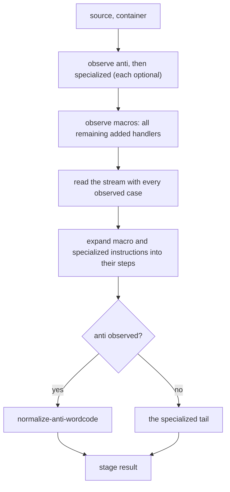

# Expand macro VM opcodes

Pipeline stage: `recover-added-opcodes` ([map](../../pipelines/jsconfuser-vm.md#frontend-order)).

Readers need the encoder's [macro opcodes](../../../js-confuser-vm/transforms/macro-opcodes.md),
the macro observation of the [`observe`](observe.md#observations) module, the stream readers of
[`read-wordcode`](wordcode/read-wordcode.md#added-opcode-instructions) and the expansion of
[`origin-addresses`](wordcode/origin-addresses.md#expanding-added-opcodes).

## 1. Target

Write every macro instruction as the canonical instructions it stands for. The encoder replaces
a repeated window of two to five instructions with one added opcode whose handler runs the
window's handlers in sequence; the macro keeps the window's operands and drops all but one opcode
word. The transform puts the opcode words back, which lengthens the stream and moves every later
address.

On a stream whose added opcodes are macros, alone or with specialized and anti opcodes, this is
the outermost step of a chain: it expands the macros (and the specialized opcodes with them) and
hands the stream to the next transform, whose result it publishes. A result exists only when the
whole chain ends in canonical wordcode
([F1](../../../decoding-method/rules.md#f1)); the input
container is never changed.

Proving which handler is a macro and of which steps is the [`observe`](observe.md) module's;
reading a macro's operands step by step is [`read-wordcode`](wordcode/read-wordcode.md)'s; the
expansion and its address rules are [`origin-addresses`](wordcode/origin-addresses.md)'s. This
doc owns the route: which observers run, and where the expanded stream goes.

## 2. Algorithm

```text
normalizeMacro(source, container, { originPcMap, suspects }):     // explanatory pseudocode
  anti        = observe anti, a tail allowed                 null if it refuses
  specialized = observe specialized, after anti if found,    null if it refuses
                a macro tail allowed
  runtime     = diagnoseMacroRuntime(source, anti, specialized)    no tail: every other added
                                                                   handler must be a macro
  stream      = diagnoseMacroWordStream(container, runtime, specialized, anti)
  expansion   = expandObservedWordStream(stream, originPcMap, suspects)
  pcMap       = composePcMaps(originPcMap, expansion.pcMap)
  anti found:  result = diagnoseNormalizeAntiWordcode(expanded, specialized tail allowed, pcMap)
  otherwise:   result = normalizeExpandedSpecializedDispatcher(expanded, pcMap)   the tail
```



1. **The prefix is observed first.** The encoder allocates added opcodes in the order anti,
   specialized, macro, alias. Anti and specialized handlers, where present, are observed before
   the macros so that the macro observer can account for every handler left. A runtime that
   also holds aliases never reaches this point through the driver: the two
   [alias routes](normalize-aliased-wordcode.md) are tried first and expand the macros
   themselves.
2. **The stream is read whole.** A macro's width depends on its occurrence: each step is read by
   its canonical opcode's own grammar at the cursor, so a step with a counted tail (a call, an
   array) takes as many words as that occurrence holds.
3. **Expansion.** Each macro becomes its steps, each with its canonical opcode word; a
   specialized instruction in the same stream becomes its one step; an anti instruction is copied
   as it is. The expansion maps every input instruction PC to its output PC and rewrites, in one
   pass, the label operands and the continuation loads, those inside the expanded steps
   included. A macro's inner steps start at PCs no input address can name.
4. **The next transform.** With anti observed, the expanded stream goes to the
   [anti normalizer](normalize-anti-wordcode.md), which reads its own fake branch targets
   through the composed map. Otherwise it goes to the
   [specialized tail](normalize-specialized-wordcode.md), which reads the canonical stream and
   undoes a dispatcher when one remains. Either result is published with the macro counts added.

### Worked example

The committed cell `composition-finally-abrupt-return` of suite `single-payload-stage`, file
`macro-opcodes` (profile `randomizeOpcodes+macroOpcodes`, seed 251). `read-wordcode` refuses the
stream: `Unknown opcode 64144 at pc 49`. The observer proves the macros, among them 64144 as
`[LOAD_CONST, RETURN]` and 60541 as `[LOAD_CONST, MOVE, LOAD_INT]`. Canonical opcodes in this
build: `LOAD_CONST` 17857, `RETURN` 25854, `MOVE` 29942, `LOAD_INT` 57530.

```text
input PC -> output PC
49 -> 49   64144, 5,3,0, 5                  17857,5,3,0   25854,5
                                            LOAD_CONST r5 = constant 3; RETURN r5
54 -> 55   LOAD_THIS r2                     unchanged; one word later
56 -> 57   FINALLY_SETUP 113, r3, r4, 136   FINALLY_SETUP 122, r3, r4, 149
85 -> 90   60541, 5,6,0, 4,5, 3,138         17857,5,6,0   29942,4,5   57530,3,151
                                            LOAD_CONST r5; MOVE r4 = r5; LOAD_INT r3 = 151
94 -> 101  JUMP 113                         JUMP 122
```

The macro at 49 is five words and expands to six, so everything after it moves. The macro at 85
ends in `LOAD_INT r3, 138`: `r3` is the continuation register the `FINALLY_SETUP` names, so 138 is
an address and is rewritten to 151 inside the expanded step. The six macro instructions take the
stream from 147 words to 161, and the output has the instruction names and direct targets of the
cell's plain encoding.

On the cell of suite `anti-macro-route` (profile `macroOpcodes+antiInstrumentation`, seed 98)
the same expansion takes 252 words to 267 and the anti normalizer then compacts them to 179.

## 3. Implementation

### Exports another file imports

| Export | Contract | Imported by |
|---|---|---|
| `diagnoseNormalizeMacroWordcode(source, container, { originPcMap = null, suspects = [] })` | `{ ok, result, diagnostic }`. `originPcMap` is the origin map when an earlier stage moved code; `suspects` are origin PCs, passed to the expansion and the next transform. | the [frontend driver](frontend-driver.md) (the third added-opcode route); `support/cell-tests.js` |

It imports the anti, specialized and macro observers
([`observe`](observe.md#exports-another-file-imports)), `diagnoseMacroWordStream`
([`read-wordcode`](wordcode/read-wordcode.md#exports-another-file-imports)),
`expandObservedWordStream`, `composePcMaps` and the `observed-expansion` refusal helpers
([`origin-addresses`](wordcode/origin-addresses.md#exports-another-file-imports)),
`diagnoseNormalizeAntiWordcode` and `normalizeExpandedSpecializedDispatcher`.

### The stage result

```js
{
  schemaVersion: 'jsconfuser-vm-macro-wordcode-normalization.v1',
  container,              // the next transform's: a clone with the final words
  wordcode,               // canonical, read by read-wordcode
  originPcMap,            // origin PC -> PC of the result
  originalWordCount,      // of the input stream
  expandedWordCount,      // after the expansion, before the next transform
  macroInstructionCount,  // macro instructions in the input stream
  // and every other field of the next transform's result (suspects, references, functions,
  // its own counts), under this schema name
}
```

The driver adopts it as a route ([Adoption](frontend-driver.md#adoption)).

### Decisions

- A failed anti or specialized observation is not a refusal: that family is taken as absent, and
  the macro observer then refuses if its handlers are in fact there.
- The transform does not use the self-modifying stage's `originContinuationLoads`: the expansion
  sees every step of every macro and specialized instruction, so its own selection is complete.
- The origin map handed on is always composed with the expansion's map, also when no earlier
  stage moved code (the composition is then the expansion's map itself).

### Refusals

Owner `observed-expansion`, shared with the expansion and the specialized transform
([Refusals](../../pipelines/jsconfuser-vm.md#refusals)). Any refusal makes the driver try its
next route.

| Code | When |
|---|---|
| the macro observer's code (`macro-runtime`, ...) | No macro handler, or an added handler that is neither a macro nor in the prefix ([`observe`](observe.md#refusals)) |
| the stream reader's code (`no-macro-instructions`, ...) | The stream does not read with the observed cases ([`read-wordcode`](wordcode/read-wordcode.md#refusals)) |
| `origin-target-boundary`, `macro-target-boundary`, `macro-expanded-width` | The expansion ([`origin-addresses`](wordcode/origin-addresses.md#refusals)) |
| the anti normalizer's or the tail's code | The next transform refused |
| `macro-normalization-error` | Any other exception |

## 4. Input Shapes

| Shape | Producer | Treatment |
|---|---|---|
| Macro instructions: an added opcode and the operands of its two to five steps | encoder step 9 `macroOpcodes`; the handlers by step 18 `applyMacroOpcodes` | expanded |
| Specialized and anti instructions beside them | encoder steps 7 and 8 | specialized expanded in the same pass; anti copied for its transform |
| `{ macros, antiPrefixCount, specializedPrefixCount }` | [`observe`](observe.md#observations) | the macro cases |
| The macro stream record, each macro with its steps and their words | [`read-wordcode`](wordcode/read-wordcode.md#added-opcode-instructions) | expanded |
| Words with self-modifying additions removed, `originPcMap`, `suspects` | [`normalize-self-modifying-wordcode`](normalize-self-modifying-wordcode.md#the-stage-result) | addresses inside macro steps are origin PCs and go through the map; suspects are read past |

A stream the alias transform projected is not an input of this function: that transform calls
the stream reader and the expansion itself.

## 5. Known Gaps

- A macro is proved as a sequence of the runtime's own canonical handlers, so the expansion is
  as right as those handlers' naming ([`identify-handlers`](handlers/identify-handlers.md)).
- No committed test asserts a refusal of this transform.
- The stage-effect test compares instruction names and direct targets with the plain encoding,
  not every operand.

## 6. Source

- [normalize-macro-wordcode.js](../../../../decoder/decode-js/src/vm/jsconfuser-vm/normalize/normalize-macro-wordcode.js):
  the whole route.
- Called from
  [diagnose-standalone.js](../../../../decoder/decode-js/src/vm/jsconfuser-vm/diagnose-standalone.js)
  (`ADDED_OPCODE_ROUTES`).

The encoder's
[bytecode macro pass](https://github.com/MichaelXF/js-confuser-vm/blob/20c5b96bf57337c568579352758d7685358650de/src/transforms/bytecode/macroOpcodes.ts)
counts and replaces repeated instruction windows; its
[runtime macro pass](https://github.com/MichaelXF/js-confuser-vm/blob/20c5b96bf57337c568579352758d7685358650de/src/transforms/runtime/macroOpcodes.ts)
appends handlers made from the steps' bodies.

## 7. Fixtures

Each suite encodes its sources with the pinned encoder and requires the decode to behave as the
source; a proof is a break of the named code that turns the suite red
([tests.md](../../tests.md#suites)). Suites are under
[cell-suites/](../../../../decoder/decode-js/test/vm/jsconfuser-vm/cell-suites/).

| Scenario | Expected result | Committed fixture |
|---|---|---|
| Macros alone | The normalizer's output holds at least one expanded macro and has the plain encoding's instruction names and direct targets; the decode behaves as the source | `single-payload-stage`, file `macro-opcodes` (the worked example; its stage-effect test) |
| A continuation load inside a macro | Its immediate is rewritten with the label operands | the same cell, the macro at PC 85; no proof of its own |
| Macros beside anti | The expanded stream goes to the anti normalizer. Proof: the anti branch | `anti-macro-route` |
| Macros beside specialized, or over a dispatcher | The tail recovers the stream | |
| Macros after self-modifying code was removed | Addresses inside macro steps go through the origin map | [`origin-addresses`](wordcode/origin-addresses.md#7-fixtures) holds the suite |
| A runtime with aliases | `macro-runtime`; the alias routes own it | |
