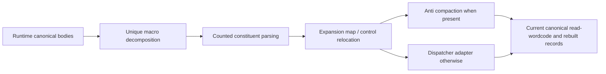

# Expand macro VM opcodes

Pipeline stage: `recover-added-opcodes` ([map](../../pipelines/jsconfuser-vm.md)).

## 1. Target

Expand a proved macro header into its two-to-five canonical constituent instructions. The tails
retain their meaning but inserted opcode words move later addresses. Success supplies current
canonical `read-wordcode` and any downstream records rebuilt by dispatcher/anti recovery; decline
supplies no partially expanded container. This differs from passing unknown macro words through.

Readers need [Babel bindings](../../babel.md), [`extract-container`](extract-container.md),
[`read-wordcode`'s counted grammar](read-wordcode.md),
[handler effects](runtime-meaning.md#2-algorithm) and the pinned
[macro producer](../../../js-confuser-vm/transforms/macro-opcodes.md). Input is admitted source and
its owned numeric container. Runtime observations prove structure, not comments or macro names.
Variable-width calls/arrays/objects are allowed as constituents; PATCH ciphertext and unadmitted
runtime representations are excluded.

## 2. Algorithm

A macro executes canonical handler bodies sequentially, so identify it by a unique decomposition
of its complete effects into canonical handlers' effects. Classify every added handler by what it
does, independently of its label and of physical switch order. Every kind keeps its own proof. Match
only eligible sequences; then let the ordinary canonical reader parse each constituent's tail.
This gives both the original macro width and the expanded canonical widths without guessing
from the runtime body length.

Build an address map before rewriting targets. Every original instruction start maps to the
start of its replacement; a macro's internal newly inserted starts have no old-PC counterparts.
Use that map for control operands and proved continuation loads. Copy synthetic anti words
unchanged: their fake jumps are anti's addition, and anti compaction translates them itself through
the map this route composes. Otherwise consume old-PC dispatcher routes through the same map.
Publish only a canonical result.

### Annotated synthetic example

Supply macro 61 proved as `[LOAD_INT,MOVE]`. Symbols below denote canonical headers; actual
LOAD_INT=1, MOVE=5, JUMP=39 and RETURN=45:

```text
old PC 0: [61,2,9,3,2]       // R2=9; R3=R2; width=5
old PC 5: [39,7]             // JUMP to RETURN boundary
old PC 7: [45,3]             // RETURN R3
new PC 0: [1,2,9]            // inserted first canonical header
new PC 3: [5,3,2]            // inserted second header
new PC 6: [39,8]             // old target 7 maps to 8
new PC 8: [45,3]
map={0:0,5:6,7:8,9:10}
```

Both programs return 9. Expansion increases nine words to ten, and the jump must change.
A target at old PC 2 is an operand, so it has no mapping even though new PC 2 exists.
For a BUILD_ARRAY constituent, parse destination/count and its count-dependent registers at
that occurrence; a second occurrence of the same macro can have a different width. This is a
synthetic word example with supplied handler proof, not standalone source admission.



## 3. Implementation

### Runtime proof and mixed reader

The [classifier](runtime-meaning.md#2-algorithm) identifies a macro: its effects are, in exactly
one way, two or more canonical handlers' effects in sequence, its operands read as each step uses
them. The observer takes the added handlers of that kind from the
[identified view](runtime-meaning.md#3-implementation); labels and their order are never read, as
in the [alias source contract](normalize-aliased-wordcode.md#source-proof-and-observation-contract).
Prefix counts come from the anti and specialized observations. Each macro leaves the dispatch
(the view's `ends`), has 2..5 steps, and reads its operands in order across them. Every position
excludes PATCH, TRY_SETUP, TRY_END, DEBUGGER, MAKE_CLOSURE. RETURN, CALL, CALL_METHOD, NEW,
THROW, JUMP, JUMP_IF_FALSE, JUMP_IF_TRUE, FOR_IN_NEXT and FINALLY_SETUP may appear only at the
end. JUMP_REG is **not** in these sets; this reflects the producer's literal omission, not a
general safe-transfer proof. Require at least one macro. In the alias route `allowAliasTail:true`
lets other added handlers remain for alias proof; in the ordinary macro route every added handler
must be a macro or belong to the prefix observations. The frozen runtime record is:

```js
{
  schemaVersion: 'jsconfuser-vm-macro-runtime-observation.v1',
  antiPrefixCount,
  specializedPrefixCount,
  macros: [{ opcode, steps: [{ name, opcode }] }],
}
```

The mixed reader consumes one macro header, then each step by constructing a virtual stream
`[canonicalStepOpcode,...remainingOriginalWords]` and applying the canonical cursor grammar.
Consume exactly the parsed tail from the original cursor; retain step words including the
canonical header. Macro width is `1+sum(step.words.length-1)`; expanded width is
`sum(step.words.length)`. The frozen stream record has schemaVersion
`jsconfuser-vm-macro-word-stream-observation.v1`, wordCount and instructions; macro entries
have pc/name/opcode/raw words/width/nextPc/steps. At least one used MACRO is required.
Canonical truncation, invalid words/counts and PATCH still decline; observations supply widths
as owned facts rather than a second externally supplied schema to validate.

### Shared expansion and address relocation

This contract is used by every compactor: macro, specialization, mixed aliases, anti, dispatcher,
CFF and string concealing. `expandObservedWordStream` implements it for added-opcode expansion and refuses with
`ObservedExpansionDecline`.

```text
E = new Map()                                  // word-PC units, input PC -> output PC
for instruction in stream (in order):
  E[instruction.pc] = nextPc
  for step in (MACRO or SPECIALIZED ? instruction.steps : [instruction]):
    emit part {originPc: instruction.pc, pc: nextPc, name: step.name, words: copy,
               encoded: instruction is MACRO or SPECIALIZED}
    nextPc += step.words.length
E[stream.wordCount] = nextPc
address(part, w) = E[part.encoded ? O[w] : w]  // O = originPcMap, identity when absent
```

A macro interior is never an original boundary. A target missing from E declines
`macro-target-boundary`; an encoded word missing from O declines `origin-target-boundary`. Emitted
words must total nextPc (`macro-expanded-width`).

**`extract-container` PC is the address identity.** The encoder resolves every label once, after
selfModifying adds its headers
([resolveLabels](https://github.com/MichaelXF/js-confuser-vm/blob/20c5b96bf57337c568579352758d7685358650de/src/transforms/bytecode/resolveLabels.ts#L30-L90)),
and applies the dispatcher's endpoint encoding in that same step. The runtime patches regions in
place and JUMP_REG jumps to the raw register value
([runtime](https://github.com/MichaelXF/js-confuser-vm/blob/20c5b96bf57337c568579352758d7685358650de/src/runtime.ts#L879-L897)),
so every address the encoder wrote is a `extract-container` PC: direct targets, operands kept inside
added opcodes, finally continuation literals and decoded dispatcher endpoints.

```text
O = null                                    // extract-container PC -> current PC; null while they coincide
after each component c that moves code:
  route (alias, macro, specialized, anti):  O = c.originPcMap      // already composed
  dispatcher, string, CFF:                  O = composePcMaps(O, c.pcMap)
address the encoder wrote, read by a later c = O[a]                // missing: decline
address c already relocated                  = c's own E
```

The [standalone schedule](standalone-diagnosis.md#canonical-frontend-retries) owns O and hands it to
every route and every dispatcher call (as `decodedTargetMap`). A component relocates the canonical
addresses it reads with its own map and leaves an encoded address in `extract-container` space for
the component that decodes it. Each map holds only surviving instructions, plus an entry the encoder's
own semantics forward (a PATCH header carries its block's label). A removed instruction has no
entry, so an address naming one declines instead of moving to the next instruction. The
`normalize-self-modifying-wordcode` also publishes which continuation literals inside added opcodes it selected
(`originContinuationLoads`), because a route reading a stream that still holds other added opcodes
cannot see every FINALLY_SETUP.

Direct address offsets count from the header (offset 0):

| Canonical operation | Address offsets |
|---|---|
| JUMP | 1 |
| JUMP_IF_FALSE, JUMP_IF_TRUE | 2 |
| FOR_IN_NEXT | 3 |
| TRY_SETUP | 1 |
| FINALLY_SETUP | 1 and 4 |
| MAKE_CLOSURE | 2 |

Plain immediate operands are not addresses. A SYNTHETIC instruction's words are copied unchanged,
fake conditional targets included: they are anti's addition, so only anti reads them (P3). The
route hands anti `composePcMaps(O,E)` as its `originPcMap`, and anti's
[fake-slot rule](anti-runtime-observation.md#function-models-and-exact-domains) translates each
fake target through it before comparing it with the instruction's fallthrough. Anti emits only
real steps, so an untranslated fake operand never reaches output, and a tampered one declines in
anti's flow proof (`register-isolation`), not here.

**Finally continuation literals** (`selectContinuationLoads`). The compiler gives each try/finally a
dedicated continuation register
([`_finallyContReg`](https://github.com/MichaelXF/js-confuser-vm/blob/20c5b96bf57337c568579352758d7685358650de/src/compiler.ts#L491-L495)),
writes it only through
[`_emitLoadLabel`](https://github.com/MichaelXF/js-confuser-vm/blob/20c5b96bf57337c568579352758d7685358650de/src/compiler.ts#L739-L748)
and reads it only with the finalizer's
[JUMP_REG](https://github.com/MichaelXF/js-confuser-vm/blob/20c5b96bf57337c568579352758d7685358650de/src/compiler.ts#L1646-L1648).
It is a `local::` register, and that pool assigns slots
[with no reuse](https://github.com/MichaelXF/js-confuser-vm/blob/20c5b96bf57337c568579352758d7685358650de/src/transforms/bytecode/resolveRegisters.ts#L5-L9).
So within one function, every LOAD_INT whose destination is a FINALLY_SETUP continuation register
(words[2]) loads an address: relocate its literal at offset 2 like a direct target. Function
membership comes from the caller's function starts (0 and MAKE_CLOSURE targets, or
`partition-functions`'s ownership). No boundary guard applies: a selected literal that is not a
boundary declines with the component's target code. Other LOAD_INTs stay unchanged.

The rule reads past PATCH suspects (P3): a selfModifying filler LOAD_INT draws its register at
random and can name a continuation register, and a suspect FINALLY_SETUP is no more decided. So
every caller hands the rule its suspects in its own PC space (`extract-container` PCs through O for
an expansion, `partitionOptions.suspects` for the dispatcher, the undecided set for
`normalize-self-modifying-wordcode` and its settle), and a suspect neither names a continuation
register nor loads one: its words stay until the
[settle](normalize-self-modifying-wordcode.md#settling-suspects) decides it.

### Route ownership, state and failures

| Component | Owned input -> output | Required consumer fact |
|---|---|---|
| Prefix/body proof | Source -> added-opcode definitions | No unproved extra cases escape suffix handling. |
| Mixed reader | `extract-container` + definitions -> complete spans | Counted constituent widths and original boundaries established. |
| Expansion | Stream -> words and E | Direct and selected continuation targets relocated together; synthetic words unchanged. |
| Anti route | Expanded `extract-container` + E -> compact `extract-container` and `read-wordcode`, optional `validate-references` and `partition-functions` | Compactor composes maps as C(E(oldPc)). |
| Nonanti dispatcher route | Expanded `extract-container` + E -> canonical `extract-container` and `read-wordcode`, optional rebuilt records | Encoded dispatcher endpoints still name old PCs. |

The normalizer first attempts anti with allowSpecializedTail:true, then specialized with
allowAntiPrefix=Boolean(anti) and allowMacroTail:true; failed optional prefixes contribute null.
Macro proof must account for all remaining cases. Expand with includePcMap:true and the caller's
originPcMap O. Clone `extract-container` and replace words only. With anti, call anti normalization
with allowSpecializedTail:true/originPcMap:composePcMaps(O,E). Otherwise pass that map to the
[specialized dispatcher adapter](normalize-specialized-wordcode.md#dispatcher-and-anti-specialized-routes).
Return its current records plus schemaVersion `jsconfuser-vm-macro-wordcode-normalization.v1`,
originalWordCount, expandedWordCount (before later compaction), macroInstructionCount.

The whole route is atomic: failure returns `{ok:false,result:null,diagnostic}` without publishing or
mutating source/A. Typed expansion failures preserve their codes; unexpected failures use
`macro-normalization-error`. Successful container/envelope need not be frozen; consumed
`read-wordcode`, `validate-references` and `partition-functions` are owned current
producer records. Expansion builds no caller AST cache and deletes no source helpers. Later source
emission removes the VM; the [owned chain](standalone-diagnosis.md#owned-record-boundary) reuses
returned records and builds absent records against current words, never stale predecessors.

The
[source-informed example scaffold](normalize-aliased-wordcode.md#source-informed-example-control-boundary)
uses the exact words above and the supplied retained canonical runtime to reach the normal source
entry. Its normalization succeeds with exact expected words and unchanged `extract-container`;
public emission then returns unemittable-structured-control for the unconditional jump directly to
RETURN. This separately records recovery and later valid decline, without expanding this page's
admission claim.

### Acceptance scenarios

| Scenario | Oracle / acceptance criterion | Evidence and limit |
|---|---|---|
| S1 header insertion / branch | Exact example words/map/value; expandedWordCount increases and old target relocates | Worked synthetic calculation; `single-payload-stage` below. |
| S2 counted tail / terminal call | Canonical reader's per-occurrence count/spread grammar; complete stream consumed and frame behavior agrees | `single-payload-stage` below, no case of its own; all canonical variable grammars remain `read-wordcode` dependencies. |
| S3 mixed routes | Every added-opcode effect observed; canonical `read-wordcode` and C(E(oldPc)) dispatcher endpoints | `anti-macro-route`, `added-opcodes-chain`, `patch-widths-chain`, `all-stages-together` below. |
| S4 source handler/count/target damage | Reach body match, counted reader or boundary remap as named; result:null and public decline | No committed test: the old controls edited encoded input by hand. |
| S5 immutable and derived state | `extract-container`/source unchanged; current records agree with emitted spans/targets; fresh parse has no VM residue and consistent consumed state | Every cell checks the input and the decode's AST state; the stage step compares with the plain program. |

## 4. Input Shapes

[PATCH recovery](normalize-self-modifying-wordcode.md) consumes these proved added-opcode definitions
at original widths, then expands only recovered executable instructions. Its finite combined
boundary is [the PATCH census](qualify-jsconfuser-vm.md#finite-patch-added-opcode-qualification); the linear
stream reader on this page still does not interpret encrypted storage.

| Earlier decoder output / spelling | Gate or dependency |
|---|---|
| [`extract-container`](extract-container.md) / [handler locator](locate-handlers.md#4-input-shapes) | Supply the words, the handler bodies and the opcode table for every runtime spelling the locator lists. |
| [PATCH compaction](normalize-self-modifying-wordcode.md) | Words with selfModifying's additions removed; addresses inside added opcodes are still `extract-container` addresses and go through its `originPcMap` ([address spaces](normalize-macro-wordcode.md#shared-expansion-and-address-relocation)). |
| [Classifier](runtime-meaning.md#2-algorithm) and the anti and specialized observations | The classifier decides each added handler's kind; the observations' counts account for the non-macro ones. |
| [Alias projection](normalize-aliased-wordcode.md) | Canonicalizes alias operands at equal width before this shared expansion; alias suffix was separately proved. |
| [`read-wordcode` canonical parser](read-wordcode.md) | Supplies the sole counted/spread/constant operand grammar, including variable-width macro tails. |

A allows extra CALL_SPREAD uses inside run while requiring one per canonical call case; a macro
ending in CALL adds a legitimate use. The [pinned macro recipe](../../../js-confuser-vm/transforms/macro-opcodes.md#4-later-stages)
explains canonical-only constituents and the terminal checks; it does not establish all combinations.

## 5. Known Gaps

A unique decomposition into the runtime's own canonical handlers remains required; it does not
prove those handlers' semantics. Nonterminal JUMP_REG can pass the literal decomposition checks,
but general correctness of that producer hazard is not qualified; document it rather than silently
strengthen the matcher. PATCH storage needs the earlier
[PATCH compaction](normalize-self-modifying-wordcode.md); it is never a linear macro stream.
Minified class and profiles beyond the suites below and the linked finite PATCH census
remain unqualified.

## Source

The observer and mixed cursor grammar in item 3 are
[observe-macro-runtime.js](../../../../decoder/decode-js/src/vm/jsconfuser-vm/observe-macro-runtime.js)
(`diagnoseMacroRuntime(source, options)`),
on the classifier in [identify-handlers.js](../../../../decoder/decode-js/src/vm/jsconfuser-vm/identify-handlers.js),
and [read-wordcode.js](../../../../decoder/decode-js/src/vm/jsconfuser-vm/read-wordcode.js).
The shared relocation contract is implemented by
[expand-observed-word-stream.js](../../../../decoder/decode-js/src/vm/jsconfuser-vm/expand-observed-word-stream.js)
(`expandObservedWordStream`, `composePcMaps`), with the continuation rule in
[finally-continuations.js](../../../../decoder/decode-js/src/vm/jsconfuser-vm/finally-continuations.js)
(`selectContinuationLoads`).
Dispatcher/anti adapters and binding comparison are linked item 3 dependencies.

The decoder is [normalize-macro-wordcode.js](../../../../decoder/decode-js/src/vm/jsconfuser-vm/normalize-macro-wordcode.js)
(`diagnoseNormalizeMacroWordcode(source, container, options)`),
wired by [diagnose-standalone.js](../../../../decoder/decode-js/src/vm/jsconfuser-vm/diagnose-standalone.js)
under the dependencies described in item 4.

The pinned encoder's [bytecode macro pass](https://github.com/MichaelXF/js-confuser-vm/blob/20c5b96bf57337c568579352758d7685358650de/src/transforms/bytecode/macroOpcodes.ts)
counts and replaces repeated instruction windows. Its
[runtime macro pass](https://github.com/MichaelXF/js-confuser-vm/blob/20c5b96bf57337c568579352758d7685358650de/src/transforms/runtime/macroOpcodes.ts)
appends handlers made from cloned constituent bodies.

## Fixtures

The scenario tables in item 3 state acceptance oracles; the suites below hold them. The annotated
examples are source-informed synthetic controls, not independent cold proofs.

The retired frozen bounded verifier demonstrated S1/M2/M4's selected LOAD_INT/MOVE and
BUILD_ARRAY/MOVE body decomposition, per-occurrence counted array widths, inserted headers and the
original-operand target refusal. The
[shared proof boundary](normalize-aliased-wordcode.md#independent-bounded-proof) supplies canonical
handler functions/A and reduced span-state builders. Complete canonical inventory/case syntax,
CALL/closure/object grammar, class layouts, continuation provenance and actual mixed dispatcher
recovery are not reconstructed. Current words/spans and selected unchanged inputs are asserted; no
`validate-references` and `partition-functions`, public emission or generated-option
qualification follows.

Each suite encodes its sources with the pinned encoder and requires the decode to behave as the
source ([tests.md](../../tests.md#suites)); a Proved line names the code whose break turns the case
red.

| Suite and cases | Claims | Proved |
|---|---|---|
| [single-payload-stage](../../../../decoder/decode-js/test/vm/jsconfuser-vm/generated-cells/single-payload-stage/suite.js), file `macro-opcodes` | S1, S2, S5: macro cases expand to canonical instructions; the stage step compares names and direct targets with the plain program | A macro step that jumps ends its macro; a macro is canonical handlers in sequence with operands read in order |
| [single-payload-stage-conditions](../../../../decoder/decode-js/test/vm/jsconfuser-vm/generated-cells/single-payload-stage-conditions/suite.js), `no-repeated-window` | Inert control: without a repeated window the stage leaves the payload as the plain cell's | `distinct-cells` |
| [anti-macro-route](../../../../decoder/decode-js/test/vm/jsconfuser-vm/generated-cells/anti-macro-route/suite.js) | S3: macro expansion reads its words through the anti route when anti instrumentation runs beside it | The anti branch in `normalize-macro-wordcode` |
| [added-opcodes-chain](../../../../decoder/decode-js/test/vm/jsconfuser-vm/generated-cells/added-opcodes-chain/suite.js) | S3: anti, specialized, macro and alias each read the previous output | The alias macro tail in `normalize-aliased-wordcode` |
| [patch-widths-chain](../../../../decoder/decode-js/test/vm/jsconfuser-vm/generated-cells/patch-widths-chain/suite.js) | S3: PATCH regions over the width-changing passes | A PATCH region holding added opcodes is read with their widths |
| [patch-dispatcher-macro-chain](../../../../decoder/decode-js/test/vm/jsconfuser-vm/generated-cells/patch-dispatcher-macro-chain/suite.js), and `suspect-filler-loads`; [finally-continuations.test.js](../../../../decoder/decode-js/test/vm/jsconfuser-vm/single-component/finally-continuations.test.js) (unit) | The continuation rule reads past PATCH suspects behind a dispatcher | The suspect read-past in `selectContinuationLoads` |
| [all-stages-together](../../../../decoder/decode-js/test/vm/jsconfuser-vm/generated-cells/all-stages-together/suite.js) | S3: every stage at once | No macro break of its own |
| [minify-over-macro-opcodes](../../../../decoder/decode-js/test/vm/jsconfuser-vm/generated-cells/minify-over-macro-opcodes/suite.js) | Handlers found under minify over macro cases | No break of its own |
| [handler-table-over-macro-opcodes](../../../../decoder/decode-js/test/vm/jsconfuser-vm/generated-cells/handler-table-over-macro-opcodes/suite.js) | Handlers found under a handler table over macro cases | No break of its own |
| [class-rewrite-over-macro-opcodes](../../../../decoder/decode-js/test/vm/jsconfuser-vm/generated-cells/class-rewrite-over-macro-opcodes/suite.js) | Handlers found under the class rewrite over macro cases | No break of its own |
| [transport-patch-chain](../../../../decoder/decode-js/test/vm/jsconfuser-vm/generated-cells/transport-patch-chain/suite.js) | Body proofs hold after minify renames the bindings | The payload is reached by structure through renamed bindings |

S4 has no committed test: the old handler, count and target controls changed encoded input by
hand, a shape no encoder emits.
