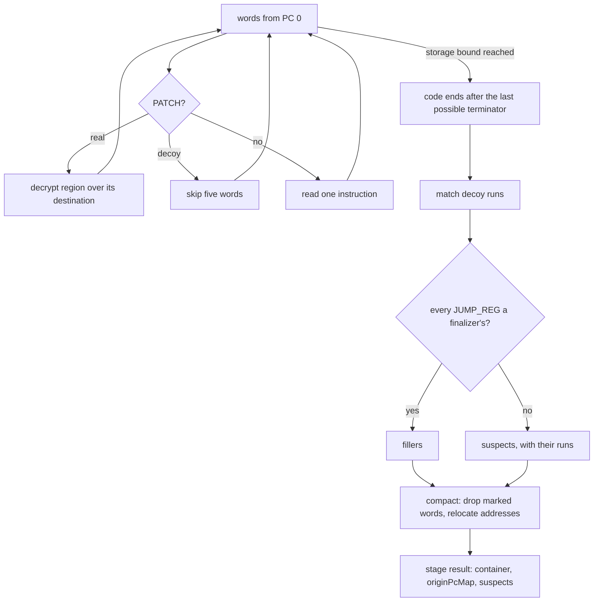

# Normalize self-modifying wordcode

Pipeline stage: `recover-patch` ([map](../../pipelines/jsconfuser-vm.md#frontend-order)).

Readers need the encoder's
[self-modifying regions](../../../js-confuser-vm/transforms/self-modifying-wordcode.md), the
[container record](source/container.md), the [instruction grammar](wordcode/read-wordcode.md) and
the [address rules](wordcode/origin-addresses.md).

## 1. Target

Remove what the encoder's `selfModifying` and `encryptPatches` steps added, and nothing else.
Given a container whose word stream holds PATCH instructions, return a container whose stream is
the code alone: every encrypted region decrypted in place, and the PATCH headers, decoy PATCHes,
decoy fillers and the storage after the code gone. Every other instruction keeps its words;
added opcodes (alias, macro, specialized, anti) stay for their own transforms.

Removing words moves code, so the result also says where each address of the input went (the
origin map). A filler-shaped entry that only a later stage can decide is not removed: it stays
in the stream as a **suspect**, and this doc's second entry point, the settle, removes it once
the labels it depends on are known.

The transform reads only what the PATCH producer itself used: instruction widths, block
boundaries, PATCH operands and the cipher. It never decides reachability or register meaning, and
never runs the program. The input container is not changed.

## 2. Algorithm

The producer works on blocks of the compiler's output, each starting at a label, before labels
are resolved to addresses. It does three things:

- **Regions.** It moves runs of a block's body into encrypted storage appended after all code.
  At the execution site it leaves a five-word PATCH `[op, dest, sourceStart, sourceEnd, key]`
  followed by garbage of the run's width. At run time the PATCH decrypts the run over the
  garbage and execution falls into it.
- **Decoy PATCHes.** Headers that copy junk to junk inside the storage.
- **Decoy runs.** After an unconditional terminator it may plant up to two entries (a decoy
  PATCH or a random harmless instruction, a **filler**) before the next label.

Labels are resolved after this, so every address in the stream is valid in the stream with the
headers in it. The transform undoes the three additions in two parts: it reads the stream and
marks every word (the region read), then drops the marked words and moves the addresses
(compaction).

```text
normalize(container, source):                          // explanatory pseudocode
  addedOpcodes = diagnosePatchAddedOpcodes(source)       widths of the added opcodes
  sweep from PC 0:                                       the region read
    real PATCH: decrypt its region over its destination, continue there
    decoy PATCH: skip five words
    anything else: read one instruction at its width
    every PATCH header lowers the storage bound to the lowest address it names
  code = the instructions up to the last possible terminator before the bound
  runs = after each terminator the producer's scan stood on, up to two entries of filler shape
  if every JUMP_REG is a finalizer's: fillers = the runs' entries
  else:                               suspects = the runs' entries, kept with their runs
  compact:                                               the stream rewritten
    drop PATCH, decoy PATCH and filler; keep the rest, suspects included
    originPcMap = input PC -> output PC of every kept instruction, PATCH header and the end
    relocate the addresses of canonical instructions; leave added opcodes' words as they are
  wordcode = the output read again, or null while it still holds added opcodes
```



### Reading the regions

1. **Sweep in order from PC 0.** A PATCH is real when it targets its own next word and copies
   from storage after its destination: `dest == pc + 5`, a positive width, `sourceStart >= dest
   + width` and `sourceEnd` inside the stream. Its region is decrypted from the original words,
   written over the destination, and the sweep continues at the destination. Any other PATCH is
   a decoy and its five words are skipped. Every other word is read as one instruction; an added
   opcode is read at the width its handler proves
   ([`observe`](observe.md#2-algorithm), all four families at once).
2. **Bound the storage.** Storage begins no later than the lowest address any PATCH header
   names: a real header's source, a decoy's source and destination, since decoys address only
   storage. The storage can open with a junk block no header names, so the sweep may read junk
   below the bound. Three facts keep that junk out of the code. A code instruction never reaches
   past the bound. A real region always decrypts to whole instructions and overlaps no earlier
   region, so a header that fails either is junk and storage starts at it. A decoy header found
   in junk names addresses behind the sweep, which lowers the bound.
3. **End the code.** A function never falls off its end, so the code ends after the last
   unconditional terminator before the bound: `JUMP`, `RETURN`, `THROW`, `JUMP_REG`, or an alias,
   macro or specialized opcode whose last canonical step is one. The only terminator-like word
   in the junk is a junk block's random last word, a canonical opcode whose operand is the next
   item's first word. So a canonical terminator counts only if its operand is possible: a `JUMP`
   to a swept instruction start, or a register below its function's frame size.

The cipher, with `>>> 0` and `| 0` as JavaScript's 32-bit coercions:

```text
state = (key ^ dest) | 0                                // explanatory pseudocode
for each cipher word:
  state = (state + 0x9e3779b9) | 0
  plain = (cipher ^ (state ^ (state >>> 13))) >>> 0
```

### Matching decoy runs

The producer plants a decoy run only where its outer scan stands. The scan collects a body from
a label to the next jump-class instruction (`JUMP`, `JUMP_IF_FALSE`, `JUMP_IF_TRUE`,
`FOR_IN_NEXT`, `TRY_SETUP`, `FINALLY_SETUP`) or `RETURN`; `JUMP_REG` and `THROW` end no body. So
a terminator inside a collected body was never scanned, and nothing is planted after it.

Walking back from a canonical terminator, whichever comes first decides: a body end means the
scan stood on the terminator, and it anchors a run; a visible label or a real PATCH means a body
holds it, and what follows is the body's own code. The case that needs this is a finalizer that
control flow flattening rewrote: its body ends `JUMP_REG; LOAD_INT d; ADD state; JUMP loopTop`,
whose `LOAD_INT; ADD` has a filler's shape and is the state loop's transition.

After an anchor, at most two entries are read. A decoy PATCH counts as an entry. An instruction
of filler shape is matched. The run stops at a visible block start, a real PATCH, or an
instruction no filler can be. The filler shapes are the producer's own list: `TRY_END`,
`LOAD_THIS`, `MOVE`, `LOAD_INT`, the unary operators, `TYPEOF`, the arithmetic, bitwise and
comparison operators, `GET_PROP`.

The visible block starts are PC 0, every label operand of a canonical instruction or of an added
opcode's canonical steps, and every continuation load's immediate
([`origin-addresses`](wordcode/origin-addresses.md#2-algorithm), rule 1). At this point no stage
has moved code, so all of them are addresses of this stream.

### Decide or defer

While its budget lasts the producer patches a block's whole body, so a block it reached starts
with a PATCH or its own terminator, never a filler shape. Once the budget is spent a block stays
as compiled and can start with a filler shape. A matched entry is therefore a filler only if
every label is visible.

`JUMP_REG` is the only operation that takes the PC from data, and the compiler emits two. A
finalizer's `JUMP_REG` reads its try's continuation register, a dedicated slot written only by
label loads, so its targets are the continuation loads and are visible. The dispatcher's
`JUMP_REG` reads encoded endpoints, which hide labels until the dispatcher is undone.

- Every `JUMP_REG`, canonical or a step of an added opcode, reads a register that some
  `FINALLY_SETUP` of the same function names as its continuation register: the labels are
  complete and the matched entries are **fillers**.
- Otherwise the matched entries are **suspects**: kept as code and published with their runs,
  read past by every stage until one recovers the labels
  ([P3](../../../encoder-decoder-method.md#p3-each-decoder-removes-only-its-own-additions-by-its-own-encoders-facts)).

Control flow flattening emits no `JUMP_REG`, so it hides no label from this transform. Anti
instrumentation never fuses a `JUMP_REG`, so its synthetic instructions are not opened.

### Compaction

1. **Keep or drop.** Walk the code in order. A PATCH, a decoy PATCH and a filler emit nothing;
   every other instruction emits its words, read from the stream with the regions decrypted.
   Each kept instruction's PC maps to its output PC, each PATCH header to the next emitted word
   (a block's label can sit on its header), and the code's end to the output length. A decoy or
   filler gets no entry: it sits after a terminator and before the next label, so no address
   names one. A suspect is kept with an entry, since a hidden label may name it.
2. **Select the continuation loads once, over every step.** The selection of
   [`origin-addresses`](wordcode/origin-addresses.md#2-algorithm) runs over the canonical steps
   of every kept instruction, suspects read past. A `FINALLY_SETUP` and its `LOAD_INT` can sit
   in two different added opcodes; only this whole view sees both.
3. **Relocate canonical addresses.** In a canonical instruction, each label operand and each
   selected load's immediate goes through the map; a target with no entry refuses
   `self-modifying-target`.
4. **Leave added opcodes, with the proof.** An added opcode keeps its words, which still hold
   addresses of the input stream. Its own transform translates them through the published
   `originPcMap`. The loads selected inside added opcodes are published as
   `originContinuationLoads`, so that transform translates exactly these and does not select
   again over a view where another added opcode hides the `FINALLY_SETUP`.

### Settling suspects

A suspect is undecided only because a label is hidden: the rule above is right, its input
incomplete. So the same rule runs again once a later stage has recovered the labels, over the
current canonical stream, with every address of the input stream read through the composed
origin map `O` (origin PC to current PC). The [frontend driver](frontend-driver.md#settling-suspects)
decides when to call it. A stage in between that removes a suspect (the dispatcher drops its
decode closure, anti drops a decoy) leaves it without an entry in `O`, and it leaves the set.

```text
settle(stream, suspects, suspectRuns, O, recoveredLabels):      // explanatory pseudocode
  if some JUMP_REG is not a finalizer's: return nothing        labels are still hidden
  current = { O(s) : s in suspects, O has s }
  labels  = function starts
          + label operands of non-suspects
          + immediates of the continuation loads among non-suspects
          + O(recoveredLabels)
  repeat:
    code = for each run, its entries still in current:
             all of them, if the run's anchor still exists and stands inside a collected body
             otherwise those from the first entry in labels on
    labels += label operands of code, and O(immediate) of the continuation loads among code
  until labels stop growing
  fillers = current - code
  drop the fillers; relocate label operands and continuation loads; read the result
  return container, wordcode, pcMap (current PC -> settled PC), no suspects
```

- **The anchor test again.** A dispatcher also hides the label of the body a finalizer's
  `JUMP_REG` sits in, so the first read finds a body end behind it and matches the state
  transition after it. With the labels known the walk back stops at the label, and the run is
  the body's code. An anchor a later stage removed decides nothing: its run is judged by labels
  alone.
- **Recovered labels.** The dispatcher rewrites a conditional route's final `JUMP` as a
  conditional jump whose skip edge is now fallthrough, so the stream no longer names the label
  the decoys sat before. The dispatcher publishes each such label
  ([`skipLabels`](normalize-dispatcher-wordcode.md), origin PCs).
- **The fixpoint.** A dispatcher route can start on a suspect, and the rewritten route is a
  direct `JUMP` at that suspect's PC. Once the suspect is code, its target is a label, which can
  turn a further run into code.
- **A code suspect's continuation load** was read past by every stage, so its immediate is
  still an address of the input stream and goes through `O` before the settled map. An immediate
  `O` does not hold refuses `self-modifying-target`.

### Worked example

**The region read and compaction.** The committed cell `composition-finally-abrupt-return` of
suite `single-payload-stage`, file `self-modifying` (profile `randomizeOpcodes+selfModifying`,
seed 251). Its source:

```js
var log = [];
function run(flag) {
  try {
    log.push("try-" + flag);
    if (flag) return "returned";
    return "normal";
  } finally {
    log.push("finally-" + flag);
  }
}
var result = run(true);
window.TEST_OUTPUT = [result, log];
```

The stream is 513 words. The sweep decrypts seven regions and finds no decoy PATCH; the lowest
address a header names is 203, and the last terminator before it is the `RETURN` at 201, so the
code is [0, 203). Part of it, with canonical names and each instruction's output PC:

```text
input  output
    0 ->   0  PATCH dest 5, source [413,466)       real; the header maps to the next output word
    5 ->   0  LOAD_THIS r1                         first decrypted instruction
    7 ->   2  MAKE_CLOSURE r5, entry 60, 9 registers    entry 60 is rewritten to 55
   58 ->  53  RETURN r5
   60 ->  55  PATCH dest 65, source [511,513)      the function's label sits on a header
   65 ->  55  LOAD_THIS r2
   67 ->  57  FINALLY_SETUP 142, r3, r4, 174       rewritten to 118, r3, r4, 145
  107 ->  97  LOAD_INT r3, 181                     continuation load: 181 is rewritten to 147
  111 -> 101  JUMP 142                             rewritten to 118
  134 -> 114  JUMP 142                             anchors a run
  136         TRY_END                              filler
  137         LOAD_INT r3, 192                     filler
  140 -> 116  JUMP 142                             192 is visible; the run has its two entries
  172 -> 143  JUMP_REG r3                          the finalizer's: r3 is the continuation register
  181 -> 147  RETURN r4                            anchors a run
  183         LOAD_INT r21, 61184                  filler
  186         GT r23 = r10 > r5                    filler
  190 -> 149  RETURN r4
```

The only `JUMP_REG` reads `r3`, which the `FINALLY_SETUP` names, so the labels are complete and
the four matched entries are fillers. The run at 183 is the producer's: it names registers
outside the function's nine. The run at 136 is not: it is the compiler's own unlabelled exit
route after the two returns, which has a filler's shape, never runs, and is dropped the same
([Known Gaps](#5-known-gaps)). The output is 157 words and reads as canonical wordcode.

**The settle.** The committed cell of the same source in suite
`flattened-self-modifying-dispatcher` (profile `controlFlowFlattening+selfModifying+dispatcher`,
seed 251). The dispatcher's `JUMP_REG` is not a finalizer's, so the region read publishes 61
suspects in 38 runs. After the dispatcher is undone one `JUMP_REG` is left, the finalizer's, and
the dispatcher has published 24 skip labels. Five of the runs, with the instructions as the
current stream holds them:

```text
anchor (origin)       entry (origin)   instruction               settled as
1712 RETURN r4        1714             GT r24 = r19 > r23        filler: no label in the run
1026 removed          1028             SHL r9 = r12 << r20       filler: before the run's label
                      1032             JUMP 590                  code: 1032 is a skip label
1536 removed          1538             JUMP 519                  code: 1538 is a skip label
1558 removed          1560             LOAD_INT r73, 16384       code: the JUMP above targets it
                      1563             ADD r12 = r12 + r73       code
1611 JUMP_REG r3      1613             LOAD_INT r73, 28273       code: the anchor is inside a body
                      1616             ADD r12 = r12 + r73       code
```

The run after 1611 is the flattened finalizer's state transition; `r12` is the state register.
The run after 1558 shows the fixpoint: it holds no recovered label, and becomes code only
because the suspect at 1538, now a route's `JUMP`, targets its first entry. The settle drops 24
fillers, 862 words to 776; the other suspects are code or were removed with the dispatcher's
routes.

## 3. Implementation

### Exports another file imports

| Export | File | Contract | Imported by |
|---|---|---|---|
| `diagnoseNormalizeSelfModifyingWordcode(container, { source = null })` | `normalize-self-modifying-wordcode.js` | `{ ok, result, diagnostic }`, `result` the [stage result](#the-stage-result). With `source` it first proves the added opcodes; without, none is admitted. | the [frontend driver](frontend-driver.md); `support/cell-tests.js` |
| `diagnoseSettleSelfModifyingSuspects(container, wordcode, { suspects, suspectRuns, originPcMap, recoveredLabels = [] })` | `normalize-self-modifying-wordcode.js` | `{ ok, result, diagnostic }` over a canonical wordcode record; `result` is null while a `JUMP_REG` is not a finalizer's, else the [settle result](#the-settle-result). | the frontend driver |
| `diagnoseSelfModifyingRegions(container, addedOpcodes = {}, { requirePatch = true })` | `analyze-self-modifying-regions.js` | `{ ok, result, diagnostic }`, `result` the [region read](#the-region-read). `addedOpcodes` is `diagnosePatchAddedOpcodes`' result. | `normalize-self-modifying-wordcode.js` |
| `outerScanReaches(code, index, labels, openingNames)` | `analyze-self-modifying-regions.js` | The walk back of [Matching decoy runs](#matching-decoy-runs): true when a body end comes before a PC of `labels` or an instruction named in `openingNames`. | the settle |
| `stepsOf(instruction)` | `analyze-self-modifying-regions.js` | An alias, macro or specialized instruction's canonical steps; any other instruction itself. | compaction |
| `functionStarts(instructions)`, `functionOf(starts)` | `analyze-self-modifying-regions.js` | PC 0 and every `MAKE_CLOSURE` entry, sorted; the index of the function holding a PC. | compaction, the settle |
| `finalizersOnly(items)` | `analyze-self-modifying-regions.js` | Over `{ name, functionId, words }`: whether every `JUMP_REG` reads a continuation register of its function. | the settle |

The transform imports `diagnosePatchAddedOpcodes` ([`observe`](observe.md)),
`diagnoseObservedWordcodeInstruction`, `diagnoseWordcode` and `LABEL_WORD_OFFSETS`
([`read-wordcode`](wordcode/read-wordcode.md#exports-another-file-imports)) and
`selectContinuationLoads` ([`origin-addresses`](wordcode/origin-addresses.md#exports-another-file-imports)).
It builds no references or functions record and calls no other transform.

### Decisions

| Step | Decision |
|---|---|
| Header | Five words, each an integer in 0..0xffffffff. Real iff `dest == pc + 5`, `width = sourceEnd - sourceStart > 0`, `sourceStart >= dest + width` and `sourceEnd <= wordCount`. |
| Real PATCH | The plaintext must read as whole instructions, and neither interval may intersect an earlier region's source or destination. A header that fails is taken as junk: the sweep stops and storage starts at the header. |
| Decoy PATCH | Skipped; the bound drops to the lower of its destination and source. Recorded as an instruction named `DECOY`. |
| Other word | Read by `diagnoseObservedWordcodeInstruction`. A word that does not read, or an instruction reaching past the bound, stops the sweep. |
| Frame size | `MAIN_REG_COUNT` for the root; for a closure the register count of its `MAKE_CLOSURE` (word 4), found in canonical instructions and added opcodes' steps. |
| Functions | Delimited by PC 0 and every `MAKE_CLOSURE` entry (word 2), in the stream at hand; no functions record exists yet. |
| Anchors | Canonical `JUMP`, `RETURN`, `THROW`, `JUMP_REG` only: the producer tests literal canonical opcodes, and fillers are planted after the added-opcode steps ran, so they are canonical too. |
| Continuation register | `FINALLY_SETUP` word 2; a `JUMP_REG` reads word 1. |

### The region read

```js
{
  schemaVersion: 'jsconfuser-vm-self-modifying-observation.v2',
  patches,        // real ones before `end`: { pc, destPc, sourceStart, sourceEnd, width,
                  //   instructions: [{ pc, name }] } (the plaintext's instructions)
  decoys,         // decoy PATCHes before `end`: { pc, destPc, sourceStart, sourceEnd }
  fillers,        // PCs; empty when the matches are suspects
  suspects,       // PCs; empty when the matches are fillers
  suspectRuns,    // [{ anchor, entries }]: the suspects grouped by the terminator they follow
  instructions,   // the code in order; PATCH and DECOY entries included
  end,            // the PC after the last code instruction
  storageStart,   // the bound
  sourceIntervals, destinationIntervals,   // of the real regions, sorted
  patchedWords,   // the whole stream with every real region decrypted in place
}
```

It is not frozen, and only compaction reads it.

### The stage result

```js
{
  schemaVersion: 'jsconfuser-vm-self-modifying-normalization.v2',
  container,                // a clone with the compact words
  wordcode,                 // the output read by read-wordcode; null while added opcodes remain
  originPcMap,              // Map: input PC -> output PC
  originContinuationLoads,  // Map: output PC of an added opcode -> step indexes of its
                            //   selected continuation loads
  suspects, suspectRuns,    // as the region read gave them: PCs of the input stream
  originalWordCount, wordCount,
  patchCount, decoyCount, fillerCount,
  addedOpcodeCounts,        // { ALIAS, MACRO, SPECIALIZED, SYNTHETIC }: kept instructions
}
```

The driver adopts it as a route ([Adoption](frontend-driver.md#adoption)) and passes
`originPcMap`, `originContinuationLoads` and `suspects` to the added-opcode routes.

### The settle result

```js
{
  container,      // a clone with the settled words
  wordcode,       // read again; a stream that does not read is a refusal
  pcMap,          // Map: current PC -> settled PC, the end included
  suspects: [], suspectRuns: [],
  fillerCount,
}
```

The driver adopts it as a rewrite.

### Refusals

Owners `self-modifying-observation` (the region read) and `self-modifying-normalization`
(compaction and the settle); the second repeats the first's code as its own
([Refusals](../../pipelines/jsconfuser-vm.md#refusals)). No partial result exists. The driver
treats a refusal of the normalization as "no PATCH recovered" and carries on; a refusal of the
settle ends the decode.

| Code | When |
|---|---|
| `invalid-container` | The container has no word stream |
| `truncated-patch`, `invalid-patch-word` | A PATCH opcode with fewer than five words left, or a header word that is no u32 |
| `patch-ciphertext`, `patch-overlap` | A header failing the real-PATCH test, when no code ends before it |
| `no-code-end` | No possible terminator before the bound |
| `no-patch`, `unparsed-word` | No real PATCH: after a clean sweep, or after one that stopped on a word that does not read |
| the observer's code (`patch-added-opcode-runtime`, ...) | `diagnosePatchAddedOpcodes` refused |
| `self-modifying-target` | An address with no entry in the map: compaction, the settle's relocation, or a code suspect's continuation immediate |
| `read-wordcode`'s code | The settled stream does not read |
| `observer-error`, `normalizer-error` | Any other exception |

## 4. Input Shapes

| Shape | Producer | Treatment |
|---|---|---|
| PATCH headers, garbage, decoy PATCHes, fillers, storage | encoder steps 12 `selfModifying`, 15 `encryptPatches` | removed |
| Numeric words, an encoded transport already decoded | [`container`](source/container.md) | the cipher uses these PCs unchanged; the map's domain |
| Alias, macro, specialized and anti opcodes in code and inside regions | encoder steps 7 to 10 | read at their proved widths, their steps used for terminators, labels and continuation loads; words kept |
| `{ anti, specialized, macro, alias }` | [`observe`](observe.md) | the widths and steps above |
| The canonical stream after a label-recovering stage, `skipLabels` | [`normalize-dispatcher-wordcode`](normalize-dispatcher-wordcode.md), run by the driver or inside the [anti](normalize-anti-wordcode.md) route | input to the settle |
| The composed origin map, the suspects still in it | the [frontend driver](frontend-driver.md#adoption) | the settle's `O` |

The stream reaches this transform only when `read-wordcode` refused it with an unknown or
hardening opcode ([Frontend order](../../pipelines/jsconfuser-vm.md#frontend-order)); a stream
with added opcodes and no PATCH ends here in `no-patch` or `unparsed-word` and goes on to
`recover-added-opcodes`.

## 5. Known Gaps

- **Dead compiler code reads as filler.** The compiler can leave unlabelled code after a
  terminator (the exit route of a try whose every path returns, as in the worked example); a
  filler-shaped entry there is matched like a decoy. It never runs, so dropping it changes no
  behaviour; a block reached only from it can be dropped by the settle as well.
- **A junk word whose operand happens to be possible.** A junk block's random last word read as
  a `JUMP` to a swept instruction start, or as a register terminator within the frame, passes
  the operand test; if no decoy header behind it lowers the bound, the code end moves into junk.
  No committed cell reaches the case.
- The cipher is unauthenticated: changed ciphertext can decrypt to a legal, different program.
- A grammar gap inside the code stops the sweep early; later references to the lost code then
  refuse in their own stages.
- `requirePatch: false` and a call without `source` have no caller.
- No committed test asserts a refusal of this transform; the last rows of section 7 have no
  fixture.

## 6. Source

- [analyze-self-modifying-regions.js](../../../../decoder/decode-js/src/vm/jsconfuser-vm/normalize/analyze-self-modifying-regions.js):
  the region read (`PatchSweep`, `endOfCode`, `matchFillers`).
- [normalize-self-modifying-wordcode.js](../../../../decoder/decode-js/src/vm/jsconfuser-vm/normalize/normalize-self-modifying-wordcode.js):
  compaction (`compact`) and the settle (`Settlement`).
- Called from
  [diagnose-standalone.js](../../../../decoder/decode-js/src/vm/jsconfuser-vm/diagnose-standalone.js)
  (`recoverPatch`, `settle`).

The encoder facts the algorithm relies on, at the pinned commit:
[region selection and whole-body patching](https://github.com/MichaelXF/js-confuser-vm/blob/20c5b96bf57337c568579352758d7685358650de/src/transforms/bytecode/selfModifying.ts#L286-L437),
[decoys after canonical terminators](https://github.com/MichaelXF/js-confuser-vm/blob/20c5b96bf57337c568579352758d7685358650de/src/transforms/bytecode/selfModifying.ts#L276-L284),
[decoy runs](https://github.com/MichaelXF/js-confuser-vm/blob/20c5b96bf57337c568579352758d7685358650de/src/transforms/bytecode/selfModifying.ts#L439-L452),
[filler shapes and decoy PATCHes](https://github.com/MichaelXF/js-confuser-vm/blob/20c5b96bf57337c568579352758d7685358650de/src/transforms/bytecode/selfModifying.ts#L50-L183),
[storage appended after the code](https://github.com/MichaelXF/js-confuser-vm/blob/20c5b96bf57337c568579352758d7685358650de/src/transforms/bytecode/selfModifying.ts#L455-L462),
[encryption](https://github.com/MichaelXF/js-confuser-vm/blob/20c5b96bf57337c568579352758d7685358650de/src/transforms/bytecode/encryptPatches.ts#L35-L84),
the [runtime PATCH handler](https://github.com/MichaelXF/js-confuser-vm/blob/20c5b96bf57337c568579352758d7685358650de/src/runtime.ts#L879-L892),
[labels resolved after selfModifying](https://github.com/MichaelXF/js-confuser-vm/blob/20c5b96bf57337c568579352758d7685358650de/src/compiler.ts#L3400-L3420),
[the finalizer's JUMP_REG reads its continuation register](https://github.com/MichaelXF/js-confuser-vm/blob/20c5b96bf57337c568579352758d7685358650de/src/compiler.ts#L1590-L1648),
[a dedicated register per try/finally](https://github.com/MichaelXF/js-confuser-vm/blob/20c5b96bf57337c568579352758d7685358650de/src/compiler.ts#L490-L496),
[which is never reused](https://github.com/MichaelXF/js-confuser-vm/blob/20c5b96bf57337c568579352758d7685358650de/src/transforms/bytecode/resolveRegisters.ts#L5-L25),
[the dispatcher's own register](https://github.com/MichaelXF/js-confuser-vm/blob/20c5b96bf57337c568579352758d7685358650de/src/transforms/bytecode/dispatcher.ts#L540-L548).

## 7. Fixtures

Each suite encodes its sources with the pinned encoder and requires the decode to behave as the
source; a proof is a break of the named code that turns the suite red
([tests.md](../../tests.md#suites)). Suites are under
[cell-suites/](../../../../decoder/decode-js/test/vm/jsconfuser-vm/cell-suites/).

| Scenario | Expected result | Committed fixture |
|---|---|---|
| PATCH alone: regions, decoy PATCHes, fillers | The normalizer's output reads as wordcode with no PATCH; the decode behaves as the source. Proof: a decoy PATCH is skipped and does not stop the sweep | `single-payload-stage`, file `self-modifying` (the first worked example) |
| A flattened finalizer's state transition after its `JUMP_REG` | Stays code: the anchor is inside a body. Proof: the `outerScanReaches` test in `decoyRuns` | `flattened-self-modifying` |
| The same under a dispatcher | The transition is a suspect and settles as code. Proofs: the decrypted region written over its destination; the settle's anchor test | `flattened-self-modifying-dispatcher` (the second worked example) |
| Regions holding alias, macro and specialized opcodes | Read with their widths, kept for their transforms; the decode recovers. Proof: the added opcodes passed to the region's own read | `patch-widths-chain` |
| A header in junk whose region does not decrypt to whole instructions | Ends the sweep as storage instead of refusing. Proof: the `patch-ciphertext` result of the region's read | `self-modifying-patch-stack` |
| Suspects settled after an added-opcode route | The decode behaves as the source | `self-modifying-dispatcher-anti` ([`frontend-driver`](frontend-driver.md#7-fixtures) holds its proof) |
| A suspect load read past by the continuation selection | The suspect keeps its words | [`origin-addresses`](wordcode/origin-addresses.md#7-fixtures) holds the suite |
| An address naming a dropped word | `self-modifying-target` | |
| A damaged header or ciphertext | `truncated-patch`, `invalid-patch-word`, `patch-ciphertext`, `patch-overlap` | |
| A stream with no terminator before storage | `no-code-end` | |
