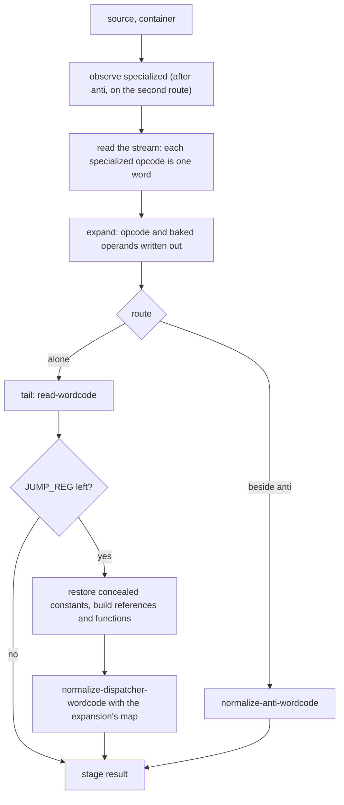

# Expand specialized VM opcodes

Pipeline stage: `recover-added-opcodes` ([map](../../pipelines/jsconfuser-vm.md#frontend-order)).

Readers need the encoder's
[specialized opcodes](../../../js-confuser-vm/transforms/specialized-opcodes.md), the specialized
observation of the [`observe`](observe.md#observations) module, the stream readers of
[`read-wordcode`](wordcode/read-wordcode.md#added-opcode-instructions) and the expansion of
[`origin-addresses`](wordcode/origin-addresses.md#expanding-added-opcodes).

## 1. Target

Write every specialized instruction as the canonical instruction it stands for. The encoder
takes a frequent instruction, opcode and operands together, and gives it an added opcode whose
handler has the operands baked in as literals; in the stream the instruction is that one word.
The transform writes the canonical opcode and its operands back, which lengthens the stream and
moves every later address.

This doc owns three things:

- the **specialized route**: specialized opcodes alone;
- the **specialized-beside-anti route**: specialized opcodes in a stream that also holds anti
  instrumentation, expanded and handed to the anti normalizer;
- **the tail**: what follows an expansion that leaves canonical words, used by this transform
  and by the [alias](normalize-aliased-wordcode.md) and [macro](normalize-macro-wordcode.md)
  transforms. It undoes a dispatcher when one remains, because the dispatcher's encoded targets
  are origin PCs that only the expansion's map can resolve.

A result exists only when the whole route ends in canonical wordcode
([F1](../../../decoding-method/rules.md#f1)); the input
container is never changed. Proving which handler is specialized and with which operands is the
[`observe`](observe.md) module's; the expansion and its address rules are
[`origin-addresses`](wordcode/origin-addresses.md)'s.

## 2. Algorithm

```text
normalizeSpecialized(source, container, { originPcMap, suspects }):   // explanatory pseudocode
  runtime   = diagnoseSpecializedRuntime(source)          every added handler is specialized
  stream    = diagnoseSpecializedWordStream(container, runtime)
  expansion = expandObservedWordStream(stream, originPcMap, suspects)
  return tail(expanded, composePcMaps(originPcMap, expansion.pcMap), suspects)

normalizeAntiSpecialized(source, container, { originPcMap, suspects }):
  anti      = observe anti, a specialized tail allowed    must succeed
  runtime   = observe specialized after the anti prefix   must account for the rest
  stream    = diagnoseSpecializedWordStream(container, runtime, anti)
  expansion = expandObservedWordStream(stream, originPcMap, suspects)
  require the expanded words to read with the anti cases alone
  return diagnoseNormalizeAntiWordcode(expanded, specialized tail allowed,
                                       composePcMaps(originPcMap, expansion.pcMap), suspects)

tail(expanded, pcMap, suspects):            normalizeExpandedSpecializedDispatcher
  wordcode = read-wordcode on the expanded words
  if no JUMP_REG: return { container, wordcode, originPcMap: pcMap }
  if a constant reference has a nonzero key: restore the concealed constants
  references = validateReferences                          none: refuse specialized-references
  functions  = diagnoseFunctionPartition, every shared-parent entry a suspect
  dispatcher = diagnoseNormalizeDispatcherWordcode(..., { decodedTargetMap: pcMap, suspects })
  ok:            its records, with originPcMap = composePcMaps(pcMap, its pcMap)
  no-dispatcher: { container, wordcode, originPcMap: pcMap } as first read
  other refusal: refuse with its code
```



1. **One word in, a whole instruction out.** The stream reader gives each specialized
   instruction one step: the original opcode followed by the baked operands. The expansion
   writes that step out. An address baked into a handler (a jump target, a closure entry, a
   continuation load's immediate) was resolved by the encoder on its own stream, so it is an
   origin PC and goes through the origin map before the expansion's map.
2. **Why the tail runs the dispatcher.** A dispatcher's route encodes its target as data; the
   decoded value is an origin PC. After the expansion the origin stream is gone, so the
   dispatcher normalizer must be given the map from origin PCs to the expanded stream
   (`decodedTargetMap`). The tail holds that map and makes the call; the driver's later
   `recover-control` then finds no `JUMP_REG`.
3. **What the dispatcher needs first.** It reads constants and functions. A specialized
   instruction can bake a concealed constant's index and key, which appear in the stream only
   after the expansion, so the tail restores concealed constants there when any key is nonzero.
   The functions record is built with every closure entry that has several parents published as
   a suspect ([`partition-functions`](wordcode/partition-functions.md#shared-parent-suspects)),
   since a shared string helper is still in the stream.
4. **No dispatcher.** A `JUMP_REG` can be a finalizer's alone. The dispatcher normalizer then
   answers `no-dispatcher`, and the tail returns the expanded stream as first read; the records
   it prepared on the way are dropped, and the driver's own stages build them.
5. **Beside anti.** Anti instrumentation is allocated before specialized opcodes and undone
   after them. The second route expands the specialized instructions, copies the anti
   instructions as they are, and hands the stream to the
   [anti normalizer](normalize-anti-wordcode.md), which runs the dispatcher normalizer itself
   where needed.

### Worked example

The committed cell `composition-finally-abrupt-return` of suite `single-payload-stage`, file
`specialized-opcodes` (profile `randomizeOpcodes+specializedOpcodes`, seed 251). `read-wordcode`
refuses the stream: `Unknown opcode 17307 at pc 0`. The observer proves the specialized
handlers, among them

```text
{ opcode: 45526, originalName: 'MOVE',          originalOpcode: 29942, operands: [3, 5] }
{ opcode: 269,   originalName: 'FINALLY_SETUP', originalOpcode: 4550,  operands: [70, 3, 4, 88] }
{ opcode: 59715, originalName: 'JUMP',          originalOpcode: 30547, operands: [70] }
```

and the expansion rewrites 32 instructions:

```text
input PC -> output PC
 0 ->   0   17307                           9566, 1            LOAD_THIS r1
 1 ->   2   MAKE_CLOSURE r5, entry 32, ...  entry 55           canonical; its address is moved
10 ->  11   45526                           29942, 3, 5        MOVE r3 = r5
54 ->  97   59457                           57530, 3, 151      LOAD_INT r3 = 151 (baked: 89)
56 -> 101   59715                           30547, 122         JUMP 122 (baked: 70)
```

The baked `JUMP 70` names input PC 70, which the expansion moved to 122. The baked
`LOAD_INT r3, 89` loads the finally continuation register, so 89 is an address too and becomes
151. The stream goes from 96 words to 161. Its only `JUMP_REG` is the finalizer's, so in the tail
the dispatcher normalizer answers `no-dispatcher`, and the output is, instruction for
instruction, the cell's plain encoding.

On the cell `f-short-circuit` of suite `dispatcher-specialized-chain` (profile
`randomizeOpcodes+dispatcher+specializedOpcodes`, seed 251) the tail does run the dispatcher: 73
specialized instructions expand 432 words to 604, and the dispatcher normalizer, reading its
targets through the expansion's map, leaves 246 words with references, functions and five skip
labels in the result.

## 3. Implementation

### Exports another file imports

| Export | Contract | Imported by |
|---|---|---|
| `diagnoseNormalizeSpecializedWordcode(source, container, { originPcMap = null, suspects = [] })` | `{ ok, result, diagnostic }`; the specialized route. | the [frontend driver](frontend-driver.md) (the fourth added-opcode route); `support/cell-tests.js` |
| `diagnoseNormalizeAntiSpecializedWordcode(source, container, { originPcMap = null, suspects = [] })` | `{ ok, result, diagnostic }`; the specialized-beside-anti route. | the frontend driver (the fifth route) |
| `normalizeExpandedSpecializedDispatcher(source, normalized, pcMap, suspects = [])` | The tail. `normalized` is a container holding canonical words, `pcMap` the origin map onto them. Returns `{ container, wordcode, originPcMap }`, or the dispatcher normalizer's result with `originPcMap` in place of its `pcMap`. Throws an `observed-expansion` refusal. | `normalize-aliased-wordcode`, `normalize-macro-wordcode` |

It imports the anti and specialized observers ([`observe`](observe.md#exports-another-file-imports)),
the specialized and anti stream readers and `diagnoseWordcode`
([`read-wordcode`](wordcode/read-wordcode.md#exports-another-file-imports)), `validateReferences`,
`diagnoseFunctionPartition`, the expansion and the `observed-expansion` refusal helpers
([`origin-addresses`](wordcode/origin-addresses.md#exports-another-file-imports)),
`diagnoseNormalizeConcealedConstants`, `hasConcealedConstant`,
`diagnoseNormalizeDispatcherWordcode` and `diagnoseNormalizeAntiWordcode`.

### The stage results

```js
{                           // the specialized route
  schemaVersion: 'jsconfuser-vm-specialized-wordcode-normalization.v1',
  container, wordcode,      // the tail's
  originPcMap,              // origin PC -> PC of the result
  originalWordCount,        // of the input stream
  expandedWordCount,        // after the expansion, before a dispatcher was undone
  specializedInstructionCount,
  // when the tail undid a dispatcher: references, functions, skipLabels and the other
  // fields of the dispatcher normalizer's result
}

{                           // the specialized-beside-anti route
  schemaVersion: 'jsconfuser-vm-anti-specialized-wordcode-normalization.v1',
  // every field of the anti normalizer's result (container, wordcode, originPcMap,
  // suspects, syntheticInstructionCount, ...)
  originalWordCount,
  specializedInstructionCount,
}
```

The driver adopts either as a route ([Adoption](frontend-driver.md#adoption)); `skipLabels`
reach the [settle](normalize-self-modifying-wordcode.md#settling-suspects) through it.

### Refusals

Owner `observed-expansion`, shared with the expansion and the macro transform
([Refusals](../../pipelines/jsconfuser-vm.md#refusals)). Any refusal makes the driver try its
next route.

| Code | When |
|---|---|
| an observer's code (`specialized-runtime`, `anti-runtime`, ...) | No handler of the kind, or an added handler the route's observers do not account for ([`observe`](observe.md#refusals)) |
| a stream reader's code (`no-specialized-instructions`, `no-synthetic-instructions`, ...) | The stream does not read with the observed cases; on the second route, also the expanded words with the anti cases |
| `origin-target-boundary`, `macro-target-boundary`, `macro-expanded-width` | The expansion ([`origin-addresses`](wordcode/origin-addresses.md#refusals)) |
| `read-wordcode`'s, the constant restoration's or `partition-functions`' code | The tail's preparation refused |
| `specialized-references` | The tail: the expanded stream has no valid references |
| the dispatcher normalizer's code, other than `no-dispatcher` | The tail: a dispatcher is there and was not undone |
| the anti normalizer's code | The second route |
| `specialized-normalization-error`, `anti-specialized-normalization-error` | Any other exception, by route |

## 4. Input Shapes

| Shape | Producer | Treatment |
|---|---|---|
| Specialized instructions: one added opcode word, operands in the handler | encoder step 8 `specializedOpcodes`; the handlers by step 17 `applySpecializedOpcodes` | expanded |
| Anti instructions beside them | encoder step 7 | copied for the anti normalizer (second route) |
| `{ specialized, antiPrefixCount }` | [`observe`](observe.md#observations) | the specialized cases |
| The specialized stream record | [`read-wordcode`](wordcode/read-wordcode.md#added-opcode-instructions) | expanded |
| Words with self-modifying additions removed, `originPcMap`, `suspects` | [`normalize-self-modifying-wordcode`](normalize-self-modifying-wordcode.md#the-stage-result) | baked addresses are origin PCs and go through the map; suspects are read past |
| An expanded canonical stream and its origin map | this transform, [`normalize-aliased-wordcode`](normalize-aliased-wordcode.md), [`normalize-macro-wordcode`](normalize-macro-wordcode.md) | the tail |
| Dispatcher routes, concealed constants, a shared string helper in that stream | encoder steps 5, 6 and 3 | the tail: constants restored for its own reading, the dispatcher undone, the helper left as a suspect |

A stream holding macros or aliases never reaches the two routes through the driver: the alias
and macro routes are tried first and expand the specialized instructions themselves.

## 5. Known Gaps

- A specialized handler is proved against the runtime's own canonical handler, so the expansion
  is as right as that handler's naming ([`identify-handlers`](handlers/identify-handlers.md)).
- When the tail finds a `JUMP_REG` and no dispatcher, the constants it restored and the records
  it built are thrown away and built again by the driver.
- No committed test asserts a refusal of this transform.

## 6. Source

- [normalize-specialized-wordcode.js](../../../../decoder/decode-js/src/vm/jsconfuser-vm/normalize/normalize-specialized-wordcode.js):
  both routes and the tail.
- Called from
  [diagnose-standalone.js](../../../../decoder/decode-js/src/vm/jsconfuser-vm/diagnose-standalone.js)
  (`ADDED_OPCODE_ROUTES`).

The encoder's
[bytecode specialization pass](https://github.com/MichaelXF/js-confuser-vm/blob/20c5b96bf57337c568579352758d7685358650de/src/transforms/bytecode/specializedOpcodes.ts)
selects the instructions and bakes their operands; its
[runtime pass](https://github.com/MichaelXF/js-confuser-vm/blob/20c5b96bf57337c568579352758d7685358650de/src/transforms/runtime/specializedOpcodes.ts)
appends the handlers.

## 7. Fixtures

Each suite encodes its sources with the pinned encoder and requires the decode to behave as the
source; a proof is a break of the named code that turns the suite red
([tests.md](../../tests.md#suites)). Suites are under
[cell-suites/](../../../../decoder/decode-js/test/vm/jsconfuser-vm/cell-suites/).

| Scenario | Expected result | Committed fixture |
|---|---|---|
| Specialized opcodes alone | The normalizer's output holds at least one expanded instruction and equals, instruction for instruction, the plain encoding's program; the decode behaves as the source | `single-payload-stage`, file `specialized-opcodes` (the worked example; its stage-effect test) |
| Specialized opcodes over a dispatcher | The dispatcher's targets are read through the expansion's map. Proof: `decodedTargetMap` in the tail | `dispatcher-specialized-chain` |
| A specialized instruction baking a concealed constant, under a dispatcher | The constant is restored before the dispatcher reads it. Proof: the tail's concealed-constant step | `dispatcher-keys-specialized` |
| Specialized opcodes beside anti | The second route recovers the stream | |
| A finalizer's `JUMP_REG` and no dispatcher | The tail returns the expanded stream as read; no proof | the worked example's cell |
| A baked address the origin map does not hold | `origin-target-boundary` | |
