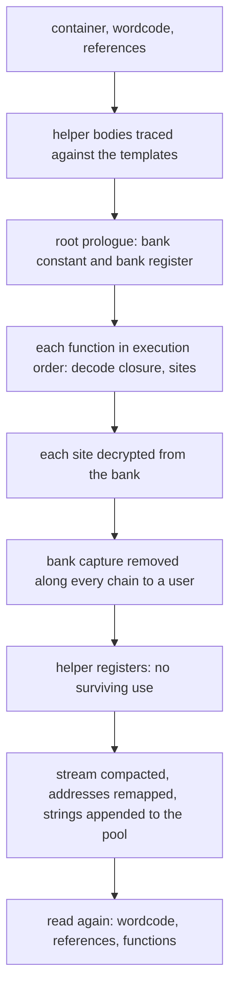

# Restore concealed VM strings

Pipeline stage: `recover-strings` ([map](../../pipelines/jsconfuser-vm.md#frontend-order)).

Readers need the encoder's
[shared string bank](../../../js-confuser-vm/transforms/shared-string-bank.md), closures and
upvalues as the VM has them (`MAKE_CLOSURE` and its capture pairs,
[`read-wordcode`](wordcode/read-wordcode.md#operand-grammar)), and the continuation loads of
[`origin-addresses`](wordcode/origin-addresses.md#2-algorithm).

## 1. Target

Write every concealed string as a plain constant load again, and remove the code that decoded
it. With `stringConcealing` the encoder moves the program's strings into one encrypted **bank**,
a base64 constant of UTF-16 units with random padding. It appends two helper functions,
**inflate** (base64 to units) and **decode** (one slice decrypted), has the program inflate the
bank once, hands the bank to every function that uses a string as one more closure capture, and
replaces each string load with a call of decode on `(key, start, length)`.

After the transform each such call is a `LOAD_CONST` of the string, the helper bodies, the
inflation, the per-function decode closures and the extra captures are gone, and the stream is
shorter. Offsets and lengths count UTF-16 units, so a character outside the basic plane is two
units; units are restored as they are.

The transform reads the canonical stream with its references. It executes nothing and knows one
cipher, the pinned encoder's, which it recognizes by the two helper bodies. The bank and all its
users are one unit: every site is restored or the input is left as it is
([F2](../../../encoder-decoder-method.md#f2-resolve-completely-or-not-at-all)). The input
container is never changed.

## 2. Algorithm

```text
restore(container, wordcode, references):                    // explanatory pseudocode
  entries = 0 and every closure entry, sorted; the last two are inflate and decode
  trace both helper bodies; each must equal its pinned template's trace
  one inflate closure at PC 0; decode closures take four parameters; none captures
  root prologue: MAKE_CLOSURE inflate; LOAD_CONST bank; CALL inflate(bank) -> bank register
  bank = the units of that base64 constant
  for each user function, read in execution order:
    its prologue: (LOAD_UPVALUE bank, unless root) then MAKE_CLOSURE decode  -> a string user
    each CALL of its decode closure, with the three LOAD_INT before it       -> one site
      plain = decrypt(bank, key, start, length); the site becomes LOAD_CONST plain
  need = the users and all their ancestors up to the root
  every closure site of a needed function loses its last capture, the bank
  no kept instruction may touch a helper register
  drop the removed instructions and both helper bodies; remap every address
  append the strings to the pool; read the result again: wordcode, references, functions
```



Every step before the last only plans. Nothing is written until all checks have passed.

### What the encoder writes

```text
root:      MAKE_CLOSURE rI, inflate          a user that is not the root:
           LOAD_CONST   rC, bank                LOAD_UPVALUE rB, <its last upvalue>
           CALL         rB = rI(rC)             MAKE_CLOSURE rD, decode
           MAKE_CLOSURE rD, decode           (only if the root uses a string)

a site:    LOAD_INT rD+1, key
           LOAD_INT rD+2, start
           LOAD_INT rD+3, length
           CALL     dst = rD(rB, rD+1, rD+2, rD+3)

a closure site of a function the bank passes through: one more capture pair at the end,
           (1, rB) in the root, (0, <the parent's own last upvalue>) elsewhere
```

A function that uses no string but has a descendant that does forwards the bank: it receives and
passes the extra capture and has no prologue of its own. The two helper bodies are the last two
functions of the stream, inflate then decode.

### Reading in execution order

The encoder writes each prologue and each site as a straight run, but the stream this transform
receives has been through the [CFF transform](normalize-cff-wordcode.md), which leaves blocks
in the flattener's shuffled layout, joined by jumps. So "the three loads before the call" is
read in the order the instructions run, not the order they lie in:

- from the function's entry, a `JUMP` is followed and left out of the reading;
- at a conditional, a try setup or a for-in step, the fallthrough is read first and each target
  later;
- a continuation load names the label its finalizer's `JUMP_REG` resumes at, so that label is a
  target too: code after a `finally` is entered no other way;
- a path ends at `RETURN`, `THROW` or `JUMP_REG`; instructions no path reached are appended in
  layout order.

Instructions that run one after another are adjacent in this reading whatever the layout. The
reading remembers which jumps it followed just before each instruction; relocation needs them.

### Proving the helpers

A call with three integer arguments could be the program's own. What makes it a string site is
that its callee is a closure of the decode body, and that body, with the inflate body, computes
the pinned cipher:

```text
inflate(text):                                 decode(bank, key, start, length):
  bytes = atob(text); out = ""; i = 0            out = ""; i = 0
  while i < bytes.length:                        while i < length:
    out += String.fromCharCode(                    key  = (key + 2654435769) | 0
      bytes.charCodeAt(i) |                        mask = (key ^ (key >>> 13)) & 65535
      bytes.charCodeAt(i + 1) << 8)                out += String.fromCharCode(
    i += 2                                           bank.charCodeAt(start + i) ^ mask)
  return out                                       i += 1
                                                 return out
```

Each body is turned into a **trace** and compared with the trace of the template the encoder
compiles, kept as an instruction list in the decoder. The trace walks the body from its entry
and records one entry per instruction on first visit:

- a jump is followed and leaves no entry; a conditional records
  `IF <condition>, <position when true>, <position when false>`, whichever of `JUMP_IF_FALSE` and
  `JUMP_IF_TRUE` the layout uses, and the walk takes the true side first; reaching an
  instruction already recorded records `GOTO <its position>`;
- an operation records its name and operands, where a register read is replaced by the position
  of the entry that last wrote it (`op7`), a `MOVE` passes its source's identity on, and a
  register never written is a parameter (`arg1`);
- a constant or global operand is its pool value, and its key must be 0; a call's argument count
  must equal the argument words it has;
- any other instruction, or a jump out of the body, refuses.

Part of the decode template's trace:

```text
5  LT   op3, arg3              i < length
6  IF   op5, 7, 34
7  LOAD_CONST 2654435769
8  ADD  arg1, op7              key + 0x9e3779b9
9  LOAD_CONST 0
10 BOR  op8, op9               | 0
...
33 GOTO 5
34 RETURN op27
```

Register numbers and layout do not appear in a trace, so the comparison holds through register
renumbering and through any order the CFF transform leaves; a changed operation, constant,
operand order or branch does not. The compiler's dead `LOAD_CONST undefined; RETURN` after the
last return is never walked. One constant has two spellings: after
[`normalize-concealed-constants`](normalize-concealed-constants.md) the increment `2654435769`
is the signed `-1640531527`, the same 32 bits, and the trace reads either as `2654435769` (the
`| 0` that follows makes them equal).

### The bank and a site

The bank constant must be canonical base64 of an even number of bytes; unit `j` is
`bytes[2j] | bytes[2j+1] << 8`. A site is decrypted with the decode body's own arithmetic:

```text
state = key
for i in 0 .. length-1:
  state = (state + 0x9e3779b9) | 0                     // advanced before each unit
  mask  = (state ^ (state >>> 13)) & 0xffff
  plain += String.fromCharCode(unit[start + i] ^ mask)
```

The site's first `LOAD_INT` becomes `LOAD_CONST dst, n, 0`, where `n` is a new pool index and
`dst` the call's destination; the other two loads and the call are removed. A site is 17 words
and its replacement 4. Each site appends its own pool value, in the order the sites are read, so
a string used twice is appended twice. The old pool entries, the bank and the helpers' constants
among them, stay; nothing reads them afterwards.

### Threading and what must not survive

The functions the bank passes through are the string users and all their ancestors, found by
walking each user's parent up to the root. Every closure site of such a function must end in the
bank's capture pair, which is removed and the capture count lowered by one; because the pair is
the last, no other upvalue index changes. A user's `LOAD_UPVALUE` must read exactly that last
upvalue.

Deleting the helpers' producers is safe only if nothing else uses what they produced. In every
function, no kept instruction may read or write a helper register (the bank register, the
decode closure's register and its three argument registers; in the root also the inflate
closure's and the bank constant's), and no closure may capture one, except in the bank pair
being removed. Register windows keep their sizes.

### Relocation

The kept instructions and the replacements are written at new PCs and every address is mapped:
the label operands ([`LABEL_WORD_OFFSETS`](wordcode/read-wordcode.md#exports-another-file-imports),
closure entries included) and the immediates of continuation loads. A removed instruction has no
new PC, with two exceptions:

- a function entry that was removed (a user's `LOAD_UPVALUE`) maps to the next kept instruction;
- a jump the reading followed **into** a removed part of a run is the run's own fallthrough,
  left by a split block. Into a site's second or third load or its call, it is retargeted to the
  instruction after the call; into a prologue part, to the first instruction after the prologue.

Any other address of a removed instruction refuses: a branch into the middle of a site that is
not the site's own run could skip an argument load, and the transform builds no control graph
that could show it dead.

### Worked example

The committed cell `composition-finally-abrupt-return` of suite `single-payload-stage`, file
`string-concealing` (profile `randomizeOpcodes+stringConcealing`, seed 251). The function entries
are 0, 93, 287 and 424: the root, the source's `run`, inflate and decode. The bank is pool entry
0, 411 units.

```text
input PC -> output PC
  0 ->   0   MAKE_CLOSURE r7, 287 (1 param, 12 regs, 0 captures)   removed: the inflate closure
  7          LOAD_CONST   r8, pool 0                               removed: the bank constant
 11          CALL         r6 = r7(r8)                              removed: r6 is the bank
 16          MAKE_CLOSURE r9, 424 (4 params, 14 regs, 0 captures)  removed: the root's decode
 23 ->   0   LOAD_THIS    r1
 25 ->   2   MAKE_CLOSURE r13, 93, captures (1,2) (1,6)            r13, 55, captures (1,2)
 61 ->  36   LOAD_INT     r10, 2830232868                          LOAD_CONST r5, pool 17
 64          LOAD_INT     r11, 239
 67          LOAD_INT     r12, 11
 70          CALL         r5 = r9(r6, r10, r11, r12)
 93 ->  55   LOAD_UPVALUE r11, 1                                   removed: run's bank
 96          MAKE_CLOSURE r12, 424                                 removed: run's decode
103 ->  55   LOAD_THIS    r2
105 ->  57   FINALLY_SETUP 222, r3, r4, 275                        FINALLY_SETUP 122, r3, r4, 149
113 ->  65   LOAD_INT r13, 2534907590; LOAD_INT r14, 253;          LOAD_CONST r5, pool 18
             LOAD_INT r15, 4; CALL r5 = r12(r11, r13, r14, r15)
184 ->  97   LOAD_INT     r3, 277                                  LOAD_INT r3, 151
```

- **Helpers.** The bodies at 287 and 424 give the two template traces.
- **The root** is a user: its decode closure follows the inflation, in `r9`, so its argument
  registers are `r10`, `r11`, `r12`. Its one site decodes 11 units from unit 239:
  `"TEST_OUTPUT"`.
- **`run`** loads upvalue 1 into `r11` and makes its decode closure in `r12`. Its closure site
  in the root passes two captures, the last `(1, 6)`: local register 6, the bank. Upvalue 1 is
  that last capture. The pair is removed.
- **One site by hand** (PC 113: key 2534907590, start 253, length 4). The bank's bytes at 506
  are `119,178, 121,14, 114,134, 110,250`: the units 45687, 3705, 34418, 64110. The state runs
  894376063, -746155464, 1908280305, 267748778, giving the masks 45575, 3596, 34305, 64006; the
  XORs are 112, 117, 115, 104: `push`.
- **Order of the new pool entries**: 17 `TEST_OUTPUT`; then `run` in execution order: 18 `push`,
  19 `try-`, 20 `returned` (the conditional's fallthrough), 21 `push` and 22 `finally-` (the
  finalizer, reached through the jump at 188), 23 `normal` (the conditional's target, read
  last). The source's two `push` share one bank slice and get two pool entries.
- **Addresses.** `run`'s entry 93 was removed and maps to 55, where its `LOAD_THIS` now is, so
  the closure names 55. The finally setup's two labels are mapped, and so is the continuation
  load at 184: `r3` is the continuation register that setup names, so 277 is an address and
  becomes 151.

Seven sites are restored, one function besides the root loses the bank capture, the pool grows
from 17 entries to 24, and the stream shrinks from 560 words to 161.

**A split run.** The cell of suite `string-flow-finally-continuation` (profile
`randomizeOpcodes+stringConcealing+controlFlowFlattening`, seed 251) reaches this transform after
the CFF transform, with blocks in the flattener's layout:

```text
 97 ->  52   LOAD_INT r22, 2830232868        LOAD_CONST r7, <new entry>
100          LOAD_INT r23, 239
103 ->  56   JUMP 33                         JUMP 17
 33          LOAD_INT r24, 4
 36          CALL r7 = r21(r18, r22, r23, r24)
 44 ->  17   GET_PROP r8, r2, r7

192 -> 114   LOAD_INT r4, 223                LOAD_INT r4, 140
223 -> 140   LOAD_INT r22, 2830232868        LOAD_CONST r12, <new entry>
```

The site that starts at 97 continues at 33 through the jump at 103. In execution order its
three loads and call are adjacent. The jump's target was removed, and since the reading followed
that jump into the site, it is retargeted to 17, the new PC of the instruction after the call.
The site at 223 is entered only through the continuation load at 192; without the continuation
rule the reading would not reach it in order.

## 3. Implementation

### Exports another file imports

| Export | File | Contract | Imported by |
|---|---|---|---|
| `diagnoseNormalizeStringConcealing(container, wordcode, references)` | `normalize-string-concealing.js` | `{ ok, result, diagnostic }`. The three records must describe one stream, with constants restored and direct jumps. | the [frontend driver](frontend-driver.md#triggers-and-refusal-policy) (`recoverStrings`); `support/cell-tests.js` |
| `HelperTracer`, `EXPECTED_HELPER_TRACES` | `string-concealing-helper-trace.js` | The trace of a body (`new HelperTracer(instructions, pool, start).trace()`), and the traces of the two templates, inflate then decode. | `normalize-string-concealing.js` |
| `HELPER_SIGNATURES` | `string-concealing-helper-signatures.js` | The two templates as compiled instruction lists, `[name, ...operands]` with constants as values. | `string-concealing-helper-trace.js` |

It imports `selectContinuationLoads`
([`origin-addresses`](wordcode/origin-addresses.md#exports-another-file-imports)),
`LABEL_WORD_OFFSETS` and `diagnoseWordcode`
([`read-wordcode`](wordcode/read-wordcode.md#exports-another-file-imports)), `diagnoseReferences`
([`validate-references`](wordcode/validate-references.md#exports-another-file-imports)) and
`diagnoseFunctionPartition`
([`partition-functions`](wordcode/partition-functions.md#exports-another-file-imports)).

### The stage result

```js
{
  schemaVersion: 'jsconfuser-vm-string-concealing-normalization.v1',
  container,              // a clone: the compacted words, the strings appended to the pool
  wordcode,               // read-wordcode on that clone
  references,             // validate-references on it
  functions,              // partition-functions on it, with no suspects admitted
  pcMap,                  // input PC -> output PC, as under Relocation
  decodedCount,           // sites replaced
  threadedFunctionCount,  // functions the bank passed through, the root not counted
}
```

The driver adopts it as a rewrite ([Adoption](frontend-driver.md#adoption)) and composes
`pcMap` onto its origin map.

### Decisions

- **Function entries** come from the references' closure descriptors, not from the functions
  record: the transform takes entry `k` to entry `k+1` as a function's interval, and the owner
  of a closure site is the greatest entry at or below its PC.
- **Helper closures.** Exactly one inflate closure, at PC 0, with one parameter, at least 12
  registers and no capture. At least one decode closure, each with four parameters, at least 14
  registers and no capture. The number of decode closures equals the number of users, and each
  has at least one site.
- **The root prologue** is the first three instructions of the root in execution order: the
  inflate closure, an unkeyed `LOAD_CONST`, and a one-argument `CALL` of the closure's register
  on the loaded register.
- **A site** is every `CALL` whose callee is the function's decode register, anywhere after the
  decode closure in execution order. The three instructions before it must be `LOAD_INT` into
  `d+1`, `d+2`, `d+3` in that order, and the call must pass exactly `bank, d+1, d+2, d+3`.
- **Slice bounds.** `1 <= key <= 0xffffffff`, `start >= 100`, `length >= 0`,
  `start + length <= units - 100`. The encoder pads each end of the bank with at least 100
  decoy units. A length of 0 gives the empty string.
- **Parents.** A user function whose closure sites lie in two different functions is refused;
  the helpers' own sites are not counted here.
- **The shared helper is a suspect until now.** With several string users, the decode body has
  several parents, which [`partition-functions`](wordcode/partition-functions.md#shared-parent-suspects)
  publishes as a suspect and the dispatcher and CFF transforms carry. This transform removes the
  body and partitions its output with no suspects admitted, so any other multi-parent entry
  refuses here.
- **The trace is a fingerprint, not a dataflow proof.** Register identities are those of the
  walk's first visit, carried from one path to the next in walk order. The template is traced by
  the same walk, so equal traces mean the same instructions with the same operand sources in
  that walk.

### Refusals

Owner `string-concealing` ([Refusals](../../pipelines/jsconfuser-vm.md#refusals)). Every shape
refusal has the code `string-concealing-shape`; the message names the check. The driver turns any
refusal into `string-concealing-declined` and stops the decode.

| Message | When |
|---|---|
| `String helper entries are absent` | Fewer than three function entries |
| `Pinned helper body at <pc> changed` | A helper's trace differs from its template's |
| `String helper operand width changed at <pc>`, `Unexpected <name> in string helper`, `String helper control leaves its body at <pc>` | The trace met a keyed constant, a call whose count is not its width, an instruction outside the templates' set, or a jump out of the body |
| `String helper closure sites changed` | The helper closures' count, place, parameters, registers or captures |
| `Program bank inflation prologue changed` | The root's first three instructions |
| `Bank is not base64`, `Bank is not canonical u16 LE base64` | The bank constant |
| `User closure has ambiguous parents` | A user function with closure sites in two functions |
| `Decoder has no inherited bank` | A decode closure at a function's entry with no bank load before it |
| `Decode call at <pc> changed` | A site's loads or call |
| `Decode slice is outside the padded bank` | The slice bounds |
| `Decoder closure has no string sites` | A decode closure nothing calls |
| `Decoder prologue count changed` | Decode closures and users differ in number |
| `String users are detached from the program` | A user's parent chain does not reach the root |
| `Bank capture at <pc> changed` | A threaded closure site's last capture is not the bank |
| `Bank upvalue index in function <pc> changed` | A user loads an upvalue other than its last |
| `String helper register escapes at <pc>`, `Bank capture escapes at <pc>` | A kept instruction or capture uses a helper register |
| `Target <pc> was removed with string helpers` | An address of a removed instruction that is not a run's own jump |
| the reader's message | The output does not read, validate or partition |

Any other exception is `string-concealing-error`.

## 4. Input Shapes

| Shape | Producer | Treatment |
|---|---|---|
| The bank constant, the two helper bodies, the root's inflation, each user's bank load and decode closure, each site, the extra capture | encoder step 3 `stringConcealing` | removed or replaced, as above |
| The helpers' increment constant as `-1640531527` | encoder steps 6 and 14 conceal it; [`normalize-concealed-constants`](normalize-concealed-constants.md) restores it signed | read as `2654435769` in the trace |
| Blocks in a shuffled layout joined by direct jumps; a site or prologue split over blocks; a block entered only through a continuation label | [`normalize-cff-wordcode`](normalize-cff-wordcode.md), which writes direct jumps and leaves the layout | read in execution order; a run's own jump retargeted |
| Direct branches where the encoder wrote encoded ones | [`normalize-dispatcher-wordcode`](normalize-dispatcher-wordcode.md) (encoder step 5) | needed: the traces and the reading follow direct targets only |
| Canonical instructions after added opcodes and PATCH regions are gone | the added-opcode routes, [`normalize-self-modifying-wordcode`](normalize-self-modifying-wordcode.md) | needed: the transform reads canonical names |
| The wordcode and references records | [`read-wordcode`](wordcode/read-wordcode.md#records), [`validate-references`](wordcode/validate-references.md#the-references-record) | instructions with operands and closure metadata; closure entries |
| A functions record with the decode entry as a shared-parent suspect | [`partition-functions`](wordcode/partition-functions.md#shared-parent-suspects) | not an argument: the transform partitions its own output |

The transform runs last of the recoveries because the encoder conceals strings first
([P1](../../../encoder-decoder-method.md#p1-work-in-reverse-encoder-stage-order-each-stage-placed-by-its-last-write)):
every later encoder step treats the helpers and the sites as ordinary code, and each must be
undone before the pinned bodies show again. The driver calls it when the stream's first three
instructions in layout order are a one-parameter `MAKE_CLOSURE`, a `LOAD_CONST` and a `CALL`
([Triggers](frontend-driver.md#triggers-and-refusal-policy)).

## 5. Known Gaps

- Only the pinned helper bodies are recognized. A different cipher, a helper compiled
  differently or a changed site layout refuses.
- No committed cell reaches a refusal and no test asserts one.
  `Bank upvalue has no decoder` in the code cannot be reached: a function has a bank register
  only when its decode closure follows the load.
- No proof covers the continuation reach of the execution-order reading;
  `string-flow-finally-continuation` holds the shape and stays green or red with the whole
  decode only.
- The pool is not compacted: the bank and the helpers' constants stay as unreferenced entries.
- The driver's trigger is a shape test on three instructions; a program that opens that way
  without string concealing is refused here
  ([frontend driver](frontend-driver.md#5-known-gaps)).

## 6. Source

- [normalize-string-concealing.js](../../../../decoder/decode-js/src/vm/jsconfuser-vm/normalize/normalize-string-concealing.js):
  the execution-order reading, the bank and slice arithmetic, sites, captures, the register
  check, relocation and the rebuild.
- [string-concealing-helper-trace.js](../../../../decoder/decode-js/src/vm/jsconfuser-vm/normalize/string-concealing-helper-trace.js):
  the trace and the templates' traces.
- [string-concealing-helper-signatures.js](../../../../decoder/decode-js/src/vm/jsconfuser-vm/normalize/string-concealing-helper-signatures.js):
  the two templates.
- Called from
  [diagnose-standalone.js](../../../../decoder/decode-js/src/vm/jsconfuser-vm/diagnose-standalone.js)
  (`recoverStrings`).

The encoder's
[string concealment pass](https://github.com/MichaelXF/js-confuser-vm/blob/20c5b96bf57337c568579352758d7685358650de/src/transforms/bytecode/stringConcealing.ts)
builds the bank, compiles the two helpers and rewrites the sites and captures.

## 7. Fixtures

Each suite encodes its sources with the pinned encoder and requires the decode to behave as the
source; a proof is a break of the named code that turns the suite red
([tests.md](../../tests.md#suites)). Suites are under
[cell-suites/](../../../../decoder/decode-js/test/vm/jsconfuser-vm/cell-suites/).

| Scenario | Expected result | Committed fixture |
|---|---|---|
| String concealing alone | The transform's output does not open with the inflation prologue; the decode behaves as the source | `single-payload-stage`, file `string-concealing` (the worked example; its stage-effect test; no proof of its own) |
| The bank threaded through nested closures, a forwarding ancestor included | Every chain loses the capture. Proof: the walk up the parents | `single-payload-stage-conditions`, `strings-in-nested-closures` |
| Non-ASCII units, a surrogate pair, a lone surrogate, NUL, the empty string | Units restored as they are. Proof: the 16-bit unit and mask in `decodeSlice` | `single-payload-stage-conditions`, `empty-string-and-utf-16` |
| Strings under flattening and the dispatcher, several sites per program | Each site gets its own pool entry; a continuation load is remapped. Proofs: the pool index per site; the continuation remap | `string-flow-chain` |
| A site entered only from a finally continuation label, split over blocks | The decode behaves as the source | `string-flow-finally-continuation` (the second example; no proof) |
| The increment constant after constant concealing | The trace accepts the signed spelling. Proof: the signed constant in the trace | `all-stages-together` |
| A source with no string under the option | The payload is the plain encoding's; the transform is not called | `single-payload-stage-conditions`, inert control `no-eligible-string` |
| Any refusal | `string-concealing-shape`, no result | |
| A surviving use of a helper register | Refused | |
| A program that opens like the prologue without the option | Refused | |
