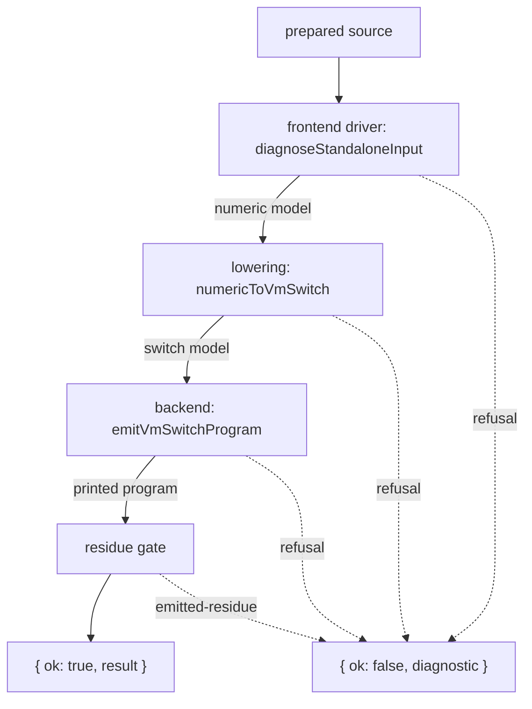

# jsconfuser-vm standalone decode

Pipeline stage: none; the driver over both layers ([map](../../pipelines/jsconfuser-vm.md#layers)).

The standalone decode is the one function that runs the whole decoder on a source string. This
doc owns its chain, the residue gate, the result record and the public diagnostic. What each link
of the chain does is its own doc's.

## 1. Target

Given the prepared source of a compiled program, return a record holding the program as fresh
JavaScript; given anything a step refuses, return a record holding one diagnostic. The record is
deeply frozen, and no partial output exists: the result is built only after the last check
([F2](../../../encoder-decoder-method.md#f2-resolve-completely-or-not-at-all)).

The decode is static. It parses and builds; it never evaluates the input, the interpreter or the
program it wrote. The output is a decompilation: it shares the input's behaviour and keeps
registers as variables, and no check here proves that behaviour (the
[cell suites](../../tests.md#suites) run it against the source).

It does not prepare the source or keep the input for the caller; the
[entry](../../plugins/jsconfuser-vm.md) does both.

## 2. Algorithm

```text
diagnoseStandalone(source):                           // explanatory pseudocode
  try:
    model       = unwrap(diagnoseStandaloneInput(source))   the frontend; its refusal is rethrown
    switchModel = numericToVmSwitch(model)                  the lowering
    emitted     = emitVmSwitchProgram(switchModel)          the backend; parses its own printout
    validateNumericVmResidue(emitted.output)                the residue gate
    return accepted(result built from model and emitted)
  catch error:
    return refused(error)        a `standalone` or `vm-switch` refusal keeps its code;
                                 anything else becomes standalone-emission-error
```



1. **The frontend** ([`frontend-driver`](frontend-driver.md)) returns the numeric model or a
   refusal under one of its own codes.
2. **The lowering** ([`lower-switch-model`](lower-switch-model.md)) writes the
   [switch model](../switch/vm-switch-boundary.md). From here nothing reads the encoder's facts.
3. **The backend** ([Backend order](../../pipelines/jsconfuser-vm.md#backend-order)) returns the
   printed program with its statement regions and simplification proofs. It has already parsed
   its printout once.
4. **The residue gate** parses the printout again and refuses if anything of the interpreter is
   named in it. The backend writes a program from the model alone, so residue would mean the
   frontend let part of the runtime through as program code; the gate is the check that this did
   not happen.

**The residue gate.** A node is residue when it is an identifier named `BYTECODE`, `CONSTANTS`,
`ENCODE_BYTECODE`, `VM`, `Closure`, `Upvalue` or `decodeBytecode`, or the member expression
`vm.run` (identifier object, identifier property, not computed). The first one found, in
traversal order, refuses with `emitted-residue` and the message `Standalone output contains
forbidden VM residue <name>`. The test is by name on the syntax tree: it does not ask whether the
name is bound or read, so a compiled program that itself uses a global of one of these names is
refused; `vm["run"]` is not matched.

### Worked example

The committed cell `return-through-finally` of suite `compiled-forms` (profile
`randomizeOpcodes`, seed 251). The decode returns `{ ok: true, result, diagnostic: null }` with

```text
wordCount: 112, instructionCount: 34, functionCount: 2
coverage: { instructions: 34, functions: 2 }
simplification.summary:
  { emitted: 18, safelyEliminated: 11, provenUnreachable: 5, unreachableFunctions: 0 }
statements: function 0: one opaque region; function 1: an opaque region and a try region
```

and this `output`:

```js
(function () {
  function __recovered_function_0() {
    let __recovered_r_0_2, __recovered_r_0_3;
    __recovered_r_0_3 = function (__recovered_r_1_0) {
      let __recovered_r_1_3, __recovered_r_1_4;
      try {
        __recovered_r_1_4 = __recovered_r_1_0 + 1;
        return __recovered_r_1_4;
      } finally {
        __recovered_r_0_2 = __recovered_r_0_2 + 1;
      }
    };
    __recovered_r_0_2 = 0;
    window["TEST_OUTPUT"] = [__recovered_r_0_3(4), __recovered_r_0_2];
    return void 0;
  }
  __recovered_function_0();
})();
```

The counts are of the stream after the frontend's recoveries: 34 instructions, of which the
backend wrote 18, removed 11 with a proof each (two register copies and nine dead definitions)
and dropped 5 as unreachable, so the three add up to the instruction count. Ordinary JavaScript
(`const answer = 42;`) returns

```js
{ ok: false, result: null,
  diagnostic: { code: 'container-declined', message: 'extractContainer declined the input container' } }
```

## 3. Implementation

### Exports another file imports

| Export | Contract | Imported by |
|---|---|---|
| `diagnoseStandalone(source)` | `{ ok, result, diagnostic }`, deeply frozen; never throws | the [entry](../../plugins/jsconfuser-vm.md); `plugin.test.js`, `cli.test.js`, `integration.test.js` |

`standalone-contract.js` (owner `standalone`, [`frontend-driver`](frontend-driver.md)) supplies
`accepted`, `refused` and `unwrap`; the gate refuses through the `vm-switch` owner's `decline`
([Refusals](../../pipelines/jsconfuser-vm.md#refusals)).

### The standalone result

```js
{
  schemaVersion: 'jsconfuser-vm-standalone.v3',
  parseOnly: true,              // constants: the decode parses and builds only
  targetExecution: false,       //   the input was not run
  vmExecuted: false,            //   the interpreter was not run
  emittedJavaScript: true,      //   output is a printed program
  finalJavaScriptSemantics: false,  // no check here proves the output's behaviour
  wordCount,                    // of the numeric model's wordcode: the stream after the recoveries,
  instructionCount,             //   not the payload as encoded
  functionCount,                // functions of the functions record
  output,                       // the printed program
  simplification: {
    schemaVersion: 'jsconfuser-vm-simplification.v1',   // the backend's record, relabeled
    functions,                  // per function { functionId, copies, deadDefinitions }: the proofs
    summary: { emitted, safelyEliminated, provenUnreachable, unreachableFunctions },
  },
  coverage: { instructions, functions },   // instructionCount and functionCount again
  statements,                   // per rendered function { functionId, regions }
}
```

The backend owns the `simplification` proofs ([`vm-switch-values`](../switch/vm-switch-values.md))
and the region rows ([`vm-switch-statements`](../switch/vm-switch-statements.md#region-rows)).
In the summary, `emitted + safelyEliminated + provenUnreachable` equals `instructionCount`;
`unreachableFunctions` counts functions only unreachable code creates, which are not rendered and
have no `statements` entry.

### The public diagnostic

`diagnostic` is `{ code, message }` plus any detail fields the refusal carried.

| Code | From | Meaning |
|---|---|---|
| `invalid-input` | the frontend driver | the source is not a string |
| `container-declined`, `wordcode-declined`, `references-declined`, `functions-declined`, `concealed-constants-declined`, `cff-declined`, `string-concealing-declined`, `unsupported-opcode` | the frontend driver | a frontend stage refused ([Frontend order](../../pipelines/jsconfuser-vm.md#frontend-order)); the stage's detailed code stays in its own record |
| the settle's own code | the frontend driver | settling the PATCH suspects refused ([`frontend-driver`](frontend-driver.md#refusals)) |
| a `vm-switch` code, as thrown | the backend (the lowering refuses nothing) | a model the backend cannot render; each backend doc lists its codes. `emitted-parse-failed` is the backend's own parse of its printout |
| `emitted-residue` | the residue gate | above |
| `standalone-emission-error` | the fallback | any exception that is not a `standalone` or `vm-switch` refusal: a defect, or a refusal of another owner that crossed the driver unconverted; the message is the exception's |

Source that does not parse is not a separate code: the container extraction refuses it, so it is
`container-declined`.

## 4. Input Shapes

| Shape | Producer | Treatment |
|---|---|---|
| The prepared source | the [entry](../../plugins/jsconfuser-vm.md) ([`normalize-source`](source/normalize-source.md)) | handed to the frontend driver |
| The numeric model | [`frontend-driver`](frontend-driver.md#the-numeric-model) | lowered; `wordcode` and `functions` supply the result's counts |
| `{ output, statements, simplification }` | the backend driver ([`vm-switch-emit`](../switch/vm-switch-emit.md)) | `output` gated, all three published |

## 5. Known Gaps

- The residue gate is a fixed list of names, those of the runtime as its template spells them; a
  runtime an encoder option renamed would not match. The cell suites' residue check, in the test
  harness, is the broader one.
- The gate refuses a compiled program that reads a global named like the runtime (`VM`,
  `Closure`).
- No committed test reaches `emitted-residue`, `standalone-emission-error` or `invalid-input`,
  or checks that the standalone record itself is frozen.
- `coverage` repeats two counts and the five constant flags carry no information about one
  decode; they are kept as the schema has them.

## 6. Source

- [decode-standalone.js](../../../../decoder/decode-js/src/vm/jsconfuser-vm/decode-standalone.js):
  the whole chain, the gate, the record.

## 7. Fixtures

No suite's proof breaks this file. Every cell of every suite decodes through it
([tests.md](../../tests.md#suites)); the tests below call it directly, from
[public-entry-points/](../../../../decoder/decode-js/test/vm/jsconfuser-vm/public-entry-points/).

| Scenario | Expected result | Committed fixture |
|---|---|---|
| Encoder output through the entry | `result` has schema `jsconfuser-vm-standalone.v3` and the five constant flags; the entry made one call | plugin.test.js |
| The CLI's sidecar against a direct call | `result` equal, field for field | cli.test.js, integration.test.js |
| Ordinary JavaScript; encoder output truncated | `container-declined`, `result` null | plugin.test.js |
| A compiled try with a finally | Decodes to a native `try`/`finally`, behaving as the source (the worked example) | [compiled-forms](../../../../decoder/decode-js/test/vm/jsconfuser-vm/cell-suites/compiled-forms/suite.js), source `return-through-finally` of file `control-try` |
| A printed program naming the runtime | `emitted-residue` | |
| An exception that is no refusal | `standalone-emission-error` with the exception's message | |
| A source that is not a string | `invalid-input` | |
