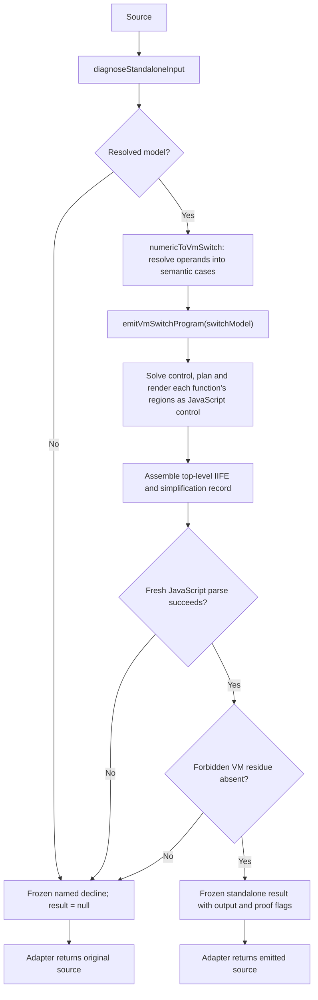

# jsconfuser-vm standalone decode

Pipeline stage: `publish` ([map](../../pipelines/jsconfuser-vm.md)).

## 1. Target

`decodeStandalone(source)` returns fresh JavaScript for the supported visible numeric-u32,
visible-constant VM baseline, or `null` on decline. The result-aware public entry point,
`diagnoseStandalone(source)`, combines [standalone diagnosis](standalone-diagnosis.md) with
emission and returns a frozen success or a structured decline. The integrated adapter preserves
the exact input bytes when either diagnosis or emission declines.

| Boundary | Success | Decline |
|---|---|---|
| Internal `diagnoseStandaloneInput` | Resolved model; no `output` | Named diagnostic; `model: null` |
| Public `diagnoseStandalone` | `{ ok: true, result, diagnostic: null }` | `{ ok: false, result: null, diagnostic }` |
| Public `decodeStandalone` | `result.output` | `null` |
| Integrated `decodeJsconfuserVm` | Output plus result | Original source plus diagnostic |

This design assumes JavaScript functions, registers and control flow, plus the
[parser/AST foundation](../../babel.md). Success is source-oriented decompilation, not
reconstruction of the original source or proof of universal runtime equivalence. The production
operation is static: it neither evaluates target helpers nor runs recovered code. Tests may
execute committed controls under their declared host/oracle boundary.

## 2. Algorithm

The public operation first admits the input through the diagnosis contract. The numeric adapter
then lowers every instruction to a [typed VM switch case](../switch/vm-switch-boundary.md), and the
shared backend renders one generated function per VM function inside a top-level IIFE. Fresh
parse and the target-specific residue scan precede publication. Nothing partially rendered
escapes a failing call.



The backend renders every function structured: planned linear, conditional and natural-loop
regions and native try statements, or a decline at rendering. Dispatch is only the review
rendering ([switch boundary](../switch/vm-switch-emit.md#inspecting-the-switch-handoff)).

Output retains registers where recovered operations need them, explicit receiver/constructor
roles, capture cells and completion/handler flow. The exact shared operation semantics are the
[operation grammar](../switch/vm-switch-boundary.md#typed-operation-grammar); the source-only native
gaps are [emission's](../switch/vm-switch-emit.md#5-known-gaps) and
[lowering's](lower-switch-model.md#5-known-gaps).
The final parse and residue scan establish syntax and a target-local shape check; they do not
execute the artifact or prove native semantic equivalence.

### Worked example: retain a method receiver

In this source-informed synthetic example, an admitted CALL_METHOD has destination r3, receiver r0,
callee r1, count 1 and argument r2. `read-wordcode` already establishes the operand roles; lowering
creates:

```js
{
  kind: 'call',
  mode: 'apply',
  destination: 3,
  callee: 1,
  receiver: { kind: 'register', index: 0 },
  arguments: { kind: 'fixed', registers: [2] },
}
```

The renderer emits an assignment equivalent to
`r3 = Reflect.apply(r1,r0,[r2])`. A spread sentinel instead produces `array-register:[r2]` and
passes r2 directly; no copied array literal is inserted. This example explains the carrier and
preserves the explicit receiver. It omits closure provenance, custom callee apply behavior,
exception routing and source qualification; those are not proved by the example.

## 3. Implementation

### Numeric-to-switch handoff and rendering path

[Lowering](lower-switch-model.md) (`numericToVmSwitch`) turns the admitted records into the
[switch model](../switch/vm-switch-boundary.md#model-fields): typed cases with no numeric opcode, raw
operand word or control, every field made true by the frontend and checked by no backend stage. The
[complete minimal model](../switch/vm-switch-boundary.md#complete-minimal-model) and the planner's
[region rows](../switch/vm-switch-statements.md#region-rows) own the exact representation.

| Delivery component | Dependency / result | Acceptance decision |
|---|---|---|
| Preflight | Source -> current resolved diagnosis model or named decline. | No lowering on decline; preceding semantic gaps remain visible. |
| Numeric projection | Model -> typed cases and frames. | No source/opcode text reaches generic operation rendering. |
| Shared backend | Typed cases -> complete function/program text and copy proofs. | Each function fully renders structured or throws. |
| Numeric publication | Fresh text -> residue-free AST -> standalone record. | Publish only after all stages finish; freeze success/decline objects. |
| Adapter and CLI | One public diagnosis -> output/result or original/diagnostic. | String rollback is separate from sequential output/sidecar filesystem writes. |

| Input or shape | Renderer action | Guard or retained evidence |
|---|---|---|
| Function partition and ordered instructions | Emit `__recovered_function_<id>`; call function 0 inside an IIFE. | Root capture argument appears only when needed. |
| Parameters, registers and captures | Declare registers referenced by structured output; add argument and capture parameters or local cells when used. | State-machine output retains its full register and handler scaffolding. |
| Loads, arithmetic, comparisons, unary operations | Render literals, `globalThis` access, `this`, capture reads and JavaScript operators. | The adapter resolves zero-key constants and lowers each operator from its opcode. |
| Property, array, object and accessor operations | Render property reads, `Reflect.set`, sloppy delete, array/object construction and property descriptors. | The wordcode reader resolves numeric widths; the adapter projects ordered semantic fields. |
| Plain, method and constructor calls | The adapter lowers each from its `read-wordcode` operands, normalizing fixed/spread argument forms; the backend renders a plain call as `f(...)`, a method call through `Reflect.apply` and construction through `Reflect.construct`. | A method's receiver and one spread-array register remain explicit. |
| `MAKE_CLOSURE`, upvalues and `FOR_IN_*` | Render closure shells and capture cells; include the enumerable-key helper only when some function needs it. | Child function entry, capture kinds/width and iterator labels are checked. |
| Structured function | Render the [planned regions](../switch/vm-switch-statements.md), `if`, loops, transfers and try statements through `StructuredFunctionEmitter`; a route into a catch or finalizer must name an enclosing try region. | Reachable cases must be fully emitted and the path must have a complete natural exit. |
| `TRY_SETUP`, `FINALLY_SETUP` | Render every try statement (catch, finally, both, nested) as native `try`, with each exit native, through the [try-region rule](../switch/vm-switch-try-region.md). | The rule's semantic checks decline models that are not compiler grammar. |

For structured functions, the [shared copy planner](../switch/vm-switch-emit.md#copy-simplification)
`effectiveStructuredInstructions` may coalesce an adjacent
producer/`MOVE` pair. It runs a reaching-definition analysis, requires the producer's destination
to have one use at that move, excludes local capture registers, and checks adjacency within a
block or across a single-predecessor fallthrough. The producer is retargeted, the redundant move
is removed, and the result records a `safely-eliminated` proof. If that analysis cannot converge,
emission declines.

The structured renderer drops unreachable cases, and the functions only unreachable code creates,
and declines if a reachable block was left uncovered
([unreachable code](../switch/vm-switch-emit.md#unreachable-code)). The summary keeps the
accounting explicit: `emitted + safelyEliminated + provenUnreachable` is the instruction count, and
`unreachableFunctions` counts the functions not emitted. Argument/cell declaration reduction is setup liveness, not
reconstruction of original lexical variables.

### Final validation and result

The shared emitter parses generated text as a script with error recovery disabled and
`allowReturnOutsideFunction:true`; the numeric wrapper parses it again as a script with error
recovery disabled for its residue scan. It scans that AST for target VM identifiers with exact names
`BYTECODE`, `CONSTANTS`, `ENCODE_BYTECODE`, `VM`, `Closure`, `Upvalue` and `decodeBytecode`,
plus noncomputed `vm.run` with identifier object/property. Shared parse failure produces
`emitted-parse-failed`; detected residue produces `emitted-residue`. Both discard the string.
An unexpected failure of the wrapper's second parse follows its generic exception path.
The residue walk is syntax-based and name-based: any
Identifier with an exact forbidden name counts, without a binding/liveness check; computed
`vm["run"]` and other unrelated names are not this rule. It is a target-local census, not
an exhaustive VM detector or semantic oracle. Typed `StandaloneDecline` and `VmSwitchDecline`
errors keep their codes; unexpected exceptions become `standalone-emission-error` with message
`error instanceof Error ? error.message : String(error)`. Residue uses code `emitted-residue`
and message `Standalone output contains forbidden VM residue ${residue}`, where residue is the
first detected forbidden identifier or `vm.run`. Both messages are source-inspected contracts;
the original reduced residue oracle asserted only the right code/discard behavior. The separate
[field-review controls](#fixtures) add exact synthetic error fields without executing these
production failure branches.

| Result field | What it records |
|---|---|
| `schemaVersion: jsconfuser-vm-standalone.v2` | Public numeric result shape, published after every frontend component. |
| `output`, `wordCount`, `instructionCount`, `functionCount` | Emitted text and current canonical wordcode/frame census after normalization; not necessarily original encoded payload counts. |
| `simplification` | Shared record relabeled `jsconfuser-vm-simplification.v1`; per-function copies and summary `emitted=instructionCount-copyCount-provenUnreachable`, `safelyEliminated=copyCount`, `provenUnreachable` (unreachable cases dropped), `unreachableFunctions` (functions only unreachable code creates, not emitted). |
| `coverage` | `{instructions:wordcode.instructionCount,functions:functionCount}`. |
| `statements` | The shared backend's [planned regions](../switch/vm-switch-statements.md) per function, `{functionId,regions}`; every rendered function has an entry, so there are `functionCount - unreachableFunctions` entries. |
| `proof` | True fields: `allPredecessorsReconstructed`, `noTargetExecution`, `noVmRuntimeEmission`, `freshJavaScriptEmission`, `freshSimplificationState`, `simplificationDispositionsDisjoint`, `finalParseValidated`, `finalResidueValidated`. |
| `parseOnly: true`, `targetExecution: false`, `vmExecuted: false` | The production decoder constructs and parses output; it does not run the target or its VM. |
| `emittedJavaScript: true`, `finalJavaScriptSemantics: false` | JavaScript was emitted, while full semantic equivalence remains unclaimed. |

`diagnoseStandalone` calls preflight once, constructs this record only after validation, and
deep-freezes the success or decline. `decodeStandalone` projects the result's `output` or `null`;
`emitStandalone` is the same projection alias. The adapter calls `diagnoseStandalone` once and
returns either its emitted output or the exact source string with the same diagnostic; the CLI's
additive registry and result sidecar expose that result without routing through the legacy decode
path. Deep freezing walks enumerable object/array values; it is not a generic immutable-Map
mechanism. The internal resolved diagnosis and shared emission return are not promised frozen. The
public record contains output and selected evidence, not every component record. Proof fields
are asserted construction/disposition flags: `allPredecessorsReconstructed` means required components
returned, not that native semantics or every reported field has independent proof.

No caller AST is mutated by this source-string operation. Emission constructs new text and uses
fresh parse trees; later consumers parse that text into a fresh scope context. The production
parse tree is not returned. Retained tests separately check fresh AST scope/reference consistency.

### Scenario and oracle map

| Scenario | Required observation / oracle | Retained assertion or gap |
|---|---|---|
| Successful numeric container | output differs from input, generated functions parse, target machinery absent. | `compiled-forms`, the public entry points and the rewrite suites below. |
| Structured branch/loop | The backend's planned regions agree with output without PC dispatch; retained oracle behavior matches. | `compiled-forms` below. |
| Catch/finalizer recovery | Explicit native syntax plus oracle value/throw; return evaluated before finalizer. | `compiled-forms` `control-try` below; arbitrary handler graphs unqualified. |
| Source/control damage | result null, decodeStandalone null, expected named code where asserted. | No committed test: the old damage edited the reference input by hand. |
| Internal emission failure | No partial output; typed code retained, unexpected exception normalized. | Source-inspected wrapper contract; injected failure/parse/residue branches lack focused retained tests here. |
| Result publication | Frozen public envelope/result/diagnostic where asserted; one adapter diagnosis call. | The plugin test; shared/internal return freezing excluded. |
| Broader native effects | Exact host result/error/effect-order comparison. | Missing controls in the shared semantic-gap list; flags/metadata cannot supply this evidence. |

### Readability gate

The committed benchmark assertions recompute fresh output for arithmetic, closure/loop and repeated-call
scale cases and compare it with committed goldens; the baseline records each decoded output's
size and digest. Its measurements are durable *axes*, not fixed figures:

| Axis | Acceptance question |
|---|---|
| Bytes and decoded/source, decoded/encoded ratios | Did output shrink against the recorded baseline for the same frozen input? |
| AST statements, declarations and generated identifiers | Did generated machinery decrease without losing executable structure? |
| Registers, captures, cells and enumerable helper | Does output retain only the setup that the recovered operations need? |
| Semantic operation counts | Did call, property, closure, handler and control forms remain present where expected? |
| Fresh parse, consistent derived state and bounded execution | Does the golden parse cleanly, keep parser state consistent and match the source fixture's observed `TEST_OUTPUT`? |

The oracle in this benchmark is a bounded regression check on committed fixtures. The metrics
collector uses current diagnosis output against committed goldens; these claims describe retained
test assertions, not a benchmark executed for this document. It is not a
production admission step and cannot establish general equivalence.

## 4. Input Shapes

| Earlier decoder output | Effect on emission |
|---|---|
| [standalone diagnosis](standalone-diagnosis.md) decline | Return its named diagnostic without building or emitting switch cases. |
| Resolved diagnosis model | Lower function/wordcode ownership, constants and instructions into the shared switch input. |

The output is target-local and additive. This component does not modify shared visitors or the
ordinary decoder plugin path.

## 5. Known Gaps

Earlier encoder eras, mixed or repeated encoders, arbitrary host behavior and source replacement
remain outside this boundary. Source-proved hardening, encoded, randomized and concealed forms reach
source emission only through their preceding [container](extract-container.md) and
[wordcode](standalone-diagnosis.md) proofs; source emission does not independently recognize those
representations. Unsupported control shapes decline at rendering, a cycle entered at more than one
case among them; dispatch is only the review rendering. In particular, switch arms with shared nonterminal routes
and loop exits that the enclosing loop cannot write remain open, including try exits into them; the
[control boundaries](../switch/vm-switch-emit.md#5-known-gaps) list each with the cell that pins it.
`finalJavaScriptSemantics` stays false. The semantic gaps of
[lowering](lower-switch-model.md#5-known-gaps) and [emission](../switch/vm-switch-emit.md#5-known-gaps)
include EXP/Math.pow, host callee apply/Reflect.apply, object destination
publication/evaluation order, strictness, global host choice and closure/ constructor behavior.
These are source-inspected contrasts and unqualified domains, not freshly executed counterexamples.

## Source

- [numeric-to-vm-switch.js](../../../../decoder/decode-js/src/vm/jsconfuser-vm/numeric-to-vm-switch.js) — resolves numeric operands into semantic cases.
- [vm-switch-model.js](../../../../decoder/decode-js/src/vm/switch/vm-switch-model.js) and [vm-switch-to-source.js](../../../../decoder/decode-js/src/vm/switch/vm-switch-to-source.js) — validate and emit the shared switch model.
- [decode-standalone.js](../../../../decoder/decode-js/src/vm/jsconfuser-vm/decode-standalone.js) — public numeric result and residue boundary.
- [diagnose-standalone.js](../../../../decoder/decode-js/src/vm/jsconfuser-vm/diagnose-standalone.js) — supplies the preflight result consumed in section 1.
- [jsconfuser-vm.js](../../../../decoder/decode-js/src/plugin/jsconfuser-vm.js) and [main.js](../../../../decoder/decode-js/src/main.js) — wire the adapter and CLI result described in section 3.
- [instruction-set.md](../../../js-confuser-vm/instruction-set.md) and [container-wordcode.md](../../../js-confuser-vm/container-wordcode.md) — define the visible baseline.

## Fixtures

The scenario table specifies the oracle boundary. The committed input/test assertions below
are source-inspected contracts; dated native executions cited beside them are separate evidence.
Neither listing nor finite execution establishes cold reconstruction or universal qualification.
Historical generation provenance alone does not supply a current replay recipe.

The retired immutable reduced emission/public verifier, built from the documents before
source consultation, ran with supplied diagnosis/emission/parser callbacks. It pins selected public result fields, flags,
simplification relabeling, counts/control references, result discard and deep freezing, plus typed
and Error normalization. It does not rebuild admission, the compiler, Babel parsing or native
behavior. Residue code/discard credit survives, but its exact-message expectation was guessed;
that run supplies no unexpected non-Error normalization credit. Projection exclusions are
recorded in [lowering's fixtures](lower-switch-model.md#fixtures), control exclusions in
[emission's](../switch/vm-switch-emit.md#fixtures).

The separate retired immutable field verifier, built from the corrected documents before
source consultation, asserted independent literal typed code/message retention, Error.message, non-Error string and number
conversion, exact BYTECODE and vm.run residue messages, null-result/discard, and envelope/nested
freezing. A supplied computed-member AST opposite publishes supplied text. These are synthetic
error/AST/text controls: actual preflight, emitter, parser, typed-class dispatch and full traversal
are not reconstructed or called. The skeletal success has only output, so it supplies no whole
standalone-result reconstruction. Other failure values, production injection/second-parse/residue
branches and source/native semantics remain unqualified. This new credit does not restore the
first verifier's excluded residue-message assertion or provide input-preservation evidence.

Each suite encodes its sources with the pinned encoder and requires the decode to behave as the
source ([tests.md](../../tests.md#suites)); a Proved line names the code whose break turns the case
red.

| Suite, fixture or test | Claims | Proved |
|---|---|---|
| [compiled-forms](../../../../decoder/decode-js/test/vm/jsconfuser-vm/generated-cells/compiled-forms/suite.js), files `data-literal`, `control-branch`, `control-switch`, `control-try` | Visible-constant input and generated functions; structured conditionals, loops and terminal switch arms without dispatch; native catch and finally rendering for protected throws, saved returns and caught returns (f-literals-order, f-branching, f-loop-forms, terminal-switch-arms, f-throw-catch, protected-conditional-catch, return-through-finally, caught-return-through-finally) | Natural loops become structured loops; catch setups are protected regions; a finally's throw pad is its own operand |
| [whole-programs](../../../../decoder/decode-js/test/vm/jsconfuser-vm/generated-cells/whole-programs/suite.js) | Large programs decode end to end | No break of its own |
| [runtime-rewrites-chain](../../../../decoder/decode-js/test/vm/jsconfuser-vm/generated-cells/runtime-rewrites-chain/suite.js) | Public output under minified and class runtimes | The payload is the boot call's single word stream and pool |
| [arithmetic input](../../../../decoder/decode-js/test/vm/jsconfuser-vm/fixtures/readability/arithmetic/encoded.js) and [decoded golden](../../../../decoder/decode-js/test/vm/jsconfuser-vm/fixtures/readability/arithmetic/decoded.js) | Source-oriented output and readability comparison. | Not a suite: a committed fixture or unit test |
| [closure-loop input](../../../../decoder/decode-js/test/vm/jsconfuser-vm/fixtures/readability/closure-loop/encoded.js) and [decoded golden](../../../../decoder/decode-js/test/vm/jsconfuser-vm/fixtures/readability/closure-loop/decoded.js) | Bounded behavior and required capture scaffolding. | Not a suite: a committed fixture or unit test |
| [vm-switch-to-source.test.js](../../../../decoder/decode-js/test/vm/switch/single-component/vm-switch-to-source.test.js) | Direct source-switch producer model, generic emission, and malformed handoff declines. | Not a suite: a committed fixture or unit test |
| [readability.test.js](../../../../decoder/decode-js/test/vm/jsconfuser-vm/support/readability.test.js) | Fresh output, bounded behavior, derived state and scaffolding reduction. | Not a suite: a committed fixture or unit test |
| [plugin.test.js](../../../../decoder/decode-js/test/vm/jsconfuser-vm/public-entry-points/plugin.test.js), [cli.test.js](../../../../decoder/decode-js/test/vm/jsconfuser-vm/public-entry-points/cli.test.js), and [integration.test.js](../../../../decoder/decode-js/test/vm/jsconfuser-vm/public-entry-points/integration.test.js) | Single-call adapter, sidecar and registered-path agreement with standalone output on a branch control. | Not a suite: a committed fixture or unit test |

Frozen success and decline records, null source on decline and the try-region damage controls have
no committed test: the old controls edited encoded input by hand.
