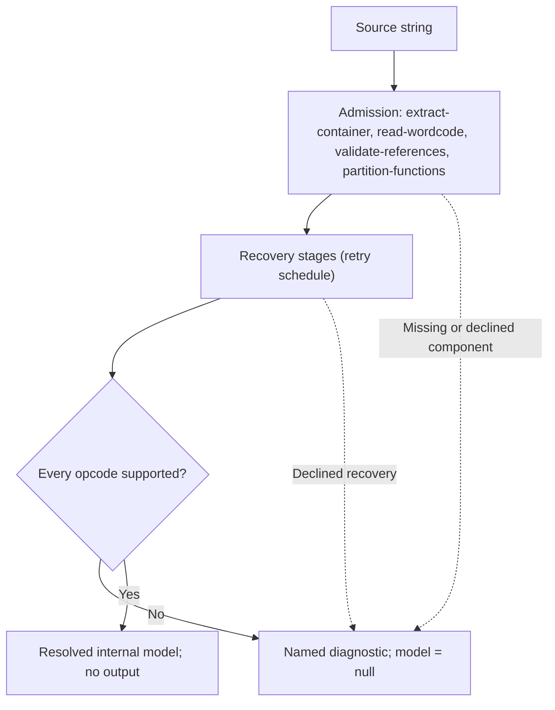

# jsconfuser-vm standalone diagnosis

Pipeline stage: `diagnose-and-lower` ([map](../../pipelines/jsconfuser-vm.md)).

## 1. Target

`diagnoseStandaloneInput(source)` decides whether one source string contains a complete,
statically recoverable instance of the visible numeric-u32, visible-constant VM baseline. It is
the internal boundary between source-derived analyses and
[standalone decoding](standalone-decode.md). It emits no JavaScript and executes neither the
target program nor the VM.

| Outcome | Internal return value | Meaning for the decoder |
|---|---|---|
| Resolved | `{ ok: true, model, diagnostic: null }` | The predecessor records passed admission; lowering and emission may start. |
| Recognized decline | `{ ok: false, model: null, diagnostic: { code, message } }` | A named gate refused the input; there is no model to emit. |
| Unexpected exception | Throws to the public boundary | The public wrapper turns it into one atomic `standalone-emission-error` decline. |

A resolved model is an **emission input**, not a decoded program or a claim of universal
behavioral equivalence.

## 2. Algorithm

The components run in dependency order on the supplied source. Each is labeled by its transform
doc's filename and publishes one record; it must resolve before the next can use it. After the
recovery stages, diagnosis checks that every opcode is one the standalone emitter implements; the
model it hands over is the program's instructions grouped by function with the constants and
frames, which the
[numeric projection](lower-switch-model.md) converts
into typed cases. Nothing else is recorded about the program's meaning: the backend's
[control solver](../switch/vm-switch-control.md) solves control from those cases, and its refusal (an
`indirect-jump` with no finite target, say) is the decode's.

## 3. Implementation

### Predecessor chain

`reconstruct` calls these functions in order. A falsy component result becomes the listed `*-declined`
diagnostic. The plugin preserves the standalone generic code.

| Component | Function and record | Main inputs | Missing-result code |
|---|---|---|---|
| `extract-container` | `extractContainerFromSource` -> container | source | `container-declined` |
| `read-wordcode` | `readWordcode` -> wordcode | container | `wordcode-declined` |
| `validate-references` | `validateReferences` -> references and constants | container, wordcode | `references-declined` |
| `partition-functions` | `diagnoseFunctionPartition` with suspects published -> function ownership; ordinary after strings (retry steps 3-5) | container, wordcode, references | `functions-declined` |

### Canonical frontend retries

The `extract-container` through `partition-functions` table describes the canonical calls; it is not the
complete normalization schedule. All retries below work on private records/analysis source, never
partially replacing public source. `extract-container` locates the payload by the boot skeleton; the
runtime added-opcode observers find the interpreter's handlers through the
[handler locator](locate-handlers.md).

After `extract-container`, the runtime added-opcode observers read the **original source**; a
handler table's handlers reach them through the locator's handler bodies. A reads the supplied tree
and builds no private clone. Successful numeric records are reused rather than reparsed or
revalidated.

1. Try canonical `read-wordcode`. An unknown-opcode or unsupported-hardening-opcode diagnosis first
   opens [PATCH compaction](normalize-self-modifying-wordcode.md), which removes only
   selfModifying's words and returns its `originPcMap` (`extract-container` PC -> current PC); a
   failure leaves original `extract-container` available. An unknown-opcode diagnosis on the current
   words then opens the linear added-opcode retries: aliases, aliases with allowObservedPrefix,
   macros, specialized, anti-specialized, then anti, each given the map. A successful inverse
   replaces the container and `read-wordcode` and adopts whatever other records it rebuilt, and its published
   `originPcMap` replaces the map (an alias projection passes the incoming one on). Other
   `read-wordcode` failures do not trigger an arbitrary recovery search; unresolved `read-wordcode`
   becomes wordcode-declined. From here on the schedule keeps that origin map (`extract-container`
   PC -> current PC, null while they coincide), recomposes it with the `pcMap` of every dispatcher,
   string and CFF success, and hands it to every dispatcher call as `decodedTargetMap`
   ([address identity](normalize-macro-wordcode.md#shared-expansion-and-address-relocation)). PATCH
   compaction's `suspects` (`extract-container` PCs) travel the same way, to every route and
   dispatcher call; a route that settles some (anti's decoys) publishes the rest. After each result
   adopted from a component that can recover hidden labels (the added-opcode or anti route, the
   dispatcher in step 3), the schedule collects its `skipLabels` and runs the
   [settle](normalize-self-modifying-wordcode.md#settling-suspects); when it settles, its `pcMap` is
   composed into the origin map and `validate-references` and `partition-functions` are rebuilt from
   the settled stream. A settle refusal is the decode's
   refusal.
2. Any nonzero constant-ref key opens the [constant inverse](normalize-concealed-constants.md). It
   replaces the container and `read-wordcode` and clears prior derived records by adopting its new result.
   `validate-references` is then built only if the current result has no `validate-references`.
   Unresolved keys produce concealed-constants-declined.
3. Use returned `partition-functions` or build `partition-functions` with every multi-parent closure
   entry published as a [suspect](partition-functions.md#shared-parent-suspects) (the shared string
   decode helper). If JUMP_REG remains, try the [dispatcher inverse](normalize-dispatcher-wordcode.md)
   once; after a settle, rebuild `validate-references` and this `partition-functions`; its decline alone does not
   fail the canonical path. Try CFF unconditionally. It reports one of three outcomes: cff-absent
   (no function reads as a whole state loop) continues on the current records; a loop it read and
   cannot invert is cff-declined; a `read-wordcode` through `partition-functions` builder refusing
   CFF's rewritten words is that component's decline (wordcode-, references- or functions-declined),
   never cff-declined, which would name the component by its pipeline position rather than by the shape
   that refused. Successful results replace their whole current record set and carry the suspects.
4. Strings come after both: the encoder conceals strings before CFF and the dispatcher, so their
   inverses peel first and the string inverse reads the program its own encoder step saw (P1). A
   first-three-instruction prefix MAKE_CLOSURE, LOAD_CONST, CALL on the current stream, with the
   first closure's paramCount=1, opens [string recovery](normalize-string-concealing.md) once. Its
   decline is string-concealing-declined; its success returns ordinary `read-wordcode`,
   `validate-references` and `partition-functions`.
5. A current `partition-functions` that still publishes a suspect is functions-declined: ordinary
   `partition-functions` refuses a closure with several parents. No recovery stage builds or
   returns a control graph, and none runs again after this step: each runs once, in decode order,
   on the stream its own encoder step produced, so a JUMP_REG the dispatcher left reaches the
   backend, whose control solver refuses it (`unresolved-indirect-jump`), rather than a retry.

The [constant result](normalize-concealed-constants.md#value-equations-and-publication) preserves
PCs and returns `extract-container` and `read-wordcode` only.
The [dispatcher inverse](normalize-dispatcher-wordcode.md#result-atomicity-and-acceptance) returns
`extract-container` through `partition-functions`;
[CFF](normalize-cff-wordcode.md#result-refusals-and-atomicity) returns `extract-container`
through `partition-functions` after its reorder and pruning;
[string recovery](normalize-string-concealing.md#address-remapping-atomicity-and-derived-state)
returns `extract-container` through `partition-functions` after bank/capture removal. Each result
replaces prior derived records rather than merging old analysis into changed words. Matched
functions recover as a unit; unmatched functions can carry through an inverse with relocated PCs and
rebuilt ownership. That internal partial boundary does not permit partially emitted source.

A dispatcher decline is optional: an observer's dispatcher-shape is not automatically
the public diagnostic, and retained dispatcher source controls later fail the backend's control
solver as `unresolved-indirect-jump`. CFF's is not: a dropped refusal would send a loop CFF has read to the backend as
ordinary code, where structured emission refuses it with a diagnostic naming neither CFF nor the
shape that refused. A function that fails CFF's grammar before its state loop reads whole is not CFF
and carries through unchanged, as ordinary code does. The mechanism pages own those selected
internal/public oracles. Do not infer a universal first rejecting component from the option name.

The detailed recognition/inversion and emitted-form inventories belong to
[`read-wordcode`'s producer map](read-wordcode.md#4-input-shapes),
[`validate-references`](validate-references.md#4-input-shapes),
and [`partition-functions`](partition-functions.md#4-input-shapes). This schedule is not evidence that every composition is
qualified.

The added-opcode/PATCH retries have distinct source and record contracts:

| Retry after direct `read-wordcode` failure | Required interpretation / returned records |
|---|---|
| [Alias isolated, then mixed](normalize-aliased-wordcode.md) | Width-preserving alias projection; mixed prefix proofs then expansion/anti or dispatcher. Current `extract-container` and `read-wordcode` and any adapter-rebuilt `validate-references` and `partition-functions`. |
| [Macro](normalize-macro-wordcode.md) | Complete anti/specialized prefixes and macro suffix; shared counted expansion with its actual expansion map E passed to compactor/dispatcher. Current `extract-container` and `read-wordcode` and optional rebuilt records. |
| [Specialized](normalize-specialized-wordcode.md) | One-word headers and baked tuples; expansion map E to dispatcher. Current `extract-container` and `read-wordcode` and optional dispatcher records. |
| [Anti-specialized](normalize-specialized-wordcode.md#dispatcher-and-anti-specialized-routes) | Expansion with its map E passed to the anti compactor, which composes C(E(oldPc)). |
| [Anti](normalize-anti-wordcode.md) | Proved real steps/seeds; private width-preserving control proof, then compact `extract-container` and `read-wordcode`; required dispatcher can add `validate-references` and `partition-functions`. |
| [PATCH, before linear retries](normalize-self-modifying-wordcode.md) | Added-opcode source proof for widths; sweep removes headers, decoys, fillers and storage; compact `extract-container`, canonical `read-wordcode` only when no added opcode remains, and `originPcMap`. |

Each retry receives unchanged original source/A until one whole route succeeds. Internal typed
added-opcode/PATCH diagnostics can be more precise than the final wordcode-declined public outcome;
a failed retry is not exposed as a partly recovered program. The direct `read-wordcode` diagnostic
is the route gate, not an encoder option-name detector. The added-opcode source observer uses the
[count-only canonical inventory](normalize-aliased-wordcode.md#source-proof-and-observation-contract);
this retry schedule does not add label-uniqueness validation to `extract-container` or that
observer. The [reachable observer](self-modifying-observation.md) consumes the owned added-opcode
definitions before any width-changing expansion. Linear added-opcode retries never interpret
ciphertext. [Finite PATCH qualification](qualify-jsconfuser-vm.md#finite-patch-added-opcode-qualification)
supplies generated interaction evidence; successful source recovery alone does not qualify every
option stack.

Changing words changes instruction spans even when some numeric PCs stay equal. Normalizers own
direct target relocation (including closure entry, iterator exit, catch/finally/pad words) and
proved LOAD_INT address seeds; plain numeric LOAD_INT values are not all addresses. For two
rewrites the address mapping composes in order, newPc = second(first(oldPc)); only proved
surviving/replaced boundaries get mappings. Unmapped consumed targets must decline rather than
retain an old address. Each producer's removal/replacement rules define that domain.

Returned records have a deliberate partial analysis boundary: a normalizer may return only
`extract-container` and `read-wordcode`, or `extract-container` through `partition-functions`.
Diagnosis fills missing records from the current words and values, reusing successful returned
records. It never combines a current `read-wordcode` with old
`validate-references` or `partition-functions`. Public success still requires every frontend component and the final emission gates; an
internally successful inverse can therefore be followed by a public atomic decline.

### Owned-record boundary

All numeric frontend component production callers originate in this source chain or its owned observer
and normalizer rebuilds. Plugin and sequential entry points supply source strings; they do not
supply private records. Exported diagnostic helpers do not create an independent model-input
boundary. Successful `read-wordcode` through `partition-functions` records are deeply frozen producer facts.
Normalizer container replacements are private clones treated as stable owned values during the
chain; not every normalizer freezes its container/envelope. No intervening caller mutates them.
Consumers build lookup maps and new records without replaying schemas, counts, raw-word
correspondence, descriptor shape, ownership or predecessor equality.

| Producer/consumer | Proof owner and retained work |
|---|---|
| Representation producer to A | Materializers prove source and publish whole analysis clones; observers prove source and publish whole observations. A retries/adapts the declared interface. Scope rebuilding belongs to the producer or fresh consumer context, not record revalidation. |
| `extract-container` to `read-wordcode` | `extract-container` admits source roles, canonical maps, encoding, and word values. `read-wordcode` owns instruction grammar, truncation, flags, unsupported opcodes, and complete consumption. |
| `read-wordcode` to `validate-references` | `validate-references` owns pool/key/global-name legality, stream-global register/capture maxima, entry boundaries, frame arithmetic and descriptor equality. Actual ownership is not yet assigned. |
| `validate-references` to `partition-functions` | `partition-functions` constructs function intervals and closure parents, rejects self-entry/ambiguous parents and ordinary cross-function targets. |
| Normalizer rebuild to chain | Producer remaps its changed stream and rebuilds the consumed records it returns. Diagnosis adopts the complete current result, fills absent `validate-references` and `partition-functions`, and reuses present records. PC relocation, PATCH legality, fake-seed/label proofs and erased-register lifetime guards remain producer decisions. |

[wordcode-index.js](../../../../decoder/decode-js/src/vm/jsconfuser-vm/wordcode-index.js) builds
instruction/boundary lookup maps over successful `read-wordcode` records; it is not a replacement
validator. `validate-references` global legality and `partition-functions` serialized ownership
are distinct facts; one successful record does not promise the next component will accept. Source
damage controls pin the first responsible diagnostic and the public atomic decline. Successful
producer regressions cover downstream projections and emitted behavior.

### Admission check

| Check | Evidence compared | Failure code |
|---|---|---|
| Input and opcode admission | Source is a string; each `read-wordcode` instruction name belongs to `SUPPORTED_INSTRUCTIONS`. | `invalid-input`, `unsupported-opcode` |

### Handoff model

| Model field | Origin | Use after diagnosis |
|---|---|---|
| `constants`, `wordcode`, `functions` | `validate-references`, `read-wordcode`, `partition-functions` | Literal values, instruction counts, function signatures and ownership. |
| `instructionsByFunction` | `read-wordcode` PCs joined to `partition-functions`'s ordered `instructionPcs` | Ordered emitter input for each recovered function. |

The [numeric projection](lower-switch-model.md) reads
this model rather than recalculating the predecessor chain: it takes `validate-references` values,
`read-wordcode` operands and `partition-functions` frames and ordered PCs. No field's presence
proves native semantics beyond its owning design's evidence.

Projection shares function records and allocates new cases; the backend solves control from the
cases. The
[exact typed operand/identity/count contract](lower-switch-model.md) is the lowering's; the
[complete supplied-model representation](../switch/vm-switch-boundary.md#complete-minimal-model)
belongs to the shared boundary, whose backend reads the [model fields](../switch/vm-switch-boundary.md#model-fields)
as given and repeats no frontend check; rendering is responsible for consumed structure and complete
output. An opaque or unsupported planned structure can therefore resolve
diagnosis but decline in emission; it is never rendered as dispatch.

`read-wordcode` instruction identity and `partition-functions` ownership are successful producer
facts. The internal envelope, lookup Maps and model are not deep-frozen by
`diagnoseStandaloneInput`; producer records retain their own freeze contracts and callers do not
mutate them. `StandaloneDecline` becomes a structured diagnostic here; any other exception
propagates. The public wrapper alone normalizes unexpected exceptions, adds parse/residue checks,
and freezes its complete success/decline.
[Publication](standalone-decode.md#final-validation-and-result) is source-string atomicity; it is
separate from CLI output/sidecar writes.

## 4. Input Shapes

| Earlier decoder output | Effect at this boundary |
|---|---|
| [container](extract-container.md), [wordcode](read-wordcode.md), [references](validate-references.md), and [functions](partition-functions.md) | Establish the visible baseline and PC/function ownership. Records are rebuilt from source on each call. |
| [standalone decode](standalone-decode.md) | Receives the resolved model or diagnostic; a decline never enters emission. |

## 5. Known Gaps

Representation variants outside the preceding container and wordcode normalization proofs,
and unknown opcodes remain outside admission. A
resolved diagnosis proves the supported static records are available; output rendering, fresh
parse, VM-residue rejection and readability belong to the decoder boundary.

## Source

- [diagnose-standalone.js](../../../../decoder/decode-js/src/vm/jsconfuser-vm/diagnose-standalone.js) — `reconstruct` and `diagnoseStandaloneInput` implement the chain and gates in sections 2-3.
- [standalone-contract.js](../../../../decoder/decode-js/src/vm/jsconfuser-vm/standalone-contract.js) — public object/array freeze helper (`deepFreeze`), typed declines (`StandaloneDecline`, `decline`) and
  `requireValue(value, code, message)`, which declines when a stage result is missing; internal diagnosis does not call the freeze helper.
- [decode-standalone.js](../../../../decoder/decode-js/src/vm/jsconfuser-vm/decode-standalone.js) — public `diagnoseStandalone` consumes the section 1 outcome.

## Fixtures

The retired immutable reduced emission/public verifier credited selected downstream reduced
decisions with supplied diagnosis records. It adds no frontend component source-admission, whole
projection or complete-validator evidence. The
[shared evidence map](../switch/vm-switch-emit.md#fixtures) keeps those exclusions alongside the
exact representation contract.

The retired frozen verifier modeled only synthetic current-result adoption/clearing, ordered string
retries and mandatory exhaustion versus optional preparation decline. It does not reconstruct source
admission, actual recovery, missing records or every frontend component. Missing-record fill and actual
caller order were verified in the postfreeze static source audit only. The synthetic public wrapper
does not qualify real public outcomes; the suites below hold those gates. The frozen executable stays unchanged.

Each suite encodes its sources with the pinned encoder and requires the decode to behave as the
source ([tests.md](../../tests.md#suites)); a Proved line names the code whose break turns the case
red.

| Suite and cases | Claims | Proved |
|---|---|---|
| [compiled-forms](../../../../decoder/decode-js/test/vm/jsconfuser-vm/generated-cells/compiled-forms/suite.js) | Visible baseline input resolves to a model and continues from preflight to emission | No break of its own |
| [transport-patch-chain](../../../../decoder/decode-js/test/vm/jsconfuser-vm/generated-cells/transport-patch-chain/suite.js) | An `encodeBytecode` input resolves through encoded-payload materialization | The encoded transport read as little-endian words |
| [self-modifying-dispatcher-anti](../../../../decoder/decode-js/test/vm/jsconfuser-vm/generated-cells/self-modifying-dispatcher-anti/suite.js) | Diagnosis retries settle the dispatcher's hidden labels behind anti decoys | Settle in `diagnose-standalone` |

The public decline shape and the payload-damage diagnostics have no committed test: the old
controls edited input by hand.
