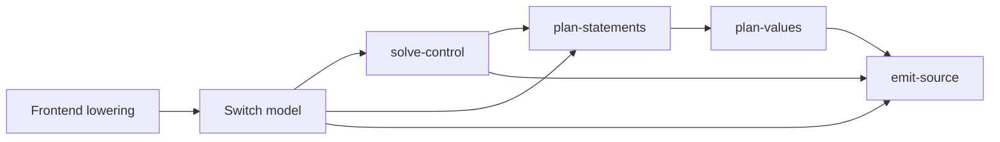

# VM switch boundary: the `model` module

Module of the VM decoder's backend ([map](../../pipelines/jsconfuser-vm.md#modules)); code in
[`src/vm/switch/model/`](../../../../decoder/decode-js/src/vm/switch/model/). This is the head
doc, and it also documents the model itself and the operation helpers; the control solve has its
own [sub-doc](vm-switch-control.md).

## 1. Target

`decode-js-vm-switch.v1`, the VM switch model, is the in-memory handoff from a VM-specific
frontend to the shared backend, and `model` is the code both sides of it share. A **case** is one
semantic instruction identified by a numeric PC. A **register** is a mutable per-invocation
variable; a **capture** names an enclosing function's register, local to the creating function or
inherited from its own captures.

It reads:

- a model object a frontend built: for js-confuser-vm, the
  [lowering](../jsconfuser-vm/lower-switch-model.md) of an admitted program. The backend's unit
  tests supply models written by hand; no other producer exists;
- within the backend, one function's frame and cases, and the fields value planning adds to a
  case.

It provides:

- the schema name and the `vm-switch` refusal;
- the meaning of every model field and typed operation (below), which the frontend makes true
  and the backend reads as given;
- per operation: the registers it reads and writes, whether it can throw, whether it renders as
  one expression and where an expression may fold into it; register and function names;
  constants as expression nodes; a function's head;
- the [control solve](vm-switch-control.md): reachability, handler stacks, edges, indirect
  targets, reaching definitions.

It never:

- holds encoder knowledge. Nothing here knows which encoder produced a model
  ([ownership test](#ownership-test));
- checks a model. Every field is the frontend's to make true ([a correct model](#a-correct-model));
- infers meaning from rendered switch text or raw words: the input is an object with `Map`
  indexes;
- plans statements or values, or renders a program
  ([statements](vm-switch-statements.md), [emission](vm-switch-emit.md)).

| Step | Observable result | Obligation |
|---|---|---|
| Source-specific lowering | One typed case per admitted instruction, with explicit storage and transfer semantics. | The frontend proves source ownership, operands, effects, calls, captures and completion. Model consistency alone cannot prove this relation. |
| Shared recovery | Source-oriented JavaScript with proved statement structure and planned register values, or explicit PC dispatch. | Emission covers the represented relation completely; it retains unproved operations and necessary register scaffolding. |
| Review rendering | Executable PC-switch JavaScript from the same model. | This exposes step one for inspection; reparsing it is not the step-two interface or a new source proof. |

### Ownership test

**One test decides where a step belongs: does it need knowledge of the encoder?** If it does, the
frontend does it; if it only reads the model, the shared backend does. The model's typed
operations are a canonical machine. A frontend maps its encoder's mechanisms onto them; the
backend recovers source from them without knowing which encoder produced them, so every VM
frontend reuses it.

| Concern | Needs encoder knowledge | Owner |
|---|---|---|
| Container, wordcode, opcode meaning, operands, constants | yes | frontend |
| Code the encoder injected (CFF fake transitions, self-modifying decoys and junk) | yes, to recognize it | frontend, removed before the model by the injecting transform's own placement facts, never by reachability ([P3](../../../encoder-decoder-method.md#p3-each-decoder-removes-only-its-own-additions-by-its-own-encoders-facts)) |
| The encoder's exception and finally mechanism | yes | frontend, lowered onto `catch-setup`, `finally-setup` (continuation, payload, throw pad), `handler-pop` and the `indirect-jump` resume |
| The encoder's for-in protocol | yes | frontend, lowered onto `for-in-setup` and `for-in-next` |
| Reachability, handler-state flow, which operation can throw where, finite indirect targets | no | backend ([control solver](vm-switch-control.md)) |
| Dispatch or structured emission for a function | no | backend |
| Statement units: if, while, do-while, for with its update, for-in, switch, labeled, try/catch/finally | no | backend |
| Transfers: break, continue, return, throw, exits routed through a finalizer | no | backend |
| Value planning (literal reads, dead definitions, copy simplification), register and capture scaffolding, rendering | no | backend |

**After its recovery stages a frontend is a format conversion into the model;** nothing of the
interpreter enters it: the backend drives the source the frontend hands over with minimal logic and
renders readable output.

### A correct model

**The frontend hands over a correct model.** Every fact in the model is the frontend's to make
true before the generalized backend sees it; the backend reads it as given and never re-derives or
re-checks it. In the frontend a check earns its place only where encoder output can differ from
what its reader assumes: a value the encoder's own construction fixes and never varies deliberately
(a function's register count and the register indexes one allocation pass assigns, say) is read,
not checked ([F4](../../../encoder-decoder-method.md#f4-keep-a-guard-only-where-a-real-case-needs-it)).
The backend is shared: its producer is the frontend, the origin is still real encoded code, and a
backend check or test earns its place only where a model a frontend hands over from real encoded
input reaches it ([F7](../../../encoder-decoder-method.md#f7-a-shared-pass-needs-off-path-cases)).

### The source program, not the interpreter

**The backend models the source program, not the interpreter.** A property of the interpreter's
own machinery (its stacks, how it delivers its own failures) has no source counterpart and is no
model fact. What no reader can decide statically is assumed: whether a try body throws cannot be
judged (a call into imported code, an accessor), so a handler may run whenever its try is entered,
and every setup routes to its own handler.

### Reachability and layout

The backend decides behaviour only from what is reachable on the model's graph: which code runs
and in what order. Unreachable operations never decide it, since their origin cannot be tested (an
intact unit injected by hand looks compiled). The model keeps them, so a frontend never removes
code by reachability, and source emission drops them as code no path runs
([unreachable code](vm-switch-emit.md#unreachable-code)). Reachable code is program code whoever
wrote it, including dead code a JavaScript transform injected before the VM compiled it.

### Jump steps

Layout never decides structure either. A case whose operation is an unconditional `jump` is
a **jump step**: it runs nothing, so every backend reader that follows control or compares where
flow arrives looks through it (`isJumpStep`), whether the producer laid its target out next or
elsewhere. A frontend that keeps a jump it cannot prove to be a fallthrough (a reordered layout,
control flow flattening's) therefore gets the same statements as one that erased it. A back edge
stays a `continue`, never a step.

## 2. Algorithm

A frontend admits its encoder's output, undoes the encoder's steps that follow its compiler, and
lowers what remains onto typed cases (the numeric frontend's
[lowering](../jsconfuser-vm/lower-switch-model.md)). From there the backend's stages read
only the model, each the previous one's result too:



| Backend stage | Reads | Doc |
|---|---|---|
| `solve-control` | each function's frame and cases | [control solver](vm-switch-control.md) |
| `plan-statements` | cases and the solver's result | [statement recovery](vm-switch-statements.md) |
| `plan-values` | cases, the solver's result and the planned regions | [value planning](vm-switch-values.md) |
| `emit-source` | cases, frames, capture counts, the solver's result, the planned regions and values | [source emission](vm-switch-emit.md) |

Where a step goes follows the [ownership test](#ownership-test): a fact about the encoder is the frontend's to make true before
the model exists, and nothing after the model checks it again.

### Complete minimal model

This model is written by hand, not lowered from encoded source (`sourceSwitchModel` in the backend's test models;
see [Fixtures](#7-fixtures)). `Map(key -> value)` denotes an actual JavaScript Map entry; labels `op0`,
`case0` and so on denote object references, not strings. All fields of this no-handler linear
example are shown:

```text
op0 = {kind:'assign', destination:0, value:{kind:'literal', value:7}}
op1 = {kind:'global-write', name:'RESULT', source:0}
op2 = {kind:'return', source:0}
case0 = {pc:0, nextPc:1, operation:op0}
case1 = {pc:1, nextPc:2, operation:op1}
case2 = {pc:2, nextPc:3, operation:op2}
frame0 = {id:0,startPc:0,regCount:1,paramCount:0,captureCount:0,hasRest:false}
model = {
  schemaVersion:'decode-js-vm-switch.v1',
  storage:{kind:'register-machine',functions:[{id:0,registerCount:1,captureCount:0}]},
  functions:{functions:[frame0]},
  instructionsByFunction:Map(0 -> [case0,case1,case2]),
  instructionCount:3
}
```

The solver finds fallthrough edges 0 -> 1 -> 2 and a return at 2; every edge falls through or
returns, so the planner makes one linear region over nodes `0:b@0`, `0:b@1`, `0:b@2`, and the walk
ends in return. The terminal return needs no case at nextPc 3. A branch extension must use
`when:'true'` or `when:'false'` as strings.

## 3. Implementation

### Model fields

The frontend makes every field below true before the handoff, and the backend reads it as given
([a correct model](#a-correct-model)). All IDs, PCs, counts, indexes and register fields are nonnegative safe
integers. PCs are globally unique case identities, not necessarily word or byte offsets; each
`nextPc` is greater than its `pc`. The case array need not be numerically sorted.

```js
{
  schemaVersion: 'decode-js-vm-switch.v1',
  storage: {
    kind: 'register-machine',
    functions: [{ id, registerCount, captureCount }],
  },
  functions: {
    functions: [{ id, startPc, regCount, paramCount, captureCount, hasRest }], // frames
  },
  instructionsByFunction,    // Map<id, case[]>; case = { pc, nextPc, operation }
  instructionCount,
}
```

| Field | Contract |
|---|---|
| `schemaVersion` | Exact. |
| `storage` | Unique function entries, equal to the corresponding frame counts. |
| `functions.functions` | Nonempty ordered frames. First frame has id 0; IDs/entries unique, parameters fit registers, `hasRest` is Boolean. |
| `instructionsByFunction` | One nonempty case array per frame. Every entry PC exists. |
| `instructionCount` | Equals the summed cases; the case map covers all frames. No raw word stream is supplied. |

The model has no control fields: blocks, edges, reachability, handler state and each function's
mode are derived, and the [control solver](vm-switch-control.md) derives them from the cases.

Registers are below `regCount`; upvalues are below `captureCount`. Direct jump/branch/handler,
finally throw-pad and iterator-exit targets exist in the same function. A closure entry identifies
a frame start, and capture width equals that child's `captureCount`. Every operation except
jump, indirect-jump, return and throw has an existing normal `nextPc`.

The frontend also establishes the meaning of every case (operands, effects, storage). The
renderer prints operators, literals and PCs from the model as given, so only a frontend's model may
reach it. The control solver derives handler state, edges and indirect targets and declines what it
cannot solve; structured rendering checks the decisions it consumes and can still decline or
throw. Future code mutation/version/context storage needs another versioned contract.

### Typed operation grammar

`R(r)` below denotes `__recovered_r_<functionId>_<r>` and `C(i)` is the enclosing function's register
that capture `i` names ([frames](vm-switch-emit.md#frames-captures-and-setup-liveness)). These are
explanatory notation, not executable helpers. The program is sloppy and each operation is written in
its [native form](vm-switch-emit.md#native-forms): the encoder carries sloppy semantics only, so where a
handler departs from native JavaScript either side is correct
([F8](../../../encoder-decoder-method.md#f8-keep-the-shared-behaviour-what-the-encoding-changed-is-free)).
A destination nothing reads is not written: the operation is dropped when it cannot throw and
written as its expression statement when it can.
Global names are strings; literal values may be undefined, null, Boolean, string, number or
BigInt. Numbers retain NaN, infinities and signed zero in emitted spellings.

| `kind` | Fields | Actual emitted operation |
|---|---|---|
| `assign` | `destination,value` | `R(dst)=value`; value kinds: `literal(value)`, `this` (native), `register(index)`, `binary(operator,left,right)`, `unary(operator,source)`, `typeof(source)`, `undefined`. |
| `global-read` | `destination,name` | The bare name: a ReferenceError when absent. `eval`, `arguments` and `__recovered_` names, which a bare name would not read from the global, check `name in globalThis`, throw `ReferenceError(name+' is not defined')` if absent, then read `globalThis[name]`. |
| `safe-typeof` | `destination,name` | Native `typeof name` (`typeof globalThis[name]` for `arguments` and `__recovered_` names): an inherited global is seen, where the handler's own-property test reads `'undefined'`. |
| `global-write` | `name,source` | Sloppy assignment to `globalThis[name]`: a non-writable global ignores it. |
| `upvalue-read`, `upvalue-write` | `destination,index`; `index,source` | Read/write C(index). |
| `property-read` | `destination,object,key` | Property get. |
| `property-delete` | `destination,object,key` | Sloppy `delete R(object)[R(key)]`: a primitive is boxed (ToObject), a nullish object throws TypeError, and an unconfigurable key gives false. |
| `property-write` | `object,key,value` | Sloppy assignment `R(object)[R(key)]=R(value)`. |
| `call` | `mode,destination,callee,receiver,arguments` | Assigned to destination: `callee(args)` for apply with receiver `none`; `o[k](args)` for apply with a register receiver whose callee is folded as a read `o[k]` of that register; `Reflect.apply(callee,receiver,args)` for any other apply with a register receiver; `new (callee)(args)` for construct. |
| `closure` | `destination,entry,captures:[{kind,index}]` | The function at `entry` as a function expression nested here, reading `local` capture `index` as R(index) and `upvalue` capture `index` as this function's C(index). |
| `array` | `destination,elements:[r...]` | Array literal with explicit values, including undefined elements. |
| `object` | `destination,pairs:[{key,value}...]` | Assign `{}` to destination first, then an ordered sloppy assignment `R(dst)[key]=value` per pair. |
| `accessor` | `accessor:get\|set,object,key,callback` | Get existing own descriptor, define configurable/enumerable accessor; preserve the opposite field only if it is a function. |
| `for-in-setup` | `destination,source` | Snapshot helper result into `{keys,index:0}`. |
| `for-in-next` | `destination,iterator,exit` | Test index against key count; exit without writing destination, or copy key and increment index then fall through. |
| `jump`, `branch`, `indirect-jump` | `target`; `condition,when:'true'\|'false',target`; `source` | Direct target, truthiness-based target versus nextPc, or raw register value as PC with no coercion. |
| `return`, `throw` | `source` | Native completion from R(source). |
| `catch-setup` | `target,exceptionRegister`, optional `layoutEnd` | Dispatch: push catch target and destination register. Structured: consume as a supported try boundary; `layoutEnd`, a case PC, only places where the statement closes when its block never completes normally. |
| `finally-setup` | `target,continuation,payload,throwPad` | Dispatch: push finalizer routing record. Structured: consume only supported return-continuation forms. |
| `handler-pop`, `debugger` | none | Dispatch stack pop; DEBUGGER emits no statement in structured mode and only the next-PC transition in dispatch mode. |

Binary operator allowlist: `+ - * / % ** & | ^ << >> >>> < > <= >= === !== == != in instanceof`.
Unary allowlist: `- + ! ~`. Branch `when` is the literal string `'true'` or `'false'`,
never a Boolean: `'false'` tests `!R(condition)` to select target and `'true'` tests
`R(condition)`; otherwise use nextPc. The shared grammar defines JavaScript expressions, with their native
coercions and throws; it does not silently equate a handler's `Math.pow` with `**`.
Call receivers are `register(index)` or `none`; `none` under apply is a plain call, and
construction permits only `none`. Arguments are `fixed(registers)`, rendered as an array literal
(a plain call's or a construction's argument list), or `array-register(registers:[r])`, rendered as the
register value directly (a plain call or a construction spreads it: `callee(...R(r))`).

The enumeration helper returns an empty snapshot for null/undefined. Otherwise it starts at
`Object(value)`, walks prototypes, reads own property names in host order, marks each first-seen
string **before** testing enumerability, and keeps enumerable names only. A nonenumerable own
name suppresses an inherited name; symbols and later mutations are absent. Dispatch rendering
iterates this snapshot, and so does a structured setup no native loop holds. A structured loop that
is the compiler's for-in unit is written as native `for...in`
([loops](vm-switch-emit.md#structured-rendering)): the encoder emits the setup and step only for a
for-in statement, so native enumeration is the source's, and it differs from the snapshot only when
the body deletes a key not yet visited or adds keys, or in when a Proxy's traps run.

### Exports another file imports

| Export | File | Contract | Imported by |
|---|---|---|---|
| `VM_SWITCH_SCHEMA` | `model.js` | `'decode-js-vm-switch.v1'`. | the lowering |
| `decline(code, message)`, `requireValue` | `model.js` | The `vm-switch` refusal and its value guard ([Refusals](../../pipelines/jsconfuser-vm.md#refusals)). | every backend file that refuses; `decode-standalone.js` |
| `isJumpStep(node)` | `model.js` | Whether a graph node's case is an unconditional `jump` ([jump steps](#jump-steps)). | `statements/`, `values/copy-simplification.js`, `emit/emit-state.js` |
| `literalNode(value)` | `operations.js` | A constant as an expression node: a negative number, `-0` and `-Infinity` as a negation, `NaN` and `Infinity` by name, `undefined` as `void 0`; any other type refuses `unsupported-constant-value`. | `emit/` |
| `registerName(functionId, register)`, `functionName(functionId)` | `operations.js` | `__recovered_r_<functionId>_<register>`, `__recovered_function_<functionId>`. | `emit/`, `to-source.js` |
| `operationReads(operation)` | `operations.js` | The registers an operation reads, in the order its rendering evaluates them. | `values/`, `emit/loop-region.js` |
| `readRegisters(instruction)` | `operations.js` | The same for a planned case: without the reads value planning wrote as a literal or folded, and without a method call's receiver, which its folded callee reads. | `values/value-planning.js` |
| `destinationRegister(instruction)` | `operations.js` | The operation's `destination`, or null; null for `for-in-next`, which writes only on its non-exit route. | `values/` |
| `functionRegisterSet(instructions)`, `localCaptureRegisterSet(instructions)` | `operations.js` | Every register the cases read or write; the registers closures capture as locals. | `emit/`, `values/value-planning.js` |
| `operationMayThrow(operation)` | `operations.js` | [`mayThrow`](vm-switch-control.md#exports-another-file-imports), and true for an `object-spread`. | `values/single-use-folding.js` |
| `expressionProducer(operation)`, `bareGlobal(name)` | `operations.js` | Whether an operation renders as one expression: `assign`, `property-read`, `property-delete`, `safe-typeof`, `upvalue-read`, `call`, `array`, `closure`, or a `global-read` of a bare name. A name is bare unless it is `eval`, `arguments` or starts with `__recovered_`. | `values/`, `emit/render.js` |
| `foldSlots(operation)`, `valueSlots(operation)` | `operations.js` | The operation's register reads as `{register, foldable, member?}` in evaluation order, or null where nothing folds into it; `member` marks a callee called without receiver. `valueSlots` also gives a register move's one slot. | `values/` |
| `operandRead(instruction)` | `operations.js` | False for `indirect-jump` and `for-in-next`, whose reads the structured rendering writes natively. | `values/value-planning.js` |
| `sameStack(left, right)` | `operations.js` | Two handler stacks with the same setups in the same order. | `values/` |
| `LiteralReads` | `operations.js` | Over one function's cases and its control result: `at(pc, register)` is the one literal every definition reaching the register at a reachable case holds, as `{value}`, or null; `read(instruction, register)` is whether that operand read reads one. A captured register, an entry value and a route write give null. | `values/value-planning.js` |
| `reachingDefinitionUses(instructions, reachingDefinitions, removed, literals)` | `operations.js` | A map from definition id to the reads it reaches, `{pc, register}`; a read reached by two definitions is a use of each. | `values/` |
| `functionHead(frame, functionRecord, instructions, registers, reachingDefinitions)`, `functionNode(frame, head, body)` | `operations.js` | A function's parameters and prologue; its node, a declaration for the root and an expression otherwise ([frames](vm-switch-emit.md#frames-captures-and-setup-liveness)). | `emit/structured-emitter.js`, `to-source.js` |

Two operation kinds are not part of the model a frontend hands over: `switch-test` and
`object-spread` are written by [value planning](vm-switch-values.md), which also adds the case
fields the helpers read (`folded`, `discarded`, `writesValue`, `unit`, `literalReads`,
`foldedReads`, `literalObject`).

## 4. Dependencies

| Imports | For |
|---|---|
| `src/vm/decline.js` (`declines`) | The `vm-switch` refusal |
| `@babel/types` | Expression and function nodes in the operation helpers |

The rule is one-way: `model/` imports nothing else of the backend and nothing of any frontend.
`statements/`, `values/`, `emit/` and `to-source.js` import it; a frontend imports only the
schema name ([imports chart](../../pipelines/jsconfuser-vm.md#imports)). Inside the module,
`control.js` imports `model.js`, and `operations.js` imports both.

## 5. Known Gaps

- No production frontend exists besides the js-confuser-vm one. Arbitrary machine context, code
  mutation at run time and a versioned extension of the model are not designed.
- The model is not validated on entry. A model a frontend did not build correctly is rendered as
  given or refused wherever a backend stage happens to depend on the broken fact.

## 6. Source

- [model.js](../../../../decoder/decode-js/src/vm/switch/model/model.js): the schema name, the
  refusal, the jump-step test.
- [operations.js](../../../../decoder/decode-js/src/vm/switch/model/operations.js): the
  operation helpers.
- [control.js](../../../../decoder/decode-js/src/vm/switch/model/control.js): the control solve
  ([sub-doc](vm-switch-control.md)).

## 7. Fixtures

The backend's unit tests build models by hand with the helpers in
[models.js](../../../../decoder/decode-js/test/vm/switch/single-component/models.js) and run the
emitted program. The fields and operations are otherwise pinned by each side's own fixtures:
the [lowering](../jsconfuser-vm/lower-switch-model.md), the
[control solver](vm-switch-control.md#7-fixtures), [statement recovery](vm-switch-statements.md)
and [source emission](vm-switch-emit.md).

| Scenario | Expected result | Committed fixture |
|---|---|---|
| The complete minimal model above (`sourceSwitchModel`) | Emitted without dispatch; running it sets `RESULT` to 7 | [emit.test.js](../../../../decoder/decode-js/test/vm/switch/single-component/emit.test.js) |
| A closure and a for-in after a `return`, and the function only that closure creates | No block, no function and no for-in helper is emitted for them | [model.test.js](../../../../decoder/decode-js/test/vm/switch/single-component/model.test.js) |

## Index

| Sub-doc | Responsibility | Files | Entry points |
|---|---|---|---|
| This doc | The model's fields and operations; the schema name and refusal; the operation helpers | `model.js`, `operations.js` | `VM_SWITCH_SCHEMA`, the `vm-switch` refusal |
| [`vm-switch-control`](vm-switch-control.md) (stage `solve-control`) | The control solve every backend transform reads | `control.js` | `solveControl` |
