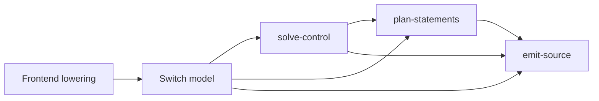

# VM switch boundary for reusable decoding

Layer handoff: from the frontend's `diagnose-and-lower` to the backend's `solve-control`
([map](../../pipelines/jsconfuser-vm.md)).

`decode-js-vm-switch.v1` is the in-memory handoff from a VM-specific frontend to the
shared backend. This design assumes JavaScript functions, arrays and control flow;
[Babel foundations](../../babel.md) explain the AST/scope vocabulary used by the surrounding decoder.
A case is one semantic instruction identified by a numeric PC. A register is a mutable
per-invocation variable; a capture is a shared cell referring to that variable or an inherited cell.

## 1. Target

A frontend turns its admitted source into typed operations and a complete function/case inventory.
The shared backend turns those cases into fresh JavaScript. Its input is an object with `Map`
indexes, not rendered switch text, serialized numeric operands or a proof about arbitrary source.
The active numeric frontend targets the linked
[js-confuser-vm instruction semantics](../../../js-confuser-vm/instruction-set.md).
The synthetic `source-switch` tests exercise a separately supplied model; there is no production
binary or source-switch extractor.

| Step | Observable result | Obligation |
|---|---|---|
| Source-specific lowering | One typed case per admitted instruction, with explicit storage and transfer semantics. | The frontend proves source ownership, operands, effects, calls, captures and completion. Model consistency alone cannot prove this relation. |
| Shared recovery | Source-oriented JavaScript with proved statement structure and bounded adjacent-copy removal, or explicit PC dispatch. | Emission covers the represented relation completely; it retains unproved operations and necessary register/cell scaffolding. |
| Review rendering | Executable PC-switch JavaScript from the same model. | This exposes step one for inspection; reparsing it is not the step-two interface or a new source proof. |

### Ownership test

**One test decides where a step belongs: does it need knowledge of the encoder?** If it does, the
frontend does it; if it only reads the model, the shared backend does. The model's typed
operations are a canonical machine. A frontend maps its encoder's mechanisms onto them; the
backend recovers source from them without knowing which encoder produced them, so every VM
frontend reuses it.

| Concern | Needs encoder knowledge | Owner |
|---|---|---|
| Container, wordcode, opcode meaning, operands, constants | yes | frontend |
| Code the encoder injected (CFF fake transitions, self-modifying decoys and junk) | yes, to recognize it | frontend, removed before the model by the injecting transform's own placement facts, never by reachability ([P3](../../../encoder-decoder-method.md#p3-each-decoder-removes-only-its-own-additions-by-its-own-encoders-facts)) |
| The encoder's exception and finally mechanism | yes | frontend, lowered onto `catch-setup`, `finally-setup` (continuation, payload, throw pad), `handler-pop` and the `indirect-jump` resume |
| The encoder's for-in protocol | yes | frontend, lowered onto `for-in-setup` and `for-in-next` |
| Reachability, handler-state flow, which operation can throw where, finite indirect targets | no | backend ([control solver](vm-switch-control.md)) |
| Dispatch or structured emission for a function | no | backend |
| Statement units: if, while, do-while, for with its update, for-in, switch, labeled, try/catch/finally | no | backend |
| Transfers: break, continue, return, throw, exits routed through a finalizer | no | backend |
| Copy simplification, register and capture scaffolding, rendering | no | backend |

**After its recovery stages a frontend is a format conversion into the model;** nothing of the
interpreter enters it: the backend drives the source the frontend hands over with minimal logic and
renders readable output.

### A correct model

**The frontend hands over a correct model.** Every fact in the model is the frontend's to make
true before the generalized backend sees it; the backend reads it as given and never re-derives or
re-checks it. In the frontend a check earns its place only where encoder output can differ from
what its reader assumes: a value the encoder's own construction fixes and never varies deliberately
(a function's register count and the register indexes one allocation pass assigns, say) is read,
not checked ([F4](../../../encoder-decoder-method.md#f4-keep-a-guard-only-where-a-real-case-needs-it)).
The backend is shared: its producer is the frontend, the origin is still real encoded code, and a
backend check or test earns its place only where a model a frontend hands over from real encoded
input reaches it ([F7](../../../encoder-decoder-method.md#f7-a-shared-pass-needs-off-path-cases)).

### The source program, not the interpreter

**The backend models the source program, not the interpreter.** A property of the interpreter's
own machinery (its stacks, how it delivers its own failures) has no source counterpart and is no
model fact. What no reader can decide statically is assumed: whether a try body throws cannot be
judged (a call into imported code, an accessor), so a handler may run whenever its try is entered,
and every setup routes to its own handler.

### Reachability and layout

The backend decides behaviour only from what is reachable on the model's graph: which code runs
and in what order. Unreachable operations never decide it, since their origin cannot be tested (an
intact unit injected by hand looks compiled). The model keeps them, so a frontend never removes
code by reachability, and source emission drops them as code no path runs
([unreachable code](vm-switch-emit.md#unreachable-code)). Reachable code is program code whoever
wrote it, including dead code a JavaScript transform injected before the VM compiled it.

### Jump steps

Layout never decides structure either. A case whose operation is an unconditional `jump` is
a **jump step**: it runs nothing, so every backend reader that follows control or compares where
flow arrives looks through it (`isJumpStep`), whether the producer laid its target out next or
elsewhere. A frontend that keeps a jump it cannot prove to be a fallthrough (a reordered layout,
control flow flattening's) therefore gets the same statements as one that erased it. A back edge
stays a `continue`, never a step.

## 2. Algorithm

A frontend admits its encoder's output, undoes the encoder's steps that follow its compiler, and
lowers what remains onto typed cases (the numeric frontend's
[lowering](../jsconfuser-vm/lower-switch-model.md)). From there the backend's stages read
only the model, each the previous one's result too:



| Backend stage | Reads | Doc |
|---|---|---|
| `solve-control` | each function's frame and cases | [control solver](vm-switch-control.md) |
| `plan-statements` | cases and the solver's result | [statement recovery](vm-switch-statements.md) |
| `emit-source` | cases, frames, capture counts, the solver's result and the planned regions | [source emission](vm-switch-emit.md), [try regions](vm-switch-try-region.md) |

Where a step goes follows the [ownership test](#ownership-test): a fact about the encoder is the frontend's to make true before
the model exists, and nothing after the model checks it again.

### Complete minimal model

This model is written by hand, not lowered from encoded source (the source-switch test's model;
see [Fixtures](#fixtures)). `Map(key -> value)` denotes an actual JavaScript Map entry; labels `op0`,
`case0` and so on denote object references, not strings. All fields of this no-handler linear
example are shown:

```text
op0 = {kind:'assign', destination:0, value:{kind:'literal', value:7}}
op1 = {kind:'global-write', name:'RESULT', source:0}
op2 = {kind:'return', source:0}
case0 = {pc:0, nextPc:1, operation:op0}
case1 = {pc:1, nextPc:2, operation:op1}
case2 = {pc:2, nextPc:3, operation:op2}
frame0 = {id:0,startPc:0,regCount:1,paramCount:0,captureCount:0,hasRest:false}
model = {
  schemaVersion:'decode-js-vm-switch.v1',
  storage:{kind:'register-machine',functions:[{id:0,registerCount:1,captureCount:0}]},
  functions:{functions:[frame0]},
  instructionsByFunction:Map(0 -> [case0,case1,case2]),
  instructionCount:3
}
```

The solver finds fallthrough edges 0 -> 1 -> 2 and a return at 2; every edge falls through or
returns, so the planner makes one linear region over nodes `0:b@0`, `0:b@1`, `0:b@2`, and the walk
ends in return. The terminal return needs no case at nextPc 3. A branch extension must use
`when:'true'` or `when:'false'` as strings.

## 3. Implementation

### Model fields

The frontend makes every field below true before the handoff, and the backend reads it as given
([a correct model](#a-correct-model)). All IDs, PCs, counts, indexes and register fields are nonnegative safe
integers. PCs are globally unique case identities, not necessarily word or byte offsets; each
`nextPc` is greater than its `pc`. The case array need not be numerically sorted.

```js
{
  schemaVersion: 'decode-js-vm-switch.v1',
  storage: {
    kind: 'register-machine',
    functions: [{ id, registerCount, captureCount }],
  },
  functions: {
    functions: [{ id, startPc, regCount, paramCount, captureCount, hasRest }], // frames
  },
  instructionsByFunction,    // Map<id, case[]>; case = { pc, nextPc, operation }
  instructionCount,
}
```

| Field | Contract |
|---|---|
| `schemaVersion` | Exact. |
| `storage` | Unique function entries, equal to the corresponding frame counts. |
| `functions.functions` | Nonempty ordered frames. First frame has id 0; IDs/entries unique, parameters fit registers, `hasRest` is Boolean. |
| `instructionsByFunction` | One nonempty case array per frame. Every entry PC exists. |
| `instructionCount` | Equals the summed cases; the case map covers all frames. No raw word stream is supplied. |

The model has no control fields: blocks, edges, reachability, handler state and each function's
mode are derived, and the [control solver](vm-switch-control.md) derives them from the cases.

Registers are below `regCount`; upvalues are below `captureCount`. Direct jump/branch/handler,
finally throw-pad and iterator-exit targets exist in the same function. A closure entry identifies
a frame start, and capture width equals that child's `captureCount`. Every operation except
jump, indirect-jump, return and throw has an existing normal `nextPc`.

The frontend also establishes the meaning of every case (operands, effects, storage). The
renderer prints operators, literals and PCs from the model as given, so only a frontend's model may
reach it. The control solver derives handler state, edges and indirect targets and declines what it
cannot solve; structured rendering checks the decisions it consumes and can still decline or
throw. Future code mutation/version/context storage needs another versioned contract.

### Typed operation grammar

`R(r)` below denotes `__recovered_r_<functionId>_<r>` and `C(i)` is
`__recovered_captures[i].value`. These are explanatory notation, not executable helpers.
Global names are strings; literal values may be undefined, null, Boolean, string, number or
BigInt. Numbers retain NaN, infinities and signed zero in emitted spellings.

| `kind` | Fields | Actual emitted operation |
|---|---|---|
| `assign` | `destination,value` | `R(dst)=value`; value kinds: `literal(value)`, `this`, `register(index)`, `binary(operator,left,right)`, `unary(operator,source)`, `typeof(source)`, `undefined`. |
| `global-read` | `destination,name` | Check `name in globalThis`, throw `ReferenceError(name+' is not defined')` if absent, then read the named property. |
| `safe-typeof` | `destination,name` | Own-property test with `Object.prototype.hasOwnProperty.call`; typeof the own value, otherwise string `'undefined'`. Inherited-only names are absent here. |
| `global-write` | `name,source` | Strict assignment to `globalThis[name]`. |
| `upvalue-read`, `upvalue-write` | `destination,index`; `index,source` | Read/write C(index). |
| `property-read` | `destination,object,key` | Property get. |
| `property-delete` | `destination,object,key` | The handler's sloppy `delete` inside the strict program: `Reflect.deleteProperty(R(object)==null?R(object):Object(R(object)),R(key))`, so a primitive is boxed (ToObject), a nullish object throws TypeError before the key converts, and an unconfigurable key gives false. |
| `property-write` | `object,key,value` | `Reflect.set` in that operand order; ignore Boolean result. |
| `call` | `mode,destination,callee,receiver,arguments` | Assigned to destination: `callee(args)` for apply with receiver `none`, `Reflect.apply(callee,receiver,args)` for apply with a register receiver, `Reflect.construct(callee,args)` for construct. |
| `closure` | `destination,entry,captures:[{kind,index}]` | Recovered callable shell using local/inherited cells and child frame. |
| `array` | `destination,elements:[r...]` | Array literal with explicit values, including undefined elements. |
| `object` | `destination,pairs:[{key,value}...]` | Assign `{}` to destination first, then ordered `Reflect.set` calls using that destination. |
| `accessor` | `accessor:get\|set,object,key,callback` | Get existing own descriptor, define configurable/enumerable accessor; preserve the opposite field only if it is a function. |
| `for-in-setup` | `destination,source` | Snapshot helper result into `{keys,index:0}`. |
| `for-in-next` | `destination,iterator,exit` | Test index against key count; exit without writing destination, or copy key and increment index then fall through. |
| `jump`, `branch`, `indirect-jump` | `target`; `condition,when:'true'\|'false',target`; `source` | Direct target, truthiness-based target versus nextPc, or raw register value as PC with no coercion. |
| `return`, `throw` | `source` | Native completion from R(source). |
| `catch-setup` | `target,exceptionRegister`, optional `layoutEnd` | Dispatch: push catch target and destination register. Structured: consume as a supported try boundary; `layoutEnd`, a case PC, only places where the statement closes when its block never completes normally. |
| `finally-setup` | `target,continuation,payload,throwPad` | Dispatch: push finalizer routing record. Structured: consume only supported return-continuation forms. |
| `handler-pop`, `debugger` | none | Dispatch stack pop; DEBUGGER emits no statement in structured mode and only the next-PC transition in dispatch mode. |

Binary operator allowlist: `+ - * / % ** & | ^ << >> >>> < > <= >= === !== == != in instanceof`.
Unary allowlist: `- + ! ~`. Branch `when` is the literal string `'true'` or `'false'`,
never a Boolean: `'false'` tests `!R(condition)` to select target and `'true'` tests
`R(condition)`; otherwise use nextPc. The shared grammar defines JavaScript expressions, with their native
coercions and throws; it does not silently equate a handler's `Math.pow` with `**`.
Call receivers are `register(index)` or `none`; `none` under apply is a plain call, and
construction permits only `none`. Arguments are `fixed(registers)`, rendered as an array literal
(a plain call's argument list), or `array-register(registers:[r])`, rendered as the register value
directly (a plain call spreads it: `callee(...R(r))`).

The enumeration helper returns an empty snapshot for null/undefined. Otherwise it starts at
`Object(value)`, walks prototypes, reads own property names in host order, marks each first-seen
string **before** testing enumerability, and keeps enumerable names only. A nonenumerable own
name suppresses an inherited name; symbols and later mutations are absent. This is snapshot
iteration, not substitution with native live `for...in`.

## 4. Input Shapes

| Producer | Supplied shape |
|---|---|
| [Numeric lowering](../jsconfuser-vm/lower-switch-model.md) | The model of an admitted js-confuser-vm program; every field made true there. |
| Synthetic source-switch fixture | Direct model objects; establishes only the exercised backend relation. |

The backend never infers machine meaning from generated switch text. New operation semantics require a checked backend extension rather than a similar-looking
native spelling.

## 5. Known Gaps

No production
binary/source-switch frontend, arbitrary machine context, code mutation or general source reconstruction is implemented.

## Source

[vm-switch-model.js](../../../../decoder/decode-js/src/vm/switch/vm-switch-model.js) holds the schema
name (`VM_SWITCH_SCHEMA`), `VmSwitchDecline` and the jump-step test (`isJumpStep`); the backend stages that read the
model are listed in their own docs.

## Fixtures

The contract has no fixture of its own; each side's fixtures pin what it makes or reads:
[lowering](../jsconfuser-vm/lower-switch-model.md#fixtures),
[control solver](vm-switch-control.md#fixtures),
[statement recovery](vm-switch-statements.md#fixtures),
[source emission](vm-switch-emit.md#fixtures) and
[try regions](vm-switch-try-region.md#fixtures). The complete minimal model above is `sourceSwitchModel` in
[vm-switch-to-source.test.js](../../../../decoder/decode-js/test/vm/switch/single-component/vm-switch-to-source.test.js),
which emits it and checks `RESULT` is 7 with no dispatch.
