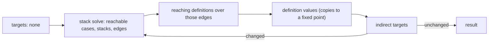

# Solve control over a VM switch model

Pipeline stage: `solve-control` ([map](../../pipelines/jsconfuser-vm.md)).

## 1. Target

For one function of a [VM switch model](vm-switch-boundary.md), decide which cases run, the handler
stack each one runs under, the edges between them, the finite targets of each `indirect-jump`, and
the register definitions reaching each case. `solveControl(frame, cases)` returns these as one
record or throws a `VmSwitchDecline`. By the [boundary's ownership test](vm-switch-boundary.md#ownership-test)
reachability and handler-state flow need no encoder knowledge: the solver reads only the typed
operations, so every VM frontend shares it.

The solver neither plans statements nor renders source; the model carries no control, so its
result is the backend's only graph. `emitVmSwitchProgram` solves each function and hands the result
to the [statement planner](vm-switch-statements.md), the structured emitter and copy planning. All three
walk the solver's `edges`, one case per node, and read which cases run (`reachablePcs`) and the
handler stack each runs under (`stateIn`, an edge's `stackAfter`); copy planning also counts each
definition's uses from `reachingDefinitions`. No frontend computes a graph of its own.

Readers need directed graphs, worklists, try/catch/finally completion and reaching definitions; the
typed operations are those of the [operation grammar](vm-switch-boundary.md#typed-operation-grammar).

## 2. Algorithm

Control depends on the case and on the stack of active handler records. Start at the frame's entry
with an empty stack and follow each case's successors. A setup pushes a record built from its own
operation fields; a `handler-pop` pops one. A record is active from its push until it is popped,
by a `handler-pop` or by the failure it receives. Where two paths meet, require the identical ordered
stack: one case with two exception routes has no single meaning.

An operation that can complete abruptly under an active record also goes to the innermost record,
which it pops. Whether it can is decided by its typed kind, `mayThrow`: a call, a throw, a global
read or write, a safe typeof (a global accessor can throw), a property operation, an object literal,
an accessor definition, a for-in setup, a coercing binary or unary operator. A strict comparison,
`!`, typeof of a register and the moves between registers, captures and fresh arrays or closures
cannot. A return closes the frame without running a finalizer: the compiler routes a return out of a
protected region through the finalizer explicitly.

A setup also routes to its own handler, from its own PC with its record on the stack. Whether a try
body throws cannot be decided (a call into imported code, an accessor), so the handler may run
whenever its try is entered: `try { x } catch (e) { note(e) }` keeps `note(e)` reachable though
reading a register cannot throw ([boundary](vm-switch-boundary.md#the-source-program-not-the-interpreter)).

An `indirect-jump` has no target operand. Its targets come from the register definitions reaching
it: a literal assign defines a known value, a register copy defines a copy of what reaches its
source, a route's write onto its edge defines its value (a finalizer's throw pad), every other write
and the entry value are unknown. The edges feed the definitions and the definitions feed the edges,
so the stack solve and the definition solve repeat until the target sets stop changing.



### Worked example: a finalizer's resume

Encoder output, js-confuser-vm at the pin, options `{}`, `Math.random` replaced by mulberry32 with
seed 1, for the source below (inline; no test source holds it), PCs read from the encoder's own
listing; frame 1 is `f`, entry 51, 7 registers:

```js
function f(x) {
  try { x = g(x) } finally { x = x + 1 }
  return x
}
function g(x) { return x * 2 }
window.TEST_OUTPUT = f(1)
```

| PC | Typed case | Solver result |
|---:|---|---|
| 51 | `assign r2 = this` | entry, stack [] |
| 53 | `finally-setup` target 75, continuation r3, payload r4, throw pad 88 | push `finally@53`; the setup's own route to 75 writing r3 := 88 |
| 58 | `upvalue-read r5` | cannot throw: no route |
| 61 | `call r6 = r5(r0)` | normal edge to 66; exceptional `finally` edge to 75, pops, writes r3 := 88 (origin `exception@61`), r4 unknown |
| 66 | `assign r0 = r6` | |
| 69 | `handler-pop` | stack [] |
| 70 | `assign r3 = 90` | definition `70`: r3 holds 90 |
| 73 | `jump 75` | kind `finally`, route normal (75 is a finalizer entry) |
| 75–83 | `x = x + 1` | stack [] |
| 86 | `indirect-jump r3` | definitions reaching r3: `route@53`, `route@61` (88), `70` (90); targets [88, 90] |
| 88 | `throw r4` | throw pad, propagates |
| 90 | `return r0` | propagates |
| 92–96 | implicit `return undefined` | unreachable: no state, no edges |

Round one has no indirect targets, so 88 and 90 are unreached; its definitions give targets
[88, 90]; round two reaches them and gives the same targets, so the solve ends. The indirect row is:

```js
{
  pc: 86,
  sourceRegister: 3,
  targets: [88, 90],
  origins: { 88: ['exception@53', 'exception@61'], 90: ['70'] },
}
```

## 3. Implementation

### Components and representations

| Component | Consumes -> produces | Decision |
|---|---|---|
| Record builder | cases -> records by setup PC | One `catch` or `finally` record (below) per setup, reachable or not. |
| Stack solve | frame entry, records, current targets -> stateIn, edges | Breadth-first from `frame.startPc` with []; first arrival sets the state, a later one must be the same records in the same order. |
| Definition solve | edges -> definitions, reaching definitions per case | Forward union over the edges, kill and gen per register. |
| Value solve | definitions -> values with origins | Literal and route definitions are seeds; copies take what reaches their source, iterated over copy cycles. |
| Indirect targets | reaching definitions at each reachable `indirect-jump` | Union of values; unknown or empty declines; each target must be a case of the function. |
| Outer loop | the four above | At most 32 rounds; stops when every target array is unchanged. |

```ts
// explanatory: the handler records, one per setup
type CatchRecord = { kind: 'catch'; setupPc; target; exceptionRegister }
type FinallyRecord = { kind: 'finally'; setupPc; target; continuation; payload; throwPad }
```

A stack is an array of record objects, oldest first; a record object is shared by every stack that
holds it. A case's next is its `nextPc` when a case of the function has that PC, else none.

### Successors

| Operation | Edges | Stack after |
|---|---|---|
| `catch-setup`, `finally-setup` | fallthrough; the abrupt route from the stack after the push | push the setup's record |
| `handler-pop` | fallthrough | pop; an empty stack declines `handler-stack-underflow` |
| `jump` | `finally` (route normal) when the target is a finalizer entry of the function, else `branch` | unchanged |
| `branch` | `conditional` to target with condition {register, truthy: when === 'true'}; fallthrough | unchanged |
| `for-in-next` | `branch` to exit with condition {kind: iterator, register, available: false}; fallthrough | unchanged |
| `indirect-jump` | one `branch` (mode indirect) per current target | unchanged |
| `call` | `call` to next (route normal, continuationPc next, callSitePc); the abrupt route with callSitePc | unchanged / route's |
| `throw` | the abrupt route | route's |
| `return` | `return` to null, route propagate | [] |
| any other | fallthrough; the abrupt route when the stack is nonempty and `mayThrow` | unchanged / route's |

A fallthrough with no next declines `unbalanced-handler-stack` when the stack is nonempty; a call
with no next declines `missing-call-continuation`.

```text
abruptRoute(pc, stack, callSitePc):        // explanatory pseudocode
  top = stack.last
  if none:          edge throw  -> null, route propagate; after []
  if top is catch:  edge handler -> top.target, route exceptional; after stack minus top;
                    writes [exceptionRegister unknown]
  if top is finally: edge finally -> top.target, route exceptional; after stack minus top;
                    writes [continuation := throwPad (origin exception@pc), payload unknown]
```

Every edge carries the same fields:

```ts
// explanatory
type Edge = {
  kind; sourcePc; targetPc        // targetPc null for throw and return
  route                           // direct, normal, exceptional or propagate
  mode                            // direct or indirect
  condition                       // null unless conditional or for-in exit
  callSitePc; continuationPc      // null unless set by a call or its abrupt route
  writes                          // route writes, applied in order
  stackBefore; stackAfter
}
```

### Definitions and values

A definition records which case or route wrote a register, and what value:

```ts
// explanatory
type Definition = { id; pc; register; value: Value; origin }
type Value =
  | { kind: 'literal'; value }
  | { kind: 'copy'; source }      // source register
  | { kind: 'unknown' }
```

Each source of a definition gives its id and value:

| Definition | id | Value |
|---|---|---|
| Entry value of register r | `entry:r` | unknown |
| A reachable case with a `destination` | its PC | literal for `assign` of a literal, copy for `assign` of a register, else unknown |
| A route write, in listed order | `route@<sourcePc>:<edge kind>:<index>` | literal (throw pad) or unknown |

The in-state of a case maps each register to the set of definitions reaching it. A case's output
replaces its destination's set with its own definition; each edge then applies its writes in order
(the later of two aliased writes wins) and unions the result into the target's in-state. A
`for-in-next` writes its key only when one is available, so its definition replaces the set on its
fallthrough edge alone; its exit edge carries the in-state unchanged. A copy's
values are the values of the definitions reaching its source at its PC; the value solve repeats until
no copy gains a value or unknownness. A value's origins are the seeding definitions' origins as
strings: a case PC, or `exception@<pc>` for a route.

### Output

```ts
// explanatory
type ControlResult = {
  functionId
  reachablePcs: pc[]                          // sorted
  stateIn: Map<pc, Record[]>                  // the stack each reachable case runs under
  edges: Edge[]
  indirectTargets: IndirectRow[]              // sorted by pc
  definitions: Map<id, Definition>
  reachingDefinitions: Map<pc, Set<id>[]>     // indexed by register
}
type IndirectRow = {
  pc
  sourceRegister
  targets: pc[]                               // sorted
  origins: { [target]: string[] }             // sorted
}
```

An unreachable case has no state, no edges and no indirect row: unreachable code never decides
behaviour. Each route write object also carries its definition id (`definition`).

| Decline (`VmSwitchDecline` code) | Cause |
|---|---|
| `handler-stack-merge-disagreement` | two paths reach a case with different stacks |
| `handler-stack-underflow` | `handler-pop` with nothing active |
| `unbalanced-handler-stack` | a fallthrough off the function with a record active |
| `missing-call-continuation` | a call with no next case |
| `unresolved-indirect-jump` | a reachable `indirect-jump` whose source is unknown or empty |
| `indirect-target-outside-function` | a target that is not a case of the function |
| `control-nonconvergence` | targets still changing after 32 rounds |

### Testing and acceptance

| Scenario | Oracle | Criterion | Fixture |
|---|---|---|---|
| S1 finally and abrupt routes | edge kinds, indirect targets per `indirect-jump`, each indirect edge a `branch` | the inventory the encoder's output fixes | `compiled-forms` `control-try` below, by behaviour and the protected-region break |
| S2 routes by typed kind | under an active record, a `===` or `!==` gets only its fallthrough edge, a safe typeof also an abrupt route, and a return an edge to null | each operation gets exactly those edges | No case of its own ([Known Gaps](#5-known-gaps)) |
| S3 setup route | a try whose body cannot throw by `mayThrow` keeps its handler | the handler body recovers with the source's behaviour | `compiled-forms` `control-try` below |
| S4 dead code | unreachable setups and resume have no state or edges | no decline; decoded behaviour equals the source's | `compiled-forms` `dead-code` below |

## 4. Input Shapes

| Input | Producer | What the solver assumes |
|---|---|---|
| `frame` {id, startPc, regCount} | the model's `functions.functions` entry | `startPc` is a case of the function |
| `cases` [{pc, nextPc, operation}] | the frontend's lowering ([numeric projection](../jsconfuser-vm/lower-switch-model.md)) | every register is in range and every direct target is a case of the function (the frontend's [model fields](vm-switch-boundary.md#model-fields)); the solver repeats no check |

## 5. Known Gaps

- A `literal` assign of any value seeds a target, whatever opcode the frontend lowered it from; a
  non-PC literal reaching an `indirect-jump` declines as a target outside the function. The numeric
  frontend loads every compiler target with an integer literal.
- No committed fixture has a safe typeof inside a try, so no test reaches its abrupt route, and
  none reaches a return under an active finalizer: the compiler routes every return out of a
  protected region through the finalizer explicitly.
- No encoder output reads, after a `for-in-next`'s exit, an earlier definition of its destination
  (the compiler advances into a temporary it rewrites before reading), so nothing pins the exit
  edge carrying the in-state unchanged.

## Source

[vm-switch-control.js](../../../../decoder/decode-js/src/vm/switch/vm-switch-control.js) exports
`solveControl`. [vm-switch-to-source.js](../../../../decoder/decode-js/src/vm/switch/vm-switch-to-source.js)
calls it per function unless dispatch is forced, and
[vm-switch-copy-planning.js](../../../../decoder/decode-js/src/vm/switch/vm-switch-copy-planning.js)
reads its edges and reaching definitions; the control-solver test calls it per function on the
numeric frontend's lowered model.

## Fixtures

Each suite encodes its sources with the pinned encoder and requires the decode to behave as the
source ([tests.md](../../tests.md#suites)); a Proved line names the code whose break turns the case
red.

| Suite and cases | Claims | Proved |
|---|---|---|
| [compiled-forms](../../../../decoder/decode-js/test/vm/jsconfuser-vm/generated-cells/compiled-forms/suite.js), `f-finally-abrupt`, `dead-code`, `return-through-finally` and the other sources of `control-try` | S1, S3, S4: finally and abrupt routes, a catch whose try body cannot throw and dead try statements recover with source behaviour | Catch setups are read as protected regions |

No case asserts the edge kinds or the indirect target sets themselves (S1, S2); a protected safe
typeof has no case.
