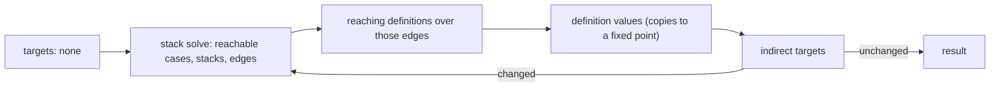

# Solve control over a VM switch model

Part of the [`model` module](vm-switch-boundary.md). Pipeline stage: `solve-control`
([map](../../pipelines/jsconfuser-vm.md#backend-order)); the backend driver calls it once per
function.

## 2. Algorithm

For one function of the model, the solver decides which cases run, the handler stack each one
runs under, the edges between them, the finite targets of each `indirect-jump`, and the register
definitions reaching each case. The model carries no control, so this result is the backend's
only graph: statement planning, value planning and emission all walk its edges, one case per
node. It reads only the typed operations
([operation grammar](vm-switch-boundary.md#typed-operation-grammar)), and neither plans
statements nor renders source.

Control depends on the case and on the stack of active handler records. Start at the frame's entry
with an empty stack and follow each case's successors. A setup pushes a record built from its own
operation fields; a `handler-pop` pops one. A record is active from its push until it is popped,
by a `handler-pop` or by the failure it receives. Where two paths meet, require the identical ordered
stack: one case with two exception routes has no single meaning.

An operation that can complete abruptly under an active record also goes to the innermost record,
which it pops. Whether it can is decided by its typed kind, `mayThrow`: a call, a throw, a global
read or write, a safe typeof (a global accessor can throw), a property operation, an object literal,
an accessor definition, a for-in setup, a coercing binary or unary operator. A strict comparison,
`!`, typeof of a register and the moves between registers, captures and fresh arrays or closures
cannot. A return closes the frame without running a finalizer: the compiler routes a return out of a
protected region through the finalizer explicitly.

A setup also routes to its own handler, from its own PC with its record on the stack. Whether a try
body throws cannot be decided (a call into imported code, an accessor), so the handler may run
whenever its try is entered: `try { x } catch (e) { note(e) }` keeps `note(e)` reachable though
reading a register cannot throw
([the source program, not the interpreter](vm-switch-boundary.md#the-source-program-not-the-interpreter)).

An `indirect-jump` has no target operand. Its targets come from the register definitions reaching
it: a literal assign defines a known value, a register copy defines a copy of what reaches its
source, a route's write onto its edge defines its value (a finalizer's throw pad), every other write
and the entry value are unknown. The edges feed the definitions and the definitions feed the edges,
so the stack solve and the definition solve repeat until the target sets stop changing.



### Worked example: a finalizer's resume

Cell `compiled-forms`: source `return-through-finally`, profile `randomizeOpcodes`, seed 251.

```js
let count = 0; function check(value) { try { return value + 1; } finally { count++; } } window.TEST_OUTPUT = [check(4), count];
```

Function 1 is `check`: entry 53, 8 registers, one capture.

| PC | Typed case | Solver result |
|---:|---|---|
| 53 | `assign r2 = this` | entry, stack `[]` |
| 55 | `finally-setup` target 83, continuation r3, payload r4, throw pad 102 | fallthrough to 60 with `finally@55` pushed; the setup's own route to 83, writing r3 := 102 (origin `exception@55`) and r4 unknown |
| 60 | `assign r5 = 1` | cannot throw: fallthrough only |
| 64 | `assign r6 = r0 + r5` | fallthrough to 68; `+` may throw: `finally` edge to 83, pops, writes r3 := 102 (origin `exception@64`), r4 unknown |
| 68 | `assign r4 = r6` | the return value becomes the payload |
| 71 | `assign r3 = 104` | definition `71`: r3 holds 104 |
| 74 | `handler-pop` | stack `[]` after it |
| 75 | `jump 83` | kind `finally`, route normal: 83 is a finalizer entry |
| 77, 78, 81 | `handler-pop`, `assign r3 = 106`, `jump 83` | unreached: the try body always returns |
| 83 to 97 | `count++` through upvalue 0 | stack `[]` |
| 100 | `indirect-jump r3` | definitions reaching r3: `route@55:finally:0`, `route@64:finally:0` (102), `71` (104); edges to 102 and 104 |
| 102 | `throw r4` | the throw pad; `throw` edge to null |
| 104 | `return r4` | `return` edge to null |
| 106, 110 | the implicit `return undefined` | unreached: no state, no edges |

Round one has no indirect targets, so 102 and 104 are unreached; its definitions give targets
`[102, 104]`. Round two reaches them and gives the same targets, so the solve ends. The indirect
row is:

```js
{
  pc: 100,
  sourceRegister: 3,
  targets: [102, 104],
  origins: { 102: ['exception@55', 'exception@64'], 104: ['71'] },
}
```

## 3. Implementation

### Exports another file imports

| Export | Contract | Imported by |
|---|---|---|
| `solveControl(frame, cases)` | The [control result](#output) for one function, or a `vm-switch` refusal. `frame` is the model's `{id, startPc, regCount}` entry; `cases` are `{pc, nextPc, operation}`. The solver assumes what the [model fields](vm-switch-boundary.md#model-fields) state and repeats no check. | `to-source.js` |
| `mayThrow(operation)` | Whether the operation's JavaScript can complete abruptly, by its typed kind. | `operations.js`, `values/value-planning.js` |
| `CONTINUING_EDGES` | The edge kinds `fallthrough`, `call`: straight on to the case after. | `emit/structured-emitter.js`, `values/conditional-values.js`, `values/single-use-folding.js` |
| `UNCONDITIONAL_EDGES` | Those and `branch`: on to one other case whatever the state. | `emit/run-walk.js`, `values/conditional-values.js` |
| `NORMAL_EDGES` | Those and `conditional`: every way a case completes and goes on to another case. | `values/case-flow.js` |

### Inside the part

| Component | Consumes -> produces | Decision |
|---|---|---|
| Record builder | cases -> records by setup PC | One `catch` or `finally` record (below) per setup, reachable or not. |
| Stack solve | frame entry, records, current targets -> stateIn, edges | Breadth-first from `frame.startPc` with []; first arrival sets the state, a later one must be the same records in the same order. |
| Definition solve | edges -> definitions, reaching definitions per case | Forward union over the edges, kill and gen per register. |
| Value solve | definitions -> values with origins (`definitionValues`) | Literal and route definitions are seeds; copies take what reaches their source, iterated over copy cycles. |
| Throw classification (`mayThrow`) | a typed operation -> whether its JavaScript can complete abruptly | The stack solve's abrupt routes; value planning's dead definitions. |
| Indirect targets | reaching definitions at each reachable `indirect-jump` | Union of values; unknown or empty declines; each target must be a case of the function. |
| Outer loop | the four above | At most 32 rounds; stops when every target array is unchanged. |

```ts
// explanatory: the handler records, one per setup
type CatchRecord = { kind: 'catch'; setupPc; target; exceptionRegister }
type FinallyRecord = { kind: 'finally'; setupPc; target; continuation; payload; throwPad }
```

A stack is an array of record objects, oldest first; a record object is shared by every stack that
holds it. A case's next is its `nextPc` when a case of the function has that PC, else none.

### Successors

| Operation | Edges | Stack after |
|---|---|---|
| `catch-setup`, `finally-setup` | fallthrough; the abrupt route from the stack after the push | push the setup's record |
| `handler-pop` | fallthrough | pop; an empty stack declines `handler-stack-underflow` |
| `jump` | `finally` (route normal) when the target is a finalizer entry of the function, else `branch` | unchanged |
| `branch` | `conditional` to target with condition {register, truthy: when === 'true'}; fallthrough | unchanged |
| `for-in-next` | `branch` to exit with condition {kind: iterator, register, available: false}; fallthrough | unchanged |
| `indirect-jump` | one `branch` (mode indirect) per current target | unchanged |
| `call` | `call` to next (route normal, continuationPc next, callSitePc); the abrupt route with callSitePc | unchanged / route's |
| `throw` | the abrupt route | route's |
| `return` | `return` to null, route propagate | [] |
| any other | fallthrough; the abrupt route when the stack is nonempty and `mayThrow` | unchanged / route's |

A fallthrough with no next declines `unbalanced-handler-stack` when the stack is nonempty; a call
with no next declines `missing-call-continuation`.

```text
abruptRoute(pc, stack, callSitePc):        // explanatory pseudocode
  top = stack.last
  if none:          edge throw  -> null, route propagate; after []
  if top is catch:  edge handler -> top.target, route exceptional; after stack minus top;
                    writes [exceptionRegister unknown]
  if top is finally: edge finally -> top.target, route exceptional; after stack minus top;
                    writes [continuation := throwPad (origin exception@pc), payload unknown]
```

Every edge carries the same fields:

```ts
// explanatory
type Edge = {
  kind; sourcePc; targetPc        // targetPc null for throw and return
  route                           // direct, normal, exceptional or propagate
  mode                            // direct or indirect
  condition                       // null unless conditional or for-in exit
  callSitePc; continuationPc      // null unless set by a call or its abrupt route
  writes                          // route writes, applied in order
  stackBefore; stackAfter
}
```

### Definitions and values

A definition records which case or route wrote a register, and what value:

```ts
// explanatory
type Definition = { id; pc; register; value: Value; origin }
type Value =
  | { kind: 'literal'; value }
  | { kind: 'copy'; source }      // source register
  | { kind: 'unknown' }
```

Each source of a definition gives its id and value:

| Definition | id | Value |
|---|---|---|
| Entry value of register r | `entry:r` | unknown |
| A reachable case with a `destination` | its PC | literal for `assign` of a literal, copy for `assign` of a register, else unknown |
| A route write, in listed order | `route@<sourcePc>:<edge kind>:<index>` | literal (throw pad) or unknown |

The in-state of a case maps each register to the set of definitions reaching it. A case's output
replaces its destination's set with its own definition; each edge then applies its writes in order
(the later of two aliased writes wins) and unions the result into the target's in-state. A
`for-in-next` writes its key only when one is available, so its definition replaces the set on its
fallthrough edge alone; its exit edge carries the in-state unchanged. A copy's
values are the values of the definitions reaching its source at its PC; the value solve repeats until
no copy gains a value or unknownness. A value's origins are the seeding definitions' origins as
strings: a case PC, or `exception@<pc>` for a route.

### Output

```ts
// explanatory
type ControlResult = {
  functionId
  reachablePcs: pc[]                          // sorted
  stateIn: Map<pc, Record[]>                  // the stack each reachable case runs under
  edges: Edge[]
  indirectTargets: IndirectRow[]              // sorted by pc
  definitions: Map<id, Definition>
  reachingDefinitions: Map<pc, Set<id>[]>     // indexed by register
  definitionValues: Map<id, {                 // the value solve's result per definition
    unknown: boolean                          // some origin is not a literal
    values: Map<literal, Set<origin>>         // keyed by SameValueZero: 0 and -0 share a key
  }>
}
type IndirectRow = {
  pc
  sourceRegister
  targets: pc[]                               // sorted
  origins: { [target]: string[] }             // sorted
}
```

An unreachable case has no state, no edges and no indirect row: unreachable code never decides
behaviour. Each route write object also carries its definition id (`definition`).

### Refusals

Owner `vm-switch` ([Refusals](../../pipelines/jsconfuser-vm.md#refusals)).

| Code | When |
|---|---|
| `handler-stack-merge-disagreement` | two paths reach a case with different stacks |
| `handler-stack-underflow` | `handler-pop` with nothing active |
| `unbalanced-handler-stack` | a fallthrough off the function with a record active |
| `missing-call-continuation` | a call with no next case |
| `unresolved-indirect-jump` | a reachable `indirect-jump` whose source is unknown or empty |
| `indirect-target-outside-function` | a target that is not a case of the function |
| `control-nonconvergence` | targets still changing after 32 rounds |

## 5. Known Gaps

- A `literal` assign of any value seeds a target, whatever instruction the frontend lowered it
  from; a literal that is no case PC reaching an `indirect-jump` refuses as a target outside the
  function.
- No committed fixture has a safe typeof inside a try, so no test reaches its abrupt route, and
  none reaches a return under an active finalizer: the compiler routes every return out of a
  protected region through the finalizer explicitly.
- No encoder output reads, after a `for-in-next`'s exit, an earlier definition of its destination,
  so nothing pins the exit edge carrying the in-state unchanged.
- No committed case asserts the edge kinds or the indirect target sets themselves; they are held
  through the decoded program's behaviour.

## 6. Source

- [control.js](../../../../decoder/decode-js/src/vm/switch/model/control.js): the whole part. A
  case's edges come from one function per operation kind (`SUCCESSORS`, any other kind
  `ordinarySuccessors`); definition values and indirect targets merge origins through
  `mergeValues`.

## 7. Fixtures

Suites encode their sources with the pinned encoder and require the decode to behave as the
source ([tests.md](../../tests.md)). No unit test calls the solver directly.

| Scenario | Expected result | Committed fixture |
|---|---|---|
| try/catch programs | A catch setup pushes a handler record and routes to its handler; ignoring catch setups turns the suite red | `control-try` in [compiled-forms](../../../../decoder/decode-js/test/vm/jsconfuser-vm/cell-suites/compiled-forms/suite.js) |
| A return through a finally; an abrupt finally | The finalizer's `indirect-jump` resolves to its throw pad and its resume; the decode behaves as the source | sources `return-through-finally`, `f-finally-abrupt` of `control-try` in compiled-forms (coverage) |
| A catch whose try body cannot throw | The handler stays reachable by the setup's own route | `control-try` in compiled-forms (coverage) |
| Code after a return | Unreached cases have no state and no edges, and nothing refuses | source `dead-code` of `control-try` in compiled-forms (coverage) |
| A `===` under an active record | Fallthrough only | |
| A safe typeof under an active record | Fallthrough and an abrupt route | |
