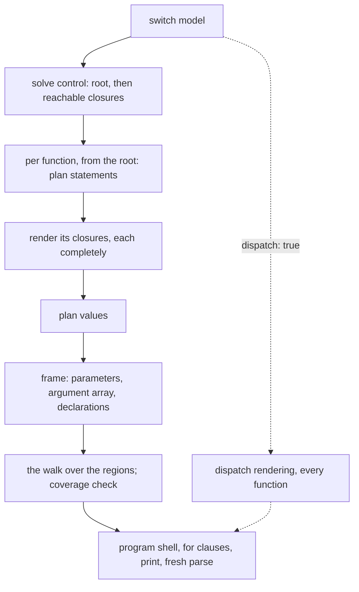

# Emit source from a VM switch model

Pipeline stage: `emit-source`, and the backend driver
([map](../../pipelines/jsconfuser-vm.md#backend-order)).

Readers need the [VM switch model](vm-switch-boundary.md#model-fields) with its
[typed operations](vm-switch-boundary.md#typed-operation-grammar), the
[solved control](vm-switch-control.md), the planner's
[region rows](vm-switch-statements.md#region-rows), the
[effective instructions](vm-switch-values.md#the-result), JavaScript closures and labeled
statements, and the compiler's
[try grammar](../../../js-confuser-vm/instruction-set.md#catch-finally-and-abrupt-completion).

## 1. Target

The backend's last stage writes one [VM switch model](vm-switch-boundary.md) as fresh JavaScript.
Every function the program can reach is written where a closure creates it, as native statements
over the planned regions, with its values as the value planner left them and with nothing of the
interpreter: no dispatch loop, no handler stack, no register array. Unreachable code is dropped.
The output is a sloppy program in [native forms](#native-forms): the encoder carries sloppy
semantics only ([known quirks](../../../js-confuser-vm/instruction-set.md#5-known-quirks)), and
where its handlers depart from native JavaScript the encoding changed the source, so the native
form is correct too
([F8](../../../encoder-decoder-method.md#f8-keep-the-shared-behaviour-what-the-encoding-changed-is-free)).

`emitVmSwitchProgram(model, { dispatch })` is the backend driver: it solves control, renders the
functions from the root and assembles the program. It returns `{ output, statements,
simplification }` or throws a `vm-switch` refusal; a function that cannot be written structured
refuses the whole decode and is never written as dispatch instead. It needs no encoder knowledge
([ownership test](vm-switch-boundary.md#ownership-test)), executes neither the input nor the
output, and changes no model object.

Original names and lexical scopes are not recovered: a register is written as a variable
`__recovered_r_<function>_<register>`, and one register can hold several source variables. With
`dispatch: true` the driver writes the review rendering, every function as a PC dispatch loop; it
is never a decode result.

## 2. Algorithm

### Order

```text
emitVmSwitchProgram(model)                                  (explanatory pseudocode)
  reachableFunctions(model)                    solve control: the root, then each function a
                                               reachable closure creates; each once
  render(root, captures = [])
    regions = planStatements(function, cases, solved)
    frame.closures = for each reachable closure site: render(child, the site's captures)
    emitStructuredFunction(frame, cases, function, regions, solved)
      effective = effectiveStructuredInstructions(...)      plan-values
      plan the for-in heads; write each conditional value's expression into the frame
      functionHead(...)                        parameters, the argument array, declarations
      emit(startPc)                            the walk; then every reachable case must be emitted
  the program: an IIFE holding the enumeration helper (if a setup needs it), the root
               declaration and the root call
  writeForClauses(tree)                        `init; while (test) { ...; update }` into `for`
  generate(tree)                               printed once
  parseEmittedJavaScript(output)               a fresh parse, as a check
```



1. **Reachable functions.** A function only unreachable code creates is not part of the program:
   it is neither solved nor written.
2. **A function is rendered children first.** A closure site needs its function as a finished
   node, so the driver renders each reachable site's function before the function holding it and
   hands the nodes over in the frame ([frames](#frames-captures-and-setup-liveness)).
3. **Values, then the frame.** The frame is set up from the reachable effective instructions, so
   a register only removed cases or folded producers wrote is not declared.
4. **The walk** visits the rooted graph one case at a time and emits each case once
   ([structured rendering](#structured-rendering)). It follows a branch only inside its planned
   region and a cycle only inside a planned loop, and requires a complete natural exit.
5. **Assembly.** Every renderer builds `@babel/types` nodes, never text. The tree is printed once
   by `@babel/generator`, which parenthesizes a folded operand only where evaluation needs it. The
   printed program is parsed afresh, which checks what the builders do not (early errors such as a
   transfer to a label no statement holds); the parse is discarded.

### Frames, captures and setup liveness

A function is written where a closure creates it. The root alone is a declaration,
`__recovered_function_<id>`, invoked once with no argument; any other function is the value a
`closure` case writes, a function expression nested in its creator, so it reads the registers it
captures as the enclosing functions' own variables:

```text
render(function, captures):            # explanatory; captures[i] names a register of an encloser
  frame = {functionId, root, captures}
  plan the function's statements
  frame.closures = for each closure site the rendering writes (each reachable one; every one in
                   the review rendering): pc -> render(child at entry, siteCaptures)   # children first
    siteCaptures[i] = R(index)              for a local capture i   (this frame's register)
                    = frame.captures[index] for an inherited one    (what this frame's capture names)
  head = root ? "function __recovered_function_<id>() {"
              : "function (" + parameters + ") {"
  body: an upvalue-read or upvalue-write of index i is the register captures[i]
  a closure case writes frame.closures[its pc]
```

The site resolves each capture to a register name before the child renders, so a capture inherited
through several levels reads the register of the function that owns it. An entry no function
starts at declines `missing-closure-function`; a malformed pair, an unknown kind or an inherited
index beyond the frame's captures declines `invalid-capture-pair` or `unsupported-capture-kind`.
Each closure site renders its function once, before the function holding it, and the renderer reads
the function node from the frame: no renderer calls back into the program assembler. Two sites of one function
would each write a correct copy; the compiler emits one `MAKE_CLOSURE` per function node, and the frontend removes the
helper closures some transforms add.

**Why lexical reads are the VM's storage.** An upvalue is the creating frame's register slot while
that frame runs and the slot's last value after it returns; every closure that frame creates shares
the one upvalue per slot. The enclosing function's `let` register is one variable per invocation
that the nested function keeps alive, so a read or write through it reaches what the upvalue
reaches, before and after the return. A captured register is still written behind the reaching
definitions (a call can run the nested function), which [value planning](vm-switch-values.md) keeps out of its rules.

**Parameters and `arguments`.** A parameter register is a native parameter, up to the last one the
reachable code reads or captures; the rest register (`hasRest`, the last parameter) is written
`...R(paramCount - 1)`. When `paramCount < regCount`, the runtime writes the call's argument array into
register `paramCount`, whether the source named it `arguments` or (in an arrow, which binds none) it
is the first local. It is bound first as `R(paramCount) = [...arguments];` only when that entry value
can be read: a structured function binds it when the solver's entry definition `entry:<paramCount>`
reaches a reachable read or a closure captures the register, so a local written before every read
gets no binding; a dispatch function binds it whenever the register is read. The root binds
neither.

**`this`.** An `assign` of `this` renders `this`, a [native form](#native-forms). Only a function that
reads `this` keeps it: the prologue's `LOAD_THIS` is a definition that cannot throw, dropped when
unread. An arrow reads the `this` and argument registers of its encloser as captures.

**Declarations.** A structured function declares, after its parameters, the registers the reachable
effective instructions reference (plus handler roles and for-in keys); a dispatch function its whole
register frame. This is setup liveness, not SSA, local-scope recovery or dead-value elimination.

The rendered function is a native function expression: it is constructible with its own
`prototype`, `instanceof` reads that prototype, and `length` counts its written parameters. The
VM's shell has `length` 0 and a prototype object without `constructor`
([known gaps](#5-known-gaps)).

### Unreachable code

A case the control solver does not reach is dropped: no path runs it, so it is not part of the
recovered program, whether the compiler made it (an implicit `return undefined`, a finally resume or
throw pad, a finally exit tail behind a block that always returns) or the source wrote it (code
after a `return`). Frame setup follows the emitted code: the declaration list, the parameters and
the argument array come from reachable cases only. The assembler emits the root, and every function
a reachable `closure` creates is written at that closure; a function only unreachable code creates is neither solved
nor emitted, and the enumeration helper is emitted only for a reachable `for-in-setup` no
`for (key in object)` holds. A reachable
case the walk did not emit declines (`requireReachableCoverage`).

The summary is exactly:

```text
emitted              = instructionCount - safelyEliminated - provenUnreachable
safelyEliminated     = the removed moves and dead definitions (their proof rows)
provenUnreachable    = unreachable cases of emitted functions + every case of a function not emitted
unreachableFunctions = the functions not emitted
```

Dispatch rendering emits every case of every function, reports `provenUnreachable = 0` and
`unreachableFunctions = 0`, and generates no copy proofs.

### Structured rendering

One function's emission state (`EmitState`) holds its cases as nodes, the solver's edges, the planned
regions by head, the value planner's result, the blocks emitted so far and the label counters, and
answers the questions every renderer asks (node and edge lookup, operands, marking, transfers, labels);
it calls no renderer. The walk (`sequence`) writes the statements from a block to a stop, each one
`statementAt` finds there. A region renderer (conditionals, switches, loops, tries) is a generator over
the state: it yields each walk it needs, `{ start, stops, context }`, and the walk answers it (`drive`),
so no renderer calls back into the walk and every module depends downward. A conditional value's expression
and each closure's function are written before the function is walked and read from the frame.

The walk renders one case at a time and stops at a planned stop. An ordinary operation permits one
normal successor and, as an exceptional successor, only an uncaught null throw or the innermost try
region's catch or finalizer route. A repeated case, an uncovered reachable case or an incomplete
natural exit declines.

- **Jumps.** A jump to an enclosing loop's head is `continue`, to a breakable statement's end
  `break`; any other jump is a step of the statement's own flow, as a fallthrough is: the walk
  continues at its target, and emitting each case once keeps anything shared out. A jump step
  renders nothing, so routes may share one.
- **Conditionals.** The arms start at the two target PCs and stop at the merge; an arm whose jump
  steps lead straight to the merge renders empty. A conditional arm's route into a catch or
  finalizer must name an enclosing try region. With one arm empty the test is written for the
  other, `if (c) { ... }`. With both arms non-empty, arm order is spelling: the arm the un-negated
  test selects comes first, so the compiler's `if (x) A else B` (a jump-if-false to B) reads
  `if (x) { A } else { B }`, while a negation the source wrote stays, `if (!x) { A } else { B }`.
- **Loops.** A loop ends at its continuation, which the planner has already followed through
  jump-only blocks; a continuation that is an enclosing loop's exit declines. A transfer is written
  without a label when an unlabeled one reaches the same statement: a `continue` to the innermost
  loop, a `break` to the innermost loop or switch (a labeled block never counts, since a bare
  `break` never leaves one). Innermost is counted where the transfer is written: a finally's exit
  tail and the pad that re-issues its exit are walked in the context of the try's start, yet written
  in place, inside every loop and switch around them (labeled-exit-forms' `break A` through two
  finally statements, from an inner loop, keeps its label). Any other transfer names its target, and a loop or switch carries its
  label only when one does, as written after the back edge is dropped: a label no transfer needs is
  spelling (`while (i < N) { if (i === S) break; ... }`, a `break L` only out of an inner loop or
  switch). Its form follows the planner's
  [exit test](vm-switch-statements.md#loop-end), decided before anything is marked (`loopHeadTest`):
  1. The test's conditional must close at the continuation and exactly one arm must reach it through
     jump steps alone: leaving runs nothing. The loop goes on under the predicate that selects the
     other arm. A for-in step has no conditional: its branch is the exit, which must reach the
     continuation the same way. A for-in step is never a bottom test. A loop that is the
     compiler's for-in unit is written `for (key in object) { body }` (`planForInHeads`, planned
     before anything is marked): its step is the header with no update; the header's one entry
     from outside is its setup, through jump steps at most; and the setup's iterator reaches that
     step alone, by the solver's reaching definitions. Its key is the step's effective destination,
     the source's variable once copy simplification retargets the step. The setup then renders nothing, its object
     read at the setup's PC in the head, and its iterator is not declared. The encoder emits the
     setup and the step only for a for-in statement, so native enumeration is the source's own;
     the VM's [snapshot](vm-switch-boundary.md#typed-operation-grammar) differs from it only when the
     body deletes a key not yet visited or adds keys, or in when a Proxy's traps run, and there
     the decode follows the source. Any other top for-in step goes on under
     `it.index < it.keys.length` (the negation of its exit test, equal because the setup's iterator
     holds an array and an integer only steps advance), its key read `k = it.keys[it.index++]`
     opening the body.
  2. A top test leads the loop when its run renders as one comma expression (`walkRun`: each
     operation one expression, a planned conditional inside written `test ? (...) : (...)` with an
     empty arm as `void 0`, a conditional value none, its use writing it; empty when the header is
     the test): `while (run..., test) { body }`, or
     `for (; run..., test; update)` with a continue target. The body is the staying arm; its final
     `continue`, the back edge, is dropped, and any other jump to the header stays `continue`, which
     runs the run and the test natively.
  3. A bottom test whose staying arm is the back edge, with no published test run, gives
     `do { body } while (test)`, the body walked from the header to the test.
  4. Otherwise the loop is `while (true)`, its test a conditional in the body,
     `if (test) { ...; continue } break`: an exit arm with code (a loop whose end moved past a tail),
     a run with a statement (a global read keeps its reference check). A for-in step in the body
     reads `if (it.index >= it.keys.length) break;` and then its key.

  **For clauses.** The compiler writes `for (init; test; update) body` as `init; while (test) { body;
  update }` when no `continue` enters the update, so the loop's form is spelling. Over the assembled
  tree (`writeForClauses`, a traverse visitor), a `while` is written `for (init; test; update)` when the statement just before
  it (or its label) writes a register r its test reads, its body's last statement writes r again,
  and no `continue` in the body targets it: such a continue skips that last write, which an update
  would run. A `for (; test; update)` whose update writes r takes the write before it as its init.
  Each statement keeps its evaluation where it was. A loop with no write of r before it stays
  `while` (a source `while (x) { ...; x = next(x) }` reads as the source wrote it).

  The first loop of the `f-loop-forms` cell ([worked example](#worked-example-a-function-end-to-end))
  reads `for (r3 = 1; r3 <= 5; r3 = r3 + 1) { r2 = r2 + r3; }`; its run is the compare, folded into
  the test. A loop with a
  [continue target](vm-switch-statements.md#trailing-run-and-continue-target) writes its update
  run the same way as the clause of `for (...; ...; update)`, and a jump to the target from anywhere in
  the body is `continue`. A do-while with one is written `do { ... } while (test)`: its test run as one
  comma expression ending in the condition that goes back, the body's own end reaching the test
  without a `continue`. So a continue routed through a finally runs the finalizer and then the
  update or the test natively.
- **Switches.** A [switch region](vm-switch-statements.md#switch) is written
  `switch (discriminant) { ... }` with its clauses in the planned order, its label written as a loop's
  is, only when a transfer names it. The head test's leading
  operations run before it as statements and its case label is the value register; every later
  case's label is `(run..., value)`, its run's operations as one comma expression ending in the value,
  so native label evaluation runs the chain's operations in the chain's order and stops at the first
  match, as the chain does; a run that is not expressions declines. Value planning has usually
  removed a run's literal load and compare ([uses](vm-switch-values.md#uses)), leaving the bare value:
  `case 2:`. Grouped labels sharing one body
  are written consecutively with empty clauses. Each body is walked to the next clause's entry (a
  fallthrough, written as nothing), the end (`break`, omitted for the last clause) or a
  transfer; a jump to the switch's end anywhere in a body is a `break` (labeled only from inside a
  nested loop or switch), and a jump to an enclosing loop's head stays `continue`. A body ending anywhere else declines.
- **Labeled blocks.** A [labeled block](vm-switch-statements.md#labeled-exits) is written
  `label: { ... }` around what starts at its head, a breakable statement but never a loop: a jump to
  its end anywhere inside is `break label`, the walk stops at that end and continues there after the
  block. A head with several ends opens the farthest first.
- **Try statements.** Every try statement, catch only, finally only, catch and finally, nested in
  any combination, is rendered by one rule ([try statements](#try-statements)): regions are read from their
  compiler-only head and tail instructions, every exit stays native, and the rule's semantic
  checks decline models that are not compiler grammar.

### Try statements

Every try statement the compiler emits is written as a native `try`: catch only, finally only,
catch and finally, nested in any combination, and left by any completion (normal, `return`,
`break`, `continue`, a caught or an uncaught throw). The rule reads blocks only. It never asks
whether a jump target is a loop header, a loop exit or a switch exit; such a target is handed to
the enclosing statement unchanged. A model that is not compiler grammar (a damaged target, a
carrier captured by a closure, an edge with a wrong state, code after a pop that is not a
transfer) declines with `unemittable-structured-control`.

**Regions are delimited by their head and tail instructions.**

Only the compiler's region code produces these instructions, and it produces them at fixed
places, so a region's boundaries are read from block heads and tails instead of from the
region's overall shape.

| Boundary | Signature (typed operation) | Meaning |
|---|---|---|
| Region head | block ending in `catch-setup(target, exceptionRegister)` | catch region opens; catch entry is `target` |
| Region head | block ending in `finally-setup(target, continuation, payload, throwPad)` | finally region opens; in try/catch/finally it encloses one catch head |
| Catch head | the catch-setup target | entered by an exception raised inside the region, by its own setup (the try statement is one unit, so the active handler is reachable with it even when no program operation in the body can throw; [control solver](vm-switch-control.md#2-algorithm)), or, for an empty catch body, by the region's own exit jumps, since it is then the continuation |
| Finalizer head | the finally-setup target | entered by every exit of the finally region |
| Exit tail, catch | `handler-pop`, then a transfer | leaves the catch region: to its continuation (normal completion) or to an outer target |
| Exit tail, finally | optional `assign payload = value`, then `assign continuation = literal` and `handler-pop`, then `jump` to the finalizer head; [jump steps](vm-switch-boundary.md#jump-steps) may sit between any two | leaves the finally region; the literal names the exit. Normal completion pops first, a routed exit loads the literal first |
| Finalizer tail | `indirect-jump` on `continuation` | resumes at one of the control solver's finite targets |
| Throw pad | `throw payload` | rethrows the pending exception |
| Return pad | `return payload` | completes a routed return |
| Other pad | a transfer in the enclosing context | continues a routed break/continue |

A `break`, `continue` or `return` that crosses several regions emits one catch tail per crossed
catch region and stops at the first finally region, whose pad continues the unwind outward. So
reading tails region by region consumes the unwind exactly as the compiler built it.

**One region, one rule.**

1. **Exits.** Walk the protected body as ordinary structured code until every path ends in this
   region's exit tail, in a return or throw, or in a nested region (handled by this same rule).
   With a catch, also walk the catch from its head the same way. With a finally, the protected
   part is the try and catch together; the finalizer is walked from its head to its tail.
2. **Every exit stays native.** JavaScript's own `try` statement already runs the finalizer and
   rethrows for every abrupt completion, so each exit is rendered where it leaves the region:
   - a `return` becomes `return x;`; a routed return renders `payload = value` then its pad's
     `return payload;`;
   - an uncaught throw, and the throw pad, need no code;
   - a `break`, `continue` or other jump to an outer target is handed to the enclosing walk, from
     inside the `try` or `catch` block. The enclosing construct decides how it is written.
   A finally region's pads are the compiler's re-issue of an exit after the finalizer, so each
   is walked in place at the exit whose literal names it and is not emitted again. Code after a
   pop is no longer protected but sits inside the native `try` block, so it must be a transfer.
3. **Continuation.** The statement continues at its normal completion block: after-catch for a
   catch-only try, after-finally with a finally. The end comes from the planner's
   [try row](vm-switch-statements.md#region-rows): its continuation, or for a catch whose block
   always throws its layout end, or for a finally with no reachable normal tail where its routed
   exits land. A finally exit tail whose literal names another block is a routed exit, walked as
   its pad; a pad landing on the end stops there, so the exit is rendered as completing. A region
   with no end ends the walk there, and its catch's block and catch close at the enclosing walk's
   stop, the catch keeping the code only it reaches.

### Native forms

The encoder compiles a sloppy program and its handlers run sloppy ([known quirks](../../../js-confuser-vm/instruction-set.md#5-known-quirks)), so the
decode takes its input as that program and writes each operation as a sloppy source writes it,
inside an IIFE with no directive ([F8](../../../encoder-decoder-method.md#f8-keep-the-shared-behaviour-what-the-encoding-changed-is-free)). What the source and the encoded program share stays
bound by these forms; where a handler departs from its native form, the encoding changed the
source's behaviour there, and the native form gives the source's.

| Operation | Written | Where the VM's handler differs |
|---|---|---|
| `property-write` | `o[k] = v` | `Reflect.set` throws on a primitive target, where a sloppy write is silent |
| `object` outside a [unit](vm-switch-values.md#object-literals) | `d = {}`, then `d[k] = v` per pair | as `property-write` |
| `property-delete` | `delete o[k]` | none: the handler's own sloppy `delete` |
| `global-write` | `globalThis[name] = v` | none: a sloppy write, silent on a non-writable global (`NaN = 1`) |
| `global-read` | the bare name | the handler's `name in globals` check misses a script-scope `let` or `const`, which a bare name reads |
| `safe-typeof` | `typeof name`; `typeof globalThis[name]` for `arguments` and the decode's own `__recovered_` names | the handler's own-property test reads `"undefined"` for an inherited global ([known quirks](../../../js-confuser-vm/instruction-set.md#5-known-quirks)), which native `typeof` sees |
| `assign` of `this` | `this` | the shell passes `this == null ? globals : this`; a sloppy function does the same, and boxes a primitive receiver as a sloppy source does |
| `call`, receiver register r, callee folded as `r[k]` | `r[k](args)` | the handler reads r again after the callee, which a getter rewriting r's variable could tell |
| `call`, any other receiver | `Reflect.apply(callee, receiver, args)` | the handler invokes a host callee through its own `apply` property |
| `call` without receiver | `callee(args)` | the handler passes `this` null where a plain call passes undefined; only a strict host function tells |
| `call`, construct | `new (callee)(args)`; a spread `new (callee)(...r)` | none: the handler's `Reflect.construct(callee, args)` is `new` for every callee; a spread iterates the compiler's own array, as a plain call's does |

A bare name would not read the global for three names, which keep the checked statement
`if (!(name in globalThis)) throw new ReferenceError(...); r = globalThis[name];`: `eval` (a bare call
to it is a direct eval), `arguments` (each function's own binding; the compiler gives the root none,
so a root `arguments` is a global read) and the decode's own `__recovered_` names. A bare global
read is one expression, so it folds into its use like any [foldable producer](vm-switch-values.md#single-use-folding);
a checked one stays a statement.

### Dispatch rendering

Dispatch is the review rendering: it is used for every function under `dispatch: true`, and for no
function otherwise. It starts at frame entry inside a labeled loop with one case per instruction.
Ordinary cases set nextPc and continue; transfers override it; return and throw finish natively. A
missing runtime PC throws `Error('Invalid recovered control state')`. Handler setup pushes records;
handler-pop alone keeps a stack but adds no catch wrapper. With a catch or finally setup, each switch
iteration runs under try/catch: pop the top handler, rethrow if absent; a catch writes its exception
register and jumps to its target; a finally writes continuation = throw pad and payload = error, then
jumps to the finalizer. Register selection uses a switch with an invalid-register error.

### Worked example: a function end to end

The committed cell `f-loop-forms` of suite `compiled-forms` (file `control-branch`, profile
`randomizeOpcodes`, seed 251):

```js
var sum = 0; for (var i = 1; i <= 5; i++) sum += i;
var j = 0; var doCount = 0; do { doCount++; j++; } while (j < 2);
var w = 0; while (w < 3) w++;
window.TEST_OUTPUT = [sum, doCount, w];
```

1. **Reachable functions.** The model has one function, the root, with 47 cases; all are
   reachable.
2. **Statements.** Three loops and their three tests
   ([statement recovery](vm-switch-statements.md#worked-example-three-loops)): top tests at 24 and
   120, a bottom test at 100.
3. **Values.** 24 cases are removed, each compare folds into its branch, and the last statement's
   array and global read fold into the property write
   ([value planning](vm-switch-values.md#worked-example-the-four-rules-on-a-loop)).
4. **Frame.** The root takes no parameter and binds no argument array. The effective instructions
   reference r2 to r6, so those five are declared.
5. **The walk.** The first loop's top test leads it with the run `r3 <= 5`, so it is opened as
   `while (r3 <= 5) { r2 = r2 + r3; r3 = r3 + 1; }`, its back edge dropped. The second, a bottom
   test with no published run, is `do { ... } while (r4 < 2)`. The third is
   `while (r6 < 3) { r6 = r6 + 1; }`.
6. **For clauses.** The first and third loops each have a write of their test's register just
   before them and as their body's last statement, and no `continue`: they become `for` loops. The
   do-while is not a `while` and stays.
7. **Summary.** `emitted` 23, `safelyEliminated` 24, `provenUnreachable` 0,
   `unreachableFunctions` 0: 23 + 24 + 0 = 47 cases. A fold removes no case: the producer is
   emitted, inside its use.

The output:

```js
(function () {
  function __recovered_function_0() {
    let __recovered_r_0_2, __recovered_r_0_3, __recovered_r_0_4, __recovered_r_0_5, __recovered_r_0_6;
    __recovered_r_0_2 = 0;
    for (__recovered_r_0_3 = 1; __recovered_r_0_3 <= 5; __recovered_r_0_3 = __recovered_r_0_3 + 1) {
      __recovered_r_0_2 = __recovered_r_0_2 + __recovered_r_0_3;
    }
    __recovered_r_0_4 = 0;
    __recovered_r_0_5 = 0;
    do {
      __recovered_r_0_5 = __recovered_r_0_5 + 1;
      __recovered_r_0_4 = __recovered_r_0_4 + 1;
    } while (__recovered_r_0_4 < 2);
    for (__recovered_r_0_6 = 0; __recovered_r_0_6 < 3; __recovered_r_0_6 = __recovered_r_0_6 + 1) {}
    window["TEST_OUTPUT"] = [__recovered_r_0_2, __recovered_r_0_5, __recovered_r_0_6];
    return void 0;
  }
  __recovered_function_0();
})();
```

### Worked example: break and continue through a finally

The committed cell `f-finally-abrupt` of suite `compiled-forms` (file `control-try`, profile
`randomizeOpcodes`, seed 251), its function `loopAbrupt`:

```js
function loopAbrupt() { for (var i = 0; i < 3; i++) { try { if (i === 1) continue; if (i === 2) break; log.push("loop-body-" + i); } finally { log.push("loop-finally-" + i); } } }
```

Function 4 starts at PC 372 (`r2` is `i`, `r3` the continuation register, `r4` the payload):

| PC | Cases | Reading |
|---|---|---|
| 381-389 | `r6 = r2 < 3; branch r6, when false -> 511` | the loop's header, run and top test; 511 is its end |
| 392 | `finally-setup -> 462, r3, r4, throw pad 489` | region head |
| 397-405 | `r6 = r2 === 1; branch -> 414` | body |
| 408-412 | `r3 = 491; handler-pop; jump 462` | a routed exit (the literal first): `continue` |
| 414-422 | `r6 = r2 === 2; branch -> 431` | body |
| 425-429 | `r3 = 493; handler-pop; jump 462` | a routed exit: `break` |
| 431-450 | `log.push("loop-body-" + i)` | body |
| 456-460 | `handler-pop; r3 = 495; jump 462` | normal completion (the pop first) |
| 462-481 | `log.push("loop-finally-" + i)` | the finalizer |
| 487 | `indirect-jump r3` | the finalizer's tail: the resume |
| 489 | `throw r4` | the throw pad |
| 491 | `jump 495` | the pad of the `continue` |
| 493 | `jump 511` | the pad of the `break` |
| 495-509 | `i++; jump 381` | the try's end, and the loop's last statement |

The planner's try row ends at 495, the literal of the normal tail. The loop publishes no continue
target: the pad 491 jumps to 495, which is where the try ends as well. The walk:

1. **The body** is walked as ordinary code under the region. Each exit tail is read one case at a
   time (`readFinallyTail`): a pop, a continuation write, the jump into the finalizer.
2. **The tail at 456** names 495, the row's continuation: the body completes there.
3. **The tail at 408** names 491, another block: a routed exit, so its pad is walked in place. The
   pad's jump lands on 495, the try's end, so the exit is rendered as completing. The source's
   `continue` therefore needs no statement: it is the arm of `if (!(i === 1))` that is empty.
4. **The tail at 425** names 493, whose jump goes to 511, the loop's end: the enclosing loop
   writes it as `break`, inside the `try` block. Native `try`/`finally` runs the finalizer.
5. **The finalizer** is walked from 462 to its `indirect-jump` on r3, which is consumed with the
   throw pad at 489: native `finally` resumes and rethrows by itself.

```js
for (r2 = 0; r2 < 3; r2 = r2 + 1) {
  try {
    if (!(r2 === 1)) {
      if (r2 === 2) {
        break;
      } else {
        log["push"]("loop-body-" + r2);
      }
    }
  } finally {
    log["push"]("loop-finally-" + r2);
  }
}
return void 0;
```

(`log` is the enclosing function's register, read as a captured variable.) The continuation and
payload registers r3 and r4 are still declared: handler roles are.

## 3. Implementation

### Exports another file imports

| Export | File | Importers | Role |
|---|---|---|---|
| `emitVmSwitchProgram(model, { dispatch })` | `to-source.js` | `jsconfuser-vm/decode-standalone.js`, `scripts/render-vm-switch.mjs`, the unit tests | the backend driver |
| `emitStructuredFunction(frame, cases, functionRecord, regions, solved)` | `emit/structured-emitter.js` | `to-source.js` | one function, structured |
| `EmitState` | `emit/emit-state.js` | `structured-emitter.js` | one function's emission state |
| `ConditionalRegions`, `SwitchRegions`, `LoopRegions`, `TryRegions` | `emit/conditional-region.js`, `switch-region.js`, `loop-region.js`, `try-region.js` | `structured-emitter.js` | the region renderers |
| `walkRun(state, runIds, start, stop)`, `runExpression(parts)` | `emit/run-walk.js` | the region renderers | a run as one comma expression |
| `emitInstruction(frame, instruction, emissionMode)`, `valueExpression(frame, instruction)` | `emit/render.js` | `emit-state.js`, `conditional-region.js` (the second), `to-source.js` (the first) | one operation as statements; one producer as an expression |
| `closureCaptures(frame, operation)`, `emitHandlerRegisterAssignment(...)` | `emit/render.js` | `to-source.js` | a closure site's captures; the dispatch unwinder's register write |

`to-source.js` imports `model/`, `statements/` and `emit/`; `emit/` imports `values/` and
`model/`. No renderer imports the driver: each closure's node and each conditional value's
expression reach it through the frame.

### The result

```js
{
  output,                    // the program text
  statements,                // [{ functionId, regions }], the planner's rows, by function id
  simplification: {
    schemaVersion: 'vm-switch-simplification.v1',
    functions,               // [{ functionId, copies, deadDefinitions }]: the proof rows
    summary: { emitted, safelyEliminated, provenUnreachable, unreachableFunctions },
  },
}
```

The summary's fields are defined under [unreachable code](#unreachable-code). The result is not
frozen; [`standalone-decode`](../jsconfuser-vm/standalone-decode.md) adds the residue gate and
builds the public record from it.

### The frame

```js
{
  functionId,
  root,                // true for the root: a declaration, no parameters
  captures,            // captures[i]: the register name of an enclosing function capture i reads
  closures,            // Map: closure site PC -> the function expression node, rendered first
  conditionalValues,   // Map: test PC -> the expression, written before the walk (EmitState's copy)
}
```

### Operation helpers

Every renderer builds `@babel/types` nodes, never text. Both renderers share the operation helpers
of [render.js](../../../../decoder/decode-js/src/vm/switch/emit/render.js) and the operation and frame
helpers of [operations.js](../../../../decoder/decode-js/src/vm/switch/model/operations.js):

| Helper | Contract |
|---|---|
| `emitInstruction(frame, instruction, emissionMode)` | One typed operation's statements, every read through its operand renderer (an instruction's `literalReads` written as literals, its `foldedReads` as their producers' expressions); a foldable producer is `register = valueExpression;`, a `discarded` one `valueExpression;`, a unit's site its literal. `dispatch` mode appends the PC write and `continue`. |
| `valueExpression(frame, instruction)` | The value a foldable producer or a bare global read writes, or a unit's literal, as one expression, its reads through the same operand renderer; the structured renderer's own reads (tests, discriminants, returns) render a fold with it. A conditional value is read from the frame (`conditionalValues`, by test PC): the structured renderer writes each before its walk, every value whose use is among the cases it renders (its own, a logical value's left producer, the producers folded into those) first. |
| `literalNode(value)` | A constant as an expression: a negative number, `-0` and `-Infinity` as a negation, `NaN` and `Infinity` by name, `undefined` as `void 0`; in an operand position the generator parenthesizes it, so `-(-1)` and `(void 0)[k]` keep their own evaluation. |
| `functionName(functionId)`, `registerName(functionId, register)` | The emitted names `__recovered_function_<id>` and `__recovered_r_<id>_<register>`. |
| `functionRegisterSet(instructions)`, `localCaptureRegisterSet(instructions)` | Every register a function reads, writes, binds in a setup or captures; the registers its closures capture as locals. |
| `operationReads(operation)` | The registers a typed operation reads, before literal and folded reads are taken out; the structured renderer finds another read of a for-in iterator with it. |
| `functionHead(frame, functionRecord, instructions, registers, reachingDefinitions)` | A function's opening statements: the root's declaration or a function expression with its parameters, the other declared registers, the argument array where its entry value is read ([frames](#frames-captures-and-setup-liveness)). |
| `closureCaptures(frame, operation)` | The register each capture of a closure site names in its function: a local capture this frame's register, an inherited one this frame's capture. |
| `emitHandlerRegisterAssignment(functionId, registerCount, property, value)` | Dispatch unwinder only: the `switch` that writes a value (the caught error, a finally continuation or payload) into the register a popped handler's field names. |
| `predicateOf(leaf)`, `inversePredicateOf(leaf)` (`EmitState`) | A branch's test as written (its condition, negated for a jump-if-false), and the test under which it falls through (negated for a jump-if-true): a negation is read from the branch's kind, never from rendered output. |
| `decline(code, message)`, `requireValue(value, code, message)` | The typed refusal; a refusal when a required value is missing. |

Emission creates new Babel nodes and local planning maps; it does not mutate a source AST or
maintain caller-owned Babel bindings. The printed tree is `output`; the fresh parse of it only checks
syntax and is discarded, and downstream AST consumers parse `output` into their own context.

### Planned regions consumed by rendering

Structured rendering builds conditional, switch, natural-loop and try lookup maps from the planner's
[region rows](vm-switch-statements.md#region-rows) and starts at the node of `frame.startPc`. A
linear or opaque row is not itself a rendering rule: the walk must still complete, and an unsupported
opaque shape declines. Proof strings in the rows describe the planner's result; rendering does not
re-prove them.

| Region | Consumer |
|---|---|
| Linear / opaque | No renderer reads `blockIds`. |
| Conditional | The test must end in a branch; the arms start at the two target PCs and stop at the merge. |
| Switch | Each later case's run (every case in it but a jump) and its test, the step nodes it marks emitted, the clause order and the end (null: every clause leaves by a transfer). |
| Natural loop | The header, the continuation (null: the loop declines), the exit test with its run, and the continue target with its run. |
| Try | The setup, the continuation and the layout end ([try statements](#try-statements)). |
| Labeled block | The head and the ends. |

### Try regions

| Component | Input -> output | Invariant |
|---|---|---|
| Region reader (`regionOf`) | setup block and its planner try row -> region record (below) | fields come from the typed setup; `setupPc` names the handler record the [control solver](vm-switch-control.md) must show for blocks inside the region; `exitTargets` and `normalEnd` come from the row's continuation |
| Exit finder | region -> stop | the row's continuation, or a catch's layout end; a region's pops are `handler-pop` cases whose solver stack top is this setup |
| Body, catch and finalizer walks (`renderTry`, `renderCatchClause`, `renderFinallyClause`) | region -> statements | each walk yielded to the emitter's `sequence` with the region pushed on `context.regions`; the finalizer walk bars its own carriers |
| Tail reader (`finallyTailStep`) | one typed operation and the setup's `continuation` and `target` -> pop, continuation write, jump step, jump into the finalizer, or none | the one reading of a finally tail's steps; the exit renderer (`renderRegionExit`, `startsRegionExit`) and the normal landing (`normalLanding`) use it |
| Exit renderer (`renderRegionExit`: `renderCatchExit`, `readFinallyTail`, `tailNext`) | an exit tail -> statements and the next case | catch: what follows the pop is walked in the enclosing context; finally: the tail is consumed one case at a time over the solver's successors, each a tail step or a jump step, a literal naming the row's continuation returns it, any other literal's pad is walked in place |
| Conditional mapping | planner conditional whose merge is a finalizer head | its arms meet at that region's normal completion, or do not meet when it has none |

The region record:

```js
{
  kind,          // 'catch' or 'finally'
  setupPc,       // the setup's PC: the handler record the solver shows inside the region
  entryId,       // the body's first block
  outer,         // the enclosing walk's context
  exitTargets,   // where the statement continues: the row's continuation, for a catch else the
                 // frontend's layout end; empty when there is neither
  continuation,  // finally only: the continuation register
  payload,       // finally only: the payload register
  normalEnd,     // finally only: the row's continuation, the tail of normal completion
}
```

The body walk stops at `exitTargets` and must end there or terminate; a walk stopping at an end's
[landing](#try-regions) in the enclosing finally closes the statement too.

**Decisions and boundaries.**

- **Catch exits.** The statement continues at the row's continuation; the body and the catch walks
  must end there, or terminate. When the body never completes normally the row has none, and the
  frontend's layout end, accepted by the planner, places it. The backend reads no unreachable case
  for it: the end is a supplied model field, and only the frontend, which knows its compiler's
  layout, may read it from dead code ([why](../jsconfuser-vm/lower-switch-model.md#the-catch-layout-hint)).
  Without it, the Continuation step says what holds.
  JavaScript cannot enter a catch from
  outside its try: a reachable edge that does is refused where it starts (an exceptional edge must
  name the innermost region's own catch or finalizer), and an unreachable one is dead code, never
  emitted, that never decides what runs.
- **Rejoining at a finally's tail.** Inside a finally, a try's row may end at that finally's normal
  tail while its catch ends in a routed exit that lands at the finally's normal end, past the tail.
  Both complete alike, so `normalLanding` reads where the tail leads and the two walks are compared
  there; when either walk stops at the tail the statement continues there, so it is rendered once.
- **Finally exits.** Normal completion is the tail whose literal names the row's continuation (the
  planner takes the first normal tail when several remain). Any other literal names a pad, which
  may only transfer control, a return reading the region's payload.
- **Resume and throw pad.** The compiler gives each try/finally its own continuation register, from
  a pool whose slots are never reused, and ends the finalizer with the one `indirect-jump` that
  reads it. So the resume is selected by that register, not by reachability. A finalizer that never
  completes (it returns, throws, breaks or continues outward) leaves the resume and the throw pad
  unreachable: the statement has no normal end, and both are
  [dropped](#unreachable-code). A finalizer that completes must reach the
  resume, and the throw pad must be one `throw payload`; both are then consumed.
- Every successor the walk follows is the control solver's edge from the case's PC, including the
  abrupt route of each protected operation that can throw; an unreachable case has none, so no
  walk meets one. The solver routes every setup to its own handler, so a catch head is reachable
  whenever its try is entered, and gives every call exactly one abrupt route.

Semantic checks, each with its decline message:

| Check | Hazard prevented | Message |
|---|---|---|
| Every walked case's solver stack holds the enclosing regions' setups, innermost last | a catch delivering into the wrong register, or code outside its region | `Try region target state at <pc>` |
| The solver's stack after a pop is exactly the outer regions' | a boundary that removes the wrong records | `Try region edge state at <pc>` |
| Ordinary code, and a finalizer, never read or write an enclosing finally region's continuation or payload; a closure never captures them | native `try/finally` keeps the pending completion itself | `Try region completion register used at <pc>`, `has captured completion registers` |
| An exceptional edge from an ordinary operation names an uncaught throw or the innermost region's own catch or finalizer | an exception delivered to a catch outside its region, such as a finalizer's into its own catch | `<operation> at <pc> has an unstructured successor` |
| Code after a pop, including a pad, is a single transfer (jump or return) | unprotected code would run inside the native `try` | `Try region exit at <pc> is not a transfer` |
| A pad's return reads the region's payload | a pad runs before the finalizer, so another register could change | `Try region return payload at <pc>` |
| Tail, resume and throw pad have their grammar shape | a damaged routing | `breaks the exit tail`, `has no finalizer resume`, `has no payload throw pad` |

### Refusals

All are `vm-switch` refusals and reach the public result as thrown
([map](../../pipelines/jsconfuser-vm.md#refusals)).

| Code | When | Owner here |
|---|---|---|
| `unemittable-structured-control` | the walk cannot write what it meets: a revisited block, a branch with no conditional row, an `indirect-jump` outside a finalizer's tail, a loop without a continuation or whose walk misses its exit, a switch clause that ends nowhere, a run that is not expressions, any [try check](#try-regions), a function with no complete natural exit, a reachable case the walk did not emit | the walk and the region renderers |
| `invalid-structured-control` | a region or an edge names a block the function does not have | `EmitState.nodeForPc`, `statementAt` |
| `unsupported-switch-operation`, `unsupported-switch-value` | an operation or value kind rendering does not know, or a fold of a kind that has no expression | `render.js` |
| `missing-switch-operation` | a case with no operation | `emitInstruction` |
| `missing-closure-function` | a closure's entry no function starts at | `ProgramEmitter.closureNode` |
| `invalid-capture-pair`, `unsupported-capture-kind` | a malformed capture, an inherited index beyond the frame's captures, an unknown capture kind | `closureCaptures` |
| `emitted-parse-failed` | the fresh parse of the printed program fails | `parseEmittedJavaScript` |

The control solve's refusals pass through the driver unchanged
([control](vm-switch-control.md)). A refusal leaves no partial output. These are the typed
refusals; an unexpected exception can still propagate, and the standalone decode publishes it as
`standalone-emission-error`.

### Inspecting the switch handoff

The [step-one renderer](../../../../decoder/decode-js/scripts/render-vm-switch.mjs) writes
`switch-case.js` from admitted numeric source. It forces dispatch for review, keeping every
operation for later cleanup, and reads no saved model: every model it renders comes from the
frontend. It includes no demo host shim or logger. From `decoder/decode-js`, with a fresh output
directory:

```sh
node scripts/render-vm-switch.mjs \
  --source <encoded program> \
  --output-dir <fresh directory>
```

The committed script test renders the `conditional-increment` baseline input cell, compares encoded
and review output under the same `window` and `performance.now` bindings and prevents overwriting its
review artifact; that one program does not establish general step-one native semantics.

## 4. Input Shapes

| Shape | Producer | Treatment |
|---|---|---|
| The switch model | [`lower-switch-model`](../jsconfuser-vm/lower-switch-model.md) | read as given; nothing here checks a [model field](vm-switch-boundary.md#model-fields) |
| Reachability, handler stacks, edges, indirect targets, reaching definitions | [`vm-switch-control`](vm-switch-control.md) | every successor the walk follows is a solved edge |
| Region rows | [`vm-switch-statements`](vm-switch-statements.md#region-rows) | indexed by head; rendered or declined, never re-proved |
| Effective instructions, literal and folded reads, conditional values | [`vm-switch-values`](vm-switch-values.md#the-result) | each case written as its row says |
| Try regions: setups, exit tails, finalizer tail, throw pad, pads | encoder step 2 `compiler.compile` ([catch and finally](../../../js-confuser-vm/instruction-set.md#catch-finally-and-abrupt-completion)) | [try statements](#try-statements) |
| `FOR_IN_SETUP` and `FOR_IN_NEXT`, emitted only for a for-in statement | the same | a native `for (key in object)` where the unit holds; the snapshot helper otherwise |
| One `MAKE_CLOSURE` per function node | the same; helper closures a stage adds are removed by the frontend ([`normalize-string-concealing`](../jsconfuser-vm/normalize-string-concealing.md)) | each site renders its function once |
| Jump steps on any route | [`normalize-cff-wordcode`](../jsconfuser-vm/normalize-cff-wordcode.md) | render nothing; routes may share one |
| Hand-built models | the unit tests | establish only the relation they exercise |

## 5. Known Gaps

- Some forms are still the interpreter's although
  [F8](../../../encoder-decoder-method.md#f8-keep-the-shared-behaviour-what-the-encoding-changed-is-free)
  frees them: a call whose callee did not fold is `Reflect.apply`.
- Where the output follows the source and not the interpreter (a native call where the interpreter
  goes through a host callee's `apply` property, a recovered function's own `length` and prototype
  object against the shell's 0 and shared `{}`, the [native forms](#native-forms)), reentrant and
  error-order conditions and host intrinsic mutation have no evidence of their own.
- Opaque or unsupported planned structure declines; the control boundaries are the planner's
  [known gaps](vm-switch-statements.md#5-known-gaps).
- Two closure sites of one function would each write a copy of it. The compiler emits one site
  per function node, and no cell has two.
- A cycle entered at more than one case declines; no frontend hands one over, and no test builds
  one.
- Of the refusals, the tests assert only code after a `handler-pop` that is not a transfer, by its
  message, not its code. The
  damaged continuation-write and resume-register controls have no committed test.
- A try nested in a catch under flattening has no case of its own.
- `literalNode`'s negative zero, `NaN` and `Infinity` forms have no cell that fails without them:
  `numeric-edges` of `compiled-forms` writes those values in its source, and its decode does not
  reach these forms.
- The review rendering is checked on one program; that does not establish its semantics in
  general.

## 6. Source

| File | Holds |
|---|---|
| [to-source.js](../../../../decoder/decode-js/src/vm/switch/to-source.js) | `emitVmSwitchProgram`; `ProgramEmitter` (`render`, `closureNode`), `reachableFunctions`, `closureSites`, the enumeration helper, the dispatch renderer (`emitStateMachineFunction`, `dispatchHandler`), `writeForClauses` (`foldForClauses`, `continuesLoop`), `parseEmittedJavaScript` |
| [structured-emitter.js](../../../../decoder/decode-js/src/vm/switch/emit/structured-emitter.js) | `emitStructuredFunction`; `StructuredFunctionEmitter`: the walk (`sequence`, `statementAt`, `transferAt`, `drive`), labeled blocks, the block renderers (`emitBlock`, `renderJump`, `renderReturnOrThrow`, `renderOrdinary`), `emit` |
| [emit-state.js](../../../../decoder/decode-js/src/vm/switch/emit/emit-state.js) | `EmitState`: node and edge lookup, `operand`, `predicateOf`, `inversePredicateOf`, marking, `loopTransfer`, `transferTo`, labels, `expressionsOf`, `requireReachableCoverage` |
| [render.js](../../../../decoder/decode-js/src/vm/switch/emit/render.js) | `emitInstruction` (by kind through `TRANSFERS` and `EFFECTS`), `valueExpression` (`assignedValue`), object literals, calls, the checked global read, `closureCaptures`, `emitHandlerRegisterAssignment` |
| [conditional-region.js](../../../../decoder/decode-js/src/vm/switch/emit/conditional-region.js) | `ConditionalRegions`: an `if` from a conditional row (`render`, `conditionalMerge`, `writeIf`); each conditional value's expression (`writeValues`) |
| [switch-region.js](../../../../decoder/decode-js/src/vm/switch/emit/switch-region.js) | `SwitchRegions` (`render`, `caseLabels`, `clauses`) |
| [loop-region.js](../../../../decoder/decode-js/src/vm/switch/emit/loop-region.js) | `LoopRegions`: `emitLoop` (`openLoop`, `emitBottomTested`, `emitHeadTested`, `emitBodyLoop`, `whileTrue`), `loopHeadTest` (`exitTestTargets`, `jumpStepsFrom`, `stayingTest`), `planForInHeads` (`forInHead`, `forInSetup`, `iteratorReachesStepAlone`), `renderForInNext`, `renderUpdate`, `renderTest`, `renderRun` |
| [try-region.js](../../../../decoder/decode-js/src/vm/switch/emit/try-region.js) | `TryRegions` (`renderTry`, `regionOf`, `renderCatchClause`, `renderFinallyClause`, `normalLanding`, `renderRegionExit`, `renderCatchExit`, `readFinallyTail`, `startsRegionExit`, `checkState`, `checkCarriers`, `carriers`, `regionProtects`), `finallyTailStep` |
| [run-walk.js](../../../../decoder/decode-js/src/vm/switch/emit/run-walk.js) | `walkRun`, `runExpression` |
| [render-vm-switch.mjs](../../../../decoder/decode-js/scripts/render-vm-switch.mjs) | the review script |

Called by `diagnoseStandalone` in
[decode-standalone.js](../../../../decoder/decode-js/src/vm/jsconfuser-vm/decode-standalone.js),
after the lowering ([`standalone-decode`](../jsconfuser-vm/standalone-decode.md)).

## 7. Fixtures

Each suite encodes its sources with the pinned encoder and requires the decode to behave as the
source; a proof is a break of the named code that turns the suite red, and an indicator compares
a form's count in the output with the source's ([tests.md](../../tests.md#suites)). Suites are
under [cell-suites/](../../../../decoder/decode-js/test/vm/jsconfuser-vm/cell-suites/). No proof
names a file of this doc. The unit files are
[emit.test.js](../../../../decoder/decode-js/test/vm/switch/single-component/emit.test.js),
[model.test.js](../../../../decoder/decode-js/test/vm/switch/single-component/model.test.js) and the
[statements/](../../../../decoder/decode-js/test/vm/switch/single-component/statements/) and
[values](../../../../decoder/decode-js/test/vm/switch/single-component/values.test.js) files, which
render hand-built models through `emitVmSwitchProgram`.

| Scenario | Expected result | Committed fixture |
|---|---|---|
| Every compiled form recovers | Decodes; behaves as the source | `compiled-forms`, by the cells' behaviour; `whole-programs` for large programs |
| A hand-built model emits without wordcode | The program runs and gives its result | `emit.test.js`, "emits a source-switch model without numeric wordcode" |
| The review rendering keeps an installed catch | A catch dispatch in the output | `emit.test.js`, "retains a catch dispatch when a typed case installs a handler" |
| `DEBUGGER` in both renderings | No statement; the following effect kept | `emit.test.js`, "%s: DEBUGGER emits no statement and preserves the following effect" |
| A two-armed conditional | The positive test first; a negated source test stays negated; the selected arm runs | `emit.test.js`, "a two-armed conditional is written with its positive test first", "a two-armed conditional runs the arm its test selects"; `reads-as-source` (branch-forms) |
| A loop's head: `for` with init and update, `while`, a short-circuit run, `!(...)` for a jump-if-true exit, a native `for (k in O)`, `do { } while` | The test in the loop's head; no label no transfer names | [loop-ends.test.js](../../../../decoder/decode-js/test/vm/switch/single-component/statements/loop-ends.test.js), "a loop is written with its test in its head"; `reads-as-source` (closure-loop) |
| A loop whose test cannot lead it | `while (true)` | `loop-ends.test.js`, "a loop keeps `while (true)` where its test cannot lead it" |
| A native for-in | The `forIns` and `scaffolding` indicators: no enumeration helper | `compiled-forms` indicators on f-for-in-enumeration |
| A function at its closure, native parameters, captures as the encloser's registers | No closure shell, capture array or argument array parameter | `reads-as-source` (closure-loop); `compiled-forms` file `fn-closure`, by behaviour |
| A method call, a construction, a member write, a global read and a global `typeof` in native form | The `methodCalls`, `memberAssignments`, `globalThisReferences` indicators | `compiled-forms` indicators on f-this-receiver, composition-receiver-mutation; `values.test.js`, "a global read is its bare name ...", "a typeof of a global is native ..." |
| A failed global write stays silent; `delete` on every member route | Behaves as the source | `compiled-forms` sources focused-store-global-assignment, delete-primitive-target, by behaviour |
| Every try form and exception route | Native `try`; behaves as the source | `compiled-forms` file `control-try` (f-throw-catch, f-finally-abrupt, composition-finally-abrupt-return, return-through-finally, caught-return-through-finally, protected-conditional-catch, f-instanceof-errors, dead-code, top-level-finally), by behaviour; its proofs break the control solve and the lowering, not this code |
| A try in a switch clause; try ends in arms; routed ends | Behaves as the source | the suites of [statement recovery](vm-switch-statements.md#7-fixtures) |
| A finalizer that never completes | Native `try`/`finally`, no resume or throw pad written | `emit.test.js`, "a finalizer that never completes leaves its resume unreachable and stays native" |
| Code after a `handler-pop` that is not a transfer: a throw, an effect, normal-completion work | Refused, the message naming an exit that is not a transfer | `emit.test.js`, the three "declines ... after handler pop" cases |
| Code after a `return`; a function only dead code creates; a dead for-in | No block, no function, no helper | `model.test.js`, "code after a return leaves no trace ..." |
| The review script | The review output behaves as the encoded input under one host; an existing artifact is not overwritten | [render-vm-switch.test.js](../../../../decoder/decode-js/test/scripts/render-vm-switch.test.js) |
| The worked examples | The outputs above | `compiled-forms` cells `f-loop-forms`, `f-finally-abrupt`; read by hand |
| A damaged continuation write or resume register | Refused | |
| Two closure sites of one function | Two correct copies | |
| Each refusal code above, other than the pop cases | The named code | |
