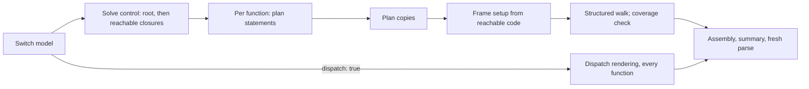

# Emit source from a VM switch model

Pipeline stage: `emit-source` ([map](../../pipelines/jsconfuser-vm.md)).

## 1. Target

The shared backend's last stage turns one [VM switch model](vm-switch-boundary.md) into fresh
JavaScript: every function structured from the [statement planner](vm-switch-statements.md)'s
regions over the [control solver](vm-switch-control.md)'s graph, with adjacent register copies
removed and unreachable code dropped, or every function as PC dispatch for review. It needs no
encoder knowledge ([ownership test](vm-switch-boundary.md#ownership-test)): it renders each operation
as the [operation grammar](vm-switch-boundary.md#typed-operation-grammar) defines it, from the model
as the frontend hands it over.

Original names and lexical scopes are not recovered in general. Register reuse, checks, host calls
and other effects remain where their removal is unproved. `emitVmSwitchProgram(model, {dispatch})`
returns `{output, statements, simplification}` or throws a typed decline; it does not freeze that
result or execute the source or output. The numeric
[publication wrapper](../jsconfuser-vm/standalone-decode.md) adds a residue gate and the frozen
public success or decline.

Readers need the [model fields](vm-switch-boundary.md#model-fields), JavaScript closures and
labeled statements, and reaching definitions.

## 2. Algorithm

### Pass order

The model carries no control, so emission solves it first and renders only what runs:

1. **Reachable functions.** Solve the root's control, then each function a reachable `closure`
   creates, transitively; each function is solved once. A function only unreachable code creates
   is not part of the program.
2. **Enumeration helper**, only when a reachable `for-in-setup` needs it.
3. **Each reachable function, in model order:**
   1. plan its statements ([statement recovery](vm-switch-statements.md));
   2. plan its copies: retarget each qualifying producer, drop its move
      ([copy simplification](#copy-simplification));
   3. set up the frame from the reachable effective instructions: parameters, capture cells,
      register declarations ([frames](#frames-cells-and-setup-liveness));
   4. walk the planned regions and render each reachable case once
      ([structured rendering](#structured-rendering)); a reachable case the walk did not emit
      declines.
4. **Assemble** the strict IIFE, the root invocation and the summary, and parse the output afresh.

Under `dispatch: true`, the review rendering, steps 1 and 3.1-3.2 are skipped: every function is
rendered as PC dispatch, reachable or not ([dispatch rendering](#dispatch-rendering)).



The structured walk visits the rooted graph one case at a time and emits each case once. A node is
one case, named `${functionId}:b@${pc}` as the planner names it, and its successors are the control
solver's edges from its PC, so the walk never meets an unreachable case. It follows a branch only
inside its planned region and a cycle only inside a planned loop, and requires a complete natural
exit. A function that cannot be rendered is not retried as dispatch: opaque regions and a cycle
entered at more than one case (no frontend hands one over) decline.

### Worked example: a loop end to end

[loop-sum](../../../../decoder/decode-js/test/vm/jsconfuser-vm/sources/loop-sum/source.js),
`function f(a) { var s = 0; for (var i = 0; i < a; i++) s += i; return s; }
window.TEST_OUTPUT = f(4);`, encoded with the pinned encoder, options `{}`, `Math.random` replaced
by mulberry32 seed 1; PCs from the encoder's listing. The model has 27 cases: function 0 at PCs
0-37, function 1 at 39-91.

1. **Reachable functions.** Function 0's closure at PC 2 is reachable and creates function 1; both
   are solved and emitted.
2. **Statements.** Function 0 has a `call` edge, so it gets one opaque row; function 1 gets a loop
   at 55 ending at 85 and a conditional at 59
   ([worked example](vm-switch-statements.md#worked-example-a-loop)).
3. **Copies.** Each producer below writes a temporary that only the next move reads, so the move
   is dropped and the producer writes the move's destination:

   | Function | Producer → move | Rendered |
   |---|---|---|
   | 0 | 2 `MAKE_CLOSURE r3` → 9 `MOVE r2 = r3` | `r2 = function (…) { … }` |
   | 1 | 41 `LOAD_CONST r5 = 0` → 45 `MOVE r3 = r5` | `r3 = 0` |
   | 1 | 48 `LOAD_CONST r5 = 0` → 52 `MOVE r4 = r5` | `r4 = 0` |
   | 1 | 62 `ADD r5 = r3 + r4` → 66 `MOVE r3 = r5` | `r3 = r3 + r4` |
   | 1 | 76 `ADD r6 = r4 + r5` → 80 `MOVE r4 = r6` | `r4 = r4 + r5` |

   PC 69 `MOVE r5 = r4` stays: PC 72 overwrites r5 before any read, so its value has no use, and
   copy simplification removes copies, not dead values.
4. **Unreachable code.** Function 1's implicit `return undefined` (87, 91) follows the explicit
   return and is not reached: dropped. Register r6 was written only by the producer now writing r4,
   so it is not declared.
5. **Summary.** `emitted` 20, `safelyEliminated` 5, `provenUnreachable` 2, `unreachableFunctions`
   0: 20 + 5 + 2 = 27 cases.

Function 1 renders as (names shortened from `__recovered_r_1_<n>`):

```js
function f(...args) {
  let r0, r2, r3, r4, r5;
  r0 = args[0];
  r2 = this;
  r3 = 0;
  r4 = 0;
  loop: while (true) {
    r5 = r4 < r0;
    if (r5) {
      r3 = r3 + r4;
      r5 = r4;
      r5 = 1;
      r4 = r4 + r5;
      continue loop;
    }
    break loop;
  }
  return r3;
}
```

## 3. Implementation

### Components

| Component | Consumes | Produces / consequential decision |
|---|---|---|
| Reachable functions (`reachableFunctions`) | The model. | The solver's result per reachable function, from the root through reachable closures. |
| [Control solver](vm-switch-control.md) | One function's frame and cases. | Reachability, handler stacks, edges, indirect targets, reaching definitions. |
| Statement planner | A function's cases and the solver's result. | Its regions ([statement recovery](vm-switch-statements.md)), also returned as `statements`. |
| Copy planner (`effectiveStructuredInstructions`, `retargetDestination`) | Cases, the solver's edges and reaching definitions. | Retarget map, removed-move PC set and per-copy proof rows; the instructions with removed moves dropped and each planned copy's destination retargeted. |
| Structured renderer (`emitStructuredFunction`) | Planned regions, effective instructions, the solver's result, frame and capture facts. | Complete function text or a decline; frame setup from reachable cases. |
| Dispatch renderer | Typed cases and frame and capture facts, under `dispatch: true` only. | Explicit PC transitions; a handler stack and unwinder only where used. |
| Program assembler (`emitVmSwitchProgram`) | All rendered functions. | Strict IIFE, optional enumeration helper, root invocation, summary and fresh parse. |

Both renderers share the operation and frame helpers of
[vm-switch-copy-planning.js](../../../../decoder/decode-js/src/vm/switch/vm-switch-copy-planning.js):

| Helper | Contract |
|---|---|
| `emitInstruction(functionId, instruction, functions, emissionMode)` | One typed operation's source text; `dispatch` mode appends the PC write and `continue`. |
| `functionName(functionId)`, `registerName(functionId, register)` | The emitted names `__recovered_function_<id>` and `__recovered_r_<id>_<register>`. |
| `functionRegisterSet(instructions)`, `localCaptureRegisterSet(instructions)` | Every register a function reads, writes, binds in a setup or captures; the registers its closures capture as locals. |
| `functionNeedsArguments(instructions, functionRecord)` | Whether a parameter register, or the one after them, is read or captured, so the function binds `arguments`. |
| `emitHandlerRegisterAssignment(functionId, registerCount, property, value)` | Dispatch unwinder only: the `switch` that writes a value (the caught error, a finally continuation or payload) into the register a popped handler's field names. |
| `appendRendered(lines, rendered)`, `invertPredicate(predicate)` | Split rendered text into lines without trailing blanks; negate a test, dropping a leading `!`. |
| `decline(code, message)`, `requireValue(value, code, message)` | The typed refusal; a refusal when a required value is missing. |

Emission creates strings and local planning maps; it does not mutate a source AST or maintain
caller-owned Babel bindings. The fresh parse checks syntax and discards its tree; downstream AST
consumers parse `output` into their own context.

### Planned regions consumed by rendering

Structured rendering builds conditional, switch, natural-loop and try lookup maps from the planner's
[region rows](vm-switch-statements.md#region-rows) and starts at the node of `frame.startPc`. A
linear or opaque row is not itself a rendering rule: the walk must still complete, and an unsupported
opaque shape declines. Proof strings in the rows describe the planner's result; rendering does not
re-prove them.

| Region | Consumer |
|---|---|
| Linear / opaque | No renderer reads `blockIds`. |
| Conditional | The test must end in a branch; the arms start at the two target PCs and stop at the merge. |
| Conditional, terminal additions | `branchTerminalBlockIds` and `fallthroughTerminalBlockIds` supply each arm's allowed terminal-region jump targets; each entry of `regionExitBlockIds` must be the catch or finalizer entry of an enclosing try region. The renderer accepts these fields; the planner always names a merge and never produces them. |
| Switch | Each later case's run (every case in it but a jump) and its test, the step nodes it marks emitted, the clause order and the end (null: every clause leaves by a transfer). |
| Natural loop | The header, the continuation (null: the loop declines) and the continue target with its run. |
| Try | The [try-region rule](vm-switch-try-region.md). |
| Labeled block | The head and the ends. |

### Frames, cells and setup liveness

Each frame becomes `__recovered_function_<id>`. Captures are an explicit first parameter only when
`captureCount > 0`. A local-capture register gets one lazy cell with a getter and setter over that
invocation's register variable; inherited captures reuse the parent's cell. The closure shell stores
its capture-array identity and forwards arguments through `Reflect.apply`, using
`this == null ? globalThis : this`. A returning invocation needs no explicit close operation:
JavaScript closures retain its lexical register variable. That representation is not a proof of all
original VM shell identity, constructor or host and reentrancy behaviour.

Arguments are bound only when some reachable instruction reads an argument register or captures it
locally. Parameter registers start at zero; with rest, the final parameter receives
`args.slice(paramCount - 1)`. When `paramCount < regCount`, register `paramCount` can hold the whole
argument array. Nonroot functions initialize the selected argument registers; the root is invoked
with `[]` only for its capture parameter and no arguments. Structured functions declare only the
registers the reachable effective instructions reference (plus handler and capture roles); dispatch
functions declare the full register frame. This is setup liveness, not SSA, local-scope recovery or
dead-value elimination.

### Copy simplification

The compiler writes a value into a temporary and then copies it into its variable
(`LOAD_CONST r4 = 140; MOVE r2 = r4`). Copy simplification removes such a move by making its
producer write the move's destination directly. It never substitutes an expression at a later use
or moves one: the producer stays at its PC, where its edges, handler state and effects are recorded,
and only its destination register, which is spelling, changes.

**Uses.** The [control solver](vm-switch-control.md#definitions-and-values) gives, for every
reachable case, the definitions reaching it per register: `entry:<register>`, a case's PC, or a
route's write (the exception, continuation and payload registers a handler route writes). Copy
planning reads them; it does not solve its own. For each reachable case, every register the
operation reads is a use of each definition reaching that register there, keeping multiplicity (a
binary operator reading one register twice is two uses). Unreachable cases have no reaching
definitions and contribute no uses.

**Qualifying pair.** A producer and a move qualify when all of these hold:

- both are reachable; the producer has an unconditional destination (`for-in-next` writes only on
  one route, so it never qualifies); the move is `assign(dst, register(src))` where src is the
  producer's destination and differs from dst;
- neither src nor dst is a local-capture register: a closure reads and writes it through its cell at
  any call, which no reaching definition records. A handler's registers may coalesce: a route writes
  them on its own edge, a definition the uses already count, so a producer retargeted into a finally
  payload (`r7 = e.message; r5 = r7` becoming `r5 = e.message`) leaves the payload to the route
  write when it throws;
- the producer's definition has exactly one use, at the move;
- they are adjacent: one of the producer's edges is a fallthrough to the move, which has exactly one
  incoming edge, passing over jump steps that each have exactly one incoming edge (incoming edges of
  every kind count). Every edge of the producer is examined; it may have several (a protected
  producer's fallthrough and handler route, say).

**Planning.** Pairs are considered case by case in PC order, each producer against each of its
fallthrough targets. Each pair is judged on the original instructions and reaching definitions.
Those facts stay true while copies are removed, since a removed move's value is still written, by the
producer it was folded into; what changes is which instruction writes it. So each decision is applied
to the current plan (explanatory pseudocode):

```text
plan        : producer PC -> register it now writes
removed     : PCs of removed moves
foldedInto  : removed move PC -> producer PC it was folded into
retained(pc): follow foldedInto from pc to a PC that was not removed

consider(producer, move):
  if the pair does not qualify: return
  if producer.pc in plan or move.pc in removed: return
  root = retained(producer.pc)               # the producer may itself be a removed move
  plan[root] = plan[move.pc] ?? move.dst     # the move may already be a planned producer
  delete plan[move.pc]
  foldedInto[move.pc] = root
  removed.add(move.pc)
```

A chain of copies therefore resolves to one write of its last register at the retained producer, in
either visit order, and no PC is ever both planned and removed. Every link is adjacent, the moves
passed over cannot throw, and each intermediate definition's only use is the next link, so the single
write is equivalent to the chain. Applied to the original instructions alone, a later pair would
retarget a move an earlier pair removed, and the chain's last register would never be written.

`var w = 140; var d = w; console.log(d);`, encoded with options `{}` and mulberry32 seed 1 (the
copy-chain unit case builds its cases from this listing):

| PC | Instruction | Reaching-definition fact |
|---|---|---|
| 2 | `r4 = 140` | used only at 6 |
| 6 | `r2 = r4` | used only at 9 |
| 9 | `r3 = r2` | used by the call |

| Pair | Retained producer | `plan` | `removed` |
|---|---|---|---|
| 2 → 6 | 2 | {2: r2} | {6} |
| 6 → 9 | retained(6) = 2 | {2: r3} | {6, 9} |

The function renders `r3 = 140;` and the call reads r3; r2 leaves the declaration list (r4 stays,
since later code reuses it). When the producer is laid out after its move and reaches it through a
jump step, 6 → 9 is planned first and records `plan[6] = r3`; the pair 2 → 6 then hands that
retarget to 2, with the same result.

**Proof rows** are built after planning, one per removed move, against the final plan:

```js
{
  functionId,
  producerPc,                // the retained producer
  movePc,
  sourceRegister,            // the register the move read
  destinationRegister,       // the register the retained producer writes
  reachingDefinitions: [String(p)], // p: the move's own producer (producerPc for an unchained copy)
  useSites: [{ pc: movePc, register: sourceRegister }],
  disposition: 'safely-eliminated',
  reason: 'single-reaching-definition-use',
  producerRetained: true,
  evaluationOrderPreserved: true,
  receiverSemanticsPreserved: true,
}
```

These are the planner's stated reason and disposition, not independent behavioural evidence.

**Rendering.** Effective instruction rows are copied when retargeted; the input cases and operation
objects are not edited. Each path applies the retarget map at the retained producer and skips a
removed move wherever it sits, inside an exception region too; skipping the move alone is
insufficient. The declaration list is taken from the effective instructions, so a register that only
a removed move wrote or read is not declared.

### Unreachable code

A case the control solver does not reach is dropped: no path runs it, so it is not part of the
recovered program, whether the compiler made it (an implicit `return undefined`, a finally resume or
throw pad, a finally exit tail behind a block that always returns) or the source wrote it (code
after a `return`). Frame setup follows the emitted code: the declaration list, the capture cells and
the `arguments` binding come from reachable cases only. The assembler emits the root and every
function a reachable `closure` creates; a function only unreachable code creates is neither solved
nor emitted, and the enumeration helper is emitted only for a reachable `for-in-setup`. A reachable
case the walk did not emit declines (`requireReachableCoverage`).

The summary is exactly:

```text
emitted              = instructionCount - safelyEliminated - provenUnreachable
safelyEliminated     = the removed moves (copy proof rows)
provenUnreachable    = unreachable cases of emitted functions + every case of a function not emitted
unreachableFunctions = the functions not emitted
```

Dispatch rendering emits every case of every function, reports `provenUnreachable = 0` and
`unreachableFunctions = 0`, and generates no copy proofs.

### Structured rendering

The walk renders one case at a time and stops at a planned stop. An ordinary operation permits one
normal successor and, as an exceptional successor, only an uncaught null throw or the innermost try
region's catch or finalizer route. A repeated case, an uncovered reachable case or an incomplete
natural exit declines.

- **Jumps.** A jump to an enclosing loop's head is `continue`, to a breakable statement's end
  `break`; any other jump is a step of the statement's own flow, as a fallthrough is: the walk
  continues at its target, and emitting each case once keeps anything shared out. A jump step
  renders nothing, so routes may share one.
- **Conditionals.** The arms start at the two target PCs and stop at the merge; an arm whose jump
  steps lead straight to the merge renders empty. A conditional arm's route into a catch or
  finalizer must name an enclosing try region.
- **Loops.** A loop is a labeled `while (true)` with `break` and `continue`, ending at its
  continuation, which the planner has already followed through jump-only blocks; a continuation
  that is an enclosing loop's exit declines. A loop with a
  [continue target](vm-switch-statements.md#trailing-run-and-continue-target) is written
  `for (; ; update)`: the update run's operations, each rendering as one expression, become the
  comma-joined clause, a planned conditional inside the run written `test ? (…) : (…)` with an empty
  arm as `void 0`, and a jump to the target from anywhere in the body is `continue`. A do-while with
  one is written `do { … } while (test)`: its test run as one comma expression ending in the
  condition that goes back, the body's own end reaching the test without a `continue`. So a continue
  routed through a finally runs the finalizer and then the update or the test natively.
- **Switches.** A [switch region](vm-switch-statements.md#switch) is written
  `label: switch (discriminant) { … }` with its clauses in the planned order. The head test's leading
  operations run before it as statements and its case label is the value register; every later
  case's label is `(run…, value)`, its run's operations as one comma expression ending in the value,
  so native label evaluation runs the chain's operations in the chain's order and stops at the first
  match, as the chain does; a run that is not expressions declines. Grouped labels sharing one body
  are written consecutively with empty clauses. Each body is walked to the next clause's entry (a
  fallthrough, written as nothing), the end (`break label`, omitted for the last clause) or a
  transfer; a jump to the switch's end anywhere in a body is `break label`, and a jump to an
  enclosing loop's head stays `continue`. A body ending anywhere else declines.
- **Labeled blocks.** A [labeled block](vm-switch-statements.md#labeled-exits) is written
  `label: { … }` around what starts at its head, a breakable statement but never a loop: a jump to
  its end anywhere inside is `break label`, the walk stops at that end and continues there after the
  block. A head with several ends opens the farthest first.
- **Try statements.** Every try statement, catch only, finally only, catch and finally, nested in
  any combination, is rendered by the [try-region rule](vm-switch-try-region.md): regions are read
  from their compiler-only head and tail instructions, every exit stays native, and the rule's
  semantic checks decline models that are not compiler grammar.

### Dispatch rendering

Dispatch is the review rendering: it is used for every function under `dispatch: true`, and for no
function otherwise. It starts at frame entry inside a labeled loop with one case per instruction.
Ordinary cases set nextPc and continue; transfers override it; return and throw finish natively. A
missing runtime PC throws `Error('Invalid recovered control state')`. Handler setup pushes records;
handler-pop alone keeps a stack but adds no catch wrapper. With a catch or finally setup, each switch
iteration runs under try/catch: pop the top handler, rethrow if absent; a catch writes its exception
register and jumps to its target; a finally writes continuation = throw pad and payload = error, then
jumps to the finalizer. Register selection uses a switch with an invalid-register error.

### Refusals

| Refusal family | Code / boundary |
|---|---|
| Control the solver cannot solve | The [control solver's declines](vm-switch-control.md#output). |
| A value or operation kind rendering does not know | `unsupported-switch-value`, `unsupported-switch-operation`. |
| Consumed region or edge metadata, or an unsupported structured walk | `invalid-structured-control` or `unemittable-structured-control`. |
| Fresh syntax | `emitted-parse-failed`. |

A function that declines is never retried as dispatch; the decline propagates, and no partially
emitted output escapes it, even where earlier functions rendered. These are source-defined error
families, not a claim that every malformed nested object throws a typed error: unexpected exceptions
can still propagate, and numeric publication normalizes them to `standalone-emission-error`.

### Testing and acceptance

| Scenario | Oracle / acceptance | Evidence |
|---|---|---|
| E1 hand-written model | The source-switch model emits without dispatch and sets `RESULT` to 7. | Unit case |
| E2 forced dispatch | An installed catch survives under dispatch. | Unit case |
| E3 copy simplification | A producer and its private move read as one statement; chains in either visit order resolve to one write of the last register, with retained-producer proof rows and matching declarations; a copy coalesces only with a producer it alone uses; adjacent copies equal the source's. | Unit cases; `compiled-forms` |
| E4 unreachable code | No `if (false)`; the summary invariant holds; a function only dead code creates is not emitted. | Unit cases |
| E5 every compiled form | Decoded behaviour equals the source's; strict-program sloppy `delete` on every member-delete route. | `compiled-forms`, `whole-programs` |
| E6 review artifact | The review rendering behaves as the encoded input under the same host and never overwrites its output. | `render-vm-switch.test.js` |

The join barrier of copy simplification is reached by no cell and is unproved.

### Inspecting the switch handoff

The [step-one renderer](../../../../decoder/decode-js/scripts/render-vm-switch.mjs) writes
`switch-case.js` from admitted numeric source. It forces dispatch for review, keeping every
operation for later cleanup, and reads no saved model: every model it renders comes from the
frontend. It includes no demo host shim or logger. From `decoder/decode-js`, with a fresh output
directory:

```sh
node scripts/render-vm-switch.mjs \
  --source test/vm/jsconfuser-vm/fixtures/readability/arithmetic/encoded.js \
  --output-dir <fresh directory>
```

The committed script test compares encoded and review output under the same `window` and
`performance.now` bindings and prevents overwriting its review artifact; that arithmetic fixture does
not establish general step-one native semantics.

## 4. Input Shapes

| Producer | Supplied shape / consumer treatment |
|---|---|
| The frontend's lowering ([numeric](../jsconfuser-vm/lower-switch-model.md)) | The model, read as given; nothing here checks a [model field](vm-switch-boundary.md#model-fields). |
| [Control solver](vm-switch-control.md#output) | Reachability, handler stacks, edges and reaching definitions per function. |
| [Statement planner](vm-switch-statements.md#region-rows) | Regions per structured function. |
| Synthetic source-switch fixture | Direct model objects; establishes only the exercised backend relation. |

## 5. Known Gaps

- Validation is model consistency, not native equivalence. The
  [target semantics](../../../js-confuser-vm/instruction-set.md#properties-collections-and-enumeration)
  build an object in a temporary with ordinary assignment before publishing it, and invoke host
  callees through their apply property rather than `Reflect.apply` or a direct call; a plain call's
  host callee there receives `this` null where the output passes undefined, which only a strict host
  function can observe. Emission's choices need comparison under custom apply properties and
  reentrant or error-order conditions, and strict IIFE, `globalThis` selection, host intrinsic
  mutation and internal closure or constructor identity need their own evidence.
- Opaque or unsupported planned structure declines; the control boundaries are the planner's
  [known gaps](vm-switch-statements.md#5-known-gaps).
- Copy simplification's unit cases give every producer a single outgoing edge; a pair whose
  producer has several (a protected producer's fallthrough and handler edges, say) is covered only
  by encoder-generated cells.

## Source

- [vm-switch-to-source.js](../../../../decoder/decode-js/src/vm/switch/vm-switch-to-source.js): `emitVmSwitchProgram`, `reachableFunctions`, the dispatch renderer, program assembly and the fresh parse.
- [vm-switch-copy-planning.js](../../../../decoder/decode-js/src/vm/switch/vm-switch-copy-planning.js): operation rendering, frame and capture setup, copy planning.
- [vm-switch-structured-emitter.js](../../../../decoder/decode-js/src/vm/switch/vm-switch-structured-emitter.js): `emitStructuredFunction`; the region walk, loops, conditionals, switches, labeled blocks, try regions and `requireReachableCoverage`.
- [decode-standalone.js](../../../../decoder/decode-js/src/vm/jsconfuser-vm/decode-standalone.js): numeric publication after this stage.
- [render-vm-switch.mjs](../../../../decoder/decode-js/scripts/render-vm-switch.mjs): the review artifact interface.

## Fixtures

| Test | Claims |
|---|---|
| [vm-switch-to-source.test.js](../../../../decoder/decode-js/test/vm/switch/single-component/vm-switch-to-source.test.js) | E1 (the source-switch model); E2 (a catch under forced dispatch); E3 (copy chains across cases and in reverse visit order through jump steps, a single copy); E4 (a finalizer that never completes; code after a return leaves no block, no function it alone creates, no for-in helper); code after a handler-pop that is not a transfer declines; DEBUGGER omitted with effects kept in structured and dispatch modes. |
| [compiled-forms](../../../../decoder/decode-js/test/vm/jsconfuser-vm/generated-cells/compiled-forms/suite.js) | E3, E5: every compiled form recovers with source behaviour; a copy coalesces only with a producer it alone uses (proved by breaks); adjacent copies equal the source's on compound-arith, compound-bitwise, operators and f-branching (the copies indicator); `expr-assign`'s delete-primitive-target drives every member-delete route (configurable, frozen, primitive, nullish) through the [sloppy delete](vm-switch-boundary.md#typed-operation-grammar). Exception regions recover in `control-try`, whose break on catch setups as protected regions turns them red. |
| [whole-programs](../../../../decoder/decode-js/test/vm/jsconfuser-vm/generated-cells/whole-programs/suite.js) | E5: large programs decode end to end with source behaviour; no exhaustive host semantics. |
| [render-vm-switch.test.js](../../../../decoder/decode-js/test/scripts/render-vm-switch.test.js) | E6: arithmetic encoded and review window effect under a fixed host, switch shape, no overwrite. |

Try-region behaviour is in the [try-region fixtures](vm-switch-try-region.md#fixtures). The
[finite minified-class qualification](../jsconfuser-vm/qualify-jsconfuser-vm.md#finite-minified-class-qualification)
owns the numeric current-output matrix; neither it nor these suites closes missing native property
or coercion exception edges, abstract-value precision or arbitrary host and exception semantics.
