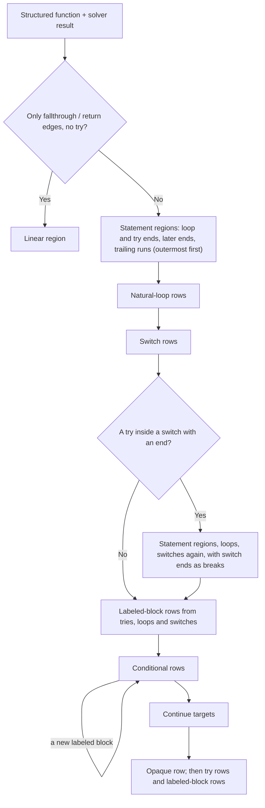

# Recover statements from a VM switch model

Pipeline stage: `plan-statements` ([map](../../pipelines/jsconfuser-vm.md)).

## 1. Target

Turn one structured function of a [VM switch model](vm-switch-boundary.md) into the statement
regions the structured emitter renders: loops, tries, switches, conditionals, labeled blocks, a
linear run, and one opaque row for the blocks no region heads. `planStatements(functionRecord,
cases, solved)` returns the regions; `emitVmSwitchProgram` calls it for every structured function
with that function's cases and [control solver](vm-switch-control.md) result and returns the plans
as `statements`. By the [ownership test](vm-switch-boundary.md#ownership-test) the planner
needs no encoder knowledge: it reads only the typed operations and the solver's result, so every VM
frontend reuses it. It never changes the model, and a plan can still fail later emission.

Readers need directed graphs, branches, loops and dominance (a block A dominates B when every path
from the entry to B passes A).

### Terms

| Term | Meaning |
|---|---|
| Block | One case, named `${functionId}:b@${pc}` as the structured emitter names its nodes; its operation is the case's typed operation. |
| Edge | The solver's (`edges`: kind, route, condition). A *normal* edge is any whose route is not `exceptional`. A call operation's edge has kind `call`. Which blocks run (`reachablePcs`) and the handler stack each case runs under (`stateIn`) are the solver's too. |
| Jump step | A block whose operation is an unconditional `jump`: it runs nothing, so every reader here looks through it ([boundary](vm-switch-boundary.md#jump-steps)). |
| Statement region, members | The blocks a statement holds: those its head dominates, less those its end (or a cut) dominates without dominating the head. A region is *closed* when every edge into a member other than the head comes from a member; the head may be entered from outside it, and a try's setup from anywhere. |
| End (continuation) | The block where control goes on after the statement completes normally. |
| Transfer, stop | A jump out of a statement to an enclosing statement's head or end (`continue`, `break`), or a `return`/`throw`. The blocks such a jump reaches are *stops*: a walk inside the statement does not pass them. |
| Later end | A block outside a statement that one of its exits reaches past code its own end runs: what `break L` leaves behind. |
| Labeled block | The row that holds later ends: `__recovered_block_…: { statement; tail; }`. |
| Trailing run | The code that ends at a loop's only back edge, where several paths enter it: a `for` update or a do-while test, when a jump proves it one. |
| Layout end | The frontend's hint, on a `catch-setup`, of where the source closed a try whose block always throws. |

## 2. Algorithm

### Pass order

A statement closes by its own edges, never by how the function ends: a source function need not end
in `return`, and `for (…) { if (x) return a; } return b;` closes its `for` where the loop's test
exits. Each pass below finds one kind of statement and hands the next the ends it found, which are
that pass's stops.

1. **Linear shortcut.** A function whose edges are all `fallthrough` or `return` and which sets up
   no try is one linear region; nothing else runs. A function with a call has a `call` edge and
   goes on.
2. **Statement regions** of loops and tries, outermost first (fewest dominators): each loop's end
   and later ends, each try's end and later ends, each loop's trailing run.
3. **Natural loops**: one row per loop header, its body the header's statement region.
4. **Switches**: chains of `===` tests on one register, given the loops' stops.
5. **Re-plan** when a try's setup is a member of a switch row with an end: steps 2-4 run again with
   the ends of the switches holding each try, which are its `break` targets.
6. **Labeled-block rows** from step 2 and step 4.
7. **Conditionals**, given every earlier end as a stop. A test whose arms meet without a first block
   adds a labeled block. That block's end becomes a stop for the tests inside it, so the pass
   repeats until it adds no row.
8. **Continue targets**: a loop whose trailing run a statement jumps to publishes it.
9. **Opaque row**: the blocks that are no conditional test, switch test or loop header.



The repetition in step 7 ends: a test that gains a labeled block closes on every later pass, since
its block's end is then one of its stops, so each test adds at most one row.

### Loop end

A **loop** is entered at a back-edge target, an edge whose target dominates its source. Its *cycle*
is the header and every block that reaches a back edge.

1. Walk the header's straight run over normal edges. The first `branch` or `for-in-next` with
   exactly one target outside the cycle is the loop's test (while, for, for-in); its outside target
   is the end.
2. A branch whose arms close inside the cycle is nested in the test, a short-circuit operand of
   `p != null && !(stop && f(p))`, say. It is closed by the conditional rule, its stops being the
   loop's head and the enclosing loops' heads and ends, and the walk continues where it closes.
3. Otherwise, with one back edge, the branch that back edge falls from is the test (a do-while).
4. The end is followed through jump steps while it stays outside the cycle.

The body is the loop's statement region: the blocks the header dominates and the end does not. So a
try inside the loop keeps its throw pad, the `handler-pop` a `break` runs before its jump, and a
catch ending in `break`. A loop whose test cannot be found has no end; its row is still published
and emission declines it.

### Try end

A **try** is entered at its setup (`catch-setup`, `finally-setup`) and ends where its own normal exit
leads. The compiler pops the try (`handler-pop`) on every exit that does not throw: its normal end,
and each `return`, `break` or `continue` crossing it. The rule depends on what the try has.

**A catch that completes normally** ends where its block's normal end and its catch's normal end
meet, as a native `try` statement completes:

1. Follow each pop of this try through the jump steps only its own route enters, to the block it
   leads to. A jump step several routes enter is where they meet, a location
   ([F1](../../../encoder-decoder-method.md#f1-select-what-the-program-cannot-run-without)): a try
   nested in a catch ends at the jump its own pops and its catch share, not at the outer try's end
   behind it.
2. Keep the blocks the catch's own normal walk reaches. The walk never passes the setup again, so a
   loop's next iteration is not the catch completing. Drop an enclosing loop's head or end and an
   enclosing switch's end: those are `continue` and `break`. A catch that leaves by a `break` of
   the switch holding the try reaches only that end: `case 1: try { if (x) break; f(); } catch (e)
   { break; } g(); case 2: …` ends its try at `g()`.
3. The end is the one the catch reaches first: it dominates the others over the catch's walk. A
   `break` crossing the try leads to a block a completing catch reaches only through the normal end,
   so the layout never decides.

**A catch that never completes normally** ends at the target of the `jump` after a pop. A pop that
falls into code ends nothing, since a `return` crossing the try has that graph too
([Known Gaps](#5-known-gaps)).

**A finally** ends at the literal its tail assigns to its continuation register after a pop and
before jumping to its finalizer. Jump steps may sit between any two of these and before the literal's
block: control flow flattening places steps there, and a routed pad may land on a different step
before the same block.

**A finally with no reachable normal tail**, whose every non-throwing exit is routed, ends where
those exits land: `a: try { throw 1; } catch (e) { break a; } finally {}` and `for (;;) { try {
throw 1; } catch (e) { break; } finally {} }` have only the routed tail. A pad that jumps, or that
opens the enclosing finally's tail, runs what follows the statement, so the try ends there. A routed
return's pad reads the pending payload and stays at its exit, so its try has no end.

**Several tails.** A `break` or `continue` crossing a try has the same tail as its normal end. Among
several tail targets, an enclosing loop's head or end and an enclosing switch's end are transfers
and are dropped; so is a `continue` to an enclosing loop's trailing run, unless every target is one.
The compiler emits one normal tail per try; when several remain (a reachable injected copy, say),
the first in program order ends the try and the others are walked as routed exits. An end that
leaves the try's region open is dropped.

**A try without an end** reaches the code after it only through its catch. The frontend's layout end
then places the end, when the catch's own normal walk reaches that block inside the catch; otherwise
the catch keeps the code only it reaches. Both layouts behave the same. The frontend reads the hint
from its compiler's dead normal exit
([why only there](../jsconfuser-vm/lower-switch-model.md#the-catch-layout-hint)); the planner reads
no unreachable case for it. The layout end serves as the try's end for labeled exits and for the
tests inside the try: `L: { try { throw 1; } catch (e) { if (c) break L; } tail(); }` reads with its
`break L` and the tail after the try.

A switch's end is known only once the switch rows are found, after the statements; that is why a
function with a try among a switch's members is planned again (pass order step 5).

### Labeled exits

`break L` and `continue L` compile to a plain `jump`. The encoder's labels exist only while it
compiles ([compiler](../../../js-confuser-vm/js-confuser-vm.md)): any statement can carry one, and
the jumps are the same whichever did, so the planner never reads a label. The graph keeps their
limit: a `break` goes only to the end of a statement holding it, a `continue` only to the continue
point of a loop holding it, and neither leaves its function. Most such jumps are transfers. The rest
leave a statement for a **later end**, past code another route runs: in `L: { while (t) { if (x)
break L; } tail; } end;` the loop's end is `tail`, and the jump to `end` is no transfer of it.

A later end is found by walking forward from each exit of the statement and from its end, without
passing a transfer; where an exit's walk first meets the end's walk is that exit's landing. A
landing that is neither the end nor a transfer is a later end. Later ends are placed in this order,
since a label makes code hard to trace:

1. Statements close by their own rules.
2. A loop with exactly one later end moves its end there, when the code it skips holds no loop and
   its test is no `for-in`: the skipped code goes into the arm of the test that leaves,
   `while (true) { if (!t) { tail; break; } if (x) break; }`, with no label beyond the loop's. A
   do-while reads this way already, since its `break` is the first branch leaving its cycle. A
   `for-in` must leave at the loop's end to advance, so it cannot.
3. Otherwise the statement gets a **labeled block** ending at each later end, nearest innermost:
   - *Loop:* every later end, as in `twoLabels` of the
     [labeled-exit-forms](../../../../decoder/decode-js/test/vm/jsconfuser-vm/sources/labeled-exit-forms/source.js)
     source, `A: { B: { for (…) { if (i === a) break A; if (i === b) break B; … } t.push("b"); }
     t.push("a"); } t.push("end");`: the loop's end is `t.push("b")`, `break B` lands at
     `t.push("a")`, `break A` at `t.push("end")`, and the output nests two blocks.
   - *Try:* always, since its tail runs after the finalizer and outside the handler, so the try
     never moves its end: `L: { try { if (c) break L; x(); } finally { f(); } tail(); } end;`. Also
     where another route reaches the end from before the try: `L: { if (d) break L; try { if (c)
     break L; } finally { } tail(); } end;`. A loop's exit to the try's own end takes one too, since
     a `break` leaves only the loop: `a: try { for (…) { if (i) break a; … } … } finally { … } end;`
     reads `L: { try { … break L; … } finally { … } } end;`.
   - *Switch:* always, since every clause body reaches its end: `L: { switch (n) { case 1: if (c)
     break L; break; default: d(); } tail(); } end;` keeps `tail()` after the switch.
   - *Conditional* whose arms meet without a first block (see [Conditional](#conditional)).

An exit lands where it runs nothing on the way: handler pops, jumps and, through a finalizer, its own
pad, never the finalizer's resume that every exit shares. So a `break A` that leaves through two
finally statements to an enclosing loop's end takes no label, and an exit to an enclosing loop's
trailing run is a `continue`, never a later end.

A labeled source statement gets no block where a statement's own rules hold. The block's name is
never the source's, and its placement need not be: `L: if (x) { … }` and `L: { if (x) { … } }` are
one graph, and only behaviour is the oracle
([M1](../../../encoder-decoder-method.md#m1-judge-an-output-by-how-it-reads-against-its-source)).

### Trailing run and continue target

A loop's **trailing run** is walked back from its only back edge, or, for a do-while, from its test
(so the run is the test). The walk crosses straight blocks and a conditional that is one expression
(an update `i = x ? i + 2 : i + 1` or `x && n++`): its arms first meet at the block walked back from,
hold no statement, and are the only way into it. It stops at a block several paths enter; that block
starts the run. A walk that reaches the header, or a block whose single predecessor branches, finds no
run. An `if` whose arms meet earlier is a statement before the run.

The run is a stop like the loop's head and end, so no statement inside the loop takes it as a member.
Whether it is the loop's **update** (entered by every `continue`) or plain body code that a merge
explains (`while (t) { if (c) a; else b; z }` closes its `if` at `z`) is read after the statements
close. It is the update when a statement jumps there without closing there:

- a try that closes elsewhere while one of its blocks jumps to the run (a `continue` routed through
  a finally re-issues the jump from its pad), or
- a conditional or switch with an arm that reaches the run while it closes elsewhere, unless an
  inner loop ends at the run, which explains that jump as its own `break`.

Only then does the loop publish the run as its continue target, which the emitter writes as a `for`
update or a do-while's `while (test)`, so that a native `continue` runs it.

### Switch

A **switch** is a chain of two-way tests that compare one register, the discriminant, with `===`
against each case's value in turn, while nothing in the chain writes the discriminant. A test's match
route enters its case body; its miss route runs the next case's value into the next test; the last
miss enters the default body, or the end when there is none. That is how a native `switch` selects
its clause, so its bodies may share routes as clauses do: fallthrough into the next clause, grouped
labels entering one body, a default between cases. A body may hold a try whose catch or finalizer
belongs to it.

1. A chain becomes a switch only when one of its tests has no first meeting block; a chain whose arms
   all meet stays a chain of conditionals, which behaves the same.
2. The switch ends at the nearest block every body's normal exit reaches (`break` or the last body
   running out). Code every route runs is therefore after the switch, even where the source wrote it
   as the last clause, and a case entered there is an empty last clause.
3. A labeled exit past that block (`L: { switch (n) { case 1: if (c) break L; … } tail(); } end;`)
   reaches it by no other route, so the switch still ends at `tail()` and the exit becomes a later
   end.
4. Clause order keeps every fallthrough: a body that runs into another clause's body is followed by
   that clause, and the default goes where that holds.

For `switch (x) { case 1: out.push(1); case 2: out.push(2); } return out;` the encoder emits the
tests `x === 1` and `x === 2`, each jumping to its case body, and the bodies in order. The first
test's arms both reach case 2's body and the return, but the second test's miss reaches the return
without case 2's body, so neither dominates the other: no first meeting block. Both tests compare
`x`, which nothing in the chain writes, so `x` is the discriminant; the end is the return, and case
1's body falls into case 2's, so the clauses keep that order.

### Conditional

A **conditional** is a block whose operation has a conditional and a fallthrough edge. Each arm walks
forward from one target over normal edges, stopping at a stop: the head, end and trailing run of
each loop holding the test, the end and clause entries of a holding switch, the ends of a holding
labeled block, the end of the innermost holding try, and the layout end of each holding try without
an end. An arm in a catch therefore stops where the try completes. A try is one statement, so an arm also walks a
`catch-setup`'s own route into its catch: `if (x) { try { throw 1; } catch (e) { a(); } } b();`
meets at `b()`, reached only through the catch. Any other exceptional route leaves the statement and
is not followed.

The test closes at the first of these that applies:

1. **The arms meet.** The merge is the first block both reach, by dominance over the paths from the
   test through its arms only, so code they share with paths from outside (a catch rejoining after a
   try) does not hide where they meet. A jump step on a single route into that block does not hide
   it either.
2. **The arms meet only at one stop** (both run into a loop's trailing run, say): they close there.
3. **One arm leaves the innermost try.** A fallthrough arm that reaches the end of the innermost try
   holding the test, while the other does not, closes the test at that end: `a: try { if (c) break
   a; x(); throw 1; } finally {}` reads `try { if (!c) { x(); throw 1; } } finally {}`. A layout end
   never closes a test this way.
4. **One arm is a transfer.** The fallback is the fallthrough target when it is a stop (the loop's
   test leaving it), else the branch target, the else-or-end, followed through jump steps to a stop.
   So `if (v < 0) throw …; return v + 1;` reads as a guard, a `switch` whose cases all return as a
   chain of guards, and a loop's test as `if (test) { body; continue } break`. Inside a labeled
   block, when the fallback is the block's end and the arms reach the block's inner stop, the test
   closes at the inner stop instead and the arm reaching the end breaks: `L1: { if (a) { if (x)
   t(); else break L1; } else e(); f(); }` closes `if (x)` at `f()`.
5. **The arms meet without a first block** and the test is no switch's: a labeled exit skips code
   another route runs. The test gets a labeled block around itself, ending at the nearest shared
   block whose removal gives the arms a first block and that a route skipping that first block
   reaches, past the code it skips. Its further exits are later ends, so `L1: { L2: { if (a) { if
   (x) break L2; if (y) break L1; } … } … }` nests a block for each. In `L: { if (a) { if (b) break
   L; } e(); f(); } end;` only `end` is reached past `e()`.

A `break` guard, `if (c) break L; rest;`, keeps its guard reading: only the fallback gives way to an
inner stop.

### Worked example: a loop

[loop-sum](../../../../decoder/decode-js/test/vm/jsconfuser-vm/sources/loop-sum/source.js),
`function f(a) { var s = 0; for (var i = 0; i < a; i++) s += i; return s; }`, encoded with the
pinned encoder's defaults (seed 1). Function 1 starts at PC 39:

| PC | Listing | Role |
|---|---|---|
| 39-52 | `this`, `s = 0`, `i = 0` | entry run |
| 55 | `for_top_2: LT r5 = r4 < r0` | back-edge target: the loop's header |
| 59 | `JUMP_IF_FALSE r5 → for_exit_3 (85)` | the first branch with one target outside the cycle |
| 62-66 | `s += i` | body |
| 69-80 | `for_update_4: i++` | update |
| 83 | `JUMP for_top_2 (55)` | the back edge |
| 85 | `for_exit_3: RETURN s` | the loop's end |
| 87-91 | `RETURN undefined` | unreachable |

Function 1 has a conditional edge, so it is not linear. The back edge 83 → 55 makes 55 a loop
header; its run reaches 59, whose target 85 is outside the cycle, so 85 is the end and the body is
55-83. Walking back from 83 meets 62, whose single predecessor 59 branches: no trailing run, no
continue target. Test 59's arms are the end 85 and the body 62; neither meets the other before a
stop, and the fallthrough 62 is no stop, so the test closes at its branch target 85. The rows:

```js
{ kind: 'conditional', testBlockId: '1:b@59', branchTargetPc: 85, fallthroughTargetPc: 62, mergeBlockId: '1:b@85' }
{ kind: 'natural-loop', headerBlockId: '1:b@55', bodyBlockIds: [/* 55 … 83 */], continuationBlockId: '1:b@85',
  headerCondition: null, continueBlockId: null, updateBlockIds: null, testBlockIds: null }
{ kind: 'opaque', blockIds: [/* every other block, 87 and 91 included */] }
```

The emitter writes `loop: while (true) { r5 = r4 < r0; if (r5) { s += i; i++; continue loop; } break
loop; } return s;` (registers folded), the loop form [Known Gaps](#5-known-gaps) names. Function
0 has a call, so it is not linear either: its rows are one opaque row over every block.

### Worked example: a catch with a labeled exit

[catch-exit-past-tail](../../../../decoder/decode-js/test/vm/jsconfuser-vm/sources/catch-exit-past-tail/source.js),
`function f(c, b) { var t = []; L: { try { if (b) throw 1; t.push("b"); } catch (e) { if (c) break
L; t.push("c"); } t.push("tail"); } t.push("end"); return t; }`, encoded the same way. Function 1
starts at PC 78:

| PC | Listing | Role |
|---|---|---|
| 86 | `TRY_SETUP [catch_3 (119), r5]` | the try's setup |
| 89 | `JUMP_IF_FALSE r1 → if_else_5 (98)` | test `b` |
| 92-96 | `THROW 1` | the throwing arm |
| 98-110 | `t.push("b")` | |
| 116 | `TRY_END` | the try's only pop |
| 117 | `JUMP after_catch_4 (142)` | a jump step only the pop's route enters |
| 119 | `catch_3: JUMP_IF_FALSE r0 → if_else_6 (124)` | test `c` |
| 122 | `JUMP block_break_2 (160)` | `break L` |
| 124-136 | `if_else_6: t.push("c")` | |
| 142-154 | `after_catch_4: t.push("tail")` | |
| 160-178 | `block_break_2: t.push("end"); return t` | |
| 180-184 | `RETURN undefined` | unreachable |

1. **Try end.** The try is catch-only. Its pop 116 leads through the jump step 117 to 142. The catch's
   walk from 119 reaches 142 (and 160), so 142 is the end.
2. **Later ends.** The end's walk is 142 onward, 160 included. The members the end's walk does not
   reach are 86-136. Their exit 122 → 160 lands at 160 without passing 142, so 160 is a later end;
   the try never moves its end, so a labeled block headed by 86 ends at 160.
3. **Test 89.** Stops: the try's end 142 and the block's end 160. The fallthrough arm 92-96 ends at
   the throw; the branch arm 98-117 reaches 142. They never meet, the fallthrough arm does not reach
   the try's end, and 92 is no stop, so the test closes at its branch target 98: a guard.
4. **Test 119.** Same stops. The fallthrough arm 122 reaches 160; the branch arm 124-136 reaches
   142. No shared stop, and the fallback 124 is no block end, so it closes at 124: a guard whose
   consequent is `break`.

```js
{ kind: 'conditional', testBlockId: '1:b@89', mergeBlockId: '1:b@98' }
{ kind: 'conditional', testBlockId: '1:b@119', mergeBlockId: '1:b@124' }
{ kind: 'opaque', blockIds: [/* every block but 89 and 119 */] }
{ kind: 'try', setupBlockId: '1:b@86', continuationBlockId: '1:b@142', layoutEndBlockId: null,
  memberBlockIds: [/* 86 … 136 */] }
{ kind: 'labeled-block', headBlockId: '1:b@86', endBlockIds: ['1:b@160'], innerStopBlockIds: [] }
```

The emitter writes (registers folded into the values they hold, for reading):

```js
block: {
  try {
    if (b) { throw 1; }
    t.push("b");
  } catch (e) {
    if (c) { break block; }
    t.push("c");
  }
  t.push("tail");
}
t.push("end");
return t;
```

## 3. Implementation

### Region rows

```js
{ kind: 'linear', blockIds, proof }   // every block, in PC order
{ kind: 'opaque', blockIds, reason }  // every block that is no conditional test, switch test or loop header
{
  kind: 'conditional',
  testBlockId, condition,               // condition: the solver edge's own object
  branchTargetPc, fallthroughTargetPc,  // the emitter starts the arms here
  mergeBlockId,                         // always named by the planner
  proof,
}
{
  kind: 'natural-loop',
  headerBlockId, bodyBlockIds, continuationBlockId, headerCondition,
  continueBlockId,            // null unless the loop publishes a continue target
  updateBlockIds,             // the trailing run, for a loop tested at its header; else null
  testBlockIds,               // the trailing run, for a do-while; else null
  proof,
}
{
  kind: 'try',
  setupBlockId,
  continuationBlockId,        // the reachable end; null when the block never completes normally
                              // or its region does not close
  layoutEndBlockId,           // the accepted frontend hint for a catch without one; else null
  memberBlockIds,             // in startPc order, excluding what either end dominates
  proof,
}
{
  kind: 'switch',
  testBlockId,                // the chain's head
  discriminant,
  cases: [{ testBlockId, value, runBlockIds, stepBlockIds, entryBlockId }], // the head's run is empty
  defaultEntryBlockId, defaultStepBlockIds,
  clauses: [{ caseIndex, entryBlockId }],  // caseIndex null for the default
  continuationBlockId,        // null when every clause leaves by a transfer
  memberBlockIds,
  proof,
}
{
  kind: 'labeled-block',
  headBlockId,                // a loop's header, a try's setup, a switch's head or a conditional's test
  endBlockIds,                // nearest first; each ends one block, the farthest outermost
  innerStopBlockIds,          // a conditional's merge; empty otherwise
  proof,
}
```

A loop's trailing run ends at the back edge's source; a do-while's ends with the test's branch and the
latch. The rows describe the function with overlap, not a disjoint partition of its operations. They
are plain data for the emitter and for inspection; the planner does not freeze them.

### Graph and dominators

`blockGraph` makes one block per case, in PC order, and an adjacency row per solver edge from its
source PC's block to its target PC's block, keeping parallel rows and the solver's edge order. Every
edge needs a source block and, for a non-null target, a target block; otherwise
`invalid-structured-control`. A null target has no successor. A block is reachable when the solver
reaches its case. `dominators` computes, over the reachable blocks from the entry
`${functionRecord.id}:b@${functionRecord.startPc}`,
`dom(v) = {v} ∪ ⋂ dom(p)` for the reachable predecessors `p`.

Shared walks: `walkForward(start, next, inside, stops)` is breadth-first, never entering `inside`
and not expanding a stop. `laterEnds(inside, end, next, transfers)` walks from the end (outside
`inside`, up to a transfer); for each edge from `inside` to outside it walks from the target the same
way, and the first block also on the end's walk is a landing; landings other than the end or a
transfer are returned, ordered by the end's walk.

### Statement regions

`findStatementRegions(entry, blocks, edges, graph, control, switchEnds)` (explanatory pseudocode):

```text
entries = [loop at each back-edge target, once] + [try at each reachable catch-setup/finally-setup]
sort entries by dominator-set size (stable), so a holding statement is solved first
for each entry:
  if loop:
    end = loopEnd(head)
    if end: (end, blockEnds) = closeLaterExits(head, end); cuts = blockEnds
  if try:
    enclosing = heads and ends of holding loops + switchEnds(head)
    tails = [catchEnd(head, enclosing)] or exitTails(head)
    if no tails and finally-setup: tails = routedEnds(head) − enclosing
    if several tails: drop enclosing
    cuts = first trailing-run block of each holding loop whose run does not dominate head
    if several tails: drop those leading to such a run through jump steps, unless all do
    end = the remaining tail with the lowest startPc
    if no end: layoutEnd = catchLayoutEnd(head)
    if end or layoutEnd: later ends over the members the end's walk does not reach,
        transfers = transfersFrom(head) + cuts + switchEnds(head);
        if some and the members cut at them close: blockEnds = them; cuts += them
  if end and membersOf(head, end, cuts) does not close: end = null
  if try, end, no blockEnds and loopExitsTo(end, members): blockEnds = [end]
  if try and no end and no layoutEnd: layoutEnd = catchLayoutEnd(head)
  if try with an end: each holding loop cut at its run records the try when a member has a
      normal edge into the run and the run is not the end
  push { head, end, blockEnds, members: membersOf(head, end ?? layoutEnd, cuts), layoutEnd,
         and for a loop: trailingRun(head) }
```

- `membersOf(head, end, cuts)`: reachable blocks the head dominates, less those a cut or the end
  dominates without dominating the head. `closed`: every reachable predecessor of a member is a
  member, except that a head may be entered from outside it, and a try's setup from anywhere.
- `loopEnd`: collects the latches (blocks the header dominates with a normal edge to it) and the
  cycle (the header plus every reachable predecessor chain from a latch). It walks the header's run
  over normal edges; at a block with several normal next steps, a `branch` or `for-in-next` with two
  normal targets, exactly one outside the cycle, gives the exit. Any other branch is closed by
  `closeConditional` with the loop's head and the enclosing loops' heads and ends as stops, and the
  walk resumes at a merge other than the head; with none it stops. Otherwise, with one latch whose
  only in-cycle predecessor gives an exit, that branch is the loop's bottom test. The exit is
  followed through jump steps while it stays outside the cycle.
- `closeLaterExits`: `laterEnds` over the cycle, the transfers being `transfersFrom(head)`: the ends,
  block ends and heads of the regions holding the loop, and a holding try's handler or finalizer
  entry. With exactly one later end, no back-edge target on the walk from the end to it, and no
  `for-in-next` leaving the cycle, it becomes the loop's end; otherwise the loop keeps its end and
  the later ends become its block ends.
- `popsOf`: the `handler-pop` cases whose solver stack (`stateIn`) has the setup's record on top.
- `catchEnd`: for a `catch-setup`, each pop's fallthrough block is followed through jump steps with
  exactly one reachable normal predecessor (`ownSteps`). The catch's walk is every block reached
  from the catch target over normal edges without entering the setup. Of the followed blocks in
  that walk and not in `enclosing`, the end is the one that dominates every other, by `dominators`
  over the walk entered at the target; with none, null.
- `exitTails`: for each pop, a catch record takes the target of the `jump` that follows it. A finally
  record, skipping jumps that do not enter its finalizer, takes the block of the literal of a
  following `assign` whose destination is the record's continuation, through jump steps, when the
  next operation jumps to the finalizer.
- `routedEnds`: for each `assign` of a literal to the setup's continuation with its record on top of
  the stack, the literal's pad through jump steps, when the pad is a jump step or the block reached
  assigns the continuation of the record then on top.
- `catchLayoutEnd`: a `catch-setup`'s `layoutEnd` block, when it is reachable and the catch target
  dominates it and reaches it over normal edges.
- `loopExitsTo(end, members)`: whether a loop whose head is a member leaves its cycle, other than to
  its own `loopEnd`, by an exit landing at `end`: `walkForward` over `exitNext`, which passes a
  `handler-pop` or `jump` to its normal successors, takes a literal write to the top finally record's
  continuation straight to that pad, and stops at anything else. An exit that runs code first (a
  `break` to a labeled block's end inside the try) lands there, not at the try's end.
- `trailingRun`: with exactly one latch, start at the latch (for a loop with a bottom test, at that
  test with the latch after it) and walk back. A block with one reachable normal predecessor whose
  only normal next step it is extends the run; a predecessor with several next steps, or reaching
  the header, gives no run. At a block with several normal predecessors, `expressionConditional`
  asks for its immediate dominator: a two-way test other than the header whose arms reach only
  blocks it dominates, share none, leave only to that block, supply all of its normal predecessors,
  are entered only from the test, and contain no `catch-setup`, `finally-setup`, `handler-pop`,
  `indirect-jump`, `return`, `throw` or `for-in-next`. Such a conditional joins the run and the walk
  continues before its test; otherwise the run starts at that block.

### Natural loops

`findNaturalLoops`: for each adjacency edge source → header with reachable endpoints, header in
dom(source) and source ≠ header, the body is the header's statement region. Exit edges have a body
source and a null or outside-body target; header edges a header source and a body target; both must
be nonempty. One row per header plus body set (the first back edge kept). `bodyBlockIds` are sorted
by startPc; `continuationBlockId` is the region's end or null; `headerCondition` is the first
conditional header-to-body edge's condition, or null. Self-loops are not recognized.

### Switches

`findSwitchRegions`, after loops:

1. **Tests and comparisons.** A test is a block whose last operation is a `branch` with a conditional
   and a fallthrough edge; its match route is the fallthrough when the branch jumps on false, else
   the branch target. Its comparison is the last operation writing the branch's condition: an
   `assign` of a `binary` `===`, after which nothing writes the condition or either operand.
2. **Chains.** A chain's head finds its comparison in its own block or the straight run entering it.
   Each next case is the straight run from a test's miss route to the next test, every run block and
   that test entered only from the one before, with no `branch`, `indirect-jump`, `for-in-next`,
   `return`, `throw`, `catch-setup`, `finally-setup` or `handler-pop`, its comparison inside the run.
   The chain continues while some register is an operand of every comparison. The discriminant is
   the one such register no run operation writes; a captured one also needs runs of `assign` only,
   since a call could write its cell. Without exactly one, the chain drops its last test until it
   has one; fewer than two tests is no chain. A chain another test's chain continues into is not a
   head.
3. **Admission.** A head becomes a switch when a test of its chain gets no merge from
   `closeConditional` over `armAdjacency`.
4. **Entries.** Each case's entry is its match target followed through jump steps (recorded as step
   blocks); the last miss, followed the same way, is the default entry unless it is the end.
5. **End.** Members for a candidate end are the blocks reached from the entries over normal edges,
   and from a `catch-setup` or `finally-setup` also over its own exceptional edge, without entering
   the end or a stop of the loops holding the head; they must exclude the chain and be entered only
   from members or the chain. The end is the candidate (a successor of a member, or an entry) whose
   members exist, exclude it and are fewest; with none, the end is null and the members are
   everything reached, which must still be closed.
6. **Nearer end.** A labeled exit past the tail leaves the tail's members open, so that end lies past
   it. A candidate other than that end or a stop is tried when every entry's walk over normal edges,
   entering neither a stop nor that end, reaches it (an entry equal to it reaches it). Its later
   ends are `laterEnds` over the blocks the entries reach before it that its own walk does not
   reach, the transfers being the stops; with some, and its members closed with them as stops, it
   is a nearer end. The one with fewest members becomes the end, and its later ends a labeled-block
   row headed by the chain's head, nearest first, returned beside the switch rows. Without the
   every-entry condition a block inside a clause, or a clause entry, would take an ordinary `break`
   for a labeled exit.
7. **Clauses.** An entry falls into another when its walk reaches exactly that one other entry before
   the end; reaching two declines the row. Clauses are the cases in chain order, with the default
   inserted at the last position, scanning from the end, where every falling entry's clause group
   (consecutive clauses with one entry) is followed by the group it falls into and no entry forms
   two groups; with no such position, no row.

### Conditionals

`findConditionalRegions`, in startPc order, skipping switch tests. For each test:

- **Stops**: the heads, ends and trailing-run heads of every loop whose body holds the test; for a
  test among a switch's members, its end and clause entries; for each labeled block whose head
  dominates the test, its ends and (for a test other than its head) its inner stops, those the test
  does not dominate; the end of the innermost try whose members hold the test and not that end; the
  layout end of every try without an end whose members hold the test and not the layout end.
- **Arms** (`armAdjacency`: normal edges plus each `catch-setup`'s edge to its target): the blocks
  reached from each target without entering a stop; an arm starting at a stop is empty and reaches
  that stop.

`closeConditional` (explanatory pseudocode):

```text
common = blocks in both arms
if no common:
  if the arms' reached stops share exactly one: return it
  if the fallthrough arm reaches tryEnd and the branch arm does not: return tryEnd
  fallback = fallthrough target if it is a stop, else the branch target through jump steps
             when that is a stop, else the branch target
  if fallback is an end of a holding labeled block and the arms reach exactly one of its
     inner stops: return that inner stop
  return fallback
dom = dominators over {test} ∪ both arms, entered at the test, normal edges only
return the common block dominating every other common block
    ?? the same among the common blocks that are no jump step
    ?? null
```

A test still without a merge tries each block the branch arm reaches, in breadth-first order, that
the fallthrough arm reaches too. The first one that, added to the stops, closes the test at some
other block, and that a walk from either arm target entering neither a stop nor that merge reaches,
ends a new labeled-block row headed by the test, with that merge as its inner stop. Its further ends
are `laterEnds` over the blocks those walks reach, entering neither a stop, the merge nor the end,
less what the end's own walk reaches, the transfers being the stops. These walks, like the arms,
follow a `catch-setup` into its catch. With no such block the test gets no row.

### Continue targets

`publishContinueTargets`, after conditionals: a loop publishes its trailing run when it recorded a
try, or when a conditional or switch in its body has an arm that reaches the run's first block over
normal edges without entering the holding loops' stops or its merge, where its merge is no such stop
and no other loop holding it ends at the run. A switch's arms are its clause entries and its merge its
end. A published run is `updateBlockIds`, or `testBlockIds` for a do-while.

### Selection

`planStatements` (explanatory pseudocode):

```text
if every edge is fallthrough or return and no block ends in catch-setup/finally-setup:
  return [linear over every block in startPc order]    // the empty edge list satisfies this
statements = findStatementRegions(); loops = findNaturalLoops(); switches = findSwitchRegions()
if a try's setup is a member of a switch row with an end:
  rerun all three, findStatementRegions given switchEnds(head)
labeled = statements' block ends as rows + the switches' labeled rows
repeat conditionals = findConditionalRegions(…, labeled) until labeled stops growing
publishContinueTargets(loops, conditionals + switches)
regions = conditionals, then switches, then loops (adjacency order)
append one opaque row if any block is no conditional test, switch test or loop header
append try rows, then labeled rows
```

### Testing and acceptance

| Scenario | Oracle / acceptance | Evidence |
|---|---|---|
| S1 linear | One linear row over every case. | None: every cell decodes the same without the linear row. |
| S2 merged conditional | The first block both arms reach, its condition and arm targets. | `compiled-forms` |
| S3 guard | Arms that never meet close at the branch target: a guard, or a chain of guards for a returning `switch`. | `compiled-forms`; no case asserts the missing `else`. |
| S4 loop end and region | The loop closes where its test exits, whatever ends the function; its body is the header's statement region. | `compiled-forms` |
| S5 opaque boundary | One combined startPc-ordered opaque list; opaque success distinct from a later rendering refusal. | None asserts the rendering refusal. |
| S6 continue target | A continue routed through a finally, with code after the try, ends the try at that code; the loop publishes its update and reads `for (; ; update)`, an update that branches written as a conditional expression; a do-while's continue enters its test; a loop whose run a merge explains publishes none. | `try-do-while-continue` for the do-while; the `for (; ; update)` form has no case of its own. |
| S7 switch | A chain with a test lacking a first meeting block is one switch row, its tests get no conditional row, clauses keep every fallthrough in source order, and a continue in a case publishes the loop's update. | `compiled-forms`, `dispatcher-specialized-chain` |
| S8 try end | A completing catch ends the try where it first reaches a pop's target, in the compiler's layout and a flattened one; a break out of a switch from the try block or catch is a native `break`; a one-test chain reads as an `if` with a labeled block. | `compiled-forms`, unit cases |
| S9 labeled exit | An exit past code another route runs recovers with source behaviour; blocks appear exactly where no other layout holds (rule order in [Labeled exits](#labeled-exits)); a `break` through two finally statements, or a `continue` to a loop's trailing run, needs none. | `labeled-exit-forms`, `compiled-forms`, `try-do-while-continue`, unit cases |
| S10 routed end | A finally with no reachable normal tail ends where its routed exits land, also through a second finally and through jump steps; a routed return keeps no end; no label. | `try-routed-ends` |
| S11 arm with a try | A try that never completes normally in an arm or clause goes on through its catch; an arm routed to the holding try's end beside a throw closes there; no label. | `try-arm-exits` |

Each named suite's cases and breaks are in [Fixtures](#fixtures). These recovery assertions would
fail for passthrough or an empty guessed plan. A negative control must reach the named local,
classification or rendering decision rather than fail grammar upstream.

## 4. Input Shapes

| Producer / consumer | Dependency used or published |
|---|---|
| The frontend's cases ([numeric projection](../jsconfuser-vm/lower-switch-model.md)) | Typed operations, one block each; the catch `layoutEnd` hint. |
| [Control solver](vm-switch-control.md) | `edges` (kinds, routes, conditions), `reachablePcs` and `stateIn`: the graph, which blocks run and the handler records on top of each pop; the planner does not re-solve control. |
| [Structured emitter](vm-switch-emit.md#structured-rendering) | Indexes conditional rows by test and loop rows by header; renders or declines. |
| [Standalone result](../jsconfuser-vm/standalone-decode.md) | Publishes the plans as `statements`. |

## 5. Known Gaps

- Arbitrary conditional structuring and all-path equivalence are unqualified. Reducible opaque
  regions are intentional output.
- A loop's test reads as `if (test) { body; continue } break` rather than `while (test)`, and an
  `if`/`else` keeps the compiled branch polarity (`if (!x) { … } else { … }`).
- Natural-loop deduplication keeps one back edge per header; self-loops are outside the described
  proof.
- The emitter ends a try where its row does, but reads a try's exit tails and a finally's pads in its
  own try rendering.
- A catch that never completes normally, laid out with the code after the try right behind the pop
  and its jump dropped, declines: "pop, then jump" and "pop, falling through" are the same edge, and
  a pop that falls into code is also how a `return` crosses the try, so it ends nothing
  ([F1](../../../encoder-decoder-method.md#f1-select-what-the-program-cannot-run-without)). The
  compiler emits that jump, and the CFF frontend keeps every transition it cannot prove a
  fallthrough as a jump, so no frontend hands over the dropped jump.
- A switch's case label keeps its run's register writes, the comparison's included,
  `case (r4 = 2, r5 = r0 === r4, r4):`, since no fact here proves the comparison's result dead.

## Source

| Source | Role |
|---|---|
| [vm-switch-statements.js](../../../../decoder/decode-js/src/vm/switch/vm-switch-statements.js) | `blockGraph`, `dominators`, `walkForward`, `laterEnds`, `findStatementRegions` (`membersOf`, `closed`, `loopEnd`, `closeLaterExits`, `popsOf`, `catchEnd`, `exitTails`, `routedEnds`, `catchLayoutEnd`, `transfersFrom`, `exitNext`, `loopExitsTo`, `trailingRun`, `expressionConditional`), `findNaturalLoops`, `findSwitchRegions`, `armAdjacency`, `closeConditional`, `findConditionalRegions`, `publishContinueTargets`; exports `planStatements`. |
| [vm-switch-to-source.js](../../../../decoder/decode-js/src/vm/switch/vm-switch-to-source.js) | `emitVmSwitchProgram` solves and plans each structured function and returns `statements`. |

## Fixtures

Each suite encodes its sources with the pinned encoder and requires the decode to behave as the
source ([tests.md](../../tests.md#suites)); a Proved entry names the code whose break turns the case
red. Unit cases are in `vm-switch-to-source.test.js`.

| Suite and cases | Claims | Proved |
|---|---|---|
| [compiled-forms](../../../../decoder/decode-js/test/vm/jsconfuser-vm/generated-cells/compiled-forms/suite.js), files `control-branch`, `control-switch`, `control-label`, `control-try`, `control-forin` | S2, S3 (terminal-switch-arms, protected-conditional-catch), S4, S7 (f-switch-flow), S8 (`control-switch`: try-in-switch-catch-break, try-in-switch-both-break, switch-catch-break-falling-tail), S9 (`control-label`: nested-exit-past-tail, try-exit-past-tail, try-exits-two-ends, catch-exit-past-tail, catch-else-exit-past-tail, exit-before-and-from-try, catch-exit-before-and-from-try, loop-exit-to-try-end, loop-exit-to-completing-try-end, catch-exit-past-throwing-try, switch-exit-past-tail, conditional-exits-two-ends, inner-exit-past-merge) | Natural loops, the guard merge, the switch region; S8: the switch-end break (try-in-switch-both-break); S9: the exit-lands and try-ends breaks, nearest-end-only (try-exits-two-ends), try-end-stop and branch-target-clause (catch-else-exit-past-tail), open-members-only (exit-before-and-from-try, catch-exit-before-and-from-try), loop-exit-to-end and pad-route (loop-exit-to-try-end, loop-exit-to-completing-try-end), layout-end later-ends and layout-end-stop (catch-exit-past-throwing-try), conditional-later-ends (conditional-exits-two-ends), break-fallback (inner-exit-past-merge), switch-later-end (switch-exit-past-tail) |
| Unit cases in `vm-switch-to-source.test.js` | S8: a catch's break out of a switch, a labeled exit from a catch; S9: a `break` guard, a switch's own `break` past a later clause | The switch-end-transfer and catch-route breaks; guard-reading (no `else`); every-entry (no `__recovered_block_`) |
| [try-do-while-continue](../../../../decoder/decode-js/test/vm/jsconfuser-vm/generated-cells/try-do-while-continue/suite.js) | S6: a continue through a finally in a do-while enters the bottom test; S9: a continue to a trailing run takes no label | The bottom test; the trailing-run-transfer break |
| [labeled-exit-forms](../../../../decoder/decode-js/test/vm/jsconfuser-vm/generated-cells/labeled-exit-forms/suite.js) | S9: labeled exits past a loop's own exit, plain | The loop's blockEnds in `closeLaterExits` |
| [try-routed-ends](../../../../decoder/decode-js/test/vm/jsconfuser-vm/generated-cells/try-routed-ends/suite.js) | S10: a finally ending where its routed exit lands, plain | The routed tails |
| [try-arm-exits](../../../../decoder/decode-js/test/vm/jsconfuser-vm/generated-cells/try-arm-exits/suite.js) | S11: a try that never completes normally in an arm, plain | The arm try-end break; reachable-end-only (a layout end as the innermost try's end) |
| [single-payload-stage-conditions](../../../../decoder/decode-js/test/vm/jsconfuser-vm/generated-cells/single-payload-stage-conditions/suite.js), `labeled-exit-forms`, `try-routed-ends`, `try-arm-exits`, `cff-loop-return` in `control-flow-flattening` | S9, S10, S11 under flattening; catch pops the flattener cannot tell from exit jumps | The same three breaks; the catch exit target |
| [dispatcher-specialized-chain](../../../../decoder/decode-js/test/vm/jsconfuser-vm/generated-cells/dispatcher-specialized-chain/suite.js) | S7: switch regions after specialized expansion and the dispatcher | No break of its own |

S1 and S5 have no committed case. The suites assert behaviour and the named breaks, not form counts.
