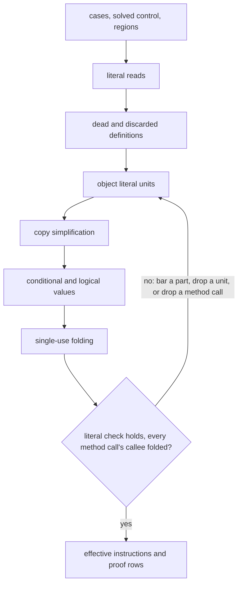

# Plan the values of a VM switch function

Pipeline stage: `plan-values` ([map](../../pipelines/jsconfuser-vm.md#backend-order)).

Readers need the [typed operations](vm-switch-boundary.md#typed-operation-grammar), the
[solved control](vm-switch-control.md) with its
[reaching definitions](vm-switch-control.md#definitions-and-values), the planner's
[region rows](vm-switch-statements.md#region-rows), and reaching definitions as a concept: which
writes of a register can be the one a read sees.

## 1. Target

The compiler routes every value through a register. It loads a constant into a temporary before an
operation reads it (`LOAD_CONST r7 = 5; LTE r8 = r3 <= r7`), copies a result into its variable
(`ADD r7 = r2 + r3; MOVE r2 = r7`), computes an operand into a temporary the next operation reads
once (`LTE r8 = ...; JUMP_IF_FALSE r8`), builds an object literal one property at a time, lowers
`c ? x : y` and `a && b` to branches, and writes values nothing reads (`LOAD_THIS r1` in every
frame). Written as it stands, a function would be a statement per instruction.

Value planning decides which of those values become expressions again. For one function it
returns the *effective instructions*: the same cases at the same PCs, each saying how the emitter
writes it (dropped, retargeted, with literal or folded operands, folded into its use, part of a
literal). It moves no case and changes no edge; the emitter still walks every case where the
planner put it.

`effectiveStructuredInstructions(functionId, cases, solved, regions)` returns them. It is called
by the emitter, after the function's closures are rendered and before its walk; the driver never
calls it. It needs no encoder knowledge
([ownership test](vm-switch-boundary.md#ownership-test)), never refuses, solves no control and
reads no unreachable case. Every rule keeps what the program can observe: the values read, the
order of every effect and exception, and what a handler or a closure sees.

## 2. Algorithm

### Order

Four rules in order, with the object literals planned between the second and the third. The first
three move nothing: every retained case stays at its PC, where its edges, handler state and effects
are recorded, and what changes is how a read is spelled, whether a value nothing reads is written,
and which register a producer writes. The fourth moves a producer's evaluation into its one use, and
only where nothing between could tell.

```text
plan values(function):                     # explanatory pseudocode
  literalAt(pc, r): the one literal every definition reaching r at pc holds, else none
  dead  = fixed point of: reachable assigns that cannot throw, whose definition has no use
          (a read literalAt answers is no use; a dead case's reads are no uses)
  discarded = reachable producers that may throw, whose definition has no use once dead is out
  repeat:
    units  = object literal units over the cases not in dead
    copies = copy simplification over the cases not in dead, a unit's site producing its object
    values = conditional and logical values over what remains
    folds  = single-use folding over the cases neither dead nor removed by copies, a unit's case
             taking folds in its literal slots, a unit's site and a conditional value one producer
  until the literal check bars or drops nothing and every planned method call's callee folded
  rows: dead and removed moves are left out; a read literalAt answers carries its literal;
        a folded producer is marked and read by its use; a discarded one is marked
```



The loop ends: each repeat bars one more part, drops one more unit or removes one more method
call from a finite set, and none is ever put back.

### Uses

The [control solver](vm-switch-control.md#definitions-and-values) gives, for every
reachable case, the definitions reaching it per register: `entry:<register>`, a case's PC, or a
route's write (the exception, continuation and payload registers a handler route writes), and each
definition's solved values with their origins. Value planning reads them; it does not solve its own.
For each reachable case, every register the operation reads is a use of each definition reaching
that register there, keeping multiplicity (a binary operator reading one register twice is two uses).
Unreachable cases have no reaching definitions and contribute no uses.

A [switch region](vm-switch-statements.md#switch)'s tests are read as the switch renders them
(`switchTestReads`): the head test reads the discriminant and its case value, every later test its
case value, and no test reads its compare, since the native `switch` compares each label with the
discriminant by `===` itself. Value planning sees each such test as a `switch-test` operation with
those reads, so a compare that only its test read has no use and goes as a dead definition (`===`
cannot throw), and frame setup counts the discriminant and the case values the switch reads even
where only the compares read them before. A compare something else reads (after the switch, or
through a function a closure creates) keeps its statement and its place in the label's run.

In the `switch-exit-past-tail` cell (the [worked example below](#worked-example-folds-and-a-switch)), function 1's
`EQ r6 = r0 === r5` at 105 and 118 are read only by the tests at 109 and 122: both go, the head
reads `switch (r0)` and the labels `case 1:` and `case 2:`; r0, a parameter that only the compares
read, is still bound from the arguments and declared.

### Literal reads

`LiteralReads` (the [model module](vm-switch-boundary.md#exports-another-file-imports)), built once per function and handed to every planning step, answers `at(pc, r)` (`literalAt` below) when every definition reaching r at pc is a case's
write whose values are one literal, each origin of it a literal assign, all of them the same value
under `Object.is` (the solver keys values by SameValueZero, so the assigns themselves tell 0 from
-0). An entry value, a route write or a register a closure captures locally never answers: a closure
reads and writes that register from the function it creates, at any call, which no reaching
definition records.
Literals are primitives (rendering declines any other constant), so writing one at several reads
creates nothing a read could tell apart. Every operand the renderer writes asks `literalAt`: the
operations' reads, branch tests, loop and switch tests, a switch's discriminant and labels, a
try's return payload; an indirect jump's source and a for-in iterator are read natively and never
ask.

### Dead definitions

A reachable `assign` that cannot throw (`mayThrow` false: a literal, a register,
`this`, `undefined`, typeof of a register, `!`, `===`, `!==`) whose definition has no use is
dropped, and the uses are counted again without it until nothing changes, so a chain of unread
copies goes as a whole. Its destination must not be a local-capture register (a closure reads it
from the function it creates) or a handler register (exception, continuation or payload), which the try
rendering reads natively. Dropping it removes no edge, since an operation that cannot throw has only
its fallthrough, and no read sees a different value, since none reads it.

An unread definition that may throw (a call, a property or global read, a coercing operator) keeps
its evaluation: its case is `discarded` and renders as its expression statement without the write
(`f();`, `o["k"];`, `a + b;`), so its effects and its throw stay while its register leaves the
declaration list. It is emitted, so it has no proof row. Its destination obeys the same
local-capture and handler exclusions; a closure, an array or an object cannot throw and never is
one.

### Copy simplification

A producer that writes a temporary only its next move reads, `LOAD_GLOBAL r4 =
W; MOVE r2 = r4`, is retargeted to write the move's destination, and the move is removed. The
producer stays at its PC and only its destination register, which is spelling, changes. The uses
are those left after the two rules above.

**Qualifying pair.** A producer and a move qualify when all of these hold:

- both are reachable and neither is dead; the move's read is not a literal read (a move reading a
  literal is a literal assign); the move is `assign(dst, register(src))` where src is the
  producer's destination and differs from dst. A `for-in-next` writes its key only on its
  fallthrough, the one edge the adjacency below follows to a move, and on its exit writes neither
  register, so it qualifies as any producer: the compiler's `FOR_IN_NEXT keyReg; MOVE slot, keyReg`
  (compiler.ts, `ForInStatement`) reads `for (slot in o) { ... }`, the head and the step's statement
  form writing the step's retargeted destination;
- src is not a local-capture register: the function a closure creates reads it at any call, which no
  reaching definition records, so the write the retarget would drop may still be read. A captured dst
  qualifies: it is still written once, at the producer's PC, with nothing rendered between the two,
  and `x = e` writes x after e is evaluated, as the move ran after its producer, so a closure called
  inside e sees, and may overwrite, the same earlier value (`r4 = []; r2 = r4` becoming `r2 = []`
  under `function f() { r2.push(...) }`). A unit's site is retargeted only as a literal written in one
  expression ([object literals](#object-literals)); an `object` outside a unit is read again by its
  property statements, so it is never the definition's one use. A handler's registers may coalesce: a route writes
  them on its own edge, a definition the uses already count, so a producer retargeted into a finally
  payload (`r7 = e.message; r5 = r7` becoming `r5 = e.message`) leaves the payload to the route
  write when it throws;
- the producer's definition has exactly one use, at the move;
- they are adjacent: one of the producer's edges is a fallthrough, or a call's continuation, to the
  move, which has exactly one incoming edge, passing over jump steps and dead definitions that each
  have exactly one incoming edge (incoming edges of every kind count); neither renders anything, and
  a dead definition cannot throw. A call that throws writes nothing, retargeted or not, and the move
  never runs, so a handler sees the same registers either way. Every edge of the producer is
  examined; it may have several (a protected producer's fallthrough and handler route, say).

**Planning.** Pairs are considered case by case in PC order, each producer against each of its
fallthrough targets. Each pair is judged on the original instructions and reaching definitions.
Those facts stay true while copies are removed, since a removed move's value is still written, by the
producer it was folded into; what changes is which instruction writes it. So each decision is applied
to the current plan (explanatory pseudocode):

```text
plan        : producer PC -> register it now writes
removed     : PCs of removed moves
foldedInto  : removed move PC -> producer PC it was folded into
retained(pc): follow foldedInto from pc to a PC that was not removed

consider(producer, move):
  if the pair does not qualify: return
  if producer.pc in plan or move.pc in removed: return
  root = retained(producer.pc)               # the producer may itself be a removed move
  plan[root] = plan[move.pc] ?? move.dst     # the move may already be a planned producer
  delete plan[move.pc]
  foldedInto[move.pc] = root
  removed.add(move.pc)
```

A chain of copies therefore resolves to one write of its last register at the retained producer, in
either visit order, and no PC is ever both planned and removed. Every link is adjacent, the moves
passed over cannot throw, and each intermediate definition's only use is the next link, so the single
write is equivalent to the chain. Applied to the original instructions alone, a later pair would
retarget a move an earlier pair removed, and the chain's last register would never be written.

A synthetic example, the model of the unit case "a copy chain across blocks resolves to one write
of its final register" (`var w = W; var d = w; console.log(d);`; only the three cases of the chain
are shown):

| PC | Instruction | Reaching-definition fact |
|---|---|---|
| 2 | `LOAD_GLOBAL r4 = W` | used only at 6 |
| 6 | `r2 = r4` | used only at 9 |
| 9 | `r3 = r2` | used by the call |

| Pair | Retained producer | `plan` | `removed` |
|---|---|---|---|
| 2 -> 6 | 2 | {2: r2} | {6} |
| 6 -> 9 | retained(6) = 2 | {2: r3} | {6, 9} |

The function renders `r3 = W;` and the call reads r3; r2 leaves the declaration list
(r4 stays, since later code reuses it). When the producer is laid out after its move and reaches it through a
jump step, 6 -> 9 is planned first and records `plan[6] = r3`; the pair 2 -> 6 then hands that
retarget to 2, with the same result.

**Proof rows** are built after planning: one per removed move, against the final plan, and one per
dead definition (`{ functionId, pc, destinationRegister, disposition: 'safely-eliminated', reason:
'unread-definition-cannot-throw' }`). A copy row is:

```js
{
  functionId,
  producerPc,                // the retained producer
  movePc,
  sourceRegister,            // the register the move read
  destinationRegister,       // the register the retained producer writes
  reachingDefinitions: [String(p)], // p: the move's own producer (producerPc for an unchained copy)
  useSites: [{ pc: movePc, register: sourceRegister }],
  disposition: 'safely-eliminated',
  reason: 'single-reaching-definition-use',
  producerRetained: true,
  evaluationOrderPreserved: true,
  receiverSemanticsPreserved: true,
}
```

These are the planner's stated reason and disposition, not independent behavioural evidence.

### Single-use folding

A producer whose value one later operation reads once is written as that operand:
`LT r5 = r4 < r0; JUMP_IF_FALSE r5` renders `if (r4 < r0)`. Moving an evaluation is safe only when
the program cannot tell it moved: the value read is the same, every effect and exception happens in
the same order, and no handler or closure sees state it would not have seen. The rules below are
those conditions. A copy is this rule's move case, already settled by copy simplification: a move is
never a use here, and copy results are unchanged.

**Straight run.** The run into a case U is the chain of cases before it in which each is the only way
into the next: walking back from U, the one incoming edge (of any kind) comes from a case whose one
normal successor is the case after it. A normal successor is a jump step's jump, or an operation's
fallthrough or call continuation; a case with a branch, conditional or return edge has none, so a
test, a for-in step or a jump into a finalizer ends a run. Abrupt routes to a handler are allowed.

**Candidates.** A producer P on U's run is a candidate for the register r it writes when:

| Condition | Why |
|---|---|
| P is reachable, not removed, not a jump step, and not already folded elsewhere | Only a rendered case can move. |
| Copy simplification did not retarget P | A retargeted producer writes the move's destination, the compiler's register for a variable, which the source wrote as a statement (`total = step(total)` a hundred times stays a hundred statements, not one call nested a hundred deep); only temporaries fold. |
| P is an assign, `property-read`, `property-delete`, `safe-typeof`, `upvalue-read`, `call`, `array`, `closure` or a bare `global-read`, a [conditional value](#conditional-values), or an [object literal](#object-literals)'s site | Each renders as one expression; a closure reads no register when it is created, its function reading its captures when it runs; a literal is `{...}`. A [checked global read](vm-switch-emit.md#native-forms) keeps its reference check, an `object` outside a unit its property statements, the for-in steps their iterator state: statement form. |
| r is not a local-capture register or a handler register | The function a closure creates reads a captured register at any call, and a route writes a handler register on its own edge; neither is a recorded use. |
| P's definition has exactly one use, at U, and it is the only definition reaching r at U | Two definitions reaching the read, or a second read, keep the register. |
| U reads r in a slot that takes a fold (table below) | Some positions repeat or reorder the operand. |
| Every case from P to U runs under the same handler stack | A throw moved into or out of a try changes which handler sees it. |

U's slots, in the order its rendering evaluates them:

| U | Slots | No fold |
|---|---|---|
| assign: binary; unary or typeof; literal, `this`, `undefined` | left, right; source; none | a move (copy simplification's), save a [conditional value](#conditional-values)'s use: its source |
| `global-write`, `upvalue-write`, `return`, `throw`, `for-in-setup` | source | |
| `property-read`; `property-write` | object, key; object, key, value | |
| `property-delete` | object, key | |
| `branch` | condition | a switch test chain's tests, its runs and the compare before its head (`switchTestPcs`): the switch renders the compare as its `case` and reads the label register itself |
| `call` | callee, receiver, arguments (`r[k](args)`, `Reflect.apply(callee, receiver, args)`, `callee(args)`, `new (callee)(args)`: [native forms](vm-switch-emit.md#native-forms)) | a `property-read` as the callee of a call without receiver: `o[k]()` would pass `o` as `this`; an `upvalue-read` is an identifier, called with the same `this` folded or not |
| `array` | elements | |
| a unit's `object`, `accessor`, `property-write`, `object-spread` | pairs' keys and values; key, value; key, function; source | the object, which the literal is |
| `object`, `accessor` outside a unit, `for-in-next`, `indirect-jump` | none | writes the destination or repeats an operand before reading, or reads natively |

**Method calls.** The compiler evaluates `o.m(args)` into a register r, reads `r["m"]` into the
callee register and calls it with r as receiver (compiler.ts, `CallExpression`), so r's producer
has two reads: the callee read's object and the call's receiver. Once the callee read folds into
the call, the call is written `r[k](args)`, which evaluates r once for both; its receiver read is
that object. A call whose callee register is reached by one definition, a `property-read` of the
receiver register reached by the same definitions of it as the call, and which reads the receiver
in no argument or key, is therefore planned with its receiver read counted as no use: the
receiver's producer is a candidate for the callee read's object slot alone. A call whose callee
does not fold loses that, and folding is planned again without it, so a receiver register is
written wherever a `Reflect.apply` reads it. Rendering and frame setup read a method call's
receiver through its callee read.

**Deciding a use.** Each use is decided after every case on its run, farthest first, so a producer
arrives with its own folds (its *tree*: its PCs in evaluation order, the registers it reads, whether
any part may throw, whether any part reads state a call could change: an `upvalue-read` or a
captured register). Candidates are tried nearest first; one is accepted when all of these hold, with the
earlier-accepted candidates of the same use in place:

1. **Order.** The folded operands' trees, listed in slot order, ran in that order: their PCs on the
   run are strictly increasing. Otherwise the later candidate stays a statement, and the nearer one
   keeps its fold.
2. **Each case X it passes** (between P and U, not a jump step, not removed, not folded into this or
   another use) satisfies:
   - X writes no register the tree reads;
   - if the tree may throw or reads state, X cannot throw (so runs no other code) and is not an
     `upvalue-write`;
   - if the tree may throw, X reads no state (no `upvalue-read`, no captured register), and X writes
     no captured register and no register a handler on the stack may read (any read in any case
     reachable from a handler's entry): a throw at the use would otherwise meet X's write, which it
     never met before.

X is judged by its own tree, so a case that itself took folds carries them. A pure producer may
pass a throwing X: if X throws, the folded value was never observable.

An unfolded slot before the tree may read a captured register the tree's call rewrites: the
folded use then reads the variable before the call, where the VM read it after. That is the
source's order: a register is the compiler's variable, and its handler reads an operand only when
it runs ([known quirks](../../../js-confuser-vm/instruction-set.md#5-known-quirks)), so
[F8](../../../encoder-decoder-method.md#f8-keep-the-shared-behaviour-what-the-encoding-changed-is-free)
frees it and no rule keeps the tree out.

```text
decide(U):                                 # explanatory pseudocode
  for C in run(U), farthest first: decide(C)
  if U takes no folds or is barred: return
  for P in run(U), nearest first:
    if P is a candidate for U and order and every passed case hold:
      fold P into U at its slot
```

### Worked example: folds and a switch

The committed cell `switch-exit-past-tail` of suite `compiled-forms` (file `control-label`, profile
`randomizeOpcodes`, seed 251;
[source](../../../../decoder/decode-js/test/vm/jsconfuser-vm/sources/switch-exit-past-tail/source.js)).
Its last statement is
`window.TEST_OUTPUT = [f(1, true), f(1, false), f(2, false), f(3, false)];`, in function 0:

| PC | Instruction | After the earlier steps |
|---|---|---|
| 28 | `CALL r7 = r2(r5, r6)` | literal arguments `1, true` |
| 34, 38 | `LOAD_CONST r5, r6` | dead |
| 42, 56, 70 | `CALL r8`, `r9`, `r10` | literal arguments |
| 76 | `BUILD_ARRAY r5 = [r7, r8, r9, r10]` | |
| 83 | `SET_PROP r3[r4] = r5` | key literal `"TEST_OUTPUT"` |

Deciding 76: the run into it is 70, 66, 62, ..., 28, ... (the dead loads are passable). 70 writes r10,
read once at 76, the fourth slot: accepted. 56 (r9, third slot) passes only 62 and 66, dead: its tree
ran before 70's, as slot order needs, so accepted; likewise 42 and 28. Deciding 83: 76's tree
(28, 42, 56, 70, 76) may throw; it passes nothing, and the object slot r3 before it is not a captured
register, so it folds. The global read of `window` into r3 ran before 28, so it folds into the
object slot too, its tree first in slot order. The write renders
`window["TEST_OUTPUT"] = [r2(1, true), r2(1, false), r2(2, false), r2(3, false)];`.

In function 1, `case 2: t.push(2)` folds `GET_PROP r6 = r4["push"]` into its call, a read of the
receiver register written as the method call `r4["push"](2)` (r4 read twice, so it stays), its unread
result [discarded](#dead-definitions); nothing folds
the head's `EQ r6 = r0 === r5` at 105 (r5 the literal 1): no switch test reads it, so it is a dead
definition ([uses](#uses)).

Two refusals, from the unit cases. `var x = O.a; RESULT = O.b - x;`: deciding the subtraction, the
read of `b` (left slot, nearest) folds; the read of `a` would sit in the right slot but ran first, so
it stays `x = O["a"];` and the result is `O["b"] - x`. `var s = "before"; try { var x = O.a;
s = "after"; RESULT = x; } catch (e) { CAUGHT = s; }`: the read may throw and `s = "after"` writes a
register the handler reads, so moving the read past it would let the handler see `"after"`.

### Object literals

The compiler builds an object literal in a fresh register d (compiler.ts, `ObjectExpression`): an
`object` operation, with the data pairs on its fast path (no spread, computed key or method) and
none otherwise, then on d alone, in source order, a `property-write` per data property or method,
an `accessor` per getter or setter, and `Object.assign(d, s)` per spread. Nothing else reads d
until the literal is complete, and nothing can observe an object no one holds, so the unit is
written as one literal where its last operation runs, or in d's one other use when the literal
folds there.

```text
object literal units(function):            # explanatory pseudocode
  for each reachable object operation O writing d:
    members = the uses of O's definition that are property-write, accessor or spread on d, d
              reached by O alone, under O's handler stack; in PC order
    chain   = [O, members...]; site = last of chain
    each pair of neighbours in chain: every normal path from one reaches the next, no return,
              no loop, no other use of d on it (casesBetween); a spread's two reads lie there
    no other use of d before site (casesBefore, every edge); at most one `__proto__` data key
  copy simplification: site is the producer of O's definition, so `v = d` right after it
                       coalesces and the literal writes v
  single-use folding: each chain case is a use with literal slots; a conditional value folds;
                      a site copy simplification did not retarget is a producer of d, its
                      definition O's, its uses those of O's definition outside chain, its tree
                      every chain case in PC order with its folds (it may throw), its parts
                      decided first; folded, the use writes `{...}` and the site nothing
  literal check, per chain case C before site:
    a tree folded into C passes each statement between C and site (mayPass), else bar C
    a register C still reads has at site the definitions it had at C, else drop the unit
    a key C reads from a register converts at site: no statement between may throw, else drop
    an accessor's function is the closure folded into it, else drop
  barred cases take no folds and the planning repeats; a dropped unit keeps `d = {}` and a
  statement per property
```

| Part | Written | Equal to the VM's |
|---|---|---|
| fast-path pair, property-write | `k: v` (an identifier or string key as itself, any other `[k]`) | define where the VM assigns; they differ only under an `Object.prototype` setter or a data key after a getter-only one, where the literal is the source's |
| accessor | `get k() {...}`, `set k(...) {...}` from the folded closure | the descriptor the VM builds: the second accessor of a key keeps the first |
| method | `m: function () {...}`: the general path compiles `m() {}` and `m: function () {}` alike, so the decode keeps the VM's constructible function | |
| spread | `...s` | `Object.assign` reads the global `Object` and calls an own setter where the literal defines; the literal is the source's |

**A literal as a producer.** A site whose object d one later case reads once is a single-use
candidate like any producer, its tree the whole literal. Moving it from its site to the use moves
every part with it, so the rules for [deciding a use](#single-use-folding) carry the literal
check one step further: a case passed writes no register a part still reads, and, the tree
counting as may-throw (an `object` case may throw), nothing passed may throw or read or write
state, which also covers a key converted at the use. Once the literal folds, a farther producer
of the same use passes nothing of it (its cases are in the use's trees): in
the `f-this-receiver` cell, `object.get.call({ value: 9 })`'s callee read folds after the literal, and
the call reads `r4["get"]["call"]({ value: 9 })`. A site copy simplification retargeted writes the
compiler's variable and stays a statement, as any retargeted producer does.

### Conditional values

A value written `c ? x : y` is a planned conditional whose arms write a
register v its use reads: a call's argument, a write's value, a unit's literal slot, a move into a
variable. The compiler lowers `c ? x : y` so (compiler.ts, `ConditionalExpression`): a test, then
each arm computing into one register; `var x = c ? a : b` adds a move of that register into x's.
Such a conditional is one producer of v when each arm's last case writes v, v is
read once and in a slot that takes a fold (a unit case's literal slot, any other use's, or a move's
source: its arms' two writes are no one producer copy simplification could retarget to the move's
destination, so the move is its use and writes `x = c ? a : b`, `valueSlots`), every
case between its test and its merge renders as one expression (a foldable
producer, a property, global or upvalue write, a planned conditional's test) and nothing else it
writes is read outside it (`conditionalValues`). Single-use folding then takes it like any producer:
the run into its merge goes on from its test, and its tree is every case it holds (reads, writes,
throws, state). The structured walk and the run walk skip its blocks, so a value nested in another's arm
(`var x = a ? b : c ? d : e`, the inner value's move into the outer arm's register its use) is written once,
in its use; the use writes it through the run walk,
`test ? X : Y`, each arm's run ending in `v = X` read as X, the positive test's arm first.
A run's case is an expression when its whole rendering parses as expression statements; it may
span lines (`r["each"](function () {...})`).

### Logical values

The compiler lowers `a && b` so (compiler.ts, `LogicalExpression`): `v = a`, a
branch past the right side when v is falsy (`||`: truthy), `v = b`; `a ?? b` loads `null`, tests
`c = v == null` and branches when c is false. One arm is then the test's own edge to the merge,
through jump steps alone, keeping a. Such a conditional is a logical value of v when its other arm's
last case writes v; the branch keeps v on that edge when v is falsy (`&&`), truthy (`||`), or when its
condition is `v == null` with null the compiler's load and is false (`??`); and its left producer is
the case right before the test, past removed cases, jump steps and, for `??`, the load and the
comparison: one foldable producer writing v (a retarget included) whose definition, or a removed
move folded into it, is v's one definition reaching the test (`logicalShape`). Its cases are the
left producer's through the merge, and it is otherwise a conditional value: v read once in a slot
that takes a fold, nothing else it writes read outside it. The value is met at its left producer
(`entryPc`): the walks skip from there to the merge, and single-use folding's run into the merge goes
on before it. It is written `(a) op (b)`, a the left producer's value, b the arm's run; the test is
the operator's own, so it is not written. A chain nests as the source's does: the inner value's use
is the move into the outer's v, the outer's left producer, so `x = a && b && c` reads
`x = a && b && c`; a value read once by a branch is written in its test, `if (a || b)`.

### Worked example: a literal, a conditional value and logical values

The committed cell `f-accessors-and-methods` of suite `compiled-forms` (file `data-object`, profile
`randomizeOpcodes`, seed 251;
[source](../../../../decoder/decode-js/test/vm/jsconfuser-vm/sources/f-accessors-and-methods/source.js)),
function 0: `object r5` at 16, accessors at 32 and 49,
property writes at 64 (`method`) and 72 (`[computedKey]`, the literal `"computed"`), `r4 = r5` at 76.
Keys, callbacks and values reuse r6 and r7, so each folds into its own case, and the site 72
writes all of them; the move at 76 coalesces:

```js
r4 = { get value() { return r2; }, set value(r2_0) { r2 = r2_0; return void 0; },
       method: function () { return this["value"]; }, computed: 11 };
```

The cell `f-short-circuit` of the same suite (file `expr-compare`, same profile and seed;
[source](../../../../decoder/decode-js/test/vm/jsconfuser-vm/sources/f-short-circuit/source.js)):
four logical values first, each test reading r9 (27, 52, 85, 118, `&&`,
`||`, `??`, `??`), each read once by the move into its variable, so they read
`r4 = false && r3("and"); r5 = true || r3("or"); r6 = null ?? r3("null"); r7 = 0 ?? r3("zero");`.
Then the array at 148, the conditional at 167 (arms 170-182 and 184-193, each ending in `r13 = ...`),
and `object r15` at 200 with pairs `values: r11, pick: r13, log: r2`. The conditional is r13's one
producer, read in the `pick` slot; the array passes it (the conditional writes r13, r14 and r15, none
of which the array reads) and folds too. The literal is one unit whose site is its own `object`
case, read once by the property write at 209, so it folds there:
`window["TEST_OUTPUT"] = { values: [r4, r5, r6, r7], pick: r2["length"] ? r3("some") : r3("none"), log: r2 };`.

### Worked example: the four rules on a loop

The committed cell `f-loop-forms` of suite `compiled-forms` (file `control-branch`, profile
`randomizeOpcodes`, seed 251), whose statements are planned in
[statement recovery](vm-switch-statements.md#worked-example-three-loops). Its first loop is
`var sum = 0; for (var i = 1; i <= 5; i++) sum += i;` (r2 is `sum`, r3 is `i`):

| PC | Instruction | Planned as | Rule |
|---:|---|---|---|
| 2 | `LOAD_CONST r7 = 0` | dropped | dead: its one read, at 6, is a literal read |
| 6 | `MOVE r2 = r7` | `r2 = 0` | literal read |
| 9, 13 | `LOAD_CONST r7 = 1; MOVE r3 = r7` | `r3 = 1` | the same |
| 16 | `LOAD_CONST r7 = 5` | dropped | dead |
| 20 | `LTE r8 = r3 <= r7` | `r3 <= 5`, written in 24 | literal read; folded: r8 has one use, the next case |
| 24 | `JUMP_IF_FALSE r8 -> 50` | the loop's test `r3 <= 5` | takes the fold |
| 27 | `ADD r7 = r2 + r3` | `r2 = r2 + r3` | retargeted by the copy at 31 |
| 31 | `MOVE r2 = r7` | dropped | copy |
| 34 | `MOVE r7 = r3` | dropped | dead: 37 overwrites r7 before any read (the unread old value of `i++`) |
| 37 | `LOAD_CONST r7 = 1` | dropped | dead |
| 41 | `ADD r8 = r3 + r7` | `r3 = r3 + 1` | literal read; retargeted by the copy at 45 |
| 45 | `MOVE r3 = r8` | dropped | copy |

6 and 13 stay: a move whose read is a literal is a literal assign, not a copy. 27 and 41 are
retargeted into `sum` and `i`, the compiler's variables, so they stay statements and do not fold.
Over the whole function (47 cases) the plan removes 24: 5 copies and 19 dead definitions, each
with a proof row. The registers r1, r7, r8 and r9 are no longer written or read by any effective
instruction, so the emitter does not declare them. The loop is written
`for (r3 = 1; r3 <= 5; r3 = r3 + 1) { r2 = r2 + r3; }`.

## 3. Implementation

### Exports another file imports

| Export | File | Importers | Role |
|---|---|---|---|
| `effectiveStructuredInstructions(functionId, instructions, solved, regions)` | `value-planning.js` | `emit/structured-emitter.js` | one function's plan |
| `CopySimplifier` | `copy-simplification.js` | `value-planning.js` | copy simplification |
| `singleUseFolds(options)` | `single-use-folding.js` | `value-planning.js` | the folds, with `treeOf` and `mayPass` for the literal check |
| `objectLiteralUnits(args)`, `checkObjectLiterals(args)` | `object-literals.js` | `value-planning.js` | the units and the literal check |
| `unitSlots(operation)` | `object-literals.js` | `single-use-folding.js`, `conditional-values.js` | a unit case's literal slots |
| `conditionalValues(args)` | `conditional-values.js` | `value-planning.js` | conditional and logical values |
| `flowView`, `casesBetween`, `casesBefore`, `reachingAt` | `case-flow.js` | `object-literals.js`, `conditional-values.js` | the solved graph under one step's removals |

Only `effectiveStructuredInstructions` leaves the folder. The folder imports `model/` alone: from
`control.js` `mayThrow` and the edge-kind sets, from `model.js` `isJumpStep`, and from
`operations.js` the readers every rule shares (`LiteralReads`, `reachingDefinitionUses`,
`readRegisters`, `operationReads`, `operandRead`, `destinationRegister`, `expressionProducer`,
`foldSlots`, `valueSlots`, `sameStack`, `operationMayThrow`, `localCaptureRegisterSet`), which the
[model module](vm-switch-boundary.md#exports-another-file-imports) owns.

### What the planner reads from the regions

| Read | From | Use |
|---|---|---|
| `switchTestPcs` | each switch row's tests, their runs, and every case-written definition of a test's condition | PCs no producer folds into |
| `switchTestReads` | each switch row's discriminant and case values | each test is planned as a `switch-test` operation with those reads ([uses](#uses)) |
| `conditionalMerges` | each conditional row with a merge: test PC to merge PC | the candidates for a [conditional value](#conditional-values) |

### The result

```js
{
  instructions,   // the effective rows of every case that is not removed, in the cases' order
  effectiveAt,    // (pc) -> the effective row of that case
  foldAt,         // (pc, register) -> the producer's effective row when that read is folded, else null
  literals,       // the LiteralReads: at(pc, register), read(instruction, register)
  removedPcs,     // Set: dead definitions, removed moves, a spread's two reads
  absorbed,       // Map: test PC -> the conditional value written in its use
                  //   { testPc, entryPc, register, pcs, mergePc, usePc, definitions, writers, logical }
  copyProofs,     // one row per removed move
  deadProofs,     // one row per dead definition
}
```

An effective row is the case, copied only where the plan changes it:

```js
{
  pc, nextPc,
  operation,      // the case's own; a copy with `destination` replaced when retargeted;
                  // `{ kind: 'switch-test', reads }` for a switch test;
                  // `{ kind: 'object-spread', object, source }` for a unit's spread call
  literalReads,   // Map: register -> the literal value that read is written as
  foldedReads,    // Map: register -> the producer's effective row
                  //   (`{ kind: 'conditional-value', destination }` for a conditional value)
  folded,         // true: written in its use, or a unit's case before its site
  discarded,      // true: an unread producer that may throw; written as its expression statement
  writesValue,    // true: an arm's last case, or a logical value's left producer
  literalObject,  // a unit's case: the register of the object it builds
  unit,           // a unit's site: { destination, parts } with the unit's rows in order
}
```

The input cases and their operation objects are never edited. Proof rows are built after
planning, in the two shapes shown under [copy simplification](#copy-simplification). The backend driver publishes them as the result's
`simplification` ([emit](vm-switch-emit.md)). A discarded definition is emitted, so it has no row.

### What the emitter does with a row

Effective instruction rows are copied when retargeted or given literal or folded
reads; the input cases and operation objects are not edited. Each path applies the retarget map at
the retained producer, skips a dead definition or a removed move wherever it sits, inside an
exception region too, writes each literal read through `literalNode` and each folded read as
`valueExpression(producer)`; skipping the move alone is insufficient. A folded producer renders
nothing at its own case, and the structured walk still visits it, so coverage holds. The renderer's
own reads (conditions, loop and switch tests, returns, throws) ask `foldAt` too; a conditional whose
arms are both empty still writes a folded condition as an expression statement. The declaration list
is taken from the effective instructions, so a register that only removed cases or folded producers
wrote, or literal or folded reads read, is not declared. Assembly prints the parsed program, so the
parentheses every folded operand gets survive only where precedence needs them.

### Refusals

None. A value the rules cannot plan stays a statement in its register.

## 4. Input Shapes

| Shape | Producer | Treatment |
|---|---|---|
| A constant loaded into a temporary before each read | encoder step 2 `compiler.compile` | literal read; the load dead |
| A result computed into a temporary and moved into its variable | the same | copy simplification |
| An operand computed into a temporary the next operation reads once | the same | single-use folding |
| `o.m(args)` as a read of `o[m]` into the callee and a call with `o` as receiver | the same (`CallExpression`) | a method call: the receiver read counted once |
| An `object` operation, then property writes, accessors and `Object.assign` spreads on its register | the same (`ObjectExpression`) | an object literal unit |
| `c ? x : y` as a test and two arms writing one register; `a && b`, `a \|\| b`, `a ?? b` as a value, a branch that keeps it and one arm | the same (`ConditionalExpression`, `LogicalExpression`) | a conditional or logical value |
| A register reused for unrelated values | encoder step 11 `resolveRegisters` | every rule reads reaching definitions, never the register's number alone |
| `edges`, `reachablePcs`, `stateIn`, `reachingDefinitions`, each definition's solved values and `mayThrow` | [`vm-switch-control`](vm-switch-control.md) | read as given |
| Conditional rows with a merge; switch rows | [`vm-switch-statements`](vm-switch-statements.md#region-rows) | value candidates; switch tests |
| Jump steps and a producer laid out after its move | [`normalize-cff-wordcode`](../jsconfuser-vm/normalize-cff-wordcode.md) | adjacency follows edges, never PC order |

## 5. Known Gaps

- A literal that stays a statement (written to a variable, read twice, or barred from its use)
  counts as may-throw, as its `object` case does, so a may-throw producer cannot pass it, and a
  call whose callee read would keeps `Reflect.apply`; the literal's own throw is not read from its
  parts.
- A unit whose part cannot move keeps `d = {}` and a statement per property: a register an unfolded
  part reads rewritten before the site, a register key past a statement that may throw, an accessor
  whose function did not fold.
- Folding takes nothing into an `object` or `accessor` outside a unit, and nothing into a switch
  test chain: a compare something else reads keeps its statement (`r6 = r0 === 1;` before the
  switch) and its label run (`case (r6 = r0 === 2, 2):`), and a case value computed in its run stays
  a run write (`case (r3 = r1(), r3):`).
- A conditional whose value is read twice (`return X[t] = c ? a : b`: the write's value, then the
  return's) stays an `if` writing its register: a conditional value is read once.
- A handler's reads are approximated by every read reachable from its entry, so a throwing producer
  stays a statement past a write that only code after the try reads.
- Where the plan follows the source and not the interpreter (a literal defines where the
  interpreter assigns; a variable operand is read in its place where the interpreter reads it when
  the operation runs), reentrant and error-order conditions have no evidence of their own.
- The unit cases of copy simplification give every producer a single outgoing edge; a pair whose
  producer has several (a protected producer's fallthrough and handler edges) is covered only by
  the cells.
- The proof rows state the planner's reason and disposition; nothing checks a row against the
  output.

## 6. Source

| File | Holds |
|---|---|
| [value-planning.js](../../../../decoder/decode-js/src/vm/switch/values/value-planning.js) | `effectiveStructuredInstructions`; `ValuePlanner` (`plan`, `units`, `round`, `settle`, `deadProofs`), `deadDefinitions`, `discardedDefinitions`, `methodCallCandidates`, `switchTestPcs`, `switchTestReads`, `conditionalMerges`, `EffectiveRows` |
| [copy-simplification.js](../../../../decoder/decode-js/src/vm/switch/values/copy-simplification.js) | `CopySimplifier` (`simplify`, `nextStatement`, `consider`, `retainedProducer`, `proofs`) |
| [single-use-folding.js](../../../../decoder/decode-js/src/vm/switch/values/single-use-folding.js) | `singleUseFolds`; `SingleUseFolder` (`chainInto`, `foldable`, `mayFold`, `oneUseAt`, `keepsOrder`, `mayPass`, `treeOf`, `handlerReads`, `decide`) |
| [object-literals.js](../../../../decoder/decode-js/src/vm/switch/values/object-literals.js) | `objectLiteralUnits` (`collectMembers`, `memberRegions`, `memberShape`, `spreadShape`), `unitSlots`, `checkObjectLiterals` |
| [conditional-values.js](../../../../decoder/decode-js/src/vm/switch/values/conditional-values.js) | `conditionalValues` (`expressionRegion`, `armWriters`, `sharedRegister`, `containedUse`, `foldableUse`, `logicalShape`, `leftProducer`) |
| [case-flow.js](../../../../decoder/decode-js/src/vm/switch/values/case-flow.js) | `flowView`, `casesBetween`, `casesBefore`, `reachingAt` |

Called by `emitStructuredFunction` in
[structured-emitter.js](../../../../decoder/decode-js/src/vm/switch/emit/structured-emitter.js),
before the walk ([backend order](../../pipelines/jsconfuser-vm.md#backend-order)).

## 7. Fixtures

Each suite encodes its sources with the pinned encoder and requires the decode to behave as the
source; a proof is a break of the named code that turns the suite red
([tests.md](../../tests.md#suites)). Suites are under
[cell-suites/](../../../../decoder/decode-js/test/vm/jsconfuser-vm/cell-suites/). An indicator
compares a form's count in the output with the source's ([readability](../../tests.md#readability)).
The unit file is
[values.test.js](../../../../decoder/decode-js/test/vm/switch/single-component/values.test.js):
each case builds a model by hand, renders it through `emitVmSwitchProgram`, runs the output and
reads its form.

| Scenario | Expected result | Committed fixture |
|---|---|---|
| A producer and its private move read as one statement | Decodes; behaves as the source | `compiled-forms`, proof "A producer and its private move read as one statement, as in the source." (removes the already-planned test in `consider`) |
| A copy coalesces only with a producer it alone uses | Effectful producers stay; behaves as the source | `compiled-forms`, proof "A copy coalesces only with a producer it alone uses, so effectful producers stay." (removes the one-use test in `consider`) |
| Adjacent copies equal the source's | The `copies` indicator | `compiled-forms` indicators on compound-arith, compound-bitwise, operators, f-branching, f-accessors-and-methods, computed-accessors, f-literals-order, f-for-in-enumeration |
| A copy chain, across blocks and in reverse visit order through jump steps | One write of the final register | `values.test.js`, "a copy chain %s resolves to one write of its final register" |
| A single copy; into a captured variable; not from a captured register; a call's result across its continuation | Coalesced, or kept | `values.test.js`, "a single copy coalesces into its producer", "a call's result coalesces into the move after it, across the call's continuation" |
| A producer retargeted into its variable | Not folded, even when read once | `values.test.js`, "a producer retargeted into its variable is not folded, even when read once" |
| A read every reaching definition gives one literal; through copies; in call, construction, array and object operands | The literal; its definition gone | `values.test.js`, "a read every reaching definition gives one literal ...", "a literal reaches through copies", "call, construction, array and object operands read their literals too" |
| A read two literals reach; a register a closure captures | The register kept | `values.test.js`, "a read two different literals reach keeps its register", "a literal into a register a closure captures stays in the register" |
| A literal operand's own evaluation (`-(-1)`, `(void 0)[k]`) | Kept | `values.test.js`, "a literal operand keeps its own evaluation: negative numbers and undefined" |
| An unread definition | Dropped when it cannot throw; its expression statement when it can | `values.test.js`, "a definition nothing reads is dropped when it cannot throw, and written without its register when it can" |
| A single-use producer in its use; nested folds; a test in its branch; an upvalue read as a callee; an operand past a slot reading a captured variable | Operands in evaluation order | `values.test.js`, "a single-use producer moves into its use ...", "folds nest ...", "a test folds into its branch ...", "an upvalue read folds into the callee of a call without receiver", "an operand folds past an earlier slot that reads a captured variable" |
| A producer that must stay: two definitions reach the use; a captured register; a call between writing a captured register it reads; an effect between; a throwing producer past a write the handler reads; a handler installed between; an operand consumed out of order; a member read as a receiver-less callee | A statement; the run shows the source's behaviour | `values.test.js`, "a producer stays a statement when %s" |
| A conditional value in its use; an arm written over several lines | `c ? x : y` in the use | `values.test.js`, "a conditional value folds into its use", "a conditional value keeps an arm written over several lines" |
| An object literal reads as the source's: properties, accessors, a computed key | The `objectProperties` and `accessors` indicators | `compiled-forms` indicators on f-accessors-and-methods, composition-accessor-evaluation-order, computed-accessors, f-literals-order |
| A conditional value in a literal's slot; logical values in their uses | The `conditionals` and `logicals` indicators | `compiled-forms` indicators on f-short-circuit |
| A method call written `o[k](args)`, its literal argument folded | The `methodCalls` indicator | `compiled-forms` indicators on f-this-receiver, composition-receiver-mutation |
| A switch's compares go; a compare read elsewhere stays | No `===`; the label a bare value | [switches.test.js](../../../../decoder/decode-js/test/vm/switch/single-component/statements/switches.test.js), "a discriminant only the compares read is still bound and declared once the compares go", "a compare stays where something else reads it", "`case g():` keeps the call in its label, and the compare goes" |
| The worked examples' plans | The tables above | `compiled-forms` cells `f-loop-forms`, `switch-exit-past-tail`, `f-accessors-and-methods`, `f-short-circuit`; read by hand |
| A unit dropped or barred by the literal check | `d = {}` and a statement per property | |
| A spread in a literal | `...s` | |
| A proof row against the output | | |
